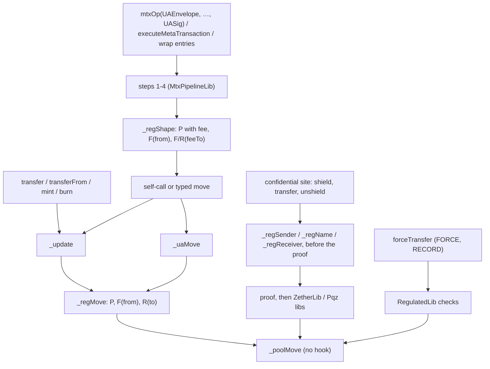

# Regulated token kinds 8–13: one regulated implementation per kind — design (draft for the owner)

**Status:** DRAFT, owner review pending. SPECIFIED; nothing is built. Work order item 3b. **Owner 2026-11-05:** all six
regulated kinds are built **inside branch `ua-mtx-merge`**, as a task group after T18 and before T19 (docs) and T22 (review),
so the round's docs, review and PR cover them; before the EVM freeze, so the audit covers them; no governance or voting token.

**Rules this spec applies, not reopens:** [CTR-GOV-03](../../decisions.md#ctr-gov-03--a-plain-transfer-stays-0-one-regulated-implementation-per-kind-never-per-feature)
(one regulated implementation per kind, never per feature), [CTR-GOV-11](../../decisions.md#ctr-gov-11--0-on-a-plain-transfer-means-no-new-read)
("+0" = no new read), [CTR-GOV-13](../../decisions.md#ctr-gov-13--moderate-only-on-public-balances),
[CTR-GOV-16](../../decisions.md#ctr-gov-16--regulated-kinds-are-real-enum-members-before-the-factory-freezes),
[CTR-GOV-17](../../decisions.md#ctr-gov-17--regulated-confidential-kinds-the-rules),
[CTR-GOV-18](../../decisions.md#ctr-gov-18--receiver-check-two-feature-bits-allowlist-and-denylist-off-by-default),
[CTR-GOV-05](../../decisions.md#ctr-gov-05--a-wrapped-kind-refuses-a-scaas-leg-with-force-or-moderate),
[CTR-GOV-08](../../decisions.md#ctr-gov-08--moderate-later-with-flags-5-8),
[CTR-GOV-09](../../decisions.md#ctr-gov-09--delayed-relaxing-and-record-later-with-the-asset-suite),
[CTR-GOV-19](../../decisions.md#ctr-gov-19--build-first-on-the-scaas-testnet-at-a-higher-code-size-ceiling-reduce-later);
asset-suite [CTR-AS-02](../../contracts/asset-suite.md#CTR-AS-02)…[CTR-AS-09](../../contracts/asset-suite.md#CTR-AS-09),
[CTR-AS-16](../../contracts/asset-suite.md#CTR-AS-16), [CTR-AS-17](../../contracts/asset-suite.md#CTR-AS-17); the governance
spec [§1.2, §4.2–§4.4, §7.7](2026-11-02-governance.md); the merge spec's entry form and §8
([2026-11-04-ua-mtx-merge.md](2026-11-04-ua-mtx-merge.md), [CTR-MTX-30](../../decisions.md#CTR-MTX-30)). Where asset-suite §2
writes `address`, this spec writes the `bytes32` id (CTR-AS-07's UA constraint, CTR-GOV-01's identity by UA); nothing else in
those rules changes.


**Owner answers (2026-11-05): Q1–Q8 all as recommended**, with Q7 read after T9's deprecation (no lever L or D is
built): `WrappedRegulatedToken` and the confidential regulated releases that miss 60 / 70 M are accepted; they deploy on
any chain whose block takes their release transaction (SCaaS testnet, Sepolia at 200 M), and the gap is recorded in TODO
beside `WrappedToken`'s. Next: a Fable counter-review and a Codex security review of this draft.

## 1. Scope and non-goals — SPECIFIED

**In scope (EVM, Hedera for kinds 8 and 9):**

| Item | Rule |
|---|---|
| Six implementations, ids 8–13 | one per kind, each the base kind's source plus the regulated hooks (§2) |
| Controls `FREEZE` 5, `FORCE` 6, `PAUSE` 7, `ALLOWLIST` 8, `DENYLIST` 9, `RECORD` 10, `MODERATE` 21 | §3; bit 8 not on the confidential kinds; bit 21 per Q1 |
| `RegulatedLib` | external library, the control bodies, namespace `scaas.regulated` |
| `ComplianceRegistry` | CTR-AS-07, keyed by `bytes32` (§5) |
| `_delayedRelaxBits()` | CTR-GOV-09, in `GovernanceLib` (§3.6) |
| Router ops | one `mtx<Op>(UAEnvelope, address target, …, UASig)` per control on `GovernanceRouter` (§3.1) |
| Factory, deploy, node rows, client rows, vectors | §6, §7 |

**Non-goals.** No governance or voting token (owner 2026-11-05). No viewing right on chain (CTR-GOV-17: the auditor shares off
chain; `auditorKey`, `auditorMode`, `auditorUA` stay as built). No change to a Zether or PQZ statement, transcript,
`proofSystemId` or binding tag. The action contracts of asset-suite §3–§6 (`VestingGrant`, `Distribution`, `ExchangeOffer`,
`AssetFactory`) and templates: not this group. No non-EVM family (one rule on every chain: each family's own round states
the same controls). No HTS-native regulated token. No migration: every chain is test-only; the SCaaS testnet takes the kinds
at reset 2. No size lever: T9's choice stays the owner's (merge plan, Q3).

## 2. How each kind is built — SPECIFIED

### 2.1 One implementation per kind

| Id | Kind | Contract | Inherits | Bits added to the base kind's `_validBits()` | Sites beyond the ledger hooks |
|---|---|---|---|---|---|
| 8 | `NORMAL_REGULATED` | `NormalRegulatedToken` | `NormalToken`, `RegulatedBase` | 5, 6, 7, 8, 9, 10, 21 | — |
| 9 | `WRAPPED_REGULATED` | `WrappedRegulatedToken` | `WrappedToken`, `RegulatedBase` | 5, 6, 7, 8, 9, 10, 21 | wrap payer |
| 10 | `NORMAL_ZETHER_REGULATED` | `NormalZetherRegulatedToken` | `NormalZetherToken`, `RegulatedBase` | 5, 6, 7, 9, 10, 21 | Zether sites (§4.1) |
| 11 | `WRAPPED_ZETHER_REGULATED` | `WrappedZetherRegulatedToken` | `WrappedZetherToken`, `RegulatedBase` | 5, 6, 7, 9, 10, 21 | Zether sites, wrap payer, unshield-unwrap |
| 12 | `NORMAL_PQZ_REGULATED` | `NormalPqzRegulatedToken` | `NormalPqzToken`, `RegulatedBase` | 5, 6, 7, 9, 10, 21 | PQZ sites (§4.2) |
| 13 | `WRAPPED_PQZ_REGULATED` | `WrappedPqzRegulatedToken` | `WrappedPqzToken`, `RegulatedBase` | 5, 6, 7, 9, 10, 21 | PQZ sites, wrap payer, unshield-unwrap |

- `RegulatedBase` (abstract, over `ERC20MetaTx`): implements the hooks of §2.2, the control stubs, the views, init of
  `scaas.regulated`. Each kind overrides `kind()` (`TokenStore.KIND_*_REGULATED`, new constants 8–13), `_validBits()`,
  `_roleBits()` (base | 5, 6, 7, 10, 21), `_contractOnlyBits()` (base | 5, 6, 7, 10, 21: a native id with code,
  CTR-AS-03), `_scalarBits()` (base | 6, 21: the power passes its amount), `_delayedRelaxBits()` (5, 6, 7). Bit 8 is
  outside `_validBits()` of 10–13, so `ALLOWLIST` there is `FeatureInvalidForKind(8)` (CTR-GOV-17).
- **No user-facing entry is added or changes form.** A regulated kind's `mtxSelectors()`, `_uaAllowed`, `_mtxRule`, typed
  structs, domain and nonce space are its base kind's. Its relayed paths are the merged `mtx<Op>(UAEnvelope, …, UASig)` of the
  base kind, hooked.
- The plain kinds 0–5 stop passing `_validBits() | REGULATED` to `GovernanceLib.init` in the same release that lifts
  `FeatureNotBuilt` (governance spec §1.2), so they refuse 5–9 with `FeatureInvalidForKind` (Q3).

### 2.2 The hooks, and why the plain kinds stay "+0"

The base sources gain five `internal view virtual` hooks with **empty bodies**. Only `RegulatedBase` overrides them. A plain
kind compiles each call to an empty internal function: no `SLOAD`, no call, so CTR-GOV-11 holds by construction; the proof is
the pin, not the argument (§8, T25).

| Hook (empty in the base) | Called from (base source) | Regulated body |
|---|---|---|
| `_regMove(bytes32 from, bytes32 to, uint256 value)` | `ERC20MetaTx._update` (after `from == UA_POOL` resolves to `_ticketSubject()`) and `ERC20MetaTx._uaMove`, the UA → UA branch included; **never `_poolMove`** | the path table of §3.2: `P`, `F(from)`, `R(to)` by row (mint `from == 0`, burn `to == 0`) |
| `_regShape(bytes32 from, address feeTo, uint256 fee, bytes4 sel)` | after steps 1–4, before the self-call / move: `UAMetaTxBase._uaSettle`, `ERC20MetaTx._uaExecuteTransfer`, and the address `_settle` of `executeMetaTransaction` and the five wrap entries | CTR-AS-08's shape step (§3.2 "shape" row) |
| `_regSender(bytes32 a)` | confidential send sites (§4), `approve`, a wrap payer when the destination is another id (C10) | `P`, then `F(a)` |
| `_regName(bytes32 a)` | a public `beneficiaryUA` ≠ 0 (a public name, not a decoy) | `F(a)`, then `R(a)` |
| `_regReceiver(bytes32 a)` | an unshield's `recipient` | `R(a)` |



**Why `_poolMove` carries no hook:** it carries the beneficiary's fee, an unshield's payout and each leg's `decoyFee` alike,
and the decoy fee must stay unchecked (governance spec §4.3, "one structural result"). `forceTransfer` runs on it for the same
reason: a hook would stop it on the frozen account it exists for (CTR-GOV-08 Change).

**Hot path of a regulated instance** (estimates, asset-suite §2.9; measured by T26): the hot slot
`complianceRegistry ‖ controls u8 ‖ pausedUntil u64` (2,100 cold), `FreezeState(from).a` (2,100 cold), and with bit 8 or 9 a
registry `STATICCALL` per checked receiver (~8 k). `counts[bit].roots` (§3.6) is read only when the account is frozen or the
pause window is open, so an unfrozen holder pays two slots. `controls` mirrors bits 5–9 of `features`; `disableFeature` on a
bit of 5–9 clears the mirror in the same call (the regulated kind's override), so the hook never reads `scaas.governance`.

### 2.3 Storage, `erc7201:scaas.regulated`

| Slot | Content |
|---|---|
| +0, hot | `complianceRegistry (20) ‖ controls u8 ‖ pausedUntil u64` |
| +1 | `requiredFlags u64 ‖ deniedFlags u64 ‖ pauseCooldownUntil u64` |
| +2 | `termsHash` |
| +3 | `mapping(bytes32 account ⇒ FreezeState)`: slot a `until u64 ‖ episodeStart u64 ‖ issuerCooldownUntil u64`, slot b `recordId` |
| +4 | `mapping(bytes32 recordId ⇒ OrderRecord)` |

`OrderRecord { bytes32 subject; bytes32 beneficiary; uint64 freezeUntil; bool revoked; uint256 maxAmount; uint256 executed; }`.
The namespace is pinned in `test/v2/layout/namespaces.json` (layout pins move with old → new).

### 2.4 Creation: `TokenConfig.reg`

```solidity
struct RegulatedParams {
    address complianceRegistry; // ≠ 0 iff ALLOWLIST or DENYLIST; has code
    uint64  requiredFlags;      // ≠ 0 iff ALLOWLIST
    uint64  deniedFlags;        // ≠ 0 iff DENYLIST
    bytes32 termsHash;          // ≠ 0 iff any of 5-9, 10, 21
}
// TokenConfig gains `RegulatedParams reg` (Q2); a plain kind with a non-zero `reg` reverts ConfigFieldForOtherKind(6).
```

| Init check, in `initialize` before the initial-supply mint | Error |
|---|---|
| a bit outside the kind's mask (bit 8 on 10–13) | `FeatureInvalidForKind(bit)` |
| `FORCE ⇒ FREEZE ∧ RECORD`; `RECORD ⇒ FREEZE`; `MODERATE` alone allowed | `RegulatedConfigInvalid()` |
| `ALLOWLIST ⇔ requiredFlags ≠ 0`; `DENYLIST ⇔ deniedFlags ≠ 0`; `complianceRegistry ≠ 0 ⇔` either, with code; `termsHash` as above | `RegulatedConfigInvalid()` |
| `roles.issuer` (bits 5–7 set) and `roles.compliance` (bit 10) are native ids with code | `RoleNotContract(bit, account)` |
| one id holding `FORCE` and `RECORD` (init, `grantRole`, `setGrant`, a leaf) | `RoleConflict(bit, account)` (new, `IGovernance`) |
| the initial-supply recipient passes `R` | `NotEligible(account, reason)` |

## 3. The controls — SPECIFIED

### 3.1 Entries, roles, router ops

Every control is a **direct entry** on the regulated token, gated by `GovernanceUse.use(bit, _govSubject(), scalar)`: a direct
contract caller is its native id; a relayed one arrives through the `GovernanceRouter` (G19: no `mtx*` twin on the governed
contract). The router gains one **merged** entry per control, `mtx<Op>(MetaTxLib.UAEnvelope e, address target, <params>,
IUARegistry.UASig auth)`, signing `UA<Op>(bytes32 from,address target,<params>,uint256 batch,uint256 nonce,uint256 validUntil,
uint32 mode,address relayer,uint256 fee,address feeRecipient)`, fee mode `NONE` as every router op, so relayable at fee 0. A
contract holder signs it by ERC-1271 on the native branch; a derived UA cannot hold these bits (contract-only).

| Op | Direct entry on the token | Bit, holder | Router entry, struct `UA<Op>` params | Event |
|---|---|---|---|---|
| Freeze | `freeze(bytes32 account, bytes32 ref, bytes32 recordId)` | 5, issuer | `mtxFreeze`: `bytes32 account, bytes32 ref, bytes32 recordId` | `AccountFrozen(bytes32 indexed account, bytes32 indexed ref, bytes32 recordId, uint64 until)` |
| Unfreeze | `unfreeze(bytes32 account, bytes32 ref)` | 5, issuer | `mtxUnfreeze`: `bytes32 account, bytes32 ref` | `AccountUnfrozen(bytes32 indexed account, bytes32 indexed ref)` |
| Forced transfer | `forceTransfer(bytes32 recordId, uint256 amount)` | 6, issuer, scalar | `mtxForceTransfer`: `bytes32 recordId, uint256 amount` | `ForcedTransfer(bytes32 indexed recordId, bytes32 indexed from, bytes32 indexed to, uint256 amount)` |
| Pause | `pause(bytes32 ref, uint64 until)` | 7, issuer | `mtxPause`: `bytes32 ref, uint64 until` | `Paused(bytes32 indexed ref, uint64 until)` |
| Unpause | `unpause(bytes32 ref)` | 7, issuer | `mtxUnpause`: `bytes32 ref` | `Unpaused(bytes32 indexed ref)` |
| Record order | `recordOrder(bytes32 orderId, bytes32 documentHash, bytes32 subject, bytes32 beneficiary, uint256 maxAmount, uint64 freezeUntil)` | 10, compliance | `mtxRecordOrder`: the same six | `OrderRecorded(bytes32 indexed recordId, bytes32 indexed orderId, bytes32 indexed subject, bytes32 beneficiary, uint256 maxAmount, uint64 freezeUntil, bytes32 documentHash)` |
| Revoke order | `revokeOrder(bytes32 recordId, bytes32 reasonRef)` | 10, compliance | `mtxRevokeOrder`: `bytes32 recordId, bytes32 reasonRef` | `OrderRevoked(bytes32 indexed recordId, bytes32 reasonRef)` |
| Moderated transfer (Q1) | `moderatedTransfer(bytes32 from, bytes32 to, uint256 amount, bytes32 ref)` | 21, holder, scalar | `mtxModeratedTransfer`: the same four | `ModeratedTransfer(bytes32 indexed from, bytes32 indexed to, uint256 amount, bytes32 indexed ref)` |

`recordId = keccak256(abi.encode(orderId, subject, beneficiary))`. Each stub `DELEGATECALL`s `RegulatedLib` (CTR-AS-02's
shape, asset-suite §2.1); `forceTransfer` and `moderatedTransfer` move in the token (`_poolMove`, `_uaMove`), which the library
cannot reach. Owner relaxations are the governance entries: `disableFeature(bit)`, `revokeRole`, `renounceRole` (§3.6).

**Views** (one struct where a wallet reads several words, fewer selectors):
`regulatedConfig() returns (RegulatedConfig { address complianceRegistry; uint8 controls; uint64 requiredFlags; uint64
deniedFlags; bytes32 termsHash; uint64 pausedUntil; uint64 pauseCooldownUntil; })`, `freezeOf(bytes32) returns (FreezeState)`,
`isFrozen(bytes32) returns (bool)`, `canReceive(bytes32) returns (bool ok, uint8 reason)`, `order(bytes32) returns
(OrderRecord)`. `registry()` stays the UA registry.

**Errors** (`IRegulatedToken`): `Frozen(bytes32 account)`, `TokenPaused(uint64 until)`, `NotEligible(bytes32 account, uint8
reason)` (1 not attested or flags missing, 2 expired, 3 attester disabled, 4 denied), `FeeRecipientFrozen(bytes32 account)`,
`RefRequired()`, `RegulatedConfigInvalid()`, `OrderExists(bytes32)`, `OrderUnknown(bytes32)`, `OrderInactive(bytes32)`,
`SubjectNotFrozen(bytes32)`, `OrderExceeded(uint256 remaining)`, `FreezeTooLong(uint64 maxUntil)`, `FreezeCooldown(uint64
until)`, `NotFrozen(bytes32)`, `PauseTooLong(uint64 until)`, `PauseCooldown(uint64 until)`, `ForceTargetRefused(bytes32)`,
`ModerateTargetRefused(bytes32)`. The role errors are `IGovernance`'s (`MissingRole`, `RoleNotContract`, `RoleConflict`).

### 3.2 Path table, public balances (every kind 8–13)

`F(a)`: bit 5 in `controls`, `freezeOf(a).until > now`, and `counts[5].roots ≠ 0`. `P`: bit 7, `pausedUntil > now`, and
`counts[7].roots ≠ 0`. `R(a)`: CTR-GOV-18's formula through `hasFlags(a, ALLOWLIST ? requiredFlags : 0, DENYLIST ?
deniedFlags : 0)`; both off: no call.

| Path | Refused when | Site |
|---|---|---|
| shape step, public kinds 8, 9 | `F(from)`; `P` unless the op is an unwrap op (`mtxUnwrap`, `mtxUnwrapLeg`, `mtxUnwrapToUA`) at fee 0; `fee ≠ 0` and (`F(feeTo)` ⇒ `FeeRecipientFrozen`, or `!R(feeTo)`) | `_regShape` |
| shape step, confidential kinds 10–13 | `fee ≠ 0` and (`P`, or `F(from)`, or `F(feeTo)`, or `!R(feeTo)`); the envelope `from` is not read at fee 0 (U4) | `_regShape` |
| `transfer`, `transferFrom`, `mtxTransfer` group, pay, `mtxTrade`, `transferToUA` | `P`; `F(from)`; `!R(to)` | `_regMove` |
| `approve` (contract callers) | `P`; `F(owner)` | `_regSender` |
| mint (`minter`, wrap, a hybrid's mint) | `P`; `!R(to)` | `_regMove` (`from == 0`) |
| wrap whose payer is not the destination | `P`; `F(payer)` | `_regSender` at the wrap site (C10) |
| holder burn, the burn inside unwrap | `F(from)`; never `P` | `_regMove` (`to == 0`) |
| unwrap recipient | not checked: another asset (CTR-AS-05) | — |
| `forceTransfer` | §3.3 only; never `P`, never `F(from)` | `RegulatedLib` |
| `moderatedTransfer` | `P`; `F(from)`; `!R(to)`; §3.4 | `_uaMove`, hooked |
| roll-over, `mtxPrepareAcc`, `rescue`, direct `addReserve` | never | — |

### 3.3 FREEZE, RECORD, FORCE (CTR-AS-04, CTR-AS-05)

| Call | Rule, as asset-suite §2.5, on `bytes32` ids |
|---|---|
| `freeze(a, ref, 0)` | issuer-only episode: `ref ≠ 0` (`RefRequired`); not frozen ⇒ `now ≥ issuerCooldownUntil` (`FreezeCooldown`), `episodeStart = now`; `until = min(now + 30 d, episodeStart + 60 d)` (`FreezeTooLong` when no extension is left); `issuerCooldownUntil = until + 30 d` |
| `recordOrder(…)` | `orderId`, `documentHash` ≠ 0; `subject ≠ beneficiary`, both ≠ 0, neither `pad(UA_POOL)`, `pad(SHIELD_POOL)`, `pad(this)`; `maxAmount > 0`, or 0 with `freezeUntil > now` (freeze-only); `recordId` unused (`OrderExists`) |
| `freeze(subject, ref, recordId)` | record live and naming `subject`: `until = freezeUntil` (`type(uint64).max` = open-ended), `FreezeState.recordId = recordId` |
| `unfreeze(a, ref)` | `until = now`; an issuer-only episode sets `issuerCooldownUntil = now + 30 d` |
| `revokeOrder(recordId, reasonRef)` | `revoked = true`; a freeze backed by it ends now |
| `forceTransfer(recordId, amount)` | bit 6 and a live root of bit 10 (`counts[10].roots ≠ 0`); record live (`OrderUnknown`, `OrderInactive`); `F(subject)` (`SubjectNotFrozen`); `executed + amount ≤ maxAmount` (`OrderExceeded`); `!F(beneficiary)`, `R(beneficiary)`; a derived beneficiary registered SIGNING (`_checkTo`); then `executed += amount`, `_poolMove(subject, beneficiary, amount)`. No court-ordered burn |

On every kind `forceTransfer` moves the subject's **public** balance only: the native ERC-20 balance or the derived UA-ledger
balance. On 10–13 no `acc`, pending, `totalShielded` or ciphertext is read or written (CTR-GOV-17, never lose ciphertext).

### 3.4 MODERATE (Q1), PAUSE, receiver check

- **`moderatedTransfer`** (CTR-GOV-08, -13): on `_uaMove`, hooked, so `P`, `F(from)` and `R(to)` apply; refuses `amount == 0`,
  `pad(UA_POOL)`, `pad(SHIELD_POOL)`, `pad(this)` on either side, an unregistered or non-SIGNING derived `to`, and a native
  `from` with code (`ModerateTargetRefused`); public balances only, on every kind; `ref ≠ 0`. Its scope (CTR-GOV-08: "any or a
  registry") is Q1's second half.
- **`pause(ref, until)`** (CTR-AS-06): `ref ≠ 0`; `now < until ≤ now + 7 days` (`PauseTooLong`); `now ≥ pauseCooldownUntil`
  (`PauseCooldown`, which also refuses a pause while paused); `pauseCooldownUntil = until + 7 days`. `unpause`: paused;
  `pausedUntil = now`, `pauseCooldownUntil = now + 7 days`. Expiry is passive.
- **Receiver check** (CTR-AS-07, CTR-GOV-18): only receivers (`to` of a transfer, mint or moderated transfer, a relayer's fee
  recipient, a beneficiary). A denied account can still send, burn and unwrap. `ELIGIBLE_CONTRACT` satisfies
  `requiredFlags`, never `deniedFlags`.

### 3.5 Durations and caps, one place

| Constant | Value | Source |
|---|---|---|
| issuer-only freeze | ≤ 30 d, ≤ 60 d per episode, 30 d between episodes | CTR-AS-05 |
| record-backed freeze | until `freezeUntil`, ends on `revokeOrder` | CTR-AS-05 |
| pause | ≤ 7 d, 7 d cooldown from its actual end, no extension | CTR-AS-06 |
| forced transfer | cumulative ≤ `maxAmount` per record | CTR-AS-04 |
| relaxation of 5, 6, 7 | `grantDelay` (§3.6) | CTR-GOV-09 |

### 3.6 Losing a role relaxes, after `grantDelay` (CTR-GOV-09)

`_delayedRelaxBits()` (5, 6, 7 on 8–13; 0 elsewhere) is passed to `GovernanceLib` like the other masks. On a masked bit,
`revokeRole`, `renounceRole`, `disableFeature`, a `setGrant` that ends the power before `now + grantDelay`, and a parent's
revoke that kills a leaf take the two calls of [CTR-GOV-04](../../decisions.md#ctr-gov-04--two-call-grantdelay-and-holdercount)
(propose, confirm by the proposer in `[eta, eta + grantDelay]`), on the existing `pending` record. A masked bit stays active
while `counts[bit].roots ≠ 0` (an expired root counts until revoked). `FORCE` also stops when no live root of `RECORD` is
left. `grantDelay = 0` means one call. The mechanism is the controller's reading (Q4).

## 4. The confidential kinds 10–13 (CTR-GOV-17) — SPECIFIED

Every refusal runs **before the proof** (a public name is known first), so a refused op costs the relayer the cheap prefix,
not 9–13 M gas of a PQZ proof. Nothing here reads a `yTo`, a ring member, a leg or a shield's `toUA`: a frozen or denied
account still receives shielded credits and each leg's `decoyFee` (the owner accepted the decoy-fee exception 2026-11-03; the
disclosure states it). **Payer** is `_subject()`, never `_msgSender()` alone (`UA_POOL` for every derived signer).

### 4.1 Classical Zether, kinds 10, 11 (`ZetherLayer`, `WrappedZetherToken`; `ZetherLib` unchanged)

| Path | Merged entry | `_regSender` | `_regName` | `_regReceiver` | Site |
|---|---|---|---|---|---|
| Shield | `mtxShield(UAEnvelope, toUA, amount, UASig)`, direct `mtxShield(toUA, amount)` | payer | — | — | layer, before `ZetherLib.shield` |
| Wrap-shield (kind 11) | `mtxWrapShield(Envelope, underlying, amountIn, toUA, sig)` and direct | payer | — | — | token, before `WrappedLib.wrap` |
| Transfer | `mtxConfidentialTransfer`, `…Compact`, `…Single` (merged and direct) | `uaOf(t.yFrom)` | beneficiary | — | layer, top of `_multi` and `…Single`; decoy loop untouched |
| Unshield | `mtxUnshield(UAEnvelope, b, amount, recipient, proof, UASig)` and direct | `uaOf(b.yFrom)` | beneficiary | `recipient` | layer, top of the entry |
| Unshield-unwrap (kind 11) | `mtxUnshieldUnwrap(UAEnvelope, b, x, proof, UASig)` and direct | `uaOf(b.yFrom)` | beneficiary | — (`x.recipient` gets another asset) | token, top, before the reserve quote |
| Roll-over | `mtxRollOver`, `mtxRollOverBatch`, `mtxRollOverSigned`, `mtxSetRollOverMode` | — | — | — | none (U1, U2) |

`ZetherLib.uaOf` is internal pure: the layer computes the sender and the library takes no hook (library-split checklist: no
library storage, `this`, `msg.sender` or return data changes).

### 4.2 PQZ, kinds 12, 13 (`PqzLayer`, `WrappedPqzToken`; `PqzTransferLib`, `PqzBurnLib` unchanged)

| Path | Merged entry | `_regSender` | `_regName` | `_regReceiver` | Site |
|---|---|---|---|---|---|
| Shield | `mtxShield(UAEnvelope, toUA, amount, UASig)`, direct | payer of `_toPool` | — | — | before `_toPool` |
| Wrap-shield (kind 13) | `mtxWrapShield(Envelope, …)`, direct | payer | — | — | before `WrappedLib.wrap` |
| Transfer | `mtxConfidentialTransfer`, `…Compact`, `…Single`, `…SingleCompact` | `t.fromUA`, and the `shieldIn` payer when `shieldIn ≠ 0` | beneficiary | — | first in `_single` / `_multi`, before `_pullShieldIn` |
| Unshield | `mtxUnshield(UAEnvelope, b, p, proof, …)`, direct | `b.fromUA`, `shieldIn` payer | beneficiary | `p.recipient` | `F`, `P`, `R(beneficiary)` first in `_burn`; `R(recipient)` in the entry |
| Unshield-unwrap (kind 13) | `mtxUnshieldUnwrap(UAEnvelope, b, x, proof, …)` | `b.fromUA`, `shieldIn` payer | beneficiary | — | first in `_burn` |
| Roll-over, prepare | `mtxRollOver`, `mtxPrepareAcc` | — | — | — | none |

The `shieldIn` payer is a second account: without its check a frozen public balance funds another account's op.

### 4.3 Specifics, kept apart

| Rule (CTR-GOV-17, governance spec §4.3 U1–U5) | Zether 10, 11 | PQZ 12, 13 |
|---|---|---|
| Whose `F` the transfer reads | `uaOf(yFrom)`, computed in the layer | `fromUA`, an explicit field; plus the `shieldIn` payer |
| A frozen envelope `from` submitting another's proof | allowed at fee 0; refused with a fee (shape step) | same |
| A frozen account receiving a shielded credit | received; roll-over into its own balance allowed | received; roll-over and prepare allowed |
| `PAUSE` | stops shield, wrap-shield, transfers, unshield, unshield-unwrap; roll-over open | same; prepare open |
| `FORCE`, `MODERATE` | public balance only; `ZetherLib` state never touched | public balance only; `acc`, pending, `totalShielded` never touched |
| Binding tag of a relayed proof | `SCAAS-ZETHER-UA-ENVELOPE-V1`, unchanged | `SCAAS-PQZ-UA-ENVELOPE-V1`, unchanged |
| Size class (§6.2) | under 64 KiB on M | the tight one: kind 13 |

## 5. `ComplianceRegistry` (CTR-AS-07, CTR-AS-16) — SPECIFIED

One plain contract per issuer policy, deployed by anyone (not a release, not a clone, not a `GovernanceBase` contract); a
regulated token pins one at creation (`reg.complianceRegistry`, immutable).

```solidity
interface IComplianceRegistry {
    event AttesterSet(address indexed attester, uint32 indexed attesterId, bool enabled);
    event Attested(bytes32 indexed account, uint64 flags, uint64 validUntil, uint32 indexed attesterId);
    error NotAdmin(); error NotAttester(); error AdminNotContract(address a); error LengthMismatch();
    error EligibleContractAdminOnly();
    function admin() external view returns (address);                 // immutable, a contract (CTR-AS-07)
    function setAttester(address attester, bool enabled) external;     // admin; ids assigned once, never reused
    function attesterId(address attester) external view returns (uint32);
    function attesterEnabled(uint32 id) external view returns (bool);
    function attest(bytes32[] calldata accounts, uint64[] calldata flags, uint64[] calldata validUntil) external;
    function attestationOf(bytes32 account) external view returns (uint64 flags, uint64 validUntil, uint32 attesterId);
    function hasFlags(bytes32 account, uint64 required, uint64 denied) external view returns (bool);
}
```

- Storage: `bytes32 ⇒ {uint64 flags, uint64 validUntil, uint32 attesterId}` in one slot; no personal data. Flags `KYC_DONE = 1`,
  `ACCREDITED = 2`, `SANCTIONS_CLEAR = 4`, `ELIGIBLE_CONTRACT = 8` (admin only, pass-through contracts only,
  `validUntil = type(uint64).max`), 16–63 issuer-defined.
- `hasFlags`: `(required == 0 || (active && ((f & required) == required || f & ELIGIBLE_CONTRACT ≠ 0))) && !(active && f &
  denied ≠ 0)`, `active = attesterEnabled(id) && validUntil ≥ now`. Disabling an attester voids its attestations at once.
- Hook on the UA ledger: `_regMove` calls it for every receiver, native and derived, the UA → UA branch included.
- Identity of `admin` and attesters: as CTR-AS-07 states (addresses; accounts keyed `bytes32`). Q5.

## 6. Factory, catalogue, deploy, sizes — SPECIFIED

### 6.1 Releases and kind enabling

No factory change (governance spec §4.2): per kind `publishEnv(kind, envVersion, env)` with `RegulatedLib` in `Env.libs` and
`libCodeHashes`, `deployImplementation(kind, version, envVersion, initcode, implArgs)`, `noticePeriod`, then
`setKindEnabled(kind, true)`. `_checkImplementation` compares `kind()`. A regulated token is `isRegisteredToken`, `KIND_SCAAS`
to the DEX, and a wrapped kind's leg check refuses it as a leg when bit 6 or 21 is set (CTR-GOV-05, built). `createTokenUnregistered`
keeps refusing ids ≥ 2. Since every release is new at reset 2, **one** `GovernanceLib` and `WrappedLib` serve plain and regulated
kinds (Q3); `LinkClosure.t.sol` proves the closure with `RegulatedLib` added. `DeployBase` deploys 8, 9 with their bases,
10, 11 under `DEPLOY_ZETHER=1`; `script/pqz/e2e.py` deploys 12, 13 on the PQZ stack; `deploy.sh` gains `DEPLOY_REGULATED=1`.
Hedera: kinds 8, 9 with `IS_HEDERA`; 10–13 are not on Hedera.

### 6.2 Sizes and deploy gas per release

**Method.** T0's stand-in (six direct stubs and a two-read hook in `_update` and `_uaMove`) measured +995 B on the `NORMAL*`
kinds and +1,067 B on the `WRAPPED*` kinds on M (runs `2026-11-04-ua-mtx-merge/t0-M-reg.txt`). It is a **floor**: the design
adds five hooks at more sites, eight stubs, the views, the init path and the shape check. Estimate [est.]: **+3.0 to +4.5 KB**
on 8, 9 and **+3.3 to +5.0 KB** on 10–13; the governance record ran 2–5 × over earlier estimates, so T26–T29 measure and these
rows are replaced. Asked gas = (regular × 64/63 + state) × 1.05 + the 0.37 M factory frame; on T0's rows that is about
**1,680 gas per runtime byte**. Base figures: T10's M (`runs/2026-11-04-ua-mtx-merge-deploy-gas.txt`).

| Release | Base on M: B / asked | Regulated on M [est.]: B / asked | 60 M | 70 M | Stand-in [M] |
|---|---|---|---|---|---|
| `NormalRegulatedToken` | 32,089 / 54.64 M | 35.1–36.6 K / 59.7–62.2 M | at the edge | yes | 33,093 / 56.32 M |
| `WrappedRegulatedToken` | 42,669 / 72.36 M | 45.7–47.2 K / 77.4–80.0 M | no | no | 43,745 / 74.16 M |
| `NormalZetherRegulatedToken` | 40,543 / 68.90 M | 43.8–45.5 K / 74.4–77.3 M | no | no | 41,547 / 70.58 M |
| `WrappedZetherRegulatedToken` | 51,031 / 86.47 M | 54.3–56.0 K / 92.0–94.9 M | no | no | 52,107 / 88.28 M |
| `NormalPqzRegulatedToken` | 46,384 / 78.62 M | 49.7–51.4 K / 84.2–87.0 M | not a target (CTR-GOV-19) | | 47,388 / 80.31 M |
| **`WrappedPqzRegulatedToken`** | 56,223 / 95.11 M | **59.5–61.2 K / 100.6–103.5 M** | not a target | | 57,299 / 96.91 M |
| `RegulatedLib` | — | 8–12 K / 13.5–20.3 M | yes | yes | — |
| `ComplianceRegistry` (plain deploy) | — | 3–5 K / 5–8.5 M | yes | yes | — |

- **The tight one is `WrappedPqzRegulatedToken`:** under the 65,536 B jump-width cliff with 4.3–6.0 KB to spare on M (a
  Δ above ~9.3 KB crosses it and costs ~4.7 KB at once); it fits the SCaaS testnet (131,072 B, 200 M block) on every
  estimate. PQZ kinds run only where the precompile is (CTR-GOV-19).
- **Public gates** (merge Q4, NET-EVM-06): public = measured (regular + state) × 1.05 ≤ the chain's limit and regular × 1.05
  < 2^24 (largest here ~4.5 M, all pass); the SCaaS testnet keeps `runtime × 1,530 + 2^24` ≤ 200 M (admits ≤ 119,753 B; all
  pass). At **60 M** only `RegulatedLib`, the registry and perhaps `NormalRegulatedToken` fit; at **70 M** add
  `NormalRegulatedToken`. `WrappedRegulatedToken` needs a lever: on T0's M + D it is ~42.8–44.3 K / 72.6–75.1 M, on M + L + D
  ~40.8–42.3 K / 69.2–71.8 M: at the edge of 70 M. The lever is T9's, the owner's (Q7).
- `size-baseline.json` gains six rows by measurement (reason in `_comment`); `_above64KiB` stays empty on M if kind 13
  lands under 65,536 B.

## 7. Node, clients, vectors — SPECIFIED

| Area | Rows |
|---|---|
| `scaas-node` `typed.rs` `TYPED` | kinds 8–13 take their base kind's token rows unchanged (same `mtxSelectors()`, `_uaAllowed`, `_mtxRule`); `gov_router` gains 8 rows (`UAFreeze`, `UAUnfreeze`, `UAForceTransfer`, `UAPause`, `UAUnpause`, `UARecordOrder`, `UARevokeOrder`, `UAModeratedTransfer`) |
| `guard.rs` | per kind 8–13 the base kind's rules; equality both directions against `mtxSelectors()`, `_uaAllowed`, `selector_audit.json` (a test per kind, both directions) |
| `selector_audit.json` | the eight direct control entries classified "power, router only"; the router's `mtxSelectors()` stays empty |
| Errors, indexer | named decode of the §3.1 errors (a revert with `Frozen`, `TokenPaused`, `NotEligible`, `FeeRecipientFrozen` is a refusal, never `dead` while a tx may land); topics of the §3.1 events; an alert on every `OrderRecorded` |
| DEX venue | NODE-DEX-11 pre-check from `isFrozen`, `canReceive`, `regulatedConfig().pausedUntil`, `balanceOf` (reasons 1–3 receiver, 4 frozen, 5 paused, 6 balance); drop a maker's orders on `AccountFrozen`; the grief-score exemption of asset-suite §2.7 |
| `typed_ops.json` | +8 router rows by `typed-ops-vectors.mjs`; `clientkeys` builders for the 8 ops; `ua-rs` signs them from the table; each digest tested with a non-zero unbound `relayer` / `feeRecipient` |
| `governance_bits.json` | bits 5–10 and 21: valid on kinds 8–13 (bit 8 not on 10–13); the confidential decoy-fee sentence of CTR-GOV-17 |
| New `smartcontracts/vectors/governance/regulated_kat.json` | `recordId` rows, the `R` truth table (both bits, `ELIGIBLE_CONTRACT` on each side, lapsed, disabled attester), freeze-window arithmetic; written by a forge test, read by `clientkeys` and the node |
| `plus_zero_slots.json` | kinds 0–5 byte-for-byte unchanged in slots; kinds 8–13 rows list the hot slot and `FreezeState.a` |
| `zether-prover`, PQZ provers | no change: statements and tags unchanged |

## 8. Invariants — SPECIFIED

| # | Invariant | Test |
|---|---|---|
| I0 | **+0:** `transfer`, `mtxTransfer`, `transferToUA`, `mtxExecuteTransfer` on kinds 0–5 read the same slots as before the group | `PlusZero.t.sol` on every kind; gas pins move only with old → new |
| I1 | `Σ balances == totalSupply`; non-hybrid wrappers keep `collateralValue() ≥ totalSupply()` across every regulated call | invariant suite |
| I2 | every `ForcedTransfer` has a live record, a subject frozen at execution, `to == beneficiary`, cumulative `executed ≤ maxAmount`, and a live root of `RECORD` | invariant suite |
| I3 | no public balance of a frozen account decreases except by `ForcedTransfer` (on 10–13 also not by a proof-sender path) | invariant suite |
| I4 | while paused, only the open rows of §3.2 / §4.3 succeed; no pause > 7 d; pauses ≥ 7 d apart | invariant suite |
| I5 | every receiver of a public balance increase passed `R` at that block, except a confidential leg's `decoyFee` | invariant suite |
| I6 | no regulated call changes `reserve_i`, `num_i/den_i`, `wrapEnabled_i`, `minter`; `controls` only loses bits | invariant suite |
| I7 | no issuer-only episode > 60 d; episodes on one account ≥ 30 d apart | invariant suite |
| I8 | on 10–13 no `FORCE` or `MODERATE` reads or writes shielded state; every ciphertext stays in contract state | state diff test |
| I9 | no confidential check reads a ring member, a leg, a `yTo` or a shield's `toUA` | a transfer with a frozen and a denied decoy succeeds |
| I10 | every refusal on a confidential site precedes proof verification | gas of each refused op < 200 k |
| I11 | allow-lists equal both directions per kind; regulated kinds' relayed surface equals their base kind's | node and forge tests |

## 9. Test plan — SPECIFIED

Red first (the plan's rule): every new behaviour has a test that fails before the change, its **positive control first** (the
same call on an unfrozen account, an unpaused token, an attested receiver passes), one change at a time. Tests in `test/as/`
(asset-suite §2.10's areas on `bytes32` ids) and `test/as/confidential/` (Zether and PQZ apart). PQZ: `script/pqz/at-set.sh`
at all four sets for kinds 12, 13 (one run per work tree, `PqzSet.sol` restored).

**Mutants**, one at a time on a clean tree, logged `mutant | test that went red | rc`; a survivor is a finding:

| Control | Mutants |
|---|---|
| +0 | a `features` read added to the base `_regMove`; the hook body moved into the base |
| FREEZE | hook dropped from `_uaMove`; hook reads `pad(UA_POOL)` instead of `_ticketSubject()`; 30 d bound off by one; cooldown not set on unfreeze; `revokeOrder` does not end the backed freeze; relax without delay |
| FORCE | `executed` not accumulated; beneficiary `F` / `R` skipped; a pool or `this` accepted; `RECORD` root not required; moved via `_uaMove` (then refused on the frozen subject) |
| PAUSE | cooldown dropped; unwrap paused; roll-over paused; a fee-bearing unwrap accepted under `P` |
| ALLOWLIST | `ELIGIBLE_CONTRACT` ignored; a lapsed attestation passes; a disabled attester passes |
| DENYLIST | `ELIGIBLE_CONTRACT` passes `deniedFlags`; `R` on a decoy leg (a ring with a denied decoy reverts: I9) |
| MODERATE | moved on `_poolMove` (a frozen `from` moves); `from` with code accepted; a shielded balance touched |
| Confidential | `F` on the envelope `from` at fee 0; frozen beneficiary passes; check after the proof (I10); PQZ `shieldIn` payer unchecked; Zether ≠ PQZ: a Zether site hook in `PqzLayer` |
| Node, clients | a router row on the token domain; a kind 8–13 row missing on one side; `UAForceTransfer` field order swapped |

## 10. Task sketch for the plan (after T18, before T19) — SPECIFIED

Contracts sequential in this worktree (shared `ERC20MetaTx`, `GovernanceLib`, `size-baseline.json`); node and clients beside
them once T30 fixes the router ABI. Estimates in agent-days, heavy runs through `scripts/capped`.

| Task | Content | Depends | Est. |
|---|---|---|---|
| T24 | `GovernanceLib`: lift `FeatureNotBuilt`, issuer / compliance roles, `RoleConflict`, `_delayedRelaxBits` (§3.6); plain kinds drop `\| REGULATED`; `TokenConfig.reg`; `TokenStore` 8–13 | T18 | 1.5 |
| T25 | the five empty hooks in the base sources; `PlusZero` and gas pins on kinds 0–5 (I0) | T24 | 0.5 |
| T26 | `RegulatedLib`, `scaas.regulated`, `RegulatedBase`; kinds 8, 9 (Hedera included); §3.2–§3.5; sizes measured | T25 | 2 |
| T27 | `ComplianceRegistry`; `ALLOWLIST`, `DENYLIST` | T26 | 1 |
| T28 | Zether kinds 10, 11 (§4.1, §4.3) | T27 | 1 |
| T29 | PQZ kinds 12, 13 (§4.2, §4.3), four sets | T27 | 1.5 |
| T30 | `MODERATE` (Q1); the 8 router ops; `selector_audit.json` | T26 | 1 |
| T31 | deploy: releases 8–13, `LinkClosure`, `deploy.sh`, `e2e.py`, size baseline, deploy-gas summary | T28–T30 | 1 |
| T32 | vectors and clients: `typed_ops.json`, `governance_bits.json`, `regulated_kat.json`, `clientkeys`, `ua-rs` | T30 | 1 |
| T33 | node rows, guard, errors, indexer, venue pre-check; e2e on anvil | T31, T32 | 1.5 |
| T34 | invariant suite I1–I11 and the mutant harness | T31 | 1 |

About 13 agent-days. T19 then covers asset-suite §2 (BUILT), token-wrappers, zether, pq-zero-knowledge, decisions (CTR-GOV-03,
-08, -09, -13, -16, -17, -18 to BUILT with commits), the operator note; T21's runner gains `forge-as` and the regulated named
tests; T22 reviews the group with the round.

## 11. Risks — SPECIFIED

| # | Risk | Mitigation |
|---|---|---|
| 1 | Real sizes 2–5 × the stand-in; `WrappedRegulatedToken` misses 70 M on every lever set | measure in T26; one struct view; Q7 |
| 2 | Hooks in shared base sources move every kind's bytecode and gas pins | empty bodies; I0 per kind; old → new in the commit |
| 3 | A path missed: the address `_settle`, `approve`, the five wrap entries, a direct confidential entry | same-class rule; §3.2 / §4 tables as test rows, direct and relayed each |
| 4 | A hook placed in `_poolMove` checks decoy fees and names a decoy | mutant (I9) |
| 5 | `GovernanceLib` grows on every kind (relax delay, roles) | library bytes only; size gate |
| 6 | A slow or reverting registry blocks receivers | pinned at creation, disclosed; `disableFeature` of 8 or 9 when unlocked (A15) |
| 7 | The group delays T19–T23 and the PR | sequential after T18; no task touches T17's files |
| 8 | Audit surface grows by six kinds and a library | the reason it lands before the freeze (owner) |

## 12. Open questions for the owner

| # | Question | Recommendation |
|---|---|---|
| Q1 | Is `MODERATE` (bit 21) built in this group, and its scope "any or a registry" read as: a grant's scope is either any account or the token's own `complianceRegistry` flags? | **Yes, in this group:** CTR-GOV-08's status says "built with the regulated implementations", and a token created without bit 21 never gets it. Scope: build "any" now; the registry scope only when the owner states its meaning |
| Q2 | Where `RegulatedParams` goes (asset-suite §2.2 "P1-open") | A field `reg` of `TokenConfig`, as `conf` and `maxSupply` are: one config shape, `ConfigFieldForOtherKind(6)` on a plain kind |
| Q3 | One `GovernanceLib` (and `WrappedLib`) for plain and regulated kinds in the reset-2 release, instead of governance spec §4.2's separate regulated libraries; plain kinds then refuse 5–9 with `FeatureInvalidForKind`, not `FeatureNotBuilt` | **Yes:** §4.2's reason was publishing onto a deployed release; nothing is deployed and all chains are test-only; one body audited once. `FeatureNotBuilt` stays declared |
| Q4 | `_delayedRelaxBits` mechanics: the relaxing edits of CTR-GOV-09 take the two calls of CTR-GOV-04 on the existing `pending` record | **Yes:** no new mechanism; the confirm window and the proposer rule already exist |
| Q5 | `ComplianceRegistry` admin and attesters: addresses as CTR-AS-07 states, or UA ids with a router path | **As stated** (addresses; accounts `bytes32`): the registry is not a governed contract; a derived signer attests through a contract wallet |
| Q6 | A relayed fee-0 `mtxBurn` during a pause on kinds 8, 9: CTR-AS-06 opens "a fee-less unwrap" only, yet "holder burn" is never paused | **Open it at fee 0** like unwrap: it is a holder burn, and kinds 10–13 already keep public exit open |
| Q7 | If `WrappedRegulatedToken` misses 70 M on the lever set the owner picks at T9 | Accept on the SCaaS testnet (200 M); record the gap beside `WrappedToken`'s 60 M gap in TODO; no extra lever without the owner |
| Q8 | The router carries the eight control ops (`UA<Op>`, fee mode `NONE`) while the token keeps no `mtx` twin (CTR-GOV-08's "no `mtx` or `ua` twin") | **Yes:** the router is how every power is relayed (CTR-GOV-15 Change); the token stays twin-free |
