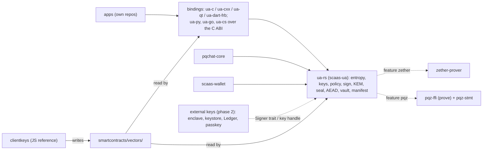

# `ua-rs-sign`: `ua-rs` as the one signer and crypto core of every client — design

**Status:** revised after the Fable counter-review (2026-11-05); owner answered the revision's questions (2026-11-05); revised
after the Codex security review (2026-11-05; owner: fix the spec per its points). SPECIFIED, nothing built. Work order item 3d (owner 2026-11-05): its own round, before the EVM freeze, in parallel with the regulated-kinds and
PqChat-contract rounds; **no contract change**. The plan follows in its own file (`superpowers/plans/2026-11-05-ua-rs-sign.md`);
§13 sketches it. Rows marked **follows** apply a stated rule; rows marked **proposal** are the controller's and the owner may
override them. Normative rule ids are given at build, in [clients/ua-libraries.md](../../clients/ua-libraries.md) and
[clients/signers-clientkeys.md](../../clients/signers-clientkeys.md), with their `decisions.md` entries. §16 maps every
Fable item (F-01 … F-52) and §17 every Codex finding (C-01 … C-12) to where it landed. UNAUDITED.

**Owner answers on the revision (2026-11-05), all as recommended:** (1) the `msig` KEM rule (no KEM key for an `msig`)
is enforced by clients now; CTR-UA-32 and the registry change in the PqChat-contract round (TODO 3c), which ships the
next registry generation anyway; (2) the off-chain purpose `scaas.ua.purpose.seal.v1` is accepted (its `decisions.md`
entry at build); (3) the clientkeys `vault.js` scrypt-bounds bug (CLI-SGN-21) is fixed now in its own small PR, not at
T1; (4) the design choices stand: signing calls take a `ScaasUaKey` handle, `alloy-rlp` is a dependency, the decoder
caps and the 1 MiB plaintext limit as proposed.

## 1. Owner rulings this spec follows (2026-11-05)

1. `ua-rs` (crate `scaas-ua`, `clients/ua-rs`) is the **only** signer. `pqchat-core` (the PqChat client core) and
   `scaas-wallet` (a Rust wallet module: SCaaS assets via the node, general EVM via alloy, the Zether and PQZ provers)
   sign only through it; neither signs on its own and neither depends on the other. Apps (separate repos) reach it
   through the existing bindings: `ua-c`, `ua-cxx`, `ua-qt`, `ua-dart-frb`, and `ua-py`, `ua-go`, `ua-cs` over the C ABI.
2. Scope: derivation exactly as `clients/clientkeys`; single-key signing for every kind; `UASig` and the `msig` minimal
   form; EIP-712 typed records; the group signers stay; the UA KEM key and its hybrid combiner; AEAD and HKDF by wrapping
   RustCrypto crates (never our own AES); a generic seal / open to a UA's KEM key. PqChat's own key schedule, labels,
   ratchet, envelope and padding stay in `pqchat-core`.
3. Secret keys never leave `ua-rs`: zeroized, no export except an explicit backup API.
4. (Coordinator message, same day.) `ua-rs` also gives clients the client-side crypto of `pqz-core` (`pqz-ffi`) and of
   `clients/zether-prover`, through the same Rust API and C ABI, as a **facade**: no proof, transcript or statement code in
   `ua-rs` (§10).
5. (Owner, same day, on the draft.) The facades `zether` and `pqz` are **on by default**; an app that needs neither builds
   with `--no-default-features` and the features it wants. The §14 answers: all as recommended.
6. (Owner, same day, on the Fable counter-review: "follow the advice, revise the spec".) Every P0 and P1 is applied in this text; P2
   items enter as rules or §13 tasks; P3 items are §15 notes.
7. (Same ruling.) **An `msig` UA has no KEM key of its own** (§6.1).
8. (Same ruling.) **External keys** (Secure Enclave, Android Keystore, Ledger, WebAuthn passkeys) are **phase 2**: not built
   in this round, but the interface is fixed now (§9.4) so phase 2 breaks no API.
9. (Same ruling.) `ua-rs` moves to Rust 1.97.1 with the repo-wide toolchain sync on branch `rust-sync`.
10. (Owner, same day, on the Codex security review [ua-rs-sign-codex-review.md](../../research/ua-rs-sign-codex-review.md):
    "fix the spec per the points".) Every confirmed finding is applied in this text; §17 maps each.

## 2. Scope and non-goals

**In scope:** a `Wallet` that holds the BIP-39 entropy and every secret derived from it; key derivation (§4); signing (§3,
§5), with the signing policy (§5.4) and EVM transactions (§5.5); `UASig`, `msig` member signatures in minimal form; the
EIP-712 hasher and the record builders already in `ua-rs`; WebAuthn challenge and assertion builders (§5.6); the KEM key,
combiner, encapsulation and decapsulation (§6); seal / open and the sealed container (§6.3); AEAD, HKDF, HMAC (§7); the
keystore, the key manifest, import and backup (§8); the Zether and PQZ facades (§10); the Rust API, the C ABI and the
bindings (§9); input bounds (§9.3); the external-key interface (§9.4, phase 2); the vectors (§11).

**Non-goals.** No contract, node or byte-format change of a signed record. No new kind. No verifier, precompile or
node-side code in the facades. No EIP-191 (`personal_sign`): live clientkeys has none (its digest is in
`legacy/typed-signing/`), and [CTR-UA-12](../../contracts/accounts.md#CTR-UA-12) forbids a raw-hash signature of an EOA.
No EIP-7702 authorization or type-4 transaction, ever ([CLI-SGN-40](../../clients/signers-clientkeys.md#CLI-SGN-40)).
PqChat's wrap, chains, message AEAD, padding and labels (UA-7 spec §6.2–§6.5 on branch `ua7-research`) stay in
`pqchat-core`. The family envelope builders (`fam/*`, SPECIFIED in clientkeys) stay with the family code; `ua-rs` signs
their bytes through the raw-digest opt-in only. Native NEAR and Algorand keys: clientkeys has no derivation path for them
yet, so `ua-rs` has none either. The pure-Dart port `ua-dart` stays identity-only. The chain scan after a restore stays in
`scaas-wallet` (§8.3). `no_std`: no listed target needs it.



## 3. Kinds: scheme, crate, derivation, vectors

The kind list is `KINDS` in `ua-rs` `lib.rs` = clientkeys `ua.js` = `kinds.json` (accounts.md §1.6). "Byte-equal" means
the Rust output equals the vector row byte for byte; "verify-only" means the row's signature is checked and the Rust
signature verifies, in **both** directions (§11), because the scheme is randomized. The UA tree is
`m/7622'/0'/<account>'/<kindNo>'/<i>'` with `kindNo` the kind number in decimal
([CLI-SGN-30](../../clients/signers-clientkeys.md#CLI-SGN-30), signers-clientkeys §9). `tag(kind)` below is the kind's ASCII
tag string (`"scaas.ua.mldsa65.v1"`); `TAG(kind) = keccak256(tag(kind))`.

| Kind | Name | Scheme and signed bytes | Crate (pin) | Derivation (as clientkeys §9) | Vectors |
|---|---|---|---|---|---|
| `0x0001` | `evm-eoa` | secp256k1 ECDSA, RFC 6979 (no extra entropy), `r‖s‖v`, low-s, v ∈ {27, 28}, over an EIP-712 digest `ua-rs` computes, the key proof `keccak256("scaas-subject-key-proof-v1" ‖ challenge)`, an EVM transaction (§5.5), or a raw digest with the opt-in | `k256` 0.13 (in tree) | BIP-32 `m/44'/60'/0'/0/i` | byte-equal; RFC 6979 rows (§11) |
| `0x0003` | `hedera-native` | ECDSA as `0x0001` at `m/44'/3030'/0'/0/i`, **or** ed25519 (HIP-632: raw ed25519 over the EIP-712 digest, as `seed.js` `sign`) at `m/44'/3030'/0'/0'/i'` | `k256`, `ed25519-dalek` | as left | byte-equal |
| `0x0011`, `0x0013`–`0x0016` | stellar, aptos, sui, cosmos, ton | ed25519 (secp256k1 for cosmos) over the family bytes, raw opt-in only | `ed25519-dalek` =2.2.0, `k256` | clientkeys `NETWORKS` paths (SLIP-10 ed25519, hardened only; `coinType` override) | byte-equal (`seed.test.js` rows) |
| `0x0010` | `solana-ed25519` (native kind, native path) | ed25519 | `ed25519-dalek` | `m/44'/501'/i'/0'` (SPECIFIED in clientkeys, added there in T1) | byte-equal |
| `0x0100` | `webauthn-p256` | the authenticator signs; `ua-rs` builds the challenge and the assertion encoding (§5.6) | `p256` 0.13 (in tree) | none (platform credential) | encoding byte-equal on the test key; signature verify-only |
| `0x0101` | `p256` | ECDSA P-256 over `sha256(ua_msg)`, RFC 6979, low-s, `r‖s` | `p256` 0.13 | UA tree, SLIP-10 `nist256p1` | byte-equal; RFC 6979 A.2.5 rows |
| `0x0102` | `ed25519` | ed25519 over `ua_msg` | `ed25519-dalek` =2.2.0 | UA tree, SLIP-10 ed25519 | byte-equal |
| `0x0103` | `bip340` | BIP-340 over `ua_msg`, 32-byte `aux` from the OS RNG | `k256` 0.13 `schnorr` | UA tree, BIP-32 | byte-equal on fixed-`aux` rows; verify-only in production |
| `0x0104`, `0x0105` | `schnorr-bn254`, `schnorr-bls12381` | scaas Schnorr (`scaas.ua.schnorr.v1`, accounts.md §1.9); nonce: the rule below | arkworks 0.5 (in tree); secret multiplications by `secret_mul` (§12) | EIP-2333 style `m/254/0/<account>/<kindNo>` (salt `SCAAS-UA-BN254-v1`), EIP-2333 `m/12381/0/<account>/<kindNo>`; **index 0 only** (§4) | byte-equal on fixed-`aux` rows; nonce-map row |
| `0x0106`, `0x0107` | `bls12381-minsig`, `bls-bn254-minsig` | BLS min-sig, deterministic; the domain (DSTs / labels SIG and POP of `verify.rs`) is the request's role (§9.4) | arkworks 0.5; `secret_mul` (§12) | as the row above; index 0 only | byte-equal |
| `0x0108` | `secp256k1` | ECDSA over `ua_msg`, no prehash, RFC 6979, `r‖s‖v`, low-s | `k256` 0.13 | UA tree, BIP-32 | byte-equal |
| `0x0110`–`0x0113` | MuSig2 / FROST (secp256k1, bn254) | BIP-327 and the bn254 port; RFC 9591 and FROST-BN254-KECCAK256 (`musig2.rs`, `frost.rs`, unchanged) | `frost-core` =3.0.0 (in tree); bn254 multiplications by `secret_mul` (§12) | `musig2-secp256k1` participants: UA tree `kindNo` 272; `musig2-bn254` participants: EIP-2333 style `m/254/0/<account>/274` (its own `kindNo`, salt `SCAAS-UA-BN254-v1`, index 0 only), as signers-clientkeys §9's bn254 row; FROST shares: DKG randomness, kept in the vault (§8) | `groups.json` byte-equal (fixed randomness) |
| `0x0120` | `msig` | a structure: member signatures (§5.2); **no KEM key** (§6.1) | — | — | `portable.json`, `nested.json` |
| `0x0130`, `0x0131`, `0x0134` | `mldsa44`, `mldsa65`, `mldsa87` | FIPS 204 `sign_internal(M' = 0x00 ‖ 0x00 ‖ pq_msg, rnd)`, `pq_msg = keccak256(TAG ‖ ua_msg)`, so the context is empty by construction ([CTR-UA-23](../../contracts/accounts.md#CTR-UA-23)); `rnd` 32 B from the OS RNG (hedged) | `ml-dsa` =0.1.1 (in tree) | `ξ = HKDF-SHA256(seed, "scaas.ua.pq.v1", utf8(tag(kind)) ‖ u32 account ‖ u32 i)`, 32 B → `KeyGen_internal` | keys byte-equal; `rnd = 0` rows byte-equal (`pq_kat.json`, `pq_signatures.json`, ACVP `sigGen`); hedged verify-only |
| `0x0132`, `0x0135` | `fndsa512`, `fndsa1024` | Falcon round 3, padded (666 / 1,280 B), over `ua_msg`; randomized | `pqcrypto-falcon` =0.4.1 (in tree) | the same HKDF, 48 B seed | keys: Q1; signatures verify-only |
| `0x0133` | `slhdsa128s` | FIPS 205 SHA2-128s `slh_sign_internal(M' = 0x00 ‖ 0x00 ‖ pq_msg, opt_rand)`, the `M'` that `pq.rs` verifies; `opt_rand = None` (= `PK.seed`) for deterministic rows, 16 B from the OS RNG in production | `slh-dsa` =0.2.0-rc.5 (in tree) | the same HKDF, 48 B → `SK.seed ‖ SK.prf ‖ PK.seed` | deterministic byte-equal (ACVP `sigGen` too); randomized verify-only |
| `0x0141` | `zether-bls12381` | Zether Schnorr | feature `zether` (§10.1) | EIP-2333 `m/12381/<coin>/<account>/7` | zether-prover's vectors |

`evm-contract` (`0x0002`) and `soroban-contract` (`0x0012`) hold no key; `ua-rs` signs nothing for them. The scheme `0x0142`
(`pqz-mlwe`) is the PQZ key, not a signing kind (§10.2). **One key, one purpose** ([CLI-SGN-29](../../clients/signers-clientkeys.md#CLI-SGN-29)):
`ua-rs` refuses a UA-tree `kindNo` that is not the requested kind's, a Zether `use` (7, 8) for a non-Zether kind, and any
signing call on a UA key that does not build `ua_msg` itself.

**Nonce of scaas Schnorr (`0x0104`, `0x0105`), proposal (Q7, revised after review):**

```text
k = hashToScalar(keccak256("scaas.ua.schnorr.nonce.v1" ‖ be32(sk) ‖ Y ‖ ua_msg ‖ aux))     aux: 32 B, OS RNG
hashToScalar(s) = (keccak256(s ‖ 0x02) · 2^256 + keccak256(s ‖ 0x03)) mod r                   the 512-bit map of verify.rs:199
```

`sk` is 32 bytes big-endian, `Y` the public key in its key-data form; `k = 0` is refused and `aux` redrawn. The signer
calls the one `hashToScalar` function the verifier calls (no second copy), so a 256-bit `mod r` map (a bias of about 2.4 bits
on bn254, 1.1 on BLS12-381: lattice key recovery) cannot appear; a known-answer row of the map (computed by the generator,
not by the signer) kills the mutant "nonce reduced from 256 bits". Every multiplication by `sk` or `k` goes through
`secret_mul` (§12: unreduced blinded integer, fixed-width ladder), never through arkworks' `*` or `mul_bigint`.

## 4. Derivation

Every rule above is clientkeys' as built (`seed.js`, `pq.js`, `zether.js`) or as SPECIFIED in signers-clientkeys §9
(the UA tree, the EIP-2333 UA paths, `solana`): **follows**. Where clientkeys has the rule only on paper, task T1 builds it
there first, so the JS writes the vector rows and `ua-rs` is checked against them (§11).

- **BIP-39:** `bip39` with features `alloc` (so `unicode-normalization`, NFKD of words and passphrase, as `@scure/bip39`) and
  `zeroize`; English list, 12–24 words with checksum; 24 words generated from 32 bytes of OS entropy. An import keeps its
  entropy at its own length (16, 20, 24, 28 or 32 bytes for 12, 15, 18, 21 or 24 words; BIP-39), never padded or replaced
  (§8.1). The `Wallet` keeps the **entropy** and derives the 64-byte seed on unlock with the BIP-39 passphrase (§8.1); a `Mnemonic` value is dropped at the
  end of `from_mnemonic` and never cloned.
- **BIP-32** secp256k1: `bip32`. **SLIP-10** ed25519 and `nist256p1`: HMAC-SHA512 in `ua-rs` (a dozen lines, as `seed.js`),
  checked on the SLIP-10 published vectors. **EIP-2333:** in `ua-rs`, parametrised by curve order and salt, checked on the
  EIP-2333 published vectors (zether-prover keeps its own copy; a test compares the two on the Zether path). **X25519**
  from derived bytes needs `x25519-dalek`'s `static_secrets` feature. The UA KEM key: §6.1.
- **Ranges:** `account`, `index` and `coinType` are `< 2^31` for every kind, HKDF kinds included, refused otherwise
  (`Argument`); a `keys.json` refusal row each.
- **EIP-2333 UA paths have no index level** (signers-clientkeys §9: `m/254/0/<account>/<kindNo>`, `m/12381/0/<account>/<kindNo>`;
  kinds `0x0104`–`0x0107`, `0x0112`): `ua_key` refuses `index ≠ 0` for them (`Argument`), so two indices can never alias one
  key; the manifest records index 0; `discover_candidates` returns index 0 alone for them. Several keys of such a kind come from
  several `account` values. Adding an index level is a change of the derivation rule in signers-clientkeys first, with
  regenerated vectors, never a Rust-only change.

## 5. Message forms and signing

### 5.1 What each key may sign

| Key | Calls | Built inside `ua-rs` |
|---|---|---|
| UA key (`0x0100`–`0x0135`) | `sign_ua(purpose, digest)` only | `ua_msg = keccak256(MSG_TAG ‖ TAG(kind) ‖ purposeTag ‖ digest)` ([CTR-UA-12](../../contracts/accounts.md#CTR-UA-12)); `purpose` must be in `PURPOSES` (`purpose_tag_v`, `pop` v2) |
| UA key as `msig` member | `sign_member(structure_ua, structure_ua_msg)` | `uaMessage(kind, PURPOSE_MEMBER, memberDigest(structure_ua, structure_ua_msg))`; nested: `inner_digest` |
| Native key | `sign_typed(typed_data, expect)` (§5.4), `sign_transaction(tx)` (§5.5), `sign_key_proof(challenge)`, `sign_digest(digest, AllowRawDigest)` | the EIP-712 digest after the policy check; the transaction hash; the key-proof digest; the raw form only with the explicit marker value ([CLI-SGN-40](../../clients/signers-clientkeys.md#CLI-SGN-40)), for Merkle roots and family envelopes, never a transaction |
| Native key as `msig` member | portable purposes: `sign_typed` over the record's typed data (portable domain); otherwise `UAAuth` under the registry's domain | ([CTR-UA-07](../../contracts/accounts.md#CTR-UA-07)) |

Every randomized call draws its randomness inside `ua-rs` from the OS RNG (§9.1); no release signature takes an RNG.

### 5.2 Records, `UASig`, `msig`

The record builders exist (`ua8.rs`, `json.rs`: `registration_digest`, `kem_record_message`, `pqz_key_record_message`,
`membership_digest`, `holder_pop_message`, `UASig`, `MemberSig`, `msig_sig_minimal`). New: a `UASig` builder that takes
the signer's key handles and returns the struct; for an `msig`, the caller names the member slots and their handles, and
`ua-rs` refuses a set that is not minimal at both levels (`UAPoP`, the registry's verdict). Member acceptance
([CTR-UA-37](../../contracts/accounts.md#CTR-UA-37)) uses `membership_digest`. The builders take `&dyn Signer` (§9.4).

### 5.3 EIP-712

One generic hasher (`encodeType` with referenced types sorted, `hashStruct`, `0x1901 ‖ domain ‖ struct`) over a typed-data
value with named fields: `{types, primaryType, domain, message}` as `eth_signTypedData_v4`. Domains: the portable
`("SCaaS UA Portable", "1")`; the registry's `UAAuth` domain `("SCaaS UARegistry", generation, chainId, registry, salt =
chainUid)`; the token and router domains `(name, version, chainId, verifyingContract, salt = chainUid)`. The hasher is
generic and the vectors (`vectors/typed/typed_ops.json`, `ua/portable.json`) carry every struct, so no struct list is copied.

**The generic hasher is faithful:** it hashes the values supplied, as EIP-712's `encodeData` and clientkeys `hashTypedData`
(`evm.js`) do; it never rewrites a field. **Canonical form, SCaaS records only (follows clientkeys `evm.js` `canonical`, which
only its operation builder `opTypedData` calls):** a step of the checked builders (`sign_typed` with an `Expect` other than
`Any`, §5.4, and the record builders of §5.2), never of the hasher and never of `sign_typed_any`. Inside such a record, whose
domain name and `primaryType` the `Expect` check has matched to a SCaaS operation, it is recursive over nested structs and
arrays: every struct value that has the fields `mode`, `relayer` and `feeRecipient` gets `relayer = 0` unless `mode & 1` and
`feeRecipient = 0` unless `mode & 2` (`MODE_RESTRICT_RELAYER`, `MODE_RESTRICT_FEE_RECIPIENT`), as `MetaTxLib.canon` does for
`MetaTransaction` and `MetaTransfer` and every struct that embeds them. Keying on the fields within a SCaaS record covers a
struct added later; an unrelated contract's struct with the same field names (`Order(uint32 mode, address relayer, address
feeRecipient, uint256 amount)`) is signed as supplied. A clear-signing device is shown the final value that is hashed (after
canon on the checked path). **Value encoding:** a field missing from `message` is its zero value
and a field not in the type is refused (as `canonical`); `uint` ≤ 32 bits as JSON numbers, wider `uint` / `int` as decimal
strings, `int` two's complement; `bytes` / `string` hashed by content; `bytesN` exact length; `address` 20 B; `bool`; `T[]`
and `T[k]` (length checked); nested structs; the `EIP712Domain` type from the fields present in `domain`, in EIP-712 order.

### 5.4 Signing policy (before `sign_typed`)

clientkeys keeps a check in front of every typed signature (signers-clientkeys [§3](../../clients/signers-clientkeys.md#signing-policy),
§5: `checkPayment`, `checkReceiverFee`, `checkPayMeta`, `checkOp`, `checkCall`, `checkOwnerCall`, `checkCancel`,
`checkTradeOrder`, `checkWrapOrder`). `ua-rs` ports them: `sign_typed(td, expect: Expect)` where `Expect` is an enum with one
variant per check and the check's named inputs (account, chain, amount, payee, maximum fee, allow-list, …) as the user
confirmed them. The check runs on the canonical value; a mismatch refuses with `PolicyRefused` and signs nothing. The general
EVM wallet passes `Expect::Any(AllowAnyTypedData)`, a marker value with its own C name (`scaas_ua_sign_typed_any`), as the
raw-digest opt-in; it signs the standard EIP-712 digest of the values as supplied (no canon, §5.3). An allow-list of `(domain name, primaryType)` alone would still sign a `MetaTransfer` to a drain, so the
ports are the gate. Vectors: clientkeys' `check*` test rows, accepted and refused, read by `ua-rs`.

### 5.5 EVM transactions

`sign_transaction(tx: EvmTx)` with named fields per EIP-2718 type: 0 (legacy, EIP-155 `chainId` required), 1 (EIP-2930),
2 (EIP-1559), 3 (EIP-4844: the signed fields only, never the sidecar). `chainId` is explicit; type 4 has no variant, so an
EIP-7702 transaction cannot be built. RLP is built inside `ua-rs` (`alloy-rlp`); `scaas-wallet` converts from alloy's types.
Output: the signed envelope and `(r, s, yParity)`. Vectors: `sign.json` rows per type, generated by clientkeys (T1), plus
published rows (EIP-155 example) recorded with source and sha256.

### 5.6 WebAuthn (`0x0100`)

`webauthn_challenge(purpose, digest) -> ua_msg` (the authenticator's challenge) and `webauthn_assertion(key_data,
expected_challenge, authData, clientDataJSON, r, s) -> signature`. `expected_challenge` is the `ua_msg` the caller requested
(kept by the caller, as clientkeys `metaop.js` keeps the digest it asked for); the challenge inside the untrusted JSON is
never the reference. In order: `0 < r < n` and `0 < s < n` (as `webauthn.js` `derToRS`), else refused; `s` normalised to
low-s (the chains refuse high-s); `clientDataJSON` kept as the exact signed bytes (never re-serialised) and accepted only by
the chain-compatible rule of `verify.rs` `client_data_ok` with `expected_challenge` (fixed prefix `type`, `challenge`,
`origin`, then `}` or `,"crossOrigin":false`), so a layout a generic JSON parser accepts but the chains refuse (reordered
fields, `crossOrigin: true`) is refused here; then the whole encoding `abi.encode(authData, clientDataJSON, r, s)` is
verified with `verify(0x0100, key_data, expected_challenge, …)` (flags, `rpIdHash`, P-256) before it is returned. Any
failure: `WebAuthnAssertion`, nothing returned. Vectors: the existing webauthn rows of `signatures.json` and
`portable.json`, plus refusals (wrong challenge; reordered JSON; `crossOrigin: true`; `r = 0`; `s = n`).

## 6. The UA KEM key, the combiner, seal / open

### 6.1 Key

Scheme 1 only ([CTR-UA-32](../../contracts/accounts.md#CTR-UA-32)): `kemPk = 0x01 ‖ ek (1,568) ‖ pk_X (32)`, 1,601 B.
**Derivation (proposal, Q2):**

```text
kemSeed = HKDF-SHA256(ikm = BIP-39 seed, salt = "scaas.ua.kem.v1", info = "scaas.kem.1" ‖ ua (32) ‖ u64 version, L = 96)
(ek, dk) = ML-KEM-1024.KeyGen_internal(d = kemSeed[0:32], z = kemSeed[32:64])
sk_X     = kemSeed[64:96] (X25519 clamps);  pk_X = X25519(sk_X, 9)
```

`ua` binds the key to one UA (two UAs of one seed never share a KEM key); `version` is the KEM record's (0 = the
`register` key). Derivation makes CTR-UA-32's client rule (one key per version, the `register` key included, on every chain)
hold by construction. **The KEM key is derived through the UA key handle alone:** `UaKey::kem_key(version)` takes no
wallet argument; the seed is the one in the handle's own secret store (§8.2), so a handle can never be combined with another
wallet's seed (two wallets, both unlocked, cannot produce a second `(ek, pk_X)` for one `(ua, version)`). It refuses a kind
that is not a KEM holder (CTR-UA-32: `mldsa44`, `mldsa65`, `fndsa512`, `mldsa87`, `fndsa1024`; `KemHolder`) and a revoked
handle (`KeyRevoked`); an external key (§9.4) has no KEM key in this round (`KIND_UNAVAILABLE`). The FIPS 203 §7.3
decapsulation-key check is a self-test for a derived key: it runs once per secret store per `(ua, version)`, its record kept in
that store and wiped with it.

**`msig` (owner 2026-11-05):** an `msig` UA has **no KEM key of its own**. Sealing to an `msig` means sealing to each of its
**accepted** members ([CTR-UA-37](../../contracts/accounts.md#CTR-UA-37)), two levels
([CTR-UA-38](../../contracts/accounts.md#CTR-UA-38)), each a single-key UA with its own KEM key; a member without one is
skipped and reported. It applies to: `kem_key` (an `msig` cannot be passed: the call takes a single-key handle); the
record builders (`ua-rs` builds no KEM record and no `kemPkHash` attribute for an `msig`, `KemHolder`); seal callers
(`scaas-wallet`, the backup and link flows, §6.3), which expand before `seal`; PqChat, whose D8 / P13 expansion of an `msig`
seat into its accepted member UAs (UA-7 spec) is this rule. Reading `msigOf` and `memberAccepted` is the caller's (chain
state); `ua-rs` gets the list of `(ua, version, kemPk)`.

### 6.2 Encapsulation, decapsulation and the combiner (UA-7 spec §6.1, **follows**)

```text
encaps check: kemPk[0] == 0x01, len 1,601; ek type check (1,568 B) and modulus check
              ByteEncode12(ByteDecode12(ek[0:1536])) == ek[0:1536]  (FIPS 203 §7.2)
(ct_M, ss_M) = ML-KEM-1024.Encaps(ek)
(e, E)       = fresh X25519 pair;  ss_X = X25519(e, pk_X);  ss_X == 0^32 → refuse
ss           = SHA3-256(ss_M ‖ ss_X ‖ E ‖ pk_X ‖ "scaas.kem.1")
decaps check: len(mlkem_ct) == 1,568 and len(x25519_eph) == 32, else KemCheck;
              ss_X = X25519(sk_X, E), not contributory (small-order E) → KemCheck;
              ML-KEM implicit rejection kept: a wrong ct gives another ss, never a distinct error
```

`ct_M` is absent from the hash while `E` is present: ML-KEM's `K` already binds `ct_M` (the X-Wing argument); X25519 does
not bind `E`. `kem_encaps(kemPk) -> (mlkem_ct, x25519_eph, ss)` needs no secret. `KemKeyPair::decaps(mlkem_ct, x25519_eph)
-> ss` runs inside `ua-rs`; `dk` and `sk_X` never leave it. The 32-byte `ss` is returned (`Zeroizing`): it is a
per-encapsulation secret, not a key of the UA, and `pqchat-core` builds its wrap KEK from it (Q6). Whoever holds the key
handle therefore has a decapsulation oracle; bindings never expose the handle to page scripts.

### 6.3 Seal / open (generic, HPKE-like; **proposal**)

```text
Sealed { version: u8 = 1, scheme: u8 = 1, mlkemCt: bytes (1,568), x25519Eph: bytes32, ciphertext: bytes }
seal(kemPk, purpose, aad, pt):                                 m and e from the OS RNG inside ua-rs
  (mlkemCt, x25519Eph, ss) = kem_encaps(kemPk)
  key        = HKDF-SHA256(ikm = ss, salt = empty,
                           info = "scaas/seal/v1" ‖ u8 scheme ‖ be16 len(purpose) ‖ purpose ‖ keccak256(kemPk), L = 32)
  ciphertext = AES-256-GCM(key, nonce = 0^96, pt, aad)          len(pt) + 16
open(kem_key, purpose, aad, Sealed): decaps, the same key, AES-256-GCM open; any failure → SealOpen
```

- `purpose`: ASCII `[a-z0-9./-]`, 1–64 B, named by the caller. This round defines `scaas/backup/v1` (§8.4) and
  `scaas/link/v1` (device linking, UA-7 spec P6: the existing device seals the UA's secrets to the new device's ephemeral key).
- `nonce = 0` is safe because every key encrypts once: `m` and `e` are fresh per seal and come from the OS RNG inside
  `ua-rs`, never from the caller (§9.1). The key binds the version, the scheme, the purpose and the recipient's whole key;
  `ss` binds `E` and `pk_X`.
- **Seal authenticates no sender.** Anyone can seal to any key. The backup and link containers carry the sender's
  signature (below); a raw `Sealed` proves nothing about who made it. The same sentence goes into the C header.
- `pt` may be empty; `pt ≤ 1 MiB` (proposal), refused above (`Argument`); no length hiding (padding is the caller's).
- Storage and transport form (only there): `version ‖ scheme ‖ mlkemCt ‖ x25519Eph ‖ ciphertext`; every API takes and
  returns the named fields. A version or scheme other than 1 is refused (`SealVersion`).
- **Ephemeral recipient:** `KemKeyPair::generate_ephemeral()` (OS RNG, no seed, never stored) for a device that has no seed
  yet (link).
- **Container** (backup and link; named fields, base64url, JSON like the vault):
  `{v: 1, purpose, recipient: {ua, version} | {kemPkHash}, sender: {ua, sig}, created, sealed: {mlkemCt, x25519Eph, ciphertext}}`.
  `aad = u8 v ‖ be16 len(purpose) ‖ purpose ‖ recipientId (32: ua, or kemPkHash) ‖ be64 version (0 for ephemeral) ‖
  senderUa (32) ‖ be64 created`, rebuilt by the opener from the container, and for `scaas/link/v1` followed by
  `sha256(shortCode)`, the code both screens show, so a swapped QR fails. `sender.sig` is a `UASig` of the sender UA over
  `keccak256(aad ‖ wire form)` under the purpose `scaas.ua.purpose.seal.v1` (a new off-chain purpose, **proposal**).
- **Container acceptance: the sender is expected, never self-declared.** A valid signature proves only that *some*
  registered UA sealed the container; `sender.ua` is chosen by whoever made it. So the one opening call is
  `open_container(kem_key, container, expect: &ContainerExpect, sender_key: &SenderKey)` with
  `ContainerExpect { purpose, sender: ExpectedSender::Ua([u8; 32]) | ExpectedSender::Set(&[[u8; 32]]), recipient:
  RecipientId::Ua { ua, version } | RecipientId::KemPkHash([u8; 32]) }` and `SenderKey { kind, key_data }`. Before any
  decapsulation, in order, each a refusal with nothing imported: `container.purpose == expect.purpose`; the container's
  recipient field equals `expect.recipient` and `expect.recipient` is the opening key's own (`(ua, version)` of the
  `UaKey::kem_key`, or `keccak256(kemPk)` of the ephemeral key); `sender.ua` is the expected UA or in the approved set;
  `sender_key.kind` is a single-key kind and `derive_ua(kind, key_data) == sender.ua`, recomputed in `ua-rs` (`lib.rs`
  `derive_ua`), so key data fetched through the node needs no trust in the node; `sender.sig` verifies over the rebuilt `aad`
  and wire form. Then decapsulation and AEAD open. A mismatch of purpose, recipient or sender: `ContainerSender`; a bad
  signature or tag: `SealOpen`. The embedded manifest is never a trust anchor. There is no call that opens a container without
  a `ContainerExpect`.
- **Where each caller gets the trust anchor.** *Restore* (`scaas/backup/v1`): the expected sender is the identity UA of the
  wallet being restored, known before the container is read: for an organisation's recovery UA or a backup-holder device, the
  UA it approved when it agreed to hold that wallet's backups (kept in its own manifest as `backup_senders`); for the user
  restoring their own wallet, the UA of their account as they confirm it. After decryption, before install, the payload must
  derive `sender.ua` from its own entropy at the manifest entry it names, else `ContainerSender` (the backup is the sender's
  own wallet, not material sealed by another UA). *Link* (`scaas/link/v1`): the expected sender is the UA the user confirms on
  the new device during the pairing session, read from the existing device's screen (a second QR or the typed fingerprint),
  never from the container.
- **Replay and rollback (consumer obligations, rules).** A valid signature and tag authenticate `created`; they do not make a
  container fresh, and `open` / `open_container` alone give **no replay protection** (rustdoc and header say so; RFC 9180
  §9.7.3 likewise). Link: `LinkSession::new()` makes the ephemeral key, the short code and an expiry (`created` of an accepted
  container lies between the session's start and start + 10 min, **proposal**; outside: `ContainerReplay`);
  `Wallet::from_link(session, container, expect, sender_key)` takes the session by value and consumes it atomically on a
  successful install, so a second install of the same or any container to that session cannot be expressed; the ephemeral key
  is wiped with the session. Restore: `BackupPayload` carries `generation` (u64, the sender's `backup_generation`, raised by
  each `backup_seal`); `Wallet::restore_backup(…)` over a device that already holds this wallet (same identity UA) refuses a
  payload whose `generation` is lower than the one recorded (`BackupRollback`) unless the caller passes the marker value
  `AllowRollback` after the user confirmed it; an equal generation is the same backup and changes nothing; a device without the
  wallet accepts any generation the expected sender signed. Archival decryption of an old backup is not refused; installing it
  over newer state is.

## 7. AEAD, HKDF, HMAC

| Call | Wraps | Notes |
|---|---|---|
| `aead_seal / aead_open(alg, key32, nonce12, aad, data)` | `aes-gcm` =0.10.3 (`Aes256Gcm`), `aes-gcm-siv` =0.11.1 (`Aes256GcmSiv`) | `alg` is an enum, never a string; output `ct ‖ tag`; a bad tag returns an error and no plaintext; nonce uniqueness is the caller's (session keys) |
| `hkdf_sha256(ikm, salt, info, len)`, `hkdf_expand_sha256(prk, info, len)` | `hkdf` =0.12.4 | `len ≤ 255 × 32` |
| `hmac_sha256(key, data)` | `hmac` 0.12 (via `hkdf`) | PqChat chains (`mk_i`, `n_i`, `ck_{i+1}`) |

Both AES crates sit on `aes` 0.8, the generation `pqzl` already pins (`aes` =0.8.4): one AES implementation in a build.
Keys passed in are caller-held session keys (PqChat's `K`, `mk_i`), not UA secrets.

## 8. Key storage, zeroize, manifest, backup

### 8.1 Vault (clientkeys vault v1, byte-compatible; **proposal**, Q3)

- **Format** `{v: 1, label, data: {iv, ct}, pin: {kdf: "scrypt", N, r, p, salt, iv, ct}, prf?: {credentialId, salt, iv, ct}}`
  ([CLI-SGN-02](../../clients/signers-clientkeys.md#CLI-SGN-02)); AES-256-GCM, AAD `label|data`, `label|pin`, `label|prf`;
  crate `scrypt` =0.11.0. One vault per secret, as clientkeys.
- **Payloads per label (follows clientkeys):** `seed` = the **BIP-39 entropy at its own length** (`SeedBackup.take()` →
  `createVault(entropy, {label: 'seed'})`; an import's `wordsToEntropy`), never the 64-byte seed: exactly 16, 20, 24, 28 or
  32 bytes (12–24 words; a new wallet always 32). A decrypted `seed` payload of any other length is refused (`VaultOpen`)
  before a `Wallet` is built, never padded or truncated; `open_vault` requires the label `seed` (`Argument` otherwise). The **BIP-39 passphrase is not stored**: it is asked at
  every unlock of a wallet that uses one and passed to `open_vault` as `bip39_passphrase` (empty by default), as
  `seedFromEntropy(entropy, passphrase)`. Further labels: `frost-share:<ua>`, `kem:<ua>:<version>` (a random KEM key),
  `native-import:<network>:<n>` (§8.3), `manifest` (§8.3).
- **Passphrase:** NFKC-normalised before scrypt, as `vault.js` (`String(pin).normalize('NFKC')`). A new passphrase has ≥ 8
  characters and is not digits only (`checkPassphrase`); opening never checks the policy.
- **Bounds on open ([CLI-SGN-21](../../clients/signers-clientkeys.md#CLI-SGN-21)):** a pin envelope outside
  `N ∈ {2^15, 2^16, 2^17}, r = 8, p = 1` is refused (`VaultParams`) before scrypt runs; stored parameters are never trusted
  beyond that (`N = 2^30` would ask 128 GiB). New envelopes use `N = 2^17, r = 8, p = 1`; old ones open and are re-wrapped.
  clientkeys' `dekFrom` lacks this check today (the rule's tests are SPECIFIED); T1 adds it there too.
- **Calls (BUILT in clientkeys, ported):** `seal_vault`, `open_vault`, `needs_rewrap`, `rewrap_pin` (keep the DEK, replace
  the pin envelope: it rotates the passphrase KEK, **not** the DEK, so it revokes nothing from someone who learnt the DEK),
  `enable_prf` (add a PRF envelope). Recovery from a DEK compromise is `seal_vault` anew: a fresh DEK, the data resealed, every
  pin and PRF envelope rebuilt.
- **Vault v2** ([CLI-SGN-17](../../clients/signers-clientkeys.md#CLI-SGN-17), SPECIFIED, browser device key) and its tombstone
  `{v: 2, moved}` are refused by name (`VaultVersion`: "open it in the browser and export v1"), never reported as a wrong
  passphrase. Any other `v` is `VaultVersion` too.
- **The hook:** the `prf` envelope takes any 32-byte platform secret through `HKDF-SHA256(…, "scaas-clientkeys-vault-v1/prf")`.
  For a passkey: `credentialId` and `salt` as clientkeys. For an Android Keystore or iOS Keychain HMAC key: `credentialId` =
  the key alias (UTF-8), `salt` = the 32-byte HMAC input, and the secret = HMAC(key, salt). No new format.
- **Why scrypt:** a JS vault opens in Rust and the reverse; one format in every client; memory-hard (RFC 7914) at
  128 MiB. Argon2id (RFC 9106) resists GPUs somewhat better but would split the format; it stays a later vault version.

### 8.2 In memory

The entropy, the seed, every derived secret, `ss`, KEKs and DEKs are `Zeroizing<…>` or types with `ZeroizeOnDrop`; key
types are neither `Clone` nor `Debug`-printing and have no accessor for secret bytes; signing takes `&self`.

**Secret store and revocation (rule).** Each wallet owns one `SecretStore` (shared by `Arc`): a read-write lock over
`{generation: u64, arena: Option<Arena>}`. Every handle derived from the wallet (`UaKey`, `NativeKey`, a derived
`KemKeyPair`, a MuSig2 / FROST session, the Zether and PQZ handles of §10) holds the `Arc`, the generation at its creation and
its slot in the arena; it holds **no secret bytes of its own**. Every secret operation (sign, decapsulate, open, prove,
decrypt, derive) takes the read lock, refuses `KeyRevoked` when its generation is not the store's, and runs under that guard.
`Wallet::lock()` takes the write lock (so it waits for every in-flight operation), wipes the arena, sets it to `None` and
raises the generation; from its return every earlier handle returns `KeyRevoked`, for good. `unlock` reopens the vault into a
new arena at the raised generation: it never revives an old handle (new handles are derived). A wallet call that needs secrets
while locked returns `WalletLocked`; `lock()` keeps the public manifest. Freeing the wallet (Rust `Drop`,
`scaas_ua_wallet_free`) is `lock()` and the release of the wallet's reference: a child handle stays valid memory (it holds the
`Arc`), returns `KeyRevoked`, and is freed by its own `_free`; no handle dangles. The caller must not free a handle while a call
on the **same** handle runs (header: undefined). `KemKeyPair::generate_ephemeral()` and a `LinkSession` have a store of their
own.

**Memory protection covers the arena, not the object graph (rule).** `mlock` / `VirtualLock` and `MADV_DONTDUMP` apply to
address ranges (mlock(2)), so locking the `Wallet` allocation would leave the handles, `Vec` buffers and boxed crate keys
outside. The arena is page-aligned chunks that never move or grow in place (a new chunk when one is full), each chunk locked and
marked no-dump at allocation, wiped, unmarked and unlocked at release; every long-lived secret lives in it as bytes: the
entropy, the seed, each handle's key bytes (the encoded key a crate type is rebuilt from per call: ML-DSA and SLH-DSA signing
keys, Falcon key bytes, the ML-KEM `dk` and `sk_X`, BIP-32 / SLIP-10 / EIP-2333 scalars), FROST shares, imported keys, the
group sessions' secret nonces, the Zether `x` and the PQZ `seed32`. Best effort (feature `mlock`, off on wasm32): a failed lock
is reported by `Wallet::memory_protection()` and never fails the wallet. **Outside that coverage, stated:** a crate's key
type rebuilt for one operation and its stack and heap temporaries, the scrypt work buffer, the caller's buffers (§9.2), and
everything on wasm32. `ua-rs` never sets the process-wide `PR_SET_DUMPABLE`; a host app that wants it sets it itself. Per
crate:

| Crate | Zeroize | `ua-rs` action / residual |
|---|---|---|
| `ml-dsa`, `ml-kem`, `slh-dsa` | only with feature `zeroize` | enable it |
| `bip39` | `Mnemonic` (word indices, `Clone`) with feature `zeroize` | enable it; drop the value in `from_mnemonic`, never clone |
| `pqcrypto-falcon` 0.4.1 | none | key bytes in the arena, the crate type rebuilt per call and dropped; PQClean's stack buffers stay (residual) |
| `x25519-dalek`, `ed25519-dalek`, `k256`, `p256`, `bip32` | yes (default / `zeroize`) | — |
| arkworks, `frost-core` | scalars copied on the stack | residual |
| `scrypt` | large work buffer not wiped | residual (it holds the passphrase-derived state) |
| browsers (wasm32) | the JS heap and linear memory are outside our control | residual, stated |

### 8.3 Manifest, discovery, import

- **Manifest** (vault label `manifest`): named fields; entries `{kind, account, index, ua, label, created}` (index 0 for the
  EIP-2333 kinds, §4), native `{network, coinType, index}`, KEM `{ua, version, origin: derived | random}`, FROST shares,
  imported keys, `backup_generation` (u64, §6.3), `backup_senders` (the UAs whose backups this wallet agreed to hold, §6.3).
  It is written when a key is first used, included in the backup and link payloads, and is what `lock()` keeps.
- **Discovery after a restore from the phrase:** `ua-rs` gives `discover_candidates(kind, account, gap) -> [(index, ua)]`
  (gap 20, BIP-44 style; index 0 alone for the EIP-2333 kinds); the registry scan through the node is `scaas-wallet`'s, which
  stops after `gap` unused indices.
- **Import** `import_native_key(network, secret)` (an existing EOA, a Stellar `S…` seed, a Solana keypair, a Hedera ed25519
  key): stored under `native-import:<network>:<n>`, tagged with its family and refused for any other family or any UA kind
  ([CLI-SGN-11](../../clients/signers-clientkeys.md#CLI-SGN-11), CLI-SGN-29), listed in the manifest and the backup.

### 8.4 Explicit exports, the only ways out

`export_vault` (encrypted); `SeedBackup` (show once, three-word check, as `backup.js`; `take()` hands the entropy to the
vault and the backup object forgets it); `backup_seal(recipients)` = the §6.3 container with purpose `scaas/backup/v1`
over `BackupPayload {v: 1, generation, entropy, secrets: [{label, bytes}], manifest}` (`entropy` at its own length, §8.1;
`generation` the raised `backup_generation`, §6.3; the non-derived secrets: FROST shares, random KEM keys, imported keys; the
BIP-39 passphrase is never in it), sealed to an organisation's recovery UA, another device, or each
accepted member of an `msig` (§6.1); `export_pqz_leaf_raw(account, i, AllowSecretExport)` (the 32-byte PQZ leaf for
`pqz-cli` or a key oracle, [CTR-PQZ-13](../../contracts/pq-zero-knowledge.md#CTR-PQZ-13)): the only call that returns a
secret in the clear, so it has the raw-digest treatment (a marker value, its own C name, a header warning, no log). No other
call returns the entropy, the seed, a private key or a KEM secret.

## 9. API surface

### 9.1 Rust (feature `wallet`; the existing verify / digest API is unchanged)

```rust
pub struct Wallet; // owns the SecretStore (§8.2) and the manifest; Send + Sync, no Clone
impl Wallet {
    pub fn generate() -> (Wallet, SeedBackup);                                     // SeedBackup forgets on take()
    pub fn from_mnemonic(words: &str, bip39_passphrase: &str) -> Result<Wallet>;
    pub fn open_vault(vault: &Vault, unlock: Unlock, bip39_passphrase: &str) -> Result<Wallet>;
                                                    // Unlock::VaultPassphrase(&str) | Unlock::Prf(&[u8; 32]); PRF first
    pub fn seal_vault(&self, vault_passphrase: &str, prf: Option<PrfEnvelope>) -> Result<Vault>;
    pub fn lock(&self);       // waits for in-flight operations; every earlier handle -> KeyRevoked (§8.2)
    pub fn unlock(&self, vault: &Vault, unlock: Unlock, bip39_passphrase: &str) -> Result<()>;  // old handles stay revoked
    pub fn manifest(&self) -> Manifest;  pub fn memory_protection(&self) -> MemoryProtection;
    pub fn ua_key(&self, kind: u16, account: u32, index: u32) -> Result<UaKey>;   // index 0 only for EIP-2333 kinds (§4)
    pub fn native_key(&self, network: Network, index: u32, coin_type: Option<u32>) -> Result<NativeKey>;
    pub fn backup_seal(&self, recipients: &[Recipient]) -> Result<Vec<SealedContainer>>;   // raises backup_generation
    pub fn restore_backup(recipient: &KemKeyPair, c: &SealedContainer, expect: &ContainerExpect, sender_key: &SenderKey,
                          current: Option<&Wallet>, rollback: Option<AllowRollback>) -> Result<Wallet>;   // §6.3
    pub fn from_link(session: LinkSession, c: &SealedContainer, expect: &ContainerExpect, sender_key: &SenderKey)
                     -> Result<Wallet>;                                          // consumes the session (§6.3)
}
impl UaKey {     // also implements Signer (§9.4); holds its store's Arc, generation and slot, no secret bytes
    pub fn kind(&self) -> u16;  pub fn key_data(&self) -> Vec<u8>;  pub fn ua(&self) -> [u8; 32];
    pub fn kem_key(&self, version: u64) -> Result<KemKeyPair>;   // through this handle's own store (§6.1); no wallet argument
    pub fn sign_ua(&self, purpose: &[u8; 32], digest: &[u8; 32]) -> Result<Vec<u8>>;
    pub fn sign_member(&self, structure_ua: &[u8; 32], structure_ua_msg: &[u8; 32]) -> Result<Vec<u8>>;
}
impl NativeKey { // also implements Signer (§9.4)
    pub fn address(&self) -> Vec<u8>;
    pub fn sign_typed(&self, td: &TypedData, expect: Expect) -> Result<Vec<u8>>;
    pub fn sign_transaction(&self, tx: &EvmTx) -> Result<SignedTx>;
    pub fn sign_key_proof(&self, challenge: &[u8]) -> Result<Vec<u8>>;
    pub fn sign_digest(&self, digest: &[u8; 32], _: AllowRawDigest) -> Result<Vec<u8>>;
}
pub fn kem_encaps(kem_pk: &[u8]) -> Result<(Vec<u8>, [u8; 32], Zeroizing<[u8; 32]>)>;
impl KemKeyPair { pub fn generate_ephemeral() -> KemKeyPair;  pub fn kem_pk(&self) -> Vec<u8>;
                  pub fn decaps(&self, mlkem_ct: &[u8], x25519_eph: &[u8; 32]) -> Result<Zeroizing<[u8; 32]>>;
                  pub fn open(&self, purpose: &str, aad: &[u8], s: &Sealed) -> Result<Zeroizing<Vec<u8>>>;   // no replay protection
                  pub fn open_container(&self, c: &SealedContainer, expect: &ContainerExpect, sender_key: &SenderKey)
                                        -> Result<Zeroizing<Vec<u8>>>; }   // §6.3 acceptance before decaps
impl LinkSession { pub fn new() -> LinkSession;  pub fn kem_pk(&self) -> Vec<u8>;  pub fn short_code(&self) -> String; }
pub fn seal(kem_pk: &[u8], purpose: &str, aad: &[u8], pt: &[u8]) -> Result<Sealed>;
pub fn webauthn_challenge(purpose: &[u8; 32], digest: &[u8; 32]) -> [u8; 32];
pub fn webauthn_assertion(key_data: &[u8], expected_challenge: &[u8; 32], auth_data: &[u8], client_data_json: &[u8],
                          r: &[u8; 32], s: &[u8; 32]) -> Result<Vec<u8>>;      // verified before return (§5.6)
```

**No RNG parameter in any release signature.** Randomness comes from `OsRng` of each `rand_core` generation inside `ua-rs`
(the pins span at least 0.6 — `frost-core`, `x25519-dalek` — and 0.10 — `ml-kem`, `slh-dsa`; T0 lists them). The
deterministic entry points (`aux`, `m`, `e`, `rnd`, `opt_rand`, Falcon and PQZ randomness) exist only under the test
feature `vectors`, never in a release build; a `compile_fail` doc test proves a release build has no such parameter. The
MuSig2 / FROST session API wraps `musig2.rs` / `frost.rs` with a session object whose secret nonce is consumed once (a second
`sign` on it is an error); no algorithm changes.

### 9.2 C ABI (`ua-c`, ABI version 5 → 6)

The rules of `scaas_ua.h` stay: caller-owned buffers, `(out, size_t *out_len)` with `SCAAS_UA_ERR_BUFFER`, a status per
call, `scaas_ua_last_error` per thread, every export in `catch_unwind`. **New:** opaque handles (`ScaasUaWallet`,
`ScaasUaKey`, `ScaasUaKemKey`), the only Rust allocations that cross the ABI. Every signing call takes a **key handle**, so a
derived key is built once per handle, not per signature, and phase 2's external keys use the same calls (§9.4):

```c
ScaasUaStatus scaas_ua_wallet_from_mnemonic(const char *words, const char *bip39_passphrase, ScaasUaWallet **out);
ScaasUaStatus scaas_ua_wallet_open_vault(const char *vault_json, const char *vault_passphrase /* NULL if prf32 */,
                                         const uint8_t *prf32 /* NULL if passphrase */, const char *bip39_passphrase,
                                         ScaasUaWallet **out);
ScaasUaStatus scaas_ua_wallet_seal_vault(const ScaasUaWallet *w, const char *vault_passphrase, char *out_json, size_t *out_len);
void          scaas_ua_wallet_free(ScaasUaWallet *w);
ScaasUaStatus scaas_ua_wallet_ua_key(const ScaasUaWallet *w, uint16_t kind, uint32_t account, uint32_t index, ScaasUaKey **out);
ScaasUaStatus scaas_ua_wallet_native_key(const ScaasUaWallet *w, uint32_t network, uint32_t index,
                                         uint32_t coin_type /* SCAAS_UA_COIN_DEFAULT */, ScaasUaKey **out);
void          scaas_ua_key_free(ScaasUaKey *k);
ScaasUaStatus scaas_ua_key_data(const ScaasUaKey *k, uint8_t *out, size_t *out_len);
ScaasUaStatus scaas_ua_sign_ua(const ScaasUaKey *k, const uint8_t purpose32[32], const uint8_t digest32[32], uint8_t *sig, size_t *sig_len);
ScaasUaStatus scaas_ua_sign_typed(const ScaasUaKey *k, const char *typed_data_json, const char *expect_json, uint8_t *sig, size_t *sig_len);
ScaasUaStatus scaas_ua_sign_typed_any(const ScaasUaKey *k, const char *typed_data_json, uint8_t *sig, size_t *sig_len);
ScaasUaStatus scaas_ua_sign_transaction(const ScaasUaKey *k, const char *tx_json, uint8_t *out, size_t *out_len);
ScaasUaStatus scaas_ua_kem_key(const ScaasUaKey *ua_key, uint64_t version, ScaasUaKemKey **out);   /* no wallet (§6.1) */
ScaasUaStatus scaas_ua_wallet_lock(const ScaasUaWallet *w);   /* waits for in-flight calls; earlier handles -> KEY_REVOKED */
ScaasUaStatus scaas_ua_kem_pk(const ScaasUaKemKey *kk, uint8_t out1601[1601]);
ScaasUaStatus scaas_ua_kem_decaps(const ScaasUaKemKey *kk, const uint8_t *mlkem_ct, size_t mlkem_ct_len,
                                  const uint8_t x25519_eph32[32], uint8_t ss32[32]);
ScaasUaStatus scaas_ua_seal(const uint8_t *kem_pk, size_t kem_pk_len, const char *purpose, const uint8_t *aad, size_t aad_len,
                            const uint8_t *pt, size_t pt_len, uint8_t *mlkem_ct, size_t *mlkem_ct_len, uint8_t x25519_eph32[32],
                            uint8_t *ct, size_t *ct_len);
ScaasUaStatus scaas_ua_aead_seal(uint32_t alg, const uint8_t key32[32], const uint8_t nonce12[12], /* aad, data, out */ …);
uint64_t      scaas_ua_features(void);
```

plus `sign_member`, `sign_key_proof`, `sign_digest_raw` (its own name, no flag argument), `kem_encaps`, `kem_ephemeral`,
`kem_free`, `open`, `open_container` (with the named-field `expect_json` and `sender_key_json` of §6.3; no container call
without them), `wallet_unlock`, `link_session_new` / `_kem_pk` / `_short_code` / `_free`, `wallet_from_link` (consumes the
session handle), `wallet_restore_backup` (`allow_rollback` only through its own name `wallet_restore_backup_rollback`),
`aead_open`, `hkdf_sha256`, `hmac_sha256`, `webauthn_challenge`, `webauthn_assertion` (with `key_data` and
`expected_challenge32`), `seed_backup_*`, `vault_needs_rewrap`, `vault_rewrap_pin`, `vault_enable_prf`,
`import_native_key`, `manifest_json`, `discover_candidates`, `backup_seal`, `export_pqz_leaf_raw`, the `UASig` builder as one JSON call (feature `json`, the
`registration_args` convention: named fields), and the facade calls of §10. `typed_data_json`, `expect_json` and `tx_json`
are named-field JSON.

- **Status codes added:** `SealOpen`, `SealVersion`, `KemCheck`, `Aead`, `VaultOpen`, `VaultParams`, `VaultVersion`,
  `RawDigestRefused`, `PolicyRefused`, `ExternalSignature` (phase 2), `WalletLocked`, `KeyRevoked`, `ContainerSender`,
  `ContainerReplay`, `BackupRollback`, `WebAuthnAssertion`, `KIND_UNAVAILABLE` (the kind exists but this build
  lacks it: Falcon on a wasm32 build without clang, `zether` / `pqz` off; distinct from `KIND_UNKNOWN`).
- **Build discovery:** `scaas_ua_features()` returns a bitmask (`wallet`, `pq`, `falcon`, `zether`, `pqz`, the
  `pqz-set-*`); every binding checks `scaas_ua_abi_version()` and `scaas_ua_features()` at load and refuses a mismatch.
- **Header rules that change** (the old "no allocation crosses the ABI" and "pure computation over immutable static tables"
  become false): `_free(NULL)` is a no-op; the caller frees each handle it received exactly once; use after free or double
  free of the same handle, or freeing a handle while a call on it runs, is undefined; `_free` zeroizes; a handle may be used
  from any thread concurrently; the last-error detail stays per thread. **Wallet and child handles (§8.2):** a key, KEM,
  session or facade handle refers to its wallet's secret store, not into the wallet handle; `scaas_ua_wallet_lock` and
  `scaas_ua_wallet_free` wait for in-flight calls, wipe the store and revoke every child handle, which then returns
  `KEY_REVOKED` (unlock does not revive it) until the caller frees it; freeing the wallet before its children is defined.
- **Nullability and caller memory:** exactly one of `vault_passphrase` and `prf32` is non-NULL (both: PRF first, as
  clientkeys); `bip39_passphrase` NULL means empty. The mnemonic, both passphrases, `ss32`, an opened plaintext and the
  exported PQZ leaf live in **caller** memory that Rust cannot wipe: the header says the caller zeroizes them
  (`explicit_bzero` / `SecureZeroMemory`), and each binding does (Python `bytearray`, Go `[]byte`, C#
  `CryptographicOperations.ZeroMemory`).
- **Panics:** `catch_unwind` does nothing under `panic = "abort"` or on `wasm32-unknown-unknown`, so no input reaches a panic:
  every decode is bounded (§9.3), `clippy::unwrap_used`, `expect_used`, `panic`, `indexing_slicing` are denied in `ua-rs` and
  `ua-c`; the shared library's `profile.release` keeps `panic = "unwind"`.
- **Errors carry no input:** `Display` of an error and `scaas_ua_last_error` never echo an argument (not the unknown BIP-39
  word, not a vault label's plaintext, not a typed-data value); no `log` or `tracing` in `ua-rs`; bindings never print
  arguments on error paths. A test runs secret inputs through every error path and checks that no error string contains a
  substring of them.

`ua-cxx`, `ua-qt` and `ua-dart-frb` call the Rust API; `ua-py`, `ua-go`, `ua-cs` load `libscaas_ua_c` for signing (ctypes,
cgo, P/Invoke) and keep their own ports for ids and digests, which stay the independent cross-check.

### 9.3 Untrusted input: bounds and fuzzing

Every decoder of outside data is bounded by length **and depth** before it allocates or recurses (the node's rule);
proposal for the caps:

| Input | Caps | Fuzz target (`clients/ua-rs/fuzz/`) |
|---|---|---|
| typed data JSON | 64 KiB, JSON depth ≤ 8, ≤ 32 struct types, ≤ 64 fields each, type references acyclic and ≤ 8 deep, arrays ≤ 1,024 | `typed_data` |
| `Expect`, transaction JSON | 16 KiB, depth ≤ 4 | `expect`, `tx` |
| vault JSON | 64 KiB, depth ≤ 4; scrypt bounds (§8.1) | `vault` |
| manifest JSON | 1 MiB, depth ≤ 4 | `manifest` |
| `Sealed`, container, `ContainerExpect` / `SenderKey` JSON | `pt ≤ 1 MiB`; fixed field lengths; expect and sender-key JSON 16 KiB, depth ≤ 4, an approved set ≤ 64 UAs | `sealed`, `container` |
| `kemPk` | exactly 1,601 B | `kem_pk` |
| mnemonic text | 1 KiB, ≤ 24 words | `mnemonic` |
| Zether / PQZ command JSON | 1 MiB, depth ≤ 8 | `zether_cmd`, `pqz_cmd` |

A short fuzz run of each target is part of the T10 gate, as in `pqz-core`.

### 9.4 External keys (phase 2; interface fixed now)

Phase 1 builds no external key, but every signing path already goes through one trait and one handle type, so phase 2
(Secure Enclave and StrongBox P-256 as `0x0101`, Android Keystore, Ledger for `evm-eoa`, WebAuthn passkeys as `0x0100`) adds
an implementation and one constructor, and changes no signature:

```rust
pub trait Signer: Send + Sync {
    fn key_ref(&self) -> KeyRef;                          // Ua { kind, key_data } | Native { network, coin_type, address }
    fn sign_request(&self, req: &SignRequest) -> Result<Vec<u8>>;  // the kind's signature bytes as the chain takes them
}
#[non_exhaustive]
pub enum SignRequest { /* built only inside ua-rs (no public constructor), read through accessors */
    UaMsg { kind: u16, ua_msg: [u8; 32], role: SigRole },          // after purpose and kind checks; role below
    Eip712 { domain_separator: [u8; 32], struct_hash: [u8; 32] },  // checked path: after canon (§5.3) and the policy (§5.4); Any: as supplied; the hashed typed value readable for clear signing
    Transaction { tx_type: u8, sighash: [u8; 32] },                // after §5.5; the EvmTx readable
    KeyProof { digest: [u8; 32] },
    RawDigest { digest: [u8; 32] },                                 // only behind AllowRawDigest
    WebAuthn { challenge: [u8; 32] },                               // response: the §5.6 assertion encoding
}
```

**Signature role (rule).** `SigRole::{Authorization, Pop}` says which verifier entry the signature is for, so the BLS kinds
(`0x0106`, `0x0107`) pick the SIG or the POP domain of `verify.rs` (`BLS12381_DST_SIG` / `_POP`, `BN254_LABEL_SIG` / `_POP`)
and every kind's post-verification calls `verify(…, pop)` with the same flag. The role is set inside `ua-rs` by the builder
from the registry's rule (`UARegistryLib._sigOk`: the portable purposes `pop` v2, `kem` and `pqz-key` reach `verifyPop`; a
write under `UAAuth` reaches `verify`; an `msig` member slot reaches `verify`, `pop = false`, as `ua8.rs` `slot_ok`):
`sign_ua` maps its purpose by that rule (portable purposes → `Pop`, every other → `Authorization`), `sign_member` is always
`Authorization`; no public call
takes a role argument, and an external signer reads it only. `ua_msg` alone does not carry it. Group registration (`0x0110`–`0x0113`
PoPs, the whole group check) is its own builder, not an ordinary `UaMsg`.

`UaKey` and `NativeKey` implement `Signer` in phase 1; the `UASig` builder, the policy, the typed and transaction builders
take `&dyn Signer`. Phase 2's `ExternalKey { key_ref, device }` implements it by handing the request to the device; `ua-rs`
then normalises (low-s, `v`) and **verifies** the returned signature against `key_ref` with its own verifier before it
returns anything (`ExternalSignature` otherwise). The C ABI reserves `scaas_ua_external_key_new(const char *key_ref_json,
const ScaasUaExternalSigner *cb, ScaasUaKey **out)` with `ScaasUaExternalSigner { void *ctx; ScaasUaStatus (*sign)(void *ctx,
const char *request_json, uint8_t *sig, size_t *sig_len); void (*release)(void *ctx); }`, the request as named-field JSON;
the result is a `ScaasUaKey` that every signing call already takes. An enclave key can also unlock the vault through the PRF
hook (§8.1). Vectors in phase 2: the same `sign.json` rows through a test `ExternalKey` that wraps an internal key.

## 10. Facades: Zether and PQZ (features `zether`, `pqz`)

`ua-rs` depends on `clients/zether-prover` and `pqz-core/ffi` (neither depends on `scaas-ua`, so no cycle). Every proof,
transcript, statement and encryption stays in those crates; `ua-rs` adds key custody and the ABI. A change there is
theirs (a transcript change: a new `proofSystemId`, new vectors, the full gate, AGENTS.md). Zether and PQZ are separate
modules, separate handles and separate features; neither calls the other. Not exposed: verifiers, the precompile, the
self-test, `test-hooks`, `fuzz`, the PQZL C core (`pqzl-c` off: `pqz-ffi` defaults to Rust).

### 10.1 Zether (`zether`, BLS12-381 only; `bn254` stays zether-prover's legacy feature, off)

| Need | zether-prover entry | Secret handling in `ua-rs` |
|---|---|---|
| Conf key, viewing key | `keys::ZetherKey::derive(seed, coin, account, 7 / 8)` (EIP-2333 tree) | seed and `x` stay in the `Wallet`; public `Y`, the UA id out |
| Encrypt, decrypt balance and pending, check a balance | `elgamal::encrypt`, `BsgsTable::decrypt`, `decrypt_pending`, `check_balance` (table bits per target, `BsgsParams::for_target`) | `x` from the handle |
| Balance cache | as clientkeys `sealBalanceCache`, `openBalanceCache`, `cacheAfterDebit`, `cacheAfterRollOver`: key `HKDF(x, CACHE_INFO)`, AES-GCM box, AAD `zether-cache:<curve>` | the key comes from `x`, so the box is built here |
| Proofs | `prove_transfer`, `prove_transfer_multi` (decoys, auditor, memo), `prove_burn` (unshield), with `Binding::Relayed` / direct | witness built inside |
| Memo, recovery, disclosure | `open_memo`, `recover_transfer_json`; the openings `SENDER_S`, `SENDER_CP`, `RECEIVER_X`, `AUDITOR` as zether-prover builds them ([CTR-ZTH-43](../../contracts/zether.md#CTR-ZTH-43)) | `s` / `x` from the handle |
| PoP, owner and UA signatures, typed digests, calls | `schnorr::zether_pop`, the `ownerAuth` and `uaSig` commands, `typed::typed_digest`, `named_call`, `envelope` | signature inside |

The C ABI gives the commands of `api::call` as named-field JSON, but the facade never forwards a `key` object: it parses
`{coin, account}` into typed values, builds zether-prover's command struct itself with the handle's key, and passes typed
values, so no input field can carry a secret (an allow-list of fields per command, not a deny-list of secret names).

### 10.2 PQZ (`pqz`, `pqz-ffi` with feature `prove`)

| Need | `pqz-core` entry | Secret handling |
|---|---|---|
| PQZ key | `seed32 = HKDF-SHA256(seed, "scaas.ua.pq.v1", utf8("scaas.ua.pqz-mlwe.v1") ‖ u32 account ‖ u32 i)` → `pqzl::keygen` ([CTR-PQZ-13](../../contracts/pq-zero-knowledge.md#CTR-PQZ-13)) | `s`, `e`, `seed32` stay; `pk` out; `export_pqz_leaf_raw` is the explicit export |
| Encrypt, decrypt, balance | `pqzl::enc`, `enc_multi`, `dec`, `dec_win` (the window decrypt of the current balance ciphertext); a balance cache box as §10.1's | `s` from the handle |
| Statements | `pqz-stmt` `Register`, `Debit` (transfer, burn = unshield, refresh), `Disclose`, `Multi` with their `encode` (typed fields) | public |
| Proofs | `prove(op, stmt, wit, rnd32)`, ops 1–5 and 7, witness layouts `wit_key` (the `R_REG` witness), `wit_debit`, `wit_ds`, `wit_multi`; `rnd32` from the OS RNG inside `ua-rs` (hedged, [CTR-PQZ-19](../../contracts/pq-zero-knowledge.md#CTR-PQZ-19)) | witness built inside from the handle |
| `R_REG` and PoP | `R_REG` = op 3 over `pqz_reg_message` (in `ua-rs`); the holder's PoP = `sign_ua(pop v2, registrationDigest)` | as above |
| Sender memo (op 7) | `memo::{seal, open}` | memo key from `seed32` |

Shield and roll-over take no proof and no client crypto (`mtxShield`, `mtxRollOver`); disclosure is ops 4 and 5
(`SENDER_S`, `RECEIVER_X`, `AUDITOR`, CTR-PQZ-14). Reading chain state stays in `scaas-wallet`. **Parameter set:** one per
build, as `pqz-ffi` (owner 2026-10-21): `ua-rs` features `pqz-set-n2048-kmax1024`, `pqz-set-n2304-kmax4096` (default with
`pqz`), `pqz-set-n2560-kmax16384`, `pqz-set-n2816-kmax65536` forward to `pqz-ffi`'s `set-<set>`. Every set but
`n2816-kmax65536` also compiles `pqzh` (the Ligero prover) into the build; T9 records the size and gates it as a ratchet.
`pqz_set()` returns the set name, `PK` length and `proofSystemId`s; the wallet compares them with the token's deployed
`PqzSet` and every call on a mismatch is refused (`PqzSetMismatch`). **Toolchain:** the whole crate declares
`rust-version = "1.97.1"`, with the repo-wide sync on branch `rust-sync`; every binding's build and CI follow.

## 11. Vectors

Generated once by clientkeys (the JS reference, noble), never by hand, read by clientkeys' tests, `ua-rs`, `ua-c`'s
Python suite, `ua-cxx`, `ua-qt`, `ua-dart-frb`, and the C-ABI tests of `ua-py`, `ua-go`, `ua-cs`. Regenerate rule: a
byte-format change regenerates all of them with their generator in one commit, and every reader follows in that
commit (AGENTS.md). The generator passes `extraEntropy: false` explicitly on every deterministic ECDSA row (noble 2.4.0's
default is already `false`; the explicit value keeps a later default change from passing silently) and says so in the file's
`note`. New files under `smartcontracts/vectors/ua/`:

| File | Rows | Compared |
|---|---|---|
| `keys.json` | the `pq_kat.json` mnemonic, the BIP-39 test mnemonic, one 12-word mnemonic (16-byte entropy) and one non-ASCII BIP-39 passphrase → public key and UA id per kind × account {0, 1} × index {0, 1} (index 0 only for the EIP-2333 kinds, `musig2-bn254` at `m/254/0/<account>/274`); native addresses per `NETWORKS`; the KEM key per (UA, version); refusals (`account`, `index` ≥ 2^31; `index` 1 for each EIP-2333 kind; KEM key for a non-holder or `msig`) | byte-equal (Falcon: Q1) |
| `sign.json` | per signing kind: deterministic rows and randomized rows; `msig` minimal and non-minimal sets; typed-data rows with arrays and a negative `int`; **one row per struct with `mode` / `relayer` / `feeRecipient`** (`MetaTransaction`, `MetaTransfer`, the UA forms, a nested `MetaTransfer`) with non-zero unbound `relayer` and `feeRecipient`, whose expected digest is the zeroed one; one row of an unrelated domain
with `Order(uint32 mode, address relayer, address feeRecipient, uint256 amount)`, `mode = 0`, non-zero addresses, signed
through `Any`, whose expected digest is the standard EIP-712 digest of the values as supplied; BLS rows per role (ordinary,
PoP) through the common `Signer` and a refusal with the right message under the other domain; WebAuthn assertion refusals
(§5.6); policy rows (accepted, refused); transaction rows per type 0–3; the scaas Schnorr nonce-map row; RFC 6979 A.2.5 (P-256) and a published secp256k1 RFC 6979 set, each with source and sha256 as `pq_external.json` | byte-equal or verify-only per §3 |
| `kem.json` | encapsulation with fixed `m` and `e` → `mlkemCt`, `E`, `ss`; encaps refusals (modulus, length, scheme 2, all-zero `ss_X`); decaps rows (short `ct`, flipped `ct` byte → another `ss`, small-order `E` refused) | byte-equal |
| `seal.json` | seal with fixed randomness per purpose; refusals (wrong purpose, AAD, version, scheme, flipped byte in each field); containers for backup and link (sender signature, swapped short code); acceptance refusals (§6.3), each from an otherwise valid container: signed by a different registered UA, purpose not the expected, recipient not the opener's, `sender_key` whose UA is not `sender.ua`, backup payload whose entropy does not derive `sender.ua`; replay rows (link `created` outside the session window; a backup of generation 1 over a wallet at generation 2) | byte-equal |
| `vault.json` | a clientkeys vault (small-`N` rows and one at `N = 2^17`) opened by `ua-rs`, and the reverse; a 12-word (16-byte entropy) vault round trip; wrong passphrase; altered AAD label; NFC / NFD passphrase pair opening the same vault; refused parameters (`N = 2^31`, `N = 3`, `r = 16`); a `seed` payload of 31 bytes refused; `v: 2` and the tombstone | byte-equal plaintext |

External known answers, inside `ua-rs` and clientkeys: ACVP ML-KEM-1024 `keyGen` (`d, z → ek, dk`) and `encapDecap`
(`m → c, K`, and decaps of a given `c`) and RFC 7748 §5.2 / §6.1 X25519, recorded in `pq_external.json` with source and
sha256; the ACVP ML-DSA and SLH-DSA `sigGen` cases already there are read by the **signers** too, not only the verifiers.
AEAD, HKDF, HMAC, BIP-32, SLIP-10 and EIP-2333 are checked on their published vectors (NIST GCM, RFC 8452, RFC 5869,
RFC 4231, the BIP and SLIP texts), no new file.

**Randomized rows both ways:** Rust verifies the JS signatures, and JS verifies the Rust ones: a `ua-rs` test writes a small
fixture of Falcon, hedged ML-DSA, randomized SLH-DSA and OS-`aux` BIP-340 signatures, committed under
`smartcontracts/vectors/ua/` and read by `npm test`, so a bug shared by one crate's signer and verifier cannot pass.

The facades reuse the existing vectors: Zether `clients/zether-prover/vectors/` (`r33_keys.json`, `transfer_*`, `burn_*`,
`disclosure_*`, `schnorr_*`), PQZ `smartcontracts/vectors/pqz/<set>/` (`keygen.json`, `enc.json`, `statement_*.json`,
`proof_pqzl.json`, `proof_pqzh.json`), read by the facade's tests through the same entry points a client uses.

## 12. Targets, constant time, tests

| Target | Core (sign, KEM, seal, AEAD, vault) | `zether` | `pqz` |
|---|---|---|---|
| x86-64, aarch64 desktop / server | yes | yes | yes. Rust `R_TX` prove p50 529 ms, heap peak 60 MiB; `R_TXM8` 1,128 ms, 110 MiB (`pqz-core/pqzl/rust/README.md` D6, `proofSystemId` v2, one desktop; v3 roughly doubles rejection attempts, no later run) |
| Android, iOS (aarch64; via `ua-c` staticlib or `ua-dart-frb`) | yes | yes; BSGS table by device RAM | builds (pure Rust); **no device measurement in the repo**: T9 measures against the [CTR-PQZ-18](../../contracts/pq-zero-knowledge.md#CTR-PQZ-18) budget (≤ 15 s, ≤ 128 MiB) |
| `wasm32-unknown-unknown` | yes; Falcon is C (PQClean) and needs clang for wasm32 without libc: T0 checks, else Falcon kinds are `KIND_UNAVAILABLE` in that build; `OsRng` needs `getrandom`'s JS backend per generation (0.2 `js`; 0.3 `wasm_js` and its cfg); scrypt at 128 MiB grows linear memory past 160 MiB (T9 measures on a phone browser) | yes (zether-prover has a wasm build) | yes: wasm32 `R_TX` prove p50 1,344 ms, peak 68.9 MiB (D6); op 7 up to M = 8; prove harness 850 KB |

`zether` and `pqz` are on by default (owner 2026-11-05); an app that needs neither builds without them
(`--no-default-features`). The whole crate and every binding build on Rust 1.97.1 (§10.2).

**Constant time.** Written constant time by their crates' own statements: `k256`, `p256`, `ed25519-dalek`, `x25519-dalek`,
`aes` (fixsliced or AES-NI), PQClean Falcon (integer `fpr`). `ml-dsa`, `ml-kem` and `slh-dsa` make **no claim** in their
documentation: stated as "no claim by the crate", T0 records each crate's words. arkworks (BLS, bn254, Zether) and the
MuSig2-bn254 port are variable time with the secret scalar: the rule below narrows it, the rest is a residual.
`ghash` / `polyval` soft paths and `scrypt` are listed in T0's report. Tag and key comparisons use `subtle`; wasm32 JIT gives
no guarantee ([CTR-PQZ-18](../../contracts/pq-zero-knowledge.md#CTR-PQZ-18)).

**Secret scalar multiplication on arkworks curves (rule).** A blinded scalar `k + ρ·r` cannot be an arkworks `ScalarField`
value (it reduces back to `k`), and the pinned crates erase it at the multiplication too: `Projective::mul_bigint` calls
`P::mul_projective` (`ark-ec` 0.5.0 `short_weierstrass/group.rs`), which on G1 of both curves converts the limbs to
`ScalarField` by `from_sign_and_limbs` (reduced mod `r`; more limbs than the field's 4 panic on its `assert!`) before GLV
(`ark-bn254` 0.5.0 and `ark-bls12-381` 0.5.0 `curves/g1.rs`); `Projective * Fr` takes the same path. The unreduced paths
(`Affine::mul_bigint`, G2's default `mul_projective`) are `sw_double_and_add_*` (`scalar_mul/mod.rs`): they skip leading zero
bits and branch on each bit. No constant-time path exists in arkworks for these curves. So every multiplication by a secret
in `ua-rs` goes through one function, `secret_mul(base, secret)` in `wallet/pairing.rs`, generic over the short-Weierstrass
config (G1 and G2): it draws `ρ` (128 bits, OS RNG), forms `k' = k + ρ·r` as a 384-bit integer in `Zeroizing<[u64; 6]>`
by integer limb arithmetic (never a field element), runs a Montgomery ladder of exactly 384 iterations whose two branches are
selected by a masked conditional swap of the point coordinates (no branch on a bit of `k'`), and wipes `ρ`, `k'` and the
ladder's swap state before it returns. Secret multiplications it covers: the public keys of `0x0104`–`0x0107` and
`0x0112` (`sk·G1`, the BLS `sk·G2`), the scaas Schnorr nonce point `k·G`, the BLS signature `sk·H(m)`, the MuSig2-bn254 nonce
points, and FROST-BN254 through a `Bn254Group` element newtype in `frost.rs` whose `Mul<Scalar>` is `secret_mul` (outputs
byte-equal on `groups.json`; no algorithm change). `mul_bigint` is denied in `src/wallet/` by `clippy::disallowed_methods`;
the operator form (`point * scalar`) cannot be linted, so the structural test below covers every secret path. **Residual, stated:** arkworks field arithmetic (conditional final
subtraction, the inversion of a normalisation), the identity and doubling cases of point addition (which also make the
ladder's leading zero bits of `k'` visible), and the scalar arithmetic of a signature (`z = k + e·sk mod r`) branch on values;
blinding randomises the multiplication's operand per call, it does not make any of these constant time. zether-prover's
own multiplications (`keys.rs` `ZetherKey::from_secret`, the provers) are that crate's and stay unblinded in this round
(§10: a change there is theirs).

**Custody tests** (§8.2): derive → `lock()` → sign, decapsulate, open, prove each `KeyRevoked`; `lock()` → `unlock` → the old
handle still `KeyRevoked`, a new one signs; `ua_key` on a locked wallet `WalletLocked`; the wallet freed with child handles
retained (Rust and C under AddressSanitizer): every child `KeyRevoked`, each freed after; many threads signing while one calls
`lock()`: each call returns a valid signature or `KeyRevoked`, none started after `lock()` returned signs, the arena reads
zero when `lock()` returns (a `vectors` hook); on Linux, `/proc/self/smaps` shows the arena's chunks with `lo` and `dd` and a
derived key's slot lies inside one; `UaKey::kem_key` of wallet A's handle equals A's derivation while a wallet B of another
mnemonic is unlocked (no call can name B).

**Tests:** red first (each task's vector reader lands failing before its code); every negative test has its positive
control (the same input unmodified passes) and changes one thing; a mutant harness as in the merge rounds, each mutant
applied alone, the suite must fail:

- derivation: hardened bit dropped; salt or `info` order swapped; `account` / `index` swapped; u32 little-endian;
  non-hardened ed25519 step accepted; wrong `kindNo`; KEM `version` ignored; `TAG(kind)` in place of `utf8(tag)` in the HKDF
  `info`; `account ≥ 2^31` accepted; NFKD dropped;
- signing: low-s normalisation removed; `v` offset 27 lost; a prehash added for `0x0108` / removed for `0x0101`; Falcon
  signs `pq_msg`; ML-DSA context non-empty; ML-DSA `rnd` or PQZ `rnd32` fixed in a release build (two signatures or proofs
  must differ); scaas Schnorr nonce reduced from 256 bits; `Y` left out of the nonce; purpose tag v1 for `pop` v2; another
  kind's `TAG`; unbound `relayer` hashed; canon skipped on a nested struct; canon applied on `Any` (the unrelated `Order` row
  turns red); policy check skipped; type-4 transaction built; WebAuthn high-s accepted; WebAuthn challenge read from the JSON
  instead of `expected_challenge`; WebAuthn JSON accepted by a generic parser; WebAuthn verify-before-return skipped; BLS role
  ignored (always SIG);
- secret multiplication: `secret_mul` replaced by `Projective * Fr` (blinding erased); `k'` reduced mod `r`; ladder width
  from the bit length of `k'`; `ρ = 0`; one secret path (keygen, nonce, BLS sign, MuSig2-bn254, FROST-BN254) bypassing
  `secret_mul`. The **structural test** under `vectors`: a hook records the integer that enters the ladder and the iteration
  count; per secret path, two calls with the same secret give the same point, two different integers, each `≥ r` and `≡ k
  (mod r)`, and 384 iterations each (a public-point equality alone cannot see blinding removed);
- index 1 accepted for an EIP-2333 kind; `musig2-bn254` on the secp256k1 path;
- `msig`: minimal check skipped; `memberDigest` over the wrong structure; slots unsorted; KEM key derived for an `msig`;
- KEM and seal: modulus check removed; all-zero `ss_X` accepted (encaps or decaps); decaps length check removed;
  combiner fields reordered or `E` dropped; label changed; `kemPkHash` or `purpose` left out of `info`; `aad` ignored; open
  returns plaintext on a bad tag; container sender signature unchecked; short code left out of the link `aad`; expected
  sender ignored (the different-UA row turns red); recipient or purpose expectation skipped; `derive_ua` recomputation of the
  sender key skipped; the backup self-consistency check skipped; link session not consumed (a second install succeeds);
  link window not checked; backup generation compare skipped; KEM key derivation through a second wallet's seed;
- custody: generation not raised by `lock()`; the generation check skipped in one secret operation; `unlock` restores the old
  generation (an old handle signs again); `lock()` wipes without the write lock (the concurrent lock-and-sign test: no
  signature may complete after `lock()` returned); a key's bytes kept outside the arena (the range test turns red);
- vault: AAD label dropped; stored scrypt parameters ignored on open; scrypt bounds check removed; NFKC dropped; 64-byte
  seed stored in place of the entropy; imported entropy padded to 32 bytes (the 12-word round trip turns red); `v: 2`
  reported as a wrong passphrase; PRF envelope opened without its label;
- ABI and inputs: a depth bound removed (the fuzz corpus must hit it); an error string echoes its input; a child handle used
  after `scaas_ua_wallet_free` crashes instead of `KEY_REVOKED` (the C smoke test under AddressSanitizer);
- facades: a `key` field forwarded to zether-prover; set mismatch accepted.

Gates per task: `cargo test` (default, `wallet`, `signers`, `pq`, `json`, `zether`, `pqz`, `vectors`) and `cargo clippy
--all-targets -- -D warnings` in `ua-rs` and `ua-c`; `cargo deny check` (advisories, licences, duplicate versions);
`npm test` in clientkeys; each binding's suite; `docs_check`; all through `scripts/capped`, foreground, with `--locked`.

## 13. Task plan sketch (the plan follows in its own file)

| Task | Content | Gate |
|---|---|---|
| T0 | Pins and `cargo tree -d` (one `aes`, one `curve25519-dalek`, the `rand_core` generations and their `OsRng`); `cargo deny` config as a permanent gate; Falcon seeded keygen: PQClean vs noble 0.7.1 (Q1); cross-builds wasm32 (Falcon with clang, `getrandom` backends), Android, iOS; each crate's constant-time and zeroize statement quoted; new pins `alloy-rlp`, `x25519-dalek` `static_secrets`; a review note per new crate (`ml-kem`, `x25519-dalek`, `aes-gcm-siv`, `scrypt`, `bip39`, `bip32`, `alloy-rlp`) | spike report, no code kept |
| T1 | clientkeys: §9 UA-tree `deriveUAKey`, the UA signers for `0x0101` / `0x0108`, the scaas Schnorr production nonce, the KEM key, `seal` / `open` and the container, transaction signing rows, the `dekFrom` scrypt bounds of CLI-SGN-21, `extraEntropy: false` explicit; the five generators and files; the external known answers | `npm test`; files regenerate byte for byte |
| T2 | `ua-rs` derivation, `Wallet` (entropy at its own length, `bip39_passphrase`), the secret store and its arena, zeroize types and crate features, ranges, index 0 for EIP-2333 kinds | `keys.json` |
| T3 | Signers per kind (no RNG parameter; `secret_mul` and its structural test; `SigRole`), `UASig`, `msig`, EIP-712 canonical step and hasher, the `check*` ports and `Expect`, `sign_transaction`, WebAuthn builders (expected challenge, verify before return), native keys, the `Signer` trait, group sessions | `sign.json`, `groups.json`, `portable.json`, RFC 6979 and ACVP `sigGen` |
| T4 | KEM (encaps and decaps checks, holder rule, `msig` refusal, `UaKey::kem_key`, ephemeral keys), combiner, seal / open, container and sender signature, container acceptance (`ContainerExpect`), link sessions, AEAD, HKDF, HMAC | `kem.json`, `seal.json`, ACVP ML-KEM, RFC 7748, published vectors |
| T5 | Vault (bounds, NFKC, v2 refusal, rewrap, PRF hook, entropy lengths), manifest, discovery candidates, import, backup payload and generation, restore, `lock()` / revocation, arena `mlock` | `vault.json`, `seal.json` replay rows, custody tests |
| T6 | Facades `zether` (balance cache, typed command build), `pqz` (balance decrypt and cache, `rnd32` inside) | the existing Zether and PQZ vectors through the facade |
| T7 | C ABI v6: handles, key handles, `features`, new statuses, header rules, nullability, panic lints, error hygiene test; fuzz targets | `ua-c` suite, header drift, fuzz smoke |
| T8 | Bindings: load-time ABI and feature check, caller-side zeroizing, the new calls | each binding's suite on the new files |
| T9 | Target matrix and sizes (with `pqzh` per set as a ratchet), mobile PQZ measurement, wasm32 scrypt memory (asked first: timing runs need a quiet host) | report |
| T10 | Mutants, fuzz runs, `cargo deny` / `cargo audit`, gate summary, rule ids in ua-libraries.md / signers-clientkeys.md, `decisions.md` entries (incl. the `msig` KEM rule and the seal purpose), NOTICE | harness kills every mutant; `docs_check` |

**New crates and licences** (read from crates.io and the local registry, 2026-11-05; all permissive, compatible with
`LicenseRef-Vegan-Community-1.0`, whose users get MIT or Apache-2.0 terms; BSD and MIT notices go into
`clients/ua-rs/NOTICE` as in `pqz-core/NOTICE`). `Cargo.lock` is committed for `ua-c` and every binding's Rust side.

| Crate | Pin | Licence | Use |
|---|---|---|---|
| `ml-kem` | =0.3.4 (features `zeroize`, `hazmat` only under `vectors`) | Apache-2.0 OR MIT | ML-KEM-1024 |
| `x25519-dalek` | =2.0.1 (on `curve25519-dalek` 4, in tree; `static_secrets`) | BSD-3-Clause | X25519 |
| `aes-gcm` / `aes-gcm-siv` | =0.10.3 / =0.11.1 | Apache-2.0 OR MIT / MIT OR Apache-2.0 | AEAD |
| `hkdf` (+ `hmac` 0.12) | =0.12.4 | MIT OR Apache-2.0 | HKDF, HMAC |
| `scrypt` | =0.11.0 | MIT OR Apache-2.0 | vault |
| `bip39` / `bip32` | =2.2.2 (`alloc`, `zeroize`) / =0.5.3 | CC0-1.0 / Apache-2.0 OR MIT | entropy, BIP-32 |
| `zeroize` | =1.8.2 | Apache-2.0 OR MIT | wiping |
| `alloy-rlp` | pinned at T0 | MIT OR Apache-2.0 | transaction RLP |
| facade `zether` (in-repo crate) | new external deps: `ark-serialize`, `ark-std` 0.5, `serde`, `thiserror` | MIT OR Apache-2.0 | |
| facade `pqz` (in-repo crates) | new external dep: `aes` =0.8.4 (via `pqzl`) | MIT OR Apache-2.0 | |

## 14. Open questions for the owner (each with a recommendation)

**Answered (owner 2026-11-05): every question as recommended.** Answers revised after the review are marked.

1. **Q1 — Falcon keys from the seed.** clientkeys derives `fndsa512` / `fndsa1024` keys with noble 0.7.1's keygen (a
   48-byte seed, "implementation-specific"); `pqcrypto-falcon` has no seeded keygen. **Recommendation:** T0 checks whether
   PQClean's keygen seeded with the same 48 bytes (SHAKE256 PRNG, as its `crypto_sign_keypair`) equals noble's; if so,
   `ua-rs` calls PQClean's seeded entry through a small vendored build (MIT); if not, both clients move to PQClean's
   keygen as the rule (every chain is test-only) and the vectors are regenerated.
2. **Q2 — KEM key from the seed** (revised after review). **Recommendation:** derived (§6.1), so a user restores it from the
   phrase like every other key, and CTR-UA-32's one-key-per-version rule holds by construction. Cost (UA-7 spec P5): a
   deleted version can be regenerated, so deleting it bounds nothing; an owner who wants that picks a random key, kept in
   the vault (`kem:<ua>:<version>`), the manifest and the backup. Only KEM-holder kinds have one; an `msig` has none (owner
   2026-11-05).
3. **Q3 — Keystore KDF** (revised after review). **Recommendation:** scrypt in the clientkeys vault v1 format (§8.1), with
   the payload (the entropy), NFKC and the open bounds of CLI-SGN-21 as clientkeys; Argon2id only as a later vault version
   for every client at once.
4. **Q4 — Browsers.** Ruling 1 makes `ua-rs` the signer of every client, while browsers sign with clientkeys today.
   **Recommendation:** a wasm32 binding of `ua-rs` (wasm-bindgen) after T9 measures its size and speed; then browser
   apps sign through it and clientkeys stays the JS reference that writes the vectors and checks them.
5. **Q5 — Seal AEAD.** **Recommendation:** AES-256-GCM with a single-use key and a zero nonce (§6.3), as PqChat's wrap
   and available in WebCrypto; GCM-SIV adds nothing when the key is never reused.
6. **Q6 — `ss` to callers** (revised after review). **Recommendation:** `decaps` returns the 32-byte shared secret
   (zeroizing) so `pqchat-core` keeps its own wrap KEK; the KEM secret key itself never leaves `ua-rs`. The handle is thus a
   decapsulation oracle: bindings never expose it to page scripts.
7. **Q7 — Production nonces of scaas Schnorr (`0x0104`, `0x0105`) and BIP-340** (revised after review). No production
   signer exists for the two scaas Schnorr kinds (the vector signer's nonce is test-only). **Recommendation:** hedged, BIP-340
   style, with the 512-bit map of `verify.rs` and `Y` in the hash (§3): `k = hashToScalar(keccak256("scaas.ua.schnorr.nonce.v1"
   ‖ be32(sk) ‖ Y ‖ ua_msg ‖ aux))`, `aux` 32 B from the OS RNG inside `ua-rs`; vector rows fix `aux`, so they are byte-equal;
   BIP-340 itself takes `aux` from the OS RNG.
8. **Q8 — PQZ set per build.** **Recommendation:** one set per build, as `pqz-ffi`, with the run-time set check (§10.2);
   a wallet that serves chains with two sets ships two builds.
9. **Q9 — PQZ statement assembly.** The planned client prover (P6h, "API shaped like zether-prover") does not exist.
   **Recommendation:** the facade wraps `pqz-ffi` `prove` and the `pqz-stmt` structs now; when the P6h crate lands in
   `pqz-core`, the facade wraps it and adds nothing of its own; reading chain state stays in `scaas-wallet`.
10. **Q10 — `slh-dsa` is a release candidate** (=0.2.0-rc.5, the verifier's pin today; revised after review).
    **Recommendation:** sign with the same pin through `slh_sign_internal` with the `M'` of `pq.rs` (§3), so a later
    release that changes the default of `sign` is caught by the vectors; move signer and verifier to the first release with
    a vector check.

## 15. Notes

- Hedera: `hedera-native` signs with ECDSA or ed25519; the §3 table has one row per scheme (F-25).
- A key handle's derived key bytes sit in its wallet's arena (§8.2), so a Falcon-1024 or SLH-DSA keygen runs once per handle,
  not per signature; a bounded per-`Wallet` cache, zeroized on evict, is the later step if apps re-derive often (F-36).
- `SeedBackup::take()` forgets the entropy (as `backup.js`); the API names the two passphrases apart, `bip39_passphrase` and
  `vault_passphrase` (F-37).
- wasm32 randomness: `getrandom`'s JS backend per `rand_core` generation is a T0 item (F-41).
- No key rotation exists for a UA's signing key: a UA id is the hash of its key, so "rotation" is a new UA (and an `msig`
  membership move, CTR-UA-37); KEM keys rotate by version, FROST by a new DKG. `rewrap_pin` rotates the passphrase envelope
  (KEK) and keeps the DEK, so it revokes nothing from someone who learnt the DEK; a new DEK is a fresh `seal_vault` with
  every envelope rebuilt (§8.1). Wallet UIs do not promise "rotate key" and do not call a PIN change a key rotation (F-50,
  C-12).
- A constant-time BLS12-381 implementation would remove most of the §12 residual for `0x0105`, `0x0106` and Zether; none is
  in tree and none exists for bn254; it is not part of this round (C-01).
- Consumer recovery beyond the phrase (SLIP-39 shares of the entropy, or a threshold of recovery UAs) is later work;
  `backup_seal` to an organisation UA and `msig` cover institutional recovery (F-51).
- Reproducible builds are for the apps' own stores (`--locked`, `SOURCE_DATE_EPOCH`, `cargo auditable`); no binary goes to
  GitHub. `no_std` is not needed (F-52).

## 16. Review response (Fable counter-review, 2026-11-05)

Every claim was checked against the code and the local crate registry before it was applied. "Applied" = in the spec text;
"task" = a §13 task only; "note" = §15. No item is rejected in whole; the sub-claims corrected are listed after the table.

| F | Sev | Disposition | Where |
|---|---|---|---|
| 01 | P0 | applied | §5.1, §6.3, §9.1 (no RNG parameter; `vectors` only; `compile_fail` test) |
| 02 | P0 | applied | §8.1 (bounds, `VaultParams`), §11 rows, §12 mutant, T1 (clientkeys `dekFrom`) |
| 03 | P0 | applied | §3 nonce rule, Q7 revised |
| 04 | P1 | applied | §6.2 decaps checks, §11 `kem.json`, §12 mutant |
| 05 | P1 | applied (owner ruling 7) | §6.1 `msig` rule, §8.4, Q2 |
| 06 | P2 | applied | §6.1 (self-test once per process; per secret store since C-05, §17) |
| 07 | P2 | applied | §6.3 (no sender authentication; container signature) |
| 08 | P2 | applied | §6.3 (aad per purpose, empty `pt`, `≤ 1 MiB`, no length hiding) |
| 09 | P1 | applied (corrected) | §3, §11 (`extraEntropy: false` explicit; RFC 6979 A.2.5; secp256k1 set) |
| 10 | P1 | applied | §11 (ACVP ML-KEM, RFC 7748, ACVP `sigGen` for signers) |
| 11 | P1 | applied (one sub-claim corrected) | §4, §8.2 table, §13 pins |
| 12 | P2 | applied | §12 ("no claim by the crate"), T0 |
| 13 | P2 | applied | §3 `0x0133`, Q10 revised |
| 14 | P2 | applied | §3 `0x0130`, §12 mutant |
| 15 | P2 | applied | §4, §11 `keys.json` |
| 16 | P2 | applied | §3 (`utf8(tag)`), §10.2, §12 mutant |
| 17 | P2 | applied | §4 ranges, §11 |
| 18 | P1 | applied | §8.1 payload = entropy; BIP-39 passphrase asked at unlock; §9.1 |
| 19 | P1 | applied | §8.1 NFKC, §11 NFC / NFD row |
| 20 | P2 | applied (corrected) | §8.1 (v2 refused by name; rewrap, PRF, passphrase policy) |
| 21 | P2 | applied | §8.1 hook fields for keystore / keychain |
| 22 | P1 | applied (corrected) | §5.3 canonical step keyed on fields, nested; §11 one row per struct |
| 23 | P2 | applied | §5.3 value encoding; §11 rows |
| 24 | P2 | applied | §11 both-ways fixture |
| 25 | P3 | note (also split in §3) | §15 |
| 26 | P1 | applied (justified variant) | §5.4 (`check*` ports + `Expect`; `AllowAnyTypedData`) |
| 27 | P1 | applied | §5.5, §9.1, §9.2 |
| 28 | P1 | applied | §5.6, §9.1, §9.2 |
| 29 | P1 | applied | §9.2 (`KIND_UNAVAILABLE`, `scaas_ua_features`) |
| 30 | P2 | applied | §9.2 panics |
| 31 | P2 | applied | §9.2 header rules |
| 32 | P2 | applied | §9.2 nullability and caller memory |
| 33 | P2 | applied | §9.2 (`coin_type` on the native key handle) |
| 34 | P2 | applied | §8.4, §9.2 (`export_pqz_leaf_raw`, marker) |
| 35 | P2 | applied | §10.1 (typed command build, no `key` forwarded) |
| 36 | P3 | note (key handles in §9.2) | §15 |
| 37 | P3 | note (names used in §9.1) | §15 |
| 38 | P2 | applied (owner ruling 9) | §10.2, §12 (1.97.1 with `rust-sync`) |
| 39 | P2 | applied | §10.1 balance cache row; T6 |
| 40 | P2 | applied | §10.2 (balance decrypt, `R_REG` witness, `rnd32`, `pqzh` size); T9 |
| 41 | P3 | note | §15, §12, T0 |
| 42 | P1 | applied | §8.3 manifest and discovery |
| 43 | P1 | applied | §6.3 ephemeral key and container; §8.4 backup payload |
| 44 | P1 | applied | §9.3 bounds and fuzz targets; T7, T10 |
| 45 | P2 | applied (owner ruling 8: phase 2) | §9.4 interface |
| 46 | P2 | applied + task | §8.2 (`lock()`, `mlock`, dump exclusion; revised by C-02 and C-09, §17); T5 |
| 47 | P2 | applied + task | §9.2 errors; T7 test |
| 48 | P2 | task | T0, T10, §12 gates (`cargo deny`, `cargo audit`, `--locked`, review notes, `Cargo.lock`) |
| 49 | P2 | applied + task | §8.3 import; T5 |
| 50 | P3 | note | §15 |
| 51 | P3 | note | §15 |
| 52 | P3 | note | §15, §2 |

Review's smaller notes: the `ct_M` remark (§6.2), the CTR-UA-32 gain of derivation (§6.1), `0x0010` as a native kind (§3),
scrypt memory on wasm32 (§12), scalar blinding for arkworks (§3, §12; replaced by the `secret_mul` rule after C-01, §17), the
decapsulation oracle (§6.2, Q6): all applied.

**Sub-claims corrected (evidence):**

- F-02: the review cites a `dekFrom` bounds check; `clients/clientkeys/src/vault.js` `dekFrom` (lines 106–116) reads `N, r,
  p` unchecked, and CLI-SGN-21 marks its bounds tests SPECIFIED. The rule stands; T1 adds the check to clientkeys.
- F-09: RFC 6979 has no secp256k1 appendix (A.2.5 is P-256); the secp256k1 rows come from a named published set with source
  and sha256. noble 2.4.0 already defaults `extraEntropy: false` (`abstract/weierstrass.js`, the default options).
- F-11: `bip39::Mnemonic` 2.2.2 holds word indices `[u16; 24]`, not a `String`, and has `ZeroizeOnDrop` under its `zeroize`
  feature (`src/lib.rs`, the struct); the fix is that feature plus no clone.
- F-20: vault v2 is SPECIFIED in signers-clientkeys (the status line: "the seed vault (v1) … BUILT"), not built in
  clientkeys; the refusal by name applies all the same.
- F-22: clientkeys keys canon on the presence of `mode`, `relayer`, `feeRecipient` at any nesting (`evm.js` `canonical`),
  not on a struct-name list; the spec follows that.
- F-26: of the review's two options, the allow-list alone is not enough (it signs a drain `MetaTransfer`); the `check*`
  ports are the gate.
- F-43: the review's `bip39PassphraseHint` field is left out: the BIP-39 passphrase is never stored, and a hint leaks it.

## 17. Codex review response (security review, 2026-11-05)

Review: [ua-rs-sign-codex-review.md](../../research/ua-rs-sign-codex-review.md), at `ba3b7578`; owner 2026-11-05: fix the spec
per its points. Each claim was checked against the code, the pinned crate sources in the local registry and the cited
standards before it was applied. "Task" names the plan task (`superpowers/plans/2026-11-05-ua-rs-sign.md`). **No finding is
rejected**; two are applied with a sharper or different fix, recorded after the table.

| C | Sev | Finding | Disposition | Where | Plan task |
|---|---|---|---|---|---|
| 01 | High | Scalar blinding erased by the reducing GLV path | applied (sharpened) | §12 `secret_mul` rule, residual, structural test, mutants; §3 rows and nonce text; §15 note | T3c (FROST newtype, MuSig2-bn254), T3a / T3c tests |
| 02 | High | `lock()` does not revoke key handles | applied | §8.2 secret store and revocation; §9.1 (`lock(&self)`, `unlock`); §9.2 header rules, `scaas_ua_wallet_lock`, `WalletLocked`, `KeyRevoked`; §12 custody tests and mutants | T2 (store), T10 (revocation), T12 (C ABI) |
| 03 | High | Container authentication trusts a self-declared sender | applied | §6.3 container acceptance (`ContainerExpect`, `SenderKey`, `derive_ua` recomputation), trust anchors for restore and link; §8.3 `backup_senders`; §9.1, §9.2; §11 `seal.json` rows; §12 mutants | T1b, T8, T9, T12 |
| 04 | Medium | Canon rewrites arbitrary EIP-712 messages | applied | §5.3 (faithful hasher; canon in checked SCaaS builders only), §5.4 (`Any` as supplied), §9.4 `Eip712`; §11 unrelated `Order` row; §12 mutant | T1a, T4 |
| 05 | Medium | KEM derivation accepts a handle of another wallet | applied (structural fix) | §6.1 `UaKey::kem_key(version)`, no wallet argument; self-test per store; §9.1, §9.2 `scaas_ua_kem_key`; §12 test and mutant | T7, T12 |
| 06 | Medium | EIP-2333 UA paths alias indices | applied | §4 index 0 only; §3 rows (`musig2-bn254` at `m/254/0/<account>/274`); §8.3 manifest and discovery; §11 `keys.json`; §12 mutants | T1a, T2 |
| 07 | Medium | WebAuthn builder cannot check its challenge | applied | §5.6 (`key_data`, `expected_challenge`, scalar ranges first, exact bytes, the chain rule, verify before return, `WebAuthnAssertion`); §9.1; §11 rows; §12 mutants | T1a, T6 |
| 08 | Medium | `SignRequest` drops the BLS SIG / POP domain | applied | §9.4 `SigRole` rule (set from the registry's `_sigOk` / `slot_ok` rule, no public role argument); §3 row; §11 rows; §12 mutant | T1a, T3a, T3c, T16 |
| 09 | Medium | Locking the `Wallet` allocation misses the secret buffers | applied | §8.2 arena rule (stable locked chunks, every long-lived secret inside, coverage gaps stated, no `PR_SET_DUMPABLE`); §12 range test | T2, T10 |
| 10 | Medium | Fixed 32-byte vault payload breaks 12–21-word imports | applied | §4, §8.1 (16/20/24/28/32 bytes exact, refusal before the wallet, label `seed` required), §8.4; §11 rows; §12 mutant | T1b, T2, T9 |
| 11 | Medium | No replay / rollback policy for containers | applied | §6.3 replay and rollback rules (`LinkSession` consumed, window, `generation`, `BackupRollback`, `AllowRollback`); §8.3, §8.4; §9.1, §9.2; §11 rows; §12 mutants | T1b, T8, T9 |
| 12 | Low | `rewrap_pin` called DEK rotation | applied | §8.1 `rewrap_pin` text; §15 rotation note | T9 (doc text), T19 |

**Sharper or different fixes (evidence):**

- C-01: confirmed in the local registry: `ark-ec` 0.5.0 `src/models/short_weierstrass/group.rs` (`mul_bigint` →
  `P::mul_projective`); `ark-bn254` 0.5.0 and `ark-bls12-381` 0.5.0 `src/curves/g1.rs` (`from_sign_and_limbs`, then
  `glv_mul_projective`); `ark-ff` 0.5.0 `montgomery_backend.rs` `from_sign_and_limbs` builds the field element through `new`
  (reduced) after `assert!(limbs.len() <= N)`, so a wide blinded integer either reduces (≤ 4 limbs) or **panics** (> 4 limbs),
  which would also break §9.2's no-panic rule. Two precisions to the review: only G1's **projective** path is overridden; the
  affine path (`Affine * Fr`, the idiom at `verify.rs` `schnorr_tagged`) and G2 use `sw_double_and_add_*`, which keep the
  integer but skip leading zeros and branch per bit. So "bypass GLV" alone is not enough; the rule is a fixed-width,
  branch-free-select ladder of our own, with the residual stated. FROST-BN254 is covered by an element newtype, not left to
  frost-core's `G1Projective * Scalar`.
- C-03: the review's "registry key resolution must authenticate the key-to-UA relationship" is met without trusting the
  registry read: a derived UA id is `keccak256(TAG(kind) ‖ keyData)` (`lib.rs` `ua_of`, `derive_ua`), so `ua-rs` recomputes it
  from the supplied key data. For restore, a second check binds the payload to the sender: its entropy must derive
  `sender.ua`.
- C-05: instead of a wallet-instance identity checked in `kem_key`, the call loses its wallet argument (`UaKey::kem_key`), so
  the cross-wallet case cannot be expressed; the self-test record lives in the store.
- C-09: the review suggests avoiding `PR_SET_DUMPABLE` unless the host asks; the spec drops it from the library entirely (the
  host sets it), with no opt-in call.

**New rules this response adds** (rule ids at build, T19): secret scalar multiplication on arkworks curves (§12); secret store
and revocation (§8.2); memory protection covers the arena (§8.2); container acceptance with an expected sender, purpose and
recipient (§6.3); trust anchors for restore and link (§6.3); replay and rollback obligations (§6.3); faithful generic EIP-712
hasher, canon only on checked SCaaS records (§5.3); KEM key through the UA handle's own store (§6.1); EIP-2333 UA kinds index
0 only (§4); WebAuthn assertion against an expected challenge, verified before return (§5.6); signature role set inside
`ua-rs` (§9.4); vault `seed` payload at its BIP-39 length (§8.1); `rewrap_pin` is not DEK rotation (§8.1).
