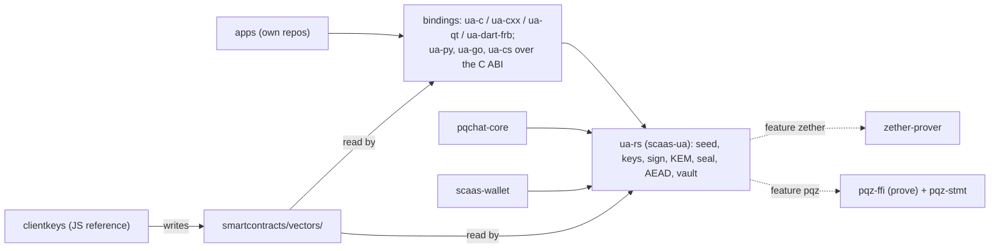

# `ua-rs-sign`: `ua-rs` as the one signer and crypto core of every client — design

**Status:** DRAFT, owner review pending. SPECIFIED, nothing built. Work order item 3d (owner 2026-11-05): its own round,
before the EVM freeze, in parallel with the regulated-kinds and PqChat-contract rounds; **no contract change**. The plan
follows in its own file (`superpowers/plans/2026-11-05-ua-rs-sign.md`) after the owner's answers to §14; §13 sketches it.
Rows marked **follows** apply a stated rule; rows marked **proposal** are the controller's and the owner may override them.
Normative rule ids are given at build, in [clients/ua-libraries.md](../../clients/ua-libraries.md) and
[clients/signers-clientkeys.md](../../clients/signers-clientkeys.md), with their `decisions.md` entries. UNAUDITED.

## 1. Owner rulings this spec follows (2026-11-05)

1. `ua-rs` (crate `scaas-ua`, `clients/ua-rs`) is the **only** signer. `pqchat-core` (the PqChat client core) and
   `scaas-wallet` (a Rust wallet module: SCaaS assets via the node, general EVM via alloy, the Zether and PQZ provers)
   sign only through it; neither signs on its own and neither depends on the other. Apps (separate repos) reach it
   through the existing bindings: `ua-c`, `ua-cxx`, `ua-qt`, `ua-dart-frb`, and `ua-py`, `ua-go`, `ua-cs` over the C ABI.
2. Scope: derivation exactly as `clients/clientkeys`; single-key signing for every kind; `UASig` and the `msig` minimal
   form; EIP-712 typed records; the group signers stay; the UA KEM key and its hybrid combiner; AEAD and HKDF by wrapping
   RustCrypto crates (never our own AES); a generic seal / open to a UA's KEM key. PqChat's own key schedule, labels,
   ratchet, envelope and padding stay in `pqchat-core`.
3. Secret keys never leave `ua-rs`: zeroized, no export except an explicit backup API.
4. (Coordinator message, same day.) `ua-rs` also gives clients the client-side crypto of `pqz-core` (`pqz-ffi`) and of
   `clients/zether-prover`, through the same Rust API and C ABI, as a **facade**: optional features, no proof,
   transcript or statement code in `ua-rs` (§10).

## 2. Scope and non-goals

**In scope:** a `Wallet` that holds the BIP-39 seed and every secret derived from it; key derivation (§4); signing (§3,
§5); `UASig`, `msig` member signatures in minimal form; the EIP-712 hasher and the record builders already in `ua-rs`;
the KEM key, combiner, encapsulation and decapsulation (§6); seal / open (§6.3); AEAD, HKDF, HMAC (§7); the keystore
and backup (§8); the Zether and PQZ facades (§10); the C ABI and the bindings (§9); the vectors (§11).

**Non-goals.** No contract, node or byte-format change of a signed record. No new kind. No verifier, precompile or
node-side code in the facades. No EIP-191 (`personal_sign`): live clientkeys has none (its digest is in
`legacy/typed-signing/`), and [CTR-UA-12](../../contracts/accounts.md#CTR-UA-12) forbids a raw-hash signature of an EOA.
No EIP-7702 authorization, ever ([CLI-SGN-40](../../clients/signers-clientkeys.md#CLI-SGN-40)). PqChat's wrap, chains,
message AEAD, padding and labels (UA-7 spec §6.2–§6.5 on branch `ua7-research`) stay in `pqchat-core`. The family
envelope builders (`fam/*`, SPECIFIED in clientkeys) stay with the family code; `ua-rs` signs their bytes through the
raw-digest opt-in only. Native NEAR and Algorand keys: clientkeys has no derivation path for them yet, so `ua-rs` has
none either (they follow when clientkeys adds one). The pure-Dart port `ua-dart` stays identity-only.



## 3. Kinds: scheme, crate, derivation, vectors

The kind list is `KINDS` in `ua-rs` `lib.rs` = clientkeys `ua.js` = `kinds.json` (accounts.md §1.6). "Byte-equal" means
the Rust output equals the vector row byte for byte; "verify-only" means the row's signature is checked and the Rust
signature verifies, because the scheme is randomized. The UA tree is `m/7622'/0'/<account>'/<kindNo>'/<i>'` with `kindNo`
the kind number in decimal ([CLI-SGN-30](../../clients/signers-clientkeys.md#CLI-SGN-30), signers-clientkeys §9).

| Kind | Name | Scheme and signed bytes | Crate (pin) | Derivation (as clientkeys §9) | Vectors |
|---|---|---|---|---|---|
| `0x0001`, `0x0003` | `evm-eoa`, `hedera-native` | secp256k1 ECDSA, RFC 6979, `r‖s‖v`, low-s, v ∈ {27, 28}, over an EIP-712 digest `ua-rs` computes, the key proof `keccak256("scaas-subject-key-proof-v1" ‖ challenge)`, or a raw digest with the opt-in | `k256` 0.13 (in tree) | BIP-32 `m/44'/60'/0'/0/i`, Hedera `m/44'/3030'/0'/0/i` (ed25519: `m/44'/3030'/0'/0'/i'`) | byte-equal |
| `0x0011`, `0x0013`, `0x0014`, `0x0015`, `0x0016` | stellar, aptos, sui, cosmos, ton | ed25519 (secp256k1 for cosmos) over the family bytes, raw opt-in only | `ed25519-dalek` =2.2.0, `k256` | clientkeys `NETWORKS` paths (SLIP-10 ed25519, hardened only; `coinType` override) | byte-equal (`seed.test.js` rows) |
| `0x0010` | `solana-ed25519` | ed25519 | `ed25519-dalek` | `m/44'/501'/i'/0'` (SPECIFIED in clientkeys, added there in T1) | byte-equal |
| `0x0100` | `webauthn-p256` | the authenticator signs; `ua-rs` builds the challenge (`ua_msg`) and the assertion encoding `abi.encode(authData, clientDataJSON, r, s)` | `p256` 0.13 (in tree) | none (platform credential) | encoding byte-equal on the test key; signature verify-only |
| `0x0101` | `p256` | ECDSA P-256 over `sha256(ua_msg)`, low-s, `r‖s` | `p256` 0.13 | UA tree, SLIP-10 `nist256p1` | byte-equal |
| `0x0102` | `ed25519` | ed25519 over `ua_msg` | `ed25519-dalek` =2.2.0 | UA tree, SLIP-10 ed25519 | byte-equal |
| `0x0103` | `bip340` | BIP-340 over `ua_msg`, 32-byte `aux` | `k256` 0.13 `schnorr` | UA tree, BIP-32 | byte-equal on fixed-`aux` rows; production `aux` from the OS RNG (verify-only) |
| `0x0104`, `0x0105` | `schnorr-bn254`, `schnorr-bls12381` | scaas Schnorr (`scaas.ua.schnorr.v1`, accounts.md §1.9) | arkworks 0.5 (in tree) | EIP-2333 style `m/254/0/<account>/<kindNo>` (salt `SCAAS-UA-BN254-v1`), EIP-2333 `m/12381/0/<account>/<kindNo>` | byte-equal on fixed-`aux` rows (nonce rule: Q7) |
| `0x0106`, `0x0107` | `bls12381-minsig`, `bls-bn254-minsig` | BLS min-sig, deterministic (DSTs / labels SIG and POP of `verify.rs`) | arkworks 0.5 | as the row above | byte-equal |
| `0x0108` | `secp256k1` | ECDSA over `ua_msg`, no prehash, `r‖s‖v`, low-s | `k256` 0.13 | UA tree, BIP-32 | byte-equal |
| `0x0110`–`0x0113` | MuSig2 / FROST (secp256k1, bn254) | BIP-327 and the bn254 port; RFC 9591 and FROST-BN254-KECCAK256 (`musig2.rs`, `frost.rs`, unchanged) | `frost-core` =3.0.0 (in tree) | MuSig2 participants: UA tree `kindNo` 272; FROST shares: DKG randomness, kept in the vault (§8) | `groups.json` byte-equal (fixed randomness) |
| `0x0120` | `msig` | a structure: member signatures (§5.2) | — | — | `portable.json`, `nested.json` |
| `0x0130`, `0x0131`, `0x0134` | `mldsa44`, `mldsa65`, `mldsa87` | FIPS 204, `pq_msg = keccak256(TAG ‖ ua_msg)`, empty context ([CTR-UA-23](../../contracts/accounts.md#CTR-UA-23)); hedged in production | `ml-dsa` =0.1.1 (in tree) | `ξ = HKDF-SHA256(seed, "scaas.ua.pq.v1", kind_tag ‖ u32 account ‖ u32 i)`, 32 B → `KeyGen_internal` | keys byte-equal; deterministic rows byte-equal (`pq_kat.json`, `pq_signatures.json`); hedged verify-only |
| `0x0132`, `0x0135` | `fndsa512`, `fndsa1024` | Falcon round 3, padded (666 / 1,280 B), over `ua_msg`; randomized | `pqcrypto-falcon` =0.4.1 (in tree) | the same HKDF, 48 B seed | keys: Q1; signatures verify-only |
| `0x0133` | `slhdsa128s` | FIPS 205 SHA2-128s over `pq_msg`, empty context | `slh-dsa` =0.2.0-rc.5 (in tree) | the same HKDF, 48 B → `SK.seed ‖ SK.prf ‖ PK.seed` | deterministic (`opt_rand = PK.seed`) byte-equal; randomized verify-only |
| `0x0141` | `zether-bls12381` | Zether Schnorr | feature `zether` (§10.1) | EIP-2333 `m/12381/<coin>/<account>/7` | zether-prover's vectors |

`evm-contract` (`0x0002`) and `soroban-contract` (`0x0012`) hold no key; `ua-rs` signs nothing for them. The scheme `0x0142`
(`pqz-mlwe`) is the PQZ key, not a signing kind (§10.2). **One key, one purpose** ([CLI-SGN-29](../../clients/signers-clientkeys.md#CLI-SGN-29)):
`ua-rs` refuses a UA-tree `kindNo` that is not the requested kind's, a Zether `use` (7, 8) for a non-Zether kind, and any
signing call on a UA key that does not build `ua_msg` itself.

## 4. Derivation

Every rule above is clientkeys' as built (`seed.js`, `pq.js`, `zether.js`) or as SPECIFIED in signers-clientkeys §9
(the UA tree, the EIP-2333 UA paths, `solana`): **follows**. Where clientkeys has the rule only on paper, task T1 builds it
there first, so the JS writes the vector rows and `ua-rs` is checked against them (§11). BIP-39: `bip39` (English list,
NFKD, 12–24 words with checksum, passphrase); 24 words generated from 32 bytes of OS entropy. BIP-32 secp256k1: `bip32`.
SLIP-10 ed25519 and `nist256p1`: HMAC-SHA512 in `ua-rs` (a dozen lines, as `seed.js`), checked on the SLIP-10 published
vectors. EIP-2333: in `ua-rs`, parametrised by the curve order and salt, checked on the EIP-2333 published vectors
(zether-prover keeps its own copy, unchanged; a test compares the two on the Zether path). The UA KEM key: §6.1.

## 5. Message forms and signing

### 5.1 What each key may sign

| Key | Calls | Built inside `ua-rs` |
|---|---|---|
| UA key (`0x0100`–`0x0135`) | `sign_ua(purpose, digest)` only | `ua_msg = keccak256(MSG_TAG ‖ TAG(kind) ‖ purposeTag ‖ digest)` ([CTR-UA-12](../../contracts/accounts.md#CTR-UA-12)); `purpose` must be in `PURPOSES` (`purpose_tag_v`, `pop` v2) |
| UA key as `msig` member | `sign_member(structure_ua, structure_ua_msg)` | `uaMessage(kind, PURPOSE_MEMBER, memberDigest(structure_ua, structure_ua_msg))`; nested: `inner_digest` |
| Native key | `sign_typed(typed_data)`, `sign_key_proof(challenge)`, `sign_digest(digest, AllowRawDigest)` | the EIP-712 digest; the key-proof digest; the raw form only with the explicit marker value ([CLI-SGN-40](../../clients/signers-clientkeys.md#CLI-SGN-40)) |
| Native key as `msig` member | portable purposes: `sign_typed` over the record's typed data (portable domain); otherwise `UAAuth` under the registry's domain | ([CTR-UA-07](../../contracts/accounts.md#CTR-UA-07)) |

### 5.2 Records, `UASig`, `msig`

The record builders exist (`ua8.rs`, `json.rs`: `registration_digest`, `kem_record_message`, `pqz_key_record_message`,
`membership_digest`, `holder_pop_message`, `UASig`, `MemberSig`, `msig_sig_minimal`). New: a `UASig` builder that takes
the signer's key handles and returns the struct; for an `msig`, the caller names the member slots and their handles, and
`ua-rs` refuses a set that is not minimal at both levels (`UAPoP`, the registry's verdict). Member acceptance
([CTR-UA-37](../../contracts/accounts.md#CTR-UA-37)) uses `membership_digest`.

### 5.3 EIP-712

One generic hasher (`encodeType` with referenced types sorted, `hashStruct`, `0x1901 ‖ domain ‖ struct`) over a typed-data
value with named fields: `{types, primaryType, domain, message}` as `eth_signTypedData_v4`. Domains: the portable
`("SCaaS UA Portable", "1")`; the registry's `UAAuth` domain `("SCaaS UARegistry", generation, chainId, registry, salt =
chainUid)`; the token and router domains `(name, version, chainId, verifyingContract, salt = chainUid)`. The struct list
is the typed structs of the current release: the hasher is generic, and the vectors (`vectors/typed/typed_ops.json`,
`ua/portable.json`) carry every struct, so no list is copied into `ua-rs`. **Canonical form before hashing:** an unbound
`relayer` / `feeRecipient` (mode bit not set) hashes as zero, as `MetaTxLib.canon` (§11 has its test).

## 6. The UA KEM key, the combiner, seal / open

### 6.1 Key

Scheme 1 only ([CTR-UA-32](../../contracts/accounts.md#CTR-UA-32)): `kemPk = 0x01 ‖ ek (1,568) ‖ pk_X (32)`, 1,601 B.
**Derivation (proposal, Q2):**

```text
kemSeed = HKDF-SHA256(ikm = BIP-39 seed, salt = "scaas.ua.kem.v1", info = "scaas.kem.1" ‖ ua (32) ‖ u64 version, L = 96)
(ek, dk) = ML-KEM-1024.KeyGen_internal(d = kemSeed[0:32], z = kemSeed[32:64])
sk_X     = kemSeed[64:96] (X25519 clamps);  pk_X = X25519(sk_X, 9)
```

`ua` binds the key to one UA (two UAs of one seed never share a KEM key); `version` is the KEM record's (0 = the
`register` key). At generation the FIPS 203 §7.3 decapsulation-key check runs once (P14 of the UA-7 spec).

### 6.2 Encapsulation and the combiner (UA-7 spec §6.1, **follows**)

```text
check:   kemPk[0] == 0x01, len 1,601; ek type check (1,568 B) and modulus check
         ByteEncode12(ByteDecode12(ek[0:1536])) == ek[0:1536]  (FIPS 203 §7.2)
(ct_M, ss_M) = ML-KEM-1024.Encaps(ek)
(e, E)       = fresh X25519 pair;  ss_X = X25519(e, pk_X);  ss_X == 0^32 → refuse
ss           = SHA3-256(ss_M ‖ ss_X ‖ E ‖ pk_X ‖ "scaas.kem.1")
```

`kem_encaps(kemPk) -> (mlkem_ct, x25519_eph, ss)` needs no secret. `kem_decaps(wallet, ua, version, mlkem_ct,
x25519_eph) -> ss` runs inside `ua-rs`; `dk` and `sk_X` never leave it. The 32-byte `ss` is returned (`Zeroizing`): it is
a per-encapsulation secret, not a key of the UA, and `pqchat-core` builds its wrap KEK from it (Q6).

### 6.3 Seal / open (generic, HPKE-like; **proposal**)

```text
Sealed { version: u8 = 1, scheme: u8 = 1, mlkemCt: bytes (1,568), x25519Eph: bytes32, ciphertext: bytes }
seal(kemPk, purpose, aad, pt):
  (mlkemCt, x25519Eph, ss) = kem_encaps(kemPk)
  key        = HKDF-SHA256(ikm = ss, salt = empty,
                           info = "scaas/seal/v1" ‖ u8 scheme ‖ be16 len(purpose) ‖ purpose ‖ keccak256(kemPk), L = 32)
  ciphertext = AES-256-GCM(key, nonce = 0^96, pt, aad)          len(pt) + 16
open(wallet, ua, version, purpose, aad, Sealed): kem_decaps, the same key, AES-256-GCM open; any failure → SealOpen
```

- `purpose`: ASCII `[a-z0-9./-]`, 1–64 B, named by the caller. This round defines `scaas/backup/v1` (§8) and
  `scaas/link/v1` (device linking, UA-7 spec P6: the existing device seals the UA's secrets to the new device's ephemeral key).
- `nonce = 0` is safe because every key encrypts once (a fresh `ss` per seal), as in PqChat's wrap. The key binds the
  version, the scheme, the purpose and the recipient's whole key; `ss` binds `E` and `pk_X`.
- Storage and transport form (only there): `version ‖ scheme ‖ mlkemCt ‖ x25519Eph ‖ ciphertext`; every API takes and
  returns the named fields. A version or scheme other than 1 is refused (`SealVersion`).

## 7. AEAD, HKDF, HMAC

| Call | Wraps | Notes |
|---|---|---|
| `aead_seal / aead_open(alg, key32, nonce12, aad, data)` | `aes-gcm` =0.10.3 (`Aes256Gcm`), `aes-gcm-siv` =0.11.1 (`Aes256GcmSiv`) | `alg` is an enum, never a string; output `ct ‖ tag`; a bad tag returns an error and no plaintext |
| `hkdf_sha256(ikm, salt, info, len)`, `hkdf_expand_sha256(prk, info, len)` | `hkdf` =0.12.4 | `len ≤ 255 × 32` |
| `hmac_sha256(key, data)` | `hmac` 0.12 (via `hkdf`) | PqChat chains (`mk_i`, `n_i`, `ck_{i+1}`) |

Both AES crates sit on `aes` 0.8, the generation `pqzl` already pins (`aes` =0.8.4): one AES implementation in a build.
Keys passed in are caller-held session keys (PqChat's `K`, `mk_i`), not UA secrets.

## 8. Key storage, zeroize, backup

- **In memory.** The seed (64 B), entropy, every derived secret, `ss`, KEKs and DEKs are `Zeroizing<…>` or types with
  `ZeroizeOnDrop`; key types are neither `Clone` nor `Debug`-printing, and have no accessor for secret bytes. Signing
  takes `&self`. Residuals stated: arkworks scalars and `frost-core` shares are copied on the stack by the crates.
- **Keystore = clientkeys vault v1, byte-compatible** (**proposal**, Q3): `{v: 1, label, data: {iv, ct}, pin: {kdf:
  "scrypt", N, r, p, salt, iv, ct}, prf?: {credentialId, salt, iv, ct}}` ([CLI-SGN-02](../../clients/signers-clientkeys.md#CLI-SGN-02));
  new passphrase envelopes at `N = 2^17, r = 8, p = 1` ([CLI-SGN-21](../../clients/signers-clientkeys.md#CLI-SGN-21)), old
  ones open and are re-wrapped; AES-256-GCM, AAD `label|data`, `label|pin`, `label|prf`. Crate `scrypt` =0.11.0.
  **The hook:** the `prf` envelope takes any 32-byte platform secret (passkey PRF, an Android Keystore or iOS Keychain
  HMAC output) through `HKDF-SHA256(…, "scaas-clientkeys-vault-v1/prf")`, so device-bound unlock needs no new format.
  One vault per secret, as clientkeys (`seed`, `frost-share:<ua>`, `kem:<ua>:<version>` for a key not from the seed).
- **Why scrypt:** a JS vault opens in Rust and the reverse; one format in every client; memory-hard (RFC 7914) at
  128 MiB. Argon2id (RFC 9106) resists GPUs somewhat better but would split the format; it stays a later vault version.
- **Explicit exports, the only ways out:** `export_vault` (encrypted); `SeedBackup` (show once, three-word check, as
  `backup.js`); `backup_seal(recipient_kemPk)` = seal of a vault payload with purpose `scaas/backup/v1` (to an
  organisation's recovery UA or another device); `export_pqz_leaf(account, i)` (the 32-byte PQZ leaf for `pqz-cli` or a
  key oracle, [CTR-PQZ-13](../../contracts/pq-zero-knowledge.md#CTR-PQZ-13)). No call returns the seed, a private key or a
  KEM secret in the clear.

## 9. API surface

### 9.1 Rust (feature `wallet`; the existing verify / digest API is unchanged)

```rust
pub struct Wallet; // the unlocked seed + vault entries; Send + Sync, no Clone
impl Wallet {
    pub fn generate() -> (Wallet, SeedBackup);
    pub fn from_mnemonic(words: &str, passphrase: &str) -> Result<Wallet>;
    pub fn open_vault(vault: &Vault, unlock: Unlock) -> Result<Wallet>;          // Unlock::Passphrase(&str) | Unlock::Prf(&[u8; 32])
    pub fn seal_vault(&self, passphrase: &str, prf: Option<PrfEnvelope>) -> Result<Vault>;
    pub fn ua_key(&self, kind: u16, account: u32, index: u32) -> Result<UaKey>;
    pub fn native_key(&self, network: Network, index: u32, coin_type: Option<u32>) -> Result<NativeKey>;
    pub fn kem_key(&self, ua: &[u8; 32], version: u64) -> Result<KemKeyPair>;   // public part readable, secret not
    pub fn backup_seal(&self, recipient_kem_pk: &[u8]) -> Result<Sealed>;
}
impl UaKey {
    pub fn kind(&self) -> u16;  pub fn key_data(&self) -> Vec<u8>;  pub fn ua(&self) -> [u8; 32];
    pub fn sign_ua(&self, purpose: &[u8; 32], digest: &[u8; 32], rng: &mut impl CryptoRngCore) -> Result<Vec<u8>>;
    pub fn sign_member(&self, structure_ua: &[u8; 32], structure_ua_msg: &[u8; 32], rng: …) -> Result<Vec<u8>>;
}
impl NativeKey {
    pub fn address(&self) -> Vec<u8>;
    pub fn sign_typed(&self, td: &TypedData) -> Result<Vec<u8>>;
    pub fn sign_key_proof(&self, challenge: &[u8]) -> Result<Vec<u8>>;
    pub fn sign_digest(&self, digest: &[u8; 32], _: AllowRawDigest) -> Result<Vec<u8>>;
}
pub fn kem_encaps(kem_pk: &[u8], rng: …) -> Result<(Vec<u8>, [u8; 32], Zeroizing<[u8; 32]>)>;
impl KemKeyPair { pub fn kem_pk(&self) -> Vec<u8>; pub fn decaps(&self, mlkem_ct: &[u8], x25519_eph: &[u8; 32]) -> Result<Zeroizing<[u8; 32]>>;
                  pub fn open(&self, purpose: &str, aad: &[u8], s: &Sealed) -> Result<Zeroizing<Vec<u8>>>; }
pub fn seal(kem_pk: &[u8], purpose: &str, aad: &[u8], pt: &[u8], rng: …) -> Result<Sealed>;
```

The MuSig2 / FROST session API wraps `musig2.rs` / `frost.rs` with a session object whose secret nonce is consumed once
(a second `sign` on it is an error); no algorithm changes. Deterministic test entry points (`aux`, `m`, `e`, Falcon or
ML-DSA randomness) exist only under the test feature `vectors`, never in a release build.

### 9.2 C ABI (`ua-c`, ABI version 5 → 6)

The rules of `scaas_ua.h` stay: caller-owned buffers, `(out, size_t *out_len)` with `SCAAS_UA_ERR_BUFFER`, a status per
call, `scaas_ua_last_error`, every export in `catch_unwind`. **New:** opaque handles, the only Rust allocations that cross
the ABI, freed (and zeroized) by their `_free`:

```c
ScaasUaStatus scaas_ua_wallet_from_mnemonic(const char *words, const char *passphrase, ScaasUaWallet **out);
ScaasUaStatus scaas_ua_wallet_open_vault(const char *vault_json, const char *passphrase, const uint8_t *prf32, ScaasUaWallet **out);
ScaasUaStatus scaas_ua_wallet_seal_vault(const ScaasUaWallet *w, const char *passphrase, char *out_json, size_t *out_len);
void          scaas_ua_wallet_free(ScaasUaWallet *w);
ScaasUaStatus scaas_ua_ua_key_data(const ScaasUaWallet *w, uint16_t kind, uint32_t account, uint32_t index, uint8_t *out, size_t *out_len);
ScaasUaStatus scaas_ua_sign_ua(const ScaasUaWallet *w, uint16_t kind, uint32_t account, uint32_t index,
                               const uint8_t purpose32[32], const uint8_t digest32[32], uint8_t *sig, size_t *sig_len);
ScaasUaStatus scaas_ua_sign_typed(const ScaasUaWallet *w, uint32_t network, uint32_t index, const char *typed_data_json, uint8_t *sig, size_t *sig_len);
ScaasUaStatus scaas_ua_kem_pk(const ScaasUaWallet *w, const uint8_t ua32[32], uint64_t version, uint8_t out1601[1601]);
ScaasUaStatus scaas_ua_kem_decaps(const ScaasUaWallet *w, const uint8_t ua32[32], uint64_t version,
                                  const uint8_t *mlkem_ct, size_t mlkem_ct_len, const uint8_t x25519_eph32[32], uint8_t ss32[32]);
ScaasUaStatus scaas_ua_seal(const uint8_t *kem_pk, size_t kem_pk_len, const char *purpose, const uint8_t *aad, size_t aad_len,
                            const uint8_t *pt, size_t pt_len, uint8_t *mlkem_ct, size_t *mlkem_ct_len, uint8_t x25519_eph32[32],
                            uint8_t *ct, size_t *ct_len);
ScaasUaStatus scaas_ua_aead_seal(uint32_t alg, const uint8_t key32[32], const uint8_t nonce12[12], /* aad, data, out */ …);
```

plus `sign_member`, `sign_key_proof`, `sign_digest_raw` (its own name, no flag argument), `kem_encaps`, `open`,
`aead_open`, `hkdf_sha256`, `hmac_sha256`, `seed_backup_*`, `export_pqz_leaf`, the `UASig` builder as one JSON call
(feature `json`, the `registration_args` convention: named fields), and the facade calls of §10. Status codes are added for
`SealOpen`, `SealVersion`, `KemCheck`, `Aead`, `VaultOpen`, `RawDigestRefused`. Handles are thread-safe. `ua-cxx`, `ua-qt`
and `ua-dart-frb` call the Rust API; `ua-py`, `ua-go`, `ua-cs` load `libscaas_ua_c` for signing (ctypes, cgo, P/Invoke)
and keep their own ports for ids and digests, which stay the independent cross-check.

## 10. Facades: Zether and PQZ (features `zether`, `pqz`)

`ua-rs` depends on `clients/zether-prover` and `pqz-core/ffi` (neither depends on `scaas-ua`, so no cycle). Every proof,
transcript, statement and encryption stays in those crates; `ua-rs` adds key custody and the ABI. A change there is
theirs (a transcript change: a new `proofSystemId`, new vectors, the full gate, AGENTS.md). Zether and PQZ are separate
modules, separate handles and separate features; neither calls the other. Not exposed: verifiers, the precompile, the
self-test, `test-hooks`, `fuzz`, the PQZL C core (`pqzl-c` off: `pqz-ffi` defaults to Rust).

### 10.1 Zether (`zether`, BLS12-381 only; `bn254` stays zether-prover's legacy feature, off)

| Need | zether-prover entry | Secret handling in `ua-rs` |
|---|---|---|
| Conf key, viewing key | `keys::ZetherKey::derive(seed, coin, account, 7 / 8)` (EIP-2333 tree) | seed and `x` stay in the `Wallet`; public `Y`, the UA id out |
| Encrypt, decrypt balance and pending, check a balance | `elgamal::encrypt`, `BsgsTable::decrypt`, `decrypt_pending`, `check_balance` (table bits per target, `BsgsParams::for_target`) | `x` from the handle |
| Proofs | `prove_transfer`, `prove_transfer_multi` (decoys, auditor, memo), `prove_burn` (unshield), with `Binding::Relayed` / direct | witness built inside |
| Memo, recovery, disclosure | `open_memo`, `recover_transfer_json`; the openings `SENDER_S`, `SENDER_CP`, `RECEIVER_X`, `AUDITOR` as zether-prover builds them ([CTR-ZTH-43](../../contracts/zether.md#CTR-ZTH-43)) | `s` / `x` from the handle |
| PoP, owner and UA signatures, typed digests, calls | `schnorr::zether_pop`, the `ownerAuth` and `uaSig` commands, `typed::typed_digest`, `named_call`, `envelope` | signature inside |

The C ABI gives the JSON commands of `api::call` (named fields) with one change: the `key` field names
`{coin, account}` of the handle; `ua-rs` refuses `x`, `mnemonic` and `seed` in any input, so no secret crosses the ABI.

### 10.2 PQZ (`pqz`, `pqz-ffi` with feature `prove`)

| Need | `pqz-core` entry | Secret handling |
|---|---|---|
| PQZ key | `seed32 = HKDF-SHA256(seed, "scaas.ua.pq.v1", "scaas.ua.pqz-mlwe.v1" ‖ u32 account ‖ u32 i)` → `pqzl::keygen` ([CTR-PQZ-13](../../contracts/pq-zero-knowledge.md#CTR-PQZ-13)) | `s`, `e`, `seed32` stay; `pk` out; `export_pqz_leaf` is the explicit export |
| Encrypt, decrypt | `pqzl::enc`, `enc_multi`, `dec`, `dec_win` | `s` from the handle |
| Statements | `pqz-stmt` `Register`, `Debit` (transfer, burn = unshield, refresh), `Disclose`, `Multi` with their `encode` (typed fields) | public |
| Proofs | `prove(op, stmt, wit, rnd32)`, ops 1–5 and 7, witness layouts `wit_key`, `wit_debit`, `wit_ds`, `wit_multi`; `rnd32` from the OS RNG (hedged, [CTR-PQZ-19](../../contracts/pq-zero-knowledge.md#CTR-PQZ-19)) | witness built inside from the handle |
| `R_REG` and PoP | `R_REG` = op 3 over `pqz_reg_message` (in `ua-rs`); the holder's PoP = `sign_ua(pop v2, registrationDigest)` | as above |
| Sender memo (op 7) | `memo::{seal, open}` | memo key from `seed32` |

Shield and roll-over take no proof and no client crypto (`mtxShield`, `mtxRollOver`); disclosure is ops 4 and 5
(`SENDER_S`, `RECEIVER_X`, `AUDITOR`, CTR-PQZ-14). Reading chain state stays in `scaas-wallet`. **Parameter set:** one per
build, as `pqz-ffi` (owner 2026-10-21): `ua-rs` features `pqz-set-n2048-kmax1024`, `pqz-set-n2304-kmax4096` (default with
`pqz`), `pqz-set-n2560-kmax16384`, `pqz-set-n2816-kmax65536` forward to `pqz-ffi`'s `set-<set>`. `pqz_set()` returns
the set name, `PK` length and `proofSystemId`s; the wallet compares them with the token's deployed `PqzSet` and every call
on a mismatch is refused (`PqzSetMismatch`). The `pqz` feature builds with `pqz-core`'s pinned toolchain (Rust 1.97.1);
the rest of `ua-rs` keeps `rust-version = 1.90`.

## 11. Vectors

Generated once by clientkeys (the JS reference, noble), never by hand, read by clientkeys' tests, `ua-rs`, `ua-c`'s
Python suite, `ua-cxx`, `ua-qt`, `ua-dart-frb`, and the C-ABI tests of `ua-py`, `ua-go`, `ua-cs`. Regenerate rule: a
byte-format change regenerates all of them with their generator in one commit, and every reader follows in that
commit (AGENTS.md). New files under `smartcontracts/vectors/ua/`:

| File | Rows | Compared |
|---|---|---|
| `keys.json` | the `pq_kat.json` mnemonic and the BIP-39 test mnemonic → public key and UA id per kind × account {0, 1} × index {0, 1}; native addresses per `NETWORKS`; the KEM key per (UA, version) | byte-equal (Falcon: Q1) |
| `sign.json` | per signing kind: deterministic rows (fixed `aux`, deterministic ML-DSA / SLH-DSA) and randomized rows; `msig` minimal and non-minimal sets; typed-data rows including **a `MetaTransaction` / `UAMetaTransaction` with a non-zero unbound `relayer` and `feeRecipient`** whose expected digest is the zeroed one | byte-equal or verify-only per §3 |
| `kem.json` | encapsulation with fixed `m` and `e` → `mlkemCt`, `E`, `ss`; P14 refusals (modulus, length, scheme 2, all-zero `ss_X`) | byte-equal |
| `seal.json` | seal with fixed randomness per purpose; refusals (wrong purpose, AAD, version, scheme, flipped byte in each field) | byte-equal |
| `vault.json` | a clientkeys vault (small-`N` rows and one at `N = 2^17`) opened by `ua-rs`, and the reverse; wrong passphrase, altered AAD label | byte-equal plaintext |

AEAD, HKDF, HMAC, BIP-32, SLIP-10 and EIP-2333 are checked on their published vectors (NIST GCM, RFC 8452, RFC 5869,
RFC 4231, the BIP and SLIP texts) inside `ua-rs`, no new file. The facades reuse the existing vectors: Zether
`clients/zether-prover/vectors/` (`r33_keys.json`, `transfer_*`, `burn_*`, `disclosure_*`, `schnorr_*`), PQZ
`smartcontracts/vectors/pqz/<set>/` (`keygen.json`, `enc.json`, `statement_*.json`, `proof_pqzl.json`, `proof_pqzh.json`),
read by the facade's tests through the same entry points a client uses.

## 12. Targets, constant time, tests

| Target | Core (sign, KEM, seal, AEAD, vault) | `zether` | `pqz` |
|---|---|---|---|
| x86-64, aarch64 desktop / server | yes | yes | yes. Rust `R_TX` prove p50 529 ms, heap peak 60 MiB; `R_TXM8` 1,128 ms, 110 MiB (`pqz-core/pqzl/rust/README.md` D6, `proofSystemId` v2, one desktop; v3 roughly doubles rejection attempts, no later run) |
| Android, iOS (aarch64; via `ua-c` staticlib or `ua-dart-frb`) | yes | yes; BSGS table by device RAM | builds (pure Rust); **no device measurement in the repo**: T9 measures against the [CTR-PQZ-18](../../contracts/pq-zero-knowledge.md#CTR-PQZ-18) budget (≤ 15 s, ≤ 128 MiB) |
| `wasm32-unknown-unknown` | yes; Falcon is C (PQClean) and needs clang for wasm32 without libc: T0 checks, else Falcon kinds are refused in that build | yes (zether-prover has a wasm build) | yes: wasm32 `R_TX` prove p50 1,344 ms, peak 68.9 MiB (D6); op 7 up to M = 8; prove harness 850 KB |

`zether` and `pqz` are off by default, so an app that needs neither links neither. **Constant time:** `k256`, `p256`,
`ed25519-dalek`, `ml-dsa`, `ml-kem`, `aes` (fixsliced or AES-NI), PQClean Falcon (integer `fpr`) are written constant
time; arkworks (BLS, bn254, Zether) and the MuSig2-bn254 port are not, which is stated as a residual; tag and key
comparisons use `subtle`; wasm32 JIT gives no guarantee ([CTR-PQZ-18](../../contracts/pq-zero-knowledge.md#CTR-PQZ-18)).
**Tests:** red first (each task's vector reader lands failing before its code); every negative test has its positive
control (the same input unmodified passes) and changes one thing; a mutant harness as in the merge rounds, each mutant
applied alone, the suite must fail:

- derivation: hardened bit dropped; salt or `info` order swapped; `account` / `index` swapped; u32 little-endian;
  non-hardened ed25519 step accepted; wrong `kindNo`; KEM `version` ignored;
- signing: low-s normalisation removed; `v` offset 27 lost; a prehash added for `0x0108` / removed for `0x0101`; Falcon
  signs `pq_msg`; ML-DSA context non-empty; purpose tag v1 for `pop` v2; another kind's `TAG`; unbound `relayer` hashed;
- `msig`: minimal check skipped; `memberDigest` over the wrong structure; slots unsorted;
- KEM and seal: modulus check removed; all-zero `ss_X` accepted; combiner fields reordered or `E` dropped; label changed;
  `kemPkHash` or `purpose` left out of `info`; `aad` ignored; open returns plaintext on a bad tag;
- vault: AAD label dropped; stored scrypt parameters ignored on open; PRF envelope opened without its label;
- facades: a `key` with `x` accepted; set mismatch accepted.

Gates per task: `cargo test` (default, `wallet`, `signers`, `pq`, `json`, `zether`, `pqz`) and `cargo clippy --all-targets
-- -D warnings` in `ua-rs` and `ua-c`; `npm test` in clientkeys; each binding's suite; `docs_check`; all through
`scripts/capped`, foreground.

## 13. Task plan sketch (the plan follows in its own file)

| Task | Content | Gate |
|---|---|---|
| T0 | Pins and `cargo tree -d` (one `aes`, one `curve25519-dalek`, `rand_core` generations); Falcon seeded keygen: PQClean vs noble 0.7.1 (Q1); cross-builds wasm32, Android, iOS | spike report, no code kept |
| T1 | clientkeys: §9 UA-tree `deriveUAKey`, the KEM key, `seal` / `open`, the five generators and files | `npm test`; files regenerate byte for byte |
| T2 | `ua-rs` derivation, `Wallet`, zeroize types | `keys.json` |
| T3 | Signers per kind, `UASig`, `msig`, EIP-712 hasher, native keys, group sessions | `sign.json`, `groups.json`, `portable.json` |
| T4 | KEM, combiner, seal / open, AEAD, HKDF, HMAC | `kem.json`, `seal.json`, published vectors |
| T5 | Vault and backup | `vault.json` |
| T6 | Facades `zether`, `pqz` | the existing Zether and PQZ vectors through the facade |
| T7 | C ABI v6, header, smoke | `ua-c` suite, header drift |
| T8 | Bindings | each binding's suite on the new files |
| T9 | Target matrix and sizes, mobile PQZ measurement (asked first: timing runs need a quiet host) | report |
| T10 | Mutants, gate summary, rule ids in ua-libraries.md / signers-clientkeys.md, `decisions.md` entries, NOTICE | harness kills every mutant; `docs_check` |

**New crates and licences** (read from crates.io and the local registry, 2026-11-05; all permissive, compatible with
`LicenseRef-Vegan-Community-1.0`, whose users get MIT or Apache-2.0 terms; BSD and MIT notices go into
`clients/ua-rs/NOTICE` as in `pqz-core/NOTICE`):

| Crate | Pin | Licence | Use |
|---|---|---|---|
| `ml-kem` | =0.3.4 | Apache-2.0 OR MIT | ML-KEM-1024 |
| `x25519-dalek` | =2.0.1 (on `curve25519-dalek` 4, in tree) | BSD-3-Clause | X25519 |
| `aes-gcm` / `aes-gcm-siv` | =0.10.3 / =0.11.1 | Apache-2.0 OR MIT / MIT OR Apache-2.0 | AEAD |
| `hkdf` (+ `hmac` 0.12) | =0.12.4 | MIT OR Apache-2.0 | HKDF, HMAC |
| `scrypt` | =0.11.0 | MIT OR Apache-2.0 | vault |
| `bip39` / `bip32` | =2.2.2 / =0.5.3 | CC0-1.0 / Apache-2.0 OR MIT | seed, BIP-32 |
| `zeroize` | =1.8.2 | Apache-2.0 OR MIT | wiping |
| facade `zether` (in-repo crate) | new external deps: `ark-serialize`, `ark-std` 0.5, `serde`, `thiserror` | MIT OR Apache-2.0 | |
| facade `pqz` (in-repo crates) | new external dep: `aes` =0.8.4 (via `pqzl`) | MIT OR Apache-2.0 | |

## 14. Open questions for the owner (each with a recommendation)

1. **Q1 — Falcon keys from the seed.** clientkeys derives `fndsa512` / `fndsa1024` keys with noble 0.7.1's keygen (a
   48-byte seed, "implementation-specific"); `pqcrypto-falcon` has no seeded keygen. **Recommendation:** T0 checks whether
   PQClean's keygen seeded with the same 48 bytes (SHAKE256 PRNG, as its `crypto_sign_keypair`) equals noble's; if so,
   `ua-rs` calls PQClean's seeded entry through a small vendored build (MIT); if not, both clients move to PQClean's
   keygen as the rule (every chain is test-only) and the vectors are regenerated.
2. **Q2 — KEM key from the seed.** **Recommendation:** derived (§6.1), so a user restores it from the phrase like every
   other key. Cost (UA-7 spec P5): a deleted version can be regenerated, so deleting it bounds nothing; an owner who wants
   that picks a random key, kept in the vault (`kem:<ua>:<version>`) and in the backup.
3. **Q3 — Keystore KDF.** **Recommendation:** scrypt in the clientkeys vault v1 format (§8); Argon2id only as a later
   vault version for every client at once.
4. **Q4 — Browsers.** Ruling 1 makes `ua-rs` the signer of every client, while browsers sign with clientkeys today.
   **Recommendation:** a wasm32 binding of `ua-rs` (wasm-bindgen) after T9 measures its size and speed; then browser
   apps sign through it and clientkeys stays the JS reference that writes the vectors and checks them.
5. **Q5 — Seal AEAD.** **Recommendation:** AES-256-GCM with a single-use key and a zero nonce (§6.3), as PqChat's wrap
   and available in WebCrypto; GCM-SIV adds nothing when the key is never reused.
6. **Q6 — `ss` to callers.** **Recommendation:** `decaps` returns the 32-byte shared secret (zeroizing) so `pqchat-core`
   keeps its own wrap KEK; the KEM secret key itself never leaves `ua-rs`.
7. **Q7 — Production nonces of scaas Schnorr (`0x0104`, `0x0105`) and BIP-340.** No production signer exists for the two
   scaas Schnorr kinds (the vector signer's nonce is test-only). **Recommendation:** hedged, BIP-340 style: `k =
   hashToScalar(keccak256("scaas.ua.schnorr.nonce.v1" ‖ sk ‖ ua_msg ‖ aux))`, `aux` 32 B from the OS RNG; vector rows fix
   `aux`, so they are byte-equal; BIP-340 itself takes `aux` from the OS RNG.
8. **Q8 — PQZ set per build.** **Recommendation:** one set per build, as `pqz-ffi`, with the run-time set check (§10.2);
   a wallet that serves chains with two sets ships two builds.
9. **Q9 — PQZ statement assembly.** The planned client prover (P6h, "API shaped like zether-prover") does not exist.
   **Recommendation:** the facade wraps `pqz-ffi` `prove` and the `pqz-stmt` structs now; when the P6h crate lands in
   `pqz-core`, the facade wraps it and adds nothing of its own; reading chain state stays in `scaas-wallet`.
10. **Q10 — `slh-dsa` is a release candidate** (=0.2.0-rc.5, the verifier's pin today). **Recommendation:** sign with the
    same pin, so signer and verifier agree, and move both to the first release with a vector check.
