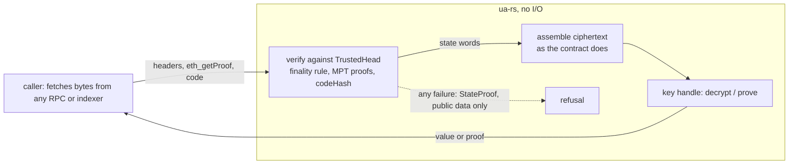

# No decryption oracle: bringing the client libraries in line with ARCH-POS-13 — fix spec

**Status:** SPECIFIED, nothing built (2026-11-06). Fix spec for owner ruling
ARCH-POS-13 "Never a decryption oracle" (`docs/decisions.md` on branch `ua-mtx-merge`, not yet on this branch,
commit `62adb3d7`; also in `AGENTS.md`). The owner's words: **"NO oracle!"**: absolute, no exception, no opt-in. This spec
offers no option that keeps any oracle; where a design choice remains it recommends one and says why. Plan tasks: appended
to [`plans/2026-11-05-ua-rs-sign.md`](../plans/2026-11-05-ua-rs-sign.md) (section "ARCH-POS-13 rework"). Inputs: the
read-only code audit of decrypt entry points (2026-11-06, findings F1 to F9 below) and the research note
`docs/research/pqz-threshold-decrypt-prove.md` §12.1 / §12.5 (branch `ua-mtx-merge`). Everything here is **UNAUDITED**.
Zether and PQZ are separate schemes, modules and handles; each section names the one it is about.

## 1. The rule, and what counts as an oracle

ARCH-POS-13, in short: no part of SCaaS decrypts, opens or test-decrypts a ciphertext **chosen by anyone other than the key
holder** and lets that party learn anything about the result (plaintext, success or failure, an error code, timing, or a
later action that depends on it). A result reaches only the key holder or a viewer the holder names. A ciphertext that
arrives from outside (an RPC or indexer response, a disclosure bundle, a peer message) gives that source nothing.

Why PQZ needs it: PQZ encryption is IND-CPA, not CCA. A query with `u` the unit polynomial at polynomial `j` and
`v_i = ⌈Δ/2⌉ + off` returns `M_i = [s_j[16w + i] ≤ off]`, so 8·K queries (288 at `n2304-kmax4096`; the audit's tighter
construction needs 144) recover `s` exactly (research §12.1, N3b). Zether's lifted ElGamal has no such key recovery, but
the rule is one rule for every scheme.

**Three facts the design rests on** (all from `docs/contracts/pq-zero-knowledge.md` on `ua-mtx-merge`):

1. **Contract state is always well-formed.** Every ciphertext enters PQZ state with a proof of exact norms (T4), the only
   trivial term is built by the contract, and the noise budget is worst case over proven norms plus `K_MAX`, enforced at
   credit and at debit (§4.3, CTR-PQZ-03, T5): "an accepted state never decrypts wrongly or fails". So decrypting a
   ciphertext that **is** contract state gives its value and nothing else: no rounding near `Δ/2`, no information on `s`.
2. **A ciphertext's bytes say nothing about whether they are state.** A crafted `(u, v)` and a real one have the same form.
   Only an outside check can tell them apart, and that check must use **public data only**: a check that uses `s` (a
   noise bound, a digit range) refuses exactly on the crafted queries, so the refusal is the oracle bit (research §12.5).
3. **Every outward action after a decryption is a signal.** A debit proof leaves the device by design; whether it was
   produced is visible to the relayer and to the chain. So "keep the result on the device" cannot cover a debit.

## 2. Findings this spec resolves

| Id | Sev. | Where (ua-rs-sign unless [M] = `ua-mtx-merge`) | Problem | Resolved in |
|---|---|---|---|---|
| F1 | P1 | `clients/ua-rs/src/facade/pqz.rs` command `dec {ct, window}` (parse ~337, run ~641, `value` ~504); every binding through `scaas_ua_pqz_call` (`ua-c` `lib.rs` ~2426, `ua-py`, `ua-go`, `ua-cs`, `ua-cxx`, `ua-dart-frb`) | any well-formed caller ciphertext → all 16 digits: the rounding oracle | §4.5, §4.6 |
| F2 | P1 | same file, `proveDisclose {stmt}` (~392, ~673) | the whole op 5 statement is the caller's; proof or refusal is a 1-bit oracle (≤ 2n queries) | §4.6 |
| F3 | P2 | same file, `proveTransfer`, `proveBurn`, `proveRefresh`, `proveTransferMulti` (~348–372, ~655–667, `rest` ~709) | decrypt the caller's `T`; the success bit reaches a malicious RPC or relayer | §4.5 |
| F4 | P3 | `pqz-core`: C `pqz.h` ~156–193, `pqz_keys.c` ~229–252; Rust `pqzl/rust/src/lib.rs` ~389–406 (`decrypt_raw`); `pqz-core/ffi/src/pqzl/{rust,c}.rs` (`dec`, `dec_win`) | return digits and noise / raw `w` to any in-process caller; [M] T6 says "noise never leaves `pqz_dec`" (`pq-zero-knowledge.md` ~2435) | §4.8 |
| F5 | P2 | [M] `docs/clients/signers-clientkeys.md` ~81–88 (CLI-SGN-31), [M] `docs/research/07-custody-providers.md` ~111 (PLANNED) | `zk_mul_by_x(points, ctx)` is a static-DH oracle that bypasses `ChainWitness` | §4.9 |
| F6 | P3 | `clients/zether-prover/src/api.rs` ~685–708 (`decrypt`, `decryptPending`, `checkBalance`); `clients/ua-rs/src/facade/zether.rs` | caller `(C, D)`: no key recovery, but plaintext and timing leak; variable-time `D·x` on an attacker's `D` | §4.7 |
| F7 | P3 | `zether-prover` binary `zether-read-balance --rpc` | decrypts what an RPC hands it | §4.7 |
| F8 | P3 | `openMemo` in both facades (PQZ: `pqz_ffi::memo::open`, a keystream without MAC) | a crafted memo with a real memo's header and salt returns the keystream, which opens the real memo (no key recovery) | §4.6, §4.7 |
| F9 | — | docs: PQZ CTR-PQZ-03 / -14 / T6; Zether `zether.md` says nothing; NODE-LANE-03 and CLI-SGN-31 cover only the server oracle; `docs/clients/ua-libraries.md` says nothing | the rule is not stated where implementers read | §6 |
| F10 | P2 | `pqz.rs` `multi` (~803): `memoHash = keccak(memo)` always | the contract fills `memoHash` only in HASH mode (`PqzCore._parseMulti`, ~430) and leaves 0 in BUNDLE; an op 7 BUNDLE proof from the facade is refused | §4.10 |

F10 is not an oracle; it is a correctness bug in the same facade, found by the T16a agent (2026-11-06), fixed with this rework.

## 3. The central question: how does the library know a ciphertext is chain state?

| Construction | Removes the oracle? | Why / why not |
|---|---|---|
| **(A) Proven state**: the library assembles every ciphertext itself from contract state it has verified against a block header its own light client accepted (EIP-1186 `eth_getProof` on EVM) | **yes** | the only check that tells "on chain" from "forged"; it uses public data only, so a refusal says nothing about `s` or the plaintext; it works from state alone (CTR-PQZ-07 keeps holding) |
| (B) Well-formedness certificates: verify the proof that admitted each ciphertext | no (not buildable) | a PQZ credit's proof is the sender's debit proof, whose statement contains the **sender's** `T` at that block (`Debit.t`), which is not in state (materialised `acc` is overwritten, window slots are deleted); proofs live in calldata (history expiry); an op 4 `SENDER_S` proof would certify a credit without `T` but needs the sender's cooperation, and a keeper's rollover of an uncertified credit would strand the account. Zether has the same shape (the transfer statement carries the sender's account ciphertext). Even where available, a forged but well-formed composition (an RPC adds an honest encryption of a known value to the real `T`) still leaks the real balance through the holder's later actions |
| (C) Containment: results never leave the device, failures never signalled | no | a debit proof leaves the device by design; whether one was produced is the oracle bit (fact 3) |
| (D) Noise-bound or digit-range filter before use | no | the refusal is the oracle: the same 8·K queries, moved to the filter's edge |
| (E) Noise flooding (add random noise before rounding) | no | the attacker scales `u` (`u = c·unit`), so the `s`-dependent term outgrows any flooding that keeps honest decryption correct (budget at `n2304-kmax4096`: worst-case noise ≈ 2^25.7 against `Δ/2` ≈ 2^26.8) |
| (F) Several RPCs must agree | no | it trusts their operators; not by construction |
| (G) The holder names a trusted RPC | no | "no opt-in"; an RPC is an outside source in the rule's own words |

**Chosen: (A) proven state.** It is the only construction found that removes the oracle by construction, keeps "restore
from state alone", and needs no contract change. Its cost is a verifier inside `ua-rs` (§4.2), which is why fetching stays
outside the library and only verification moves in. The owner judged a similar restriction for MPC quorum members "not
reasonable" (research §12.5, 2026-11-06); this spec applies it only to the key holder's own library, where no other
construction works; owner question Q1 asks to confirm it. §12.5's quorum question is not reopened here.

## 4. Design

### 4.1 The input rule (one rule, every scheme, every chain)

> **A facade decrypts only a ciphertext it has assembled itself from proven state.** No decrypt-path command takes
> ciphertext bytes, a statement or a `T` from its caller. It takes a **locator** in named, typed fields (`chainUid`,
> `token`, `ua`, and `entryRef` with `leg` where an entry is meant) and **evidence** (headers and state proofs as the
> chain's RPC returns them). The facade verifies the evidence against its own trusted head (§4.2), reads the state words
> by the contract's pinned storage layout, assembles the ciphertext exactly as the contract does, and only then touches the
> key. Every refusal before the key is used is a function of public inputs only, and all of them return the same status
> (`StateProof`), with no detail.

What may still fail after the key is used is a fact about the holder's own genuine data (a balance below the debit), and it
goes to the holder's caller only. A genuine state never fails to decrypt (fact 1), so no failure after the key is a
decryption failure.

### 4.2 Where the trust comes from: the chain's own finality, from its genesis

- **Anchor.** `chain_uid` is the chain's genesis block hash on EVM and Hedera
  ([NET-ALL-22](../../networks/README.md#NET-ALL-22)) and is already in every PQZ and Zether statement and signing domain.
  The library's light client starts at the genesis header that hashes to `chain_uid`, or at a head it verified itself
  earlier (persisted in the wallet's store, below). Never at a header, root or signer set an RPC asserts.
- **Advancing.** A head is accepted only when the family's **finality rule** holds for it, checked in the library: the
  same threshold under which the chain's own writes are final. So a read is exactly as trustworthy as the chain itself,
  on every chain: one rule, an adapter per consensus engine (as the node has adapters per family).
  - EVM Clique (the SCaaS testnet): the header's seal recovers to a signer of the current set; the set comes from the last
    epoch checkpoint header the client verified; the header counts as final once descendants sealed by more than half of
    the distinct signers are verified. On a single-signer chain ([NET-EVM-04](../../networks/evm.md#NET-EVM-04)) that is
    one seal: the read then trusts that signer, the same party that already orders every write (stated residual, not an
    exception: the trust is the chain's, never an RPC's).
  - Other EVM engines (QBFT / IBFT commit seals, Ethereum PoS sync committee, AuRa) and other families are adapters added
    when a PQZ or Zether token is used there. Until a family's adapter exists, decryption on it **fails closed**
    (`StateProof`). Which non-EVM families can have one at all is task T15f's report (owner question Q2).
- **Head store.** `TrustedHead { chainUid, number, hash, stateRoot, engine state (signer set, epoch) }` per `chainUid`,
  kept in the wallet's secret store beside the keys and sealed into the vault and backups (it is public data, but its
  integrity matters); `advance_head(chainUid, headers)` takes headers as RLP bytes, bounded by length and depth. Staleness
  is not a safety issue (an old genuine state is still genuine); a caller that wants fresh data advances the head first.
- **State proofs (EVM).** EIP-1186: the account proof of the token (storage root) and of each SSTORE2 blob address
  (`codeHash`, then `keccak256(code)` compared with it), storage proofs of the slots read. Verifier: `alloy-rlp` (already a
  dependency, T5) plus a Merkle-Patricia proof check; every decoder bounded by length **and** depth (AGENTS.md, Node rules,
  same class here).

### 4.3 Evidence in named fields

Every decrypt-path command takes `{chainUid, token, ua, block, evidence}` and, where an entry is meant, `entryRef` and
`leg` (explicit parameters: no packed blob of several fields). `evidence` is `{accountProof: [bytes], storageProofs:
[{slot, value, proof: [bytes]}], codes: [{address, code}]}`, the shape `eth_getProof` and `eth_getCode` return. A proof node
list is a list of crypto objects, each one `bytes`. The caller fetches whatever the facade's `need(cmd, locator, state)`
helper lists (the slots of the pinned layout); the facade refuses missing or extra items alike.

### 4.4 PQZ: state words to ciphertexts (layout of `pq-zero-knowledge.md` §7.1, pinned in `test/v2/layout/`)

- `AccountState` from its ERC-7201 slots (`pendingCount`, `rolled`, `floor`, `cleared`, `acc` word, `accUnits`, `flags`,
  `sendCounter`, `accHash`).
- `acc`: a reference → the blob's `u_0 ‖ v_f` at its offsets (blob code proven by `codeHash`); materialised (`flags & 1`)
  → the packed stream given by the caller and checked against the **proven** `accHash` slot, as the contract checks its
  own `accHint` (one storage proof instead of `ACC_WORDS` of them); never 0 units: `Trivial(0)`.
- Pending `[rolled, p)`: each slot word proven; a credit → `u ‖ v` at `uOff` / `vOff` of its proven blob; a TRIVIAL entry
  → `Trivial(digits(amount))` built here, like the contract.
- `T = acc ± Σ pending[window) + Trivial(shieldIn)` exactly as `PqzCore` builds it, `unitsOf(T) ≤ K_MAX` checked. **The
  facade chooses `p`** by CTR-PQZ-06 (`pendingCount`, or the largest `p` the inline window allows), so `p` leaves the
  request.
- An entry `(entryRef, leg)`: `entryPtr[entryRef]` proven → blob → the leg's `u_g`, `v_j` (or the auditor copy `v_{a,j}` and
  its window `w`), `memos[entryRef]` proven where a memo is read.
- Vectors: a forge writer over the built token dumps state snapshots (slot words, blob codes) with the contract's own `T`
  and entry ciphertexts (from its statement views); the facade must reproduce them byte for byte. The contract is the
  authority; no hand-written expected bytes.

### 4.5 PQZ: what replaces `dec` and the debit inputs

| Old (removed from release builds) | New | Output, to whom |
|---|---|---|
| `dec {ct, window}` | `balance {chainUid, token, ua, block, evidence}` | `{value, p, sendCounter, block}` to the holder's caller: its own balance |
| `proveTransfer / proveBurn / proveRefresh / proveTransferMulti` with `T`, `p` | the same commands with the locator and evidence in place of `T` and `p` | `{stmt, proof}`; a refusal after the key (balance below amount + fee) goes to the holder's caller only |
| (none) | `auditRead {chainUid, token, entryRef, leg, block, evidence}` on the **auditor's** key handle (one auditor key per token) | `{amount}` of the audited copy at its window, to the auditor (the key holder) |

The old commands stay only under the test feature `vectors` (the vector files feed `T` and `ct`), never in a release
build, with a `compile_fail` doc test as today's `vectors_call` (backup, not delete). The pqz-ffi `dec` / `dec_win` calls
move into the one private function that decrypts an assembled ciphertext; `value()` keeps wiping the noise.

### 4.6 PQZ: disclosure and memo

- `proveDisclose {chainUid, token, entryRef, leg, kind, block, evidence}` with `kind ∈ {RECEIVER_X, AUDITOR}`: the facade
  reads the leg from proven state (§4.4), checks the registry key it is for (the holder's `pk` for `RECEIVER_X`, the
  token's auditor key for `AUDITOR`, on the matching handle), decrypts, builds the op 5 statement itself (layout of
  CTR-PQZ-14: `chainId`, `chainUid`, `token`, `registry`, `entryRef`, `amount`, `kind + 256·w`, `pk`, `u`, `v`) and proves.
  The output (statement with the amount, and the proof) goes to the viewer the holder names; it discloses one genuine
  entry, which is what disclosure is for. The audit's suggested check against `transferCiphertextHash` is subsumed: the
  blob itself is proven.
- `proveDiscloseSender` (op 4) decrypts nothing: it re-derives `r, e1, e2_t` from `seed32` and compares with the statement
  (a MAC-like equality: an attacker passes only with the genuine bytes). It stays as built; it is not an oracle.
- `openMemo {chainUid, token, entryRef, block, evidence}`: the memo bytes from proven `memos[entryRef]` and the header words
  from the proven entry, never from the caller. This closes F8's keystream reuse: the facade opens only the memo that is in
  state for that header and salt.

### 4.7 Zether (separate module, separate handle)

- The same input rule: `decrypt`, `decryptPending`, `checkBalance` and every `acc` / `balance` / `(C, D)` input of
  `proveTransfer`, `proveTransferMulti`, `proveBurn`, `recoverTransfer`, `openDisclosure`, `openMemo` are replaced by
  locators and evidence verified as §4.2, read by the Zether token's pinned layout on that family. The balance hint stays a
  cache of the holder's own value, checked against the proven account (the `checkBalance` use).
- `zether-prover`'s `api` keeps the raw commands behind a new feature `hazmat` (off by default and in every wasm build);
  `ua-rs` calls the internal functions only with assembled ciphertexts. `clientkeys/src/zether.js` comments that name the
  prover wasm's `decrypt` / `decryptPending` change with it (no JS byte format changes).
- `D·x` in decrypt and check runs through `scaas_ct::secret_mul` (the owner's 2026-11-05 answer planned moving
  zether-prover's own secret multiplications onto `scaas-ct` "after this round"; ARCH-POS-13 makes the decrypt path's
  multiplication part of this rework). BSGS time depends only on the holder's own genuine value: residual, stated.
- `zether-read-balance --rpc` refuses (`StateProof`) until it reads through the same verifier; then it takes evidence like
  the facade. Its no-RPC use on a local backup is unchanged.
- Families: Zether runs on non-EVM families too. Each family's adapter (finality rule plus state proof) is a task of its
  own; until it exists, Zether decryption there fails closed (Q2).

### 4.8 pqz-core: the core decrypt functions (F4)

`pqzl` `decrypt_raw`, the C `pqz_dec` family and pqz-ffi's `dec` / `dec_win` return noise or raw `w` to any in-process
caller. They are not reachable from outside today (pqz-ffi's own C ABI exports only `pqz_precompile` and
`pqz_max_input`; the C core is the oracle library, not production; the Rust callers are pqz-ffi's self-test, the vector
generator, the `pqzl` tests and the facade), so this is defence in depth: a feature `hazmat` around those exports, enabled
internally by the self-test and by `vectors`, the vector generator and `ua-rs`'s one private decrypt path, with no
transcript, relation or byte change. **Gate (AGENTS.md):** a change under
`pqzl` or `ffi/src` falls under "full gate only when `pqzl` … `ffi/src` … change", even as a `cfg` only. Recommended: land
it with the next core change that runs the full gate anyway (the pending `stmt` doc-comment update is one), and fix T6's
wording now (§6). Owner question Q3.

### 4.9 Server key oracle (CLI-SGN-31, PLANNED; F5)

The enclave interface loses `zk_mul_by_x(points, ctx)` (a static-DH oracle on `x` for any caller point),
`zk_nonce_commit` / `zk_response` as separate calls (a response to a caller-chosen challenge is a proof or signature
oracle) and the raw `elgamal_decrypt(C, D, ChainWitness)`. **Recommended: whole operations inside the enclave** (group B'
only: balance, transfer, burn, disclosure), each taking a locator and evidence verified in the enclave by the same
verifier as §4.2; `ChainWitness` becomes that evidence. Binding every caller point to chain state instead was rejected: a
proof's internal points (commitments, transcript-derived bases) are not state, so it would leave the multiplications that
matter unbound. Results go to the tenant (the key holder) over its channel, never to the relayer or the broker's logs. The
planned threshold auditor key (CTR-ZTH-41, `y_audit` 3-of-5 in CLI-SGN-31) is a quorum decryption: ARCH-POS-13 covers it,
and it stays blocked on the same open question as the PQZ quorum (research §12.5), not settled here.

### 4.10 Op 7 `memoHash` per mode (F10)

`PqzCore` on `ua-mtx-merge`: `memo = mode == HASH ? 2 + 40·m : 0` (~408) and `if (memo != 0) o.memoHash =
keccak256(abi.encodePacked(t.salt, t.sealedMemo))` (~430); op 1 the same at ~286 / ~304 with `SEALED = 41`. The facade's
memo is `salt(16) ‖ sealed` (`pqz_ffi::memo::seal`), so `keccak(memo)` equals the HASH formula, but BUNDLE needs 0. Fix:
`proveTransferMulti` takes an explicit `mode` field (`"BUNDLE"` or `"HASH"`, no default); HASH → `memoHash =
keccak256(salt ‖ sealedMemo)` and the memo returned; BUNDLE → `memoHash = 0` and no memo returned. The token's
`disclosureMode` decides which a caller may use (COMPACT refuses BUNDLE on chain, ~399); the facade does not guess it. A
test fails on the old behaviour: a BUNDLE op 7 statement's `H_MEMO_HASH` word is 0 and equals the forge-built statement for
the same inputs. Op 1 takes the same `mode` field once T36a lands (the contract still refuses a 58-byte op 1 memo:
`PqzCore.SEALED` is 41).

### 4.11 What does not change

`enc` (public), `proveRegister`, `proveKeyRecord`, `proveDiscloseSender`, the balance-cache boxes, the KEM `open` (ML-KEM is
CCA-secure; `ua-rs-sign` spec §6.2's handle rule stays), no contract, node or byte-format change (the storage layouts are
read, not changed). `ua-rs` stays I/O-free: `scaas-wallet` (or any caller) fetches; `ua-rs` verifies.

### 4.12 Residuals (stated, none is an oracle)

- The read trusts the chain's finality rule; on a single-signer PoA chain, that signer.
- A stale head shows an old balance; a debit over it is refused on chain (T8 retry), revealing nothing about `s`.
- A genuine state is composed partly by senders (credits, decoys); its decryption is the holder's own data and reveals
  nothing about `s` (fact 1).
- Timing of BSGS (Zether) and of the PQZ prover over the holder's own genuine values.

## 5. Tests that must be able to fail

- **The oracle harness as a test** (`clients/ua-rs/tests/no_oracle.rs`): the 8·K crafted queries of research §12.1 at the
  default set, through every public command and every binding's call path. Positive control: the same queries through the
  `vectors`-only raw `dec` recover `s` exactly (the harness can fail). Negative: through release commands, every query is
  refused with one status before the key is touched (a `vectors` counter of key uses stays 0) and the refusal is identical
  for every `off`.
- Evidence: a flipped byte in any proof node, a slot of another account, a blob whose code does not hash to its
  `codeHash`, a header sealed by a non-signer, a head not yet final, a materialised `acc` stream that does not hash to
  `accHash`: each `StateProof`, before any key use.
- Mutants (each must turn a test red): the caller's `T` accepted again; `p` taken from the request; the `accHash` check
  skipped; the finality count off by one; `codeHash` not compared; F10's `memoHash` always set.
- Byte equality with the contract: the forge state snapshots of §4.4 at the default set and one other set.

## 6. Doc changes

On `ua-rs-sign` (this branch): this spec; `ua-rs-sign` spec §10.1 / §10.2 tables (decrypt rows → proven state);
`docs/clients/ua-libraries.md` gets a `CLI-UAL` rule for §4.1 with its `decisions.md` entry at build (T19).

On `ua-mtx-merge` (listed as task T19b; not edited from here):

| File | Change |
|---|---|
| `docs/contracts/pq-zero-knowledge.md` | T6: "noise never leaves `pqz_dec`" → decryption runs only on proven state inside the holder's library, the core's raw decrypt is `hazmat`; CTR-PQZ-14 and §4.2's "`Dec` is used by the owner only" point at ARCH-POS-13; §7.8 "Restore from state alone" → from proven state (evidence verified by the wallet library, §4.2 here) |
| `docs/contracts/zether.md` | a rule (new id) pointing at ARCH-POS-13: Zether decryption only on proven state; `zether-read-balance` (line ~252) reads through it; CTR-ZTH-41's threshold auditor key blocked on §12.5's question |
| `docs/clients/signers-clientkeys.md` | CLI-SGN-31: group B rewritten per §4.9 (no `zk_mul_by_x`, no separate nonce / response calls, no raw `elgamal_decrypt`; whole operations in the enclave; `ChainWitness` = verified evidence); the `y_audit` note; the clientkeys `zether.js` wording |
| `docs/research/07-custody-providers.md` | a dated note at ~111 that the group B sketch is superseded by ARCH-POS-13 / CLI-SGN-31 (research stays background) |
| `docs/node/submit-lanes.md`, `docs/node/gateway.md` | NODE-LANE-03: the node never decrypts and serves evidence as plain RPC data, untrusted by design (no new guarantee) |
| `docs/decisions.md` | ARCH-POS-13's source: the audit done, this spec; entries for the `CLI-UAL` input rule, the CLI-SGN-31 change and the Zether rule, each in full |
| `docs/research/pqz-threshold-decrypt-prove.md` | §12.5: a link to this spec's §3 (single holder); the quorum question stays open as written |

## 7. Owner questions

1. **Q1 — proven state for the holder's library.** Confirm (A): every decrypt path in `ua-rs` (and the enclave of §4.9)
   assembles its ciphertexts from state verified against a head its own light client accepted by the chain's finality rule,
   from `chain_uid`'s genesis. Recommended: yes; (B) to (G) in §3 do not remove the oracle. This is close to the
   restriction judged not reasonable for MPC members (§12.5); it is proposed here only for the key holder's own library.
2. **Q2 — families without verifiable state.** Where a family has no light client or no state proof for contract data
   (expected, to be confirmed by T15f: Solana, Stellar / Soroban, Algorand application state, possibly Hedera), Zether
   decryption fails closed: balances there cannot be read or spent through `ua-rs` until an adapter exists. Recommended:
   accept (the rule has no exception). PQZ is not affected (it needs the PQZ precompile, EVM today).
3. **Q3 — pqz-core `hazmat` gate.** Land the `cfg` gate of §4.8 with the next core change that runs the full gate anyway
   (recommended; nothing outside the facade reaches those functions today), or run the full gate at four sets for it now.

## 8. Effort

Plan tasks T15b–T15j, T14b and T19b: **30.5–43.5 agent-days** (T15h excludes the full gate run itself), critical path T15c → T15d → T15e / T14b → T15g → T15i ≈ 20–28
days (details and sizes in the plan).
