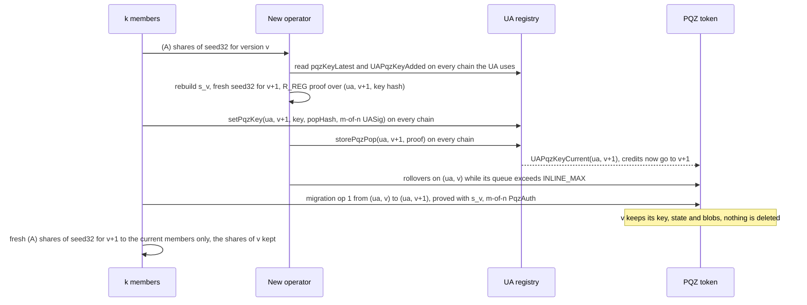
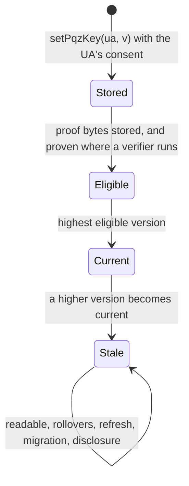

# Versioned PQZ keys (group 3g) — design

**Status:** **approved by the owner 2026-11-06; build after T43, before 3f (owner 2026-11-07: 3g before 3f), with T66b's registry generation (owner 2026-11-07: `requirePortable`, the `msig` KEM refusal and the rebalance moved from 3c to plan task T66b).** **BUILT on branch `ua-mtx-merge`** (T19, 2026-11-10): EVM registry and tokens T51–T54, node T55, invariants T56 `e1336e60`; `ua-rs-sign`'s share SPECIFIED; UNAUDITED. Rule ids as landed: CTR-UA-42 (this spec's CTR-UA-41: that id went to the verifier-naming rule of 2026-11-10), CTR-PQZ-31, CTR-PQZ-32, NODE-JOB-23, CLI-SGN-49 (this spec's CLI-SGN-43: taken on `ua-rs-sign`).
Revised after the Codex and Fable reviews of the first draft ([Codex](../../research/pqzver-codex-review.md): 2 high, 2 medium;
[Fable](../../research/pqzver-fable-review.md): 0 P0, 0 P1, 5 P2, 10 P3, verdicts on Q1–Q4, a missing-items list) and the
owner's rulings R1–R5 of 2026-11-06; every finding's outcome is in §17. Work-order group **3g** of branch `ua-mtx-merge`: tasks
**T51–T57** after 3e (T37–T43) and before 3f (T44–T50, owner 2026-11-07) and T66b (the registry generation, whose `UARegistryLib` ↔ `UARegistry`
rebalance comes after every PQZ contract change) and 3c (`PqChat`), so the round's docs (T19), gates (T21), review (T22) and PR (T23) cover it
and the EVM freeze and audit include it. **PQZ only:** no Zether contract, statement or vector changes. **Everything here is
UNAUDITED.**

**Rules this spec applies, not reopens:** [CTR-UA-32](../../contracts/accounts.md#CTR-UA-32) (the KEM key versions: the pattern
mirrored), [CTR-UA-16](../../contracts/accounts.md#CTR-UA-16) (the PQZ key attribute, `proven`, `keyOwner`; its R-cross-set
replacement is retired by R2), [CTR-UA-07](../../contracts/accounts.md#CTR-UA-07) (portable typed records),
[CTR-UA-36](../../contracts/accounts.md#CTR-UA-36) (`UASig`, the `msig` minimal form),
[CTR-PQZ-12](../../contracts/pq-zero-knowledge.md#CTR-PQZ-12) (holders; an `msig`'s PQZ key is one view / prove key held by an
operator), [CTR-PQZ-13](../../contracts/pq-zero-knowledge.md#CTR-PQZ-13), [CTR-PQZ-09](../../contracts/pq-zero-knowledge.md#CTR-PQZ-09)
(proof systems, ids, the full-gate trigger), [CTR-PQZ-07](../../contracts/pq-zero-knowledge.md#CTR-PQZ-07) and the
never-lose-ciphertext rule, [CTR-MTX-29](../../decisions.md#ctr-mtx-29--every-parameter-is-explicit) (explicit parameters); the 3e
spec [2026-11-05-pay-meta-tax.md](2026-11-05-pay-meta-tax.md) (O18: the 64,512 B stop line, reduce, never `_above64KiB`); the 3f
spec [2026-11-06-attested-verify.md](2026-11-06-attested-verify.md) (R3 / AV-6: OFFCHAIN tokens accept unproven keys). Background:
[pqz-threshold-decrypt-prove.md](../../research/pqz-threshold-decrypt-prove.md) §7 (research only). Where this design changes an
existing rule, the change is listed in §10 for a `decisions.md` Change line in T19; nothing is resolved silently.

## 0. Owner rulings, controller calls (2026-11-06)

### 0.1 Owner rulings

Written as given; not reopened.

| # | Ruling | Where |
|---|---|---|
| O1 | (2026-11-06) **Build PQZ key versions now, before the EVM freeze, following the existing UA KEM key version pattern** ([CTR-UA-32](../../contracts/accounts.md#CTR-UA-32)). | all |
| O2 | (2026-11-06, the context) For an `msig` PQZ holder the PQZ key is **one view / prove key held by an operator** ([CTR-PQZ-12](../../contracts/pq-zero-knowledge.md#CTR-PQZ-12)). | §1 |
| O3 | (2026-11-06) **k-of-n seed backup (A) is accepted**: `ua-rs-sign` T16a, a client warning, not a refusal. | §7.2 |
| O4 | (2026-11-06) **Rotation alone (B) was rejected** because the old operator could refuse the migration proof. **(A) removes that objection:** the members rebuild the old seed, register version v+1 under the `msig`'s m-of-n, and migrate the balance with a proof under v. | §1, §3.4 |
| O5 | (2026-11-06) **Old versions are kept readable and are never deleted.** | KV-4 |
| O6 | (2026-11-06, research Q12 and Q13 answered as recommended) Versions are **strictly sequential** (latest + 1); **current = the highest proven version**; **a debit names its version explicitly**; **no version word enters the statement or the transcript** (same `proofSystemId`). Each new version gets fresh (A) shares, k = the `msig` threshold and n = its accepted members by default; the shares of old versions are kept. | KV-1, KV-3, KV-8, §4, §7.2 |
| O7 | (2026-11-06, the placement; wording per Fable F-13) Versions ship in **this release's registry generation on every chain**, with or without the `0x0142` verifier; where a chain enables `0x0142`, only one generation may, and it is this one. After reset 2 that is the next generation, with round 3c. Nothing deployed is upgraded: a new registry generation and new token releases. | §6.1 |
| R1 | (2026-11-06, Q1) **No `keyVersion` in `PqzAuth`.** Reason (Fable's caveat): with distinct keys per version, enforced in every mode (KV-1, KV-9), `bodyHash` names the version, and the version changes **neither amount nor recipient**: a debit under any version of one UA spends that UA's own funds to the recipient it signed, and a stale version can only migrate to itself (KV-8). The relayed forms sign `keyVersion` in their args. | §3.3, §4.2 |
| R2 | (2026-11-06, Q2) **R-cross-set's version-0 replacement is retired; every PQZ record becomes write-once.** A key of another set's length stays at its version; this chain's set gets a new version. This changes the owner ruling R-cross-set of 2026-10-30 (Change line, §10 row 3) and closes Codex #2. | KV-1, §2.3 |
| R3 | (2026-11-06, Q3) **Debits do not name the receiver's or the auditor's versions.** Fable F-2's two mitigations, with no contract change: the wallet's decoy filter excludes a UA whose latest version is pending, and the node refuses such a job by name at intake. **Activation is permissionless:** once a version's record and proof are public, anyone may replay them on any chain (CTR-UA-07), so an `msig`'s wallets register and prove v+1 on every chain the UA uses in one sitting. | §3.2, §7.2, §7.3 |
| R4 | (2026-11-06, Q4) **If both registry contracts still miss 57 M after T66b's rebalance, 60 M is accepted**, pinned with T10's public-gate formula (`asked = (regular + state) × 1.05 ≤ 60 M` and `regular × 1.05 < 2^24`). Recorded (Fable): 60 M is already the `storePqzPop` ceiling at `n2816-kmax65536`, so a 60 M chain is in practice an `n2304-kmax4096` chain. | §6.2 |
| R5 | (2026-11-06) **Every remaining finding of both reviews is adopted** (§17), among them: distinct keys per UA enforced at storage in every mode and pairwise in every statement (Codex #1); the structural, not cryptographic, account-safety argument and the related-key assumption (Codex #3); additive sender recovery (Codex #4); eligibility needs the proof bytes (F-1); the host-mode rules (F-3); the per-rotation `R_REG` gas (F-4); member departure as a rotation trigger and k against m (F-5); a stale version only migrates (F-6); the realistic estimates (F-12, F-15). | §2–§7 |
| R6 | (2026-11-06) **Confirmed by the owner:** the stale-version rule as written (a stale version may only migrate or refresh; no unshield, not even to the UA itself, before migrating; `StaleKeyVersion`); the k-of-n backup default k = m (research Q12); §6.2's note that the 57 M target sits in the main checkout's `TODO.md`. | §3.3 (KV-8), §12, §6.2 |

### 0.2 Controller calls (2026-11-06, the owner may override)

| # | Call | Where |
|---|---|---|
| C1 | **Every PQZ holder gets versions, single-key UAs too.** One rule, no kind branch. A single-key holder whose exported PQZ leaf leaked (CTR-PQZ-13: `pqz-cli`, a key oracle) rotates the PQZ key without a new UA; a leaked BIP-39 seed still means a new UA (the signing key is gone too). | KV-5 |
| C2 | **Eligibility on a registry without the `0x0142` verifier** (the chains of 3f's OFFCHAIN tokens): stored with this build's set length **and its proof bytes stored** (F-1). Length is not proof validity, unique ownership or recoverability; the PQZ verifier (off-chain) checks those (3f AV-6). With the verifier, eligibility is exactly O6's "proven". | KV-3, §5 |
| C3 | **The views mirror `kemKeyOf` / `kemKeyAt`:** `pqzKeyOf(ua)` returns the current version first; `pqzKeyAt(ua, version)`; `pqzKeyLatest(ua)`; `pqzKeyUsed(ua, pqzKeyHash)`. | KV-3 |
| C4 | **The entries mirror `setKemKey(ua, version, …)`:** `setPqzKey(ua, version, …)` and `storePqzPop(ua, version, pqzPop)`; version 0 keeps today's records, digests and `R_REG` messages byte for byte; versions ≥ 1 use two new typed structs. | KV-1, KV-2 |
| C5 | **Migration is an op 1 self-transfer** from `(ua, v)` to `(ua, current)`, v < current; every key a statement names is pairwise distinct on chain (`KeyReused`). | KV-9 |
| C6 | **No per-entry version storage.** Receivers find a credit's version by its queue or by trial decryption, senders by additive matching against the stored blob, the auditor by its own keys; on-chain disclosure names the version as a parameter. | KV-11 |
| C7 | The registry emits `UAPqzKeyCurrent` when current moves; `register` keeps emitting only `UARegistered` for version 0 (F-10); PQZ's own events carry `keyVersion`; the shared `Shielded` stays as it is. | KV-3, KV-10 |
| C8 | Client key material per version: single-key holders derive version v ≥ 1 with `be64(version)` appended to the HKDF `info` (version 0 unchanged); an `msig` operator generates each version's `seed32` fresh; vault entries and backups are keyed `(ua, version, pqzKeyHash)` (F-14). | §7.2 |
| C9 | Rule ids next-free: CTR-UA-41 (unused: 3f dropped its draft of it), CTR-PQZ-31, CTR-PQZ-32, NODE-JOB-23, CLI-SGN-43. | §12 |

## 1. Scope and non-goals — SPECIFIED

**In scope (EVM; Hedera runs the same registry code):**

| Item | Rule |
|---|---|
| Versioned PQZ key records in the next `UARegistry` / `UARegistryLib` generation; R-cross-set's replacement retired (R2) | §2 |
| Per-version account state in the PQZ tokens (kinds 4, 5, 12, 13), new releases and their catalogue rows | §3 |
| The statement-safety argument: no `proofSystemId`, statement, transcript or pqz-core vector change | §4 |
| The OFFCHAIN mode of 3f with versions | §5 |
| Placement, size, deploy gas, the per-rotation `R_REG` gas | §6 |
| Vectors, `clientkeys`, every `ua-*`, node rows, jobs, indexer, operator note; the coordination with `ua-rs-sign` | §7 |

**Why versions, in one paragraph (O2, O4).** After (A), the members of an `msig` can rebuild `seed32_v` without the operator, but
the old operator still knows it and reads every future credit and balance of the UA. A new UA (CTR-UA-13's rotation) moves the
identity: counterparties, the public UA-ledger balance, governance roles and mandates that name the old UA must move, and senders
who still use it keep crediting a key the old operator reads. A new **version** keeps the UA id; every new credit goes to the new
key from the block it becomes current; the balance under v moves to v+1 by one proof under v, which the members can now make.

**Rotation triggers** (F-5): an operator change, a lost or suspected operator, a single-key leaf exposed, and **any holder of
(A) shares leaving or suspected**. CTR-UA-13 keeps members in the id, so a departing member keeps its signing weight; a rotation
stops it **reading** what comes after (its shares of v stay valid for v), it does not remove it from the m-of-n.

**Non-goals.** No change to `pqz-core` (`pqzl`, `pqzh`, `stmt`, `ffi`), to any relation, statement layout, transcript, binding tag or
`proofSystemId`; no change to `PqzKeyVerifier` (it proves any 32-byte message); no Zether change (Zether ≠ PQZ: the Zether key is
the UA, CTR-UA-16). No change to the signing key, the members or the threshold of a UA (still CTR-UA-13: those are in the id). No
threshold decryption or proving (research C/D). No migration of deployed state: every chain is test-only; reset 2 loads the new
release.

## 2. Registry — SPECIFIED

### 2.1 Records (KV-1, KV-2)

**KV-1. One PQZ key record per `(ua, version)`, written once, strictly sequential, with distinct key bytes per UA.**

- **Version 0 is today's key**, from `register` (`attrs.pqzKey`) or the first `setPqzKey`: its records, digests and `R_REG`
  messages stay byte for byte (`UAPqzKey`, `UAPqzKeyRecord`, `PURPOSE_POP_V2` / `PURPOSE_PQZ_KEY`). **Write-once without exception
  (R2):** a second version-0 key reverts `UAPqzKeySet`, whatever its set; R-cross-set's replacement and its kept `register` key go
  (to `legacy/ua-mtx-merge/`, backup, not delete). A UA whose version 0 is of another set adds version 1 of this chain's set.
- **A version v ≥ 1** is accepted only when version 0 is stored and `v == latest + 1` (`latest` = the highest stored version),
  else `UAPqzKeyVersion(ua, version)`. Strictly sequential, unlike KEM's "any order": a version below the latest could never become
  current, and a gap would leave a version number that names nothing.
- The key's length is one of the four sets' `PqzSet.PK` (`UAKeyData(0x0142)`), as for version 0: a version of another set's length
  is stored (the record is portable), never becomes current on this chain (KV-3), and the next version may follow it.
- **Distinct key bytes per UA, at storage, in every mode (Codex #1).** A per-UA marker `pqzKeyUsed[ua][pqzKeyHash]` is set when any
  version of the UA stores a key, proven or not; a second version with the same bytes reverts `UAKeyInUse(pqzKeyHash, ua)`. On a
  host generation the check also reads the predecessor (`pqzKeyUsed(ua, h)` there). The marker is per UA, so nobody can squat
  another UA's key with it; the global `keyOwner` stays the proof-time check across UAs (KV-2). So no two versions of one UA ever
  hold the same key, on any registry kind, before any proof or verdict exists.
- **Consent.** The UA's own `UASig` ([CTR-UA-36](../../contracts/accounts.md#CTR-UA-36)): the signer for a single-key holder, the
  m-of-n in minimal form for an `msig` (`_portableOk`, as `setKemKey` ≥ 1 and `setPqzKey` today), never `keyData`, over
  `uaMessage(kind, PURPOSE_PQZ_KEY, typed(UAPqzKeyVersionRecord))`. An operator who is not a quorum cannot add a version; a refusing
  operator cannot stop one (O4). Anyone submits; no fee; relayable as a node `call` job. **Activation is permissionless (R3):** once
  a record and its proof are public (`UAPqzKeyAdded.sig`, `UAPqzPopStored.pqzPop`), anyone may replay them on any chain; the UA
  consented to the record everywhere, but the moment of activation on a chain is anyone's.
- **The holder rule** and the C0-5 bound are checked as for version 0 (`UAPqzHolder`): the authorization does not change with the key.

```text
UAPqzKeyVersion(bytes32 ua,uint64 version,bytes32 pqzKeyHash)
UAPqzKeyVersionRecord(UAPqzKeyVersion key,bytes32 pqzPopHash)UAPqzKeyVersion(bytes32 ua,uint64 version,bytes32 pqzKeyHash)

consent (v ≥ 1)  = the UA's UASig over uaMessage(kind, PURPOSE_PQZ_KEY, typed(UAPqzKeyVersionRecord{UAPqzKeyVersion{ua, v, h}, pqzPopHash}))
R_REG   (v ≥ 1)  = over uaMessage(0x0142, PURPOSE_PQZ_KEY, typed(UAPqzKeyVersion{ua, v, h}))
typed(s)         = keccak256(0x1901 ‖ DS_P ‖ hashStruct(s))    (the portable domain of CTR-UA-07)
```

Both typehashes are pinned (`UAPqzKeyVersionTypehashIsPinned`, `UAPqzKeyVersionRecordTypehashIsPinned`); they differ from
`UAPqzKey` / `UAPqzKeyRecord`, so a version-0 signature or proof never serves a version ≥ 1. The version is inside the signed
record, so version v names the same key on every chain **if the client signs one key per version** (the client rule of
CTR-UA-32, held by construction for single-key holders and by the runbook for an `msig`, C8). New pure views
`pqzKeyVersionDigest(ua, version, pqzKeyHash)` and `pqzKeyVersionRecordDigest(ua, version, pqzKeyHash, pqzPopHash)` beside today's
`pqzKeyDigest` / `pqzKeyRecordDigest`.

**KV-2. Each version has its own proof bytes, its own `proven` flag and its own `keyOwner` entry.**

- `storePqzPop(ua, version, pqzPop)`: no signature; `keccak256(pqzPop)` equals that version's `pqzPopHash` (`UAPqzPopHash`); a
  no-op once stored; where slot `0x0142` has a verifier the proof is checked over that version's `R_REG` message (version 0:
  today's two messages, `PURPOSE_POP_V2` over the portable record for a `register` key, `PURPOSE_PQZ_KEY` over `UAPqzKey` for a
  `setPqzKey` key; v ≥ 1: the one above) and the version becomes `proven`.
- **`keyOwner` per version.** When a version becomes proven, `keyOwner[pqzKeyHash] = ua`; a hash already owned by **any** UA,
  this one included, reverts `UAKeyInUse`. With KV-1's marker the same-UA case is already refused at storage; `keyOwner` keeps the
  cross-UA rule where the verifier runs.
- **The `0x0142` list** ([CTR-UA-29](../../contracts/accounts.md#CTR-UA-29)) gets the UA once, when its first version becomes
  proven: decoys are drawn per UA, never per version. On a registry without the verifier the list stays empty for unproven holders,
  as today; 3f's service-assisted discovery stays the source there.
- **Gas per rotation (F-4).** Each version costs its UA one signed record and one `storePqzPop`. At `n2816-kmax65536` that call is
  ≈ 59.9 M gas with the real `R_REG` verify, and ≈ 60.1 M on a gen-2 host (`TODO.md`'s watch item): on a 60 M chain a rotation sits
  at the limit and the host form is over it, and the proof cannot be split. A 60 M chain that wants rotations runs
  `n2304-kmax4096` (≈ 7 M of headroom). The SCaaS testnet's 200 M block is not affected. R4's 60 M deploy pin adds nothing new there.
- `setPqzKey(ua, version, pqzKey, pqzPopHash, sig)` and `storePqzPop(ua, version, pqzPop)` replace the four- and two-argument forms
  (to legacy). Version 0 through them behaves exactly as the old forms, minus the replacement.

### 2.2 Current, views and events (KV-3, KV-4)

**KV-3. Current = the highest eligible version; it never goes down; it moves only when proof bytes are stored.**

| Registry | A version is **eligible** when | Why |
|---|---|---|
| slot `0x0142` has a verifier | it is `proven` (its bytes stored and verified) | O6 as stated |
| slot `0x0142` is empty | its key has this build's `PqzSet.PK` length **and** its proof bytes are stored (hash matched) | C2, F-1: nothing can be proven there; 3f's PQZ verifier (off-chain) refuses a key without stored bytes, so a key without them must not be current |

- `current(ua)` = the highest eligible version, **0 when none is** (then version 0 is returned as stored, `proven = false`: today's
  answer for an unproven key). On both registry kinds `current` moves only inside `register` (with `pqzPop`) or `storePqzPop`:
  never in `setPqzKey`, so no credit is ever addressed to a key whose proof the chain does not hold. Stored as `(latest, current,
  listed)` in one slot per UA; eligibility never reverts, so `current` is non-decreasing. A version proven late below `current`
  stays readable but does not lower it.
- **One `current` per `(ua, registry generation)`** (F-3). Each token reads the registry it was initialised with; two tokens bound
  to two generations of one chain may credit different versions of one UA, each consistently.
- **Events.** `UAPqzKeyAdded(bytes32 indexed ua, uint64 indexed version, bytes32 pqzKeyHash, bytes32 pqzPopHash, bytes pqzKey,
  bytes sig)` from `setPqzKey` (as `UAKemKeySet`); `register` does **not** emit it: version 0 of a `register` key is found through
  `UARegistered`, as today (F-10); `UAPqzPopStored(bytes32 indexed ua, uint64 indexed version, uint8 checkedPqzPop, bytes pqzPop)`;
  new `UAPqzKeyCurrent(bytes32 indexed ua, uint64 indexed version)` whenever a version becomes current, version 0 included (also
  inside `register` with `pqzPop`). Errors: new `UAPqzKeyVersion(bytes32 ua, uint64 version)`; `UAPqzKeySet` for any second
  version-0 key; `UAKeyInUse` for a repeated key.

| View (C3) | Returns | Today |
|---|---|---|
| `pqzKeyOf(ua)` | `(uint64 version, address ptr, bytes32 pqzPopHash, bool proven)` of the current version | `(ptr, pqzPopHash, proven)` |
| `pqzKeyAt(ua, uint64 version)` | `(address ptr, bytes32 pqzPopHash, bool proven)` of any stored version (zero if none) | new |
| `pqzKeyLatest(ua)` | `uint64` latest stored version (clients sign `latest + 1`) | new |
| `pqzKeyUsed(ua, bytes32 pqzKeyHash)` | `bool`: some version of `ua` stores this key (KV-1's marker; the host reads it on gen 1) | new |
| `pqzPopOf(ua, uint64 version)`, `pqzKeySigOf(ua, uint64 version)` | that version's proof bytes and stored signature | one-argument forms, to legacy |
| `recordOf(ua)`, `checkedOf(ua)` | shapes unchanged; the PQZ pointer and `checkedPqzPop` are the current version's | version 0's |
| `registrationOf(ua)` | unchanged; version 0 as registered (no replaced-key fallback after R2) | — |
| `keyOwner(h)` | unchanged | — |

**KV-4. Nothing is deleted.** Every version's key, proof hash, proof bytes and signature stay readable through the views above;
there is no revoke, replace or delete path (R2 removed the last one). A leaked old key stays a read-only breach of what was
encrypted to it ([CTR-UA-32](../../contracts/accounts.md#CTR-UA-32)'s "no revocation" reasoning).

**KV-5. Every PQZ holder** (single-key `mldsa44` / `mldsa65` / `mldsa87` / `fndsa512` / `fndsa1024` and the PQ-dominant `msig`) may
add versions (C1). Nothing iterates over versions on chain, so no cap is needed: each version costs its UA one signed record and
one `R_REG` proof (KV-2's gas).

### 2.3 Storage and generations

`UAStore.Layout`, moved old → new in T51: slots 2 (`pqzKey`), 7 (`pqzPopHash`), 8 (`pqzPop`) and 9 (`pqzKeySig`) become
`mapping(bytes32 ua => mapping(uint64 version => …))`; slots 13 and 14 (R-cross-set's kept `register` key) are retired by R2 and
stay as unused placeholders so that 15 and 16 keep their numbers; slot 17 is new, `mapping(bytes32 ua => PqzVersions)` with
`PqzVersions { uint64 latest; uint64 current; bool listed; }`; slot 18 is new, `mapping(bytes32 ua => mapping(bytes32 pqzKeyHash
=> bool)) pqzKeyUsed`. **The layout pin:** the `UARegistrySplit.t.sol` that `UAStore`'s comment names lives under
`legacy/msig-nested/test/ua/` and is not an executed gate (Codex); T51 adds an active `test/ua/UAStoreLayout.t.sol` that pins every
slot number.

**Generations: the host rules (F-3, Codex).** As version 0 today ([CTR-UA-16](../../contracts/accounts.md#CTR-UA-16), A6-I1), a gen
2 that enables `0x0142` in front of a gen 1 that does not holds the PQZ attachment of gen-1 records. With versions:

1. **Sequence.** The host's `latest` and its sequence check read `max(latest_host, latest_gen1)`; a version already stored in
   either generation is refused on the host (`UAPqzKeyVersion`); the KV-1 marker is checked in both.
2. **Reads.** `pqzKeyAt`, `pqzPopOf`, `pqzKeySigOf` on the host return the host's record for v when it holds one, else gen 1's
   (today's `_pqzElsewhere` pattern); once the host holds v, its answer for v never changes as gen 1 grows.
3. **Proofs.** The host proves a version only by checking the proof bytes itself with its own verifier, gen 1's stored bytes
   included (a predecessor's unchecked bytes are never taken as proven); `current` is the host's.
4. **The accepted divergence.** Gen 1 cannot see gen 2, so a gen-1 write of a version the host already holds can store a second
   record at that number in gen 1 (the A6-I1 divergence, now per version): accepted, listed, tested. Wallets write to the newest
   generation only; tokens read the generation they were initialised with (KV-3).

A generation of this release forwards only to a predecessor of this release: every chain is test-only and reset, so no
compatibility path is built.

## 3. Token — SPECIFIED

### 3.1 State (KV-6)

**KV-6. Account state per `(ua, version)`; `sendCounter` per UA.**

| Item | Today ([§7.1](../../contracts/pq-zero-knowledge.md#71-state-per-ua-token)) | Versioned |
|---|---|---|
| `Account` (`pendingCount`, `rolled`, `floor`, `cleared`, `acc` reference, `accUnits`, `flags`, `accHash`, `pending[i]`, `accWords`) | `acct[ua]` | `acct[ua][version]`; every bound (`K_MAX`, `INLINE_MAX`, `ROLL_AGE`, `ROLL_MAX`) per account |
| `sendCounter` | a field of `Account` | `sendCounter[ua]`, one per UA, advanced by every debit of any version; every read, increment and view moves together |
| `entryRef` | `keccak256(abi.encode(TAG_ENTRY, chainid, chainUid, token, fromUA, sendCounter))` | **unchanged**: unique per UA across versions, so `entryPtr` never collides |
| Pool invariant, `totalShielded` | token-wide | unchanged: the sum over every version of every UA |

The `Account` struct loses its `sendCounter` field (it sat alone in its slot, so a debit touches as many slots as today); the
`scaas.pqz` layout pin moves old → new.

### 3.2 Credits go to current (KV-7)

**KV-7.** Every credit lands in `(to, current(to))`, read from `pqzKeyOf(to)` **once, in the same call** that writes the
statement's `pk_t` (or `pk_a`) and appends the pending entry: op 1's receiver, every op 7 leg, decoys included, the auditor copies
(the auditor's key is `pqzKeyOf(auditorUA)`), `mtxShield`, `mtxWrapShield` and `shieldIn` (TRIVIAL entries, no key, the same queue
rule). No parameter names a receiver or auditor version (R3). A proof built against `pk_v` of a receiver that reaches v+1 before
the transaction lands fails `ProofRejected` (OFFCHAIN: `PqzVerdictMismatch`): liveness only, never funds. Because `current` never
goes down, such a proof can never land once `current > v`, so the node may refuse it by name without ever calling it `dead` while it
could still land.

**Mitigations (R3, F-2), no contract change.** A version is **pending** on a chain when the UA's latest stored version has this
set's length and is not yet eligible (its proof bytes are missing): the on-chain sign of an imminent rotation. (A latest version
of another set's length is not pending: it never becomes current here.)

- **Decoy filter** (an addition to CTR-UA-29's selection rule, in every wallet and `clientkeys`): never draw a UA with a pending
  version as a decoy; prefer UAs without a `UAPqzKeyCurrent` in the look-back window.
- **Node intake:** a PQZ job naming a receiver, a leg or the auditor with a pending version is refused by name,
  `PQZ_KEY_ROTATION_PENDING` (§7.3), before the sender pays for a transaction that would fail.

### 3.3 Debits name their version; a stale version only migrates (KV-8)

**KV-8.** `PqzTransferArgs`, `PqzMultiArgs` and `PqzBurnArgs` gain **`uint64 keyVersion`** after `fromUA`. The token reads
`pqzKeyOf(from)` once (the current version, its key), and `pqzKeyAt(from, keyVersion)` when `keyVersion` differs; it **captures the
selected key and account once**, builds `T` only from `acct[from][keyVersion]` and settles only that account (`acc`, `rolled`,
`floor`, `cleared`, the deleted slots); `sendCounter[from]` advances. The key check of KV-12 applies (PRECOMPILE: proven; OFFCHAIN:
the length). Then:

| `keyVersion` | Allowed debits | Else |
|---|---|---|
| `== current` | every debit, as today | — |
| `< current` (stale) | **only** the migration (op 1 with `to == from`, KV-9) and a refresh (a burn of 0 with no recipient) | `StaleKeyVersion(ua, keyVersion, current)` |
| `> current` | none: such a version holds no credited state | `KeyVersionUnknown(ua, keyVersion)` |

**Why a stale version only migrates (F-6).** Every debit under v writes `v_f` under `pk_v`, so the holder of `s_v` reads old − new =
amount + fee of **any** debit under v, not only of credits; after a rotation for compromise, a payment to a third party from v would
hand its amount to the old operator. The migration's amount is the balance the old holder reads anyway, and a refresh reveals no
amount (it frees a full `acc`, CapReached, on the way to the migration). Old credits stay spendable through the migration (O5).

The relayed forms sign `keyVersion` explicitly: the typehashes of `UAPqzTransferSingle`, `…SingleCompact`, `UAPqzTransfer`,
`…Compact`, `UAPqzUnshield` and the unshield-unwrap form move (their args structs are typed members), pins old → new. The direct
forms bind it through `PqzAuth.bodyHash`, which covers `pk_f` and `T`; `PqzAuth` itself is unchanged (R1).

### 3.4 Migration (KV-9)

**KV-9. A debit may credit its own UA only from a stale version, by op 1; every key a statement names is distinct.**

- **Migration:** op 1 with `to == from` and `keyVersion < current(from)`; the credit lands in `(from, current)` like any credit
  (KV-7). One proof under v, with `s_v`, authorized by the UA (the `msig`'s m-of-n), its amount hidden; fee and beneficiary as any
  transfer. Op 1 with `to == from` at the current version, and `from` as an op 7 leg at any version, revert `SelfTransfer` as today.
- **Pairwise distinct keys, on chain, in every mode (Codex #1, F-7).** The keys a statement names (`pk_f`, `pk_t` or every op 7 leg
  key, `pk_a`) are compared pairwise by `extcodehash` of their pointers (already read by `EXTCODECOPY`, so warm: at most 10 keys,
  45 compares, about 1.5–4 k gas); any two equal revert `KeyReused(ua)`. Together with KV-1's per-UA marker (no two versions of one
  UA ever share a key, so a burn or refresh with no credited key is covered too) and `keyOwner` where the verifier runs, this
  closes the F-4 class (one randomness under one key twice cancels the masks) for migrations, for legs of two UAs that stored one
  key on a registry without `keyOwner`, and for a leg equal to the auditor's key.
- A queue under v longer than `INLINE_MAX` drains first by rollovers on v (KV-10) or by refreshes. The public path (unshield, then
  shield) is refused for a stale version (KV-8): unshield after the migration.





### 3.5 Rollover, views, events (KV-10)

**KV-10.** `mtxRollOver(bytes32 ua, uint64 keyVersion, uint256 n)` and `mtxPrepareAcc(bytes32 ua, uint64 keyVersion, uint256 half)`,
direct and as `UARollOver` / `UAPrepareAcc` (each gains `uint64 keyVersion`, typehash pins old → new); the two-argument PQZ forms go
to legacy. They read `pqzKeyAt(ua, keyVersion)` under the mode's key check, as `_keyPtr` does today (PqzStateLib's rollover and
prepare call it): a rollover or prepare on a version that never passed the check is refused. Their static calldata grows from 68 to
100 bytes: `_isPqzOp` and `_pqzRule`'s static-shape list take the new selectors and the new length (Codex). Views:
`pqzAccount(ua, keyVersion)` (`AccountState` unchanged in shape, `sendCounter` the UA's), `pqzAcc(ua, keyVersion)`,
`pqzPending(ua, keyVersion, i)`, `pqzPendingCt(ua, keyVersion, i)`; `pqzEntryBlob`, `transferEntry`, `transferCiphertextHash`
unchanged. Events: PQZ's own `Credited(bytes32 indexed ua, uint64 indexed index, uint64 keyVersion, bytes32 entryRef)` and
`Debited(bytes32 indexed ua, uint64 keyVersion, uint64 rolled, uint64 floor, address blob)`; the PQZ rollover emits
`PqzRolledOver(bytes32 indexed ua, uint64 indexed keyVersion, uint64 rolled, uint32 accUnits, bytes32 accHash)` in place of the
shared `RolledOver`; the shared `Shielded`, `ConfidentialTransfer*` and `Unshielded` keep their shapes (a shield's version is the
current one at its log position; every debit also emits `Debited` with its version). **Restore from state alone:** seed → UA →
`pqzKeyLatest` → per version `pqzAccount` → `pqzAcc` and `pqzPendingCt` for `[rolled, pendingCount)` → decrypt with that version's
key → balance = Σ over versions.

### 3.6 Disclosure and recovery (KV-11)

**KV-11. Disclosure names the key it checks; recovery matches each leg on its own.**

- **Disclosure.** A leg's version is not stored (C6). The PQZ disclosure views take it after `kind`:
  `disclosureStatement(entryRef, leg, amount, kind, keyVersion)`, `verifyTransferAmount(entryRef, leg, amount, kind, keyVersion,
  proof)` and 3f's OFFCHAIN form with `keyVersion` in the same place. `keyVersion` **selects which registered key the opening is
  checked against** (the leg owner's for `SENDER_S` and `RECEIVER_X`, the auditor's for `AUDITOR`); the verdict says whether the
  leg opens to `amount` under that key. It does **not** prove which version the leg was encrypted for (Codex #3): for
  honestly generated independent keys a wrong version gives `false` with overwhelming probability [inference], but two registered
  keys with one short secret (`pk_0 = A·s + e_0`, `pk_1 = A·s + e_1`) can both open it. A version that is not stored reverts
  `KeyVersionUnknown(ua, keyVersion)`. The five-argument PQZ forms go to legacy; Zether's `ITransferDisclosure` form is untouched.
- **Sender recovery, additive (Codex #4).** From `sendCounter` → `entryRef` → the op blob `R ‖ v_f` and the memo, in this order:
  1. **The sender's version:** for each of its own stored versions w, derive `seed_enc` from `seed_w` and the stored salt
     (CTR-PQZ-19), recompute `u_0 = A^T r_0 + e1_0` and compare it with the stored packed `u_0`. `u` does not depend on any
     receiver key, so the match is exact and names w; the memo then opens with `seed_w`'s memo key (CTR-PQZ-23), giving each leg's
     amount and UA.
  2. **The randomness:** op 7's group seeds `seed_enc_g` and CTR-PQZ-19's draw order (`r_g`, `e1_g`, the legs' `e2`, `e2_f`, the
     auditor copies), none of which depends on a key.
  3. **Each leg on its own:** for each stored version x of the leg's UA, encrypt the leg's amount under `pk_x` with that leg's
     `r_{g(j)}` and `e2_j`, pack it and compare with the leg's stored bytes; the match is the leg's version. **The auditor copy on its
     own** likewise over the auditor's versions, in its group's coefficient window.
  4. Rebuild `R` and check `keccak256(R) == transferCiphertextHash`.

  The work is the **sum**, not the product, of the version lists (eight legs with ten versions each: 80 trial encryptions, not
  10^8). T54 checks against `pqz-core`'s `Enc` that the noise draws do not depend on the key [to verify there].
- **Receiver.** A pending credit's version is its queue. A consumed credit (its slot deleted, its blob kept) is found by trial
  decryption of the leg under each own version; with honestly generated independent keys exactly one opens to digits in range
  [inference]. The balance itself needs no per-credit history (`acc`).
- **Auditor:** trial decryption over its versions, as the receiver. **Indexers:** `Credited` / `Debited` and the log order of
  `UAPqzKeyCurrent`.

## 4. Statement and transcript: why the version stays out — SPECIFIED

### 4.1 What does not change (KV-13)

**KV-13.** The relations (`R_TX`, `R_TX0`, `R_TXM`, burn, refresh, `R_DR`, `R_REG`), the statement layout of
[§7.7](../../contracts/pq-zero-knowledge.md#77-statement-layout) (the 640-byte header, then `pk_f ‖ [pk_t] ‖ [pk_a] ‖ T ‖ out`),
the PQZL and PQZH transcripts (`hash0` over `op` and the whole statement), `PqzAuth` (R1), `PqzKeyVerifier`, the precompile and the
four sets' parameters are untouched. The version decides only **which** key bytes and which `T` the contract writes into the
existing slots and which account it updates. So: the **same `proofSystemId`**; **no new pqz-core vectors**: the
`smartcontracts/vectors/pqz/<set>/` statement bytes, proofs and `auth_digest` fields stay byte-equal (a UA that never rotates
builds exactly today's statements, J8; `auth_digest` would move only if `PqzAuth` changed, which R1 rules out); **no full gate**
(CTR-PQZ-09's trigger, a change to `pqzl`, `pqzh/ligero/src`, `stmt`, `ffi/src` or set parameters, is not met). `R_REG` of a
version ≥ 1 changes only the 32-byte message's pre-image, the precedent of UA-8 and typed-signing
([§7.2](../../contracts/pq-zero-knowledge.md#72-register-the-ua-registry) step 7).

### 4.2 Why no version word is needed

The claim to show: a proof or signature accepted for `(ua, v)` cannot be used for `(ua, v′)`, cannot be replayed, and the debit
settles exactly the account it was built from. Each step rests on a **contract rule**, not on the proof system catching a contract
bug (Codex #3):

| # | Property | Why it holds without a version word |
|---|---|---|
| 1 | **Domain separation between versions** | The statement carries the full key bytes `pk_f`, `pk_t`, `pk_a`, and the transcript absorbs the whole statement. Versions of one UA hold distinct keys **in every mode**: KV-1's per-UA marker refuses a repeated key at storage, before any proof or verdict exists (Codex #1's issue-before-rotation case cannot arise), and `keyOwner` adds the cross-UA rule where the verifier runs. So the statements for `(ua, v)` and `(ua, v′)` always differ in `pk_f`, even when their `T` coincide (two fresh accounts, or two equal TRIVIAL shields), and a proof, a `PqzAuth` or a 3f verdict (which binds `statementHash`) for one never verifies for the other. |
| 2 | **Single use** | `sendCounter` (header word 352) stays per UA and advances on every debit of any version, so a replay meets a stale counter whatever version it names; `entryRef` keeps its formula and stays unique. A per-version counter would have collided `entryRef` across versions: that is why it stays per UA. |
| 3 | **The debit settles the account it was built from** | A structural rule, J1 plus the capture-once rule of KV-8: the token selects `(from, keyVersion)` and its key once, builds `T` only from that account and settles only that account; every entry of the account was written with `pk_{keyVersion}` in its statement (credits under KV-7 in the same call, `acc` from a debit whose `v_f` row 4 proves under `pk_f`, TRIVIAL entries key-free). **No cryptographic fail-closed is claimed** for a selection bug: two accounts can have identical `T` (both empty, or equal TRIVIAL shields), and keys with one short secret can decrypt each other's ciphertexts. Mutant M-T5 runs with equal TRIVIAL balances and asserts **which account changed**, not only a revert. |
| 4 | **Masks under two keys of one UA** | A migration encrypts `v_t` under `pk_{v+1}` and `v_f` under `pk_v` with one `r`: `v_t − v_f = (pk_{v+1} − pk_v)^T r + Δ·(amount − balance′) + noise`. Equal keys would cancel the mask (the F-4 class); KV-9 refuses equal keys on chain. Distinct bytes are not enough for related keys: with `pk_{v+1} = A·s + e_1` and `pk_v = A·s + e_0` the difference `(e_1 − e_0)^T r` is short and the amount difference leaks. **Migration confidentiality assumes honestly generated, independent keys** (C8's derivation for a single key, a fresh seed per version for an `msig`), the same assumption and caveat as [§4.5](../../contracts/pq-zero-knowledge.md#45-shared-randomness-against-malicious-recipients)'s related keys: only the UA can register such a pair (each `R_REG` needs `s`), and what leaks is its own amounts. |
| 5 | **Authorization** | `PqzAuth` signs `bodyHash = keccak256(statement[640:])`, which covers `pk_f` and `T`; with row 1's distinct keys it names the version. R1: the version changes neither amount nor recipient, and a stale version can only migrate (KV-8), so nothing of value turns on a signer not seeing the number; the relayed forms sign `keyVersion` anyway. |
| 6 | **Encryption randomness and memo** | `seed_enc` and the memo key come from the **debited** version's `pqzKeySeed` ([CTR-PQZ-19](../../contracts/pq-zero-knowledge.md#CTR-PQZ-19), CTR-PQZ-23; formula unchanged); the per-UA counter and the fresh salt keep `info` unique across versions. A holder of `seed_v` can re-derive the migration's `r` and so learns the migrated amount, which it learns anyway by decrypting `T_v`; KV-8 keeps any other debit off v, and it learns nothing of debits under v+1. |
| 7 | **`R_REG`** | The version is inside the `UAPqzKeyVersion` message, so a version's proof is not reusable for another version or UA; the relation and statement (`opTag ‖ proofSystemId ‖ message ‖ pk`) are as today. |

**Verdict.** The version can stay out of the statement and the transcript: distinct keys per UA (enforced at storage in every mode)
separate versions inside the statement, the per-UA counter gives single use, and the capture-once rule makes the settled account
the one the statement was built from. It relies on three contract rules, each pinned: the per-UA key marker and the pairwise
compare (M-R4, M-T6), the per-UA counter (M-T2), and the single read of `current` per credit and of the account per debit (M-T3,
M-T5). Migration confidentiality additionally assumes honest independent keys (row 4). [inference; UNAUDITED]

## 5. OFFCHAIN mode (3f) with versions — SPECIFIED

**KV-12.** The token's key check takes the version; the mode decides what it requires, exactly as 3f's AV-6:

| Read | PRECOMPILE | OFFCHAIN |
|---|---|---|
| Debit: `pqzKeyOf(from)`, and `pqzKeyAt(from, keyVersion)` if stale | `proven` and `PqzCt.PK + 1` bytes of code, else `AccountNotRegistered(ua)` | the length only |
| Credit: `pqzKeyOf(to)` (current) | the same | the same, length only |
| Rollover, prepare: `pqzKeyAt(ua, keyVersion)` | the same | the same, length only |
| Auditor at `init`: `pqzKeyOf(auditorUA)` | the same | the same, length only |

- **One current per UA and registry generation, for both modes.** Tokens never pick a version: the registry's `current` (KV-3)
  decides. On a registry with the verifier, an OFFCHAIN token credits the highest **proven** version, or version 0 unproven while
  none is proven (3f's R3 unchanged for a UA that never rotates); on a registry without it, the highest version of this set's length
  **whose proof bytes are stored** (C2, F-1). So a rotation never moves `current` to a key the PQZ verifier (off-chain) would refuse for
  missing bytes.
- **The PQZ verifier's (off-chain) obligations** (3f §6) apply per version: for each key the statement names, the `pqzPop` bytes of
  **that version** are stored and hash to its `pqzPopHash`; the proof verifies over that version's message (version 0: its two
  messages, as 3f; v ≥ 1: `uaMessage(0x0142, PURPOSE_PQZ_KEY, typed(UAPqzKeyVersion))`; one path is never evidence for another);
  single ownership across every UA **and every version**; the cache key becomes `(ua, version, pqzKeyHash)` (§10 row 11). The
  on-chain guards KV-1 (per-UA marker) and KV-9 (pairwise compare) hold for outstanding verdicts too: a later duplicate cannot
  be stored, so a verdict issued before a rotation never fits another account.
- `PqzVerdict` is unchanged: it binds `statementHash`, which binds the version's keys and `T` (§4.2 row 1).
- A rotation in flight makes the verdict of a credit to the rotated UA mismatch (`PqzVerdictMismatch`), the same liveness
  case as KV-7, with the same mitigations.
- On a registry without the verifier the `0x0142` list stays empty for these holders (KV-2); decoy discovery stays with 3f's
  service, which applies KV-7's pending filter too.

## 6. Placement, size and deploy gas — SPECIFIED

### 6.1 Placement (KV-14)

**KV-14.** Versions ship in **this release's registry generation on every chain** (O7 as worded by F-13), with or without the
`0x0142` verifier; on a chain that enables `0x0142`, this is the one generation that does. After reset 2 that is the generation of
this branch, with 3c's `requirePortable` and "an `msig` has no KEM key" (which does not touch PQZ: an `msig` keeps its PQZ key,
CTR-PQZ-12); mainnet 22776 (the owner's) gets this release or a later one, never an earlier one. New PQZ token releases (kinds 4,
5, 12, 13) with their factory catalogue rows (`OpenFactory` / `DeployBase` entries, release codehashes); nothing deployed is
upgraded. Order in the branch (owner 2026-11-07: 3g before 3f): **3e (T37–T43) → 3g (T51–T57) → 3f (T44–T50) → 3h (T58–T66) → 3c** (its
registry items, then the `UARegistryLib` ↔ `UARegistry` rebalance last, measured with 3g in) → T19–T23. Both 3g and 3f change
`PqzCore._check` / `_keyPtr` and the PQZ entry signatures, so 3f builds its OFFCHAIN mode over versioned keys and takes §5's
OFFCHAIN items (KV-12, the OFFCHAIN disclosure form with `keyVersion`, their tests); it precedes 3c because the rebalance must come after every PQZ contract change (TODO item 3c).

### 6.2 Registry size and deploy gas

Today (`size-baseline.json`; T10's public gate, `runs/2026-11-04-ua-mtx-merge-deploy-gas.txt`): `UARegistryLib` 36,192 B asks
**60.83 M** (state 55,557,360: 1,535 gas per byte), `UARegistry` 29,710 B asks **50.61 M** (asked = (regular + EIP-8037 state) ×
1.05). The marginal cost is about 1,530 × 1.05 ≈ **1,607 gas per runtime byte** [est.]. **The 57 M target** is TODO item 3c's own
words, "rebalance `UARegistryLib` ↔ `UARegistry` … target ≤ 57 M each" (the owner's 2026-11-05 entry; it is in the main checkout's
`TODO.md`, not yet in this worktree's copy, F-12).

| Line | `UARegistryLib` at most | `UARegistry` at most | Room for both, from today's 65,902 B |
|---|---|---|---|
| 57 M each (3c's target) | ≈ 33,810 B | ≈ 33,690 B | ≈ **1.6 KB** |
| 60 M each (a 60 M public block, R4) | ≈ 35,680 B | ≈ 35,550 B | ≈ **5.3 KB** |

| Where | Δ runtime [est.] | Basis |
|---|---|---|
| `UARegistryLib` | +1.8 to +3.0 KB | (F-12's budget) `setPqzKey` and `storePqzPop` with a version branch and a host branch per version (predecessor calls to `pqzKeyAt`, `pqzKeyLatest`, `pqzPopOf(ua, v)`, `pqzKeyUsed`), a second `R_REG` message builder, the `PqzVersions` read-modify-write in `_pqzAttach`, `_pqzProof` and `storePqzPop`, the per-UA marker, `UAPqzKeyCurrent`, one error |
| `UARegistry` | +0.5 to +1.0 KB | `pqzKeyAt`, `pqzKeyLatest`, `pqzKeyUsed`, `pqzKeyOf`'s fourth word, `pqzPopOf` / `pqzKeySigOf` with a version and their predecessor fallback, two pure digests |
| R2 (R-cross-set's replacement retired) | −0.3 to −0.6 KB | `_pqzKeyFree`'s replacement branch, slots 13 and 14, `registrationOf`'s fallback |
| **3g in all** | **+2.0 to +3.4 KB ≈ +3.2 to +5.5 M asked**, before 3c's own additions | |

**Plan.** T51 measures both contracts at all four sets (`UARegistryLib` imports `PqzSet`) after the change, with `forge build src
--sizes --json`, `size_gate.py` and T10's public-gate formula, and records the rows old → new. 3c's rebalance then moves code from
the library into the registry with 3g in. **The 60 M line holds with about 1.9–3.3 KB to spare before 3c's own additions; the 57 M
target is missed by about 0.4–1.8 KB plus 3c's additions** unless the levers recover it. Levers, in order, each re-measured (sizes,
then the whole `forge test`, then the PQZ tests at four sets): (1) one error `UAPqzKeyVersion` for every version refusal, no new
error elsewhere; (2) the per-version views through one shared predecessor helper; (3) the rebalance itself. **Not levers without
the owner's word:** a second registry library (the owner's 2026-11-01 ruling: one library only), a `fallback` module,
`optimizer_runs` or `via_ir`, dropping an entry or a rule. **R4:** if either contract stays above 57 M after the rebalance, the 60
M line is accepted, pinned by a test on T10's formula (`asked = (regular + state) × 1.05 ≤ 60 M` and `regular × 1.05 < 2^24`), and
the figures are reported; above 60 M the task stops. The registry is far below the 64,512 B stop line; its binding constraint is
deploy gas. `storePqzPop`'s run-time gas at the largest set is KV-2's, not this section's.

### 6.3 Token size

| Release | Δ runtime [est.] | Basis |
|---|---|---|
| PQZ tokens, kinds 4, 5, 12, 13 (`PqzLayer`) | +0.5 to +1.1 KB | one `uint64` field in three args structs (decoders of the twelve entries), `mtxRollOver` / `mtxPrepareAcc` with a version (direct and signed, new selectors and static length), four views with a version, the events, three errors (`KeyReused`, `StaleKeyVersion`, `KeyVersionUnknown`) |
| `PqzStateLib`, `PqzTransferLib`, `PqzBurnLib`, `PqzViewLib` | +0.3 to +0.8 KB each | the nested account mapping, `sendCounter[ua]`, the current and stale reads, the pairwise compare, the disclosure version |

**Kind 13 (`WrappedPqzRegulatedToken`) is measured first in T52**, from what T43 leaves (62,285 B after T29/T30: 3g alone would
leave 1.1–1.7 KB under the line, before 3e adds its own and 3f, built after 3g, adds its own, each reduced under the line by its own levers). The stop line is
**64,512 B** (3e O18): at or above it the task applies, in order, one at a time, re-measuring after each: (1) the four versioned
views as one-line forwards into `PqzViewLib` / `PqzStateLib` (the pattern `pqzAcc` already uses); (2) the three errors as one
`KeyVersionInvalid(uint8 reason, bytes32 ua, uint64 keyVersion)`; (3) the rollover and prepare bodies wholly in `PqzStateLib`, the
token passing only its immutables; (4) the pairwise compare and the stale rule inside the libraries' shared `PqzCore` steps, none
in the token; (5) 3e's levers not yet used, in its order. Each library lever passes the split checklist (DELEGATECALL
storage in `scaas.pqz`, `address(this)` the token, `msg.sender` the direct caller, fixed return data, the token's one
`nonReentrant` guard, `LinkClosure` pins and library codehashes old → new). `_above64KiB` is not a fallback (3e O18). Deploy gas
of the PQZ releases grows by about +0.8 to +1.8 M; they already need a block above 60 M (the SCaaS testnet's 200 M; accepted gap,
regulated Q7), so their class does not change.

## 7. Clients, vectors, node — SPECIFIED

### 7.1 Vectors (generated, then checked)

| File | Change |
|---|---|
| `smartcontracts/vectors/ua/portable.json` (`clients/clientkeys/scripts/ua-portable-vectors.mjs`) | new rows `pqzKeyVersions`: per set, versions 1 and 2 of a single-key holder and of an `msig` (record digest, `R_REG` message, consent signature); negatives: a gap (v = latest + 2), v ≥ 1 without version 0, a duplicate version, a repeated key at a new version, the version-0 struct signed for v = 1, a v-1 message for v-2, a consent replayed for another UA; version-0 rows unchanged byte for byte, except that R-cross-set's replacement rows become refusal rows (R2) |
| `smartcontracts/vectors/typed/typed_ops.json` (`typed-ops-vectors.mjs`) | the PQZ `UA*` rows with `keyVersion` in the args, `UARollOver` / `UAPrepareAcc` with `keyVersion`; each with a non-zero unbound `relayer` / `feeRecipient` |
| `smartcontracts/vectors/ua/pq_kat.json` (`pq-vectors.mjs`) | PQZ seed rows for versions 0, 1, 2 of one `(account, i)` (C8): version 0 equal to today's |
| `smartcontracts/vectors/pqz/<set>/` | **unchanged** (KV-13); a test asserts byte equality, `auth_digest` included |

Every language reads the same rows: `clientkeys`, `ua-rs` and the wrappers that follow it (`ua-c`, `ua-cxx`, `ua-qt`,
`ua-dart-frb`), `ua-py`, `ua-go`, `ua-cs`, `ua-dart`. Generators re-run, `git diff --exit-code`.

### 7.2 Clients (KV-15, C8)

- **Record builders** (`clientkeys` `ua.js` / `ua-verify.js`, `ua-rs` `ua8.rs`, every `ua-*`): `pqzKeyVersionRecord`,
  `pqzKeyVersionMessage` (`R_REG`), the `setPqzKey(ua, version, …)` and `storePqzPop(ua, version, …)` arguments; the builders refuse a
  version-0 replacement (R2) and a key already stored at another version of the UA; `clientkeys` `evm.js` adds `keyVersion` to the
  PQZ args builders.
- **Key material per version (C8).** Single-key holder: `seed32_v = HKDF-SHA256(BIP-39 seed, "scaas.ua.pq.v1",
  utf8("scaas.ua.pqz-mlwe.v1") ‖ u32 account ‖ u32 i ‖ be64 version)` for v ≥ 1; version 0 keeps today's `info` without the suffix,
  so existing keys stay; the 8-byte suffix keeps the map injective. `msig` operator: each version's `seed32` is fresh CSPRNG output,
  never derived from a former operator's material. **Vault entries and backups are keyed `(ua, version, pqzKeyHash)`** (F-14), so
  two keys at one number (a rule broken across chains) never overwrite each other.
- **The (A) backup per version (O3, O6, F-5).** Fresh shares for every version, **to the current members only**; the shares of old
  versions are kept. **k against m:** k = the `msig` threshold m by default (research Q12 as answered); a wallet that sets k < m
  states it as the UA's **read threshold** ("any k members can read every balance under this version") before dealing, since k
  members read what only m may spend. **Member departure** is a rotation trigger (§1): rotate, deal v+1's shares to the members who
  stay.
- **`ua-rs-sign` coordination (its own stream, not this worktree):** T15's facade takes `pqz_key(version)` (the analogue of
  `UaKey::kem_key(version)`); T16a's share header binds `(msig ua, version, pqzKeyHash, k, n, index)`, `reconstruct` checks the
  result against that version's registered `pqzKeyHash`, and the "no k-of-n backup" warning applies per version. If those tasks
  have run when 3g lands, a follow-up task on that branch adds them.
- **Wallets:** show the version being debited and, on a migration, "moves the balance of version v to version v+1"; refuse to
  build a stale-version debit other than the migration or a refresh (KV-8); before a send, read the receiver's current version and
  apply KV-7's pending filter to decoys; warn when an `msig` holder registers a version without its k-of-n backup (O3); never sign a
  version whose key bytes equal a stored version's; the sender's recovery as KV-11.
- **The runbook's first step after (A)** (F-14): read `pqzKeyLatest` and `UAPqzKeyAdded` on every chain the UA uses, replay an
  existing v+1 record where it is missing, and generate a new key only for a number no chain holds; then register and prove it on
  every chain in one sitting (R3).

### 7.3 Node (`scaas-node`)

| Area | Change |
|---|---|
| Jobs (NODE-JOB-23) | PQZ debit jobs carry the named field `key_version` (u64, as `p`); rollover and prepare jobs too; `call` rows for `setPqzKey(ua, version, …)` and `storePqzPop(ua, version, …)`; the node builds every byte from the named fields and refuses old forms (`HEX_ARGS_REFUSED`). `PqzTransferArgs` in `typed.rs` gains `keyVersion` after `fromUA` |
| Allow-lists | `typed.rs` `TYPED` / `PLAIN` rows and `guard.rs`'s per-kind rules equal to the new `mtxSelectors`, `_uaAllowed`, the static calldata lengths (100 bytes for rollover and prepare) and `selector_audit.json`, both directions, for kinds 4, 5, 12, 13; the rollover row today shared by Zether and PQZ becomes separate per-kind rows (Zether keeps its form) |
| Refusals by name | `PQZ_KEY_VERSION_UNKNOWN`; `PQZ_KEY_STALE` (a stale debit other than migration or refresh); `PQZ_KEY_REUSED`; at intake `PQZ_KEY_ROTATION_PENDING` (KV-7: a receiver, leg or auditor with a pending version); after the fact `PQZ_KEY_ROTATED`: a queued job whose re-simulation fails `ProofRejected` / `PqzVerdictMismatch` after a `UAPqzKeyCurrent` of one of its parties since intake, the refusal carrying the actual simulation error (the event is evidence of the cause, not proof); never `dead` while it may land. The node does not refuse a self-transfer; the token does (`SelfTransfer` unless a stale-version migration) |
| Indexer | `UAPqzKeyAdded`, `UAPqzPopStored` and `UAPqzKeyCurrent` with `version`; `Credited`, `Debited`, `PqzRolledOver` with `keyVersion`; feed rows "current version of a UA" and "pending version" |
| Keeper | rollovers per `(ua, version)` for every version with a pending tail, not only current |
| Operator note | the rotation runbook of §3.4's diagram and §7.2's first step; rotate on operator change and on any share holder leaving; in-flight credits to a rotating UA are refused by name and re-proved; a 60 M chain at `n2816-kmax65536` cannot rotate (KV-2) |

## 8. Family impact — SPECIFIED (one rule, each family in its own round)

The rule is family-neutral: a PQZ key record per `(ua, version)`, written once, strictly sequential, signed by the UA, distinct
key bytes per UA; each version proven by its own `R_REG`, owned once; `current` = the highest eligible version, moving only when
proof bytes are stored; nothing deleted; PQZ state per `(ua, version)` with the counter per UA; debits name the version and a stale
version only migrates; credits go to current; the statement unchanged. PQZ runs only where its precompile exists or a 3f OFFCHAIN
token runs ([CTR-PQZ-01](../../contracts/pq-zero-knowledge.md#CTR-PQZ-01)).

| Family | Registry today | What its round adds |
|---|---|---|
| EVM, Hedera | this group | — |
| Soroban | `set_pqz_key`, `store_pqz_pop`, `pqz_key_of` built (a directory: no PQZ verifier, relayer-checked mode, [CTR-UA-34](../../contracts/accounts.md#CTR-UA-34)) | `set_pqz_key(ua, version, …)`, `store_pqz_pop(ua, version, …)`, `pqz_key_of → version`, `pqz_key_at`, `pqz_key_latest`, the per-UA key marker; `checked` per version; eligibility as C2; R2's write-once version 0 |
| NEAR | no UA registry yet | versions from the start in its UA round (per-UA records, NEAR's own storage); no PQZ token there today |
| Algorand | no UA registry yet | versions from the start in its UA round (the shared account app's boxes); no PQZ token there today |
| Cosmos, Sui, Aptos, Solana | no UA registry yet | versions from the start in each UA round |
| TON | registry design first | versions in that design |

NEAR ≠ Algorand: separate rounds, separate storage. A family that later runs a PQZ token takes §3 with it.

## 9. Doc changes (written in T19 / T57, BUILT only with code and tests)

| Doc | Change |
|---|---|
| `docs/contracts/accounts.md` | CTR-UA-13 (PQZ key versions are not a rotation of the UA), CTR-UA-15 (versions added, each once), CTR-UA-16 (versions, `current`, eligibility, `pqzKeyOf`'s shape, the per-UA marker, generations; R-cross-set's replacement retired, R2), CTR-UA-07's record table (the two structs), the `IUARegistry` block, CTR-UA-29 (one list entry per UA; the wallet's pending filter) |
| `docs/contracts/pq-zero-knowledge.md` | CTR-PQZ-13 ("immutable" → versioned; the derivation suffix), §7.1 state per `(UA, version, token)`, §7.2's last two lines ("No rotation"), §7.4 (`keyVersion`, the stale rule, `SelfTransfer`, `KeyReused`), §7.6, §7.8 (events and views, restore from state), §7.9 (disclosure with `keyVersion`, what it does not prove), CTR-PQZ-19 / -23 (the debited version's seed; additive sender recovery), §4.5 (the related-key caveat covers migration), §14 (tests) |
| `docs/decisions.md` | the entries of §12 and the Change lines of §10, R2's on R-cross-set included |
| `docs/node/job-api.md`, `indexer-feeds.md`, `ops.md` | §7.3's rows and the runbook |
| `docs/clients/signers-clientkeys.md`, `ua-libraries.md`, `app.md` | C8's derivation, vault keys and backup per version, k against m, the builders, the wallet rules |
| `docs/integration.md` | the rotation recipe for an operator change or a member's departure |
| `docs/networks/README.md`, `soroban.md`, `evm.md` | the family row; `evm.md`: a chain at `n2816-kmax65536` with a 60 M block cannot rotate |
| `docs/research/pqz-threshold-decrypt-prove.md` | none (research stays research); its §7.3 `PqzAuth` recommendation and §7.5 placement recommendation are superseded by R1 and O1 / O7, said in the decisions entry |

## 10. Conflicts with existing rules (for Change lines in T19; none resolved here)

| # | Source | Rule and what it says today | Change needed |
|---|---|---|---|
| 1 | O1, O4 | [CTR-UA-13](../../contracts/accounts.md#CTR-UA-13): "No key rotation inside a UA … Rotation = a new UA + moving the funds" | the signing key, members and threshold still never change; the **PQZ key attribute** gains versions under the same UA; the new-UA path stays for everything else |
| 2 | O1 | [CTR-UA-15](../../contracts/accounts.md#CTR-UA-15): later writes add "a PQZ key to a record without one (`setPqzKey`, once)" | "PQZ key versions (`setPqzKey`, each once, strictly sequential)"; still monotonic, admin-free, nothing removed |
| 3 | O1, R2, C3, C4 | [CTR-UA-16](../../contracts/accounts.md#CTR-UA-16): "at most one PQZ key per UA per chain, written once"; "it never changes once set"; **R-cross-set (owner 2026-10-30): an unproven other-set key may be replaced**; `pqzKeyOf(ua) → (ptr, pqzPopHash, proven)`; `setPqzKey(ua, pqzKey, pqzPopHash, sig)`, `storePqzPop(ua, pqzPop)` | one key per `(ua, version)`, distinct per UA; `current`; the new shapes; **Change line on the owner ruling R-cross-set: the replacement is retired by R2 (owner 2026-11-06), every record write-once, another set's key gets a new version** |
| 4 | O1 | [CTR-PQZ-13](../../contracts/pq-zero-knowledge.md#CTR-PQZ-13): the key "is immutable and belongs to one UA only"; [§7.2](../../contracts/pq-zero-knowledge.md#72-register-the-ua-registry): "No rotation … a new key is a new UA plus a confidential transfer to it" | each version immutable and owned once; a new key is a new version plus a migration (§3.4) |
| 5 | KV-6 | [§7.1](../../contracts/pq-zero-knowledge.md#71-state-per-ua-token): "State (per `(UA, token)`)", `sendCounter` a field of the account | per `(UA, version, token)`; `sendCounter` per UA |
| 6 | KV-8, KV-9 | [§7.4](../../contracts/pq-zero-knowledge.md#transfer): `from ≠ to` (`SelfTransfer`); any debit of the account | op 1 self-transfer allowed from a stale version; a stale version only migrates or refreshes; `KeyReused` pairwise |
| 7 | KV-10 | [CTR-ZTH-45](../../contracts/zether.md#CTR-ZTH-45) and §7.8: the confidential entries and events share names and shapes with Zether (`mtxRollOver(bytes32, uint256)`, `RolledOver`) | PQZ's rollover and prepare take a version and emit `PqzRolledOver`; Zether keeps the shared forms (Zether ≠ PQZ) |
| 8 | KV-11 | [CTR-PQZ-14](../../contracts/pq-zero-knowledge.md#CTR-PQZ-14) / `ITransferDisclosure`: the five-argument `verifyTransferAmount`, four-argument `disclosureStatement` | PQZ's forms take `keyVersion` and do not attest historical use; Zether unchanged |
| 9 | KV-6 | `PqzCore` storage layout pin (`test/v2/layout/`); `UAStore`'s pin named as `UARegistrySplit.t.sol`, a legacy file | both move old → new in T51 / T52; T51 adds an active `UAStoreLayout.t.sol` |
| 10 | KV-8 | PQZ `UA*` typehash pins, `mtxSelectors()`, `selector_audit.json` | move old → new; `PqzAuth` unchanged (R1) |
| 11 | KV-12 | 3f [AV-6](2026-11-06-attested-verify.md#6-keys-in-offchain-mode-r3--specified): "cached by `(ua, pqzKeyHash)`"; `_keyPtr` reads `pqzKeyOf` | cache by `(ua, version, pqzKeyHash)`; debits read `pqzKeyOf` and, if stale, `pqzKeyAt(from, keyVersion)`; C2's eligibility on a registry without the verifier |
| 12 | KV-3 | O6 / research Q13: "current = the highest proven version" | on a registry without the `0x0142` verifier, "proven" reads "this set's length and the proof bytes stored" (C2, F-1) |
| 13 | §7.2 | `ua-rs-sign` T16a's "Why": "key rotation for an `msig` holder is **rejected**"; its share header `(msig ua, pqzKeyHash, k, n, index)` | rotation after (A) is built (O4); the header binds the version; shares only to current members |
| 14 | §6.2 | TODO item 3c: the rebalance's "target ≤ 57 M each" | may be missed by about 0.4–1.8 KB plus 3c's own additions; the 60 M line holds and is accepted (R4) |
| 15 | KV-1 | [CTR-UA-32](../../contracts/accounts.md#CTR-UA-32)'s pattern: versions "in any order" | PQZ versions are strictly sequential (O6); KEM unchanged |
| 16 | C8 | [CTR-PQZ-13](../../contracts/pq-zero-knowledge.md#CTR-PQZ-13)'s derivation `info = tag ‖ u32 account ‖ u32 i` | `‖ be64 version` for v ≥ 1; version 0 unchanged |
| 17 | KV-11 | [CTR-PQZ-19](../../contracts/pq-zero-knowledge.md#CTR-PQZ-19), CTR-PQZ-23: `seed_enc` and the memo key from `pqzKeySeed`; the sender recovers by a whole-`R` hash check | the **debited version's** `pqzKeySeed`; recovery matches the sender's version by `u_0`, then each leg and auditor copy on its own, then the whole hash |
| 18 | KV-2, KV-7 | [CTR-UA-29](../../contracts/accounts.md#CTR-UA-29): the `0x0142` list and the decoy selection rule | the list holds a UA once, at its first proven version; decoys skip a UA with a pending version |
| 19 | R1 | research [§7.3](../../research/pqz-threshold-decrypt-prove.md#73-the-minimal-versioned-model): "an explicit `keyVersion` field in `PqzAuth` follows the explicit-parameter rule" | not adopted (R1) |
| 20 | O7 | O7's first wording "versions ship in the generation that first enables `0x0142`" | this release's generation on every chain, verifier or not (F-13) |
| 21 | KV-10 | `IConfidentialToken`, the node's `PLAIN` rows: PQZ answers `mtxRollOver(bytes32,uint256)` / `mtxPrepareAcc(bytes32,uint256)` at 68 bytes | PQZ no longer answers them; the versioned forms at 100 bytes; Zether keeps its forms; interface ids and `selector_audit.json` move |
| 22 | KV-3 | 3f R3, "an OFFCHAIN token accepts unproven keys": a key is usable from its storage | unchanged for keys, but on a registry without the verifier a version becomes current only when its proof bytes are stored (F-1) |
| 23 | KV-8 | research [§7.2](../../research/pqz-threshold-decrypt-prove.md#72-path-a--rotation-near-term) step 5: "anything left under v stays spendable with `s_v`" | spendable through the migration (and a refresh) only; any other stale debit is refused (F-6) |

## 11. Questions answered by the owner

No question is open. Q1–Q4 of the first draft were answered on 2026-11-06 as recommended, each with the reviews' additions (R1–R4,
§0.1); every other finding was adopted by R5 (§17).

| # | Question | Answer (owner 2026-11-06) |
|---|---|---|
| Q1 | `PqzAuth` gains `uint64 keyVersion`? | **No (R1)**, on Fable's reason: with distinct keys per version the digest names the version, and the version changes neither amount nor recipient |
| Q2 | Retire R-cross-set's version-0 replacement? | **Yes (R2)**: every PQZ record write-once; a Change line on R-cross-set; closes Codex #2 |
| Q3 | Debits name the receiver's and the auditor's versions? | **No (R3)**, with the decoy filter, the intake refusal and the permissionless-activation statement |
| Q4 | Accept 60 M if 57 M is missed? | **Yes (R4)**, pinned on T10's formula; 60 M is already `storePqzPop`'s ceiling at `n2816-kmax65536` |

**Questions from the build, answered by the owner 2026-11-07 as recommended:** (B1) the rollover does not read the key itself
and relies on the prepare's key check, to stay under the `n2560-kmax16384` gas bound: KV-10's wording changes accordingly (T52
`612971bd`); (B2) `PQZ_KEY_ROTATED`'s "since intake" is a fixed look-back of 10,000 blocks until the node has its own queue (the
pull path gives no intake block; `submit.rs`); the owner keeps it as is, no interim change; (B3) node jobs name the field `keyVersion`, as the struct does (like `fromUA`), not
`key_version`; (B4) `PQZ_KEY_ROTATION_PENDING` is reported `dead`: the debit is refused at intake, before simulation, so nothing can
land.

## 12. Rules this group adds — SPECIFIED

Each lands in `docs/decisions.md` in T19 with its commit; the local labels KV-n map to the proposed ids (next-free, C9).

| Label | Proposed id | Rule (one line) | Section |
|---|---|---|---|
| KV-1 … KV-5 | CTR-UA-41 | PQZ key records per `(ua, version)`: version 0 as today and write-once (R2), v ≥ 1 strictly sequential, signed by the UA (m-of-n for an `msig`), distinct key bytes per UA at storage, each with its own `R_REG` (version in the message), `proven`, `keyOwner`; `current` = highest eligible (proven; without a verifier, this set's length with the proof bytes stored), moving only when proof bytes are stored, non-decreasing, `UAPqzKeyCurrent`; one list entry per UA; nothing deleted; every PQZ holder; the host rules | §2 |
| KV-6 … KV-11 | CTR-PQZ-31 | PQZ account state per `(ua, version)`, `sendCounter` per UA, `entryRef` unchanged; credits to current in one read; debits name `keyVersion`, captured once, a stale version only migrates or refreshes; migration = op 1 self-transfer from a stale version; the keys of a statement pairwise distinct; rollovers, prepares and disclosures name `keyVersion`; additive sender recovery | §3 |
| KV-12, KV-13 | CTR-PQZ-32 | No version word in the statement or transcript: same `proofSystemId`, no pqz-core vector, no full gate, by distinct keys per UA, the per-UA counter and the capture-once rule; migration confidentiality assumes honest independent keys; OFFCHAIN reads the same `current` and attests per version | §4, §5 |
| KV-14 | (in CTR-UA-41) | Versions ship in this release's generation on every chain; new releases only | §6.1 |
| §7.3 | NODE-JOB-23 | `key_version` named on PQZ jobs; `PQZ_KEY_VERSION_UNKNOWN`, `PQZ_KEY_STALE`, `PQZ_KEY_REUSED`, `PQZ_KEY_ROTATION_PENDING` at intake, `PQZ_KEY_ROTATED` only after a `UAPqzKeyCurrent` since intake with the simulation error; keepers roll every version | §7.3 |
| KV-15 | CLI-SGN-43 | Key material per version: single-key HKDF with `be64 version` for v ≥ 1, version 0 unchanged; `msig` fresh per version; vault and backups keyed `(ua, version, pqzKeyHash)`; k-of-n shares per version to current members, k = m by default or a stated read threshold; the decoy pending filter; the runbook's cross-chain first step | §7.2 |

## 13. Invariants — SPECIFIED

| # | Invariant | Test |
|---|---|---|
| J1 | every pending entry of `(ua, v)` is TRIVIAL or was credited by a statement whose `pk_t` (op 1) or leg key (op 7) is `pqzKeyAt(ua, v)`; `acc` of `(ua, v)` is `Trivial(0)` or a debit's `v_f` under `pqzKeyAt(ua, v)` | invariant suite (handlers: credits, shields, debits, rotations) |
| J2 | `sendCounter[ua]` rises by exactly 1 per debit of any version; no `entryPtr` is ever overwritten | invariant suite |
| J3 | `current(ua)` is non-decreasing, equals the highest eligible version, and changes only in `register` with `pqzPop` or `storePqzPop`; versions `0 … latest` are all stored; no `(ua, v)` record is written twice | `PqzKeyVersions.t.sol`, invariant suite |
| J4 | no two versions of one UA store the same key, on any registry kind; on a registry with the verifier no `pqzKeyHash` is proven under two UAs; no debit lands with two equal keys in its statement | invariant suite |
| J5 | every credit and shield lands in `(to, current(to))` as read once in the same call; every debit settles exactly the `(from, keyVersion)` account it read | `vm.accesses` per entry, M-T5's account assertion |
| J6 | the pool invariant of §7.1 with balances summed over versions | invariant suite |
| J7 | version 0's records, digests, `R_REG` messages and events' non-version fields are byte-equal to today's (R-cross-set rows excepted, R2) | `portable.json` v0 rows |
| J8 | a UA that never rotates gets byte-identical statements and `auth_digest` values to today's | `statement_*.json` rows at the four sets unchanged |
| J9 | the `0x0142` list holds each UA once | registry test |
| J10 | a debit under a stale version is a migration to its own current version or a refresh, nothing else | invariant suite |

## 14. Tests and mutants — SPECIFIED

Red first, positive control first (the same call with a well-formed version-1 record, a proven key, a current debit), one change at
a time; every negative must be able to fail.

**Registry:** v1 signed by the single key and by an `msig`'s minimal m-of-n stored; v1 by fewer than m members, by a non-member
operator, with `keyData`, over the version-0 struct or for v2 refused `UAUnauthorized`; a v1 consent replayed as the consent for v1
of another UA refused (`ua` is in the struct) (F-11); a v1 record and proof from chain A replayed on chain B accepted (the
portability positive control, F-11); v2 with latest 0 and v1 without version 0 refused `UAPqzKeyVersion`; v1 twice refused; v1's
proof over v2's message, over the unversioned `PURPOSE_PQZ_KEY` message, over the `PURPOSE_POP_V2` portable-record message or over
another UA refused `UAPoP` (F-11); **v1 with version 0's key bytes refused `UAKeyInUse` at `setPqzKey`, on a registry with and
without the verifier, and on a host whose gen 1 stores that key** (Codex #1); v1 with another UA's proven key refused at proof;
`setPqzKey(ua, v1)` leaves `current` where it was on both registry kinds, `storePqzPop` moves it with `UAPqzKeyCurrent` (F-1); v1 of
another set's length stored, never current, v2 of this set follows; on a registry without the verifier v1 of this set's length
without its bytes is not current; a late proof of v1 after v2 is current leaves `current` 2; the list holds the UA once after v0 and
v1 are proven; **a second version-0 key of another set refused `UAPqzKeySet`** (R2; R-cross-set's old positive test becomes this
refusal, and "nothing is replaced on a registry without the verifier" stays as its control); the host rules 1–4 of §2.3, the gen-1
write of a version the host holds (the accepted divergence) included; `register` emits no `UAPqzKeyAdded` and, with `pqzPop`,
emits `UAPqzKeyCurrent(ua, 0)`; every version-0 path otherwise equal to today's.

**Token, at the four sets** (`script/pqz/at-set.sh <set> test --match-path 'test/{ua,pqz,as/confidential}/*'`): after a rotation a
new credit lands in v+1; **a proof, `PqzAuth` and verdict issued for a receiver before its rotation and submitted after it
fail** (PRECOMPILE `ProofRejected`, OFFCHAIN `PqzVerdictMismatch`), and **a burn issued for version 0 cannot be retargeted to
version 1 by changing `keyVersion`** (the duplicate-key version cannot be stored; with distinct keys the statement differs)
(Codex #1); a debit on v to another UA after the rotation refused `StaleKeyVersion`, likewise op 7 and a burn with an amount from
v; a refresh on v works; the migration op 1 moves the balance with the books of J6; `from == to` at the current version and `from`
as an op 7 leg refused `SelfTransfer`; two equal keys in one statement (an op 7 with two UAs that stored one key, a leg equal to the
auditor's key, on an OFFCHAIN token over a registry without the verifier) refused `KeyReused`; `keyVersion` above current refused
`KeyVersionUnknown`, an unproven stale one refused on PRECOMPILE; **M-T5's control: two versions with equal TRIVIAL balances, a
debit on v changes `acct[ua][v]` and nothing of `acct[ua][v′]`**; a replay of v's debit after the migration refused (stale
counter); debits on v and v+1 get counters 0 and 1 and distinct `entryRef`; rollover and prepare on a stale version, refused on a
never-checked one; rollover and prepare at 100 bytes allowlisted, at 68 refused; disclosure with the right version `true`, an
unknown one `KeyVersionUnknown`; decoy legs to a rotated UA land on its current; an auditor rotation sends new copies to its new
version and refuses an in-flight debit with the copies; **recovery: an audited op 7 after the sender, three receivers and the
auditor each rotated and the receivers consumed their credits: the sender rebuilds `R` additively (the per-leg matches and the
whole hash), each receiver finds its consumed credit by trial decryption** (Codex #4); restore from state over two versions equals
the balance; gas pins old → new.

**Clients and node:** the decoy filter skips a UA with a pending version and keeps one whose latest is of another set; the intake
refusal `PQZ_KEY_ROTATION_PENDING`; `PQZ_KEY_ROTATED` only after an indexed `UAPqzKeyCurrent`, with the simulation error; builders
refuse a version-0 replacement and a repeated key; backups keyed with `pqzKeyHash`.

**Mutants** (one at a time, clean tree, logged `mutant | test that went red | rc`; a survivor is a finding):

| # | Mutant |
|---|---|
| M-R1 | the version left out of the `R_REG` message (a v1 proof accepted for v2); the `PURPOSE_POP_V2` form accepted for v1 |
| M-R2 | the sequence check `== latest + 1` as `≥` or `> latest`; the host reading only its own `latest` |
| M-R3 | `current` = latest instead of the highest eligible; a late proof lowering `current`; `current` moved in `setPqzKey` |
| M-R4 | the per-UA key marker skipped (storage), or not read on the predecessor; `keyOwner` skipped for v ≥ 1 |
| M-R5 | the list entry per version |
| M-R6 | eligibility without the verifier ignoring the length, or ignoring the stored proof bytes |
| M-R7 | R-cross-set's replacement kept (a second version-0 key stored) |
| M-T1 | credits to the latest stored version, or to `keyVersion` in a migration |
| M-T2 | `sendCounter` per version (the `entryRef` collision test goes red) |
| M-T3 | the credit's current read twice (statement and queue from different reads) |
| M-T4 | `SelfTransfer` dropped, or kept for a stale-version migration |
| M-T5 | `pk_f` from `pqzKeyOf` (current) while `T` and the settled account come from `keyVersion`'s, with equal TRIVIAL balances |
| M-T6 | the pairwise `KeyReused` compare dropped, or reduced to `pk_f` only |
| M-T7 | disclosure ignoring `keyVersion` (current used) |
| M-T8 | `Debited` / `Credited` without the version |
| M-T9 | the stale rule dropped (a stale payment to a third party lands) |
| M-T10 | the rollover static length left at 68 |
| M-C1 | a version-0 digest changed (vectors red); `be64 version` appended at version 0; recovery as a Cartesian search (the op 7 case times out) |
| M-N1 | `key_version` dropped from the node's rebuilt calldata; `PQZ_KEY_ROTATED` reported `dead`; an allow-list row missing in one direction; the intake pending check off |

## 15. Tasks — SPECIFIED

Written into the merge plan as **T51–T57**, after T43 and before 3f and 3c (owner 2026-11-07: 3g before 3f); T19 (docs), T21 (gates), T22 (review) and T23 (PR) cover the
group. Contracts T51 → T52 → T53 sequential in this worktree (shared `UARegistryLib`, `PqzCore`, `size-baseline.json`); T54 after
T53 fixes the ABI; T55 after T54; T56 after T53, beside T54–T55; T57 lands in T19. Every contracts task ends with the whole `forge
test` green at the default set, the size gate and the PQZ tests at the four sets (one run per work tree, `PqzSet.sol` restored).
Legacy copies are the first commit of each task that replaces a body.

| Task | Content | Depends on | Estimate (agent-days) |
|---|---|---|---|
| T51 | Registry: `UAStore` layout and the new active pin, `setPqzKey(ua, version, …)`, `storePqzPop(ua, version, …)`, the two typed structs and digests (pins), the per-UA key marker, eligibility and `current` (F-1), `UAPqzKeyCurrent`, per-version `keyOwner`, list once, the views of KV-3, the host rules 1–4, R-cross-set's replacement retired (R2), legacy moves, `IUARegistry`, `DeployBase` / `e2e.py` callers; sizes and the T10 deploy-gas rows at four sets (§6.2) | T43 | 3.5 |
| T52 | Token: `acct[ua][version]`, `sendCounter[ua]` (layout pin), `keyVersion` in the three args structs (typehash pins), credits to current, the capture-once debit, the stale rule, migration, the pairwise `KeyReused`, rollover / prepare (100-byte static rule) / views / events, `mtxSelectors`, `selector_audit.json`, the factory catalogue rows, gas pins; **kind 13 measured first**, then 4, 5, 12 and the four libraries, stop rule and levers (§6.3) | T51 | 4 |
| T53 | Disclosure with `keyVersion` (the PRECOMPILE form; the OFFCHAIN form and OFFCHAIN mode with versions, KV-12, are built in 3f's T44 / T45); the rotation scenario in `script/pqz/e2e.py` on a local chain with the PQZ precompile, brought up for the task (never the live testnet stack) | T52 | 2 |
| T54 | Vectors and clients: the three generators (§7.1), `clientkeys` builders, derivation, wallet rules (stale, pending decoy filter, repeated key) and additive recovery, every `ua-*` reading the rows (ten packages); `git diff --exit-code` | T53 | 4.5 |
| T55 | Node: job fields, call rows, allow-lists both directions with static lengths and per-kind rollover rows, the five refusals, indexer events and feeds, keepers per version, operator-note draft; the whole suite with `CAPPED_MEM=6G` alone, clippy, e2e on anvil | T54 | 2 |
| T56 | Invariants J1–J10 (handlers over credits, shields, debits of every version, rotations, proofs, the host) and the mutant harness of §14 (about thirty mutants, four sets) | T53; beside T54–T55 | 2.5 |
| T57 | Docs share (§9, §10's Change lines, §12's entries), lands in T19 | T51–T56 | 1 |
| `ua-rs-sign` | T15 `pqz_key(version)`, T16a's header with the version, shares to current members (§7.2), on that branch, its own stream | — | 1 |

**Total: 19.5 agent-days in this branch (T51–T57), plus 1 on `ua-rs-sign`** (the first draft's 15.5 grew by the per-UA marker and
host rules, the stale rule and pairwise compare, the realistic client count, the local precompile chain and the mutant harness,
F-15).

## 16. Risks — SPECIFIED

| # | Risk | Mitigation |
|---|---|---|
| 1 | The registry's deploy gas misses 3c's 57 M target | §6.2's levers in order; R4 accepts 60 M, pinned on T10's formula, with 1.9–3.3 KB to spare |
| 2 | Kind 13 crosses 64,512 B | measured first in T52; §6.3's levers; never `_above64KiB` |
| 3 | A rotation kills credits in flight to that UA, or a replayed record is timed against them | liveness only; the pending filter and the intake refusal (R3); `PQZ_KEY_ROTATED` by name, re-prove; register and prove on every chain in one sitting |
| 4 | The old operator, or a departed share holder, still reads everything under v | by design: rotation stops only what comes after; a stale version only migrates (KV-8), so no later payment's amount reaches it; drain and migrate promptly; rotate on every departure |
| 5 | A client signs two keys for one version on two chains | C8's derivation (single key), the runbook's cross-chain first step and backups keyed by `pqzKeyHash` (`msig`) |
| 6 | Related keys (one short secret) registered by a UA | self-inflicted: its own migration amounts leak and its disclosure verdicts may not name the version; the honest-key assumption is stated (§4.2 row 4, KV-11) |
| 7 | A UA spreads its balance over many versions | each version restores from state (§3.5); wallets migrate after a rotation; nothing on chain iterates versions |
| 8 | A 60 M chain at `n2816-kmax65536` cannot rotate | KV-2's figure; such a chain runs `n2304-kmax4096`; the operator note says so |
| 9 | The statement-safety argument is wrong | §4.2 rests on contract rules pinned by M-R4, M-T2, M-T3, M-T5, M-T6; J8's byte-equality test; the audit covers it; UNAUDITED |

## 17. Review disposition

The first draft was reviewed by Codex ([copy](../../research/pqzver-codex-review.md)) and Fable
([copy](../../research/pqzver-fable-review.md)), both requested by the owner. Every item, with its outcome:

| Item | Severity | Outcome | Where |
|---|---|---|---|
| Codex #1: an OFFCHAIN signature redirected between duplicate-key versions | high | adopted (R5): per-UA key marker at storage, every version, the predecessor included; pairwise `KeyReused`; the issue-before-rotation tests | KV-1, KV-9, §4.2 row 1, §14 |
| Codex #2: R-cross-set's replacement strands version-0 state in host mode | high | closed by R2: the replacement retired, every record write-once | KV-1, §2.3, §10 row 3 |
| Codex #3: the wrong-key fail-closed argument is stronger than the relations guarantee | medium | adopted (R5): account safety rests on J1 and capture-once; no fail-closed claim; M-T5 with equal TRIVIAL balances asserting the account; the honest-key assumption for migration; disclosure does not prove historical use | KV-8, KV-11, §4.2 rows 3–4 |
| Codex #4: sender recovery does not find all historical leg keys | medium | adopted (R5): additive per-leg and auditor matching, then the whole hash; receiver trial decryption for consumed credits; the audited op 7 test | KV-11, §14 |
| Codex §10 row 5: update every counter read, increment and view together | — | adopted | KV-6 |
| Codex §10 row 6: capture once before settlement; keep auditor-party and duplicate-recipient checks | — | adopted | KV-8, KV-9 |
| Codex §10 row 7: the node's rollover row is shared with Zether | — | adopted: separate per-kind rows | §7.3 |
| Codex §10 row 8: both 3f disclosure forms take the version; the verdict claim | — | adopted | KV-11 |
| Codex §10 row 10: re-pin selectors with static calldata lengths; `PqzAuth` safe only after uniqueness | — | adopted: 68 → 100 bytes, `_pqzRule`; uniqueness by KV-1 | KV-10, §7.3 |
| Codex §10 rows 11, 12: issuance-time checks do not protect outstanding verdicts; length eligibility is not validity | — | adopted: KV-1's marker; C2 states what length does not mean | KV-12, C2 |
| Codex §10 row 14: the headroom is an estimate | — | adopted: T51 measures; R4 | §6.2 |
| Codex: `UARegistrySplit.t.sol` is a legacy file, not a gate | — | adopted: a new active layout pin | §2.3, §10 row 9 |
| Codex: the host must refuse a version resolved in either generation, keep host reads stable, verify a predecessor's bytes itself | — | adopted | §2.3 host rules 1–3 |
| Codex: an event since intake is evidence, not proof; keep the simulation error | — | adopted | §7.3 |
| Codex: on a registry without the verifier the list is empty; keep 3f's discovery | — | adopted | KV-2, §5 |
| Fable F-1: `current` moves before the proof bytes exist | P2 | adopted: eligibility needs the bytes; `current` moves only in `register` with `pqzPop` / `storePqzPop` | KV-3, C2 |
| Fable F-2: rotation and replay grief counterparties' proofs | P2 | adopted by R3: decoy filter, intake refusal, permissionless activation stated | KV-1, KV-7, §7.2, §7.3 |
| Fable F-3: host mode under-specified | P2 | adopted: the host rules, one current per `(ua, generation)` | §2.3, KV-3 |
| Fable F-4: per-version `R_REG` at 60 M at `n2816-kmax65536` | P2 | adopted: the figure and the chain rule | KV-2, R4, §16 |
| Fable F-5: k below m; member departure as a trigger | P2 | adopted: k = m by default or a stated read threshold; shares to current members; departure triggers rotation | §1, §7.2 |
| Fable F-6: a stale debit to a third party leaks its amount to the old key | P3 | adopted as a contract rule: a stale version only migrates or refreshes (`StaleKeyVersion`) | KV-8 |
| Fable F-7: `KeyReused` is `pk_f`-only | P3 | adopted: the pairwise compare on chain | KV-9 |
| Fable F-8: the identical-key corner | P3 | closed: KV-1's marker makes it impossible; R1's reason is Fable's | KV-1, R1 |
| Fable F-9: Q1 reverses research §7.3 silently; `auth_digest` wording | P3 | adopted: §10 row 19; KV-13 and J8 name `auth_digest` | §10, KV-13 |
| Fable F-10: does `register` emit `UAPqzKeyAdded`? | P3 | adopted: no; `UAPqzKeyCurrent` yes with `pqzPop` | KV-3, C7 |
| Fable F-11: replay negatives missing | P3 | adopted: three rows; M-R1 widened | §14 |
| Fable F-12: the 57 M source; the library estimate is low | P3 | adopted: the source cited; +1.8 to +3.0 KB | §6.2 |
| Fable F-13: O7's wording | P3 | adopted | O7, KV-14, §10 row 20 |
| Fable F-14: vault label and backups across an operator change | P3 | adopted: keyed `(ua, version, pqzKeyHash)`; the runbook's first step | C8, §7.2 |
| Fable F-15: T53, T54, T56 tight | P3 | adopted: 19.5 agent-days | §15 |
| Fable verdicts Q1–Q4 | — | closed by R1–R4, with Fable's additions (R1's reason, R3's mitigations, R4's formula and note) | §0.1, §11 |
| Fable §10 rows 17–22 | — | adopted as §10 rows 17–22 | §10 |
| Fable missing: factory catalogue rows | — | adopted | KV-14, T52 |
| Fable missing: the node does not refuse self-transfers; `typed.rs` row | — | adopted | §7.3 |
| Fable missing: rollover and prepare under the mode's key check | — | adopted | KV-10 |
| Fable missing: a wallet never signs a version whose key equals a stored one | — | adopted (and enforced on chain by KV-1) | §7.2 |
| Rejected | — | none | — |
