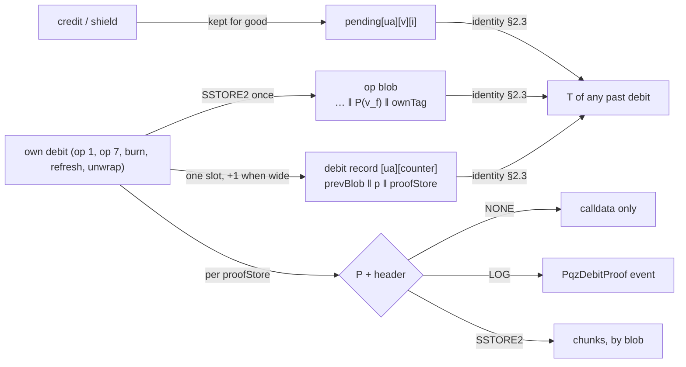

# PQZ proof path, contract side (group 3h) — design

**Status:** SPECIFIED, nothing built (written 2026-11-06, for the owner's review). Work-order group **3h** of branch
`ua-mtx-merge`: plan tasks **T58–T65** in [`2026-11-04-ua-mtx-merge.md`](../plans/2026-11-04-ua-mtx-merge.md), after 3g
(T51–T57) and before 3c, so the round's docs (T19), gates (T21), review (T22) and PR (T23) cover it and the EVM freeze and audit
include it. **PQZ only:** Zether gets nothing (Zether ≠ PQZ). **Everything here is UNAUDITED.** Gas and size figures are paper
arithmetic over figures the repository records; nothing was measured.

**Scope (owner 2026-11-06): one spec per branch, split by component.** This spec is the **contract side** (and the node's small
share). The client side of the PQZ proof path (the `ua-rs` commands, proof verification, the sender's `T` rebuild, the `ownTag`
check, sealing, the reinstall table, the C ABI and bindings) goes into the no-oracle spec on branch `ua-rs-sign`
(`docs/superpowers/specs/2026-11-06-no-decryption-oracle.md`, path (A) there), to be added after its current reviews. This spec
gives that work its contract interface (§9) and the list of items to add there (§13.3).

**Source of the design.** The owner-agreed design of
[`pqz-leg-proof-option.md`](../../research/pqz-leg-proof-option.md) §15A "Agreed design (owner 2026-11-06)", with §14 (the state
identity of `T`, the owner decisions on pending slots and keepers) and §15 ((b′) `ownTag`). The research note calls the earlier
form "debit-T"; that name and `legProof` are historical only (no per-leg proof exists in this design).

**Rules this spec applies, not reopens:** [ARCH-POS-13](../../decisions.md#ARCH-POS-13) (never a decryption oracle);
[CTR-PQZ-06](../../contracts/pq-zero-knowledge.md#CTR-PQZ-06), [CTR-PQZ-07](../../contracts/pq-zero-knowledge.md#CTR-PQZ-07),
[CTR-PQZ-19](../../contracts/pq-zero-knowledge.md#CTR-PQZ-19), [CTR-PQZ-23](../../contracts/pq-zero-knowledge.md#CTR-PQZ-23)
and the never-lose-ciphertext rule;
[CTR-MTX-29](../../decisions.md#ctr-mtx-29--every-parameter-is-explicit) (explicit parameters);
[CTR-GOV-10](../../decisions.md#ctr-gov-10--bit-bands-0-127-one-meaning-128-255-per-application-none-refused) (bit bands); the 3e
spec [2026-11-05-pay-meta-tax.md](2026-11-05-pay-meta-tax.md) (bit 23 `TAX`, the router-op pattern, O18's 64,512 B stop line);
the 3f spec [2026-11-06-attested-verify.md](2026-11-06-attested-verify.md) (`verifyMode` in `ConfidentialConfig` and slot 0 byte
22); the 3g spec [2026-11-06-pqz-key-versions.md](2026-11-06-pqz-key-versions.md) (`acct[ua][version]`, `sendCounter[ua]`,
`Debited` with `keyVersion`). Where this design changes a recorded rule, the change is listed in §12 for a `decisions.md`
Change line in T19.

## 0. Owner rulings, controller calls

### 0.1 Owner rulings (2026-11-06)

Written as given; not reopened.

| # | Ruling | Where |
|---|---|---|
| O1 | **Keep every pending slot for good** (+32 B per credit), reversing the deletion of [pq-zero-knowledge.md §7.4](../../contracts/pq-zero-knowledge.md#transfer) and state spec [§5.5](2026-10-20-pqz-state-redesign.md#55-state-growth-garbage-and-refunds); **one record slot per debit** (previous blob pointer and queue position; a second slot only when `shieldIn ≠ 0`). `T` is not stored: it is rebuilt from state. | §2 |
| O2 | **A seed-keyed `ownTag` (32 B) in each own debit's blob, bound by `memoHash`**, on every own debit: op 1, op 7, burn, refresh (research §15 (b′)). A rollover writes no own ciphertext and needs no tag. | §3 |
| O3 | **Where the debit proof P and its ≈ 640 B header live is a token setting**, `NONE` (calldata), `LOG` (an event of the token), `SSTORE2` (state), chosen at creation and **changeable** later by the token's governance; a change applies to later debits only; each debit's record notes its mode; the header always follows P. | §4 |
| O4 | **Who may change it:** a new governance bit `PQZ_PROOF` in the SCaaS band, on PQZ kinds only; bit 23 is `TAX` (3e), so 24 is the candidate; the spec fixes the number, the holder kinds and whether a relaxation is delayed. **Zether needs no such bit** and has no proof-storage setting. | §5 |
| O5 | **Rejected, not to be designed:** the wallet keeping P, SCaaS nodes archiving debits, the sender handing P over, periodic settling by the holder, a chain-history setting as a rule. A succinct certificate in state stays a watch item. | §1 |
| O6 | **Names** (2026-11-06): the whole design is the **PQZ proof path**; the reader-trust path is **path (A)** (or "state path"); kept pending slots plus the per-debit record are the **debit record** (view `pqzDebitRecord`); the own-debit tag is **`ownTag`**; the setting is **`proofStore`** with values `NONE` / `LOG` / `SSTORE2`; the bit is **`PQZ_PROOF`**; folding credits into the holder's own `v_f` by an own debit or a refresh is to **seal**. | all |
| O7 | **One spec per branch:** contracts here; the client design in the no-oracle spec on `ua-rs-sign`, cross-linked. | §9, §13.3 |

### 0.2 Controller calls (the owner may override)

| # | Call | Where |
|---|---|---|
| C1 | The record is keyed by `(ua, sendCounter)` (the debit's counter before the increment, the one in `entryRef`), not by `entryRef`: no hash, and the view takes the pair. Word 0 always carries a set bit, so a written record is never the zero word. | §2.2 |
| C2 | "Previous blob pointer" is the account's `accBlob` just before `_debit` overwrites it: the blob of the previous debit **of the same `(ua, keyVersion)` account** (a rollover never changes `accBlob`, `PqzStateLib.rollOver`), 0 for its first debit. It also makes every own blob findable from state, a burn's included (a burn writes no `entryPtr`). | §2.2 |
| C3 | One `memoHash` formula for every debit: `keccak256(memo ‖ ownTag)`, `memo` = `salt ‖ sealedMemo` on a commit-reveal (HASH) transfer, empty otherwise. | §3.2 |
| C4 | `ownTag` key derivation: `HKDF-SHA256` with the label `"SCAAS-PQZ-OWNTAG-V1"`, MAC `HMAC-SHA256` (labels: controller naming, pending the owner, as CTR-PQZ-19's). | §3.1 |
| C5 | `SSTORE2` stores `header ‖ P` in chunks of at most 24,575 data bytes (24,576 B of code, EIP-170), whatever the chain's own code limit: one rule on every chain. Chunks and the event are found by the debit's op blob address, the one thing a credit's pending slot names. | §4.3 |
| C6 | The header is the statement's first 640 bytes **as verified** (`statement[0:640]`, the 20 words of [§7.7](../../contracts/pq-zero-knowledge.md#statement)), copied from the verified buffer; P is the calldata proof. In ATTESTED mode (3f) P is stored the same way; the attestation is not stored. | §4.2 |
| C7 | `proofStore` is a field of `ConfidentialConfig` beside 3f's `verifyMode`, stored in `PqzStorage` slot 0 byte 23. A non-PQZ kind refuses a non-zero value where T44 refuses a set `verifyMode` on such a kind (one shared config check; if T44 left none, one check in that shared place, no Zether body changes). | §4.1 |
| C8 | Rule ids, next-free at writing: CTR-PQZ-33 (debit record), CTR-PQZ-34 (`ownTag`), CTR-PQZ-35 (`proofStore`), CTR-GOV-22 (`PQZ_PROOF`); `docs_check.py` confirms at T65. | §12 |
| C9 | The node indexes `ProofStoreSet` with the governance events and takes the new typed fields; it does **not** index `PqzDebitProof`'s data (that would be an archive, O5). | §10 |

## 1. Scope and non-goals — SPECIFIED

**In scope (EVM, the PQZ kinds 4, 5, 12, 13, new releases and their catalogue rows):**

| Item | Rule |
|---|---|
| Pending slots kept; one debit record per debit; the view `pqzDebitRecord` | §2 (PP-1, PP-2) |
| `ownTag` in the args, appended to every own debit's blob, bound by `memoHash` | §3 (PP-3) |
| `proofStore` `NONE` / `LOG` / `SSTORE2`: creation, storage, the event, the chunked store, the view | §4 (PP-4) |
| Bit 24 `PQZ_PROOF`, `setProofStore`, the router op | §5 (PP-5) |
| Release, layout and namespace pins, typehash pins | §6 |
| Gas and size on paper | §7, §8 |
| The interface the contracts give clients | §9 |
| The node's share | §10 |
| Tests, invariants, mutants | §11 |

**Non-goals.** No change to `pqz-core` (`pqzl`, `pqzh`, `stmt`, `ffi`), to a relation, a statement layout, a transcript or a
`proofSystemId`: `memoHash` is a header word the relations do not constrain and `pqz-stmt` does not require to be zero on any
form (research §15 (b′)), so **no full gate**. No precompile or chainspec change. No Zether change: no bit, no setting, no
record, no tag. No keeper of P (O5): no wallet cache rule, no node archive, no sender channel, no periodic holder action, no
history-retention rule. No client commands (O7: the no-oracle spec). No non-EVM contract (PQZ tokens exist only on EVM,
NET-SOR-26; a later family follows the same rule). No migration: every chain is test-only.



## 2. Debit record — SPECIFIED

### 2.1 Pending slots kept (PP-1)

**PP-1.** No pending slot is ever deleted. The two loops go: `_debit`'s `delete a.pending[i]` for `[cleared, p)` and
`rollOver`'s for `[cleared, rolled − INLINE_MAX)`. `cleared` and `floor` keep every update they have today, so `floor` still
bounds an un-roll to `INLINE_MAX` and `cleared` only marks where the contract stops reading; `cleared ≤ floor ≤ rolled ≤
pendingCount` still holds. No slot moves. `pqzPending` and `pqzPendingCt` return the entry for every `i < pendingCount` (below
`cleared` included). Every other rule of CTR-PQZ-06 (strict order, the `acc` cap, the units rule, TRIVIAL merges only at an index
`≥ max(floor, rolled)`) is unchanged, so a consumed entry never changes again.

### 2.2 One record per debit (PP-2)

**PP-2.** Every debit (op 1, op 7, burn, refresh, unwrap; the migration and refresh of a stale version under 3g included) writes,
in the shared debit step, after the proof check, `debitRec[from][sendCounter]` (the counter before the increment):

| Word | Written | Layout (high bits first) |
|---|---|---|
| `w0` | always | `prevBlob(160) ‖ p(64) ‖ proofStore(8) ‖ flags(8) ‖ 0(16)`; `flags` bit 0 `RECORD` = 1 always (C1), bit 1 `WIDE` = `w1` written |
| `w1` | only when `shieldIn ≠ 0` **or** `keyVersion ≠ 0` (Q2) | `shieldIn(64) ‖ keyVersion(64) ‖ 0(128)` |

- `prevBlob` = `acct[from][keyVersion].accBlob` before `_debit` overwrites it (C2); `p` = the debit's `p`; `proofStore` = the
  token's setting in force for this debit (§4); `shieldIn < 2^62` (`maxShielded`), `keyVersion` the 3g version debited.
- The record is written once and never changed. Storage: `mapping(bytes32 => mapping(uint64 => DebitRecord)) debitRec`,
  `struct DebitRecord { uint256 w0; uint256 w1; }`, appended to `PqzStorage` (§6).
- **View** (named fields, one entry): `pqzDebitRecord(bytes32 ua, uint64 counter) → DebitRecordView { address prevBlob; uint64 p;
  uint8 proofStore; uint64 shieldIn; uint64 keyVersion; }`; a counter with no record (`w0 == 0`, i.e. `counter ≥ sendCounter[ua]`)
  reverts `DebitRecordUnknown(bytes32 ua, uint64 counter)`.

### 2.3 What the record guarantees: `T` from state

Research §14.1 shows the identity, read against `PqzCore._total`, `_debit` and `PqzStateLib.rollOver`: for the debit of `from`
with counter `k` on version `v`, with `j` the largest counter `< k` whose record names version `v` (none: `prevBlob = 0`,
`p_j = 0`),

```
T_k = reduce( (u, v_f) of prevBlob_k           (Trivial(0) when prevBlob_k = 0)
              + Σ_{i ∈ [p_j, p_k)} entry_i      (pending[from][v][i]: a credit's (u, v) from its blob; TRIVIAL: Trivial(digits(amount)))
              + Trivial(digits(shieldIn_k)) )
```

The materialised `acc`, `accHash`, the hint and the rollovers are caches; none is needed. `T_k` is exactly the `T` written into
debit `k`'s statement, which the proof binds verbatim (op 1 at 271, op 7 at 481, burn and refresh at 604 of `PqzCore`). This is a
contract guarantee, pinned by invariant P2 (§11): a wrongly rebuilt `T` makes the proof fail, so a reader's error costs liveness,
never the key. The walk to `j` is one step for a UA that never rotated (3g: a stale version only migrates or refreshes).

## 3. `ownTag` — SPECIFIED

### 3.1 Definition (PP-3)

**PP-3.** Every own debit carries `ownTag` (32 B), computed by the holder's client (the contract cannot check it):

```
K      = HKDF-SHA256(ikm = pqzKeySeed_v, salt = "SCAAS-PQZ-OWNTAG-V1", info = "", L = 32)
ownTag = HMAC-SHA256(K, chainUid(32) ‖ token(20) ‖ fromUA(32) ‖ be32(sendCounter) ‖ keccak256(P(u) ‖ P(v_f)))
```

`pqzKeySeed_v` is the seed of the version debited (3g C8); `P(·)` is the stored packed form ([§4.4](../../contracts/pq-zero-knowledge.md#stored-form));
`u` is `u_0` (op 1, op 7 group 0) or `u′` (burn, refresh, unwrap); `sendCounter` is the counter in the statement (`be32`, as
CTR-PQZ-19's `info`). `K` is independent of `s`: a check of the tag uses no secret key bit, so refusal depends only on `K` and
the bytes (research §15.3). Labels per C4.

### 3.2 Where it goes and how it is bound

- **Args:** `bytes32 ownTag` is a named field of `PqzTransferArgs` and `PqzMultiArgs` (after `salt`) and of `PqzBurnArgs`
  (after `beneficiaryUA`). The relayed structs that embed them (`UAPqzTransferSingle`, `…SingleCompact`, `UAPqzTransfer`,
  `…Compact`, `UAPqzUnshield`, the unshield-unwrap form, the refresh form) gain it; typehash pins old → new.
- **Blob:** appended last. Transfer: `R ‖ P(v_f) ‖ ownTag`; op 7: `R ‖ P(v_f) ‖ ownTag`; burn, refresh, unwrap:
  `P(u′) ‖ P(v_f) ‖ ownTag` (length `CTP + 32`). `v_f` is at `length − 32 − VP`; the offsets of `u`, every leg and the auditor
  copies are unchanged, so disclosure (op 4, op 5) and the `acc` reference (`accU`, `accV`) are unchanged. `transferEntry(ref)`
  is the blob minus its trailing `VP + 32` bytes; `transferCiphertextHash(ref) = keccak256(R)` keeps its value and meaning
  (CTR-PQZ-23's sender recovery unchanged).
- **Binding (C3):** `memoHash = keccak256(memo ‖ ownTag)` with `memo` = `salt ‖ sealedMemo` on a commit-reveal (HASH) transfer
  and empty otherwise; so a BUNDLE transfer, a burn, a refresh and an unwrap have `memoHash = keccak256(ownTag)`. `memoHash` is
  header word 608, signed by `PqzAuth` and absorbed by the proof's transcript, so a relayer cannot change the tag. It replaces
  today's `memoHash = keccak256(salt ‖ sealedMemo)` on HASH and `0` elsewhere; the statement views (`transferStatement`,
  `transferSingleStatement`, the burn view) compute the same.
- **No refusal** of any tag value: a wrong tag only fails its own holder's later check.

**Sealing.** An own debit or a refresh writes a fresh `v_f` with its `ownTag`, which folds every credit up to its `p` into the
holder's own balance: those credits are **sealed**, and no P of theirs is ever needed again. A rollover seals nothing. Unsealed
credits are visible from state (§9.4).

## 4. `proofStore` — SPECIFIED

### 4.1 The setting (PP-4)

**PP-4.** `proofStore ∈ {0 NONE, 1 LOG, 2 SSTORE2}`; any other value reverts `ProofStoreInvalid(uint8)`.

- **Creation:** `IFactoryToken.ConfidentialConfig.proofStore` (`uint8`), beside 3f's `verifyMode`; `NONE` is the default (0).
  A non-PQZ kind refuses a non-zero value (C7). The `TokenConfig` encoding moves for every kind (the ripple of 3f §3: wizard,
  `clientkeys`, vectors, node).
- **Stored:** `PqzStorage` slot 0 byte 23 (after `pqz`, `disclosureMode`, `auditorMode`, 3f's `verifyMode` at byte 22), so a
  debit reads no new slot. View `proofStore() → uint8`.
- **Changed:** only by `setProofStore` under bit 24 (§5). A change applies to debits **after** it; every record keeps the mode
  it was written with (`w0.proofStore`), so earlier debits keep where they were stored. Without bit 24 at creation the setting is
  fixed for ever (features only lose bits).

### 4.2 What each mode writes, per debit (C6)

| `proofStore` | P + header | Written by the contract |
|---|---|---|
| `NONE` | calldata only | nothing beyond the record |
| `LOG` | an event of the token | `PqzDebitProof(address indexed blob, bytes32 indexed ua, uint64 indexed sendCounter, bytes header, bytes proof)`, `header` = the verified `statement[0:640]`, `proof` = the calldata proof |
| `SSTORE2` | state | `header ‖ proof` in chunks (§4.3); `proofOf[blob]` = the chunk addresses |

The write sits in the shared debit step in `PqzCore`, after the proof check, in both verify modes, for every debit form and both
proof systems (PQZL, PQZH). `blob` is the debit's op blob (the same address as `Debited`'s).

### 4.3 The chunked store and its view

- `SSTORE2` chunks of at most 24,575 data bytes each, in order (C5); `mapping(address => address[]) proofOf`, appended to
  `PqzStorage`. Chunks: 2 for a PQZL op 1 or burn at every set, 3–4 for op 7 M = 8 with the auditor, ≈ 11 for a PQZH debit.
- **View:** `pqzDebitProof(address blob) → (bytes header, bytes proof)`, the concatenation split at 640; both empty when the
  debit of `blob` was not stored in `SSTORE2` (or `blob` is no debit's).

### 4.4 Who it is for (owner's table, research §15A)

| Setting | Extra gas per debit (§7) | Lifetime of P | For |
|---|---|---|---|
| `NONE` | 0 | the chain's history of block bodies | the default; a direct call or a SCaaS envelope parses from the transaction; a call through another contract needs a trace, which many RPCs do not serve, else path (A) |
| `LOG` | +0.34–0.69 M | the chain's history of receipts (same lifetime as calldata, loss accepted) | active wallets: robust for every call shape |
| `SSTORE2` | +66–132 M state (PQZL), ≈ +385 M (PQZH) | state, for good | no history dependence, an MPC quorum included; needs a large block (op 1 ≈ 102 M of `tx.gas` at `n2304-kmax4096`, op 7 M = 8 with the auditor ≈ 194 M): stated to token creators (§7) |

## 5. Bit 24 `PQZ_PROOF` — SPECIFIED

**PP-5.** Bit **24** (`0x1000000`), `PQZ_PROOF`, the first free bit of the SCaaS band after 23 `TAX` (3e; `governance_bits.json`
holds 0–22 today, 23 with 3e). Type: power, no scalar, no scope. **Valid on kinds 4, 5, 12, 13 only:** in their `_validBits()`;
every other kind, Zether's included, refuses it (`FeatureInvalidForKind`).

- **Holders (Q1):** any holder (an EOA, a single-key UA, an `msig` or a contract), as `TAX` (3e O9): in `_roleBits()` of the four
  kinds and in `GovernanceBits.ISSUER_BITS` (so `init` grants it to `roles.issuer` when the bit is set), not in
  `_contractOnlyBits()` or `REGULATED_ROLES`. T61 checks the plain kinds' (4, 5) init path takes the issuer grant as 12, 13 do.
- **Relaxation (Q1):** bit 24 is **not** in `_delayedRelaxBits()`. Disabling the feature or revoking a holder only freezes the
  setting; it takes nothing from a holder of funds.
- **Power:** `setProofStore(uint8 next)`, direct on the four kinds, `nonReentrant`, gated by `GovernanceUse.use(PQZ_PROOF,
  _govSubject(), 0)`; body in a PQZ library; `next` checked as PP-4; takes effect for the next debit (Q1: immediately in both
  directions); emits `ProofStoreSet(uint8 previous, uint8 next)`; `next == current` is a no-op without an event.
- **Relayed** through the `GovernanceRouter` (no `mtx` twin on the token, as 3e G19): `mtxSetProofStore(UAEnvelope e, address
  target, uint8 next, UASig auth)` over `UASetProofStore(uint8 next)` (new typehash, pinned); fee mode `NONE`, relayable at fee 0.
- **Sentences** (`governance_bits.json`): "A holder chooses where the token stores each later debit's proof: calldata only, an
  event, or contract state. Earlier debits keep where they were stored." Disclosure at creation: `SSTORE2` needs a large block;
  a change to `NONE` or `LOG` leaves later proofs to the chain's history.

## 6. Release, storage layout, pins — SPECIFIED

- **Release:** new releases of kinds 4, 5, 12, 13 and of the PQZ libraries, with their factory catalogue rows (`OpenFactory` /
  `DeployBase` / `script/pqz/e2e.py` entries, release codehashes, `LinkClosure` pins). Nothing deployed is upgraded; no migration.
- **`scaas.pqz` (`PqzStorage`):** slot 0 byte 23 `proofStore`; appended after the 3f and 3g fields: `debitRec`, `proofOf`. No
  existing slot moves. If T52 (3g) has not yet pinned `scaas.pqz` in `test/v2/layout/namespaces.json`, T58 pins it; either way
  the pin moves old → new with the three fields.
- **Typehashes:** the PQZ `UA*` structs that embed the args (§3.2) and the new `UASetProofStore`; old → new in the commit.
- **Selectors:** `selector_audit.json` rows for `setProofStore`, `proofStore`, `pqzDebitRecord`, `pqzDebitProof`, the router's
  `mtxSetProofStore`; `mtxSelectors()` of the tokens unchanged (the setter is a governance power, not a relayed token entry).
- **Statement and vectors of `pqz-core`:** unchanged (`smartcontracts/vectors/pqz/<set>/` byte-equal); a client vector row with a
  non-zero `memoHash` on a burn is new (T62).

## 7. Gas on paper — SPECIFIED

State gas at ≈ 1,539 per stored byte and 97,920 per new slot (EIP-8037, the research's
[`debit_t_state.out`](../../research/pqz-leg-proof-option/debit_t_state.out)); `B` = proof bytes from that file, plus the 640 B
header. USD only as `gas × gwei × 1e-9 × ETH-USD` (1 gwei, 3,000 USD/ETH as assumptions). Nothing measured; forge figures come
in T58–T61 as pins old → new (forge gas is deterministic; no timing or calibration).

**Always (every PQZ token, flat across sets):**

| Item | State | Regular |
|---|---|---|
| debit record `w0` | +97,920 | ≈ +5,000 |
| `w1` (`shieldIn ≠ 0` or `keyVersion ≠ 0`) | +97,920 | ≈ +2,900 |
| `ownTag` in the blob (+32 B) | ≈ +49,250 | ≤ +2,048 calldata at the 64 gas/byte floor |
| deletions skipped by a debit (0–32 slots) | 0 | −12,100 gross each, up to −0.39 M |
| deletions skipped by a rollover | 0 | up to −1.16 / −0.97 / −0.77 / −0.39 M gross |

≈ +0.15 M per debit (≈ 0.45 USD), down to ≈ −0.24 M net with 32 skipped deletions. Per credit +32 B kept for good (its state gas
was paid at the credit). Rollover pins (`PqzStatePinGasTest`) can only fall, so `n2560-kmax16384`'s tight margin cannot get worse.

**By `proofStore`, per debit** (LOG = 8 gas per byte of data plus ≈ 1,500 for the log and three topics, regular gas; SSTORE2 =
state gas for the chunks, plus ≈ 0.2–0.4 M state for 2–4 pointer slots and ≈ 32,000 regular per chunk):

| Set | op 1 with auditor: LOG / SSTORE2 | burn, refresh: LOG / SSTORE2 | op 7 M = 8 with auditor: LOG / SSTORE2 |
|---|---|---|---|
| `n2048-kmax1024` | 0.35 M / 66.8 M | 0.34 M / 65.5 M | 0.69 M / 132.0 M |
| `n2304-kmax4096` | 0.38 M / 72.8 M | 0.37 M / 71.6 M | 0.65 M / 124.6 M |
| `n2560-kmax16384` | 0.41 M / 78.5 M | 0.40 M / 77.3 M | 0.59 M / 112.9 M |
| `n2816-kmax65536` | 0.44 M / 85.5 M | 0.44 M / 84.1 M | 0.64 M / 122.9 M |
| PQZH debit, `n2304-kmax4096` (≈ 250 KB) | ≈ 2.0 M / ≈ 385 M | | |

**Fit.** PQZL with `LOG`: today's regular gas (op 1 9.17 M, op 7 M = 8 with the auditor 12.89 M at `n2304-kmax4096`, research §6)
plus ≤ 0.69 M stays under 2^24 (EIP-7825) at every set. **PQZH with `LOG`** adds ≈ 2 M of execution to debits already near
2^24 under the calldata floor: whether a form stays under is measured in T60 (Q3). `SSTORE2` changes regular gas little, but
`tx.gas` (regular + state, EIP-8037) reaches ≈ 92–125 M for op 1 and up to ≈ 194 M for op 7 M = 8: over a 60 M block and over
the SCaaS testnet node's 64 M `max_gas_per_tx`. No chain assumption is coded: the contract accepts every mode on every chain; the
creation disclosure and the docs state the block it needs.

## 8. Size on paper — SPECIFIED

| Where | Δ runtime [est.] |
|---|---|
| tokens 4, 5, 12, 13 (`PqzLayer`) | +0.3 to +0.6 KB: `setProofStore` (a forward), `proofStore`, `pqzDebitRecord`, `pqzDebitProof` (forwards), bit 24 in the masks, the `ownTag` field in three args decoders |
| `PqzCore` steps (inlined in `PqzTransferLib`, `PqzBurnLib`) | +0.6 to +1.1 KB each: the record write, the `LOG` / `SSTORE2` writer, the `memoHash` formula, the blob tail; −0.1 KB the deletion loop |
| `PqzStateLib` | ≈ 0: the rollover's loop out, the setter body in |
| `PqzViewLib` | +0.3 to +0.5 KB: the two views, `transferEntry`'s new length |

**Kind 13 (`WrappedPqzRegulatedToken`) is measured first in T58**, from what T57 leaves. Stop line **64,512 B** (3e O18): at or
above it, in order, one at a time, re-measuring (sizes, whole `forge test`, PQZ tests at four sets): (1) the setter and the two
views as one-line forwards into `PqzStateLib` / `PqzViewLib`; (2) the `LOG` / `SSTORE2` writer as one library function called
from the shared step, not inlined twice; (3) the unused levers of 3e, 3f, 3g in their order. Each library lever passes the split
checklist (DELEGATECALL storage in `scaas.pqz`, `address(this)` the token, `msg.sender`, fixed return data, the one
`nonReentrant` guard, `LinkClosure` pins). `_above64KiB` is not a fallback. The ceiling is 131,072 B runtime and 262,144 B init on
the reset chain (CTR-GOV-19, `size-baseline.json`); the ratchet moves only with a reason in `_comment`.

## 9. Interface for clients — SPECIFIED

What the contracts expose; the client design that uses it is in the no-oracle spec on `ua-rs-sign` (§13.3). Every item is state
unless marked history.

### 9.1 Views

| View | Returns |
|---|---|
| `pqzDebitRecord(bytes32 ua, uint64 counter)` | `{prevBlob, p, proofStore, shieldIn, keyVersion}` (§2.2); `DebitRecordUnknown` past the last debit |
| `pqzDebitProof(address blob)` | `(header, proof)` of a debit stored in `SSTORE2`; both empty otherwise |
| `proofStore()` | the setting for the next debit |
| `pqzPending(ua, keyVersion, i)`, `pqzPendingCt(ua, keyVersion, i)` (3g) | every `i < pendingCount`, below `cleared` included |
| `pqzAccount(ua, keyVersion)` (3g) | unchanged; `accBlob` is the last own debit's blob, `sendCounter` the UA's |
| `pqzEntryBlob(entryRef)`, `transferEntry`, `transferCiphertextHash` | the blob now ends `… ‖ P(v_f) ‖ ownTag`; `transferEntry` = blob minus `VP + 32` |

### 9.2 Events (history)

- `PqzDebitProof(address indexed blob, bytes32 indexed ua, uint64 indexed sendCounter, bytes header, bytes proof)`, `LOG` only.
- `ProofStoreSet(uint8 previous, uint8 next)`.
- Unchanged: `Debited` (3g shape, with the blob), `Credited`, `Shielded`, `PqzRolledOver`, `ConfidentialTransfer*`, `Unshielded`.

### 9.3 Byte formats

| Item | Format |
|---|---|
| debit record | §2.2: `w0 = prevBlob(160) ‖ p(64) ‖ proofStore(8) ‖ flags(8) ‖ 0(16)`, `w1 = shieldIn(64) ‖ keyVersion(64) ‖ 0(128)` |
| op blob tail | `… ‖ P(v_f) ‖ ownTag(32)`; a burn / refresh / unwrap blob is exactly `CTP + 32` bytes, a transfer blob longer |
| `ownTag` | §3.1 |
| `memoHash` (header word 608) | `keccak256(memo ‖ ownTag)`, `memo` = `salt(16) ‖ sealedMemo` on HASH, empty otherwise |
| stored P | `header(640) ‖ proof`: the event's two fields, or the chunks' concatenation |
| `T` of a past debit | the identity of §2.3 |

### 9.4 Where P of a credit is found

A credit's pending slot names its sender's op blob and block. In order: `pqzDebitProof(blob)` non-empty → `SSTORE2`; else
`eth_getLogs` at that block for topic `blob` → `LOG`; else the block's transactions (a direct call or a SCaaS envelope; through
another contract a trace) → `NONE`. The header names `from` and `sendCounter`, so the sender's `pqzDebitRecord` follows and its
`proofStore` confirms the mode. **Unsealed credits** of `(ua, v)`: the indexes `[p_last, pendingCount)`, `p_last` from the last
record of version `v` (or 0).

## 10. Node — SPECIFIED

Only what the node already does: `typed.rs` rows and the job builder take `own_tag` as a named field of the PQZ debit jobs (old
shapes refused by name, `HEX_ARGS_REFUSED` unchanged); the router op `UASetProofStore` row and the `mtxSetProofStore` selector in
the allow-lists, both directions, equal to the contract's; the `TokenConfig` encoder of `tests/e2e.rs`; the indexer derives
`ProofStoreSet` with the governance events. No archive, no `PqzDebitProof` data indexing, no new guarantee (O5, C9). An operator
note: PQZ debit jobs gain `own_tag`; an old shape is refused by name, never silently `dead`.

## 11. Tests, invariants, mutants — SPECIFIED

Red first with a positive control; one change at a time; mutants on a clean tree, logged `mutant | test that went red | rc`.
Every contracts task: whole `forge test` at the default set, `script/pqz/at-set.sh <set> test --match-path
'test/{ua,pqz,as/confidential}/*'` at the four sets (one run per work tree, `PqzSet.sol` restored), the size gate.

**Unit tests (forge):** `test_debit_keepsPendingSlots`, `test_rollover_keepsPendingSlots` (each with its control: today's code
deletes), `test_pendingCt_belowCleared`, `test_record_{op1,op7,burn,refresh,unwrap,migration}`, `test_record_wide_{shieldIn,keyVersion}`
and `test_record_narrow` (no `w1` slot touched: `vm.accesses`), `test_record_prevBlob_afterRollover`, `test_record_unknown_reverts`,
`test_ownTag_inBlob_{op1,op7,burn,refresh}`, `test_memoHash_{hash,bundle,burn}` against a client-built statement,
`test_ownTag_swapped_ProofRejected` (a relayer changes `ownTag`: `AuthRejected` or `ProofRejected`), `test_transferEntry_length`,
`test_proofStore_{none,log,sstore2}_{op1,op7,burn}` (`LOG`: exactly one event, `header` equals the statement's first 640 bytes;
`SSTORE2`: the view returns the calldata proof; `NONE`: no event, empty view), `test_proofStore_attested` (3f ATTESTED: P stored
the same), `test_proofStore_change_appliesLater` (records before keep their mode), `test_proofStore_invalid`,
`test_proofStore_zether_refused` (C7), `test_bit24_{validKinds,otherKindsRefused,anyHolder,notDelayed}`, `test_setProofStore_{gated,noop}`,
`test_router_UASetProofStore`, `test_UASetProofStoreTypehashIsPinned`, the moved PQZ typehash pins, `test_layout_scaasPqz`,
`test_mtxSelectors_unchanged`, gas pins old → new.

**Invariants** (`test/pqz/invariant/ProofPath{Handler,Invariants}.t.sol`; handlers over credits, shields with same-block merges,
rollovers, un-rolls, every debit form, 3g rotations and migrations, `setProofStore`):

| Id | Invariant |
|---|---|
| P1 | every `i < pendingCount` of every account has a non-zero pending slot |
| P2 | for every recorded debit, `T` rebuilt from state by §2.3 equals the `T` its statement carried (captured by the handler) |
| P3 | `debitRec[ua][k].w0 ≠ 0` exactly for `k < sendCounter[ua]`; a record never changes after it is written |
| P4 | every own blob's last 32 bytes equal the debit's `ownTag`, and its statement's `memoHash` equals §3.2's formula |
| P5 | each record's `proofStore` equals the setting at its debit; `LOG` ⇔ one `PqzDebitProof`; `SSTORE2` ⇔ `pqzDebitProof(blob)` equals header and proof |
| P6 | the pool invariants of [§7.1](../../contracts/pq-zero-knowledge.md#71-state-per-ua-token) and 3g's J-invariants still hold |
| P7 | Zether tokens: gas pins, layout and selectors byte-equal to before |

**Mutants** (each must turn a test red): M1 the debit's delete loop restored; M2 the rollover's restored; M3 the record's `p`
off by one; M4 `prevBlob` = the new blob; M5 `w1` not written when only `keyVersion ≠ 0`; M6 `RECORD` bit dropped; M7
`memoHash` without `ownTag`; M8 `ownTag` not appended (or before `v_f`); M9 `transferEntry` still minus `VP`; M10 the record's
`proofStore` read after a same-transaction change (stale mode); M11 `LOG` event with the proof-stripped buffer; M12 `SSTORE2`
chunk of 24,576 data bytes; M13 bit 24 accepted on a Zether kind; M14 bit 24 in `_delayedRelaxBits()`; M15 `setProofStore`
ungated.

## 12. Docs and `decisions.md` — SPECIFIED

| File | Change |
|---|---|
| `docs/contracts/pq-zero-knowledge.md` | §7.1 (the table: pending kept, `debitRec`, `proofOf`, `proofStore`; the flow); §7.4 (the deletion line and "keeps state from growing by 32 B per credit forever" replaced; the blob tail; `memoHash`); §7.5, §7.6 (no deletion); §7.7 (`memoHash` word); §7.8 (views, events); CTR-PQZ-07, -23 text; a "PQZ proof path" section with CTR-PQZ-33, -34, -35, BUILT only with code and tests |
| `docs/contracts/token-wrappers.md` | the bit table: 24 `PQZ_PROOF` |
| `docs/node/indexer-feeds.md`, `job-api.md` | `ProofStoreSet`; `own_tag`; the release note |
| `docs/research/pqz-leg-proof-option.md` | a dated status line: the contract side specified here, the client side in the no-oracle spec |
| `smartcontracts/vectors/governance/governance_bits.json` | bit 24 (T61) |

**`decisions.md` entries** (each in full, with status and commits at build):

1. **CTR-PQZ-33 — Debit record: every pending slot kept, one record per debit** (owner 2026-11-06, O1). Change lines on the plan
   5h entries that state the deletion (D4's `_debit` and D8's rollover in CTR-PQZ-06's group), on CTR-PQZ-07, and a note on
   state spec §5.5.
2. **CTR-PQZ-34 — `ownTag` on every own debit, bound by `memoHash`** (owner 2026-11-06, O2), with C3 and C4; a Change line on
   CTR-PQZ-23 (blob tail, `transferEntry`, `memoHash`).
3. **CTR-PQZ-35 — `proofStore`: where a debit's proof and header live** (owner 2026-11-06, O3), with C5–C7.
4. **CTR-GOV-22 — `PQZ_PROOF`: bit 24, PQZ kinds, any holder, not delay-relaxed** (owner 2026-11-06, O4, and Q1's answer).

For the client side (no-oracle spec): its §4.10 owner decision of 2026-11-06 (a BUNDLE op 7 has `memoHash = 0`) holds for today's
release only; on a 3h release the facade computes C3's formula. That spec carries its own Change line.

## 13. Tasks — SPECIFIED

### 13.1 Contract part (this branch; plan T58–T65)

| Task | Content | Depends on | Agent-days |
|---|---|---|---|
| T58 | Debit record: both deletions out, `debitRec` and its write in the shared debit step, `pqzDebitRecord`, pending views below `cleared`, layout and `scaas.pqz` pin; kind 13 measured first | T57 | 3 |
| T59 | `ownTag`: the args fields, the blob tail, `memoHash`, `transferEntry`, the statement views, typehash pins | T58 | 2 |
| T60 | `proofStore`: `ConfidentialConfig`, slot 0 byte 23, the record's mode, `LOG` event, `SSTORE2` chunks, `pqzDebitProof`, the non-PQZ refusal; PQZH × `LOG` measured (Q3) | T59 | 2.5 |
| T61 | Bit 24 `PQZ_PROOF`: masks, holders, `setProofStore`, `ProofStoreSet`, the router op and typehash, `selector_audit.json`, `governance_bits.json` | T60 | 1.5 |
| T62 | Vectors and their readers: `typed_ops.json` PQZ rows with `ownTag`, `UASetProofStore`, `TokenConfig` with `proofStore`, an `ownTag` / `memoHash` KAT and record-word rows; `clientkeys` `evm.js`; every `ua-*` reader of the moved rows | T61 | 2.5 |
| T63 | Node: `own_tag`, the router row, allow-lists both directions, `ProofStoreSet` feed, e2e encoder | T62 | 1.5 |
| T64 | Invariants P1–P7 and the mutant harness M1–M15 | T61; beside T62–T63 | 2 |
| T65 | Docs share (lands in T19): §12's files and the four entries | T58–T64 for BUILT | 1 |
| | **Contract part in all** | | **16** |

Order: T58 → T59 → T60 → T61 sequential in this worktree (shared `PqzCore`, `PqzLayer`, `size-baseline.json`); T62 after T61
(ABI final); T63 after T62; T64 after T61, beside T62–T63; T65 drafts beside, lands in T19. Placement: after 3g (T57), before 3c
(whose `UARegistryLib` ↔ `UARegistry` rebalance comes after every PQZ contract change; 3h touches no registry code).

### 13.2 What must wait for the no-oracle spec's T15e

T15e (`ua-rs-sign`) defines path (A)'s API: the named location fields, the word fields and their parser, `p` chosen inside, the
one refusal status `Argument`, the forge state vectors (`state.json`). The proof-path commands must reuse that API, so the
client items C-PP-1 … C-PP-3, C-PP-6 and C-PP-7 below start only after T15e lands; C-PP-4 waits for T15b and this branch's T62
vectors. None of the contract tasks T58–T65 waits for `ua-rs-sign`: T62 changes byte formats on this branch only (vectors,
`clientkeys`, readers of the moved rows), and the forge state writer of T15e gains the record and blob-tail words when both
branches meet (C-PP-1).

### 13.3 To add to the no-oracle spec (`ua-rs-sign`), after its current reviews

| Item | Content | Waits for | Agent-days |
|---|---|---|---|
| C-PP-1 | Words of the proof path on T15e's parser: the debit record words, pending entries below `cleared`, the blob tail (`ownTag`), stored P (`header`, `proof` as named fields); `state.json` rows with records | T15e, T62 | 1 |
| C-PP-2 | `balanceProven {chainUid, token, ua, block, words, credits[…]}`, named like `balance`, same location fields and output `{value, p, sendCounter}` plus `parts`: verify each credit's P with the library's own verifier over a statement it rebuilds, the sender's `T` from record words (§2.3), sum ≤ `K_MAX`, own `v_f` by `ownTag`, TRIVIAL entries from amounts; one status `Argument` before the key | C-PP-1 | 3–4 |
| C-PP-3 | Proof-path debit commands (`proveTransferProven`, `proveTransferMultiProven`, `proveBurnProven`, `proveRefreshProven`), one entry per operation, the account words of research §3.3 from the reading layer under R1 | C-PP-2 | 2 |
| C-PP-4 | `ownTag` and `memoHash` (C3) in every debit builder of the facade, op 1, op 7, burn, refresh; replaces T15b's BUNDLE `memoHash = 0` on a 3h release | T15b, T62 | 1 |
| C-PP-5 | Seal and reinstall rules as library duties: unsealed count from state (§9.4), the reinstall table of research §15A, an MPC quorum member never on path (A) | C-PP-2 | 0.5 |
| C-PP-6 | C ABI (`ua-c`) and bindings (`ua-cxx`, `ua-qt`, `ua-dart-frb`, `ua-py`, `ua-go`, `ua-cs`): the new command fields, no new status | C-PP-3, T15g | 1.5–2 |
| C-PP-7 | Negatives and mutants (forged `T`, wrong key, swapped leg, more than `K_MAX` parts, a non-canonical coefficient, a forged `ownTag`, P of another debit), the 8·K harness through the proof path | C-PP-6 | 1.5–2 |
| C-PP-8 | `docs/clients/ua-libraries.md`: the proof path beside path (A) | C-PP-3 | 0.5 |
| | **Client part in all** | | **11–13** |

## 14. Owner questions

1. **Q1 — Bit 24 `PQZ_PROOF`:** number 24; any holder (EOA, single-key UA, `msig`, contract), granted with the issuer seat; not
   delay-relaxed; a change effective for the next debit in both directions (no notice period)? *Recommendation:* yes. Earlier
   debits keep their mode, so a change takes nothing already stored; a holder who wants P kept seals before going cold, and funds
   never depend on P (path (A) stays).
2. **Q2 — The record's second word with 3g:** written when `shieldIn ≠ 0` **or** `keyVersion ≠ 0` (the version debited is needed
   to find the window's queue after a rotation; it does not fit `w0`)? *Recommendation:* yes; a UA that never rotates keeps
   exactly the owner's "second slot only when `shieldIn ≠ 0`".
3. **Q3 — PQZH with `LOG` or `SSTORE2`:** if T60's forge figures put a PQZH debit form with `LOG` over 2^24 regular gas at a set,
   should the contract refuse that pair at creation and in `setProofStore`, or only the wizard and the docs? *Recommendation:* the
   wizard refuses and the docs state it; the contract stays chain-neutral, as for `SSTORE2`'s block size, and a `PQZ_PROOF`
   holder can move such a token back to `NONE`.
