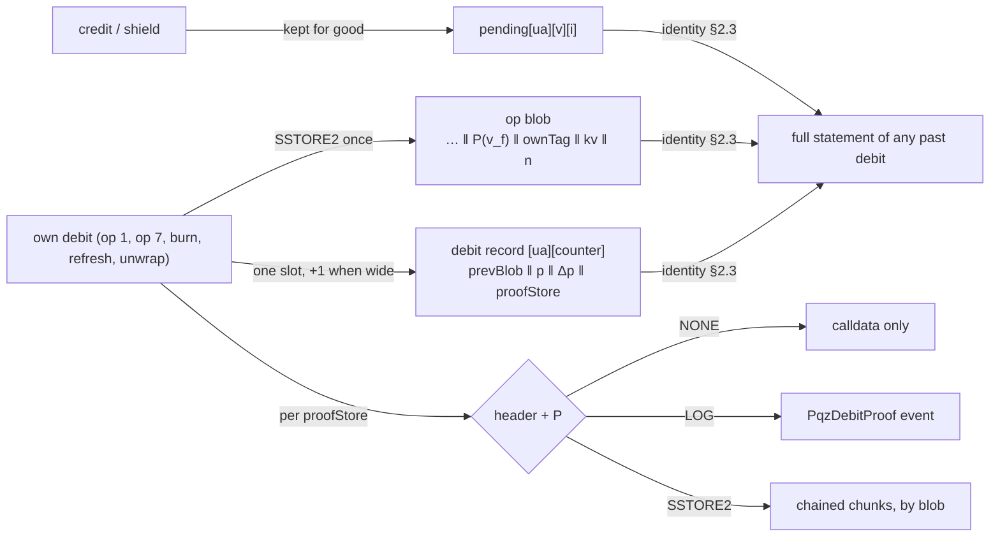

# PQZ proof path, contract side (group 3h) — design

**Status:** SPECIFIED, nothing built. Written 2026-11-06, **revised 2026-11-07 after two independent reviews (Codex: 1 P1, 6 P2,
1 P3; Fable: 1 P1, 4 P2, several P3; no P0)**, every item accepted, outcomes in §15. For the owner's review; questions Q1–Q3 in
§14. Work-order group **3h** of branch `ua-mtx-merge`: plan tasks **T58–T66** in
[`2026-11-04-ua-mtx-merge.md`](../plans/2026-11-04-ua-mtx-merge.md), after 3g (T51–T57) and before 3c, so the round's docs
(T19), gates (T21), review (T22) and PR (T23) cover it and the EVM freeze and audit include it. **PQZ only:** Zether gets nothing
(Zether ≠ PQZ). **Everything here is UNAUDITED.** Gas and size figures are paper arithmetic over figures the repository records;
nothing was measured.

**Scope (owner 2026-11-06): one spec per branch, split by component.** This spec is the **contract side** (and the node's share).
The client side of the PQZ proof path (the `ua-rs` commands, proof verification, the statement rebuild, the `ownTag` check,
sealing, the reinstall table, the MPC quorum's rules, the C ABI and bindings) goes into the no-oracle spec on branch `ua-rs-sign`
(`docs/superpowers/specs/2026-11-06-no-decryption-oracle.md`, path (A) there), to be added after its current reviews. This spec
gives that work its contract interface (§9) and the list of items to add there (§13.3).

**Source of the design.** The owner-agreed design of
[`pqz-leg-proof-option.md`](../../research/pqz-leg-proof-option.md) §15A "Agreed design (owner 2026-11-06)", with §14 (the state
identity of `T`, the owner decisions on pending slots and keepers), §15 ((b′) `ownTag`) and §9.2 (the MPC quorum's fallback).
The research note calls the earlier form "debit-T"; that name and `legProof` are historical only (no per-leg proof exists here).

**Rules this spec applies, not reopens:** [ARCH-POS-13](../../decisions.md#ARCH-POS-13) (never a decryption oracle);
[CTR-PQZ-06](../../contracts/pq-zero-knowledge.md#CTR-PQZ-06), [CTR-PQZ-07](../../contracts/pq-zero-knowledge.md#CTR-PQZ-07),
[CTR-PQZ-19](../../contracts/pq-zero-knowledge.md#CTR-PQZ-19), [CTR-PQZ-23](../../contracts/pq-zero-knowledge.md#CTR-PQZ-23)
and the never-lose-ciphertext rule;
[CTR-MTX-29](../../decisions.md#ctr-mtx-29--every-parameter-is-explicit) (explicit parameters);
[CTR-GOV-10](../../decisions.md#ctr-gov-10--bit-bands-0-127-one-meaning-128-255-per-application-none-refused) (bit bands); the 3e
spec [2026-11-05-pay-meta-tax.md](2026-11-05-pay-meta-tax.md) (bit 23 `TAX`, the router-op pattern, the `noticePeriod()` pending
of §6.2, O18's 64,512 B stop line); the 3f spec [2026-11-06-attested-verify.md](2026-11-06-attested-verify.md) (`verifyMode` in
`ConfidentialConfig` and slot 0 byte 22); the 3g spec [2026-11-06-pqz-key-versions.md](2026-11-06-pqz-key-versions.md)
(`acct[ua][version]`, `sendCounter[ua]`, `Debited` with `keyVersion`, credits to `current`). Where this design changes a recorded
rule, the change is listed in §12 for a `decisions.md` Change line in T19.

## 0. Owner rulings, controller calls

### 0.1 Owner rulings (2026-11-06)

Written as given; not reopened.

| # | Ruling | Where |
|---|---|---|
| O1 | **Keep every pending slot for good** (+32 B per credit), reversing the deletion of [pq-zero-knowledge.md §7.4](../../contracts/pq-zero-knowledge.md#transfer) and state spec [§5.5](2026-10-20-pqz-state-redesign.md#55-state-growth-garbage-and-refunds); **one record slot per debit** (previous blob pointer and queue position; a second slot only when `shieldIn ≠ 0`, extended by R1 below). `T` is not stored: it is rebuilt from state. | §2 |
| O2 | **A seed-keyed `ownTag` (32 B) in each own debit's blob, bound by `memoHash`**, on every own debit: op 1, op 7, burn, refresh (research §15 (b′)). A rollover writes no own ciphertext and needs no tag. | §3 |
| O3 | **Where the debit proof P and its ≈ 640 B header live is a token setting**, `NONE` (calldata), `LOG` (an event of the token), `SSTORE2` (state), chosen at creation and **changeable** later by the token's governance; a change applies to later debits only; each debit's record notes its mode; the header always follows P. | §4 |
| O4 | **Who may change it:** a new governance bit `PQZ_PROOF` in the SCaaS band, on PQZ kinds only; bit 23 is `TAX` (3e), so 24 is the candidate; the spec fixes the number, the holder kinds and whether a relaxation is delayed. **Zether needs no such bit** and has no proof-storage setting. | §5 |
| O5 | **Rejected, not to be designed:** the wallet keeping P, SCaaS nodes archiving debits, the sender handing P over, periodic settling by the holder, a chain-history setting as a rule. A succinct certificate in state stays a watch item. | §1 |
| O6 | **Names** (2026-11-06): the whole design is the **PQZ proof path**; the reader-trust path is **path (A)** (or "state path"); kept pending slots plus the per-debit record are the **debit record** (view `pqzDebitRecord`); the own-debit tag is **`ownTag`**; the setting is **`proofStore`** with values `NONE` / `LOG` / `SSTORE2`; the bit is **`PQZ_PROOF`**; folding credits into the holder's own `v_f` by an own debit or a refresh is to **seal**. | all |
| O7 | **One spec per branch:** contracts here; the client design in the no-oracle spec on `ua-rs-sign`, cross-linked. | §9, §13.3 |
| O8 | (research §9.2) **An MPC quorum never uses path (A).** When P is lost it rebuilds `seed32` k-of-n, one member becomes the operator, who seals by refresh under path (A) with a trusted source and rotates the key version (3g). | §9.6 |

### 0.2 Required by the reviews (2026-11-07)

| # | Requirement | Where |
|---|---|---|
| R1 | (both reviews) **The record's second word is written when `shieldIn ≠ 0` or `keyVersion ≠ 0`** (or its same-version predecessor is not the previous counter): after a rotation the version debited is needed to find the window's queue, and it does not fit word 0. A UA that never rotates keeps the owner's "second slot only when `shieldIn ≠ 0`". Formerly question Q2; recorded as required. | §2.2 |
| R2 | (Codex C2) **The key versions of every credited key are stored with the debit**, so the full statement of a past debit is rebuilt by an exact public lookup, never by trying versions. | §3.2 |
| R3 | (Fable P1) **`SSTORE2` is a freeze power:** creation with `SSTORE2` needs bit 24; disabling bit 24 resets `proofStore` to `NONE`. | §4.1, §5 |

### 0.3 Controller calls (the owner may override)

| # | Call | Where |
|---|---|---|
| C1 | The record is keyed by `(ua, sendCounter)` (the counter before the increment, the one in `entryRef`), not by `entryRef`. Word 0 always carries a set bit, so a written record is never the zero word. | §2.2 |
| C2 | "Previous blob pointer" is the account's `accBlob` just before `_debit` overwrites it: the blob of the previous debit **of the same `(ua, keyVersion)` account** (a rollover never changes `accBlob`), 0 for its first debit. With `Δp` in word 0, the window of `T` needs no other record (Fable). | §2.2 |
| C3 | One `memoHash` formula for every debit: `keccak256(memo ‖ ownTag)`, `memo` = `salt ‖ sealedMemo` on a commit-reveal (HASH) transfer, empty otherwise. | §3.3 |
| C4 | **`ownTag` label `"PQZ/owntag/v1"`**, the HKDF `info` as for the memo key (CTR-PQZ-23's owner-approved `"PQZ/memo/v1"`, the closest analogue: a client-side key from `pqzKeySeed`), the label the no-oracle spec already reserved; `HKDF-SHA256` then `HMAC-SHA256`, pinned by one shared KAT row in `smartcontracts/vectors/ua/pq_kat.json` (Codex C8; the draft's `SCAAS-PQZ-OWNTAG-V1` is dropped). | §3.1 |
| C5 | The op blob tail is self-describing from its last byte (`… ‖ P(v_f) ‖ ownTag ‖ kv ‖ u8(n)`); one internal function `rOf` is the single place that reads or writes it. | §3.2 |
| C6 | `SSTORE2` stores `header ‖ P` with **its own chunk writer** (not `SSTORE2.writeChunks`, whose pieces are 32,768 B): chunks of at most 24,576 B of code (EIP-170) on every chain, **chained** (each chunk begins with the next chunk's address), written last first, so one pointer slot per debit holds the chain. A CREATE2 address keyed by `(blob, i)` is not used: it depends on the chunk's bytes, so it cannot be computed without them (Fable P3, considered). | §4.3 |
| C7 | The header is the statement's first 640 bytes **as verified**, copied from the verified buffer; P is the calldata proof. In ATTESTED mode (3f) P is stored the same way; the attestation is not stored. | §4.2 |
| C8 | `proofStore` is a field of `ConfidentialConfig` beside 3f's `verifyMode`; `PqzStorage` slot 0 byte 23, the pending change in byte 24 and one appended slot. A non-PQZ kind refuses a non-zero value where T44 refuses a set `verifyMode` (one shared config check; no Zether body changes). | §4.1 |
| C9 | **Release discriminator:** a client tells a 3h release by probing `proofStore()` (absent before 3h); vector rows of moved formats carry `"release": "3h"`. No new field. | §9.3 |
| C10 | Rule ids, next-free at writing: CTR-PQZ-33 (debit record), CTR-PQZ-34 (`ownTag` and the key-version tail), CTR-PQZ-35 (`proofStore`), CTR-GOV-22 (`PQZ_PROOF`), NODE-JOB-24 (the lane's proof-store cap); `docs_check.py` confirms at T66. | §12 |
| C11 | The node does **not** index `PqzDebitProof`'s data (that would be an archive, O5). | §10 |

## 1. Scope and non-goals — SPECIFIED

**In scope (EVM, the PQZ kinds 4, 5, 12, 13, new releases and their catalogue rows):**

| Item | Rule |
|---|---|
| Pending slots kept; one debit record per debit; the account's `lastDebit`; `pqzDebitRecord` | §2 (PP-1, PP-2) |
| `ownTag` and the credited keys' versions in every own debit's blob; `memoHash` | §3 (PP-3) |
| `proofStore` `NONE` / `LOG` / `SSTORE2`: creation, storage, the pending change, the event, the chained store, the view | §4 (PP-4) |
| Bit 24 `PQZ_PROOF`, `setProofStore`, the disable reset, the router op | §5 (PP-5) |
| Release, layout and namespace pins, typehash pins | §6 |
| Gas, fit and size on paper; the measurement matrix | §7, §8 |
| The interface the contracts give clients | §9 |
| The node's share | §10 |
| Tests, invariants, mutants, the integration gate | §11 |

**Non-goals.** No change to `pqz-core` (`pqzl`, `pqzh`, `stmt`, `ffi`), to a relation, a statement layout, a transcript or a
`proofSystemId`: `memoHash` is a header word the relations do not constrain and `pqz-stmt` does not require to be zero on any form
(research §15 (b′)), so **no full gate**. No precompile or chainspec change. No Zether change. No keeper of P (O5). No client
commands (O7). No non-EVM contract (PQZ tokens exist only on EVM, NET-SOR-26). No migration: every chain is test-only.



## 2. Debit record — SPECIFIED

### 2.1 Pending slots kept (PP-1)

**PP-1.** No pending slot is ever deleted. The two loops go: `_debit`'s `delete a.pending[i]` for `[cleared, p)` and
`rollOver`'s for `[cleared, rolled − INLINE_MAX)`. `cleared` and `floor` keep every update they have today (a rollover raises
`floor` only when `end > floor`), so `floor` still bounds an un-roll to `INLINE_MAX` and `cleared` only marks where the contract
stops reading; `cleared ≤ floor ≤ rolled ≤ pendingCount` holds. No slot moves. `pqzPending` and `pqzPendingCt` return the entry
for every `i < pendingCount`. Every other rule of CTR-PQZ-06 is unchanged; in particular a TRIVIAL merge touches only the tail at
an index `≥ max(floor, rolled)`, so **a consumed entry never changes** (invariant P1′).

### 2.2 One record per debit (PP-2)

**PP-2.** Every debit (op 1, op 7, burn, refresh, unwrap; a 3g migration and a stale refresh included) writes, in the shared debit
step after the proof check, `debitRec[from][k]` with `k` the counter before the increment, and the account's `lastDebit`:

| Word | Written | Layout (high bits first) |
|---|---|---|
| `w0` | always | `prevBlob(160) ‖ p(64) ‖ Δp(16) ‖ proofStore(8) ‖ flags(8)`; `flags` bit 0 `RECORD` = 1 always (C1), bit 1 `WIDE` = `w1` written |
| `w1` | when `shieldIn ≠ 0`, or `keyVersion ≠ 0`, or `prevCounter ≠ k − 1` with a predecessor (R1) | `shieldIn(64) ‖ keyVersion(64) ‖ prevCounter(64) ‖ 0(64)` |
| `lastDebit` | always | `acct[from][keyVersion].lastDebit = k + 1` (0 = never debited), in the account slot 3g freed (its `sendCounter`) |

- `prevBlob` = `acct[from][keyVersion].accBlob` before the overwrite (C2). `p` = the debit's `p`. `Δp = p − p_prev`, with `p_prev`
  the `p` of the same account's previous debit (0 for its first): `Δp ≤ K_MAX − 2 = 65,534` at `n2816-kmax65536` by the units rule,
  so it fits 16 bits at every set. `proofStore` = the mode in force for this debit (§4.1). `prevCounter` = the old `lastDebit − 1`.
  `shieldIn < 2^62` (`maxShielded`); `keyVersion` the 3g version debited.
- Written once, never changed. Storage: `mapping(bytes32 => mapping(uint64 => DebitRecord)) debitRec`, `struct DebitRecord {
  uint256 w0; uint256 w1; }`, appended to `PqzStorage` (§6).
- **Views** (named fields): `pqzDebitRecord(bytes32 ua, uint64 counter) → DebitRecordView { address prevBlob; uint64 p; uint16
  deltaP; uint8 proofStore; uint64 shieldIn; uint64 keyVersion; uint64 prevCounter; bool hasPrev; }` (`prevCounter = k − 1` when
  narrow with a predecessor); no record (`w0 == 0`) reverts `DebitRecordUnknown(bytes32 ua, uint64 counter)`. `pqzAccount(ua,
  keyVersion)` (3g) gains `lastDebit` as its last field.

### 2.3 What the record guarantees: `T` from state

Research §14.1 shows the identity, read against `PqzCore._total`, `_debit` and `PqzStateLib.rollOver`: for the debit of `from`
with counter `k` on version `v`,

```
T_k = reduce( (u, v_f) of prevBlob_k                 (Trivial(0) when prevBlob_k = 0)
              + Σ_{i ∈ [p_k − Δp_k, p_k)} entry_i     (pending[from][v][i]: a credit's (u, v) from its blob; TRIVIAL: Trivial(digits(amount)))
              + Trivial(digits(shieldIn_k)) )
```

One record gives the whole window: no walk to a predecessor (Fable P3). The materialised `acc`, `accHash`, the hint and the
rollovers are caches. `T_k` is exactly the `T` written into debit `k`'s statement, which the proof binds verbatim; a wrongly
rebuilt `T` makes the proof fail (liveness, never the key). Pinned by invariant P2 and by the integration gate (§11.4). The same
version's chain is `lastDebit` → `prevCounter` → …, one lookup per step (Codex C6).

## 3. `ownTag` and the key-version tail — SPECIFIED

### 3.1 `ownTag` (PP-3)

**PP-3.** Every own debit carries `ownTag` (32 B), computed by the holder's client (the contract cannot check it):

```
K      = HKDF-SHA256(ikm = pqzKeySeed_v, salt = "", info = "PQZ/owntag/v1", L = 32)
ownTag = HMAC-SHA256(K, chainUid(32) ‖ token(20) ‖ fromUA(32) ‖ be32(sendCounter) ‖ keccak256(P(u) ‖ P(v_f)))
```

- `pqzKeySeed_v` is the seed of the version debited (3g C8); `P(·)` the stored packed form
  ([§4.4](../../contracts/pq-zero-knowledge.md#stored-form)); `u` is `u_0` (op 1, op 7 group 0) or `u′` (burn, refresh, unwrap).
- **`K` is counter-free on purpose:** one key per seed version; the counter, the location and the ciphertext hash are in the MAC's
  message. `K` is independent of `s`, so a check uses no secret key bit (research §15.3).
- **Counter width:** `be32`, as CTR-PQZ-19's `info`; `sendCounter` is `uint64`, and a counter at or above 2^32 (four billion
  debits of one UA) is out of reach; the message also covers the ciphertext hash, so two tags never share an input.
- **What it proves:** authorship, not inclusion. A tag match says the holder's seed wrote these bytes, not that they are the
  current state of the account. A client never treats a tag match as the latest state, and a migration's credit (a credit, not an
  own `v_f`) is checked by re-encryption (3g KV-11), not by the tag.

### 3.2 Where it goes: the blob tail (C5, R2)

- **Args:** `bytes32 ownTag` is a named field of `PqzTransferArgs` and `PqzMultiArgs` (after `salt`) and of `PqzBurnArgs` (after
  `beneficiaryUA`). The relayed structs that embed them (`UAPqzTransferSingle`, `…SingleCompact`, `UAPqzTransfer`, `…Compact`,
  `UAPqzUnshield`, the unshield-unwrap form, the refresh form) gain it; typehash pins old → new.
- **The key versions of the credited keys (R2):** `kv` = `be64(version)` of every key the statement names after `pk_f`, in
  statement order: op 1 `pk_t`, then `pk_a` when the auditor is on; op 7 every leg's key in leg order, then `pk_a`; burn, refresh,
  unwrap none. `n` = their number (≤ 9). Each version is the one the contract read in the same call (3g KV-7: `current` of the
  receiver, the leg, the auditor). Written by the contract, not an argument.
- **Blob:** every own blob ends `… ‖ P(v_f) ‖ ownTag(32) ‖ kv(8·n) ‖ u8(n)`: a transfer `R ‖ tail`, an op 7 `R ‖ tail`, a burn,
  refresh or unwrap `P(u′) ‖ tail` (`CTP + 33` bytes). From the last byte: `n`; `kv` at `len − 1 − 8n`; `ownTag` at `len − 33 −
  8n`; `v_f` at `len − 33 − 8n − VP`; `R` = the bytes before `v_f`. **`rOf`** (an internal function of `PqzCore`) is the one place
  that computes these: the three `_debit` call sites (`vOff` of the `acc` reference), `transferEntry`, `transferCiphertextHash`
  and the views. The offsets of `u`, every leg and the auditor copies are unchanged, so disclosure (op 4, op 5) is unchanged;
  `transferEntry(ref) = R` and `transferCiphertextHash(ref) = keccak256(R)` keep their values (CTR-PQZ-23's sender recovery
  unchanged).

### 3.3 Binding (C3)

`memoHash = keccak256(memo ‖ ownTag)` with `memo` = `salt ‖ sealedMemo` on a commit-reveal (HASH) transfer, empty otherwise; so a
BUNDLE transfer, a burn, a refresh and an unwrap have `memoHash = keccak256(ownTag)`. `memoHash` is header word 608, signed by
`PqzAuth` and absorbed by the proof's transcript, so a relayer cannot change the tag. It replaces today's `keccak256(salt ‖
sealedMemo)` on HASH (the preimage gains `ownTag`) and `0` elsewhere; the statement views compute the same. `kv` needs no binding:
the contract writes it from its own reads, and a wrong `kv` only makes a reader's rebuild fail. No tag value is refused.

**Sealing.** An own debit or a refresh writes a fresh `v_f` with its `ownTag`, folding every credit up to its `p` into the
holder's own balance: those credits are **sealed**. A single holder then needs no P of theirs again; an MPC quorum, which has no
seed, still needs the P of the sealing debit itself (§9.6). A rollover seals nothing.

## 4. `proofStore` — SPECIFIED

### 4.1 The setting (PP-4)

**PP-4.** `proofStore ∈ {0 NONE, 1 LOG, 2 SSTORE2}`; any other value reverts `ProofStoreInvalid(uint8)`.

- **Creation:** `IFactoryToken.ConfidentialConfig.proofStore` (`uint8`), beside 3f's `verifyMode`; `NONE` by default. **`SSTORE2`
  needs bit 24 set at creation**, else `ProofStoreNeedsGovernance()` (R3: without a holder, a mode that needs a ≥ 100 M block would
  freeze the token for good on a chain with smaller blocks). A non-PQZ kind refuses a non-zero value (C8). The `TokenConfig`
  encoding moves for every kind (the 3f ripple).
- **Stored:** `PqzStorage` slot 0 byte 23 `proofStore`, byte 24 `proofStoreNext` (0 = nothing pending, else the value + 1), and
  one appended slot `proofStoreEta` read only while a change is pending; a debit reads no new slot otherwise. View `proofStore() →
  uint8` (the mode in force now) and `pendingProofStore() → (uint8 next, uint64 eta)`.
- **Changed** only through bit 24 (§5). The **mode in force for a debit** is `proofStoreNext − 1` once `now ≥ proofStoreEta`
  (applied lazily by the first debit or call after it), else `proofStore`. A change applies to later debits only; every record
  keeps its own mode (`w0.proofStore`).
- **Timing (Q1):** a change **to `SSTORE2`**, or between `NONE` and `LOG`, is immediate; a change **away from `SSTORE2`** takes
  effect at `eta = now + IOpenFactory(FACTORY).noticePeriod()` (3e §6.2's mechanism), a later change to `SSTORE2` cancels it.

### 4.2 What each mode writes, per debit (C7)

| Mode in force | header + P | Written by the contract |
|---|---|---|
| `NONE` | calldata only | nothing beyond the record |
| `LOG` | an event of the token | `PqzDebitProof(address indexed blob, bytes32 indexed ua, uint64 indexed sendCounter, bytes header, bytes proof)`, `header` = the verified `statement[0:640]`, `proof` = the calldata proof |
| `SSTORE2` | state | `header ‖ proof` in chained chunks (§4.3); `proofOf[blob]` = the first chunk |

The write sits in the shared debit step in `PqzCore`, after the proof check, in both verify modes, for every debit form and both
proof systems. `blob` is the debit's op blob (`Debited`'s).

### 4.3 The chained store and its view (C6)

- Data `D = header(640) ‖ proof`. Chunk `i` is an SSTORE2 contract whose data is `next_i(20) ‖ D_i`, `D_i` at most 24,555 bytes
  (24,576 B of code with SSTORE2's leading `0x00`), `next` = 0 on the last. Written last first by the token's own writer; one slot
  `mapping(address => address) proofOf` per debit. Chunk boundaries count the 640 header bytes. Chunks: 2 for a PQZL op 1 or burn
  at `n2048-kmax1024` and `n2304-kmax4096`, 3 at the two larger sets, 3–4 for op 7 M = 8 with the auditor, ≈ 11 for a PQZH debit.
- **View:** `pqzDebitProof(address blob) → (bytes header, bytes proof)`, following the chain; both empty when that debit was not
  stored in `SSTORE2`.

### 4.4 Who it is for (owner's table, research §15A)

| Setting | Extra per debit (§7) | Lifetime of P | For |
|---|---|---|---|
| `NONE` | 0 | the chain's history of block bodies | the default; a direct call or a SCaaS envelope parses from the transaction; a call through another contract needs a trace, which many RPCs do not serve, else path (A) (never for a quorum) |
| `LOG` | +0.34–0.69 M regular | the chain's history of receipts (same lifetime as calldata, loss accepted) | active wallets: robust for every call shape |
| `SSTORE2` | +65–131 M state (PQZL), ≈ +384 M (PQZH) | state, for good | no history dependence, an MPC quorum included; needs a large block (op 1 ≈ 102 M of `tx.gas` at `n2304-kmax4096`, op 7 M = 8 with the auditor ≈ 194 M) |

## 5. Bit 24 `PQZ_PROOF` — SPECIFIED

**PP-5.** Bit **24** (`0x1000000`), `PQZ_PROOF`, the first free bit of the SCaaS band after 23 `TAX` (3e). Type: power, no scalar,
no scope. **Valid on kinds 4, 5, 12, 13 only;** every other kind, Zether's included, refuses it (`FeatureInvalidForKind`).

- **A freeze power (R3).** A holder who sets `SSTORE2` makes every later debit need a large block; on a chain with smaller blocks
  that stops every debit of the token. So: creation with `SSTORE2` needs the bit (§4.1), and the token's `disableFeature` override
  **resets `proofStore` to `NONE`** when bit 24 is disabled (through §4.1's timing: at once from `LOG`, after the notice from
  `SSTORE2`), so a disabled bit never leaves the token in a mode nobody can leave. The bit is not delay-relaxed: a disable both
  removes the power and moves the token to the cheapest mode.
- **Holders (Q1):** any holder (EOA, single-key UA, `msig`, contract), as `TAX` (3e O9): in `_roleBits()` of the four kinds and in
  `GovernanceBits.ISSUER_BITS`, not in `_contractOnlyBits()`, `REGULATED_ROLES` or `_delayedRelaxBits()`. T61 checks the plain
  kinds' (4, 5) init grant path.
- **Power:** `setProofStore(uint8 next)`, direct on the four kinds, `nonReentrant`, gated by `GovernanceUse.use(PQZ_PROOF,
  _govSubject(), 0)`, body in a PQZ library; timing per §4.1; emits `ProofStoreSet(uint8 previous, uint8 next, uint64
  effectiveAt)`; the current value is a no-op without an event.
- **Relayed** through the `GovernanceRouter` (no `mtx` twin on the token, 3e G19): `mtxSetProofStore(UAEnvelope e, address target,
  uint8 next, UASig auth)` over `UASetProofStore(uint8 next)` (typehash pinned); fee mode `NONE`, relayable at fee 0.
- **Disclosure** (`governance_bits.json` sentence and the creation wizard): "A holder chooses where the token stores each later
  debit's proof: calldata only, an event, or contract state. Contract state needs a large block for every debit, so a holder can
  stop debits on a chain with smaller blocks until the setting moves back; moving away from contract state waits the notice period.
  Disabling the bit returns the token to calldata only." For an MPC quorum holder: a mode other than `SSTORE2` leaves its proofs to
  the chain's history (§9.6).

## 6. Release, storage layout, pins — SPECIFIED

- **Release:** new releases of kinds 4, 5, 12, 13 and of the PQZ libraries, with their factory catalogue rows (`OpenFactory` /
  `DeployBase` / `script/pqz/e2e.py`, release codehashes, `LinkClosure` pins). Nothing deployed is upgraded; no migration.
- **`scaas.pqz` (`PqzStorage`):** slot 0 bytes 23–24; appended after the 3f and 3g fields: `debitRec`, `proofOf`,
  `proofStoreEta`; the account's `lastDebit` in the slot 3g freed. No existing slot moves. `scaas.pqz` is pinned field by field in
  `test/v2/layout/namespaces.json` (`Layout.t.sol`, plan T19c; `ua-rs` reads it as a vector): T58 updates that pin, old → new,
  with the new fields' probe rows.
- **Typehashes:** the PQZ `UA*` structs that embed the args (§3.2) and `UASetProofStore`; old → new in the commit.
- **Selectors:** `selector_audit.json` rows for `setProofStore`, `proofStore`, `pendingProofStore`, `pqzDebitRecord`,
  `pqzDebitProof`, the router's `mtxSetProofStore`; `mtxSelectors()` of the tokens unchanged.
- **`pqz-core` vectors** (`smartcontracts/vectors/pqz/<set>/`): byte-equal.

## 7. Gas, fit and the measurement matrix — SPECIFIED

State gas at ≈ 1,530 per stored byte and 97,920 per new slot (EIP-8037; T10's figure). Proof bytes `B` from the research's
[`debit_t_state.out`](../../research/pqz-leg-proof-option/debit_t_state.out), plus the 640 B header. USD only as `gas × gwei ×
1e-9 × ETH-USD` (1 gwei, 3,000 USD/ETH as assumptions). Nothing measured: forge figures come in T58–T61 as pins old → new
(deterministic; no timing or calibration).

**Always (every PQZ token):**

| Item | State | Regular |
|---|---|---|
| record `w0` | +97,920 | ≈ +5,000 |
| `w1` (R1) | +97,920 | ≈ +2,900 |
| `lastDebit` (first debit of an account creates it) | +97,920 once | ≈ +5,000 per debit |
| blob tail `ownTag ‖ kv ‖ n`: `33 + 8n` B (burn 33, op 1 with auditor 49, op 7 M = 8 with auditor 105) | +50 k / +75 k / +161 k | ≤ +2,048 calldata at the 64 gas/byte floor (`ownTag` only; `kv` is not calldata) |
| deletions no longer made, per debit (0–32 slots) and per rollover | 0 | debit: up to −0.39 M gross; rollover: up to −1.16 / −0.97 / −0.77 / −0.39 M gross |

≈ +0.15–0.27 M per debit with a narrow record (≈ 0.45–0.80 USD), ≈ +0.25–0.37 M with `w1`; the record and `lastDebit` add regular
gas, so the debit pins move either way (old → new); only the rollover pins (`PqzStatePinGasTest`) can only fall, so
`n2560-kmax16384`'s tight rollover margin cannot get worse. Per credit +32 B kept for good (paid at the credit).

**By `proofStore`, per debit** (`LOG` = 8 gas per data byte plus ≈ 1,500, regular; `SSTORE2` = `1,530 × (B + 640 + 20 per chunk)`
state, plus one pointer slot 97,920 and per chunk an account creation and ≈ 32,000 regular):

| Set | op 1 with auditor: LOG / SSTORE2 | burn, refresh: LOG / SSTORE2 | op 7 M = 8 with auditor: LOG / SSTORE2 |
|---|---|---|---|
| `n2048-kmax1024` | 0.35 M / 66.5 M | 0.34 M / 65.2 M | 0.69 M / 131.4 M |
| `n2304-kmax4096` | 0.38 M / 72.4 M | 0.37 M / 71.2 M | 0.65 M / 123.9 M |
| `n2560-kmax16384` | 0.41 M / 78.2 M | 0.40 M / 76.9 M | 0.59 M / 112.4 M |
| `n2816-kmax65536` | 0.44 M / 85.0 M | 0.44 M / 83.7 M | 0.64 M / 122.3 M |
| PQZH debit, `n2304-kmax4096` (≈ 250 KB) | ≈ 2.0 M / ≈ 384 M | | |

**Fit and inclusion (Codex C4).** A forge run under the raised `gas_limit` is not inclusion. Inclusion follows the pinned
Amsterdam rules: regular gas `< 2^24` (EIP-7825), calldata floor 64 gas per byte (EIP-7976), and **regular + state** within the
block (EIP-8037; `gas_used = max(…)` is accounting, not inclusion). T60 measures, per set, every debit form (op 1 with and without
the auditor, op 7 M = 1, 2, 4, 8 with and without, burn, refresh, unshield, unwrap on 5 and 13, the migration), each direct and
relayed (`mtxExecute`, `uaExecute`), at its largest proof (the bounds of `pqz-core/params/sets/*`), PQZL and PQZH, under each
`proofStore`, the record wide and narrow, and records `regular`, `state`, calldata floor, and the verdicts against 2^24, a 60 M
block, the SCaaS testnet's 200 M block and its node's 64 M `max_gas_per_tx`. The table of unsupported combinations is published
in `pq-zero-knowledge.md` (T66) and the creation wizard refuses them (Q3). On paper: PQZL with `LOG` stays under 2^24 at every set
(today ≤ 12.89 M plus ≤ 0.69 M); PQZH with `LOG` adds ≈ 2 M to debits near 2^24 under the floor (open until measured); every
`SSTORE2` form exceeds a 60 M block and the 64 M node cap.

**`PQZ_DEBIT_MIN_GAS`** ([CTR-PQZ-12](../../contracts/pq-zero-knowledge.md#CTR-PQZ-12)'s relay guarantee) is set from the cheapest
PQZL debit as a full relayed transaction; under `LOG` that debit costs ≈ 0.34–0.44 M more, so a job at the pinned minimum can run
out of gas. Q2 asks whether the pin includes the `LOG` cost (measured in T60; a `set.toml` `debit_min_gas` change is the owner's).

## 8. Size on paper — SPECIFIED

| Where | Δ runtime [est.] |
|---|---|
| tokens 4, 5, 12, 13 (`PqzLayer`) | +0.4 to +0.8 KB: `setProofStore`, `proofStore`, `pendingProofStore`, `pqzDebitRecord`, `pqzDebitProof` (forwards), the `disableFeature` override, bit 24 in the masks, the `ownTag` field in three args decoders |
| `PqzCore` steps (inlined in `PqzTransferLib`, `PqzBurnLib`) | +0.8 to +1.4 KB each: the record and `lastDebit`, `rOf` and the tail, the `LOG` writer and the chained chunk writer, `memoHash`; −0.1 KB the deletion loop |
| `PqzStateLib` | +0.2 KB: the setter body and the timing; the rollover's loop out |
| `PqzViewLib` | +0.4 to +0.6 KB: the two views, `rOf` in `transferEntry` |

**Kind 13 (`WrappedPqzRegulatedToken`) is measured first in T58**, from what T57 leaves, and T58 plans to pull lever 1 at once (the
headroom after 3e, 3f, 3g is thin). Stop line **64,512 B** (3e O18): at or above it, in order, one at a time, re-measuring (sizes,
whole `forge test`, PQZ tests at four sets): (1) the setter and the views as one-line forwards into `PqzStateLib` / `PqzViewLib`;
(2) the `LOG` / chunk writer as one library function, not inlined twice; (3) the unused levers of 3e, 3f, 3g in their order. Each
library lever passes the split checklist (DELEGATECALL storage in `scaas.pqz`, `address(this)` the token, `msg.sender`, fixed
return data, the one `nonReentrant` guard, `LinkClosure` pins). `_above64KiB` is not a fallback. Ceiling 131,072 B runtime,
262,144 B init on the reset chain (CTR-GOV-19).

## 9. Interface for clients — SPECIFIED

What the contracts expose; the client design is in the no-oracle spec on `ua-rs-sign` (§13.3). State unless marked history.

### 9.1 Views

| View | Returns |
|---|---|
| `pqzDebitRecord(bytes32 ua, uint64 counter)` | §2.2's `DebitRecordView`; `DebitRecordUnknown` past the last debit |
| `pqzAccount(ua, keyVersion)` (3g) | adds `lastDebit` (counter + 1 of the account's last debit, 0 = none); `accBlob` is that debit's blob |
| `pqzDebitProof(address blob)` | `(header, proof)` of a debit stored in `SSTORE2`; both empty otherwise |
| `proofStore()`, `pendingProofStore()` | the mode in force now; a pending change and its time |
| `pqzPending(ua, keyVersion, i)`, `pqzPendingCt(ua, keyVersion, i)` (3g) | every `i < pendingCount` |
| `pqzEntryBlob(entryRef)`, `transferEntry`, `transferCiphertextHash` | the blob with §3.2's tail; `transferEntry = R` |

### 9.2 Events (history)

`PqzDebitProof(address indexed blob, bytes32 indexed ua, uint64 indexed sendCounter, bytes header, bytes proof)` (`LOG` only);
`ProofStoreSet(uint8 previous, uint8 next, uint64 effectiveAt)`. Unchanged: `Debited` (3g, with the blob), `Credited`, `Shielded`,
`PqzRolledOver`, `ConfidentialTransfer*`, `Unshielded`.

### 9.3 Byte formats

| Item | Format |
|---|---|
| debit record | §2.2 |
| op blob tail | `… ‖ P(v_f) ‖ ownTag(32) ‖ kv(8·n) ‖ u8(n)`, read from the last byte (§3.2) |
| `ownTag` | §3.1; KAT rows `ownTag` in `smartcontracts/vectors/ua/pq_kat.json`, shared by both specs |
| `memoHash` (header word 608) | `keccak256(memo ‖ ownTag)`, `memo` = `salt(16) ‖ sealedMemo` on HASH, empty otherwise |
| stored P | `header(640) ‖ proof`: the event's two fields, or the chunks' data concatenated |
| release | a 3h token answers `proofStore()`; an earlier release does not (C9); vector rows of moved formats carry `"release": "3h"` |

### 9.4 Rebuilding a past debit's statement (exact lookup)

For the debit `(from, k)`: the record gives `prevBlob`, `p`, `Δp`, `shieldIn`, `keyVersion` (the sender's version and key
`pqzKeyAt(from, keyVersion)`); `T_k` by §2.3 from `pending[from][keyVersion]`; the blob (an `entryPtr` for a transfer, the next
same-version record's `prevBlob` or `lastDebit`'s `accBlob` for a burn) gives `out` and `kv`, and `kv` names every credited key
`pqzKeyAt(ua_j, kv_j)` (op 7 legs' UAs from the blob, the auditor's from `auditorUA`); the header words from the stored or
fetched P. No version is guessed.

### 9.5 Where P of a credit is found

A credit's pending slot names its sender's op blob and block. In order: `pqzDebitProof(blob)` non-empty → `SSTORE2`; else
`eth_getLogs` at that block for topic `blob` → `LOG`; else the block's transactions (a direct call or a SCaaS envelope; through
another contract a trace) → `NONE`. The header names `from` and `sendCounter`, so the sender's record follows and its
`proofStore` confirms the mode. **Unsealed credits** of `(ua, v)`: `[p_last, pendingCount)`, `p_last` from the record at
`lastDebit − 1` (0 when none).

### 9.6 An MPC quorum (Codex C1, C3; owner O8)

A quorum has no seed, so `ownTag` does not help it. Before contributing a partial, each member verifies itself **the P of the
quorum's own last debit** of the version (burn, refresh and migration included; found by `lastDebit`) and **the P of every
incoming credit** since, over statements it rebuilds by §9.4, and sums at most `K_MAX` parts. When any of those P is lost, the
quorum never falls back to path (A): k members rebuild `seed32`, one member becomes the operator, seals by refresh under path (A)
with a trusted source and rotates the key version (3g). **Consequence:** for a quorum, funds stay safe but spending depends on P
being available; under `NONE` or `LOG` that is the chain's history, under `SSTORE2` it is state. A token whose holders include
quorums should keep `SSTORE2`; the disclosure says so (§5).

## 10. Node — SPECIFIED

Only what the node already does, plus one refusal and one alert (Fable P2):

- `typed.rs` rows and the job builder take `own_tag` as a named field of the PQZ debit jobs (old shapes refused by name,
  `HEX_ARGS_REFUSED` unchanged); the router's `UASetProofStore` row and `mtxSetProofStore` selector in the allow-lists, both
  directions, equal to the contract's; the `TokenConfig` encoder of `tests/e2e.rs`.
- **NODE-JOB-24 (proposed):** at submit the lane reads the token's `proofStore()` (and a pending change due before the job's
  `validUntilBlock`), estimates regular + state for the job's form under it, and refuses a job above the lane's per-transaction cap
  with the named status `PROOF_STORE_OVER_LANE_CAP`, before sending; such a job is never reported `dead` while it may still land.
- The indexer derives `ProofStoreSet` with the governance events and raises it as an alert (as 3e's `TaxRecipientSet`). No archive,
  no `PqzDebitProof` data indexing (C11). Operator note: PQZ debit jobs gain `own_tag`; the new refusal.

## 11. Tests, invariants, mutants, the integration gate — SPECIFIED

Red first with a positive control; one change at a time; mutants on a clean tree, logged `mutant | test that went red | rc`. Every
contracts task: whole `forge test` at the default set, `script/pqz/at-set.sh <set> test --match-path
'test/{ua,pqz,as/confidential}/*'` at the four sets (one run per work tree, `PqzSet.sol` restored), the size gate.

### 11.1 Unit tests (forge)

`test_debit_keepsPendingSlots`, `test_rollover_keepsPendingSlots` (controls: today's code deletes), `test_pendingCt_belowCleared`,
`test_record_{op1,op7,burn,refresh,unwrap,migration}`, `test_record_wide_{shieldIn,keyVersion,prevNotPrevious}`, `test_record_narrow`
(`vm.accesses`: no `w1` slot), `test_record_deltaP_{first,afterRollover,unroll}`, `test_record_prevBlob_afterRollover`,
`test_lastDebit_{perVersion,interleaved}`, `test_record_unknown_reverts`, `test_ownTag_inBlob_{op1,op7,burn,refresh}`,
`test_kv_{op1,op1Auditor,op7,op7Rotated,auditorRotated}` (receivers and auditor rotated between debits: `kv` names the version
read in the call), `test_rOf_{burn,op1,op7}`, `test_memoHash_{hash,bundle,burn}`, `test_ownTag_swapped_refused`,
`test_transferEntry_unchanged`, `test_proofStore_{none,log,sstore2}_{op1,op7,burn}`, `test_proofStore_attested`,
`test_proofStore_change_appliesLater`, `test_proofStore_sstore2NoneSstore2_creditsBetween` (Codex C3: each credit's debit keeps
its mode; the views answer per mode), `test_proofStore_awayFromSstore2_waitsNotice`, `test_proofStore_upgrade_cancelsPending`,
`test_proofStore_invalid`, `test_proofStore_sstore2NeedsBit24`, `test_proofStore_zether_refused`,
`test_chunks_{boundary,order,headerCounted}` (`640 + proof` at exactly `24,555 · n` and one more), `test_bit24_{validKinds,
otherKindsRefused,anyHolder,notDelayed,plainKindIssuerGrant}`, `test_disable24_resetsToNone_{fromLog,fromSstore2AfterNotice}`,
`test_setProofStore_{gated,noop}`, `test_router_UASetProofStore`, `test_UASetProofStoreTypehashIsPinned`, the moved PQZ typehash
pins, `test_layout_scaasPqz`, `test_mtxSelectors_unchanged`, gas pins old → new.

### 11.2 Invariants

`test/pqz/invariant/ProofPath{Handler,Invariants}.t.sol`; handlers over credits, shields with same-block merges, rollovers,
un-rolls, every debit form, 3g rotations and migrations interleaved across versions, `setProofStore` with its timing,
`disableFeature(24)`:

| Id | Invariant |
|---|---|
| P1 | every `i < pendingCount` of every account has a non-zero pending slot |
| P1′ | a pending entry below `max(floor, rolled)` never changes again (Fable) |
| P2 | for every recorded debit, `T` rebuilt from that one record and state (§2.3) equals the `T` its statement carried (captured by the handler) |
| P3 | `debitRec[ua][k].w0 ≠ 0` exactly for `k < sendCounter[ua]`; a record never changes after it is written; `lastDebit` and `prevCounter` form each version's chain |
| P4 | every own blob ends with the debit's `ownTag`, the `kv` of the keys its statement named and `n`; its statement's `memoHash` equals §3.3's formula |
| P5 | each record's `proofStore` equals the mode in force at its debit; `LOG` ⇔ one `PqzDebitProof`; `SSTORE2` ⇔ `pqzDebitProof(blob)` byte-equal to the whole `header ‖ proof` string |
| P6 | the pool invariants of [§7.1](../../contracts/pq-zero-knowledge.md#71-state-per-ua-token) and 3g's J-invariants still hold |
| P7 | Zether tokens: gas pins, layout and selectors byte-equal to before |

### 11.3 Mutants

Each must turn a test red: M1 the debit's delete loop restored; M2 the rollover's restored; M3 the record's `p` off by one; M4
`prevBlob` = the new blob; M5 `w1` not written when only `keyVersion ≠ 0`; M6 `RECORD` bit dropped; M7 `memoHash` without
`ownTag`; M8 `ownTag` before `v_f`; M9 `rOf` ignoring `n`; M10 the record's mode read before a due pending change is applied; M11
the `LOG` event with the buffer instead of the proof; M12 a chunk of 24,556 data bytes; M13 bit 24 accepted on a Zether kind; M14
bit 24 in `_delayedRelaxBits()`; M15 `setProofStore` ungated; M16 `_trivial`'s merge bound `lo = rolled` (merges into a consumed
entry); M17 `rollOver` sets `floor` unconditionally; M18 `w1` not written when only `shieldIn ≠ 0`; M19 chunks chained out of
order; M20 `setProofStore` writes byte 22 (3f `verifyMode`); M21 `Δp` from `floor` instead of the previous `p`; M22 `kv` in key
pointer order instead of statement order; M23 a change away from `SSTORE2` applied at once.

### 11.4 Integration gate: real proofs rebuilt and verified (Codex C7)

On a local chain with the PQZ precompile brought up for the task (never the live testnet stack), `script/pqz/e2e.py` runs real
proofs at the default set and one other: op 1 (auditor on and off), op 7 M = 4 with the auditor, burn, refresh, unwrap (kind 5),
and a 3g migration, after rollovers, un-rolls, later debits and rotations of the sender, a receiver, a leg and the auditor, under
each `proofStore` and across `SSTORE2 → NONE → SSTORE2`. A reference rebuild in the harness (test code, not a client library)
rebuilds each statement only from the §9 interface and verifies it with `pqz-ffi`'s verifier. Positive control first; then the
negatives must each fail verification or the lookup, one at a time: a wrong historical key version, a swapped leg, a wrong
auditor window, a wrong `shieldIn`, a wrong predecessor or `Δp`, a version boundary crossed, a missing, reordered or duplicated
chunk, a mode read from the wrong record. Logged per step; summary committed.

## 12. Docs and `decisions.md` — SPECIFIED

| File | Change |
|---|---|
| `docs/contracts/pq-zero-knowledge.md` | §7.1 (the table: pending kept, `debitRec`, `lastDebit`, `proofOf`, `proofStore`; the flow); §7.4 (the deletion line and "keeps state from growing by 32 B per credit forever" replaced; the blob tail; `memoHash`); §7.5, §7.6 (no deletion); §7.7 (`memoHash`); §7.8 (views, events); CTR-PQZ-07, -12 (the min-gas pin per Q2), -23 text; a "PQZ proof path" section with CTR-PQZ-33, -34, -35 and **the published table of unsupported combinations** from T60; BUILT only with code and tests |
| `docs/contracts/token-wrappers.md` | the bit table: 24 `PQZ_PROOF`, the freeze-power disclosure |
| `docs/node/indexer-feeds.md`, `job-api.md`, `submit-lanes.md` | `ProofStoreSet` alert; `own_tag`; NODE-JOB-24 and `PROOF_STORE_OVER_LANE_CAP`; the release note |
| `docs/research/pqz-leg-proof-option.md` | a dated status line: the contract side specified here, the client side in the no-oracle spec |
| `smartcontracts/vectors/governance/governance_bits.json` | bit 24 (T61) |

**`decisions.md` entries** (each in full, with status and commits at build):

1. **CTR-PQZ-33 — Debit record: every pending slot kept, one record per debit** (owner O1, R1), with `Δp`, `lastDebit`,
   `prevCounter`. Change lines on the plan 5h entries that state the deletion (D4's `_debit`, D8's rollover), on CTR-PQZ-07, and a
   note on state spec §5.5.
2. **CTR-PQZ-34 — `ownTag` and the key-version tail on every own debit, bound by `memoHash`** (owner O2, R2), with C3–C5; a
   Change line on CTR-PQZ-23: the blob tail, `transferEntry` through `rOf`, and the HASH `memoHash` preimage `salt ‖ sealedMemo ‖
   ownTag` (was `salt ‖ sealedMemo`; BUNDLE, burn and refresh were 0).
3. **CTR-PQZ-35 — `proofStore`: where a debit's proof and header live** (owner O3, R3), with C6–C8 and Q1's timing; the
   unsupported-combination table; a Change line on CTR-PQZ-12 if Q2 moves `debit_min_gas`.
4. **CTR-GOV-22 — `PQZ_PROOF`: bit 24, PQZ kinds, any holder, a freeze power reset on disable** (owner O4, R3, Q1).
5. **NODE-JOB-24 — the lane refuses a PQZ debit above its cap under the token's `proofStore`** (Fable P2).

For the client side: the no-oracle spec's §4.10 decision (a BUNDLE op 7 has `memoHash = 0`) holds for releases before 3h; a 3h
release (C9) uses C3's formula; that spec carries its own Change line and aligns its `ownTag` label to C4.

## 13. Tasks — SPECIFIED

### 13.1 Contract part (this branch; plan T58–T66)

Each task moves its own byte formats everywhere at once: the generator, the fixture and every reader of a format it changes are in
that task (Codex C5); T62 finishes what is left.

| Task | Content | Depends on | Agent-days |
|---|---|---|---|
| T58 | Debit record (`w0` with `Δp`, `w1` per R1, `lastDebit`, `prevCounter`), both deletions out, `pqzDebitRecord`, `pqzAccount.lastDebit`, `scaas.pqz` pin; kind 13 measured first and size lever 1 pulled | T57 | 3.5 |
| T59 | `ownTag`, the `kv` tail and `rOf`, `memoHash`; typehash pins; with them the `typed_ops.json` PQZ rows, the shared `ownTag` KAT, `clientkeys` `evm.js` and every reader of those rows | T58 | 3.5 |
| T60 | `proofStore`: config, `ProofStoreNeedsGovernance`, slot 0 bytes 23–24 and the pending timing storage, `LOG`, the chained chunk writer, `pqzDebitProof`; the `TokenConfig` rows and their readers; **the measurement matrix** (§7) and the unsupported-combination table | T59 | 4 |
| T61 | Bit 24: masks, holders, `setProofStore` with the notice timing, the `disableFeature` reset, the router op and its typed row and readers, `selector_audit.json`, `governance_bits.json` | T60 | 2.5 |
| T62 | The rest of the vectors: record-word, blob-tail and stored-P rows tagged `"release": "3h"`; any reader not yet moved; generators re-run, `git diff --exit-code` | T61 | 1 |
| T63 | Node: `own_tag`, the router row, allow-lists both directions, NODE-JOB-24's lane check, the `ProofStoreSet` alert, the e2e encoder | T62 | 2 |
| T64 | Invariants P1–P7 with P1′; mutants M1–M23 | T61; beside T62–T63 | 2.5 |
| T65 | Integration gate (§11.4): real proofs rebuilt from the interface and verified, every form and negative | T61; beside T62–T64 | 3 |
| T66 | Docs share (lands in T19): §12's files and the five entries | T58–T65 for BUILT | 1.5 |
| | **Contract part in all** | | **23.5** |

Order: T58 → T59 → T60 → T61 sequential in this worktree (shared `PqzCore`, `PqzLayer`, `size-baseline.json`); T62 after T61; T63
after T62; T64 and T65 after T61, beside T62–T63 (at most two heavy at once); T66 drafts beside, lands in T19. Placement: after 3g
(T57), before 3c (3h touches no registry code; 3c's rebalance comes after every PQZ contract change).

### 13.2 What must wait for the no-oracle spec's T15e

T15e (`ua-rs-sign`) defines path (A)'s API: the named location fields, the word fields and their parser, `p` chosen inside, the
one refusal status `Argument`, the forge state vectors. The proof-path commands reuse it, so C-PP-1 … C-PP-3 and C-PP-6 … C-PP-9
below start only after T15e lands; C-PP-4 waits for T15b and this branch's T59. No contract task waits for `ua-rs-sign`.

### 13.3 To add to the no-oracle spec (`ua-rs-sign`), after its current reviews

| Item | Content | Waits for | Agent-days |
|---|---|---|---|
| C-PP-1 | Words of the proof path on T15e's parser: record words, pending entries below `cleared`, the blob tail through one `rOf` twin, stored P as named fields; `state.json` rows with records and `kv` | T15e, T62 | 1 |
| C-PP-2 | `balanceProven`, named like `balance` with the same location fields, output `{value, p, sendCounter}` plus `parts`: each credit's P verified by the library's own verifier over a statement rebuilt by §9.4 (exact key versions from `kv`), sum ≤ `K_MAX`, own `v_f` by `ownTag` (authorship, never "latest state"), a migration credit by re-encryption, TRIVIAL entries from amounts; one status `Argument` before the key | C-PP-1 | 3.5–4.5 |
| C-PP-3 | Proof-path debit commands (`proveTransferProven`, `proveTransferMultiProven`, `proveBurnProven`, `proveRefreshProven`), one entry per operation, the account words of research §3.3 from the reading layer under R1 | C-PP-2 | 2 |
| C-PP-4 | `ownTag` (C4's label, the shared KAT) and `memoHash` (C3) in every debit builder; the release probe (C9) chooses C3's formula or T15b's | T15b, T59 | 1 |
| C-PP-5 | Library duties: seal advice and unsealed count (§9.5), the reinstall table of research §15A, "a tag proves authorship, not inclusion" | C-PP-2 | 0.5 |
| C-PP-6 | The MPC quorum's rules (§9.6): verify the own last debit's P and every credit's P before a partial, burn, refresh and migration included; never path (A); P lost → seed rebuild, operator, rotation | C-PP-2 | 1 |
| C-PP-7 | Resource bounds (Codex C6): streaming fetch and verify, batches, cancellation, one fetch per shared op 7 blob, the version chain by `lastDebit` / `prevCounter`; large-workload and interleaved-version tests | C-PP-2 | 1.5–2 |
| C-PP-8 | C ABI (`ua-c`) and bindings (`ua-cxx`, `ua-qt`, `ua-dart-frb`, `ua-py`, `ua-go`, `ua-cs`): the new command fields, no new status | C-PP-3, T15g | 1.5–2 |
| C-PP-9 | Negatives and mutants (forged `T`, wrong historical key version, swapped leg, more than `K_MAX` parts, a non-canonical coefficient, a forged `ownTag`, P of another debit, chunks reordered), the 8·K harness through the proof path | C-PP-8 | 1.5–2 |
| C-PP-10 | `docs/clients/ua-libraries.md`: the proof path beside path (A) | C-PP-3 | 0.5 |
| | **Client part in all** | | **14–16.5** |

## 14. Owner questions

1. **Q1 — Bit 24 `PQZ_PROOF` and change timing:** number 24; any holder, granted with the issuer seat; not delay-relaxed; a change
   to `SSTORE2` (or between `NONE` and `LOG`) at once, a change away from `SSTORE2` (the disable reset included) after the factory's
   `noticePeriod()`? *Recommendation:* yes: holders, a quorum above all, get notice before proofs leave state; an upgrade needs no
   wait.
2. **Q2 — `PQZ_DEBIT_MIN_GAS` under `LOG`:** include the `LOG` cost of the cheapest debit form in the pin (measured in T60,
   regenerated from `set.toml` `debit_min_gas`)? *Recommendation:* yes, so CTR-PQZ-12's relay guarantee holds in every mode.
3. **Q3 — Unsupported combinations** (T60's matrix: e.g. a PQZH form with `LOG` over 2^24, any `SSTORE2` debit above a chain's
   block): refused by the creation wizard and published in the docs, the contract staying chain-neutral? *Recommendation:* yes; a
   bit 24 holder can always move a token back to `NONE`, and `SSTORE2` already needs the bit (R3).

## 15. Review outcomes (2026-11-07)

All items accepted. Conflicts and choices:

| Item | Outcome |
|---|---|
| Codex C1 (P1) MPC cannot use `ownTag` | §9.6, O8; C-PP-6 |
| Codex C2 (P2) key versions at debit time | R2: the `kv` tail in the blob (state in every mode, beside the ciphertexts it describes); `test_kv_*`; M22 |
| Codex C3 (P2) "funds never depend on P" false for quorums | §9.6's consequence; Q1's reason rewritten; `test_proofStore_sstore2NoneSstore2_creditsBetween` |
| Codex C4 (P2) raised-gas forge ≠ inclusion | §7's matrix in T60; the published table; Q3 |
| Codex C5 (P2) task order | each format moves in its own task (T59, T60, T61); T62 the rest |
| Codex C6 (P2) reconstruction bounds | contract: `Δp`, `lastDebit`, `prevCounter`; client: C-PP-7 |
| Codex C7 (P2) integration gate | §11.4, task T65; chunk boundaries count the header |
| Codex C8 (P3) one label, 1,530, no "debit rows fall", own chunk writer | C4 chooses `PQZ/owntag/v1` (the memo key's owner-approved form, already reserved by the no-oracle spec, so only this spec moves); one KAT in `pq_kat.json`; §7 at 1,530; T58 wording; C6 |
| Fable P1 freeze power | R3: `ProofStoreNeedsGovernance`, the disable reset, the disclosure. **Conflict with Fable P2 (notice away from `SSTORE2`):** the reset goes through the same timing, so a disable away from `SSTORE2` also waits the notice; chosen so that no path removes stored proofs from later debits without notice, at the cost of a bounded wait before a frozen token unfreezes |
| Fable P2 `PQZ_DEBIT_MIN_GAS` | Q2 |
| Fable P2 node lane cap, alert | §10, NODE-JOB-24, T63 |
| Fable P2 Q1 timing | §4.1, Q1 |
| Fable P2 P1′, M16–M20 | §11.2, §11.3 |
| Fable P3 `Δp` | in `w0` (16 bits suffice at every set) |
| Fable P3 CREATE2 chunks keyed by `(blob, i)` | not taken: the address depends on the chunk's bytes; the chain of C6 gives one slot per debit instead, with no length slot |
| Fable P3 `rOf`, release discriminator, authorship, gas w1 ≈ 0.25 M, kind 13 lever in T58, HKDF and `be32` notes, CTR-PQZ-23 Change line | §3.2, C9, §3.1, §7, §8, §12 |
