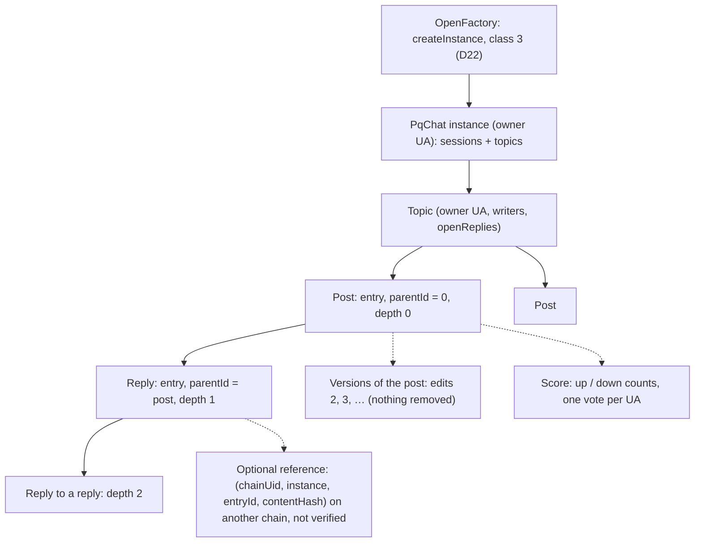

# PqChat public topics: communities, posts, threaded replies and votes in contract state

**Status:** SPECIFIED (2026-11-07). The owner ruled the design's choices the same day (D18–D22, §9; a Change on
[CTR-CHAT-01](../../decisions.md#CTR-CHAT-01)); its two remaining questions (§9, Q1–Q2) were answered as recommended
the same day. **Factory (owner-approved 2026-11-07):** `PqChat` is class 3 on the factory's generic path (factory index spec
§8, `2026-11-07-factory-contract-index.md` on branch `ua-mtx-merge`); the `PqChat`-specific factory code this spec first
proposed (`createPqChat`, `deployPqChatImplementation`, `PQCHAT_DOMAIN`, `isPqChat`, task PF1) is replaced by that path,
mapped in §11; `ChainEnv` (spec `2026-11-07-chain-neutral-releases.md`, same branch) applies to `PqChat` instances.
Status: **BUILT on branch `ua-mtx-merge`** (group 3c: PT1–PT6 as T84, T88–T93; the topics and votes in the body module
`PqChatTopics`, CTR-TOK-30, 3C-D2); clients (PT7) **PLANNED**; the normative text is
[`contracts/pqchat.md`](../../contracts/pqchat.md); Fable review 2026-11-10: approved with the corrections marked "Fable"
here. UNAUDITED.

**Parent spec:** [`2026-10-25-ua7-pq-e2e-sessions.md`](2026-10-25-ua7-pq-e2e-sessions.md) version 2 (P1–P32, D1–D17,
D22). This file continues its numbering (P33–P46) and reuses its domain, purpose tag, signature check, nonce bitmaps,
SSTORE2 blobs and cost basis. `PqChat` is a factory kind with many instances per chain (D22, parent §2.1 P32); every
topic lives in one instance. **Why a sibling file:** the parent is accepted and long; public topics share no cryptography
with sessions (no KEM, no epochs, no sealing, nothing encrypted), only the contract and the signing path, so they read
better on their own.

**Owner, 2026-11-07:** a UA can own public topics and post in them; content is public **Markdown** (`text/markdown`);
Lemmy-style: a topic is a community, posts in it, **threaded replies** on posts and on replies; **who may post: the topic
owner plus writers the owner grants and revokes**; content must not depend on event logs (logs and history expire): posts,
replies and every index live in contract **state**, listed by paged views (topics by owner, posts by topic, replies by
parent, entries by author). Then D18–D22 (§9): nothing hidden, replies open by default, bodies in full on chain with an
optional link to an entry on another chain, up and down votes, `PqChat` instances from the factory. On cost: "if storing
on chain is cheap, fine".

## 1. Model



**P33 — One entry record.** A post and a reply are the same record, `PqTopicEntry`, with a `parentId`: zero for a post
(depth 0), otherwise the id of the entry it answers, a post or a reply, in the same topic of the same instance (depth =
the parent's depth + 1, no bound; the contract never walks a thread). Edits are versions of an entry (P38). Nothing is
removed or hidden (D18, backup-not-delete).

**P34 — Public by nature.** Topics, entries, authors, writers, votes and times are public forever. Nothing is sealed;
there is no `sealedInfo` and no store list. The unlinkable mode of the parent (§13, `docs/research/pqchat-unlinkability.md`)
does not apply and cannot: a public post or vote is linked to its author's UA by its signature, and to its topic and parent
by its fields. A UA that posts or votes in public topics and is also a session member links both; a client says so and
offers a separate UA for public use.

## 2. Records

**P35 — Domain, purpose, signature.** As the parent's P7: typed EIP-712 structs in the portable domain `DS_C` ("SCaaS
PqChat", "1", no chain id, no address), the author signs `uaMessage(kind, PURPOSE_PQCHAT, typed(s))` as a `UASig`
(single key or `msig` by quorum), the contract verifies through the registry's `requirePortable` (parent §14 O1). The type
strings below differ from every session struct, so a session signature is never a topic record. No record carries a fee;
a payer pays a relayer through `RelayFeeRouter` (CTR-MTX-27). Every write is relayable by anyone, fee 0 too.

| Struct | Type string | Signed by |
|---|---|---|
| `PqTopic` | `PqTopic(bytes32 owner,uint64 nonce,bytes32 homeChain,address homeContract,string name,bytes about,bool openReplies)` | `owner` |
| `PqTopicUpdate` | `PqTopicUpdate(bytes32 topicId,uint64 seq,string name,bytes about,bool openReplies)` | the topic's owner |
| `PqTopicWriter` | `PqTopicWriter(bytes32 topicId,bytes32 writer,bool granted,uint64 seq)` | the topic's owner |
| `PqTopicEntry` | `PqTopicEntry(bytes32 topicId,bytes32 author,uint64 nonce,bytes32 parentId,EntryRef ref,string mediaType,bytes body)EntryRef(bytes32 chainUid,address pqchat,bytes32 entryId,bytes32 contentHash)` | `author` |
| `PqTopicEdit` | `PqTopicEdit(bytes32 entryId,bytes32 author,uint64 nonce,uint32 version,string mediaType,bytes body)` | the entry's author |
| `PqTopicVote` | `PqTopicVote(bytes32 entryId,bytes32 voter,int8 value,uint64 seq)` | `voter` |

**Fields.**

- `homeChain`, `homeContract` — the instance whose state readers treat as the topic's reference (as a session's home,
  parent P32); no contract rule reads them beyond "not zero". The same records may land in other instances as mirrors
  (P43).
- `name` — UTF-8, 1–128 B; not unique (ids are hashes; no global name to squat). `about` — the topic's description,
  Markdown bytes.
- `openReplies` — who may reply (P37); clients create topics with `true` (D19).
- `mediaType` — 1–64 B. Clients write `text/markdown` (RFC 7763, CommonMark); the contract checks only the length, so a
  later type needs no new release.
- `body` — the full text, non-empty, **always in state** (D20; no off-chain form). Bounded only by the transaction (P39).
- `ref` — an optional **reference to an entry in another instance**, usually on another chain (D20): all four fields zero
  for none; otherwise `chainUid`, `pqchat` (the instance's address there) and `entryId` non-zero (`PqTopicRef`), and
  `contentHash` either zero (not pinned) or `typed(...)` of the exact referenced version (its `PqTopicEntry` or
  `PqTopicEdit` record under `DS_C`). **The contract stores the reference as given and never checks it**: no bridge, no
  message across chains, no proof; the target may not exist. A reader resolves it by reading that chain's state (an RPC
  there), checks that its factory lists `pqchat` as a `PqChat` instance and that the referenced entry's topic names that
  instance as its home (`homeChain`, `homeContract`; Fable P3-4: else a writer revoked at home could post in a replica
  holding only its grant, and the link would check), and compares `contentHash` when set; until then the client shows the
  link as unverified. Edits keep the original's reference.
- `value` — `+1` up, `-1` down, `0` withdrawn (`PqTopicVoteValue` otherwise).

**P36 — Ids and nonces.** As the parent's §4.3:

```text
topicId = keccak256(abi.encode(keccak256("scaas/pqchat/v1/topic"), owner, nonce))
entryId = keccak256(abi.encode(keccak256("scaas/pqchat/v1/entry"), topicId, author, nonce))   edits use the same scope
```

Nonce bitmaps per instance, any order, checked after the signature and then marked used (a forged record cannot burn a
nonce): a topic `(owner, nonce)` under its own tag, apart from the session scope; an entry or an edit `(topicId, author,
nonce)`. Records that replace a value carry `seq` and are accepted only at **`seq == stored + 1`** (`PqTopicSeq`): a topic
update per `topicId`, a writer grant or revoke per `(topicId, writer)`, a vote per `(entryId, voter)`. A `seq` far ahead
could lock a value forever; `+1` cannot.

## 3. Rights

**P37 — Who writes what.**

| Operation | Who may sign |
|---|---|
| create a topic | any UA the registry verifies |
| update a topic, grant or revoke a writer | the topic's owner (fixed for the topic's life; an `msig` owner gives shared ownership) |
| post (`parentId` zero) | the owner or a granted writer (`PqTopicNotWriter`) |
| reply (`parentId` set) | `openReplies` true (the default, D19): any UA the registry verifies; false: the owner or a writer |
| edit | the entry's author only, the topic owner included in that rule (`PqTopicNotAuthor`) |
| vote | any UA the registry verifies, once per entry, changeable (P40) |

A revoked writer's entries stay; its new posts are refused. The **instance** owner (D22) has no right here at all. Rights
are read from **this instance's state at submission**; a record copied to a mirror before the matching grant or revoke
lands there may be accepted or refused differently, which is why readers follow the topic's home (P43). No moderators,
no hide flag, no ban list (D18); a client may filter entries locally on its own, outside the contract.

## 4. State

**P38 — Edits are versions.** `editEntry` stores a new version of an existing entry: `entryId` names the original (the
first version), `version` must equal the stored version count + 1 (`PqTopicVersion`; the first edit is version 2), the
author must be the original's author. Versions append to the original's list; `entryOf` returns the latest, `versionAt`
any. An edit keeps the original's topic, parent, reference, votes and place in every list; replies attach to the original
id. Two edits racing for the same version: the first to land wins, the other is refused and re-signed (as the parent's P9).

**P39 — Storage.** Each record's bytes, `abi.encode(<struct fields>, sigHash)`, go into SSTORE2 blobs of at most the
code-size limit (parent P11; a chain value, `ChainEnv.params[0]`, §11), split across as many blobs as needed. As the parent's D11, the
signature's hash is in the blob and its bytes in the event: the contract checked the signature on the way in; a mirror
copying the record elsewhere needs the bytes from the author, the event or an indexer. Content never depends on a log.
A topic keeps only its latest update's pointer: earlier names and `about` texts stay in their blobs with no pointer in
state, so topic history is not kept, unlike entry versions (P38; Fable P3-5).
**The only bound on a body is the transaction** (EIP-8037: regular + state gas within the chain's block limit, about
38 KB at a 60 M block and 1,530 gas per byte); the contract assumes no block limit. A longer text is posted as an entry
and follow-up replies by the same author (Q1).

| State (per instance, ERC-7201) | Slots | Written by |
|---|---|---|
| `topic[topicId]` | owner; blob pointer + `seq` + `openReplies` | create; pointer, `seq`, flag on update |
| `writer[topicId][ua]` | `granted` + `seq` | grant / revoke |
| `entry[entryId]` | blob pointer + `depth` + version count; one more per extra blob | post, reply; count on edit |
| `versions[entryId]` | one blob pointer per edit | edit |
| `vote[entryId][ua]` | `value` + `seq` | vote |
| `score[entryId]` | `up` (uint128) + `down` (uint128) | vote |
| lists (`bytes32[]`, append-only) | `topics`, `topicsByOwner[owner]`, `writersOf[topicId]` (first grant only), `posts[topicId]`, `replies[parentId]`, `byAuthor[author]` (originals, every topic) | create, grant, post, reply |

Layout pinned under `test/v2/layout/` with the rest of `PqChat` (a clone's namespaced storage).

**P40 — Votes and double voting.** `voteEntry` (D21): the entry must exist in this instance (`PqTopicUnknown`); the vote
attaches to the original id. The contract keeps **one slot per (entry, voter UA)** holding the current value and `seq`; a
new vote replaces it and moves the counts (the old value's count − 1, the new one's + 1), so one UA counts at most once
per entry. A replay is refused by `seq`; the signature binds the voter UA, so nobody votes as another. What it does
**not** prevent: one person with many UAs; each UA costs its registration, and a client may weigh or filter voters on its
own. Counts are public `up` and `down`, never a combined score in state.

## 5. Entries, views, events

**P41 — Entries.** One entry per operation, named typed parameters:

| Entry | Checks |
|---|---|
| `createTopic(PqTopic t, UASig sig)` | sig; nonce; `homeChain`, `homeContract` not zero; lengths |
| `updateTopic(PqTopicUpdate u, UASig sig)` | sig by the topic owner (`PqTopicNotOwner`); `seq == stored + 1`; lengths |
| `setTopicWriter(PqTopicWriter w, UASig sig)` | sig by the topic owner; `seq == stored + 1`; `writer` not the owner |
| `postEntry(PqTopicEntry e, UASig sig)` | sig; nonce; topic exists; P37 rights; parent exists in the same topic (`PqTopicParent`); `ref` shape; lengths |
| `editEntry(PqTopicEdit e, UASig sig)` | sig; nonce in the original's topic scope; original exists; author equals the original's; `version`; lengths |
| `voteEntry(PqTopicVote v, UASig sig)` | sig; entry exists; `value` in −1..1; `seq == stored + 1` |

**P42 — Views, paged; events as notifications.** `(start, count)` returns at most `count` ids from `start`, fewer at
the end, empty past it, with the list's length: `count = 0` is the count view (3C-D8; Fable P3-3). `topicOf(topicId)`, `entryOf(entryId)` (topicId, author, parentId,
depth, ref, mediaType, body, sigHash, versionCount, of the latest version), `versionAt(entryId, i)`, `writerOf(topicId,
ua)`, `scoreOf(entryId)` (up, down), `voteOf(entryId, ua)` (value, seq); lists `topics`, `topicsByOwner`, `writersOf`,
`posts`, `replies`, `byAuthor`; `topicNonceUsed`, `entryNonceUsed`. Events: `PqTopicCreated(topicId, owner)`,
`PqTopicUpdated(topicId, seq)`, `PqTopicWriterSet(topicId, writer, granted, seq)`, `PqTopicEntryPosted(topicId, entryId,
parentId, author, sig)`, `PqTopicEntryEdited(entryId, version, sig)`, `PqTopicVoted(entryId, voter, value, seq)`. No view
reads a log, and no reader needs one. Errors named per check: `PqTopicSeq`, `PqTopicNotOwner`, `PqTopicNotWriter`,
`PqTopicNotAuthor`, `PqTopicParent`, `PqTopicVersion`, `PqTopicRef`, `PqTopicVoteValue`, `PqTopicShape`,
`PqTopicUnknown`, plus the parent's `PqChatNonceUsed`.

**P43 — Several instances and chains.** One rule in every instance on every chain: the same records, ids and checks.
Copying a topic elsewhere is copying its records, parents before replies, originals before edits, grants before the
writer's posts; out of order, a record is refused there until what it needs has landed. Readers display the topic's home
instance; others are mirrors. A cross-chain **reference** (P35 `ref`) is different: it points, it copies nothing.

## 6. Anti-spam and cost

**P44 — What limits writes.** Posts only by the owner and writers; replies and votes by any registered UA (D19, D21),
each signed, each nonce or `seq` used once (a replay guard, not a rate limit); gas paid by the submitter; the node relays
a write under the operator's lane policy (parent P17): a signed write is relayed on the lane, unpaid by default; the two
unsigned writes only when paid through `RelayFeeRouter` or when the lane policy allows them (Fable P3-10: the node's
default as built, `docs/node/job-api.md`). No on-chain rate limit: one
keyed on time adds a slot write per entry and does not stop many UAs. With no hide (D18), whatever a topic accepts stays
in state; an owner who wants a quiet topic sets `openReplies` false, and a client may filter locally.

**Gas on paper** (parent §11 basis: EIP-8037 1,530 gas per state byte, new slot 97,920, new account 183,600; ETH
$2,261.87; about $0.70 per M gas at 0.31 gwei, $11.3 at 5 gwei, $0.011 on a layer 2 at 0.005 gwei). Signature
verification is regular gas: FN-DSA-512 2.3 M, ML-DSA-65 on the cached key 5.8 M, a precompile ≈ 0.2 M.

| Write | Blob | State gas | Total, FN-DSA-512 / ML-DSA-65 cached / precompile | 0.31 gwei | 0.005 gwei |
|---|---|---|---|---|---|
| **each further KiB of body** | 1,024 B | **≈ 1.57 M** | — | **$1.10** | **$0.018** |
| post, 1 KiB Markdown | 1,473 B | ≈ 2.7 M (blob 2.25 M, account 0.18 M, 3 slots 0.29 M; +0.1 M per new list or nonce word) | ≈ 5.2 / 8.7 / 3.1 M | $3.6 / 6.1 / 2.2 | $0.06 / 0.10 / 0.03 |
| reply, 256 B | 705 B | ≈ 1.6 M | ≈ 4.0 / 7.5 / 1.9 M | $2.8 / 5.3 / 1.3 | $0.05 / 0.08 / 0.02 |
| edit, 1 KiB | 1,345 B | ≈ 2.4 M (blob, account, version slot) | ≈ 4.9 / 8.4 / 2.8 M | $3.4 / 5.9 / 2.0 | $0.05 / 0.09 / 0.03 |
| vote, first on an entry by this UA | — | ≈ 0.1–0.2 M (vote slot; score slot on an entry's first vote) | ≈ 2.5 / 6.0 / 0.4 M | $1.8 / 4.2 / 0.3 | $0.03 / 0.07 / 0.004 |
| vote changed | — | 0 (slots exist) | ≈ 2.3 / 5.8 / 0.2 M | $1.6 / 4.1 / 0.2 | $0.03 / 0.06 / 0.003 |
| create topic, 256-B `about` | 609 B | ≈ 1.6 M (blob, account, 2 topic slots, 2 list slots, nonce word) | ≈ 4.0 / 7.5 / 1.9 M | $2.8 / 5.3 / 1.3 | $0.05 / 0.08 / 0.02 |
| grant a writer | — | ≈ 0.2 M | ≈ 2.6 / 6.1 / 0.5 M | $1.8 / 4.3 / 0.4 | $0.03 / 0.07 / 0.006 |

**Cheap where gas is cheap.** Storage dominates: about 1.57 M state gas per KiB of body, which is about 2 cents a KiB on a
layer 2 pricing state at 0.005 gwei and less on a chain with a lower gas price; the signature costs more than a short
reply's text. On Ethereum today the same KiB is about $1.10 (at 5 gwei, $18). On the SCaaS testnet it costs the test
token. To be measured in PT4; a transaction fits only if regular + state gas fits the block limit (EIP-8037).
Measured (plan 3c T90, stand-in verifier, state gas; Fable P3-1): post 1 KiB 3.08 M, reply 256 B 1.90 M, edit 1 KiB
2.49 M, first vote 0.20 M, changed vote 0, create topic 1.85 M, grant 0.29 M; the table above is the paper estimate
(`contracts/pqchat.md` §12 has the pins).

**Contract size.** Six entries, ≈ 18 views, the typehashes and checks: an estimate of +8–12 KB runtime on the `PqChat`
release. Built (plan 3c T90; Fable P3-1): the release reached 34,223 B, past 3C-D2's 33,594 B line, so the topics and
votes moved into the body module `PqChatTopics` (CTR-TOK-30: a `DELEGATECALL` module pinned in the class env, not a second
kind): `PqChat` 24,771 B at the split (24,883 B with the Fable fixes), `PqChatTopics` 16,396 B; the `_above64KiB` pin
no longer exists.

## 7. Node and indexer

**P45 — Node.** Six new `call` rows (`createTopic`, `updateTopic`, `setTopicWriter`, `postEntry`, `editEntry`,
`voteEntry`), equal to the release's entries both directions, named JSON fields per job, old hex forms refused
(`HEX_ARGS_REFUSED`); the call target must be an instance the chain's factory lists as `PqChat` (parent P17, P32): the
generic `factory_class(3)` guard rule, `infoOf(target).contractClass == 3` and `version ≠ 0` (factory index §8.6). The
rule and the rows go in `docs/node/job-api.md` for every consumer (PLANNED). The node's indexer **may** mirror topics for
full-text search and feeds, reading the views (events only as a hint of what to read) and the factory index for the
instances; the chain's state is the answer, and every mirrored item names its `(chain_uid, instance, list, index)` so a
client can re-read it.

**P46 — Clients.** `ua-rs` signs the six structs as typed portable records (the `ua-rs` signing round, TODO 3d), and every
client reads the vectors (`smartcontracts/vectors/pqchat/topics.json`). A client renders `text/markdown` as CommonMark with
raw HTML off, links marked as external, and no remote image loaded without the reader's consent (a public post is
untrusted input); it resolves a cross-chain `ref` as P35 says before showing it as verified. The app's topic UI is out of
scope here.

## 8. Tests and mutants

Tests (red first, each refusal with its positive control, one change at a time):

1. Create a topic; owner posts; a granted writer posts; a stranger's post refused (`PqTopicNotWriter`); a revoked writer's
   new post refused and its old post still listed.
2. Writer records: `seq` 1 then 2 accepted, a repeated or skipped `seq` refused (`PqTopicSeq`), a non-owner signer refused
   (`PqTopicNotOwner`), revoke then re-grant; the instance owner is no topic owner.
3. Replies: an open topic accepts a stranger's reply; after `updateTopic(openReplies = false)` the stranger is refused and
   a writer accepted; a reply to a reply has depth 2; a parent in another topic, unknown, or in another instance refused
   (`PqTopicParent`).
4. Edits: version 2 then 3 by the author accepted, `entryOf` returns version 3, `versionAt` returns 1–3; another UA's edit
   refused, the topic owner's included (`PqTopicNotAuthor`); version 2 twice refused (`PqTopicVersion`); replies and votes
   stay on the original id.
5. Votes: +1, then −1 by the same UA moves one count from `up` to `down`; 0 withdraws; the same `seq` twice refused; a
   value of 2 refused (`PqTopicVoteValue`); two UAs count twice, one UA never; a vote on an unknown entry refused.
6. Bodies: a body over one blob splits and reads back byte-exact; an empty body, an over-length `mediaType` or `name`
   refused; a `ref` with `chainUid` set and `entryId` zero refused (`PqTopicRef`); a well-formed `ref` to nothing stored
   accepted (no cross-chain check) and returned as given.
7. Nonces: a replay refused; nonces in any order accepted; a forged record does not burn a nonce.
8. Paged views at the edges (`start` past the end, `count` clipped), `byAuthor` across two topics, `topicsByOwner`, all
   topics; every assertion through views with logs ignored.
9. Two instances from the factory: a topic in A is absent in B; its records copied into B in order land with the same
   ids; a reply before its parent refused there, then accepted.
10. An `msig` topic owner grants by quorum; a session record's signature refused as a topic record (type separation).
11. Typehashes pinned against the vectors (`*TypehashIsPinned`); layout pin; gas rows (PT4).

Mutants, each killed by a test above: the writer check, the `openReplies` check, the parent-topic equality, depth + 1,
the edit-author check, the version + 1 check, the `seq` + 1 check, the vote's old-count decrement, the vote value range,
the `ref` shape check, the nonce scope's `topicId` dimension, the list key (parent vs topic), `byAuthor` written for edits.

## 9. Owner decisions and questions

**Decisions of 2026-11-07** (owner, relayed by the coordinator; a Change on CTR-CHAT-01):

- **D18 — Nothing hidden, no on-chain moderation.** Neither the topic owner, a moderator nor anyone else may hide an
  entry; the contract has no hide flag, no moderator role and no ban list. Every accepted entry stays listed for good. A
  client may filter locally on its own.
- **D19 — Replies.** Each topic has an `openReplies` flag: true lets any registered UA reply; **the default is open**;
  the topic owner may change it (`updateTopic`). Posting stays the owner's and the writers'.
- **D20 — Bodies in full on chain; references across chains.** A body is stored in full in state; there is no off-chain
  body (hash + URI). An entry may carry a named reference to an entry in another instance, usually on another chain:
  `chainUid`, instance address, entry id and an optional content hash; no bridging and no verification across chains.
- **D21 — Votes.** Minimal up and down counts per entry, in state; one vote per UA per entry, changeable.
- **D22 — `PqChat` is a factory kind** (parent §2.1 P32): many instances per chain, each with its own owner UA, sessions
  and public topics; `PqChat` is class 3 on the factory's generic path (§11, factory index spec §8, owner-approved
  2026-11-07).
- **Cost:** the owner accepts the on-chain cost ("if storing on chain is cheap, fine"); §6 gives it per KiB.

**Owner 2026-11-07: Q1 and Q2 answered as recommended** (a Change on CTR-CHAT-01): (Q1) no contract feature; the client
posts the rest of a long text as replies by the same author, marked as continued; (Q2) an instance's owner UA has no power
over sessions, topics, entries or votes; it is fixed at creation, with no transfer.

**Q1 — Text longer than one transaction.** A body is bounded by the chain's block limit (≈ 38 KB at 60 M).
**Recommendation:** no contract feature; the client posts the rest as replies by the same author, marked as a
continuation in the Markdown. A signed body hash with unsigned `appendBody` parts (as `addWraps`) is the way if long
documents become common; it adds an entry and a check, not needed for posts and comments.

**Q2 — Powers of an instance's owner UA.** **Recommendation: none** over sessions, topics, entries or votes; the owner UA
names the instance in the factory index and `owner()`, fixed at creation, with no transfer (there is nothing to govern).
A later release could add an owner-set name or a topic-creation allow-list if a service needs one.

## 10. Tasks for 3c (branch `ua-mtx-merge`)

To be numbered into the merge plan; sizes in agent-days. The factory index tasks T67–T70 (T70: the generic catalogue and
`createInstance`) and the chain-neutral tasks T71–T76 come before 3c in the work order (3e → 3g → factory index → 3f → 3h →
3c), so `PqChat` is registered on a built generic path with no factory change. PF1 is dropped (§11).

| # | Task | Files | Size |
|---|---|---|---|
| ~~PF1~~ | **dropped** (owner-approved generic factory, §11): T70 builds the generic path; `PqChat`'s registration is three deploy-script calls in PC0 | — | 0 |
| PC0 | `PqChat` as a release of class 3, kind 0 (parent P32, §11): `initialize(bytes32 ownerUA)` once, by the factory only (`ownerUA` 0 allowed, fixed, no transfer); `factoryInfo()`; `supportsInterface` (ERC-165, `type(IPqChat).interfaceId`); `owner()`; ERC-7201 storage; `initEnv` / `chainEnv()` (`ChainEnv`: `chainUid`, registry, code-size limit `params[0]`); constructor `(ReleaseId, factory_, implArgs)`; `DeployBase` publishes the class env, deploys release 1, enables `(3, 0)`, creates one instance; `homeContract` in `PqChatSession` and the home-instance check of P9; store-list `contract`; changes to UA-7 plan T5, T6, T8 (T8 becomes the release deploy in `DeployBase` plus one instance) | `src/pqchat/*`, `script/DeployBase.s.sol`, `test/pqchat/*` | +0.5–1 over T5–T8 |
| PT1 | Vectors: six topic typehashes, `EntryRef`, ids, a record and blob per struct, the new `PqChatSession` typehash, non-zero values in every field | `clients/clientkeys` `src/pqchat.js`, `scripts/pqchat-vectors.mjs`, `smartcontracts/vectors/pqchat/topics.json` | 0.5–1 |
| PT2 | Topics: structs, five entries (no votes), rights, edits, multi-blob bodies, `ref`, lists, views, events, errors; tests 1–4, 6–10 | `src/pqchat/PqChat.sol`, `PqChatTypes.sol`, `IPqChat.sol`, `test/pqchat/PqTopics.t.sol` | 2–3 |
| PT3 | Votes: `voteEntry`, vote and score slots, views; test 5 | same | 0.5–1 |
| PT4 | Gas rows of §6 (`--isolate`, new pins with figures), a `createInstance` row with the `PqChat` release, size-gate row, layout pin | `test/pqchat/PqChatGas.t.sol`, `size-baseline.json`, `test/v2/layout/` | 0.5 |
| PT5 | Mutants of §8 and their summary in the gate runner | `runs/<date>-ua7-pqchat-gates.sh` summary | 0.5–1 |
| PT6 | Node: six topic rows, the instance check on every `PqChat` row (the generic `factory_class(3)` guard rule, built with these rows), job shapes, allow-list both directions | `scaas-node` call table, `docs/node/job-api.md` | 0.5–1 |
| PT7 | `ua-rs`: build and sign the six records, read the views, resolve a `ref`, vectors row by row | `clients/ua-rs` `pqchat` module | 1 |
| PT8 | Docs: `docs/contracts/pqchat.md` sections for instances and public topics (SPECIFIED, then BUILT); `docs/contracts/` factory doc row for class 3 | docs | 0.5 |
| | **Total** | | **6.5–9.5** |

## 11. The factory: the generic path (factory index spec §8, owner-approved 2026-11-07)

**Superseded proposal.** This section first proposed `PqChat`-specific factory code (a `CLASS_PQCHAT` constant, an env
domain `PQCHAT_DOMAIN = 254`, `deployPqChatImplementation` and its views, `createPqChat`, `isPqChat`, task PF1). The owner
approved instead a generic catalogue (factory index spec `2026-11-07-factory-contract-index.md` §8, branch `ua-mtx-merge`):
`PqChat` is **class 3, kind 0**, registered by the registrar with no factory code. Mapping (index spec §8.8):

| First proposed here | Becomes |
|---|---|
| `uint8 CLASS_PQCHAT = 3`, `ClassUnknown` for 0 and 4–255 | class id 3 in the CTR-TOK-28 table, no factory constant; ids `uint16`; `ClassUnknown` for 0 and any generic class with no release; `ownerUA` from `factoryInfo()` |
| `PQCHAT_DOMAIN = 254`, `publishPqChatEnv`, `pqChatEnvOf`, `latestPqChatEnvVersion` | `publishClassEnv(3, 0, …)`, `classEnvOf`, `latestClassEnvVersion` |
| `deployPqChatImplementation`, `pqChatReleaseOf`, `pqChatImplementationOf`, `deprecatePqChat`, `isPqChatDeprecated`, `latestPqChatVersion`, `PqChat*` events and errors | `deployRelease(ReleaseId(3, 0, v), …)`, `classReleaseOf`, `deprecateRelease`, `latestClassVersion`, `ReleaseDeployed` / `ReleaseDeprecated`, the generic errors; checks by `factoryInfo()` instead of `factory()` / `chainUid()` |
| `createPqChat(uint64 version, bytes32 ownerUA, bytes32 salt)`, `initialize(msg.sender, version, ownerUA)`, `PqChatCreated`, `isPqChat` | `createInstance(ReleaseId(3, 0, v), salt, abi.encodeCall(IPqChat.initialize, (ownerUA)))`; `initialize(bytes32 ownerUA)`; `InstanceCreated`; `infoOf(a).contractClass == 3 && version != 0` (node: `factory_class(3)`) |
| gas: a `GovGas` `createPqChat` row | a `createInstance` row with the `PqChat` release (`PqChatGas`, PT4); the factory side measured once in T70 with the test kind |
| size: +2–3 KB on `OpenFactory` | none for `PqChat`: the generic block is T70's |
| tests: release usable after notice, deprecated, wrong factory / `chainUid`, relayer creator, `isPqChat`, slot count | the generic ones are T70's; `PqChat`'s own: `initialize` once and only by the factory, `factoryInfo()` fields, ERC-165, two instances independent, `contractsPage(3, …)` after a creation; its mutants: `initialize` without the factory check, `factoryInfo()` with a wrong class |
| formats | unchanged: no factory format moves for `PqChat` |
| PF1 (factory `PQCHAT` class, 1–1.5) | **dropped**: T70 builds the generic path before 3c; `PqChat`'s registration is three deploy-script calls in PC0 |
| PC0 `initialize(creator, version, ownerUA)` | `initialize(bytes32 ownerUA)`, `factoryInfo()`, `supportsInterface`, constructor `(ReleaseId, factory_, implArgs)`; `DeployBase` publishes the class env, deploys release 1, enables `(3, 0)`, creates one instance |
| PT6 node instance check `isPqChat` | the generic `factory_class(3)` guard rule (built with PT6's rows) |

**What `PqChat` implements** (the generic initializer; index spec §8.8 with the chain-neutral spec's constructor):

```solidity
// constructor(IOpenFactory.ReleaseId id, address factory_, bytes implArgs)
//   immutables: FACTORY = factory_, CLASS = 3, KIND = 0, VERSION = id.version; implArgs only values equal on every chain;
//   the initializer and initEnv locked on the implementation
function initEnv(ChainEnv calldata env) external;  // msg.sender == FACTORY, once (chain-neutral spec §2.1)
function initialize(bytes32 ownerUA) external;     // msg.sender == FACTORY, once; ownerUA 0 allowed, fixed, no transfer (Q2)
function factoryInfo() external view returns (IOpenFactory.FactoryInfo memory);
function supportsInterface(bytes4 id) external view returns (bool);  // ERC-165 and type(IPqChat).interfaceId
function owner() external view returns (bytes32);                    // names the instance, no power (Q2)
```

The creator is not an argument: it is in the factory index (`infoOf(this).creatorId`, the signing UA on a signed creation)
and, during `initialize`, `IOpenFactory(FACTORY).creating()`.

**`ChainEnv` applies** (chain-neutral spec, owner-approved 2026-11-07, pending its Fable review). As built (Fable P3-1):
the factory appends each instance's chain values to its clone's runtime code (`ChainEnvCode`, the chain-neutral spec's
option I), with no `initEnv` and no storage, and `validateEnv` refuses `PqChatEnv`; the paragraph and the code block
above keep the design text: the factory writes each
instance's chain values into its own storage at creation (`initEnv`, before `initialize`): `chainUid`, the registry and
the code-size limit as `ChainEnv.params[0]` (131,072 on the SCaaS testnet, 65,536 under EIP-7954); they are not immutables
of the release, so one `PqChat` bytecode deploys at the same address on every chain, and an instance's address depends on
the factory, its creator, class, kind and salt (CREATE3), not on the release.

**Registration and creation** (deploy script, then anyone):

```solidity
factory.publishClassEnv(3, 0, 1, env);
factory.deployRelease(ReleaseId(3, 0, 1), 1, IPqChat.initialize.selector, type(IPqChat).interfaceId, initcode, implArgs);
factory.setClassKindEnabled(3, 0, true);  // after the notice period
factory.createInstance(ReleaseId(3, 0, v), salt, abi.encodeCall(IPqChat.initialize, (ownerUA)));
```

The exact env and constructor arguments follow the factory index spec §8.2 as changed by the chain-neutral spec; this
section does not restate them.
