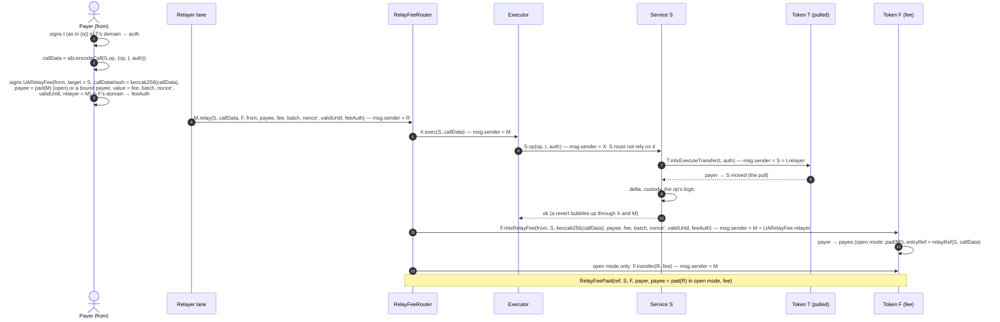

# Service pull: the signed, contract-bound pull that replaces `approve` — design

**Status:** **Built (T19, 2026-11-10):** T77 `b9b130bb` (the reference service, test only), T78 `9fe6253d` (vectors, `clientkeys`), T79 `711f4f35` (node kind `service`) on branch `ua-mtx-merge`; T80 (`ua-rs`) on `ua-rs-sign`; rules CTR-MTX-32, NODE-JOB-25, NET-ALL-85. SPECIFIED, nothing built, **UNAUDITED**. Written 2026-11-09 at the owner's request. Revised the same day after the
Fable review (approve with fixes; no P0 or P1; every P2 and P3 applied). **Approved by the owner 2026-11-09: Q1–Q5 as
recommended** (§13): the generic node kind `service`, one signature, the relay-fee router as the only fee path, a seen
`entryRef` refused, the regulated custody rule accepted. The EVM token needs **no change**. This was verified against the code of every EVM kind (0–13) and Hedera (§2, §6); no
gas or size figure was measured. Work-order group **3i** of branch `ua-mtx-merge`: plan tasks T77–T81 (§14), after 3h, beside
T66b, before 3c.

**The owner's request (2026-11-09).** `approve` is gone: under [CTR-TOK-01](../../contracts/token-wrappers.md#CTR-TOK-01) an EOA
or UA never holds or grants an allowance on a SCaaS token. A service contract that must take a payer's tokens into its custody
and then run its own logic needs another standard path. That logic must run atomically and relayed. Examples: an auction bond,
escrow, staking, bonds, subscriptions. The path may differ from `RelayFeeRouter`, whose purpose is close.

**Rules this spec applies, not reopens:**
- [CTR-TOK-01](../../contracts/token-wrappers.md#CTR-TOK-01) and [CTR-UA-27](../../contracts/accounts.md#CTR-UA-27): no allowance
  for EOAs or UAs.
- [CTR-MTX-01](../../contracts/metatx.md#CTR-MTX-01): a `UAMetaTransfer` with `entryRef ≠ 0` is a payment.
- [CTR-MTX-13](../../contracts/metatx.md#CTR-MTX-13): fee modes, and nobody pays for an operation that did not happen.
- [CTR-MTX-16](../../contracts/metatx.md#CTR-MTX-16): no forwarder.
- [CTR-MTX-19](../../contracts/metatx.md#CTR-MTX-19): every write is relayable, even at fee 0.
- [CTR-MTX-23](../../contracts/metatx.md#CTR-MTX-23): the typed path.
- [CTR-MTX-27](../../contracts/metatx.md#CTR-MTX-27): `RelayFeeRouter`. Its doc text lags the code; the code follows pay-meta-tax
  §4 O4: one `relay` on ids with `batch` / `nonce`.
- [CTR-MTX-29](../../decisions.md#ctr-mtx-29--every-parameter-is-explicit): explicit parameters.
- [CTR-MTX-30](../../contracts/metatx.md#CTR-MTX-30): the merge, one form on ids with `UASig`.
- The 3e spec's O12 ([2026-11-05-pay-meta-tax.md](2026-11-05-pay-meta-tax.md) §2.3): `mtxExecuteTransfer` takes any `entryRef`
  and is never gated.
- [CTR-TND-01](../../contracts/tender.md#CTR-TND-01): the tender's deposit, the first instance of this pattern.
- [ARCH-POS-13](../../decisions.md#ARCH-POS-13): never a decryption oracle.
- No EIP-7702.
- [CTR-AS-16](../../contracts/asset-suite.md#CTR-AS-16): eligible contracts.
- The lessons of [CTR-DEX-19](../../contracts/dex.md#CTR-DEX-19) and [CTR-DEX-22](../../contracts/dex.md#CTR-DEX-22).

**Controller calls (the owner may override):**
- **C1.** `entryRef` is the EIP-712 digest of the operation in the service's own domain (§3.2).
- **C2.** One pull per entry: one payer, one token.
- **C3.** The operation struct of a node-relayable entry has atomic fields, `bytes` and `string` only (§3.1).
- **C4.** The gateway is unchanged (§8).
- **C5.** The balance-delta check is always on (§3.3).
- **C6.** Rule ids, next free per `docs_check.py resolve`:
  - CTR-MTX-32 (CTR-MTX-31 is reserved by pay-meta-tax PT-1).
  - NODE-JOB-25 (22–24 are reserved by the 3f, 3g and 3h specs).
  - NET-ALL-85.
  - CLI-SGN-48: the client ids live on `ua-rs-sign`, whose live `CLI-SGN` rules end at 47 (CLI-SGN-44 there is the seal rule;
    47 took 3g's client id). 80–87 are reorg-era relics, and 48–79 are free. Re-check at the build, when T80 lands on that
    branch.
- **C7.** The names `ServicePullShape`, `ServicePullNotReceived`, `ServicePullReplayed`, `ServicePullFrozen` and
  `servicePullEntries`.

## 1. Problem and scope — SPECIFIED

An allowance lets a contract pull later, at its own choice. Since CTR-TOK-01, no subject grants one. The service pull keeps what
the service needs, "take X from the payer and run my logic in the same transaction", and drops what an allowance adds: standing
authority, an amount left open and any time window.

The payer signs **one `UAMetaTransfer`** in the token's own domain:
- `to` is the service and `relayer` is the service, with `MODE_RESTRICT_RELAYER` set.
- `entryRef` is the digest of the one service operation.
- The fee mode is `NONE`.

Anyone submits the operation to the service. The service checks that the transfer matches the operation. It then calls
`token.mtxExecuteTransfer(t, auth)` itself, which only it can do, once. After that it records custody and runs its logic, all in
one transaction. There is no new token entry, no allowance and no service-side signature check.

**In scope:**
- The public balances of every EVM kind (0–13, plain, wrapped, regulated, and the public side of the Zether and PQZ kinds) and of
  Hedera.
- The rules a service contract follows.
- Wallet display, the relayer fee and the node.
- The form of the same rule on every family.
- Clients and vectors.
- A reference service for tests only.

**Not in scope:**
- **Confidential balances (PQZ, Zether).** A pull into a service's confidential balance needs a key that can open what arrives. A
  contract holds no key. A keeper that decrypts for it on demand is a decryption-oracle shape that ARCH-POS-13 forbids absolutely.
  Nor can the service check an encrypted amount: that needs a new statement, which means a new `proofSystemId` and a full gate. A
  payer who holds only shielded value unshields first and then pulls publicly.
- **Standing authority.** A subscription is either one signed pull per charge (pre-signed, each with its own lane nonce and
  `validUntil`) or a `MandateWallet` whose delegate is the service ([CTR-ACC-06](../../contracts/mandates.md#CTR-ACC-06)).
- **An operation that moves nothing into custody** (an unstake request, a cancel). Payouts to a destination fixed at pull time
  need no signature: they are permissionless, as in [CTR-TND-03](../../contracts/tender.md#CTR-TND-03). A payer's free choice
  without a pull is the service's own signed entry, not specified here.
- **Several payers or tokens in one entry** (C2): v1 has one pull per entry.

## 2. The mechanism on the EVM, verified — BUILT (token), SPECIFIED (use)

### 2.1 The entry

`ERC20MetaTx.mtxExecuteTransfer(MetaTxLib.UAMetaTransfer t, IUARegistry.UASig auth)` is at `ERC20MetaTx.sol:230-235`. It is
`nonReentrant` and has no feature gate (`MetaTokenBase.sol:32-33`, O12). Its body, `_uaExecuteTransfer` (`ERC20MetaTx.sol:259-270`),
runs in this order:
1. `_regPre(t.from, 0, t.mode)`.
2. `MtxPipelineLib.preTransferUA`, an external library call by DELEGATECALL, so `msg.sender` stays the token's caller
   (`MtxPipelineLib.sol:123-130`).
3. `_regFeeTo`, then the fee move.
4. `_uaSplit(from, to, value, 0, 0)`.
5. `UAPaymentSettled`, when `entryRef ≠ 0`.
6. `UAMetaTransactionExecuted(from, msg.sender, batch, nonce, digest, feeTo, fee)`.

Line numbers are those of `smartcontracts/evm/src/` at `f2bd37ba`.

### 2.2 Properties

| Property | Holds because | Code |
|---|---|---|
| Bound to the service | With `MODE_RESTRICT_RELAYER`, `relayer` is in the digest (it is zeroed when the bit is off). The envelope refuses `relayer ≠ msg.sender` with `MetaTxUnauthorizedRelayer`. | `MetaTxLib.sol:178-184`, `MtxPipelineLib.sol:180-181` |
| The executor runs no delegate code | `SigCheck.requireNotDelegated(msg.sender)` on a bound relayer refuses an EIP-7702 designator with `CallerDelegated` | `MtxPipelineLib.sol:182`, `SigCheck.sol:34-41`, `:51-53` |
| Bound to the operation | `entryRef` is a signed field, which the token only emits and never parses | `MetaTxLib.sol:143-159`, `ERC20MetaTx.sol:267` |
| Bound to the chain and the token | The digest's domain is `("SCaaS MetaToken" \| "SCaaS ZetherToken" \| "SCaaS PqzToken", "1", chainId, verifyingContract = the clone, salt = chain_uid)` | `MetaTokenBase.sol:125-131`, `SaltedEIP712.sol:91-92`, `ZetherLayer.sol:65-67`, `PqzLayer.sol:80-82` |
| Runs once | The nonce of lane `(from, batch)` is checked first and consumed after every other check | `MtxPipelineLib.sol:188-189`, `:308-311`, `:289-291` |
| Expires | `block.timestamp > validUntil` is refused (`MetaTxExpired`) | `MtxPipelineLib.sol:184` |
| Unknown mode refused | Unknown bits and fee values above `FIXED` are refused | `MtxPipelineLib.sol:185-187` |
| Cancel | `mtxCancelNonce(e, lane, auth)` bumps the lane, so the signed pull can never land | `UAMetaTxBase.sol:103-117` |
| Signer | A native id signs with its own key: ECDSA low-s, ERC-1271 under the gas cap, or HIP-632 on Hedera, with no registry call. A derived id goes through `requireAuthorized(from, PURPOSE_METATX, digest, auth)` and needs a registry (`UALedgerOff`). | `MtxPipelineLib.sol:351-371` |
| A contract may be `to` | For a native `to`, `_checkTo` refuses only 0, the token, `UA_POOL` and `SHIELD_POOL`. There is no code check. | `MtxPipelineLib.sol:273-281` |
| Exactly `value` moves, to `to` | Balance ≥ `value + fee` is checked before the nonce, then `_uaSplit` moves `value` from `from` to `to` | `MtxPipelineLib.sol:267-268`, `ERC20MetaTx.sol:263-266`, `:274-277` |
| No callback into `to` | Moves go through `ERC20._update` and the UA ledger. The token calls nothing in `to`: no ERC-777 or ERC-1363 hook. | `ERC20MetaTx.sol:298-319` |
| All or nothing | The pull is one frame inside the service's transaction. A revert after it undoes the move and the nonce. | EVM semantics |
| A payment record | `UAPaymentSettled(from, pad(service), value, 0, …, entryRef)`, then `UAMetaTransactionExecuted` with `relayer` = the service | `ERC20MetaTx.sol:267-268` |
| No other entry lands it | `mtxBatchTransfer` from any other caller fails the relayer check. `mtxPay` first requires `entryRef == metaPayId(meta)` (`PayMetaMismatch`; `MtxPipelineLib.sol:400-401`). `mtxPayReceiverFee` runs `t`'s own digest (`MetaTokenBase.sol:325`) but is refused the same way: `_payMeta` first (`PayMetaMismatch`, `:305`), then the relayer binding. `mtxTransfer` signs `entryRef = 0`, a different digest (`MetaTokenBase.sol:226-242`). `mtxPayWithTax` signs another struct. | as cited |

### 2.3 What the token leaves to the service and the client

None of these is a defect of the token. Each is closed by a rule in §3 or §10.

1. **The fee recipient.** `feeTo = t.feeRecipient` when it is non-zero, else `msg.sender`, which here is the service
   (`MtxPipelineLib.sol:258`). With the recipient bit off the field is unsigned, so whoever calls the service writes it.
   ⇒ The fee mode is `NONE` on every pull (§5). The tender reached the same rule (tender.md §8).
2. **An unbound transfer to a service** can be landed by anyone through `mtxExecuteTransfer`. The funds then sit in the service
   with no operation (tender I6). ⇒ The builder always binds, and the service refuses an unbound one.
3. **A token the service did not choose** can fake `mtxExecuteTransfer`. ⇒ The service fixes its token (CTR-TND-07), and the
   delta check backs that up.
4. **`value = 0` is accepted** by the token. ⇒ The service checks the amount.

**Verdict:** on every EVM kind and Hedera, the existing token supports the shape with no change.

### 2.4 Flows

The plain relay-fee flow (fee only) is drawn under [CTR-MTX-27](../../contracts/metatx.md#CTR-MTX-27).

**(a) A service pull without a token fee.** The relayer pays gas and is paid by nobody, or off chain. Fee 0 stays relayable.

```mermaid
sequenceDiagram
    autonumber
    actor P as Payer (t.from)
    participant R as Relayer lane (any account)
    participant S as Service S
    participant T as Token T
    Note over P: builds op = Op{payer, …} (typed data in S's domain, NOT signed)<br/>entryRef = EIP-712 digest of op in S's domain
    P->>P: signs t = UAMetaTransfer{from, to = pad(S), value, entryRef,<br/>batch, nonce, validUntil, mode = RESTRICT_RELAYER,<br/>relayer = S, fee 0, feeRecipient 0} in T's domain → auth
    P->>R: op, t, auth (named JSON fields)
    R->>S: S.op(op, t, auth) — msg.sender = R (S reads no authority from it)
    S->>S: checks 1–6 (§3.3), op's own checks, effects
    S->>T: T.mtxExecuteTransfer(t, auth) — msg.sender = S = t.relayer
    T->>T: envelope (relayer = S, not delegated), signature,<br/>receiver, balance, nonce; move value: payer → S
    T-->>S: true; UAPaymentSettled(payer, pad(S), value, 0, …, entryRef),<br/>UAMetaTransactionExecuted(payer, relayer = S, …)
    S->>S: balanceOf(S) delta == value; custody[…] += value; the op's logic
    Note over R,T: any revert anywhere reverts the transaction: nothing moved, nonce unused
```

**(b) A service pull with the relayer paid in a token.** The fee token F may be T, or any other SCaaS token.



The order is from `RelayFeeRouter.sol:72-73`: the target runs first, then the fee. Open mode is `RelayFeeRouter.sol:93-97`. When `F = T`,
both signatures spend the payer's one nonce space on T. On one lane, the pull takes nonce `n` and the fee `n + 1`, because the pull
runs first. Two lanes also work. `callData` contains `auth`, so the payer signs `t` before `UARelayFee`.

### 2.5 The relay fee and a service pull compared

One mechanism in the token: the payer signs a one-shot pull with `MODE_RESTRICT_RELAYER`, and only the contract named as
`relayer` can make the token execute it (`MtxPipelineLib.sol:181`). Both have the payer's lane nonce, `validUntil`, the public
balance only, and one revert for any failure. Both are bound to the chain twice: the token's EIP-712 domain
`(name, "1", chainId, verifyingContract = the token, salt = chain_uid)` (`SaltedEIP712.sol:26`, `MetaTokenBase.sol:125-131`),
and the reference (`ref` hashes `block.chainid`; `entryRef` is a digest in the service's own domain, which holds `chainId` and
the service's address, §3.2). They differ in three things (owner 2026-11-09):

| | The relay fee ([CTR-MTX-27](../../contracts/metatx.md#CTR-MTX-27)) | A service pull |
|---|---|---|
| **Who pulls** (the signed `relayer`) | the relay-fee router (`relay` → `token.mtxRelayFee`) | the service contract (`token.mtxExecuteTransfer`) |
| **What the signature binds** | `ref` = chain + `target` + the exact call bytes | `entryRef` = the service operation's EIP-712 digest: chain + service (its domain) + the operation (its typehash) + every parameter + the payer |
| **Where the funds go, and what they are** | the relayer (open mode) or the signed payee: a **fee, final**, for a call that ran | the service: **custody**, refunded or paid on by the service's own logic |

What follows from it: for the relay fee, the token and the router check everything and the target knows nothing of the fee;
for a service pull, the token checks `to`, `relayer`, once and expiry, and the service must check that the funds are for this
operation (§3.3). The router always runs the target before the fee; a service orders its pull and its logic itself. The
relay fee's payer signs `UARelayFee` (the token builds the transfer); a service pull's payer signs the `UAMetaTransfer`
itself. The two compose in one transaction: `relay(target = service)` lands the pull and pays the relayer (§2.4 (b)).

## 3. Rules for a service contract (proposed CTR-MTX-32) — SPECIFIED

### 3.1 Entry shape

- **One external function per operation:**
  `function <op>(<Op> calldata op, MetaTxLib.UAMetaTransfer calldata t, IUARegistry.UASig calldata auth)`. `<Op>` is a struct of
  named fields whose first field is `bytes32 payer`. Its EIP-712 type is exactly that struct: same names, order and types. Every
  value the service reads for the operation is a field of `<Op>` or the service's own state, never a field of `t` alone. No
  packed `bytes` holds several fields (CTR-MTX-29). A single crypto object may be `bytes` (a commitment, a proof).
- **Node-relayable entries** (C3) have `<Op>` fields of EIP-712 atomic types (`address`, `bool`, `bytesN`, `uintN`, `intN`) plus
  `bytes` and `string`, at most 16 fields, no arrays and no nested structs. Under these limits the node's decode is bounded by
  type (§8).
- **Permissionless.** The entry's only authority is the signed transfer. It never reads `msg.sender` for authority: the caller
  may be a lane, the router's executor or anyone. A role-restricted operation of the service is not a pull entry.
- **An `<Op>` type is never a signed type.** `entryRef` is a full EIP-712 signing digest in S's domain (C1), and a wallet handed
  `<Op>`'s typed data (§4 A puts it beside the request) could be tricked into signing it. So no entry of S, now or later,
  verifies a signature over an `<Op>` type. A signed intent of S is a different struct.
- **Discovery views:**
  - `servicePullEntries() returns (bytes4[] selectors, string[] opTypes, address[] tokens)`. `opTypes` holds the EIP-712
    `encodeType` of each `<Op>`. `tokens[i]` is the token entry `i` pulls; `address(0)` means `<Op>` names it in a field
    `address token`.
  - ERC-5267 `eip712Domain()`.

  The node keeps its allow-list equal to the first view, in both directions, and reads the pull token from it (§8).

### 3.2 The operation digest (`entryRef`)

```text
entryRef = keccak256(0x1901 ‖ domainSeparator(S) ‖ hashStruct(<Op>, op))
domain(S) = (name, version, chainId = block.chainid, verifyingContract = S)     # SCaaS-built: salt = chain_uid (CTR-GEN-05)
```

**Why a full digest (C1).**
- It binds the chain and S by itself, independently of the token's domain.
- It is exactly what an EIP-712 library computes from the typed data the signer shows (§4).
- It cannot collide with the token's other references. `metaPayId` starts with the tag `scaas.pay.meta.v2`
  (`MtxPipelineLib.sol:392`) and `relayRef` with `scaas.relayfee` (`MetaTokenBase.sol:356`). The `0x1901` prefix gives a
  different preimage format, so a pull can never be landed as a pay entry or a relay fee.

**What `<Op>` does not need.**
- **No nonce field.** The lane nonce makes one *signature* run once. One *operation* runs once because S refuses an `entryRef`
  it has seen (§3.3 step 6, pending Q4). That keeps the reconciliation key `(token, payer, S, entryRef)` unique. A payer who
  wants the same operation twice signs two `<Op>`s that differ in a salt field (the reference service has one).
- **No random reference.** CTR-MTX-03's random `entryRef` is for payment requests. Here the reference is the operation, whose
  fields are in calldata anyway. A value that must stay hidden until later (a sealed price) sits in `<Op>` only as a commitment,
  as in CTR-TND-02.

### 3.3 The checks, in order

Each shape check reverts `ServicePullShape(uint8 code)`:

| Step | Check | Error |
|---|---|---|
| 1 | `t.to == MetaTxLib.pad(address(this))` | `ServicePullShape(1)` |
| 2 | `t.mode == MODE_RESTRICT_RELAYER` (the bit set, fee mode `NONE`, nothing else), `t.relayer == address(this)`, `t.fee == 0` and `t.feeRecipient == address(0)` | `ServicePullShape(2)` |
| 3 | `t.entryRef ==` the digest of `op` (§3.2) | `ServicePullShape(3)` |
| 4 | `t.from == op.payer` | `ServicePullShape(4)` |
| 5 | `t.value ==` the amount the operation requires (from S's state or a field of `op`), and that amount `> 0` | `ServicePullShape(5)` |
| 6 | `!used[t.entryRef]` (pending Q4). On a regulated token (`supportsInterface(type(IRegulatedToken).interfaceId)`): `!isFrozen(pad(this))`. Then the operation's own checks: state, windows, eligibility. | `ServicePullReplayed(entryRef)`, `ServicePullFrozen()`, S's own errors |
| 7 | Effects: `used[t.entryRef] = true`, S's records of the operation | — |
| 8 | `b0 = token.balanceOf(this)`; `IERC20MetaTx(token).mtxExecuteTransfer(t, auth)` (a revert propagates); `balanceOf(this) − b0 == t.value` | the token's errors; `ServicePullNotReceived(expected, got)` |
| 9 | The rest of the operation's logic and its events | S's own |

**Why step 2 pins `fee` and `feeRecipient`.** At fee `NONE` nothing is charged: `FeePolicy.compute` returns 0
(`FeePolicy.sol:37-39`), `validateRecipient` accepts anything (`:55-59`) and `_regFeeTo(·, 0)` does nothing
(`RegulatedBase.sol:235-237`). But a non-zero `t.feeRecipient` becomes `feeTo` (`MtxPipelineLib.sol:258`). Whoever calls S writes
that field, and it lands in the events `UAPaymentSettled` and `UAMetaTransactionExecuted`. One comparison keeps those events
clean.

**Why step 6 checks the freeze.** A frozen S still receives pulls, because `_regMove` checks no F on `to`
(`RegulatedBase.sol:240-244`). It could not pay them out. So S refuses new pulls while it is frozen.

**The token S calls** is S's own: immutable configuration, or a field of `op` checked against S's list or the factory's
provenance (a registered, non-deprecated implementation, CTR-TND-07). Never a token named only by the caller.

### 3.4 Custody, payouts, refunds

- **Custody is S's own ledger,** credited only after step 8. The invariant is `token.balanceOf(S) ≥ Σ owed`, as tender I2. Tokens
  sent outside a pull entry (plain transfers, an unbound transfer landed directly) belong to no one in S's books. S's rescue
  policy is its own: a SCaaS-built S follows the immutable `rescueTo` pattern of CTR-GOV-06, or states the tokens unrecoverable.
- **Every payout destination is fixed by the rules at pull time:** the payer `t.from`, or a party named in `op` or in S's
  configuration. Payouts are permissionless where the rules allow, so a refund needs no second payer signature. They run per
  payer (pull-based), so one payee that cannot receive never blocks another.
- **Token entries for payouts:**
  - To a native id: `transfer(address, amount)`. S is `_msgSender()` (`MetaTxBase.sol:262-269`), and `_update` applies the hooks
    (`ERC20MetaTx.sol:200-214`).
  - To a derived UA: `transferToUA(bytes32, amount)` (`ERC20MetaTx.sol:219-223`). It needs the UA ledger on and a registered
    SIGNING UA, else `UALedgerOff`, `UANotRegistered` or `UAKindNotAccepted` (`:281-285`).
  - With a payment reference on the payout: `payWithFee` or `payWithFeeToUA` with `PayMeta` (`MetaTokenBase.sol:380-416`; needs
    `PAYABLE`).
  - One helper picks between the first two:
    `inNativeSpace(id) ? token.transfer(address(uint160(uint256(id))), a) : token.transferToUA(id, a)`.
- **A refused payout stays owed** (pending Q5). The token may refuse a payout: the payee is no longer eligible (`R(to)` in
  `_regMove`, `RegulatedBase.sol:240-244`), or its UA is not a registered SIGNING UA (`ERC20MetaTx.sol:281-285`). Then the payout
  reverts, the custody stays recorded in S, and a later call retries. S never redirects the payout: a second destination needs
  a new signed entry, which is out of scope.
- **A forced move falls on the last claimants** (regulated kinds; pending Q5).
  - A recorded order's `forceTransfer` on a frozen S moves S's pooled public balance with no hook (`RegulatedBase.sol:101-106`,
    `RegulatedLib.sol:263-278`). After it, `balanceOf(S) ≥ Σ owed` no longer holds: the shortfall equals the forced amount.
  - Payouts then fail closed, in full or not at all, and the shortfall falls on the last claimants.
  - A service on a regulated kind states this in its own documentation.
  - The alternative, if the owner refuses this, is regulated kinds out of v1 (Q5).

### 3.5 Reverts and reentrancy

- **One transaction.** If S's logic reverts after the pull, the token's move and nonce revert with it: nobody pays for an
  operation that did not happen (CTR-MTX-13). On the EVM this is automatic. On the asynchronous families it is an explicit
  refund (§9).
- **No `try` / `catch` and no unchecked low-level call** around the token. A caught failure would let a relayer starve the inner
  call (63/64) and S continue without the funds. The delta check would still catch the money, but the rule stands on its own.
- **Reentrancy.** The token calls nothing back (§2.2), so a reentry into S can come only from S's own outgoing calls. S uses
  checks, effects, interactions and a transient reentrancy guard (EIP-1153, as the tokens: `MetaTxBase.sol:51-55`, `:286-294`).
  A call to code S does not trust runs only after S's state is final, and never with an allowance S holds (CTR-DEX-22's lesson).

## 4. Wallet display — SPECIFIED

| Option | What is signed | Cost | Gain |
|---|---|---|---|
| **A. One signature** (recommended) | Only `t`. The request carries `<Op>`'s typed data `{domain, types, primaryType, message}` beside it. | **A signer other than `ua-rs` commits blind to the operation.** A generic EIP-712 wallet shows "pay `value` to S" with `entryRef` opaque, and a hostile front end can bind an `op` the payer never saw: another beneficiary, a `releaseAfter` far out, another salt. The token accepts that signature from any wallet. This is the class accepted for `PayMeta`, but here the committed bytes decide who is paid out. | One prompt; no signature code in any service |
| B. Two signatures | `t`, and `<Op>` in S's domain, which S verifies | A second prompt and per-service signature code: native ECDSA, ERC-1271 and HIP-632 checks, `UARegistry.requireAuthorized` under S's own purpose tag for a derived UA (`UARegistry.sol:664` takes any tag), its own nonce, and a second binding to test | Every wallet shows the operation |
| C. A nested token struct `UAServicePull(UAMetaTransfer payment, bytes32 opHash)` | One signature | A token change, and the operation stays opaque, because the token cannot know `<Op>`'s type | none |

**Recommendation: A, if the owner accepts the blind-commitment residual**, as for `PayMeta`
([CTR-MTX-26](../../contracts/metatx.md#CTR-MTX-26)): there too, the signature over `entryRef` binds a preimage the contract only
compares, and the client shows the preimage. `ua-rs`, the only SCaaS signer, recomputes the digest from the typed data, refuses
on a mismatch and shows both (§10). Every other signer is blind (§7).

## 5. Relayer fee — SPECIFIED

| Option | Defects |
|---|---|
| **A. Compose with `RelayFeeRouter`; the pull at fee `NONE`** (recommended) | One extra signature when a fee is wanted |
| B. The transfer's own fee mode | The open recipient is `msg.sender`, which is S, not the relayer (`MtxPipelineLib.sol:258`). An unbound recipient is written by whoever calls S, unsigned. A bound one pays a single relayer. It is capped at 1 % of `value` (`FeePolicy.sol:47-50`) and paid in the pulled token only. It is a second fee rule for contracts other than the token. |

**Recommendation: A**, by "one rule". CTR-MTX-27 already pays a relayer for every fee-less call:
- in any SCaaS token, for any amount the payer signs;
- only after the exact call ran (pay-meta-tax J8);
- with open mode unchanged (O14).

The rule: every service pull has fee mode `NONE` (§3.3 step 2). The relayer is paid by `RelayFeeRouter` or not at all, and fee 0 is
still relayable. This is CTR-TND-01's "fee `NONE`", made general.

## 6. Token kinds — SPECIFIED (verified on the code)

| Kind | The pull | Payouts | Notes |
|---|---|---|---|
| Plain (`NORMAL`) | As §2 | `transfer` / `transferToUA` | — |
| Wrapped | The public wrapped units, as plain. No kind overrides `mtxExecuteTransfer`, `_uaExecuteTransfer`, `_update`, `transfer` or `transferToUA`; only `ERC20MetaTx` defines them. | as plain | The underlying is never touched. Unwrapping is the payee's own business. |
| Zether, PQZ | The **public** ERC-20 balance only, in the kind's own domain name (§2.2). `SHIELD_POOL` is never a side (`MtxPipelineLib.sol:279`, `:368`, `ERC20MetaTx.sol:300-302`). | as plain | Shielded value is out of scope (§1) |
| Regulated 8–13 | `_regPre(t.from, 0, mode)`: on 8 and 9, P and F(payer), because selector 0 is not in the pause-open set (`RegulatedBase.sol:228-232`). On 10–13 only when the envelope carries a fee (`NormalPqzRegulatedToken.sol:65-66`, `NormalZetherRegulatedToken.sol:83-84`, the wrapped twins at `:66-67` and `:83-84`), and a pull never does. On every kind the move runs `_regMove(payer, pad(S))`: P, F(payer), **R(S)** (`RegulatedBase.sol:240-244`, `:281-290`). | `_regMove(pad(S), to)`: P, F(S), R(to) | See below |
| Hedera | As EVM, the same bytecode. `IS_HEDERA` changes only a native payer's check: a 64-byte HIP-632 signature from an account without code (`MtxPipelineLib.sol:369`). | as EVM | S is an HSCS contract. EIP-7702 on Hedera is unverified (NET-ALL-83), so `requireNotDelegated` applies as on EVM. HSCS charges ≥ 80 % of the gas limit. |
| UA ledger off | A native payer runs. A derived payer gets `UALedgerOff` (`MtxPipelineLib.sol:355`). | `transferToUA` needs the ledger on (`UAMetaTxBase.sol:209-211`) | — |

**Regulated kinds (8–13) in detail:**
- **Eligibility of S.** With a list on, S must be eligible: either the `ELIGIBLE_CONTRACT` flag, which the registry admin sets
  only on a pass-through contract (CTR-AS-16, `RegulatedBase.sol:41`), or ordinary flags.
- **The caller.** S as `msg.sender` is not checked on this path.
- **Freeze.** A frozen payer cannot pull, but can still be paid out (no F on `to`). A frozen S still receives pulls, so it
  refuses them itself (§3.3 step 6). It pays nothing out until it is unfrozen, or until a recorded order runs `forceTransfer`
  (`RegulatedBase.sol:101-106`, `RegulatedLib.sol:263-278`). That moves the pooled balance, and the shortfall rule of §3.4
  applies (pending Q5).
- **A payee the token refuses.** A payee that is no longer eligible, or no longer a registered SIGNING UA, is refused at payout.
  The custody stays owed and is never redirected (§3.4).
- **Operators.** `operatorTransfer` refuses a `from` with code, so an operator never moves S's custody
  (`RegulatedLib.sol:353-356`).
- **Pause.** A pause stops pulls and payouts alike. A permissionless withdraw is retried after it.
- **Tax.** A pull pays no tax: the generic path is untaxed (O12). A taxed payment is `mtxPayWithTax` only
  (`RegulatedBase.sol:142-150`).

## 7. Threats — SPECIFIED

| Threat | Defence |
|---|---|
| Front-running: someone else submits `S.op(op, t, auth)` first | The operation is fixed by `entryRef`, so an earlier submitter runs the payer's own operation. Where order matters (tie-breaks, auctions), submitters and block producers decide it, as CTR-TND-05 states. |
| The relayer substitutes parameters | Check 3, and every field S reads is in `<Op>` (§3.1) |
| **A blind commitment (residual).** A hostile front end binds an `op` the payer never saw, and a signer other than `ua-rs` shows only "pay `value` to S". | `ua-rs` recomputes the digest and refuses on a mismatch (§10). Every other signer is blind, the `PayMeta` class weighed in Q2. No `<Op>` is ever a signed type (§3.1). |
| The same operation pulled twice (two signatures over one `op`) | S refuses a seen `entryRef` (§3.3 step 6, pending Q4) |
| Landing the transfer outside S (stranded funds) | The relayer is bound (`MtxPipelineLib.sol:181`). The builder refuses an unbound pull, and S refuses one (check 2). |
| Replay into another service | `relayer = S` is in the digest, and `entryRef` is in S's domain |
| Replay on another chain or token | The token's domain (chainId, `chain_uid`, the clone) and S's chainId |
| Replay as another entry (`mtxPay`, a relay fee, a batch) | Different preimage formats (§3.2) and the relayer check (§2.2) |
| Signature reuse | The lane nonce. A payer cancels by `mtxCancelNonce`. |
| Griefing by withholding or late landing | A short `validUntil`, the operation's own deadline field, and an independent path: any relayer, or the payer's own transaction (tender §6.2 step 0) |
| Gas starvation of the inner pull | No `try` / `catch` (§3.5). ERC-1271 and registry calls refuse a starved call (`SigCheck.sol:75`, `RegulatedBase.sol:298`). |
| A malicious or buggy S | S can take at most `value`, once, to itself, for the operation signed. Custody then depends on S's code: a contract is not proof of honesty (CTR-DEX-19). Clients warn for an S off the chain profile's service list: the `chain_contract` rows of kind `service`, advisory, as the kind `dex` rows are the DEX list (NET-ALL-24, §8). |
| S reads `entryRef` or another field wrongly | The reference negatives and mutants (§11). Every service's own suite includes them. |
| A fake token | S fixes its token, and the delta check backs that up (§3.3) |
| EIP-7702 | A designator cannot be the bound executor (`MtxPipelineLib.sol:182`). S is a contract. A delegated payer signs only with its own key (`SigCheck.sol:58-63`). 7702 is off on the SCaaS testnet and mainnet 22776. |
| Reentrancy | The token makes no callback; S has a guard and follows checks-effects-interactions (§3.5) |
| A regulator touches custody | A freeze of S stops payouts, and S refuses new pulls meanwhile. `forceTransfer` runs only on a recorded order, and its shortfall falls on the last claimants, failing closed (§3.4, pending Q5). `operatorTransfer` is refused on S (§6). |
| A payee the token refuses at payout | The custody stays owed and is never redirected; a retry succeeds once the payee is accepted again (§3.4) |
| A decryption oracle | None: public balances only (§1) |

## 8. Node — SPECIFIED

**Today:** the node cannot relay a third-party service.
- No row of the typed table names one ([named entries](../../node/job-api.md#named-entries)).
- The contract kinds are `Token`, `AccountFactory`, `SelfAuth`, `Dex`, `UaRegistry` and `GovRouter` (`scaas-node/src/guard.rs:43-58`).
- `chain_contract.kind` is one of `tender`, `sponsorship_pool`, `account_factory`, `dex` or `role_holder`
  (`docs/node/store.md:197-198`).
- [NODE-JOB-20](../../node/job-api.md#NODE-JOB-20) makes the table fixed: a node release per operation.

**Proposal: Q1 option B, proposed NODE-JOB-25.**

- **The contract kind `service`** (`Rule::Service`).
  - The operator registers the target as `chain_contract.kind = 'service'`.
  - Its entries come from config: `[[chains.services]] address, entries = [{entry, op_type}]`. At most 32 entries per service
    and 1,024 bytes per `op_type`; more is a startup error.
  - At startup and at registration the node reads `servicePullEntries()` and `eip712Domain()`. The set of
    `(selector(entry, op_type), op_type)` must equal the contract's, in both directions, and the domain's chainId must equal the
    chain's. Otherwise the service is refused (`SERVICE_ENTRIES_MISMATCH`, a startup error or a refused registration).
  - **One kind per address, both ways.** A service is never a registered token, the factory, a `GovernanceRouter`, the UA
    registry, a DEX, a `SmartKeyAccount` or `MandateWallet` (`Rule::SelfAuth`), the `RelayFeeRouter` or its executor, or a
    `chain_contract` of another kind. The reverse also holds: a `service` address is refused as the target of every other
    kind's row, as NODE-JOB-19 does for `gov_router`.
  - These rows are also **the chain profile's service list**, beside the DEX list (NET-ALL-24). Clients read it as advisory,
    as `isDex` is ([CTR-DEX-19](../../contracts/dex.md#CTR-DEX-19)).
- **The job.** It is a `ua_metatx` named entry (its signature is a `UASig`) with no envelope; the transfer's fields are the
  envelope. Every value is a named field; hex is refused (`HEX_DATA_REFUSED`).

  ```json
  {"entry": "deposit", "contract": "service", "token": "0x<S>",
   "args": {"op": {"payer": "0x…", "amount": "1000", "releaseAfter": "1790000000", "salt": "0x…"},
            "pullToken": "0x<T>",
            "t": {"from": "0x…", "to": "0x…", "value": "1000", "entryRef": "0x…", "batch": "7", "nonce": "0",
                  "validUntil": "1790000300", "mode": 1, "relayer": "0x<S>", "fee": "0",
                  "feeRecipient": "0x0000000000000000000000000000000000000000"},
            "auth": {"keyData": "0x", "signature": "0x…", "members": []}}}
  ```

- **Before simulation**, the node:
  - decodes `op` by `op_type`, bounded by the limits of §3.1 plus `params.max_service_op_bytes` (default 2,048) on
    `bytes` / `string`; a breach is `BAD_PAYLOAD` with the path named;
  - computes the digest of `op` in S's domain;
  - requires §3.3 checks 1–4 (`SERVICE_PULL_SHAPE: <code>`);
  - takes the pull token from the contract, not the client: `tokens[i]` of `servicePullEntries()`, or `op.token` when that is
    0. The struct `t` names no token, so the job still carries `pullToken`. If it differs from the contract's, the job is
    refused (`SERVICE_TOKEN_MISMATCH`). The token must be registered (`TOKEN_NOT_SERVED`);
  - runs the signature pre-check over the transfer's digest in the pull token's domain.
- **The key, completion and status.**
  - The in-flight key is that transfer digest plus the bytes sent.
  - Completion is the receipt's `UAMetaTransactionExecuted` with that digest. Its `relayer` is S, not the lane.
  - The pull is `consumed` once `mtxNonce(from, batch)` has passed the nonce.
  - The payer is held as for relay-fee jobs ([pay-meta and relay-fee jobs](../../node/job-api.md#paymeta-relayfee-jobs)): a
    service job is a job of the payer on `pullToken`.
- **With a fee.** The `call` of a `uaRelayFee` job may be a service entry. The service rule then runs on the inner target too,
  in both directions, as for `gov_router` ([NODE-JOB-19](../../node/job-api.md#NODE-JOB-19)).
  - When the fee token is the pull token, the node holds both nonces.
  - On one lane it requires `nonce_fee == nonce_pull + 1` before simulating (`SERVICE_PULL_SHAPE: fee nonce`). Otherwise the
    simulation would fail with `MetaTxBadNonce` once the pull has run.
- **Operators' note** (the job shape is new): a new contract kind `service`, the `[[chains.services]]` config, and the
  refusals `SERVICE_ENTRIES_MISMATCH`, `SERVICE_PULL_SHAPE` and `SERVICE_TOKEN_MISMATCH`. In the example above, `mode` is a JSON
  number, as `uint32` may be ([named entries](../../node/job-api.md#named-entries)). `auth` with an empty `keyData` and
  `members: []` is a native payer's shape.
- **The gateway (C4).** Unchanged. `POST /v1/op` stays limited to a registered token's `mtx*` entries
  ([NODE-GW-03](../../node/gateway.md#NODE-GW-03)), so a service pull is a namespace job with the grant.
- **The indexer.**
  - The pull is the token's `UAPaymentSettled` row (payer → S, `entry_ref` = the operation digest) plus its
    `UAMetaTransactionExecuted`.
  - The reconciliation key is `(token, payer, S, entryRef)`, as pay-meta-tax PT-1.
  - S's own events are indexed like a registered contract's (tender.md §7). The node does not interpret them.
- **The node stays open.** It knows the kind `service` and what config and the contract declare. No service's name enters node
  code.

## 9. Every family — one rule, each family's native form

**The rule on every chain:** the payer signs once; the authorization is bound to the service as executor and to one operation,
runs once, and expires; the service takes exactly the signed amount; and the payer never pays for an operation that did not happen.
On the asynchronous families, that last part is an explicit refund. Proposed NET-ALL-85 records this table.

| Family | Native form (the executor binding, file:line) | Today | Status |
|---|---|---|---|
| EVM | §2: `mtxExecuteTransfer`, `relayer == msg.sender` (`MtxPipelineLib.sol:181`) | possible, atomic | token BUILT; rule SPECIFIED |
| Hedera | the same bytecode | possible, atomic | token BUILT; rule SPECIFIED |
| Soroban | A native holder signs an auth tree rooted at `S.op(args)` with `token.pay(from, to = S, amount, pay_ref = op digest, valid_until)` as a sub-invocation (`smartcontracts/soroban/contracts/token/src/lib.rs:219-220`); the tree itself binds S and the operation. A UA holder: `ua_pay(…, relayer = Some(S), auth)` with `r.require_auth()`, satisfied by S as the direct invoker (`contracts/token/src/ua.rs:157-158`, `:252`). The relay-fee router takes any target (`contracts/relay-fee/src/lib.rs:83`). | possible, atomic | SPECIFIED; built in a Soroban round |
| NEAR | `mtx_execute_transfer(op, auth)` with `op.relayer = S`, `relayer == predecessor` (`near/token/src/account.rs:199-200`). The transfer is a separate receipt (`near.md:32`): S runs its logic in its callback and refunds if the logic fails; S attaches the storage deposit. The router's targets are a per-method config list (`near.md:263-265`). | possible, asynchronous; no UA round (`near.md:130`) | SPECIFIED; PLANNED with `ua-near` |
| Algorand | An inner app call `mtx_execute_transfer(op, auth)` with `relayer == Txn.sender`, S's app address (`algorand/contracts/common.py:159`). Inner calls are synchronous; the MBR payment goes before the call. Use `mtx_execute_transfer`, never `mtx_pay`: with `to == relayer ==` the calling app, `mtx_pay` switches to open mode (`token.py:163-167`). | possible, atomic; never tested from a third-party app; no UA round (`algorand.md:129`) | SPECIFIED; PLANNED with `ua-algorand` |
| Solana | A CPI to `relay_pay(owner, args, auth)` with S's PDA as the `lane` signer (`invoke_signed`), `relayer == lane` (`programs/scaas/src/account.rs:128`, `:158`). Through the relay-fee router it is not possible: the target would CPI back into `scaas`. That is an inference from Solana's reentrancy rule, unstated in the repo. | possible by direct CPI | PLANNED (its round decides the fee path) |
| TON | A `SignedOp` to the payer's jetton wallet with `relayer == sender`, S (`ton/contracts/jetton.tact:206`, `common.tact:259-260`). Asynchronous with bounce. `forwardTon > 0` for the notification. The operation digest goes in `pay_ref`, because the forward payload is fixed to `payTag(payRef)` (`jetton.tact:249`). | possible, asynchronous; node paths blocked (NET-TON-14) | PLANNED |
| Cosmos | `ExecuteMsg::Relay{payload, auth}` with op `pay`, `relayer == info.sender`, S (`cosmos/token/src/lib.rs:212-213`), by submessage | possible, atomic; no UA round | PLANNED |
| Sui | **Not possible with today's package.** The relayer is bound to `ctx.sender()`, the transaction signer, never a module (`move/sui/sources/meta.move:411`), and the coin leaves by `public_transfer`. | no | PLANNED; needs a token change in its round |
| Aptos | **Not possible with today's package.** `relay_pay` is a `package entry fun` (`move/aptos/sources/meta.move:270`), so no third-party module can call it. | no | PLANNED; needs a token change in its round |

**Corrections to tender.md §11** (docs share, §12):
- Soroban: the deposit is SCaaS `pay` / `ua_pay` with `pay_ref`, not a SEP-41 `transfer`.
- Sui and Aptos: not possible on today's packages.
- TON: `(tenderId, commitment)` goes into `pay_ref` through the operation digest, not into `forward_payload`.

## 10. Clients and vectors — SPECIFIED

**`ua-rs`** is the only signer. Its service-pull builder, proposed CLI-SGN-48, takes `<Op>`'s typed data, the pull token, the
payer, the amount, the lane, the nonce and `validUntil`. It refuses unless all of these hold:
- the typed data hashes under its own EIP-712 encoder, within the field limits of §3.1;
- `op.payer == from`;
- the domain's `verifyingContract` is `to` and `relayer`, and its chainId is the chain's;
- the shape of §3.3 steps 1–4 holds;
- fee is 0 and `feeRecipient` is 0.

It then sets `entryRef` to the digest and signs `t` in the token's domain. With a fee, it builds the calldata and signs
`UARelayFee` after `t`, assigning the nonces as in §2.4.

**Display.** The signer shows S's domain name and address, every `<Op>` field, the amount and token, and `validUntil`. It warns
for an S not on the chain profile's service list (§8), as CTR-DEX-19 does for a DEX. It never signs an `<Op>` itself (§3.1). The bindings (`ua-c`, `ua-cxx`, `ua-qt`, `ua-cs`,
`ua-py`, `ua-go`, `ua-dart`) call `ua-rs`. `zether-prover` gets nothing (public balances only).

**`clientkeys`** keeps the JS reference builder in `evm.js` and a test that reads the vectors.

**Vectors.** A new file, `smartcontracts/vectors/metatx/servicepull.json`, comes from its generator, beside `famvec.py`.
- Each row holds: the reference service's domain, `<Op>`'s typed data and `encodeType`, the operation digest, `t`, the
  transfer's digest, the entry's selector and calldata, `servicePullEntries()`, and a relay-fee wrap (`callDataHash`,
  `relayRef`, the `UARelayFee` digest).
- One row has a **non-zero unbound `feeRecipient`** in `t`, so that a client which forgets `canon` fails (AGENTS rule). It
  tests the client's canon only: S refuses that `t` at check 2 (N18).
- A row of the second operation, `Note`, with a `string` and a `bytes` field (§11). EIP-712 hashes a dynamic field as
  `keccak256(value)` while the ABI passes it raw, and the node builds calldata from the EIP-712 type: this is where a client,
  the node and the contract would diverge.
- Readers: the forge cross-check, `clientkeys`, `ua-rs` and the node's typed KAT all read the same rows.

## 11. The reference service and the test plan — SPECIFIED

**The reference service** is `smartcontracts/evm/test/metatx/helpers/RefServiceEscrow.sol`: test only, never deployed, not a
product contract.
- `deposit(Deposit op, UAMetaTransfer t, UASig auth)` with
  `Deposit(bytes32 payer,uint256 amount,uint64 releaseAfter,bytes32 salt)`.
- `note(Note op, UAMetaTransfer t, UASig auth)` with `Note(bytes32 payer,uint256 amount,string memo,bytes commitment,bytes32 salt)`,
  which exercises the dynamic fields of C3.
- Custody is keyed by `entryRef`, and a seen `entryRef` is refused.
- `release(bytes32 entryRef)` is permissionless after `releaseAfter` and pays the recorded payer: `transfer` for a native id,
  `transferToUA` for a derived one. A refused payout stays owed.
- `servicePullEntries()` and `eip712Domain()`, with a fixed token.

**Positive controls** (`test/metatx/ServicePull.t.sol`):
- deposit and release by a native EOA, a derived single-key UA, an `msig` UA, a `SmartKeyAccount` (ERC-1271) and a Hedera
  64-byte payer;
- relayed directly, and through `RelayFeeRouter` with the fee in T on one lane (`n`, `n + 1`) and in another token;
- every kind through `test/metatx/helpers/KindRigs.sol`: plain, wrapped, the public side of Zether and PQZ, and regulated 8–13
  with S eligible.

**Negatives**, one change at a time from the positive control, each expecting its named error:

| # | Change | Expected |
|---|---|---|
| N1 | `t.to` ≠ S | `ServicePullShape(1)` |
| N2 | relayer bit off; `relayer` another address; fee mode `PERCENT` / `FIXED` | `ServicePullShape(2)` |
| N3 | any `op` field changed after signing; `entryRef` from another service or chain | `ServicePullShape(3)` |
| N4 | `t.from` ≠ `op.payer` | `ServicePullShape(4)` |
| N5 | wrong `value`; `value = 0` | `ServicePullShape(5)` |
| N6 | expired | `MetaTxExpired` |
| N7 | submitted twice: step 6 refuses the seen `entryRef` first (Q4), `ServicePullReplayed`; the lane cancelled by `mtxCancelNonce` first, on a fresh operation | `ServicePullReplayed`; `MetaTxBadNonce` (as built in T77, `b9b130bb`) |
| N8 | a third party calls the token directly with `t`: `mtxExecuteTransfer`, `mtxBatchTransfer` / `mtxPay`, `mtxPayReceiverFee` (`PAYABLE` set) | `MetaTxUnauthorizedRelayer` / `PayMetaMismatch` |
| N9 | a second escrow (same code, another address) submits `t` | `ServicePullShape(2)`; with its checks removed, the token's `MetaTxUnauthorizedRelayer` |
| N10 | `t` signed in another token's or chain's domain | `MetaTxBadSignature` |
| N11 | a mock token that returns `true` and moves nothing | `ServicePullNotReceived` |
| N12 | the escrow's logic reverts after the pull | the payer's balance and `mtxNonce` unchanged |
| N13 | a relay-fee wrap whose service operation reverts | no fee paid |
| N14 | regulated: S not eligible; payer frozen; paused; S frozen at release; `operatorTransfer` from S; a pull while S is frozen | `NotEligible`, `Frozen`, `TokenPaused`, `Frozen(pad(S))`, `OperatorTargetRefused`, `ServicePullFrozen` |
| N14b | regulated: the payee is ineligible at release | `NotEligible`; custody intact; the retry after re-eligibility succeeds |
| N15 | a derived payer, ledger off | `UALedgerOff` |
| N16 | a 7702 designator account as the bound executor | `CallerDelegated` |
| N17 | the same `op` signed twice, on two nonces | the second: `ServicePullReplayed` |
| N18 | `t.fee ≠ 0` or `t.feeRecipient ≠ 0` at fee `NONE` | `ServicePullShape(2)` |
| N19 | relay-fee wrap with F = T, the fee signed at the pull's own nonce | `MetaTxBadNonce` after the pull; the whole relay reverts, no fee paid (proves §2.4's order) |
| N20 | a mock token that re-enters `S.deposit` during `mtxExecuteTransfer` | S's guard: `ReentrancyGuardReentrantCall` (OpenZeppelin's transient guard). The real token never calls back, so only a mock makes §3.5 falsifiable. |

**Mutants** ("a service that forgets a check") run in the T64-style harness, each one alone:
- drop each of checks 1–5;
- drop the fee pins of check 2;
- drop the replay check or the freeze check of step 6;
- drop the delta check;
- drop the reentrancy guard;
- move the pull before the checks;
- wrap the token call in `try` / `catch`;
- credit `op.payer` without check 4.

Each mutant must turn a named negative red, while the original stays green.

**Invariant fuzz:**
- `balanceOf(S) ≥ Σ custody`, except after a forced move;
- after a forced move, the shortfall equals the forced amount, and payouts fail closed;
- conservation of every payer's balance plus custody;
- an operation (`entryRef`) lands at most once.

**Node tests:**
- entries equal in both directions: a config entry missing on the contract, and a contract entry missing from config, both
  refused;
- decode bounds, on `Note`: 17 fields, a nested struct, an array, `bytes` over the limit, a `string` at the limit (accepted);
- the config bounds: 33 entries, an `op_type` over 1,024 bytes;
- every shape refusal, `SERVICE_TOKEN_MISMATCH`, and the fee-nonce pre-check;
- one kind per address, both ways: a `service` address named by a DEX or wallet row, and a DEX registered as a service;
- the inner call of a relay-fee job;
- completion by digest with `relayer = S`;
- one mutant of the guard rule.

## 12. Docs and `decisions.md` — SPECIFIED

One rule, one place. Each lands in the docs share (T81, in T19), tagged SPECIFIED until built.

| Id | Where | Content |
|---|---|---|
| **CTR-MTX-32** (new) | `docs/contracts/metatx.md`, beside CTR-MTX-23 | §3 and §5's fee `NONE`: the service pull |
| CTR-MTX-32 | `docs/decisions.md` | The entry, with the owner's answers to Q1–Q5 (`owner: yes` once approved) |
| CTR-TOK-01 Change | `decisions.md` and `token-wrappers.md` §5 | "A contract that must take a payer's SCaaS tokens into its custody uses a service pull (CTR-MTX-32), never an allowance." |
| CTR-MTX-01 Change | `metatx.md` | "Tender's deposit and every service pull (CTR-MTX-32) are this shape." |
| CTR-TND-01 Change | `tender.md` | An instance of CTR-MTX-32: `UAMetaTransfer` + `UASig` (merge R46), and `depositRef` becomes the EIP-712 digest of the tender's `Deposit` operation in its domain. Nothing moves: the tender is not built. The §11 corrections of §9. |
| **NODE-JOB-25** (new) | `docs/node/job-api.md`, call table | The `service` kind and its rows (§8), with a Change on NODE-JOB-01 / -20 if Q1 = B; `store.md` adds `'service'` to the `chain_contract.kind` CHECK; the operators' note |
| **NET-ALL-85** (new) | `docs/networks/README.md` | §9's table |
| NET-ALL-24 Change | `docs/networks/README.md` | A chain profile also lists its services: the `chain_contract` rows of kind `service`, advisory (§8) |
| **CLI-SGN-48** (new) | `docs/clients/signers-clientkeys.md` on `ua-rs-sign` | §10's signer checks and display |

## 13. Owner questions

**Owner 2026-11-09: every question below as recommended** (Q1 B, Q2 A with the blind-commitment residual accepted as for
`PayMeta`, Q3 A, Q4 refuse, Q5 accept). Status: decided (owner); built in group 3i (§14).

**Q1. How does a third-party service become relayable by the node?**
- (A) As stated by NODE-JOB-20: a node release per service kind, a row per operation. This works only for services SCaaS defines,
  such as the tender. A third party's service waits for our release, and its names enter node code.
- (B) One generic kind, `service`, whose rows come from operator registration and are checked against the contract's
  `servicePullEntries()` in both directions. The node builds the calldata from named fields by the declared EIP-712 type, under
  the bounds of §3.1 and §8, and reads the pull token from the contract. No hex is accepted, no service is named in code, and
  an address has one kind, both ways.
- **Recommendation: B.** The node is open, and third-party services are the point of the request. B keeps NODE-JOB-20's
  guarantees: named fields, no client hex, a bounded decode, and allow-lists equal in both directions.

**Q2. Wallet display: one signature (§4 A) or two (§4 B)?**
- The cost of A: a signer other than `ua-rs` commits blind to the operation.
- B shows the operation to every wallet, at the price of a second prompt and per-service signature code.
- **Recommendation: A, if the owner accepts the blind-commitment residual**, as for `PayMeta`. `ua-rs` recomputes the digest
  and refuses on a mismatch.

**Q3. Relayer fee: only `RelayFeeRouter`, with every pull at fee `NONE` (§5 A), or also the transfer's own fee mode (§5 B)?**
**Recommendation: A**: one fee rule for every fee-less call, as CTR-TND-01 already requires.

**Q4. A repeated operation: may one `op` be pulled twice, by two signatures, or does S refuse an `entryRef` it has seen?**
**Recommendation: refuse** (`ServicePullReplayed`, §3.3 step 6, N17).
- It keeps the reconciliation key `(token, payer, S, entryRef)` unique and the custody map sound.
- The cost is one storage slot per operation.
- A payer who wants the same operation twice signs two `<Op>`s that differ in their salt.

The owner chose it (2026-11-09).

**Q5. Regulated custody: does the owner accept two consequences on kinds 8–13?**
- (a) A payout the token refuses (an ineligible payee, a UA no longer registered SIGNING) stays owed in S, never redirected.
- (b) A recorded `forceTransfer` on S drains the pooled balance, so the shortfall falls on the last claimants, and payouts fail
  closed.

**Recommendation: accept** (§3.4, N14b, the shortfall invariant), with every service on a regulated kind stating it in its
documentation. The alternative is services on regulated kinds out of v1. The owner accepted (2026-11-09).

## 14. Tasks (plan `2026-11-04-ua-mtx-merge.md`, group 3i) — SPECIFIED

**The token needs no change** (verified, §2.3, §6). No contract source moves, so there is no size, gas-pin or layout change.

| Task | Content | Depends on | Agent-days |
|---|---|---|---|
| T77 | `RefServiceEscrow` (test only) with `deposit` and `note`; `ServicePull.t.sol`: the positive controls on every kind, N1–N20 with N14b, the mutant tokens (no-op, re-entering), the mutants, the invariant fuzz with the shortfall invariant | T66 (3h landed), Q4, Q5; beside T66b | 3.5 |
| T78 | Vectors: the `servicepull.json` generator and rows (`Deposit`, `Note`, the unbound `feeRecipient` row, the relay-fee wrap), the forge cross-check, the `clientkeys` `evm.js` builder and its test | T77 | 2 |
| T79 | Node (after Q1): the `service` kind, store and config with its bounds, the startup and registration equality, one kind per address both ways, the pull token from the contract, the bounded typed builder from `op_type`, the shape and fee-nonce pre-checks, the relay-fee inner call, completion, the payer hold, refusals, the operators' note, tests and the mutant | T78 | 3.5 |
| T80 | `ua-rs` (branch `ua-rs-sign`): the builder, display and refusals, reading the vectors (`Note`'s dynamic fields included); the bindings' smoke test | T78 | 1.5 |
| T81 | The docs share, landing in T19: §12's rows | T77–T80 for BUILT tags | 1 |
| | **In all** | | **11.5** |

Order: T77 → T78; then T79 ∥ T80; T81 last. T77 touches only `test/`, so it can run beside T66b in this worktree. The other
families get their forms (§9) in their own rounds, outside this plan.
