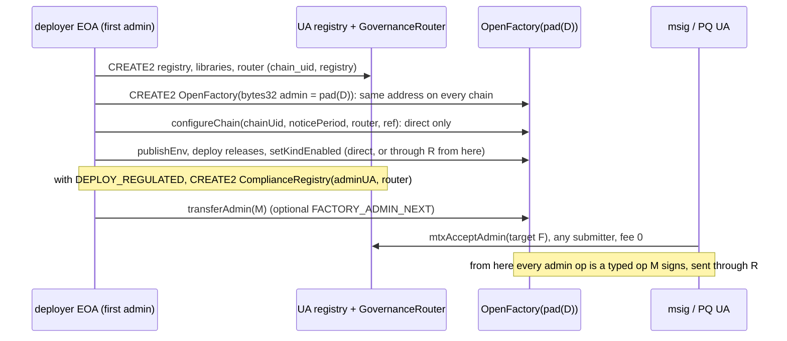

# Admin, not owner: the factory's record, UA admins, one name on every contract (round 3r) — design

**Status:** SPECIFIED, nothing built, **UNAUDITED**. Written 2026-11-10 for three owner rulings of the same day (§1); **the
owner answered Q1–Q6 and ruled the directory the same day (§10, §13)**, recorded in `decisions.md` as CTR-GOV-23 and its
Changes (§11). A Fable review of the whole spec comes before any code. Branch
`ua-mtx-3r`, off `ua-mtx-merge` `74262fa0`; every `file:line` below is at that commit (contracts under
`smartcontracts/evm/`). No figure here was measured for the new code: [measured] a figure already in the repo, [estimate]
arithmetic over one, [inference] from the EVM's rules, checked at the build. Owner rulings: §10. Decisions: §11.

## 1. The rulings (owner, 2026-11-10, in chat)

- **R1. `OpenFactory` keeps no owner information.** An owner can transfer or renounce, so a recorded owner goes stale. The
  record, its views and the creation events lose the owner; the immutable facts stay (`creatorId`, `contractsOfCreator`, class,
  kind, version, block, time). The current admin is read from the contract, its history from the contract's own events.
- **R2. The address admins become UA admins:** `OpenFactory.registrar` (an `address immutable`, usually an EOA) and
  `ComplianceRegistry.admin` (an `address`, written once). Reason (owner): an admin should be any UA, an `msig` or a PQ-signing
  UA included, which is more secure and more flexible. Same pattern as `GovernanceBase`; every admin op relayable through the
  router at fee 0 too.
- **R3. `owner` becomes `admin`** on every governed contract (the 12 token kinds and the DEX: `GovernanceBase`,
  `GovernanceLib`, `SCaaSDexAdmin`) and on the PqChat topic record (`PqTopic.owner`). Exactly one admin per contract; the
  two-step transfer, the renounce, the role bits, the delays and every rule stay; only names and the ABI move. **Not renamed
  (owner):** the PqChat instance's `owner` (`bytes32`), `MandateWallet` and `SmartKeyAccount` `owner` (the holder of the assets).

**Also not renamed** (another meaning of the word): the UA registry's `keyOwner`; the owner of a PQZ leg
(`src/pqz/PqzCore.sol:725-781`); Zether's account owner (purpose `zether-owner`, `ownerSig`, the owner statements of TS-D19);
ERC-20 `allowance(owner, spender)`; `"owner 2026-…"` in comments (the person).

**Rules applied, not reopened:** [CTR-GOV-01](../../decisions.md#ctr-gov-01--governancebase-on-every-token-kind-and-the-dex)
and its 2026-11-04 Change (every identity a UA id, `_govSubject()`), CTR-GOV-07 (the non-EVM `set_admin` / `renounce_admin`
semantics), CTR-GOV-15's router Change, [CTR-TOK-27](../../contracts/token-wrappers.md#CTR-TOK-27),
[CTR-TOK-29](../../contracts/token-wrappers.md#CTR-TOK-29), [CTR-AS-07](../../contracts/asset-suite.md#CTR-AS-07),
[NET-EVM-05](../../networks/evm.md#NET-EVM-05), [NET-EVM-11](../../networks/evm.md#NET-EVM-11), D2 (no EIP-7702 designator as a
direct authority, `decisions.md:2167`), explicit parameters, every state-changing `mtx*` relayable at fee 0, nothing deployed is
upgraded, all chains test-only.

## 2. What is there today

| Item | Where | Today |
|---|---|---|
| Record | `src/factory/OpenFactory.sol:31-40`, `src/factory/IOpenFactory.sol:47-63` | `Rec {creatorId, ownerUA, class, kind, version, block, time}`, three slots; `Created` the same plus `addr` |
| Owner reads | `OpenFactory.sol:330` (`IGovernance(dex).owner()`), `:756-757` (`t.owner()`), `:484-488` (`fi.ownerUA`) | read once after `initialize`, written to the record, the owner list and the event |
| Owner list | `OpenFactory.sol:71` (`_byOwner`, slot 12), `:508-512` (`contractsOfOwner`), `:665` (push) | never for 0 |
| Events | `IOpenFactory.sol:77-79` (`TokenCreated … bytes32 owner …`), `:84` (`DexCreated`), `:307-308` (`InstanceCreated`) | the owner at creation |
| `FactoryInfo` | `IOpenFactory.sol:287-299`, read `OpenFactory.sol:712-717` (224 B), `:704` (release owner 0) | seven words, `ownerUA` the sixth |
| Registrar | `OpenFactory.sol:53` (`address public immutable registrar`), `:90-98` (`onlyRegistrar`: `msg.sender`, `requireNotDelegated`) | the factory's only constructor argument; trust root for code (`docs/contracts/token-wrappers.md:738`, `:892`) |
| Registry admin | `src/regulated/ComplianceRegistry.sol:23-35`, `:51` | `address admin`, constructor only, must be a contract (`AdminNotContract`); no immutables so one runtime, one code hash (F-11, `:8-11`) |
| Governance owner | `src/governance/GovernanceLib.sol:70-73` (`owner` +2, `pendingOwner` +3, `ownerGeneration` +4), `:382-408`, `:595-598` | two-step transfer, renounce refused while a live root (`OwnerHasHolders`, `:512`) |
| The pattern | `src/governance/GovernanceBase.sol:46-50` (`governed`), `:61-65` (`_govSubject()`) | `msg.sender == router` ⇒ `subject()`, else `pad(_caller())`; the DEX's `_caller()` runs `requireNotDelegated` (`src/dex/SCaaSDexAdmin.sol:29-32`) |
| Router owner ops | `src/governance/GovernanceRouterBase.sol:33-38`, `:190-205` | `UATransferOwnership(… bytes32 newOwner …)`, `UAAcceptOwnership`, `UARenounceOwnership` |
| Topic owner | `src/pqchat/IPqChat.sol:83-91`, `:167`, `:200`, `:302`; `src/pqchat/PqChatTypes.sol:30-31`, `:142-144`; `src/pqchat/PqChatCore.sol:35`, `:78`; `src/pqchat/PqChatTopics.sol:34-43`, `:243-256` | `PqTopic.owner`, `topicsByOwner`, `PqTopicNotOwner`, `_ownerAuth` |

Why the registrar was immutable: the chain-neutral spec §3.4 (`docs/superpowers/specs/2026-11-07-chain-neutral-releases.md:222-229`)
needs the factory's constructor argument to be the same account under the same control on every chain (an EOA by construction;
a contract registrar deployed deterministically, the Wintermute lesson), and the registrar's key is the trust root for code. No
document argues against a transfer as such; immutability was the simplest way to keep the factory's address and its control
equal everywhere.

## 3. R1: the factory keeps no owner information

- **Record.** `Rec {creatorId, contractClass, kind, version, createdBlock, createdAt}`: two slots (the packed word moves from
  `+2` to `+1`). `Created {addr, creatorId, contractClass, kind, version, createdBlock, createdAt}`. `_rec` stays at slot 8.
- **Views.** `infoOf`, `contractsPage`, `contractsOfCreator` stay; `contractsOfOwner` and `_byOwner` go (the later sequential
  slots move down by one; only slot 8 is pinned, by `test/zether/ZetherStateVectors.t.sol:34`, `:222-228`).
- **Reads.** The factory reads no owner or admin of anything it creates: `_create` drops `t.owner()` (`:756-757`), `createDex`
  drops `IGovernance(dex).owner()` (`:330`), `_recordInstance` stops using `fi.ownerUA` (`:488-489`).
- **Events.** `TokenCreated(token, creatorId, kind, version, implementation, features, lockedFeatures, underlyings)`,
  `DexCreated(dex, creatorId, version, implementation)`, `InstanceCreated(instance, creatorId, contractClass, kind, version,
  implementation)`; topic0 of each moves (§4.3).
- **`FactoryInfo`** loses `ownerUA` (owner, Q4): six words, 192 B; `_factoryInfo` checks 192 (`:715`); `_checkRelease` drops "owner 0"
  (`:704`); `PqChat.factoryInfo()` (`src/pqchat/PqChat.sol:67-70`) answers six fields; PqChat's own `owner()` stays.
- **The admin's history** is the contract's own: `GovernanceLib.init` already emits the creation-time transfer from 0
  (`GovernanceLib.sol:128-132`), renamed `AdminTransferred(0, admin)` (§4), in the creating transaction.
- **Node.** It decodes no `TokenCreated` / `DexCreated` / `InstanceCreated` (`docs/node/indexer-feeds.md:228-229`); it reads
  `infoOf(target)` for `(contractClass, version)` only (`scaas-node/src/guard.rs:1013-1024`). `abi.rs:597-605`'s `Created` loses
  `ownerUA`, the test mock at `guard.rs:2465-2466` likewise; no job shape moves.

## 4. R3: `owner` becomes `admin`

### 4.1 Rename map (EVM)

| Area | Old | New |
|---|---|---|
| Views | `owner()`, `pendingOwner()` | `admin()`, `pendingAdmin()` |
| Entries | `transferOwnership(bytes32 newOwner)`, `acceptOwnership()`, `renounceOwnership()` | `transferAdmin(bytes32 newAdmin)`, `acceptAdmin()`, `renounceAdmin()` |
| Events | `OwnershipTransferStarted(previousOwner, newOwner)`, `OwnershipTransferred(previousOwner, newOwner)` | `AdminTransferStarted(previousAdmin, newAdmin)`, `AdminTransferred(previousAdmin, newAdmin)` (both `bytes32 indexed`) |
| Errors | `NotOwner(bytes32)`, `NotPendingOwner(bytes32)`, `OwnerAccountPool(bytes32)`, `OwnerHasHolders(uint8)` | `NotAdmin(bytes32)`, `NotPendingAdmin(bytes32)`, `AdminAccountPool(bytes32)`, `AdminHasHolders(uint8)` |
| Storage `scaas.governance` | `owner` +2, `pendingOwner` +3, `ownerGeneration` (+4, packed) | `admin`, `pendingAdmin`, `adminGeneration`: **same slots and offsets** |
| Bodies | `_ownerBody`, `_pendingOwnerBody`, `_transfer/_accept/_renounceOwnershipBody` (`GovernanceBase.sol:92-93`, `:134-138`); `GovernanceLib.transfer/accept/renounceOwnership`, `_onlyOwner` | `_adminBody`, …, `GovernanceLib.transferAdmin`, …, `_onlyAdmin` |
| Readers | `WrappedLib.sol:831`, `:855`, `:1006`; `PqzStateLib.sol:132`, `:185`, `:196` | `g.admin`, `g.adminGeneration` |
| Init config | `TokenConfig.owner` (`src/factory/IFactoryToken.sol:128`), `DexConfig.owner` (`src/dex/ISCaaSDex.sol:18`), `GovernanceLib.init(…, bytes32 owner, …)` (`:98`), `ZetherLib.initNormal` (`:293-306`) | `admin`; the ABI encoding of `initArgs` is unchanged (names are not encoded) |
| DEX stubs | `SCaaSDex.sol:809-810`, `:832-834`; `SCaaSDexAdmin.sol:73-74`, `:107-109` | the new names |
| Token faces | generated (`src/metatx/NormalToken.sol:4`) from `script/modules/entries.json` (72 lines name `Ownership`); `face_abi.json` (from `d142b57c`) declares the old events and errors | `entries.json` renamed, `gen_faces.py` run; `legacy_artifacts.py faceabi` takes the rename map, so the faces declare the new names |
| Selector audit | class `OWNER` (`test/governance/SelectorAudit.t.sol:37`, `:151`, `:172`; `scaas-node/src/guard.rs:1718`) | `ADMIN` (`HOLDER_OWN` stays: `acceptAdmin` is the pending's own) |
| Router | `UATransferOwnership(…,bytes32 newOwner,…)`, `UAAcceptOwnership`, `UARenounceOwnership`; `mtx…Ownership` | `UATransferAdmin(…,bytes32 newAdmin,…)`, `UAAcceptAdmin`, `UARenounceAdmin`; `mtxTransferAdmin`, `mtxAcceptAdmin`, `mtxRenounceAdmin` |
| Topic | `PqTopic.owner`; `PqTopicCreated(topicId, owner)`; `PqTopicNotOwner(bytes32 owner)`; `topicsByOwner(owner_, start, count)`; storage `Topic.owner`, `S.topicsByOwner`; `_ownerAuth` | `admin`; `PqTopicCreated(topicId, admin)`; `PqTopicNotAdmin(bytes32 admin)`; `topicsByAdmin(admin_, …)`; `Topic.admin`, `S.topicsByAdmin` (same slots); `_adminAuth` |
| Disclosure | `governance_bits.json` sentences "The owner may …" (bits 25, 26), from `test/governance/GovBitsVector.t.sol:327`, `:339` | "The admin may …", regenerated (`WRITE_BITS=true`) |

One shared interface, `IAdmin` (`src/governance/IAdmin.sol`): `admin()`, `pendingAdmin()`, `transferAdmin(bytes32)`,
`acceptAdmin()`, the two events, `NotAdmin(bytes32)`, `NotPendingAdmin(bytes32)`. `IGovernance is IAdmin` and adds
`renounceAdmin()`; `IOpenFactory` and `IComplianceRegistry` use it (§5), so every admin has one selector set and one error
shape. The topic id derivation keeps its value: `topicId(admin, nonce) = keccak256(abi.encode(TAG_TOPIC, admin, nonce))`, the
nonce scope likewise; only the field name and `TOPIC_TYPEHASH` change.

### 4.2 Selectors (computed: keccak256 of each signature; the old values equal `typed_ops.json` and the typehash pins)

| Old | Selector | New | Selector |
|---|---|---|---|
| `owner()` | `0x8da5cb5b` | `admin()` | `0xf851a440` |
| `pendingOwner()` | `0xe30c3978` | `pendingAdmin()` | `0x26782247` |
| `transferOwnership(bytes32)` | `0xf807e3da` | `transferAdmin(bytes32)` | `0xe923bc3d` |
| `acceptOwnership()` | `0x79ba5097` | `acceptAdmin()` | `0x0e18b681` |
| `renounceOwnership()` | `0x715018a6` | `renounceAdmin()` | `0x8bad0c0a` |
| `registrar()` (factory) | `0x2b20e397` | `admin()` | `0xf851a440` |
| `NotOwner(bytes32)` | `0xa6922f00` | `NotAdmin(bytes32)` | `0xba963c12` |
| `NotPendingOwner(bytes32)` | `0xda5bcbae` | `NotPendingAdmin(bytes32)` | `0x16600d0b` |
| `OwnerAccountPool(bytes32)` | `0x631254fc` | `AdminAccountPool(bytes32)` | `0x0c4bfe3f` |
| `OwnerHasHolders(uint8)` | `0xb164ad5e` | `AdminHasHolders(uint8)` | `0xc77bc55f` |
| `NotRegistrar()` (factory) | `0x2ad95351` | `NotAdmin(bytes32)` | `0xba963c12` |
| `NotAdmin()` (registry) | `0x7bfa4b9f` | `NotAdmin(bytes32)` | `0xba963c12` |
| `topicsByOwner(bytes32,uint256,uint256)` | `0x944640bd` | `topicsByAdmin(bytes32,uint256,uint256)` | `0xa448972c` |
| `PqTopicNotOwner(bytes32)` | `0xbbd4dd0b` | `PqTopicNotAdmin(bytes32)` | `0x8bb56219` |
| `contractsOfOwner(bytes32,uint16,uint256,uint256)` | `0x9fbde75c` | removed | |
| `mtxTransferOwnership` | `0xc3efbc3a` | `mtxTransferAdmin` | `0xa682ea50` |
| `mtxAcceptOwnership` | `0x9c682cce` | `mtxAcceptAdmin` | `0x321b86a3` |
| `mtxRenounceOwnership` | `0x71364d1a` | `mtxRenounceAdmin` | `0xfeedac3d` |

The `mtx*` selectors are over `(UAEnvelope, address target[, bytes32], UASig)` as `typed_ops.json:8016` pins the old one.

### 4.3 Event topics and typehashes

| Old | topic0 / typehash | New | topic0 / typehash |
|---|---|---|---|
| `OwnershipTransferStarted(bytes32,bytes32)` | `0x77586e9b…` | `AdminTransferStarted(bytes32,bytes32)` | `0xc022cde7…` |
| `OwnershipTransferred(bytes32,bytes32)` | `0xcbbb77f6…` | `AdminTransferred(bytes32,bytes32)` | `0x72ecac40…` |
| `TokenCreated(…,uint256,uint256,bytes32,address[])` | `0x6328d132…` | `TokenCreated(…,uint256,uint256,address[])` | `0x0ed41946…` |
| `DexCreated(address,bytes32,uint64,address,bytes32)` | `0xe7ef47f6…` | `DexCreated(address,bytes32,uint64,address)` | `0x7333afd9…` |
| `InstanceCreated(…,uint64,address,bytes32)` | `0x45e2860e…` | `InstanceCreated(…,uint64,address)` | `0xdb1952a9…` |
| `PqTopicCreated(bytes32,bytes32)` | `0x5b2fb9b3…` | unchanged (a parameter name only) | |
| `UATransferOwnership` | `0xa468e58d…` (pinned, `GovRouterTypehash.t.sol:50-53`) | `UATransferAdmin(bytes32 from,address target,bytes32 newAdmin,E)` | `0x36dbad09…` |
| `UAAcceptOwnership` | `0x2ce67927…` | `UAAcceptAdmin(bytes32 from,address target,E)` | `0x996ac68d…` |
| `UARenounceOwnership` | `0x0397c70e…` | `UARenounceAdmin(bytes32 from,address target,E)` | `0x4be88ff9…` |
| `PqTopic(bytes32 owner,…)` | `0x75bed97b…` | `PqTopic(bytes32 admin,uint64 nonce,bytes32 homeChain,address homeChatContract,string name,bytes about,bool openReplies)` | `0x66954727…` |

`E` is the seven envelope words (`uint256 batch,uint256 nonce,uint256 validUntil,uint32 mode,address relayer,uint256 fee,address
feeRecipient`). No other typehash names `owner` (`src/` scan); the old four stay pinned as legacy pins. Every chain test-only: no
alias, no old selector kept.

### 4.4 Layout pins

The slots do not move; the labels do: `test/v2/layout/namespaces.json` (`owner`, `pendingOwner`, `ownerGeneration`),
`test/v2/Layout.t.sol:48-51`, `:201-204`; PqChat's `Topic.admin` and `S.topicsByAdmin` (the namespace pin
`test/pqchat/PqChatLayout.t.sol:37` names the instance's `ownerUA`, unchanged). The test still asserts the same offsets: a label
edit that moved a slot fails it.

### 4.5 One rule on every chain

The non-EVM token and DEX already say admin: `smartcontracts/soroban/contracts/token/src/lib.rs:204`,
`smartcontracts/soroban/contracts/dex/src/lib.rs:120`, `smartcontracts/near/token/src/lib.rs:187`, and CTR-GOV-07's
`set_admin` / `renounce_admin` for every family. 3r aligns the EVM; the mandate's `owner` stays on every family, as on EVM.

## 5. R2: UA admins for `OpenFactory` and `ComplianceRegistry`

### 5.1 The pattern, one definition

`abstract contract UAAdmin is IAdmin` (`src/governance/UAAdmin.sol`), storage in ERC-7201 namespace `scaas.admin` (no sequential
slot moves: the factory's slot 8 and the registry's slots stay):

```solidity
struct AdminStorage { bytes32 admin; bytes32 pendingAdmin; }
function _adminRouter() internal view virtual returns (address);          // factory: govRouter; registry: its own
function _adminSubject() internal view returns (bytes32) {               // GovernanceBase._govSubject, :61-65
    address r = _adminRouter();
    if (r != address(0) && msg.sender == r) return IGovernanceRouter(r).subject();
    SigCheck.requireNotDelegated(msg.sender);                             // D2, as onlyRegistrar (:96)
    return MetaTxLib.pad(msg.sender);
}
modifier onlyAdmin() { bytes32 c = _adminSubject(); if (c == 0 || c != $().admin) revert NotAdmin(c); _; }
// transferAdmin(next) onlyAdmin: pending = next (0 cancels), AdminTransferStarted(admin, next)
// acceptAdmin(): c = _adminSubject(); c != 0 && c == pending, else NotPendingAdmin(c); AdminTransferred(admin, c); pending = 0
// _renounceAdmin() onlyAdmin: AdminTransferred(admin, 0); admin = pending = 0  (exposed by the factory only, Q1/Q2)
```

The semantics are `GovernanceLib`'s (`:382-408`) and CTR-GOV-07's: two steps with acceptance, a renounce clears the pending and
is one-way. No pool check (the factory and the registry hold no pool) and no generation counter (they have no pending grant).

### 5.2 `OpenFactory`

- `constructor(bytes32 admin_)`: `admin_` must be a native id (`≠ 0`, high 96 bits 0), else `AdminNotNative(admin_)`; emits
  `AdminTransferred(0, admin_)`. The factory's address stays chain-neutral: the first admin is the same native id on every chain.
- `onlyRegistrar` → `onlyAdmin` on `configureChain`, `publishEnv`, `publishDexEnv`, `publishClassEnv`,
  `deployTokenImplementation`, `deployDexImplementation`, `deployImplementation`, `deprecate`, `deprecateDex`,
  `deprecateRelease`, `setKindEnabled`, `setClassKindEnabled` (`OpenFactory.sol:113-416`). `_adminRouter()` is `govRouter`; the
  router's subject read shares `_creatorId()`'s source (`:631-636`).
- **`configureChain` is direct only, by construction:** before it `govRouter` is 0, so the router path does not exist; the factory
  cannot trust a router it has not been told of (a contract that names itself the router could answer any `subject()`). Hence a
  native first admin, and the transfer after `configureChain` (§6).
- `transferAdmin`, `acceptAdmin`, `renounceAdmin` (owner, Q1); `admin()`, `pendingAdmin()` replace `registrar()`.
- **Renounce ends every admin op for good, deprecation included:** no env, no release, no deprecation, no kind switch on that
  chain's factory; a release found bad after a renounce can no longer be stopped there (owner, Q1: stated consequence).
- The chain's directory (owner, §13): the router's code hash at `configureChain`, the write-once `setChainEntries`.

### 5.3 `ComplianceRegistry`

- `constructor(bytes32 admin_, address govRouter_)`, both written once to storage (no immutable: F-11's one runtime holds; the
  regulated releases' `REGISTRY_CODEHASH` changes once, with the new runtime). `admin_ ≠ 0` (`AdminZero`); `AdminNotContract`
  goes: any UA, an EOA, a contract, an `msig` or a PQ UA (CTR-AS-07 Change, §11). `govRouter_` 0 = no router path. The
  registry's address now differs per chain (the router is per chain); every book names it per chain already.
- `setAttester(bytes32 attester, bool enabled)`: `onlyAdmin`. `attest`: `c = _adminSubject()`; `c == admin` ⇒ id 0, else
  `id = attesterId[c]`, enabled, else `NotAttester` (§5.3.1). D2 applies to every direct caller, an attester's too (the registry
  is authority there; it had no check because its admin had to be a contract).
- `transferAdmin`, `acceptAdmin`; **no renounce** (owner, Q2): only the admin disables a compromised attester or writes an
  `ELIGIBLE_CONTRACT` row, so the registry always has one.

#### 5.3.1 The attester is a UA too (owner, Q5)

The attester writes the registry's own state: it is the subject of its call, like a governance holder, so it takes the
`governed` / `UAAdmin` pattern, not a signer's. (A signer, like 3f's verifier UA, signs a record that rides inside someone
else's transaction and never sends one: `PqzVerdict` is the last parameter of the user's proof-carrying entry, CTR-PQZ-29. An
attester sends its own `attest`.) Hence:

- `attesterId` is keyed by the attester's UA id: `mapping(bytes32 attester => uint32)`; `setAttester(bytes32, bool)`,
  `attesterId(bytes32)`, `AttesterSet(bytes32 indexed attester, uint32 indexed attesterId, bool enabled)`. The id rules stay:
  assigned at the first enabling, never reused, 0 is the admin, an unknown id is not enabled.
- `attest` takes the subject from `_adminSubject()`: a native attester calls directly (`pad(addr)`, D2), a derived one (`msig`,
  PQ) through the router's `mtxAttest`, the same op the admin uses; the router's domain, `target` and nonce give replay
  protection, so the registry needs no domain, nonce or record of its own.
- Every row rule stays: `{flags, validUntil, attesterId}` in one slot; `ELIGIBLE_CONTRACT` only by the admin with
  `validUntil = type(uint64).max` (CTR-AS-16); an admin row (`attesterId 0`, `flags ≠ 0`) is the admin's alone
  (`AdminWrittenSlot`, owner 2026-11-06); disabling an attester voids its rows at once; `hasFlags`, `attestationOf`,
  `attesterEnabled` keep their selectors, so `RegulatedBase`'s bounded calls do not move.
- **3f is untouched.** The PQZ verifier UA stays a signer: `pqzVerifyMode`, `pqzVerifierUA`, its admitted kinds and frozen shape,
  fixed or transferable with the factory's notice, immediate revocation, the epoch in every verdict, `PqzVerdict` under
  `PURPOSE_PQZ_VERDICT`, the OFFCHAIN key rule (CTR-PQZ-27 to CTR-PQZ-30). Only the word changes where they say "the owner"
  (`PqzStateLib.sol:185`: the admin proposes). The registry's attestation rows and 3f's attested verification stay two things.

### 5.4 Router ops

In `GovernanceRouterBase` (every `IAdmin` contract): the three renamed ops, which reach the factory and the registry too, as
their selectors equal `IGovernance`'s. In `GovernanceRouter`, next to the creations (`src/governance/GovernanceRouter.sol:215-241`),
fourteen new ops (the last from §13), each `mtx<Op>(UAEnvelope e, address target, <params>, UASig auth)` over `UA<Op>(bytes32 from,address
target,<words>,E)`, fee mode `NONE`, relayable at fee 0:

| Op | Signed words after `target` | Calls |
|---|---|---|
| `UAPublishEnv` | `uint8 kind,uint16 envVersion,Env env` | `publishEnv` |
| `UAPublishDexEnv` | `uint16 envVersion,Env env` | `publishDexEnv` |
| `UAPublishClassEnv` | `uint16 contractClass,uint16 kind,uint16 envVersion,Env env` | `publishClassEnv` |
| `UADeployTokenImplementation` | `uint8 kind,uint64 version,uint16 envVersion,bytes32 initcodeHash,bytes32 implArgsHash` | `deployTokenImplementation` |
| `UADeployDexImplementation` | `uint64 version,uint16 envVersion,bytes32 initcodeHash,bytes32 implArgsHash` | `deployDexImplementation` |
| `UADeployImplementation` | `uint16 contractClass,uint16 kind,uint64 version,uint16 envVersion,bytes4 initSelector,bytes4 interfaceId,bytes32 initcodeHash,bytes32 implArgsHash` | `deployImplementation` |
| `UADeprecate` | `uint8 kind,uint64 version,string reason` | `deprecate` |
| `UADeprecateDex` | `uint64 version,string reason` | `deprecateDex` |
| `UADeprecateRelease` | `uint16 contractClass,uint16 kind,uint64 version,string reason` | `deprecateRelease` |
| `UASetKindEnabled` | `uint8 kind,bool on` | `setKindEnabled` |
| `UASetClassKindEnabled` | `uint16 contractClass,uint16 kind,bool on` | `setClassKindEnabled` |
| `UASetAttester` | `bytes32 attester,bool enabled` | `ComplianceRegistry.setAttester` |
| `UAAttest` | `bytes32[] accounts,uint64[] flags,uint64[] until` | `ComplianceRegistry.attest` (the admin or an attester, §5.3.1) |
| `UASetChainEntries` | `address complianceRegistry,address smartKeyAccountFactory,bytes32 smartKeyAccountFactoryCodeHash` | `OpenFactory.setChainEntries` (§13) |

- `Env(address registry,address smartKeyAccountImpl,bool hedera,address[] deps,bytes32[] params,address[] libs,bytes32[]
  libCodeHashes)` is appended to the three publish types and hashed as EIP-712 does (each array `keccak256` of its 32-byte
  words), so every field of the env is signed by name.
- `initcode` and `implArgs` go to the factory unchanged; their hashes are the signed fields, as `UACreateToken` signs `initHash`
  (S3). The ids flat, as `UACreateInstance` (`:234-241`). `UAAttest` names its third array `until` because `validUntil` is an
  envelope word (the precedent: `UAOperatorTransfer`'s `account`, `GovernanceRouter.sol:105`).
- No `mtxConfigureChain` (§5.2). The router's entries go from 38 to 52.
- **The three release deploys are not node jobs** (owner, Q3, option (i)): their init code is over the gateway's 64 KiB body
  (`scaas-node/src/gateway.rs:142`), which is not raised; any sender submits them to the router directly, fee 0 too. They are
  `NOT_ROWS` with that reason.

### 5.5 Threat notes

- **A stolen admin key.** Factory: the thief publishes envs, deploys releases (usable after `noticePeriod`, at least 3 days on a
  mainnet; existing contracts are clones of old code and do not move), deprecates or disables (a denial of creation), and can
  move the admin to itself. Registry: the thief enables attesters and writes rows (a receiver check passes for its accounts) or
  disables honest attesters (their rows void at once). Today's immutable registrar is the same exposure with no way to rotate
  first; a k-of-n `msig` or a PQ UA admin needs more than one key, and a transfer lets an honest admin rotate before a loss.
  The release list (`releases.json`) and `isRegisteredToken` stay what clients trust; a thief's release is not in the list.
- **The router down.** It has no owner, no pause and no state: it cannot be stopped, only refused by relayers, and then the
  admin's own account submits the signed call (any submitter). A router bug blocks a derived admin, which has no direct path; a
  native admin (an EOA or a contract) keeps it. The factory's `govRouter` is fixed by `configureChain`: a later router needs a
  new factory. Mitigation: the router passes the matrix run on the chain before the transfer to a derived admin.
- **Replay across chains or factories.** The router's domain is `("SCaaS GovernanceRouter", "1", chainId, router, chain_uid)`
  and `target` is a signed word: a signature for one chain's factory is refused by another chain (another `chain_uid` and
  router) and by another factory or registry on the same chain. The native admin's direct transactions keep NET-EVM-05's sibling
  rule (configure every sibling first); once the admin is derived, every admin op goes through the router and that class closes.
- **Another chain's control of the admin id.** A derived UA id is a pure function of its key data or policy, the same on every
  chain (`docs/contracts/accounts.md:70-73`), so nobody else holds it elsewhere: §3.4's deterministic-deployment requirement
  holds only for a native contract admin. Each chain's transfer is its own; the pending must be registered on that chain's UA
  registry before it can accept.
- **Delegated callers.** `requireNotDelegated` stays on every direct path (`_adminSubject`); through the router a native EOA is
  verified by its own key only (CTR-UA-24), the delegate never asked; the router is the caller, a contract.
- **A fake router.** Only `msg.sender == govRouter` (the factory's, written once) or the registry's constructor router is asked
  for a subject; any other caller is its own native id.

## 6. Deploy order (NET-EVM-05, NET-EVM-11)



- `DeployBase._deployTokenFactory` (`script/DeployBase.sol:353-369`) moves the factory after the registry and the router (the
  ruling's order; the factory's address does not depend on them). `new OpenFactory{salt}(MetaTxLib.pad(deployer))` (`:364`).
- `releases.json`: the row `registrar` (`:600`) becomes `admin`, the factory's constructor argument (the first admin); the
  factory row hashes `abi.encode(bytes32 admin)` (`:598-599`). The chain's book gains `factory_admin` (current) and the gate
  reads `admin()` and `pendingAdmin()` against it.
- `FACTORY_ADMIN_NEXT` (optional `bytes32`): the run's last transaction is `transferAdmin(next)`; the accept is `next`'s signed
  `mtxAcceptAdmin`, a separate step; until then the deployer stays admin and the gate reports the pending.
- `COMPLIANCE_ADMIN` becomes a `bytes32` UA id, required with `DEPLOY_REGULATED` (no default).
- NET-EVM-11 holds for the router path: a release through the router is measured `(regular + state) × 1.05` like a direct one,
  and must fit 60 M with regular × 1.05 < 2^24; the router adds a calldata-to-memory copy and a `keccak256` of the init code
  (about 0.1–0.2 M regular for a 100–130 KB init code [estimate]). The largest face of kind 13 asks 50.51 M direct [measured,
  `networks/evm.md:362-365`].
- With the directory (§13.10): the chain-neutral relay pair comes before `configureChain`, and `setChainEntries` follows it.

## 7. ABI consumers

| Consumer | Change |
|---|---|
| Contracts | §3–§5; `entries.json` → `gen_faces.py`; `face_abi.json` through the rename map |
| `scaas-node/src/typed.rs` | `:121` `PqTopic(bytes32 admin,…)`; `:207-209` the three renamed rows; eleven new `GR` rows (§5.4 but the three deploys) |
| `scaas-node/src/guard.rs` | `NOT_ROWS` (`:1649-1663`) + the three deploy ops, reason "init code over the gateway's 64 KiB body (`gateway.rs:142`): any sender submits to the router directly" (owner, Q3); the three join the creations' exclusion, so the router count goes `36` → `47` (`:1726`); class `ADMIN` (`:1718`); the `infoOf` mock (`:2465-2466`) |
| `scaas-node/src/abi.rs` | `Created` without `ownerUA` (`:597-605`) |
| `test/vectors/selector_audit.json` | class `ADMIN`; the router's 13 new `SIGNED` rows; the old names gone (both directions, `SelectorAudit.t.sol`) |
| `clients/clientkeys` | `src/evm.js:360-362` renamed + 14 rows (the `Env` type, the arrays); `src/pqchat.js:49`; the governance-bits sentence table; `scripts/typed-ops-vectors.mjs`, `scripts/pqchat-vectors.mjs` |
| `clients/ua-rs` | a router-op table for the 17 ops (the pattern of `src/regulated.rs`, `src/wraplimit.rs`), so a PQ or `msig` admin signs them (ua-rs signs every kind); tested against `typed_ops.json` |
| `clients/zether-prover/tests/typed_ops.rs` | `:22-23` the names |
| Other `ua-*` | no router or topic row; they read `governance_bits.json` (text only) |
| Vectors (generators only) | `typed/typed_ops.json`, `pqchat/topics.json` (topic ids unchanged, digests move), `governance/governance_bits.json` (`GovBitsVector.t.sol`), `governance/regulated_kat.json` (`RegulatedKat.t.sol`, the registry's code hash), `zether/state.json` (`ZetherStateVectors.t.sol`, `record` two words) |
| Matrix | `script/onchain/{Tokens,Dex,Gov,Misc,PqChat,Liquidity,WrapLimits,ZetherMore}.s.sol` (e.g. `Tokens.s.sol:276-278`, `:639-666`; `Dex.s.sol:477-488`; `Gov.s.sol:209-221`, `:289-299`, `:792`; `Misc.s.sol:318`; `PqChat.s.sol:530`; `PqChat.s.sol:187` is the instance and stays); new steps: misc's factory admin moved to an `msig` UA and every factory op through the router, gov's registry likewise; `coverage.py gen`, `notrun.json` reasons |
| Docs | every current doc naming the old identifiers (15 files, 114 hits today, mostly `token-wrappers.md`, `pqchat.md`, `contracts/README.md`, `networks/evm.md`, `dex.md`, `asset-suite.md`, `node/job-api.md`, `node/indexer-feeds.md`); `decisions.md` keeps its history and gains §11 |

## 8. Tests (red first) and mutants

Red first, each before its code: (1) `test/governance/AdminNames.t.sol`: on each of the 12 kinds and the DEX the new five answer
and the old five selectors revert with no data; (2) the four new typehash pins and the old four as legacy pins; (3)
`FactoryIndex.t.sol`: `Created` without the owner, no `contractsOfOwner`, a release whose `admin()` reverts is still created
(today `test_index_ownerRevertRevertsCreation`), the slot counts `test_index_slotCount_*` one record slot and one list push
fewer; (4) `test/v2/FactoryAdmin.t.sol`; (5) `test/as/RegistryAdmin.t.sol`; (6) the router ops in `GovRouter.t.sol`.

`FactoryAdmin.t.sol` and `RegistryAdmin.t.sol` cover: the constructor (factory: 0 and a derived id refused); a direct native
admin passes every op; a stranger `NotAdmin(pad(stranger))`; an EIP-7702 designator admin `CallerDelegated`; `configureChain`
direct only; after `transferAdmin` + router `acceptAdmin` by a derived UA (secp256k1, ML-DSA, `msig`), every op through the
router at fee 0 by a stranger relayer; another signer through the router `NotAdmin(signer)`; a contract answering
`subject() = admin` that is not the router refused; the same signature on a second factory or registry (same admin) refused,
and on a second chain (another `chain_uid`, router) refused; `acceptAdmin` by a non-pending `NotPendingAdmin`; renounce: admin 0,
pending 0, every op refused, including through a mock router answering 0. The registry's runtime code hash is equal across two
deployments with different admins and routers (F-11 positive control); the registry has no `renounceAdmin` (its selector
reverts with no data). Attesters (§5.3.1): a native attester directly and a derived attester (`msig`, ML-DSA) through the
router each write rows under their own id; a derived attester's id called directly (`pad(msg.sender)` is not it) refused
`NotAttester`; a disabled attester's rows read inactive at once; an attester over an admin row `AdminWrittenSlot`; an attester's
`ELIGIBLE_CONTRACT` `EligibleContractAdminOnly`; an EIP-7702 designator attester `CallerDelegated`; the `RegulatedKat` rows
regenerated and equal.

Mutants (each must turn a named test red; the round's mutant log records it):

| # | Mutant | Caught by |
|---|---|---|
| M1 | `_adminSubject` asks any caller for `subject()` | the fake-router test |
| M2 | the router branch returns `pad(msg.sender)` | the derived-admin tests |
| M3 | `onlyAdmin` drops `c != 0` | renounce + mock router answering 0 |
| M4 | the direct path drops `requireNotDelegated` | the designator test |
| M5 | `entries.json` keeps an `owner()` alias | `AdminNames.t.sol`, `SelectorAudit.t.sol` |
| M6 | `_create` still reads `admin()` | the reverting-`admin()` creation |
| M7 | `UATransferAdmin` keeps `newOwner` | the typehash pin, the clientkeys vector |
| M8 | `TOPIC_TYPEHASH` keeps `owner` | `PqChatTypes.t.sol`, `topics.json` |
| M9 | `acceptAdmin` leaves the pending | a second accept |
| M10 | the factory constructor takes a derived id | the constructor test |
| M11 | `attest` from the router takes a non-admin subject as the admin | `RegistryAdmin.t.sol` |
| M12 | a node row keeps `mtxTransferOwnership` | `allow_lists_equal_the_selector_audit_both_directions` |
| M13 | `attest` looks the attester up by `msg.sender`, not the subject | the derived-attester test |
| M14 | the registry keeps a `renounceAdmin` | the no-renounce test, `SelectorAudit.t.sol` |
| M15 | a node row for a release deploy | the guard test (`NOT_ROWS`) |

Gates: every `forge` directory and the node e2e (the change is shared), `script/pqz/at-set.sh <set> test` at the four sets,
the size gate, layout, ABI and gas pins, `cargo test` + `clippy -D warnings`, clientkeys and ua-rs tests, the local matrix run.

## 9. Gas and size

- **Renames:** zero bytes of logic; selector values move, so each dispatcher's order does: a few gas per entry either way
  [inference]; the pinned gas figures move only with old → new in the commit.
- **Creation:** one record slot, two list writes (`_byOwner` length and element) and one `STATICCALL` fewer per creation, so
  `createToken`, `createDex`, `createInstance` fall from their last pins (2,183,102 / 4,383,367 / 1,826,732 [measured,
  CTR-TOK-27]); new pins measured.
- **Admin ops:** a cold `SLOAD` of the admin instead of an immutable read (+2,100 [inference]); through the router, the router's
  verification on top (a native ECDSA in the tens of thousands, a PQ or `msig` more).
- **Size:** `OpenFactory` 29,238 B [measured, `size-baseline.json`] gains `UAAdmin` and loses the owner index (net about +0.5 to
  +1 KB [estimate]); `GovernanceRouter` (not in the baseline) gains 13 entries with the `Env` and array hashing (several KB
  [estimate]); the registry about +1 KB. Measured in T12; a baseline row moves only with its reason.

## 10. Owner rulings on the questions (2026-11-10)

Each answer is the owner's, in chat, relayed by the controller; status: decided, SPECIFIED, nothing built.

- **Q1. The factory admin: a two-step transfer and a renounce, as in `GovernanceBase`.** The first admin is a native id (the
  constructor refuses a derived one) and `configureChain` is its direct call. **Consequence: a renounce also ends deprecation**,
  with every other admin op (env, release, kind switch): a release found bad after it can no longer be deprecated on that
  factory. Why (spec): "immutable but UA-typed" cannot serve a derived admin, whose only path is the router, which the factory
  may trust only after `configureChain` names it; a router in the constructor would give the factory another address per chain.
- **Q2. The `ComplianceRegistry` admin: a two-step transfer, no renounce.** Why: a derived UA's keys never change
  (`accounts.md:70-72`), so the transfer is how an `msig` or PQ admin rotates; with no admin nobody could void a bad attester's
  rows or write an `ELIGIBLE_CONTRACT` row.
- **Q3. Option (i): the three release deploys are sent directly to the router by any sender, fee 0 too, and are not node
  jobs.** They carry init code over the gateway's 64 KiB body; they are `NOT_ROWS` with that reason; the gateway's limit is not
  raised (§5.4, §7).
- **Q4. `FactoryInfo.ownerUA` is dropped** (six words, 192 B). The PqChat instance keeps `owner()` (`bytes32`).
- **Q5. Yes: the attester becomes a UA too, inside 3r**, in the `governed` / `UAAdmin` pattern (§5.3.1): an attester is the
  subject of its own call, not a signer riding in another's; every 3f rule (CTR-PQZ-27 to CTR-PQZ-30) and every attestation-row
  rule stays.
- **Q6. The names as proposed** (§4.1): `admin()`, `pendingAdmin()`, `transferAdmin(bytes32)`, `acceptAdmin()`,
  `renounceAdmin()`, `AdminTransferStarted` / `AdminTransferred(previousAdmin, newAdmin)`, `NotAdmin(bytes32)`,
  `NotPendingAdmin(bytes32)`, `AdminAccountPool`, `AdminHasHolders`, `adminGeneration`, config field `admin`, selector-audit
  class `ADMIN`, `UATransferAdmin(…,bytes32 newAdmin,…)`, `UAAcceptAdmin`, `UARenounceAdmin`, `topicsByAdmin`,
  `PqTopicNotAdmin`, the factory's `AdminNotNative`, the registry's `AdminZero`.
- **Directory: option (a)**, write-once, one address per name, no versions, constants where chain-neutral (§13).

## 11. `decisions.md`

Recorded on this branch: [CTR-GOV-23](../../decisions.md#ctr-gov-23--one-admin-per-contract-a-ua-named-admin-on-every-contract)
(owner: yes; status SPECIFIED) with the rulings R1–R3, Q1–Q6 and the directory, and Change lines on CTR-TOK-27 (R1, Q4),
CTR-TOK-29 (the constructor, Q1, the directory), CTR-AS-07 (Q2, Q5), CTR-GOV-01 (the names) and NET-EVM-05 (the deploy order).
The component docs (`token-wrappers.md`, `asset-suite.md`, `pqchat.md`, `networks/evm.md`, the node's) move with the build
(T14), when the code exists.

## 12. Tasks

| Task | Content | Estimate |
|---|---|---|
| T1 | Red tests: `AdminNames.t.sol`, typehash pins, `FactoryIndex` changes, `FactoryAdmin.t.sol`, `RegistryAdmin.t.sol` skeletons | 0.5 d |
| T2 | R3 in the governed contracts: `IAdmin`, `IGovernance`, `GovernanceLib`, `GovernanceBase`, `SCaaSDexAdmin`, `SCaaSDex`, `WrappedLib`, `PqzStateLib`, `ZetherLib`, the config fields, `entries.json` + `gen_faces.py`, `face_abi.json` map, layout labels, `GovBitsVector` sentences | 1 d |
| T3 | R3 on the topic: `IPqChat`, `PqChatTypes`, `PqChatCore`, `PqChatTopics`, `PqChat`; `topics.json`; node `typed.rs:121`; clientkeys `pqchat.js` | 0.5 d |
| T4 | R1: record, views, events, `FactoryInfo`, reads; `ZetherStateVectors` + `state.json`; node `abi.rs`, guard mock | 1 d |
| T5 | `UAAdmin`; `OpenFactory` admin (constructor, `onlyAdmin`, transfer, renounce); `FactoryAdmin.t.sol` green | 1.5 d |
| T6 | `ComplianceRegistry` admin, router, transfer without renounce, attesters by UA (§5.3.1); `RegistryAdmin.t.sol`; `regulated_kat.json`; `Gov.s.sol`'s `setAttester` | 1.5 d |
| T7 | Router: the 3 renamed and 14 new ops, `Env` and array hashing, pins, `GovRouter.t.sol` | 1.5 d |
| T8 | Clients and vectors: clientkeys rows + `typed_ops.json`, ua-rs router-op table + test, zether-prover list | 1 d |
| T9 | Node: rows, `NOT_ROWS`, counts, class `ADMIN`; `cargo test`, `clippy` | 0.5 d |
| T10 | Deploy: `DeployBase` order, `FACTORY_ADMIN_NEXT`, `COMPLIANCE_ADMIN` as UA, release rows, the gate; every release through the router on a 60 M anvil (NET-EVM-11) | 1 d |
| T11 | Matrix: scripts renamed, the router steps for the factory and the registry, coverage, local run | 1 d |
| T12 | Gates and pins: every forge dir, the four PQZ sets, size, layout, ABI, gas old → new | 0.5 d |
| T13 | Mutants M1–M12, log | 0.5 d |
| T14 | Docs: component docs (`decisions.md` done, §11), `docs_check` | 0.5 d |
| T15 | The directory (§13): constants and their generator test, `setChainEntries`, `configureChain`'s checks, the registry agreement, `directory()`; `FactoryDirectory.t.sol`, mutants D1–D8; `DeployBase` and `e2e.py` order | 1 d |
|  | **Total** | **≈ 13.5 d** |

## 13. `OpenFactory` as the chain's directory (owner ruling 2026-11-10, option (a))

**Ruling (owner).** From the factory anyone finds the chain's fixed shared contracts: `UARegistry`, `GovernanceRouter`,
`RelayFeeRouter`, `RelayFeeExecutor`, `ComplianceRegistry`, `SmartKeyAccountFactory`, and the shared Zether contracts that stand
apart. Option (a): write-once, one address per name, no versions; constants can be used. Excluded: libraries and body modules
(they are in the env and the releases), and per-DEX children (`DexPuller` through `dex.puller()`, `mtxLiquidityPull` a token
entry, the position readers listed by the DEX). Status: decided, SPECIFIED, nothing built.

### 13.1 The entries, from the deploy scripts at `74262fa0`

| Name | Chain-neutral? | Constant or write-once | Source of the address |
|---|---|---|---|
| `UARegistry` | no: constructor `chain_uid` (`script/DeployBase.sol:777`) | neither: not stored | the router's `registry()`; every env bound to it (§13.4) |
| `GovernanceRouter` | no: `(chain_uid, registry, smartKeyAccountImpl, hedera)` (`:522`) | write-once, `configureChain` (today's `govRouter`) | `configureChain`'s `govRouter_`, code hash the admin's argument |
| `RelayFeeRouter` | yes: no argument (`:511`) | constant | CREATE2(`0x4e59b44847b379578588920cA78FbF26c0B4956C`, salt, init-code hash) |
| `RelayFeeExecutor` | yes: `CREATE` by the relay router's constructor, nonce 1 (`src/metatx/RelayFeeRouter.sol:59`) | constant | the `CREATE` address of (`RelayFeeRouter`, 1) |
| `ComplianceRegistry` (the canonical one) | no in 3r: `(bytes32 admin, address govRouter)` (§5.3); today `(admin)` (`:496`) | write-once, `setChainEntries` | the admin's write; code hash a constant (one runtime, F-11) |
| `SmartKeyAccountFactory` | no: `(chain_uid)` (`script/Deploy.s.sol:38`) | write-once, `setChainEntries` | the admin's write; code hash the admin's argument |
| `ZetherStatements` | yes: no argument (`:852`); optional (no Zether on Hedera or without EIP-2537) | constant | CREATE2, as above |

Not entries, each found where it lives: the libraries and body modules (`envOf(…).libs`, `modules()`), the releases (the
catalogue), Zether's `ZetherDisclosure` and the transfer, burn and inner-product verifiers and the PQZ verifiers (an env's `deps`,
`:861-862`), the `SmartKeyAccount` implementation (`smartKeyAccountFactory().IMPLEMENTATION()` and `Env.smartKeyAccountImpl`),
`DexPuller` (`dex.puller()`), the position readers (the DEX), PqChat instances (the index). The Zether registry is the UA
registry (`:869`), so it stands apart from nothing.

### 13.2 Constants

- `DEPLOYER = 0x4e59b44847b379578588920cA78FbF26c0B4956C` and `SALT = keccak256("scaas.deploy.v1")` (the deploy's default,
  `script/DeployBase.sol:287`); `RELAY_FEE_ROUTER_INITCODE_HASH` and `ZETHER_STATEMENTS_INITCODE_HASH` literals; each address
  computed in a `pure` view from them (`keccak256(0xff ‖ DEPLOYER ‖ SALT ‖ hash)`; the executor `keccak256(0xd6 0x94 ‖ router ‖
  0x01)`). Literals, not `keccak256(type(C).creationCode)`: that would embed each init code in the factory [inference]; a test
  recomputes them from the build.
- Runtime code-hash literals: `RELAY_FEE_ROUTER_CODEHASH`, `RELAY_FEE_EXECUTOR_CODEHASH`, `ZETHER_STATEMENTS_CODEHASH`,
  `COMPLIANCE_REGISTRY_CODEHASH` (the registry's runtime is the same on every chain, F-11).
- A CREATE2 address binds its init code: nobody can put other code there. The only failure is "not deployed yet", which anyone
  repairs with the same bytes. `configureChain` refuses while the relay router or its executor lacks its pinned runtime
  (`SingletonMissing(at, expected, got)`); `ZetherStatements` is optional: its view answers the constant and a client checks the
  code. A `DEPLOY_SALT` other than the default puts the pair elsewhere and `configureChain` refuses: fail closed.
- Cost: the factory's init code, so its address, now depends on those four hashes; a change to `RelayFeeRouter`,
  `ZetherStatements` or `ComplianceRegistry` is a new factory, and the release list pins them all.

### 13.3 Write-once entries

- **The router:** `configureChain(chainUid_, noticePeriod_, govRouter_, govRouterCodeHash, refBlock, refHash)`:
  `govRouter_.codehash` must equal `govRouterCodeHash` (not 0, not `keccak256("")`), beside today's `chainUid()` check; `govRouter_`
  0 with hash 0 is no router. The router's runtime carries `chain_uid` and the registry as immutables, so its hash is per chain
  and comes from the deploy's build.
- **`setChainEntries(address complianceRegistry, address smartKeyAccountFactory, bytes32 smartKeyAccountFactoryCodeHash)`**,
  `onlyAdmin`, after `configureChain`: each non-zero address is written once, into its zero slot, else
  `EntryAlreadySet(bytes4 view)`; 0 leaves the entry open for a later call (a chain may add the regulated kinds later). The
  registry's code hash must be the constant and its `govRouter` the factory's; the account factory's code hash must be the
  argument and its `chainUid()` the factory's. Event `ChainEntrySet(bytes4 indexed view, address at, bytes32 codeHash)`.
  Relayable: `mtxSetChainEntries` (§5.4), a node row.
- Storage: two slots appended after `_classes` (slot 8 untouched).

### 13.4 The registry, one source

`uaRegistry()` stores nothing. Its value is the router's `registry()` (`src/metatx/UAMetaTxBase.sol:365`), an immutable of the
router's runtime, so the router's code-hash check at `configureChain` pins it too; and every `publishEnv`, `publishDexEnv`,
`publishClassEnv` refuses an `env.registry` other than 0 or that value (`EnvRegistryMismatch(expected, got)`). So the env each
clone carries, the router that authenticates its governance and the directory name one registry, and none can disagree.
Without a router `uaRegistry()` is 0 and the envs are free, as today. A stack with its own registry has its own router and its
own factory (`script/pqz/e2e.py:1295-1315`), so one registry per factory holds. The same rule binds `Env.smartKeyAccountImpl`,
once the account factory is set: 0 or its `IMPLEMENTATION()` (`EnvSmartKeyAccountMismatch`) (controller choice for "one rule,
one source"; the owner may override).

### 13.5 Cycles

- None among the seven at `74262fa0`: no constructor takes the factory (`UARegistry` `src/ua/UARegistry.sol:164-172`; the
  router `(chain_uid, registry, smartKeyAccountImpl, hedera)`; `RelayFeeRouter` none, its executor none, `ROUTER = msg.sender`;
  `SmartKeyAccountFactory` `(chain_uid)`; `ComplianceRegistry` `(admin)`, in 3r `(admin, govRouter)`; `ZetherStatements` none).
  The constants are acyclic: the factory's init code depends on four codes, none of which depends on the factory.
- **The one that would cycle:** a `ComplianceRegistry` that found its router through the factory (`IOpenFactory(F).govRouter()`)
  would carry `F` in its init code, so `F` could not hold its code hash as a constant (`F`'s own address depends on it).
  Resolution (§5.3): the router is the registry's constructor argument; the registry is a chain-specific, write-once entry; its
  runtime code hash stays a constant.
- For a later entry: one whose init code needs the factory is write-once (or takes the factory as a call argument), never a
  constant. What needs the factory today (releases, their modules, `DexPuller`, PqChat instances) is outside the directory.

### 13.6 ABI

```solidity
struct Directory {
    address uaRegistry;
    address govRouter;
    address relayFeeRouter;
    address relayFeeExecutor;
    address complianceRegistry;
    address smartKeyAccountFactory;
    address zetherStatements;
}
function directory() external view returns (Directory memory);
function uaRegistry() external view returns (address);
function govRouter() external view returns (address);              // exists (CTR-TOK-29): one name, no second one
function relayFeeRouter() external pure returns (address);
function relayFeeExecutor() external pure returns (address);
function complianceRegistry() external view returns (address);    // 0 until written
function smartKeyAccountFactory() external view returns (address); // 0 until written
function zetherStatements() external pure returns (address);
```

No generic key map: a new entry comes with a new factory release, under (a).

### 13.7 Threats

- **A wrong address written once** is refused at the write unless its code is the expected code (no code and empty code fail).
  Once written, nothing but a new factory fixes it, and a new factory is a new address on every chain. So the deploy flow checks
  before writing: `DeployBase` takes every expected hash from its own build and the chain's book, dry-runs the call (as
  `configureChain`'s dry run, NET-EVM-05) and writes after the gate; the gate then compares `directory()` with the book.
- **What the code hash does not prove.** It pins code, not state: a canonical-code registry whose admin is a thief passes it
  (hence the extra `govRouter` check, and no admin check is possible: any UA may be one), and an admin-supplied hash proves only
  that the admin wrote what it claimed (a typo is caught, a malicious admin is not). The directory is discovery: no contract reads
  it for authority (a regulated token names its registry in its own config), and clients verify every entry's code hash against
  the pinned list (`releases.json` for the chain-neutral ones, the chain's `deployments/<key>.json` for the chain-specific ones)
  before use.
- **Constants** cannot point at other code; a test pins them against the build.
- **A stolen admin key** fills an open entry once with code of the right hash; it changes no entry already written.

### 13.8 Size and gas [estimate]

- Views: a constant one `keccak256` of 85 B (or 23 B), about 100–200 gas; a write-once entry one cold `SLOAD` (2,100
  [inference]); `uaRegistry()` one `STATICCALL` to the router; `directory()` all of them, about 10 k gas, an `eth_call`.
- Writes, once per chain: `setChainEntries` two new slots, an `EXTCODEHASH` each and two view calls; `configureChain` three
  `EXTCODEHASH` more; every env publish one `STATICCALL` more (two once the account factory is set).
- `OpenFactory` about +0.8 to +1.5 KB (eight views, the struct, the setter, the checks, six literals); the router one op more.

### 13.9 Tests and mutants

`test/v2/FactoryDirectory.t.sol`, red first: each address constant equals the CREATE2 address of `type(X).creationCode` under
the default salt and `0x4e59…956C` (the executor its `CREATE` address); each code-hash constant equals the deployed contract's
`codehash`, and the registry's equals the regulated releases' `REGISTRY_CODEHASH`; `configureChain` refuses without the relay
pair and passes once it is deployed (positive control), refuses a router of another code hash; `setChainEntries` refuses a wrong
code hash, no code, a registry naming another router, an account factory of another `chainUid`, a second write
(`EntryAlreadySet`), a stranger (`NotAdmin`); 0 leaves an entry open and a later call fills it; a derived admin writes through
`mtxSetChainEntries`; `directory()` equals the named views; an env naming another registry `EnvRegistryMismatch`, 0 and the
router's pass; two chains (`ChainNeutralFactory.t.sol`): one factory address with the constants, each chain its own entries;
another `DEPLOY_SALT`: `configureChain` refuses.

| # | Mutant | Caught by |
|---|---|---|
| D1 | an init-code hash constant one byte off | the CREATE2 test; the deploy harness's `configureChain` |
| D2 | `setChainEntries` overwrites a written entry | the second-write test |
| D3 | no code-hash compare at the write | the wrong-hash test |
| D4 | 0 or `keccak256("")` taken as a code hash | the no-code test |
| D5 | an env publish without the registry agreement | the `EnvRegistryMismatch` test |
| D6 | `directory()` reads another source than the views | the equality test |
| D7 | `configureChain` skips the router's code hash | its test |
| D8 | `configureChain` skips the relay pair's presence | the absent-pair test |

### 13.10 Deploy order with the directory

The CREATE2 deployer → `RelayFeeRouter` (its executor in the same transaction) → `ZetherStatements` with `DEPLOY_ZETHER` → the UA
registry → the router → `SmartKeyAccountFactory` → `ComplianceRegistry(admin, router)` with `DEPLOY_REGULATED` →
`OpenFactory(pad(deployer))` → `configureChain(…, router, routerCodeHash, …)` → `setChainEntries(registry, accountFactory,
accountFactoryCodeHash)` → envs and releases → `transferAdmin`. Today `DeployBase` deploys the relay pair after the factory
(`script/DeployBase.sol:364-367`), the account factory first (`script/Deploy.s.sol:38`), `ZetherStatements` inside
`_deployZether` after `configureChain` (`:852`; optional, so its place does not matter). `script/pqz/e2e.py` deploys its factory
after its registry and router (`:1295-1315`) and needs the shared relay pair on its chain before its `configureChain`.
