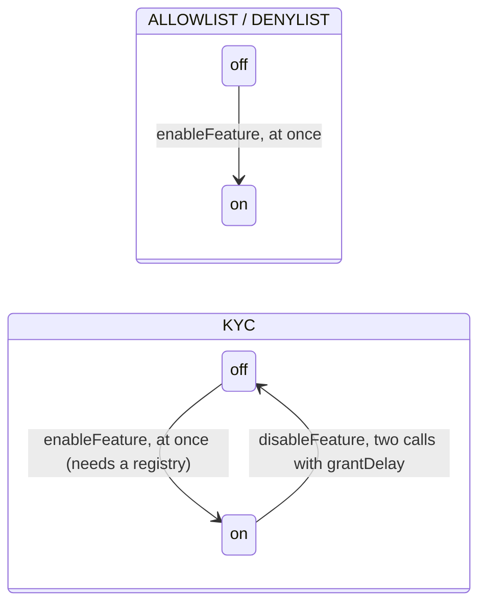

# KYC, allow list, deny list: the registry check becomes bit 28, bits 8 and 9 become lists in the token (round 3s) — design

**Status:** SPECIFIED, nothing built, **UNAUDITED**. Written 2026-11-10 for the owner's rulings of the same day (§1), on branch
`ua-mtx-3s` at `35843c6a` (round 3r mid-build). It uses 3r's names throughout (`admin`, `kycProvider`, `providerId`,
`COMPLIANCE_REGISTRY_CODEHASH`, `ComplianceRegistryRouterMismatch`; spec `2026-11-10-admin-not-owner.md` §4.1); the build comes
after 3r merges. Recorded in `decisions.md` as [CTR-GOV-24](../../decisions.md#ctr-gov-24--kyc-bit-28-allowlist-and-denylist-lists-held-in-the-token-enabled-at-once)
(owner: yes) with Change lines on the rules it moves (§11). The component docs move with the build (T11).

## 1. The rulings (owner, 2026-11-10, in chat)

- **R1. The registry check becomes a new bit `KYC`; bits 8 and 9 become lists held in the token.** Verbatim: "OK, coi như thêm
  bit KYC, sử dụng ComplianceRegistry. Còn ALLOWLIST / DENYLIST tương đương WHITELIST/BLACKLIST." (OK: add a KYC bit that uses
  the `ComplianceRegistry`; `ALLOWLIST` / `DENYLIST` mean a whitelist / blacklist.) The owner's reason: a compliance registry
  per token is an extra deploy step, while a list held in the token is fast and easy to check.
- **R2. The lists.** `ALLOWLIST`: both parties of a transfer must be `ALLOWED`. `DENYLIST`: neither party may be `DENIED`. One
  `uint8` of flags per account in the regulated namespace. Contracts are listed like anyone else. The three bits are
  independent; any combination works.
- **R3. The ops.** `setAllowed` / `setDenied` over a bounded batch, effective at once (operational, like a freeze), relayable at
  fee 0, typed, one entry point per op; one event per account; a view `listFlagsOf`.
- **R4. Who.** The role-per-bit pattern: a holder of bit 8 edits the allow list, a holder of bit 9 the deny list; the admin
  grants under `grantRole` / `grantDelay`, and `revokeRole` acts at once.
- **R5. Governance of the three bits** (the final ruling, §5): `enableFeature` for the three, at once; `ALLOWLIST` and `DENYLIST`
  never off once on; `KYC` off as today (`disableFeature`, delayed) and on again; `lockedFeatures` locks the creation state, on
  or off. The sequence of the day's messages is §5.1.
- **R6. Scope.** The regulated kinds 8–13 only; the plain kinds keep "+0" (CTR-GOV-03, CTR-GOV-11).

**Rules applied, not reopened:** CTR-AS-02 (disclosure mandatory), CTR-AS-05 (freeze semantics), CTR-AS-08 (the hook seats),
CTR-AS-16, CTR-AS-25 (every fee leg checked before effects), CTR-AS-27 (`_regPre` before `pre*`), CTR-AS-28 (the bounded
registry call), CTR-AS-29 (raw hook arguments), CTR-GOV-17 (the confidential kinds; no `yTo`, ring member or leg is read, I9),
CTR-GOV-10 / CTR-GOV-14 (the bit table; 13 and 14 never allocated), explicit parameters, every state-changing `mtx*` relayable
at fee 0, one rule on every chain, all chains test-only (no alias, no migration).

## 2. What is there today (at `35843c6a`)

| Item | Where | Today |
|---|---|---|
| Bits | `src/governance/GovernanceBits.sol:16-17`, `:48`, `:51` | `ALLOWLIST = 8`, `DENYLIST = 9`, both in `REGULATED` (5–9); `ISSUER_BITS` = 5, 6, 7, 23, 24; 13, 14 "never allocated", 15, 16 reserved names, **28–127 free** (`smartcontracts/vectors/governance/governance_bits.json` note) |
| Masks | `src/regulated/RegulatedBase.sol:25-29` | `REG_BITS` adds 5–10, 21, 22, 23; `REG_BITS_CONFIDENTIAL` drops 8 (CTR-GOV-17); `REG_ROLES` has no 8, 9 (capabilities, no holder) |
| Delayed set | `RegulatedBase.sol:66-68` | `_delayedRelaxBits()` = `ISSUER_BITS` minus 23, 24 = **5, 6, 7**; bits 8 and 9 were never in it (regulated-kinds spec §3.6 runbook: "owner `disableFeature(8)` / `(9)` … (not delayed)") |
| Mirror | `src/regulated/RegulatedLib.sol:25-31`, `:119` | `controls` u8 = features bits 5–10 >> 5: `C_FREEZE 1`, `C_PAUSE 4`, `C_ALLOW 8`, `C_DENY 16`, `C_LISTS = C_ALLOW \| C_DENY`, `C_RECORD 32`; bits 6, 7 of the byte unused |
| Init | `RegulatedLib.sol:94-123` | `ALLOWLIST ⇔ requiredFlags ≠ 0`, `DENYLIST ⇔ deniedFlags ≠ 0`, `complianceRegistry ≠ 0 ⇔ (ALLOWLIST ∨ DENYLIST)`, code hash pinned; `termsHash ≠ 0 ⇔` any of 5–10, 21 (`TERMS_BITS`, `:38`) |
| `R` | `RegulatedBase.sol:282-291`, `:206-221` | `_eligible(a)`: with `C_LISTS` set, one bounded `hasFlags(a, ALLOW ? required : 0, DENY ? denied : 0)`; `canReceive` reasons 1 not attested / flags missing, 2 expired, 3 KYC provider disabled, 4 denied |
| Hooks | `RegulatedBase.sol:229-264`, `:275-279` | `_regPre` P, F(from); `_regFeeTo` → `_feeRecipient` F, R; `_regMove` P, F(from), R(to); `_regPayer` → `_regSender` P, F; `_regName` → `_feeRecipient`; `_regReceiver` R |
| Locks | `src/governance/GovernanceLib.sol:106` | `locked & ~features ≠ 0` ⇒ `LockedNotSubset`: a bit can only be locked on |
| Disable | `GovernanceLib.sol:368-380` | admin; locked ⇒ `FeatureLocked`; unset ⇒ `FeatureNotSet`; delayed on `delayedRelax` with `grantDelay`; `FeatureDisabled(bit, by)` |
| Grant | `GovernanceLib.sol:490` | a role only on a set bit (`RoleWithoutFeature`) |
| Pools | `src/metatx/ERC20MetaTx.sol:248-260`, `:344-351` | `_update` names the UA a `UA_POOL` move is for, refuses `UA_POOL` and `SHIELD_POOL` as parties; `_uaMove` refuses `SHIELD_POOL`; `_poolMove` (forced transfer, confidential payouts, `decoyFee`) is unhooked |
| Wrap list (3l) | `GovernanceBits.sol:42`, router `mtxSetWrapMember` | the precedent of a list in a token: a byte per id, a power any holder holds, at once both ways, `WrapMemberSet(account, by, …)` |

## 3. Bit 28 `KYC`: today's registry check under a new bit

**The bit.** `GovernanceBits.KYC = 28`, the first free SCaaS bit (13 and 14 stay unallocated, CTR-GOV-14; 15, 16 are reserved
names; 17–27 are taken). Checked against `GovernanceBits.sol` and the client rows (§10): every table stops at 27 today. A
capability (no holder), valid on kinds 8–13 (`REG_BITS |= 1 << 28`, so `REG_BITS_CONFIDENTIAL` keeps it), in `REGULATED` and
`TERMS_BITS`.

**Meaning unchanged.** `KYC` is what bits 8 and 9 do today, with both masks under one bit:

| Today | 3s |
|---|---|
| `ALLOWLIST` (8) reads `requiredFlags` | `KYC` reads `requiredFlags` |
| `DENYLIST` (9) reads `deniedFlags` | `KYC` reads `deniedFlags` |
| `R(a) = (!8 ∨ (flags(a) & required) == required) ∧ (!9 ∨ flags(a) & denied == 0)` | `R(a) = !KYC ∨ hasFlags(a, requiredFlags, deniedFlags)` (a zero mask constrains nothing) |
| `_eligible` gated by `C_LISTS`; the call passes each mask only under its bit | gated by `C_KYC`; both masks always passed |
| `canReceive` reasons 1–4 under `C_LISTS` | the same reasons under `C_KYC` (lists add 5, 6: §4.3) |
| on 10–13 bit 8 is out of the mask, so `requiredFlags == 0` | on 10–13 `requiredFlags` must be 0 (`RegulatedConfigInvalid`): a shielded receiver cannot be checked (I9), so a required mask there would leak; `deniedFlags` as today |
| `ELIGIBLE_CONTRACT` satisfies `requiredFlags`, never `deniedFlags` (CTR-AS-16) | unchanged |
| only receivers checked (CTR-AS-07) | unchanged: `KYC` is receiver-only; the lists of §4 are two-sided |

**Init rows** (`RegulatedLib.init`, before the initial-supply mint), replacing today's registry rows:

| Check | Error |
|---|---|
| `KYC ⇒ complianceRegistry ≠ 0` (the registry and its masks may be set while `KYC` is off, so the admin can enable it later, §5) | `RegulatedConfigInvalid()` |
| `complianceRegistry ≠ 0 ⇔ (requiredFlags \| deniedFlags) ≠ 0` (a registry with no mask checks nothing; masks with no registry mean nothing) | `RegulatedConfigInvalid()` |
| on 10–13: `requiredFlags == 0` | `RegulatedConfigInvalid()` |
| `complianceRegistry ≠ 0`: its code hash is `COMPLIANCE_REGISTRY_CODEHASH`, its `govRouter()` 0 or the token's (3r §5.3) | `ComplianceRegistryCodeMismatch`, `ComplianceRegistryRouterMismatch` |
| `termsHash ≠ 0 ⇔ (features & TERMS_BITS ≠ 0 ∨ ENABLEABLE & valid & ~locked ≠ 0)` (§5.4) | `RegulatedConfigInvalid()` |

**Mirror.** `C_KYC = 1 << 6` in `controls` (byte bit 6, unused today): `controls = uint8(f >> 5) & 0x3F | (f >> 28 & 1) << 6`.
`_regDisabled(28)` clears it; `_regEnabled(bit)` (§5) sets `C_ALLOW`, `C_DENY` or `C_KYC`. **I12** becomes `controls ==
((features >> 5) & 0x3F) | (((features >> 28) & 1) << 6)` after every call.

## 4. The lists (bits 8 and 9)

### 4.1 Storage

`scaas.regulated` +7 (appended; slots +0…+6 unchanged): `mapping(bytes32 account => uint8) listFlags`, `ALLOWED = 1`, `DENIED
= 2`, one slot per account, both flags in it. Layout pin (`test/v2/layout/namespaces.json`, `regulated`): label `listFlags[A]`,
slot 7, inner 0, byte 0. The mapping is independent of the bits: it is written while a bit is off (§6.3) and keeps its rows
whatever the bits do; turning a bit on starts with the rows already there.

### 4.2 The check `L(a)`

```solidity
function _listed(bytes32 a) internal view {                 // RegulatedBase, inlined beside F and R
    RegulatedLib.RegulatedStorage storage r = RegulatedLib.$();
    uint8 c = r.controls;                                    // the hot slot +0, already read by P / F
    if (c & RegulatedLib.C_LISTS == 0) return;               // both lists off: no read
    uint8 f = r.listFlags[a];                                // one SLOAD for both lists
    if (c & RegulatedLib.C_ALLOW != 0 && f & ALLOWED == 0) revert IRegulatedToken.NotAllowed(a);
    if (c & RegulatedLib.C_DENY != 0 && f & DENIED != 0) revert IRegulatedToken.Denied(a);
}
```

`C_LISTS` keeps its value and now gates the lists only; the registry is gated by `C_KYC`. **One rule:** `L` runs on every
account today's hooks check by `F` (a sender, a payer, a meta-tx `from`) or by `R` (a receiver, a fee recipient, a
beneficiary), and on no other. Two exceptions, both today's: a forced transfer's subject (never `F` either: the remedy must reach
a denied or unlisted account) and the unwrap recipient (another asset, CTR-AS-05). On each hook the order is `P`, `F`, `L`,
then `R`, so a list refusal costs no registry call.

### 4.3 Per path (public balances, every kind 8–13; `R` rows are today's, gated by `KYC`)

| Path | `F` / `P` (today) | `L` (3s) | `R` (today, `KYC`) | Site |
|---|---|---|---|---|
| pre of every meta-tx op, kinds 8, 9 (`mtxCancelNonce` included) | `F(from)`, `P` unless pause-open | `L(from)` | — | `_regPre`, before `pre*` (CTR-AS-27): a list refusal costs no verify |
| pre, confidential 10–13 | fee-bearing: `P`, `F(from)`; else nothing (U4) | fee-bearing: `L(from)`; else nothing | — | `_regPre` |
| fee leg: envelope fee, `payWithFee*`, `mtxPayReceiverFee`, `mtxRelayFee` payee, wrap-order fee, tax leg | `F(feeTo)` ⇒ `FeeRecipientFrozen` | `L(feeTo)` | `R(feeTo)` | `_regFeeTo` → `_feeRecipient`, before effects (CTR-AS-25) |
| `transfer`, `transferFrom`, `mtxTransfer` group, pay, `mtxTrade`, `transferToUA`, `operatorTransfer` | `P`, `F(from)` | `L(from)`, `L(to)` | `R(to)` | `_regMove` |
| `approve` (contract callers) | `P`, `F(owner)` | `L(owner)` | — | `_regPayer` → `_regSender` |
| mint (`minter`, wrap, a hybrid's mint), the initial supply | `P` | `L(to)` | `R(to)` | `_regMove` (`from == 0`) |
| wrap whose payer is not the destination | `P`, `F(payer)` | `L(payer)` | — | `_regPayer` |
| holder `burn`, the burn inside unwrap | `F(from)`, never `P` | `L(from)` | — | `_regMove` (`to == 0`) |
| unwrap recipient | not checked | not checked | not checked | — |
| `forceTransfer` | the order rules; never `P`, `F(from)` | `L(beneficiary)`; **never `L(subject)`** | `R(beneficiary)` | `_forceTransferBody` |
| DEX relayer share (an ordinary transfer by the DEX) | `R(submitter)`, no `F` | `L(dex)`, `L(submitter)` | `R(submitter)` | `_regMove` |
| `setTaxRecipient`, the init tax recipient | — | none at set; `L` at every tax leg (fee-leg row) | `R` at set (unchanged) | — |
| roll-over, `mtxPrepareAcc`, `rescue`, direct `addReserve`, the PQZ refresh's sender | never | never | never | — |

Confidential kinds (CTR-GOV-17; regulated-kinds spec §4): every site runs before the proof.

| Site | Zether 10, 11 | PQZ 12, 13 | `L` |
|---|---|---|---|
| proof sender | `_regZetherSender(yFrom)` → `_regSender(uaOf(yFrom))` | `_regSender(fromUA)` (amount ≠ 0 on unshield) | `L(sender)` |
| shield, wrap-shield payer; PQZ `shieldIn` payer | `_regPayer()` | `_regPayer()` | `L(payer)` |
| beneficiary of the op | `_regName` → `_feeRecipient` | same | `L(beneficiary)` |
| unshield recipient (amount ≠ 0) | `_regReceiver` | same | `L(recipient)` |
| a shielded receiver (`yTo`, ring member, leg, a shield's `toUA`), each leg's `decoyFee` | not read (I9) | not read (I9) | **not read**: a `DENIED` account still receives shielded credit and its `decoyFee`, as a denied account does today (`governance_bits.json` `decoyFee` sentence) |

`ALLOWLIST` stays outside the masks of 10–13 (`FeatureInvalidForKind(8)`): both parties cannot be seen on a confidential transfer,
the reason bit 8 is outside today (CTR-GOV-17). `DENYLIST` is valid on 8–13; `KYC` on 8–13 (deny mask only on 10–13, §3).

`canReceive(bytes32)` keeps its selector and runs the hot path's order for a receiver: `L` first (**5** not on the allow list,
**6** on the deny list), then the registry (1–4). The node's pre-check names list refusals `NOT_ALLOWED` / `DENIED` (§9).

### 4.4 Contracts are listed like anyone else (owner, R2)

Under `ALLOWLIST` every contract that holds, receives or sends the token is `ALLOWED` by a holder of bit 8, and under `DENYLIST`
a listed contract is stopped like any account: the DEX and its puller (`load_regulated` already treats both as receivers,
`scaas-node/src/dex/venue.rs:322`), the DEX's liquidity (the DEX's own balance), the tender escrow, `VestingGrant`,
`Distribution` and `ExchangeOffer` clones, a wrapper holding the token as a leg (its wrap pulls in and its unwrap pays out),
`MandateWallet`, `SmartKeyAccount`, `RelayFeeRouter` as a relay-fee payee, every fee recipient (regulated templates stay at
`MODE_FEE_NONE`, CTR-AS-08). There is no `ELIGIBLE_CONTRACT` for the lists: that flag stays the registry's, read by `KYC`. The
token's own pools are never a party: `_update` refuses `UA_POOL` and `SHIELD_POOL` as parties and names the UA a `UA_POOL`
debit is for; `SHIELD_POOL` moves only on the unhooked `_poolMove` (`ERC20MetaTx.sol:248-260`, `:344-351`).

### 4.5 Invariants

| # | Invariant (changed or new) | Test |
|---|---|---|
| I5 | every receiver of a public balance increase passed `R` at that block **while `KYC` is on**, except a confidential leg's `decoyFee` | invariant suite |
| I6 | no regulated call changes `reserve_i`, `num_i/den_i`, `wrapEnabled_i`, `minter`; `controls` gains `C_ALLOW`, `C_DENY`, `C_KYC` only by `enableFeature`, loses `C_KYC` only by a confirmed disable, never loses `C_ALLOW` or `C_DENY`; every other bit only loses | invariant suite |
| I12 | `controls == ((features >> 5) & 0x3F) \| (((features >> 28) & 1) << 6)` after every call | invariant suite, `Mirror.t.sol` |
| I14 | while `ALLOWLIST` is on, every account a public balance change names (sender, receiver, payer, fee recipient, beneficiary) is `ALLOWED` at that block; while `DENYLIST` is on, none is `DENIED`; except a forced transfer's subject, the unwrap recipient, and the shielded credits and `decoyFee` of I9 | invariant suite (`RegulatedHandler` gains list edits) |
| I15 | `listFlags` changes only by `setAllowed` / `setDenied`; bits 8, 9 never leave `features` once set; bit 28 leaves only by a confirmed `disableFeature`; a locked bit never changes | invariant suite |

## 5. Governance of the three bits (owner ruling 2026-11-10, final)

### 5.1 The sequence (owner, in chat, the same day)

The brief's first rule was "as every other bit: set at creation, lockable, one-way `disableFeature`". Then, in order:
"3 bit bật tắt được." (the three bits can be switched on and off) and "Và có tác dụng ngay lập tức" (and at once); withdrawn:
"Thôi, như những bit khác đi. còn có lockFeatures mà nhỉ?" (no, like the other bits; there is `lockedFeatures` after all); then
"Như vậy không đúng với bit DENYLIST lắm, vì khởi đầu có thể tắt, rồi sau đó bật. Thôi, thêm enableFeature cho bit nayf." (that
does not fit `DENYLIST`, which may start off and be switched on later; add `enableFeature` for it); then, final:
"Thường, 3 bit này là tắt, trong quá trình vận hành thì bật. Nhưng ở đây lại cấm bật về sau?" (usually these three bits start off
and are switched on during operation; yet here switching on later is forbidden?), "Có lẽ theo chiều ngược lại, không cho gọi
disableFeature trên các bit này. Tức khi bật lên rồi thì không tắt. Ngược với các bit khác, tắt rồi thì không bật." (rather the
reverse: no `disableFeature` on these bits; once on, never off; the opposite of the other bits, which once off are never on), and
on keeping `KYC`'s escape from a dead or compromised registry: "OK, KYC sẽ như thế." (OK, `KYC` stays like that).

### 5.2 The rule

| Bit | Set at creation | `enableFeature` | `disableFeature` | Locked at creation |
|---|---|---|---|---|
| 8 `ALLOWLIST` (kinds 8, 9) | on or off | at once | **refused**: `FeatureNotDisableable(8)` (once on, never off) | on or off, fixed for good: both entries `FeatureLocked(8)` |
| 9 `DENYLIST` (8–13) | on or off | at once | **refused**: `FeatureNotDisableable(9)` | on or off, fixed |
| 28 `KYC` (8–13) | on or off (the registry and its masks may be set while off) | at once; no registry: `ComplianceRegistryNotSet()` | as today: in the regulated delayed set (two calls keyed `(28, 0)` with `grantDelay`, at once when it is 0); enabled again later | on or off, fixed |
| every other bit | unchanged | `FeatureNotEnableable(bit)` | unchanged (one-way) | on only (`LockedNotSubset`), as today |

Relief under `ALLOWLIST` / `DENYLIST` comes from editing the list (add to the allow list, remove from the deny list), at once by a
holder (§6). Locking a bit off is how an issuer promises "never this list" or "never a registry check".



A locked bit stays in its creation state on both diagrams.

### 5.3 The code

- `GovernanceBits`: `KYC = 28`; `ENABLEABLE = (1 << 8) | (1 << 9) | (1 << 28)`; `NOT_DISABLEABLE = (1 << 8) | (1 << 9)`. One meaning
  on every SCaaS contract (CTR-GOV-10); no plain kind's valid mask holds them, so the constants change nothing there.
- `GovernanceLib.enableFeature(uint8 bit, bytes32 caller, uint256 valid) public`: `_onlyAdmin(caller)` (`NotAdmin`); `ENABLEABLE &
  m == 0` ⇒ `FeatureNotEnableable(bit)`; `valid & m == 0` ⇒ `FeatureInvalidForKind(bit)` (bit 8 on 10–13); locked ⇒
  `FeatureLocked(bit)`; set ⇒ `FeatureAlreadySet(bit)`; then `features |= m`, `FeatureEnabled(bit, caller)`. One call, no
  proposal, no `grantDelay`.
- `GovernanceLib.disableFeature`: after the lock check, `NOT_DISABLEABLE & m ≠ 0` ⇒ `FeatureNotDisableable(bit)`; the rest as today.
- `GovernanceLib.init`: `locked & ~(features | (ENABLEABLE & valid)) ≠ 0` ⇒ `LockedNotSubset` (a lock off only on 8, 9, 28, and only
  on a kind where the bit is valid); `lockedFeatures` keeps the value.
- `IRegulatedToken.enableFeature(uint8 bit)` on kinds 8–13 only (module R; no entry on the plain kinds or the DEX):
  `RegulatedBase._enableFeatureBody(bit)` calls `GovernanceLib.enableFeature(bit, _govSubject(), _validBits())`, then refuses
  `bit == 28` with `complianceRegistry == 0` (`ComplianceRegistryNotSet()`; the whole call reverts, event included), then
  `_regEnabled(bit)` sets the mirror. `governed`, `nonReentrant` as `disableFeature`.
- `RegulatedBase._delayedRelaxBits()` = **5, 6, 7, 28**: `ISSUER_BITS & ~(TAX | PQZ_PROOF | ALLOWLIST | DENYLIST) | (1 << KYC)`
  (`ISSUER_BITS` gains 8, 9 for the issuer seat, §6.3; 8 and 9 are subtracted, so a list holder's revoke is at once, R4, and
  their disable is refused anyway; `KYC` has no holder, so only its disable is delayed). RK-3 / CTR-AS-22 unchanged: a proposed
  `KYC` disable changes nothing until its confirm.
- Router (`GovernanceRouter`, beside the regulated controls): `mtxEnableFeature(UAEnvelope e, address target, uint8 bit, UASig
  auth)` over `UAEnableFeature(bytes32 from,address target,uint8 bit,E)`, fee mode `NONE`, relayable at fee 0.

### 5.4 What assumed that features only shrink

| Place | Assumption | 3s |
|---|---|---|
| `renounceAdmin` (`GovernanceLib._noLiveHolder`, `:509`) | holders of a set, unlocked role bit block a renounce | unchanged and still right: an on 8 / 9 with holders blocks it (revoke first). An off 8 / 9 with holders (granted while off, §6.3) does not, and after the renounce nothing can turn it on: its holders edit a dormant list. With admin 0 (renounced, or none at creation) no bit is ever enabled and `KYC` is never disabled: a dead registry then refuses receivers for good, unless `KYC` was off. Stated in the disclosure |
| `disableFeature` callers | a set bit can go | 8, 9 refused by name (`FeatureNotDisableable`) |
| `LockedNotSubset` (`GovernanceLib.sol:106`) | locked ⊆ features | relaxed for 8, 9, 28 only; `lockedFeatures()` may now hold a bit `features()` lacks: "locked off" |
| `controls` mirror, I6, I12 | only loses bits | §3, §4.5 |
| `termsHash` rule (`RegulatedLib.sol:109`) | the creation bits are all the regulated powers a token will have | a regulated token can come to hold 8, 9, 28, so CTR-AS-02's mandatory disclosure covers each enableable bit that is not locked off: `termsHash ≠ 0` iff a bit of `TERMS_BITS` is set **or** one of 8, 9, 28 is valid and not locked (§3 row) |
| CTR-AS-02, CTR-AS-07, CTR-AS-17, CTR-TOK-22, CTR-GOV-18 ("never added later", "a token created with a bit off never gets it") | one-way | Change lines (§11): 8, 9, 28 may be added later unless locked off; 8, 9 never leave |
| Wrapped kinds' legs (`_addLeg`, CTR-GOV-05) | a leg's features read once | `FORCE` / `MODERATE` are not enableable: the refusal at `_addLeg` holds. The disclosure of a leg with 5, 7, 8, 9 (now 28 too) reads the leg's `features()` and `lockedFeatures()` live: any regulated-kind leg can come to hold 8, 9, 28 unless locked off (`governance_bits.json` `legWhen`) |
| Node indexer (`scaas-node/src/indexer.rs:314-323`, `:374-381`) | `FeatureDisabled` is the only feature event | `REGULATED_TOPICS` gains `FeatureEnabled`, `AllowedSet`, `DeniedSet` (11 → 14); `derived`: `FeatureEnabled(8)` `allow_list_on`, `(9)` `deny_list_on`, `(28)` `kyc_on`, `FeatureDisabled(28)` `kyc_off`; `ALERTS` gains `FeatureEnabled` and the restricting edits (`DeniedSet` with `on`, `AllowedSet` without) |
| Gateway | — | no `FeatureDisabled` handling (checked: `scaas-node/src` names it only in `abi.rs` and `indexer.rs`); nothing to change |
| `features()` caching (node, DEX, matrix) | — | the node never calls `features()` (no `featuresCall` in `scaas-node/src`); the venue reads `regulatedConfig()` live on every pre-check (`dex/venue.rs:385`) and caches only `pausedUntil`; its `load_regulated` eligibility alert (`:309-333`) runs at load only, so it also runs on a leg's `FeatureEnabled` (§9); `SCaaSDex` reads no token features; the matrix scripts set features at creation and read none back (`script/onchain/*.s.sol`), new steps in T8 |
| `TokenCreated(…, features, lockedFeatures, …)` (3r §3) | the creation features bound later ones | the event stays a creation record; a reader takes live `features()` / `lockedFeatures()` for the current state; the node decodes no `TokenCreated` (3r §3) |
| Client bit rows (§10) | 8, 9 capabilities; rows end at 27 | 8, 9 powers, 28 `KYC` capability, rows 0–28; sentences cover "can be switched on" |

## 6. The ops and who holds them

### 6.1 Entries

| Entry (kinds 8–13, module R; `governed`, `nonReentrant`) | Bit, holder | Router | Event per account |
|---|---|---|---|
| `setAllowed(bytes32[] accounts, bool on)` | 8, a holder (an entry on 10–13 too, where no holder can exist: `MissingRole`) | `mtxSetAllowed` | `AllowedSet(bytes32 indexed account, bytes32 indexed by, bool on)` |
| `setDenied(bytes32[] accounts, bool on)` | 9, a holder | `mtxSetDenied` | `DeniedSet(bytes32 indexed account, bytes32 indexed by, bool on)` |
| `listFlagsOf(bytes32 account) returns (uint8)` | view | — | — |
| `enableFeature(uint8 bit)` | the admin (§5.3) | `mtxEnableFeature` | `FeatureEnabled(uint8 indexed bit, bytes32 indexed by)` (`IGovernance`) |

Body (`RegulatedLib.setList(uint8 bit, uint8 flag, bytes32[] calldata accounts, bool on, bytes32 subject)`, one body for both):
the role first (§6.3), then `1 ≤ accounts.length ≤ MAX_LIST_BATCH = 256` (`ListBatchInvalid(length)`), then per account `≠ 0`
(`ListAccountZero()`), `listFlags[a] = on ? f | flag : f & ~flag`, one event, `by` = the subject. Effective at once, both ways;
duplicates are idempotent; the other flag is never touched. 256 is 3r's row bound (`setCompliance`, 3r §5.3.1) and the node's
decode bound (§9); 256 new rows ≈ 25 M state gas + ≈ 6 M regular, inside NET-EVM-11's 60 M (§14).

### 6.2 Router ops

`mtxSetAllowed(UAEnvelope e, address target, bytes32[] accounts, bool on, UASig auth)` over `UASetAllowed(bytes32 from,address
target,bytes32[] accounts,bool on,E)`, `mtxSetDenied` likewise, `mtxEnableFeature` (§5.3); fee mode `NONE`, relayable at fee 0,
any submitter. `accounts` is hashed as EIP-712 hashes an array (`keccak256` of its 32-byte words), the router hashing the words
itself as 3r's `UASetCompliance` does. The tokens' `mtxSelectors()` and `_uaAllowed` do not change (governance entries are direct,
never on the generic allow-list), so no token row moves.

### 6.3 Who

- **The role-per-bit pattern**, as `FREEZE` / `PAUSE`: bits 8 and 9 join `ISSUER_BITS`, so `roles.issuer` holds each one set at
  creation; the admin grants others with `grantRole` / `setGrant` (two calls within `[eta, eta + grantDelay]`, CTR-GOV-04) and
  revokes with `revokeRole`, **at once** (8, 9 outside `_delayedRelaxBits()`, §5.3). `_roleBits()` gains 8, 9 on kinds 8, 9 and 9
  on 10–13 (the valid masks).
- **Any holder** (an EOA, a single-key UA, an `msig`, a contract), never contract-only, as `TAX` and `WRAP_LIST`: with a single
  key allowed, the revoke is immediate (pay-meta-tax Q5's reason). An issuer seat holding only 8 or 9 is accepted (as bit 23).
- **The admin does not act on a list directly.** `GovernanceUse.use` admits holders only (`MissingRole`); the existing pattern has
  no admin shortcut, so an admin that edits lists grants itself the role.
- **While the bit is off** (before its `enableFeature`): a role on 8 or 9 may be granted when the bit is not locked off
  (`_check`'s `RoleWithoutFeature` exempts `ENABLEABLE & ~lockedFeatures`), and a holder edits the list (the list ops check the
  role as `GovernanceUse.use` does, without its feature test: `WHOLE` passes, `LIMITED` runs `useLimited(bit, subject, 0)`, none is
  `MissingRole`). So the usual flow, in the owner's words "usually off, switched on during operation", is: grant a lister, write
  the list, then `enableFeature`, with no window where every transfer stops.
- **A token created with `ALLOWLIST` on starts with an empty list**: its initial-supply mint to `creator` refuses
  `NotAllowed(creator)`. Such a token is created with supply 0 (the issuer seat lists, then mints), or with `ALLOWLIST` off and
  enabled once listed.

## 7. ABI (selectors with `cast sig`, topics and typehashes with `cast keccak`, Foundry 1.8.5, 2026-11-10)

Positive controls, computed the same way in the same run: `mtxSetWrapMember` `0x3c0ed776` (= `scaas-node/src/guard.rs:1972`),
`mtxDisableFeature` `0x784da8a6` (= the legacy `typed_ops.json` row), `UADisableFeature` `0x245ae38b…` and `UASetWrapMember`
`0x53c3dd87…` (= `test/governance/GovRouterTypehash.t.sol:47`, `:322`). None of the seven new selectors equals a selector of the
168 signatures of `test/vectors/selector_audit.json` (checked).

| Signature | Selector / topic0 | Where |
|---|---|---|
| `setAllowed(bytes32[],bool)` | `0x8817535c` | kinds 8–13, module R |
| `setDenied(bytes32[],bool)` | `0xdb194d97` | kinds 8–13, module R |
| `listFlagsOf(bytes32)` | `0x42f2e200` | kinds 8–13 |
| `enableFeature(uint8)` | `0x68c0006d` | kinds 8–13 |
| `mtxSetAllowed((bytes32,uint256,uint256,uint256,uint32,address,uint256,address),address,bytes32[],bool,(bytes,bytes,(uint16,(uint16,bytes)[],bytes)[]))` | `0x06b98e72` | router |
| `mtxSetDenied((bytes32,uint256,uint256,uint256,uint32,address,uint256,address),address,bytes32[],bool,(bytes,bytes,(uint16,(uint16,bytes)[],bytes)[]))` | `0x1d288fdc` | router |
| `mtxEnableFeature((bytes32,uint256,uint256,uint256,uint32,address,uint256,address),address,uint8,(bytes,bytes,(uint16,(uint16,bytes)[],bytes)[]))` | `0x2eb8c708` | router |
| `NotAllowed(bytes32)` | `0x22352358` | `IRegulatedToken` |
| `Denied(bytes32)` | `0x09dd64d7` | `IRegulatedToken` |
| `ListBatchInvalid(uint256)` | `0x1d8da8b6` | `IRegulatedToken` |
| `ListAccountZero()` | `0x90614cfe` | `IRegulatedToken` |
| `ComplianceRegistryNotSet()` | `0x31cd322a` | `IRegulatedToken` |
| `FeatureNotEnableable(uint8)` | `0x4dc8fc69` | `IGovernance` |
| `FeatureNotDisableable(uint8)` | `0x2176442f` | `IGovernance` |
| `FeatureAlreadySet(uint8)` | `0xe12f681b` | `IGovernance` |
| `AllowedSet(bytes32,bytes32,bool)` | `0x29dea46be247a581e9189d80e8838977755b9a3814891da2920b809832bfa8eb` | `IRegulatedToken` |
| `DeniedSet(bytes32,bytes32,bool)` | `0xe51fb638bf9565bf75ddc9834cd3c5e4886bdc8f92f98c295adcc7dd7f4f1b52` | `IRegulatedToken` |
| `FeatureEnabled(uint8,bytes32)` | `0x92f99f2fe0c1efc6749207f52096ec6df976eaff483e7329c716a50b2b76103f` | `IGovernance` |

| Typehash (`E` = `uint256 batch,uint256 nonce,uint256 validUntil,uint32 mode,address relayer,uint256 fee,address feeRecipient`) | Value |
|---|---|
| `UASetAllowed(bytes32 from,address target,bytes32[] accounts,bool on,E)` | `0xa96171fcd5e3202f58eeb220838f1277c4d57b19b0cbea4dc7f324970253d232` |
| `UASetDenied(bytes32 from,address target,bytes32[] accounts,bool on,E)` | `0x11df43474f648318e52abedb4d7a998e8e0ba0957b93b4d2ac967bc412355094` |
| `UAEnableFeature(bytes32 from,address target,uint8 bit,E)` | `0x4cbb50807ee9d23bb7eaedea39a2a3df6eca4b6ad9b5f9dab35fcb03d1347114` |

Unchanged selectors whose behaviour moves: `disableFeature(uint8)` `0x45e5ac68` (refuses 8, 9), `canReceive(bytes32)`
`0xbffff6d2` (reasons 5, 6), `regulatedConfig()` `0x46825269` (`controls` bit 6 = `KYC`; the struct is unchanged). Each new
typehash gets a `*TypehashIsPinned` row in `GovRouterTypehash.t.sol`.

## 8. Layout pins

`test/v2/layout/namespaces.json` `regulated`: `listFlags[A]` appended (slot 7, inner 0, byte 0); every other label, slot and
offset unchanged, and `Layout.t.sol` still asserts them (a label edit that moved a slot fails it). `controls` keeps its slot and
byte; its bit 6 is a value, not a layout change. `scaas.governance` unchanged (`lockedFeatures` holds a bit `features` lacks:
a value).

## 9. Node rows (both directions)

| File | Change |
|---|---|
| `scaas-node/src/typed.rs` | three `GR` rows after `UASetWrapMember` (`:243`): `("UASetAllowed", "mtxSetAllowed", GR, "bytes32 from,address target,bytes32[] accounts,bool on,E", "")`, `UASetDenied` likewise, `("UAEnableFeature", "mtxEnableFeature", GR, "bytes32 from,address target,uint8 bit,E", "")`; no `PLAIN` row and no token row (§6.2); the row counts move old → new in the commit |
| `scaas-node/src/guard.rs` | the router's `CALL_TABLE` gains the three (type string, ABI signature, selector of §7); the router count (`:1726`) +3 on top of 3r's; the decode bound of `accounts`: flat, depth 1, `1 ≤ len ≤ 256`, refused by name before any simulation, as the contract refuses (`ListBatchInvalid`); `bit` a `uint8` word |
| `smartcontracts/evm/test/vectors/selector_audit.json` (by hand, never regenerated) | each regulated kind: `setAllowed(bytes32[],bool)` `BIT(8)`, `setDenied(bytes32[],bool)` `BIT(9)`, error `MissingRole(uint8,bytes32)`; `enableFeature(uint8)` `ADMIN`, error `NotAdmin(bytes32)`; the router: the three `SIGNED`; `SelectorAudit.t.sol` and the node's `allow_lists_equal_the_selector_audit_both_directions` both ways |
| `scaas-node/src/abi.rs` | `IRegulatedToken` the four entries, the five errors, the two events; `IGovernance` `FeatureEnabled` and the three errors; `LIFTABLE` (`:641`) gains `NotAllowed`, `Denied` (a list edit lifts them: `REGULATED_REFUSED`, never `dead`, NODE-LANE-09) |
| `scaas-node/src/indexer.rs` | §5.4's row |
| `scaas-node/src/dex/venue.rs` | `leg_receivable` (`:353-374`) gates the registry by `C_KYC` (`1 << 6`), both masks; a list read (`listFlagsOf`) under `C_LISTS` for the seller, the DEX, its puller and the receiver, refused `NOT_ALLOWED: {who} on {token}` / `DENIED: …`; the venue's own alert re-runs on a leg's `FeatureEnabled` |
| Docs | `docs/node/job-api.md:893`, `submit-lanes.md:473` (the liftable names), `ops.md:907`, `:917` (the runbook row: a hostile registry is `disableFeature(28)`, delayed; a hostile list holder is revoked at once), `indexer-feeds.md:205-211`, `dex-venue.md` NODE-DEX-11 |

## 10. Clients and vectors (generators only)

| Item | Change |
|---|---|
| `smartcontracts/vectors/governance/governance_bits.json` | `GovBitsVector.t.sol` (`WRITE_BITS=true`): rows 8, 9 type `power`, holder `any`, kinds `[8, 9]` / `[8, …, 13]`, sentences `on` and `enableable` (below); row 28 `KYC`, `capability`, kinds `[8, …, 13]`, the registry sentence of today's rows 8 and 9 with "the admin can switch it on at once, and off after grantDelay"; the note's "Bits 28-127 are free" becomes 29-127; `legWhen` names 28 and the enableable bits |
| `smartcontracts/vectors/governance/regulated_kat.json` | `RegulatedKat.t.sol`: the `canReceive` rows under `C_KYC`, list rows (`listFlagsOf`, reasons 5, 6), the mirror with bit 6 |
| `smartcontracts/vectors/typed/typed_ops.json` | `clients/clientkeys/scripts/typed-ops-vectors.mjs`: `UASetAllowed`, `UASetDenied` (two accounts), `UAEnableFeature`, one row with a non-zero unbound `relayer` and `feeRecipient` (the canonical zeroing) |
| `clients/clientkeys` | `src/evm.js:1549-1555` bit rows 0–28 (8, 9 `power`, 28 `KYC` `capability`), `:407` the three router types; `src/regulated.js` `C_KYC`, `canReceive` gated by it, a `listed(controls, listFlags)` helper with reasons 5, 6; `test/governance-bits.test.js:39` last row 28 |
| `clients/ua-rs` | `src/lib.rs:206` rows 0–28; `src/regulated.rs` `can_receive` gated by `KYC`, the list check, the `UASetAllowed` / `UASetDenied` / `UAEnableFeature` struct hashes and digests (the pattern of `src/wraplimit.rs`), tested against `typed_ops.json` (ua-rs signs every kind); `tests/vectors.rs:200` |
| Every `ua-*` with bit rows | `ua-c` (`src/lib.rs:366`, `include/scaas_ua.h:286`, `tests/test_vectors.py:904`), `ua-cxx` (`src/lib.rs:206`, `tests/vectors_test.cpp:818-823`), `ua-qt` (`src/ua_kinds.rs:21`), `ua-cs` (`Scaas.Ua/Ua.cs:91-97`), `ua-py` (`scaas_ua/__init__.py:89-94`), `ua-go` (`ua.go:104-112`), `ua-dart` (`lib/src/table.dart`), `ua-dart-frb` (`rust/src/api/ua.rs:72`, `lib/src/rust/api/ua.dart:13`, `test/vectors_test.dart:808`): rows 0–28, 8 and 9 `power`, 28 `KYC`; the "past bit 27" bounds become 28 |
| `clients/zether-prover/tests/typed_ops.rs` | `NOT_ZETHER` gains `UASetAllowed`, `UASetDenied`, `UAEnableFeature` |

Sentences (content; the generator writes the final text): bit 8 *on* "Only listed accounts may send or receive this token's
public balance, contracts such as the DEX included; a holder of this power lists or unlists an account at once. Once on, this
check is never switched off." *enableable* "The admin can switch on an allow list at any time, at once, with no notice but the
event; it is never switched off." Bit 9 likewise for "an account on the deny list can neither send, receive, burn nor unwrap",
and on 10–13 "a denied account still receives shielded credits and each leg's decoyFee". A wallet prints *enableable* for a
valid bit that is off and not locked, *locked off* ("never") for one locked off.

## 11. Docs to change

- **`decisions.md`** (this commit): [CTR-GOV-24](../../decisions.md#ctr-gov-24--kyc-bit-28-allowlist-and-denylist-lists-held-in-the-token-enabled-at-once),
  owner: yes, status SPECIFIED, with every owner quote of §1 and §5.1; Change lines on CTR-GOV-18 (bits 8 and 9 change meaning,
  the registry check is bit 28), CTR-GOV-10 (bit 28 allocated), CTR-TOK-22 (8, 9, 28 may be added later; locks off), CTR-AS-02
  (added later unless locked off), CTR-AS-07 (the registry check under `KYC`; the lists check senders too), CTR-AS-21 (the
  delayed set 5, 6, 7, 28).
- **`contracts/asset-suite.md`** (T11): a new rule **CTR-AS-31** (the lists: storage, `L`, the per-path rows of §4.3, contracts
  listed, the ops, the roles, the governance of §5.2), CTR-AS-07 rewritten for `KYC`, §2.2's init rows and storage, §2.3's
  interface, §2.4's table gains the `L` column, §2.6 unchanged but for `KYC`, §2.8's disclosure statements, §2.9's invariants
  (I5, I6, I12, I14, I15), the threat rows of §12 and the gas line of §14, CTR-AS-21's set. **Line budget:** the file is 1,076
  lines against 750 (warned above 975) today; 3s replaces the bit-8 / bit-9 sentences rather than adding beside them and keeps
  the file at or below 1,076 lines (the rename lists live in `decisions.md`).
- `contracts/token-wrappers.md` CTR-TOK-22 (one line), `contracts/README.md:303` ("features only lose bits": except 8, 9, 28),
  the node docs of §9.

## 12. Threat notes

| # | Abuse | Outcome (3s) |
|---|---|---|
| A7 | Compliance registry admin compromised | marks anyone, clears a denial, or voids KYC providers (receives fail); no fund movement; the admin `disableFeature(KYC)` unless locked: two calls with `grantDelay` (at once when it is 0), and `enableFeature(KYC)` again, at once, once the registry is trusted. The lists are untouched by it |
| A15 | Dead registry | `disableFeature(KYC)` by the admin (delayed as above); migration offers work again; a locked `KYC` has no recovery, as disclosed. The registry cannot be replaced after creation |
| A16 | Compromised list holder | denies any account, or unlists any account under `ALLOWLIST`, at once and with no end date, up to stopping every transfer; it cannot move funds. The admin revokes it at once; another holder relists (a new grant waits `grantDelay`; a second holder granted ahead avoids the wait). The bits cannot be switched off, so relief is the list edits. Alerts on `DeniedSet` / `AllowedSet` |
| A17 | Compromised or careless admin enables `ALLOWLIST` (or `DENYLIST`) | at once, with no notice beyond `FeatureEnabled`; under an empty allow list every public transfer, mint, burn and fee stops, and the bit never goes off: relief is a holder's listing. An issuer that never wants a list locks the bit off at creation. Disclosed |
| A18 | A contract party not listed (DEX, puller, wrapper, clone, `RelayFeeRouter`) | its legs refuse `NotAllowed`; the venue refuses intake by name (§9); a settlement leg fails only its settlement (`MatchFailed`) |
| A19 | A denied holder tries to exit | burn and unwrap refuse `Denied` (`L(from)`), as a frozen holder's do; a forced transfer reaches it (the subject is never checked); on 10–13 its shielded balance still receives credits (I9) |

## 13. Tests (red first) and mutants

Red first, each before its code, each negative with its positive control (the same call with the account listed, or the bit off,
passes): (1) `test/as/Lists.t.sol` on kinds 8 and 9: every row of §4.3 under `ALLOWLIST` and under `DENYLIST`, each party in turn
unlisted / denied, a relayed op of a denied `from` with a garbage signature stops in `_regPre` (no verify), the forced transfer
from a denied subject passes and to a denied beneficiary refuses, the unwrap to an unlisted recipient passes, the DEX relayer
share to an unlisted submitter refuses; (2) `test/as/confidential/ZetherLists.t.sol`, `PqzLists.t.sol`: the four confidential
sites under `DENYLIST`, a transfer with a denied decoy succeeds (I9), the PQZ refresh's `shieldIn` payer checked; (3)
`test/as/ListGovernance.t.sol`: §5.2's table cell by cell (`enableFeature` of 8, 9, 28 at once; 5 and every other bit
`FeatureNotEnableable`; 8 on 10–13 `FeatureInvalidForKind`; locked on and locked off both `FeatureLocked` both ways; set
`FeatureAlreadySet`; `KYC` without a registry `ComplianceRegistryNotSet`; `disableFeature(8|9)` `FeatureNotDisableable`,
locked first `FeatureLocked`; `disableFeature(28)` two calls with `grantDelay`, one at 0, then enabled again; a stranger
`NotAdmin`; through the router at fee 0 by a stranger relayer); (4) `RegulatedInit.t.sol` / `RegConfig.t.sol`: §3's init rows,
the lock-off rule (8, 9, 28 accepted off-locked, 5 refused `LockedNotSubset`), the `termsHash` rule, `ALLOWLIST` on with an
initial supply `NotAllowed(creator)`; (5) the ops: 256 accounts pass and 257 / 0 refuse `ListBatchInvalid`, account 0
`ListAccountZero`, one event per account, the other flag untouched, a holder edits while the bit is off and the list holds after
`enableFeature`, a role granted while off and refused when locked off, a revoke at once (no `RelaxProposed`); (6) the router's
binding matrix for `UASetAllowed`, `UASetDenied`, `UAEnableFeature` (one element, the length and the order of `accounts`; `on`;
`bit`), the three typehash pins, digests reproduced by clientkeys and ua-rs; (7) `RegulatedGas.t.sol` (new): the pins of §14;
(8) `PlusZero.t.sol` unchanged (the plain kinds' "+0"). Invariants I5, I6, I12, I14, I15 in `RegulatedInvariants.t.sol` with list
edits and enables in `RegulatedHandler`.

| # | Mutant | Caught by |
|---|---|---|
| M1 | `_regMove` drops `L(from)` | the unlisted-sender tests |
| M2 | `_regMove` drops `L(to)` | the unlisted-receiver tests, I14 |
| M3 | `_regPre` drops `L(from)` | the garbage-signature test (a verify runs) |
| M4 | `_feeRecipient` drops `L` | `FeeLegs` under the lists |
| M5 | `_regSender` drops `L` | approve, the wrap payer, the Zether / PQZ sender, the `shieldIn` payer |
| M6 | `_regReceiver` drops `L` | the unshield-recipient tests |
| M7 | `forceTransfer` checks `L(subject)` | the seize-from-denied test |
| M8 | `forceTransfer` drops `L(beneficiary)` | the denied-beneficiary test |
| M9 | `ALLOWED` / `DENIED` or `C_ALLOW` / `C_DENY` swapped | every list test |
| M10 | `setAllowed` touches `DENIED` (or the reverse) | the other-flag test |
| M11 | the list ops skip the role, or keep `use`'s feature test | the stranger test, the edit-while-off test |
| M12 | the bound off by one | 256 / 257 |
| M13 | account 0 accepted | `ListAccountZero` |
| M14 | `_eligible` still gated by `C_LISTS` | a list-only token makes no registry call; a `KYC` token calls |
| M15 | init leaves `C_KYC` out of the mirror | I12, the `KYC`-at-creation receive test |
| M16 | `enableFeature` takes a bit outside `ENABLEABLE` | the bit-5 test |
| M17 | `enableFeature` ignores `lockedFeatures` | the locked-off test |
| M18 | `enableFeature(28)` without a registry | `ComplianceRegistryNotSet` |
| M19 | `disableFeature(8)` or `(9)` applies | `FeatureNotDisableable`, I15 |
| M20 | 28 not delayed | the two-call test |
| M21 | 8 or 9 in `_delayedRelaxBits()` | the immediate-revoke test |
| M22 | init refuses a lock off on 8, 9, 28, or takes one on 5 | the lock-off tests |
| M23 | `_check` grants on a locked-off 8, or refuses an unlocked off 8 | the grant-while-off tests |
| M24 | `_regEnabled` leaves the mirror | the enable-then-transfer tests, I12 |
| M25 | `canReceive` reorders or renumbers 5, 6 | the reason rows, `regulated_kat.json` |
| M26 | the `termsHash` rule ignores the enableable bits | the init test |
| M27 | `L` on the unwrap recipient | the unwrap-to-unlisted test |
| M28 | a confidential site reads a leg or `yTo` | I9's denied-decoy test |
| B1–B3 | a word dropped from `UASetAllowed`, `UASetDenied`, `UAEnableFeature` | each struct's binding matrix |

Gates: every `forge` directory and the node e2e (shared modules: `GovernanceLib`, `GovernanceBits`), `script/pqz/at-set.sh <set>
test` at the four sets, the size gate, layout, ABI, gas pins (old → new in the commit), `cargo test` + `clippy -D warnings`,
clientkeys and every `ua-*` test, the local matrix run.

## 14. Gas and size [estimates; measured in T9]

**No regulated transfer gas pin exists today**: `RegulatedGas.t.sol`, named in asset-suite §2.9, was never built; the only pinned
rows are the plain kinds' "+0" (`test/vectors/plus_zero_gas.json`), which 3s does not move. Old figures are §2.9's estimates; T9
builds `RegulatedGas.t.sol` and pins the measured new ones. `L` costs one `SLOAD` per checked account **for both lists at once**
(one slot holds both flags): ≈ +2.3 k cold, +0.1 k warm.

| Regulated op, over the tier row | Old (today's bits 8 / 9 = 3s `KYC`) | New: lists only | New: `KYC` and a list |
|---|---|---|---|
| `transfer`, no control on | +4.3 k (hot slot, `FreezeState`) | +4.3 k (`C_LISTS` is in the hot slot) | — |
| `transfer` | +12.3 k (+8 k: one registry call) | ≈ +8.9 k (`L(from)`, `L(to)`) | ≈ +16.9 k |
| `mtxTransfer`, fee 0 | +12.3 k | ≈ +9.0 k (`L(from)` cold in `_regPre`, warm in `_regMove`) | ≈ +17.0 k |
| `mtxTransfer` with a fee | +20.3 k (two receivers) | ≈ +11.4 k (+ `L(feeTo)`) | ≈ +27.4 k |
| `setAllowed` / `setDenied`, per new account | — | ≈ 98 k state gas (one new slot, the figure 3r uses) + ≤ 25 k regular (the write, the event, the loop) | |
| `setAllowed` / `setDenied`, per existing account | — | ≈ 5 k (a slot change, cold) + the event | |
| `enableFeature` | — | ≈ 15–20 k (two slot changes, the event, the admin read) + the router's verification when relayed | |

256 new accounts ≈ 25 M state + ≈ 6 M regular ≈ 31 M per call, inside NET-EVM-11's 60 M and the EIP-8037 inclusion rule.

**Size.** The entries go in body module R and their bodies in `RegulatedLib`; the checks `L` inline where the hooks already are
(every module that moves a balance), not in R alone. Module R is ≈ 11–12 KB today [estimate from the SCaaS testnet reset 2
deploy, `runs/2026-11-10-scaas-testnet-reset2/summary.txt`: `NormalRegulatedTokenR` 18.57 M used, 20.16 M asked;
`WrappedZetherRegulatedTokenR` 18.91 M, 20.53 M] against the module margin line 33,780 B (57 M) and the stop line 35,570 B (60 M):
+0.5–0.9 KB (three entries, the view) leaves ≈ 21 KB. `L` adds ≈ 0.2–0.4 KB per hooked module; the tightest,
`NormalPqzRegulatedTokenQ` 32,423 B [measured, `size-baseline.json`], reaches ≈ 32.8 KB, under 33,780 B by ≈ 0.9 KB;
`WrappedPqzRegulatedTokenP` 30,783 → ≈ 31.2 KB; the releases (largest `WrappedPqzRegulatedToken` 29,795 B) stay under 33,594 B.
`RegulatedLib` +0.6–0.9 KB, `GovernanceLib` 14,513 B +0.5–0.8 KB (`enableFeature`, the two masks, the lock rule) against
33,903 B; `GovernanceRouter` +1.0–1.5 KB (three entries, the array hash). A baseline row moves only with its reason.

## 15. Tasks (after 3r merges)

| Task | Content | Estimate |
|---|---|---|
| T0 | The round's gate script (per-step logs, resume), mutant harness, summary header | 0.25 d |
| T1 | Red tests of §13 (1)–(6), the typehash pins, `RegulatedGas.t.sol` skeleton | 0.75 d |
| T2 | `GovernanceBits` (28, `ENABLEABLE`, `NOT_DISABLEABLE`, `ISSUER_BITS`, `REGULATED`), `GovernanceLib` (`enableFeature`, the ratchet, the lock rule, `_check`'s exemption), `IGovernance` (event, errors) | 1 d |
| T3 | `RegulatedLib` / `RegulatedBase`: `KYC` gate and init rows, `termsHash`, mirror bit 6, `_listed` at every hook, `setList`, `listFlagsOf`, `canReceive` 5 / 6, `_enableFeatureBody`, `_regEnabled` / `_regDisabled(28)`, `_delayedRelaxBits`, `_roleBits` per kind; the six cores, module R's entries, `IRegulatedToken`; Hedera (`RegulatedHedera.t.sol`) | 1.5 d |
| T4 | Router: `mtxSetAllowed`, `mtxSetDenied` (array hash), `mtxEnableFeature`, pins, binding matrix, B1–B3 | 0.75 d |
| T5 | §13 green: the list matrix on 8–13, confidential sites, governance, init, invariants I5, I6, I12, I14, I15 | 1.5 d |
| T6 | Vectors and clients: `governance_bits.json`, `regulated_kat.json`, `typed_ops.json`, `selector_audit.json` by hand; clientkeys, ua-rs, the eight other `ua-*` bit rows, zether-prover | 1 d |
| T7 | Node: `typed.rs`, `guard.rs` (table, count, bound), `abi.rs` (`LIFTABLE`), `indexer.rs`, `venue.rs`; `cargo test`, `clippy` | 1 d |
| T8 | Matrix: `Tokens.s.sol`, `Gov.s.sol`, `Misc.s.sol`, `pq.py`, `zether_reg.py` move to `KYC`; list and enable steps (a DEX leg with the DEX listed, a deny list switched on at once, `KYC` off and on); `coverage.py gen`; local run | 1 d |
| T9 | Gates and pins: every forge dir, the four PQZ sets, size, layout, ABI, gas old → new, node e2e | 0.75 d |
| T10 | Mutants M1–M28, B1–B3, log | 0.75 d |
| T11 | Docs: `asset-suite.md` within its line count, CTR-AS-31, the node docs, CTR-TOK-22's line, `contracts/README.md`; `docs_check` | 0.5 d |
|  | **Total** | **≈ 10.75 d** |

## 16. Open questions (defaults applied; none blocks the build)

1. **A denied or unlisted holder cannot burn or unwrap** (`L(from)` on the holder's exit, as `F`; A19). Today's registry check
   lets a denied account exit; the two-sided lists of R2 do not. Default as written; the owner may open the exit.
2. **`termsHash` is required on a regulated token whose 8, 9 or 28 can still be enabled** (CTR-AS-02 applied to bits that can be
   added later, §5.4). Default as written; locking all three off at creation keeps today's rule.
3. **List holders are any holder, granted while the bit is off, revoked at once** (§6.3: the `TAX` / `WRAP_LIST` precedent and R4).
   A contract-only holder would follow `FREEZE` more closely but needs the delayed revoke that R4 rules out.
