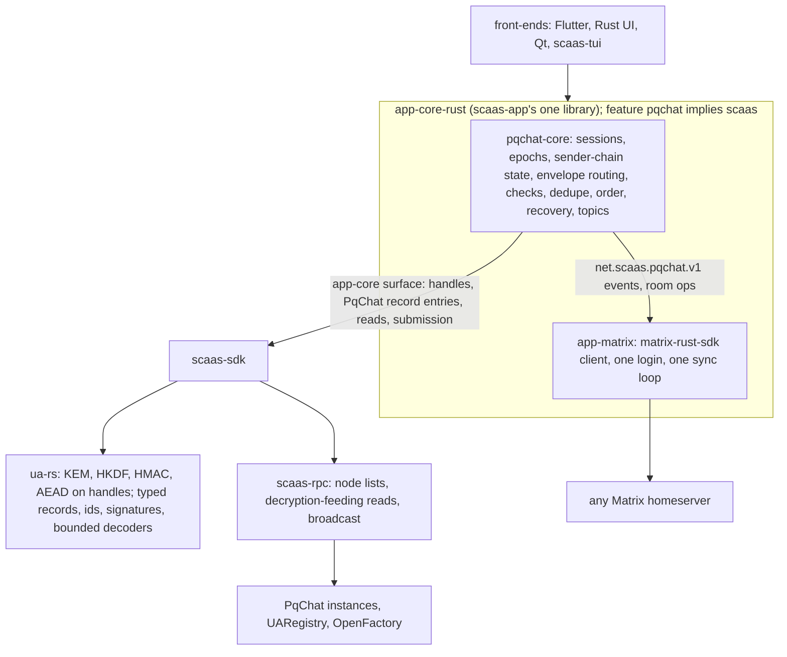

# `pqchat-core`: the PqChat client core above `scaas-sdk` — design

**Status:** SPECIFIED (2026-11-17), nothing built. UNAUDITED: every cryptographic construction it runs is UA-7's design, not a
reviewed protocol. Rules: [`docs/clients/pqchat-core.md`](../../clients/pqchat-core.md) (CLI-PQC-01 to CLI-PQC-12), register
entries CLI-PQC-01 to CLI-PQC-12, CLI-PQC-30 (owner rulings) and CLI-PQC-31 (coordinator and controller calls) in
[decisions.md](../../decisions.md). Plan: [`2026-11-17-pqchat-core.md`](../plans/2026-11-17-pqchat-core.md). Branch `pqchat-core`,
made from `scaas-sdk` at `0da3423ae`.

**Normative for clients, and not restated here:** the UA-7 spec
[`2026-10-25-ua7-pq-e2e-sessions.md`](2026-10-25-ua7-pq-e2e-sessions.md) version 2 (P1–P49), the topics spec
[`2026-11-07-pqchat-public-topics.md`](2026-11-07-pqchat-public-topics.md) (P33–P46) and the contract
[`contracts/pqchat.md`](../../contracts/pqchat.md) (CTR-CHAT-01 to CTR-CHAT-21). The client order and layers of the UA-7 plan
[`2026-11-04-ua7-pqchat.md`](../plans/2026-11-04-ua7-pqchat.md) ("Clients": `pqchat-core` beside the SDK, a `ua-rs` `pqchat`
module, libQuotient in `ua-qt`) are outdated by the rulings of §1; its contract tasks stand.

**The SDK** is read as it is at `0da3423ae` ([`2026-11-17-scaas-sdk.md`](2026-11-17-scaas-sdk.md)); its rewrite on branch
`scaas-sdk` removes the `chat` module and adds a section "App cores above the SDK". This spec does not copy SDK internals: it names
the surface it needs (§5) and marks each row **per the SDK spec's App cores section**.

**Contents**

1. [Rulings and conditions](#1-rulings-and-conditions)
2. [Goal and non-goals](#2-goal-and-non-goals)
3. [Layers](#3-layers)
4. [What of UA-7 it implements](#4-what-of-ua-7-it-implements)
5. [The SDK surface it needs](#5-the-sdk-surface-it-needs)
6. [The Matrix adapter; rooms and sessions apart](#6-the-matrix-adapter-rooms-and-sessions-apart)
7. [Its store](#7-its-store)
8. [API sketch and errors](#8-api-sketch-and-errors)
9. [Threat model](#9-threat-model)
10. [Vectors](#10-vectors)
11. [Bindings](#11-bindings)
12. [Test strategy](#12-test-strategy)
13. [Open points](#13-open-points)

## 1. Rulings and conditions

**Owner rulings, all 2026-11-17, quoted** (recorded in CLI-PQC-30; not reopened here):

| # | Ruling | Where it lands |
|---|---|---|
| Q-R1 | "pqchat-core cũng đảo chiều luôn" ("OK, reverse pqchat-core too"): `pqchat-core` depends on `scaas-sdk` like any app core; the SDK has no chat module | CLI-PQC-01 |
| Q-R2 | Chat "(b)": ordinary Matrix chat in the default app build, PqChat in the `scaas` build; one matrix-rust-sdk stack, one client, one login. `pqchat-core` takes the app's live Matrix client (scaas-app's `app-matrix`) as its transport and store and sends envelopes as `net.scaas.pqchat.v1` events | CLI-PQC-05, §6 |
| Q-R3 | In scaas-app, `pqchat-core` is the Cargo feature `pqchat` of `app-core-rust` (the app's contract, section 12) | CLI-PQC-01, §11 |
| Q-R4 | "Ok, đưa e2e vào plan pqchat-core" ("OK, put the e2e into the pqchat-core plan"): a real-crypto client e2e | CLI-PQC-12, plan T11 |

**Earlier owner rulings it follows** (CTR-CHAT-01 and the UA-7 spec): recovery from state alone, no events relied on
(2026-11-10, P47); the 2-person chat first, groups correct (2026-11-10); spam filtered by clients, no on-chain consent step
(2026-11-10, D5); consent in clients before any network call (P12); every message to every listed store (D15); no forced KEM
rotation (P5); the device id a 16-byte UUID, a restored device a new one (2026-11-10, CTR-CHAT-12).

**Coordinator conditions** (2026-11-17), written as rules:

1. **Secrets stay below the SDK** (CLI-PQC-03). `pqchat-core` gets key handles only; KEM, HKDF, HMAC and AEAD, the sender chain's
   derivations included, run in `ua-rs` on handles; only decrypted plaintext leaves.
2. **No blind signing** (CLI-PQC-04), as corrected by the coordinator the same day: `PqChat` is a SCaaS contract, so the SDK keeps
   named, typed signing entries for its record structs (session, epoch with its wraps, leave, remove, message, the topic records),
   built from named fields under `PURPOSE_PQCHAT`, as for every SCaaS contract's operations; `pqchat-core` calls those entries and
   never passes a digest; the generic app signing call stays closed to SCaaS purposes. The SDK knows PqChat's record formats, not
   its chat logic. **The coordinator's call; the owner may override** (the SDK spec on branch `scaas-sdk`, `82d9754cd`, lists it as
   open: §13 O1).
3. **Calls stay out of scope**: SFrame and WebRTC call keys go to a frame encryptor outside `ua-rs`, which breaks condition 1 (§13 O2).
4. **Key labels**: each app core declares its key-label prefixes, so it cannot open another app's keys; checked against PqChat's
   labels in §5.2.

## 2. Goal and non-goals

**Goal.** One Rust crate that a SCaaS app links to run PqChat: create and accept 1:1 sessions (groups correct), rekey, leave and
remove, send and read messages over the session's Matrix room and chain stores, recover everything on a new device from contract
state, and read and write public topics, with every key operation and signature below the SDK and every chain read through its
node lists.

**Non-goals.**

- No cryptography, no signed byte format, no Matrix client, no RPC client of its own (CLI-PQC-01).
- No change to the `PqChat` contract, its records, `DS_C` or `PURPOSE_PQCHAT`; no new vector row format.
- Out of this round (CLI-PQC-02), each PLANNED in the UA-7 plan's later tasks: calls (UA-7 §10, P21–P23, P30), attachments
  (`file`, P28), HCS (§7.3), Waku (§7.6), libp2p (§7.5), device linking (P6), the epoch-key export (§14 O5), the unlinkable mode
  (§13), MLS. Other families: each `pqchat-<family>` round.
- No UI, no view model: the app's. No push (UA-7 P28).

## 3. Layers



Every arrow out of `pqchat-core` goes through the SDK or `app-matrix`; it has no other dependency that touches a key or a node
(CLI-PQC-01). `app-matrix` lives in the scaas-app repository, so `pqchat-core` does not depend on it: it defines the transport trait
of §6.1 (`MatrixTransport`: send an event in a room, page a room's history, create a room, invite, remove, join, the incoming
`net.scaas.pqchat.v1` events of its rooms) and `app-matrix` implements it over its one client; its own tests use a fake and, for
the e2e, a test-only implementation over matrix-rust-sdk at the version `app-matrix` pins (a dev-dependency, never in the crate). A front-end sees `pqchat-core`'s calls and events through the bindings of the one library (§11).

## 4. What of UA-7 it implements

Each row: the UA-7 or contract rule (normative), what `pqchat-core` does, and the SDK row of §5 it uses.

| Part | Rule | `pqchat-core` does | SDK (§5) |
|---|---|---|---|
| Session | P8, CTR-CHAT-06, CTR-CHAT-07 | picks the home instance (listed, class 3, version ≠ 0); lists the creator first as member and admin; draws `K`; wraps it per member; seals `sealedInfo` with the store list; signs; sends `createSession` with the wraps that fit, the rest by `addWraps` (P11) | S1, S2, S4, K1, K2, K5, R1–R3, W1 |
| Epoch | P9, P10, CTR-CHAT-08, CTR-CHAT-09 | `epoch = parent + 1`; fresh `K` (never derived from the old one); plain rekey by any member who has not left, membership change by an admin; finishes an incomplete child with `addWraps`; follows the home's `childOf` / `epochsOf` after finality; stops sending under an epoch once the home shows a complete child | S2, K1, K2, K5, R1–R3, W1 |
| Remove, leave | P48, P12, CTR-CHAT-20, CTR-CHAT-10 | an admin's `remove` before the next epoch; the next epoch drops removed and left members; reads `removedIn` / `removalAt` before building a child | S3, R1, W1 |
| Wraps, KEM | P4, P5, P14, §6.1, §6.2 | wraps to each member's highest KEM version seen on any source; skips and names a UA whose `checkedOf(ua).kem` is `NONE`; shows `kemPkHash` fingerprints and warns on a shared KEM key; rekeys when a member's highest version rises; may suggest a rotation, never requires one | K1, K2, R1 |
| Sender chains | §6.3, O6 | keeps per (session, epoch, sender, device) the next counter and the counters seen; at most 2,000 skipped keys per chain, no step past 2,000 in one go; handles of skipped keys die at lock and are re-derived from `K` | K3, K4 |
| Message | §6.4, P49, §6.5 | builds canonical JSON content of the types in scope (CLI-PQC-02), pads, encrypts with `mk_i` / `n_i` and the AAD, signs the record, seals the envelope | K3, K4, K5, S5 |
| Envelope, stores | P15, P27, P29, P16 | the same envelope to every listed store: the Matrix event, `storeMessage` per chain store; `postMessage` by the user's choice; refuses to send when a listed store kind is not implemented (CLI-PQC-06) | K5, S5, W1, M1 |
| Checks, dedupe, order | P25, P19, P32 | for every record read: envelope opens, bounded decode, portable signature, membership by the home's order, fresh counter, new `messageId`; replica records equal to the home's; order by `parents`, then `ts`, then `messageId`; buffers a message for an unknown epoch; drops failures silently (CLI-PQC-07) | V1, V2, K5, R1–R3 |
| Recovery from state | P47, CTR-CHAT-14 | factory index → `sessionCount` / `sessionsOf` per instance, de-duplicated; `epochCount` 0 skipped; home epochs; own wraps; `storedRange`, `messageAt`, the room's history (CLI-PQC-09) | R1–R3, K2 |
| Pending until accepted | P12, Fable P2-4 | nothing derived from wraps or `sealedInfo` reaches the network before the user accepts (CLI-PQC-08) | — |
| `msig` expansion | P13, CTR-UA-37, CTR-UA-38 | expands each `msig` seat into its accepted members, two levels, at every epoch; keeps the leaves holding a KEM key with `via` = the seat, warns on the others; re-checks `via` against the registry on read (display only) | R1 |
| Public topics | P33–P46, CTR-CHAT-15 to CTR-CHAT-18 | creates topics with `openReplies` true; posts, replies, edits, votes; pages the state views; resolves a `ref` on its chain (factory listing, the referenced topic's home, `contentHash`) before showing it as verified; renders nothing itself (Markdown with raw HTML off is the front-end's rule) | S6, R1, R2, W1 |

**Not in this table and not built here:** the call types and keys, `file`, HCS, Waku, libp2p, device linking, the O5 export
(CLI-PQC-02).

**The create flow** (2-member case; groups the same with more wraps):

```mermaid
sequenceDiagram
  participant A as pqchat-core (A)
  participant S as scaas-sdk / ua-rs
  participant M as app-matrix (A)
  participant C as PqChat (home instance)
  participant B as pqchat-core (B)
  A->>S: reads: factory listing, kemKeyOf(A), kemKeyOf(B), checkedOf
  A->>S: random K (handle); wrap K to A and B (P14 checks inside)
  A->>M: create the room, invite B's Matrix id
  A->>S: seal sealedInfo {stores: [matrix room, chain store], matrix ids}
  A->>S: sign PqChatSession (named fields, wraps) -> UASig, sessionId
  A->>C: createSession (self-relay or a gateway), addWraps if needed
  B->>C: sessionsOf(B): new entry; epochCount > 0
  B->>S: open own wrap, open sealedInfo: show creator, name (pending)
  Note over B: user accepts (CLI-PQC-08)
  B->>M: join the room (the invite was held until now, §6.2)
  A->>S: message: chain step, encrypt, sign, envelope
  A->>M: net.scaas.pqchat.v1 {v, hint, env}
  A->>C: storeMessage(v, hint, env) when a chain store is listed
  M-->>B: event; B checks and decrypts (CLI-PQC-07)
```

A's client invites the Matrix ids of `sealedInfo` when it creates the room; B's app holds the invite unanswered until its user
accepts the session (§6.2, §13 O5). A chain store needs no invite.

## 5. The SDK surface it needs

Every row is **per the SDK spec's App cores section** (branch `scaas-sdk`): the name there wins; this table states what
`pqchat-core` needs and the byte format each must keep. Nothing here asks the SDK for chat logic.

### 5.1 The rows

| Id | Need | Form | Byte format kept |
|---|---|---|---|
| A1 | its scope | an app-core object scoped to PqChat: app class 3 (`PqChat`), declared label prefix `scaas/pqchat/v1/` | — |
| A2 | account handles | the UA id and kind, its KEM key versions, the seed set's class; never a key | — |
| K1 | a fresh epoch key | a random 32-byte key as a handle | — |
| K2 | KEM wrap and unwrap of a key handle to a UA's registered KEM key | wrap: recipient UA, KEM version, the key handle, label `scaas/pqchat/v1/wrap`, context `sessionId ‖ epochId ‖ member ‖ be64(keyId) ‖ 0x01 ‖ kemPkHash`, AAD `sessionId ‖ epochId ‖ member ‖ be64(keyId)`; returns the named `Wrap` fields; runs P14's checks first (`KemKeyInvalid`); unwrap: the account, its KEM version, a `Wrap`, the same label, context and AAD; returns a handle | §6.1, §6.2: `keys.json` `wraps`, `p14` |
| K3 | HKDF on handles | `hkdf(handles, salt = empty, label, context, 32) -> handle`, `info = label ‖ context` byte for byte; label under the declared prefix (`AppLabelRefused` otherwise) | §6.3 `ck_0`, P15 `k_env`, §4.2 the `sealedInfo` key: `messages.json` `chains`, `envelope`, `sealedInfo` |
| K4 | the sender-chain step | from `ck_i` (a handle of this scope) the handles `mk_i = HMAC(ck_i, 0x01)`, `n_i = HMAC(ck_i, 0x03)[0:12]`, `ck_{i+1} = HMAC(ck_i, 0x02)`; the input must be a handle this scope derived under its prefix | §6.3: `messages.json` `chains` |
| K5 | AEAD on handles | AES-256-GCM-SIV with a nonce from a handle (`n_i`) and an AAD (§6.4); AES-256-GCM-SIV with a random 96-bit nonce prepended, empty AAD (P15 envelope, §4.2 `sealedInfo`); open returns `Plaintext` (`SecretBytes`) | `messages.json` `message`, `envelope`, `sealedInfo` |
| K6 | the epoch hint | `HMAC(K, "scaas/pqchat/v1/hint")[0:8]`, 8 public bytes: the only public output derived from `K` in this round | P15: `messages.json` `envelope.hint` |
| S1 | sign `PqChatSession` | named fields with the `Wrap` list; the SDK computes `wrapHashes`; returns `UASig`, the typed digest, `sessionId` | `records.json` |
| S2 | sign `PqChatEpoch` | as S1; returns `epochId` | `records.json` |
| S3 | sign `PqChatLeave`, `PqChatRemove` | named fields | `records.json` |
| S4 | the session and epoch ids before signing | `sessionId(creator, nonce)`, `epochId(sessionId, author, nonce)` (the KEK binds them) | `records.json` `tags` |
| S5 | sign `PqChatMessage`; the envelope's inner bytes | named header fields and the ciphertext; returns `UASig`, `messageId`; `abi.encode(PqChatMessage, UASig)` and the payload `abi.encode(uint8 1, bytes8 hint, bytes env)` built by `ua-rs` | `messages.json` `envelope.inner`, `payload` |
| S6 | sign the six topic records | named fields; returns ids | `topics.json` |
| S7 | an `msig` signer | S1–S3 and S6 for an `msig` author by its quorum (`UASig.members`, minimal form), through the SDK's `msig` member signatures; S5 refuses an `msig` sender (P13) | `records.json` |
| V1 | verify a portable PqChat record | a record (named fields) and a `UASig` against the signer's registry record (single key; `msig` minimal form, two levels); returns the typed digest and id; `Refused` carries no detail | `records.json`, `topics.json` |
| V2 | decode received bytes, bounded | the envelope's inner bytes, a stored payload, a stored record blob, by length and depth ([CLI-UAL-03](../../clients/ua-libraries.md#CLI-UAL-03)) into named fields | `messages.json`, `records.json` |
| R1 | chain reads | registry (`kemKeyOf`, `kemKeyAt`, `checkedOf`, `memberAccepted`, the record for V1), factory (`contractsPage(3, …)`, listing checks), `PqChat` views of CTR-CHAT-14 and the topic views, through `scaas-rpc`'s lists (ARCH-POS-15) | — |
| R2 | decryption-feeding reads | the reads of wraps, `sealedInfo`, `messageAt`, `storedRange` marked as feeding a decryption (CLI-RPC-06) | — |
| R3 | finality | the home's `childOf` / `epochsOf` read at a final block | — |
| W1 | submission | the `PqChat` writes (`createSession`, `addWraps`, `rekey`, `leave`, `remove`, `postMessage`, `storeMessage`, the six topic writes) as prepared operations (prepare, review, quote, submit, follow; [CLI-SDK-08](../../clients/scaas-sdk.md#CLI-SDK-08)), self-relay or a gateway that takes them, fee 0 allowed; an unsigned write (`addWraps`, `storeMessage`) is paid or self-relayed (UA-7 P17) | — |
| T1 | test-only vectors build | fixed randomness and key import for K1, K2, K5 and the signers, refused in a release build | §10 |

### 5.2 PqChat's key labels against the label-prefix rule (coordinator point 4)

The SDK's App cores section scopes `kem_unwrap`, `derive`, `seal_to` and `open_sealed` to labels under the prefixes an app core
declares, refusing a label another registered app core declares. Every label of `clients/clientkeys/src/pqchat.js` and the UA-7
spec, checked:

| Label | Use | Fits `scaas/pqchat/v1/` | Note |
|---|---|---|---|
| `scaas/pqchat/v1/wrap` | KEK of a wrap (§6.2) | yes | the HKDF info is the label followed by a binary context: the SDK call must take `(label, context)` and build `info = label ‖ context` exactly (K2), not a label alone |
| `scaas/pqchat/v1/chain` | `ck_0` (§6.3) | yes | context `sessionId ‖ epochId ‖ sender ‖ device` (K3) |
| `scaas/pqchat/v1/env` | `k_env` (P15) | yes | K3 |
| `scaas/pqchat/v1/info` | the `sealedInfo` key (§4.2) | yes | K3 |
| `scaas/pqchat/v1/hint` | the 8-byte hint (P15) | yes | an HMAC key input, not an HKDF info; its output is public (K6) |
| HMAC messages `0x01`, `0x02`, `0x03` | the chain step (§6.3) | no label | scoped by provenance instead: K4 takes only a handle this scope derived under its prefix (`ck_0`, then the step's own outputs) |
| `scaas/pqchat/v1/call`, `/sframe`, `/call-rendezvous`, `/call-peer` | call keys, rendezvous (P22, P30) | yes | out of scope this round (§13 O2) |
| `scaas.kem.1` | the hybrid KEM's combiner (§6.1) | not an app label | the KEM scheme's own constant inside `ua-rs` (CTR-UA-32), the same for every app; the app label enters after it, in the KEK |
| `scaas/pqchat/v1/session`, `/epoch`, `/topic`, `/entry`, `/scope/*` | id and nonce-scope tags (CTR-CHAT-04) | not KDF labels | keccak tags of public ids, computed by `ua-rs` in S1–S6 |

**Result: the labels fit**, with three needs on the SDK's form: (1) a label plus a binary context, concatenated exactly, salt empty;
(2) a chain step on a handle with no label of its own, allowed by the handle's scope; (3) one public 8-byte output (K6). The
prefix `scaas/pqchat/v1/` overlaps no other declared prefix known today (PqVault's labels are under `scaas/pqvault/v1/`; neither
is a prefix of the other). The scope protects against one app core misusing another's labels by mistake; it is no boundary
against a hostile crate linked into the same library, which runs in the same process (§9).

## 6. The Matrix adapter; rooms and sessions apart

### 6.1 The adapter

- **Attach and detach.** `pqchat-core` takes the app's live `app-matrix` client after the app's Matrix login, and is detached before
  the app's Matrix logout (which deletes the local Matrix store, the app's contract §11.3). It shares the app's one tokio runtime.
  Detached, a session that lists Matrix cannot send (`MatrixDetached`); reading its chain stores still works.
- **Send.** One event of type `net.scaas.pqchat.v1`, content `{"v": 1, "hint": base64(hint), "env": base64(env)}` (P15, the
  `matrixEvent` row), in the session's room. Matrix's own encryption may wrap it (the room is encrypted from its first event, the
  app's contract §11.5); PqChat relies on none of it.
- **Receive.** `app-matrix` hands every `net.scaas.pqchat.v1` event to `pqchat-core`; it keeps those of a room an accepted session
  lists and ignores the rest. Content is parsed with bounds (an event of at most 65,536 B, `v == 1`, `hint` 8 bytes, `env`
  non-empty), then checked as CLI-PQC-07. A hint of an epoch not yet known is buffered (P19), bounded per room.
- **History.** On acceptance, after an unlock past the buffer bound (CLI-PQC-10) and on a fresh device, `pqchat-core` pages the
  room's history back to the session's first epoch or the server's retention limit.
- **Membership.** The client of the author of an epoch invites the Matrix ids its `sealedInfo` adds and removes those it drops;
  a Matrix member without the epoch key sees ciphertext only. A Matrix power level grants no PqChat right: the room's creator holds
  the top level; the Matrix ids of the epoch's admins get the level that invites and removes; nothing else follows from it.
- **Errors** of `app-matrix` (not logged in, rate limited, server gone) are the send's outcome for that store only; the chain stores
  of the same message still receive it, and the send reports which stores took it.

### 6.2 Rooms and sessions apart (the app's contract §11)

- A PqChat session is not a Matrix room to the user: the app's room list does not show a room an accepted session lists as an
  ordinary room, and a Matrix room is never upgraded into a PqChat session in place.
- A room is found only through `sealedInfo`; its id never goes on chain in the clear (D10).
- Before acceptance the app does not answer an invite to the session's room, and `pqchat-core` reads nothing from it
  (CLI-PQC-08). How the app tells such an invite from an ordinary Matrix invite before the session is accepted is §13 O5.
- In the default build (no SCaaS) a `net.scaas.pqchat.v1` event is shown as "needs the SCaaS build", never as a message (the app's
  contract §11.2); that is `app-matrix`'s rule.
- The app says that Matrix's encryption is classical; PqChat's protection is the envelope's, and the front-end never presents a
  plain Matrix conversation as post-quantum.

## 7. Its store

A cache with no secret and no source of truth (CLI-PQC-09), through a small storage interface the app implements over a file in its
private data directory (or IndexedDB on wasm32), written whole under a revision check as the SDK's keystore writes are.

| Item | Why | Lost |
|---|---|---|
| device id (16 bytes, UUID v4 by default, §13 O8) | enters every own chain, scope and AAD | a new device id (CTR-CHAT-12) |
| per own chain `(session, epoch, device)`: the next counter | a counter is never reused | goes with the device id |
| per received scope: the counters seen, bounded | replay refusal across restarts | rebuilt from the stores |
| accepted and declined session ids | consent on this device | asked again (§13 O6) |
| envelopes kept while locked or for unknown epochs, bounded | CLI-PQC-10, P19 | read again from the stores |
| read positions: per room, per chain store `(instance, hint)`, per session's `sessionsOf` offset | paging resumes | rebuilt from offset 0 |

No key, handle export, decrypted content or `sealedInfo` plaintext is written (§13 O7). Every item is public or derivable from
contract state and the stores; a stolen store reveals which sessions the device holds, which the chain shows anyway.

## 8. API sketch and errors

The API is fixed with the SDK's App cores section; this sketch fixes the shape the plan builds against (Rust; the bindings follow
§11).

```rust
pub struct PqChat { /* Arc; one per process, over one AppCore of the SDK */ }
impl PqChat {
    pub fn new(sdk: Arc<Sdk>, store: Arc<dyn PqChatStore>) -> Result<Arc<Self>, PqChatError>;
    pub fn attach_matrix(&self, client: Arc<dyn MatrixTransport>) -> Result<(), PqChatError>;   // Rust-only (§11)
    pub fn detach_matrix(&self);
    pub async fn sessions(&self, account: AccountRef) -> Result<Vec<SessionSummary>, PqChatError>;   // recovery (CLI-PQC-09)
    pub async fn accept(&self, session: SessionId) -> Result<(), PqChatError>;
    pub async fn decline(&self, session: SessionId);
    pub async fn create(&self, req: CreateSession) -> Result<Prepared, PqChatError>;       // members, admins, home, stores
    pub async fn rekey(&self, req: Rekey) -> Result<Prepared, PqChatError>;                // plain, or a membership change
    pub async fn remove(&self, req: Remove) -> Result<Prepared, PqChatError>;
    pub async fn leave(&self, session: SessionId) -> Result<Prepared, PqChatError>;
    pub async fn send(&self, session: SessionId, content: Content, on_chain: OnChain) -> Result<SendReport, PqChatError>;
    pub async fn timeline(&self, session: SessionId, page: Page) -> Result<Vec<Message>, PqChatError>;
    pub fn subscribe(&self) -> Arc<PqChatSubscription>;                                   // pull, bounded, Lagged as the SDK
    pub fn topics(&self) -> Arc<Topics>;                                                  // create, post, reply, edit, vote, pages
}
```

`Prepared` is the SDK's (W1): every write is reviewed and submitted through the SDK's operation model, so its states are the SDK's.
`SendReport` lists each store and its outcome. Events: `SessionFound`, `SessionChanged` (epoch, members), `MessageAdded`,
`MessageEdited`, `ReceiptAdded`, `TypingChanged`, `StoreFailed { session, store }`, `Lagged { missed }`.

**Errors** (`PqChatError::code()`, stable, appended only; no input, key, ciphertext, room id or Matrix id in one). They come back
only for the user's own action; a received record that fails is never an error (CLI-PQC-07). The SDK's codes pass through by their
own names (`WalletLocked`, `KeyRevoked`, `NoTrustedEndpoint`, `EndpointAllFailed`, `AppLabelRefused`, the operation states).

| Code | When |
|---|---|
| `InstanceUnlisted` | a `PqChat` address the chain's factory does not list as class 3 with version ≠ 0 |
| `SessionUnknown`, `SessionPending` | no such session in any listed instance; an action on a session the user has not accepted |
| `NotMember`, `NotAdmin` | the account is not a member of the latest epoch (or left, or was removed); a membership change without admin rights at the parent |
| `KemKeyMissing`, `KemKeyInvalid` | a member without a usable KEM key (none, or `checkedOf.kem` `NONE`); P14 refused the key |
| `MembersInvalid` | fewer than 2 members, a duplicate, a non-holder kind, an `msig` seat with no KEM leaf |
| `StoreListInvalid`, `StoreUnsupported` | no message store, duplicates, more than one Matrix entry; a listed kind this build does not implement (CLI-PQC-06) |
| `MatrixDetached`, `MatrixRoom` | no Matrix client attached; the room cannot be created, joined or written (the store's outcome only) |
| `EpochTaken`, `EpochIncomplete` | the home already holds a complete child of the parent (the author rebuilds from it); the parent is not complete |
| `ContentInvalid`, `ContentTooLarge` | a content out of P49's bounds or out of scope; above 16,000 B of text, or above the 1,024-B bucket on chain without the cost confirmation |
| `CounterExhausted` | an own chain at `2^64 − 1` (a rekey is needed) |
| `StoreIo`, `StoreConflict` | the app's storage interface failed; the item changed under the crate three times |
| `Internal` | no better name; carries nothing |

## 9. Threat model

**Assets.** The epoch keys and every key derived from them; message plaintext; the store list, room ids and Matrix ids; the
signing power of the UA; the user's choice of what to accept.

| Adversary | Can | Cannot, and why |
|---|---|---|
| A stranger who creates a session naming the user | index it in `sessionsOf`, wrap a chosen `K`, name a store it runs | learn whether the device saw or opened it: nothing reaches the network before acceptance (CLI-PQC-08), and nothing sent depends on an opening (CLI-PQC-07; UA-7 P12, P49) |
| A member, or a stranger writing to a store (`storeMessage`, a Matrix room) | send any bytes under a known hint | forge another member's message (PQ signature per record, D7); replay (scope and counter); have a bad record shown or answered (silent drop) |
| A removed member | read and post under the old epoch; race plain rekeys (P9's limit) | read the next epoch (fresh `K`, not wrapped to it); author a rekey of an epoch it was removed from (P48) |
| A replica instance or a second chain | hold a different record under the same id (P32) | be counted: a replica's record counts only when equal to the home's, and membership is read at home |
| One RPC endpoint the app did not name | answer reads | put a ciphertext of its choice into a decryption: decryption-feeding reads need a named or default endpoint, or agreement with at least three ([CLI-RPC-06](../../clients/scaas-rpc.md#CLI-RPC-06), [ARCH-POS-15](../../decisions.md#ARCH-POS-15)) |
| A homeserver | see room membership, Matrix ids, sizes, times, the hint (P20); drop or delay events | read content or forge a record; hide a message also on a chain store |
| A decryption-oracle attempt | send chosen ciphertexts to the user's keys | learn anything from the result: [ARCH-POS-13](../../decisions.md#ARCH-POS-13) as amended on 2026-11-13 puts the hybrid KEM's decapsulation and its one-shot AEAD outside that rule, and PqChat keeps its own no-reaction rule anyway (CLI-PQC-07) |
| The app core itself (a bug) | call the SDK's app-core surface | reach a key byte (handles only, CLI-PQC-03), sign a SCaaS operation other than a PqChat record (CLI-PQC-04), or use another app's labels (§5.2) |
| A hostile crate linked into the same library | everything in the process | not addressed: the app's builder chooses what it links; the label scope guards against mistakes, not against code in the same address space |

**Accepted costs** (stated in the rules they come from): no deniability (D7); forward secrecy bounded by the KEM version's lifetime
(P5), so re-deriving the sender chains from `K` after a lock (CLI-PQC-03) loses nothing the design keeps; the on-chain link
between a creator and the UAs it lists (until the unlinkable mode); a stored envelope under a superseded epoch has no provable time
(P29's limit: marked or dropped).

## 10. Vectors

`pqchat-core` reads `smartcontracts/vectors/pqchat/` as written by `clients/clientkeys/src/pqchat.js` (`scripts/pqchat-vectors.mjs`);
it writes none and edits none (CLI-PQC-11). Per file:

| File | Rows `pqchat-core` checks (through the SDK's vectors build, T1) | Rows `ua-rs` checks below the SDK |
|---|---|---|
| `records.json` | domain, purpose, typehashes, tags, ids, scopes, typed digests, `uaMessage`, `sigHash`, record blobs (S1–S5, V1, V2) | the signatures with fixed randomness |
| `topics.json` | the six topic records, `EntryRef`, ids, blobs (S6, V1) | as above |
| `keys.json` | `kemKeys` (public key, `kemPkHash`), `wraps` (`ctM`, `E`, `sealedKey`, the `Wrap` struct and its hash), `p14` refusals by code | `ssM`, `ssX`, `ss`, `kek` |
| `messages.json` | `devices`, `padding`, `message.ciphertext` and `aad`, `envelope.hint`, `inner`, `env`, `payload`, `matrixEvent`, `sealedInfo.sealedInfo` and `json` | `chains` (`ck0`, every `mk`, `n`, `ck`), `kEnv`, `kInfo`, `mk`, `n` |

The call-key rows (`messages.json` `callKeys`) wait for the call tasks. A row that cannot be reproduced through the SDK's surface is
a gap in the surface, reported, never worked around by a key export.

## 11. Bindings

`pqchat-core` has no binding of its own. In scaas-app it is linked into `app-core-rust` (feature `pqchat`), and the generators that
run over that one library (the SDK's binding rules, [CLI-SDK-12](../../clients/scaas-sdk.md#CLI-SDK-12)) carry its public API to
Flutter (FRB 2), C++ / Qt (UniFFI or the fallback the SDK's spike picks) and later the browser, with the SDK's surface rules: `Arc`
objects, owned strings and records, ids as strings, a pull subscription, no callback for events, decrypted content as `SecretBytes`
through the SDK's copy calls. `attach_matrix` and the storage interface are Rust-only: wired inside the one library, never carried by
a binding. A test asserts the generated surface holds no handle type and no byte accessor of one.

## 12. Test strategy

- **Local only**, as the SDK: anvil (through `scripts/capped`, foreground), the contract deployed by its own forge script, a fake
  Matrix client implementing the adapter's trait, then a real homeserver in Docker with `--memory` for the e2e (plan T11).
- **Vectors first** (CLI-PQC-11), every row, before any flow test.
- **Red first.** Each check of CLI-PQC-07 has a positive control (a valid record shown) and a negative changing one field at a
  time: a flipped envelope byte, a signature of another member's key, a non-member sender, a replayed counter, a duplicate
  `messageId` on two stores, a replica record differing from the home's, an epoch that lost the home slot, an unlisted instance, a
  hint of an unknown epoch, an oversize event, a content out of bounds.
- **Mutants.** Listed per task and applied one at a time by a mutants script (the SDK plan's form) over the check functions and
  the state machine (the counter store, the home-order check, the acceptance gate, the replica equality, the store-list refusal);
  each must turn a named test red.
- **No-reaction tests.** For every negative, the test asserts zero network calls and zero writes caused by it (a recording fake of
  the SDK's submission and of the Matrix adapter), and the same for a pending session.
- **Secrets.** A test greps every error, event and log line of the suite for key, handle, ciphertext and Matrix id bytes; a
  `cargo tree` test holds the dependency rule of CLI-PQC-01.
- **Real-crypto e2e** (CLI-PQC-12): plan T11, local; the SCaaS testnet at its next reset on the owner's word (plan T13). Today's
  on-chain PqChat runs (`smartcontracts/evm/script/onchain/PqChat.s.sol`, the stand-in wraps of `_wraps`) test the contract only:
  their wraps are random bytes of the right shape, never opened.
- **Gates:** `cargo test`, `cargo clippy --all-targets -- -D warnings` with the SDK's panic denials, `cargo deny`, `cargo audit`,
  the SDK's `cargo tree -e features` test, a wasm32 `cargo check` of the crate without the Matrix adapter, `docs_check`; heavy steps
  through `scripts/capped`, per-step logs and resume as the plan says.

## 13. Open points

Each with options and a recommendation; nothing here is decided until the owner says so, except where marked as already applied.

**O1 — How PqChat records are signed.** (a) The SDK keeps named, typed entries for `PqChat`'s record structs (§5 S1–S6), as for
every SCaaS contract; `pqchat-core` calls them (the coordinator's call, applied in CLI-PQC-04; the owner may override). (b)
`pqchat-core` stays inside the SDK as a module. (c) The generic app signing call opened to `PURPOSE_PQCHAT`. **Recommendation: (a).**
(b) undoes ruling Q-R1; (c) opens the generic call to a SCaaS purpose, the hole condition 2 closes.

**O2 — Calls.** SFrame keys feed a WebRTC frame encryptor outside `ua-rs`. (a) Keep calls out until a frame encryptor runs on
handles inside `ua-rs` (the media layer hands frames to `ua-rs`, keys never leave). (b) A named, reviewed export of per-call SFrame
base keys to the media layer, an exception to condition 1. (c) Calls inside the SDK. **Recommendation: (a)**, decided with UA-7's
call tasks; (b) only if per-frame calls into `ua-rs` prove too slow, measured, and with the owner's word.

**O3 — The shape of the key surface.** (a) The SDK's generic handle calls in the forms of §5 (label plus context, the chain step
by provenance, the one public hint), held to the vector rows. (b) PqChat-shaped key entries in the SDK (wrap, chain step,
envelope seal) beside the signing entries of O1. **Recommendation: (a)** if the SDK's App cores section takes those three forms;
otherwise (b), which O1's reasoning already allows for a SCaaS contract.

**O4 — Submission of PqChat writes from an end-user build.** The SDK has no job API client in an end-user build. (a) Self-relay
from the user's own account (the SDK's path) until a gateway takes PqChat's writes. (b) Ask the node's next round for PqChat's
thirteen writes at the gateway's door. **Recommendation: (a) now, (b) asked of the node**: every write is relayable by anyone
already (UA-7 P17), so the node's door is the open part.

**O5 — Telling a PqChat room from an ordinary Matrix room before acceptance.** (a) Rooms `pqchat-core` creates carry the room type
`net.scaas.pqchat.v1` in `m.room.create`; `app-matrix` keeps such rooms out of the ordinary list and holds their invites, unanswered,
until a session that lists the room is accepted. (b) No marker: the app hides only rooms an accepted session lists, so an invite of
a pending session shows as an ordinary Matrix invite. **Recommendation: (a).** Cost: homeservers learn that a room is a PqChat room
(they see the event type anyway when Matrix's own encryption is off). (b) mixes the two kinds and lets a user answer the invite
before accepting the session, which tells the creator.

**O6 — Acceptance on a fresh device.** Acceptance is local (CLI-PQC-08) and the store is a cache. (a) Ask again for every session.
(b) Count a session as accepted when the UA created it or authored a record in it found in state (an epoch, a leave, a removal, a
`postMessage`); ask again for the rest. (c) An encrypted acceptance list kept somewhere. **Recommendation: (b)**: state only, no new
list, and a session the UA only received stays a question.

**O7 — A local plaintext history.** (a) None: decrypt again from the stores after each unlock (the Matrix history is cached by
`app-matrix`, chain stores are read). (b) Seal the history under an app-scoped storage key the SDK derives for the account.
**Recommendation: (a)** this round (no secret at rest, no new SDK row); (b) when the SDK offers the storage key and a user asks for
offline history.

**O8 — The device id's version.** (a) UUID v4 (no creation time on chain under `postMessage`). (b) v7. **Recommendation: (a)**, the
controller proposal already in [ua-libraries.md](../../clients/ua-libraries.md#pqchat-clients).

**O9 — Attachments.** The `file` content carries its key inside the plaintext (P49), so sending one means a fresh key whose bytes
enter the content. (a) Out of this round (as the app's contract §11.6: attachments not in its first version). (b) An SDK call that
encrypts a file under a fresh key and returns the ciphertext and the key as `Plaintext` content. **Recommendation: (a) now, (b)**
with the attachment task.

**O10 — The e2e homeserver.** (a) Synapse in Docker (what matrix-rust-sdk's own integration tests use). (b) A lighter server
(Conduit family). **Recommendation: (a)**, capped with `--memory 1g`, one container, removed after the run.
