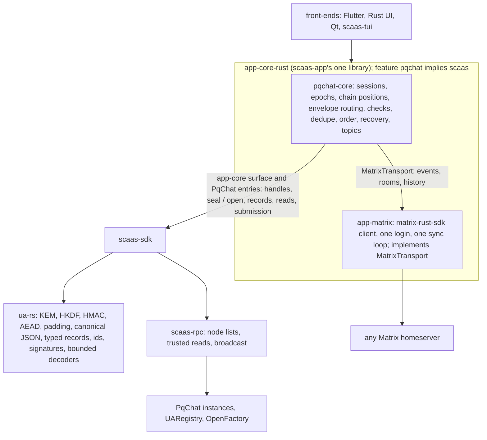

# `pqchat-core`: the PqChat client core above `scaas-sdk` — design

**Status:** SPECIFIED (2026-11-17), nothing built; revision 2 the same day applies Fable's review of revision 1 (`3a5ece097`;
P0 0, P1 3, P2 16, P3 12, info 4; every finding as proposed, with the coordinator's calls K1–K5, K16, K17; §14). UNAUDITED: every
cryptographic construction it runs is UA-7's design, not a reviewed protocol. Rules:
[`docs/clients/pqchat-core.md`](../../clients/pqchat-core.md) (CLI-PQC-01 to CLI-PQC-14), register entries CLI-PQC-01 to
CLI-PQC-14, CLI-PQC-30 (owner rulings) and CLI-PQC-31 (coordinator and controller calls) in [decisions.md](../../decisions.md).
Plan: [`2026-11-17-pqchat-core.md`](../plans/2026-11-17-pqchat-core.md). Branch `pqchat-core`, made from `scaas-sdk` at
`0da3423ae`.

**Normative for clients, and not restated here:** the UA-7 spec
[`2026-10-25-ua7-pq-e2e-sessions.md`](2026-10-25-ua7-pq-e2e-sessions.md) version 2 (P1–P49), the topics spec
[`2026-11-07-pqchat-public-topics.md`](2026-11-07-pqchat-public-topics.md) (P33–P46) and the contract
[`contracts/pqchat.md`](../../contracts/pqchat.md) (CTR-CHAT-01 to CTR-CHAT-21). The client order and layers of the UA-7 plan
[`2026-11-04-ua7-pqchat.md`](../plans/2026-11-04-ua7-pqchat.md) ("Clients": `pqchat-core` beside the SDK, a `ua-rs` `pqchat`
module, libQuotient in `ua-qt`) are outdated by the rulings of §1; its contract tasks stand.

**The SDK** is read as it is at `0da3423ae` ([`2026-11-17-scaas-sdk.md`](2026-11-17-scaas-sdk.md)); its rewrite on branch
`scaas-sdk` removes the `chat` module and adds a section "App cores above the SDK". This spec does not copy SDK internals: it names
the surface it needs (§5) and marks each row **per the SDK spec's App cores section**.

**Contents**

1. [Rulings and conditions](#1-rulings-and-conditions)
2. [Goal and non-goals](#2-goal-and-non-goals)
3. [Layers](#3-layers)
4. [What of UA-7 it implements](#4-what-of-ua-7-it-implements)
5. [The SDK surface it needs](#5-the-sdk-surface-it-needs)
6. [The Matrix adapter; rooms and sessions apart](#6-the-matrix-adapter-rooms-and-sessions-apart)
7. [Its store](#7-its-store)
8. [API sketch and errors](#8-api-sketch-and-errors)
9. [Threat model](#9-threat-model)
10. [Vectors](#10-vectors)
11. [Bindings](#11-bindings)
12. [Test strategy](#12-test-strategy)
13. [Open points and requests](#13-open-points-and-requests)
14. [Review: Fable, 2026-11-17](#14-review-fable-2026-11-17)

## 1. Rulings and conditions

**Owner rulings, all 2026-11-17** (recorded in CLI-PQC-30; not reopened here):

| # | Ruling | Where it lands |
|---|---|---|
| Q-R1 | The dependency is reversed for `pqchat-core` too: `pqchat-core` depends on `scaas-sdk` like any app core; the SDK has no chat module | CLI-PQC-01 |
| Q-R2 | Chat option (b): ordinary Matrix chat in the default app build, PqChat in the `scaas` build; one matrix-rust-sdk stack, one client, one login. `pqchat-core` takes the app's live Matrix client (scaas-app's `app-matrix`) as its transport and store and sends envelopes as `net.scaas.pqchat.v1` events | CLI-PQC-05, §6 |
| Q-R3 | In scaas-app, `pqchat-core` is the Cargo feature `pqchat` of `app-core-rust` (the app's contract, section 12) | CLI-PQC-01, §11 |
| Q-R4 | The e2e goes into the pqchat-core plan: a real-crypto client e2e | CLI-PQC-12, plan T11 |

**Earlier owner rulings it follows** (CTR-CHAT-01 and the UA-7 spec): recovery from state alone, no events relied on
(2026-11-10, P47); the 2-person chat first, groups correct (2026-11-10); spam filtered by clients, no on-chain consent step
(2026-11-10, D5); consent in clients before any network call (P12); every message to every listed store (D15); no forced KEM
rotation (P5); the device id a 16-byte UUID, a restored device a new one (2026-11-10, CTR-CHAT-12).

**Coordinator conditions and calls** (2026-11-17), written as rules:

1. **Secrets stay below the SDK** (CLI-PQC-03). `pqchat-core` gets key handles only; KEM, HKDF, HMAC and AEAD, the sender chain's
   derivations included, run in `ua-rs` on handles; only decrypted plaintext leaves.
2. **No blind signing** (CLI-PQC-04), as corrected by the coordinator the same day: `PqChat` is a SCaaS contract, so the SDK keeps
   named, typed signing entries for its record structs (session, epoch with its wraps, leave, remove, message, the topic records),
   built from named fields under `PURPOSE_PQCHAT`, as for every SCaaS contract's operations; `pqchat-core` calls those entries and
   never passes a digest; the generic app signing call stays closed to SCaaS purposes. The SDK knows PqChat's record formats, not
   its chat logic. **The coordinator's call; the owner may override** (the SDK spec on branch `scaas-sdk`, `82d9754cd`, lists it as
   open: §13 O1).
3. **Calls stay out of scope**: SFrame and WebRTC call keys go to a frame encryptor outside `ua-rs`, which breaks condition 1 (§13 O2).
4. **Key labels**: each app core declares its key-label prefixes, so it cannot open another app's keys; checked against PqChat's
   labels in §5.2.
5. **After Fable's review:** K1, every read that chooses a key, a recipient or an epoch is a trusted read (CLI-PQC-13); K2, a fresh
   device reads recent messages of a long epoch (CLI-PQC-14, a client rule within UA-7's skip bound); K3, K16, K17, T11 rewritten so
   that every mutant guards a check it can reach, anvil started with `--enable-tx-gas-limit`; K4, K5, the SDK's forms go to the SDK
   spec's writer, and this spec states the requirement only (§5.3).

## 2. Goal and non-goals

**Goal.** One Rust crate that a SCaaS app links to run PqChat: create and accept 1:1 sessions (groups correct), rekey, leave and
remove, send and read messages over the session's Matrix room and chain stores, recover everything on a new device from contract
state, and read and write public topics, with every key operation and signature below the SDK and every chain read through its
node lists.

**Non-goals.**

- No cryptography, no signed or encrypted byte format, no Matrix client, no RPC client of its own (CLI-PQC-01).
- No change to the `PqChat` contract, its records, `DS_C`, `PURPOSE_PQCHAT` or UA-7; no new vector format (new rows only).
- Out of this round (CLI-PQC-02), each PLANNED in the UA-7 plan's later tasks: calls (UA-7 §10, P21–P23, P30), HCS (§7.3), Waku (§7.6), libp2p (§7.5), device linking (P6), the epoch-key export (§14 O5), records authored by an
  `msig`, the unlinkable mode (§13), MLS. Other families: each `pqchat-<family>` round.
- No UI, no view model: the app's. No push (UA-7 P28).

**Key bytes that would have to leave `ua-rs`** for the parts left out, each named with its open point: the `file` content's key
(O9), SFrame base keys (O2), the secrets device linking sends to a key that is not a registered UA's (P6), the epoch-key export
(UA-7 §14 O5). Nothing in this round's scope.

## 3. Layers



Every arrow out of `pqchat-core` goes through the SDK or the transport trait; it has no other dependency that touches a key or a
node (CLI-PQC-01). `app-matrix` lives in the scaas-app repository, so `pqchat-core` does not depend on it: it defines the transport
trait of §6.1 (`MatrixTransport`) and `app-matrix` implements it over its one client; the crate's own tests use a fake and, for the
e2e, a test-only implementation over matrix-rust-sdk at the version `app-matrix` pins (a dev-dependency, never in the crate). A
front-end sees `pqchat-core`'s calls and events through the bindings of the one library (§11).

## 4. What of UA-7 it implements

Each row: the UA-7 or contract rule (normative), what `pqchat-core` does, and the SDK row of §5 it uses.

| Part | Rule | `pqchat-core` does | SDK (§5) |
|---|---|---|---|
| Session | P8, CTR-CHAT-06, CTR-CHAT-07 | picks the home instance (listed, class 3, version ≠ 0, a trusted read); the creator is in `members` and `admins`, both strictly sorted; draws `K`; wraps it per member; has the SDK seal `sealedInfo` from its named fields; signs; sends `createSession` with as many wraps as the SDK's quote shows fit, the rest by `addWraps` (P11; regular + state gas within the block limit, no limit of ours assumed) | S1, S4, K1, K2, R1, R2, W1 |
| Epoch | P9, P10, CTR-CHAT-08, CTR-CHAT-09 | `epoch = parent + 1`; fresh `K` (never derived from the old one); plain rekey by any member who has not left, membership change by an admin; finishes an incomplete child with `addWraps`; follows the home's `childOf` / `epochsOf` after finality; at the first sight of a complete child stops sending under the parent and holds sends until the child is final (CLI-PQC-07) | S2, K1, K2, R2, R3, W1 |
| Remove, leave | P48, P12, CTR-CHAT-20, CTR-CHAT-10 | an admin's `remove` before the next epoch; the next epoch drops removed and left members; reads `removedIn` / `removalAt` (trusted) before building a child | S3, R2, W1 |
| Wraps, KEM | P4, P5, P14, §6.1, §6.2 | wraps to each member's highest KEM version seen on any source and kept in the store (a lower one served later is refused); skips and names a UA whose `checkedOf(ua).kem` is `NONE`; shows `kemPkHash` fingerprints and warns on a shared KEM key; a member's higher version raises an event, and the rekey is a write the user confirms; may suggest a rotation, never requires one | K2, R2 |
| Sender chains | §6.3, O6, CLI-PQC-14 | keeps per own chain the next counter and per received scope the counters seen; keeps no skipped key; derives a message key when its verified record arrives, at most 2^20 steps from the nearest held position; holds a bounded number of positions per session (least recently used dropped); derives lazily after a lock | K3, K4 |
| Message | §6.4, P49, §6.5 | builds the content value of a type in scope; the SDK canonicalises, pads, encrypts at the chain's counter, signs and seals the envelope in one call | S5 |
| Envelope, stores | P15, P27, P29, P16, P49 | the same envelope to every listed store its type may use (`typing` to the room only); chain stores under the user's per-session spend consent, `receipt` off by default with a chain store; `postMessage` by the user's choice; refuses to send when a listed store kind is not implemented; a new store after a rekey used only once the user confirms it (CLI-PQC-06) | S5, W1 |
| Checks, dedupe, order | P25, P19, P32 | CLI-PQC-07 for every record read, failures counted per reason; order by `parents`, then `ts`, then `messageId`; buffers a message for an unknown epoch | V1, V2, K4, K5, R2 |
| Recovery from state | P47, CTR-CHAT-14 | factory index → `sessionCount` / `sessionsOf` per instance, batched, de-duplicated; a session shown only when its home is listed, reachable, holds the equal record and `epochCount > 0`; home epochs; own wraps when the user looks or accepts; after acceptance `storedRange`, `messageAt`, the room's history (CLI-PQC-09) | R1–R3, K2 |
| Pending until accepted | P12, Fable P2-4 | nothing derived from wraps or `sealedInfo` reaches the network before the user accepts (CLI-PQC-08) | — |
| `msig` expansion | P13, CTR-UA-37, CTR-UA-38 | expands each `msig` seat into its accepted members (`memberAccepted`, trusted), two levels, at every epoch; keeps the leaves holding a KEM key with `via` = the seat, warns on the others; re-checks `via` against the registry on read (display only). An `msig` **author** is out of this round (CLI-PQC-02) | R2 |
| Public topics | P33–P46, CTR-CHAT-15 to CTR-CHAT-18 | creates topics with `openReplies` true; posts, replies, edits, votes; pages the state views; resolves a `ref` on its chain (factory listing, the referenced topic's home, `contentHash`) before showing it as verified; renders nothing itself (Markdown with raw HTML off is the front-end's rule) | S6, R1, R2, W1 |

**The create flow** (2-member case; groups the same with more wraps):

```mermaid
sequenceDiagram
  participant A as pqchat-core (A)
  participant S as scaas-sdk / ua-rs
  participant M as app-matrix (A)
  participant C as PqChat (home instance)
  participant B as pqchat-core (B)
  A->>S: trusted reads: factory listing, kemKeyOf(A), kemKeyOf(B), checkedOf
  A->>S: random K (handle); wrap K to A and B (P14 checks inside)
  A->>M: create the room (no Matrix encryption, CLI-PQC-05)
  A->>S: sign PqChatSession: named fields, sealedInfo fields sealed inside -> UASig, sessionId
  A->>C: createSession (self-relay or a gateway), addWraps if needed
  A->>M: once the session is complete at home: invite B's bound Matrix id
  B->>C: sessionsOf(B): new entry; home listed, equal record, epochCount > 0
  Note over B: pending: the invite is held unanswered (CLI-PQC-08)
  B->>S: when the user looks: open own wrap, open sealedInfo, show creator and name
  Note over B: user accepts
  B->>M: join the room bound to the session
  A->>S: send: content, chain position -> pad, encrypt, sign, envelope (one call)
  A->>M: net.scaas.pqchat.v1 {v, hint, env}
  A->>C: storeMessage(v, hint, env) when a chain store is listed and its spend was consented
  M-->>B: event; B checks and decrypts (CLI-PQC-07)
```

A chain store needs no invite. B's Matrix id is invited only once bound to B's UA (CLI-PQC-05: its contact card, or an envelope
signed by B from that Matrix sender).

## 5. The SDK surface it needs

Every row is **per the SDK spec's App cores section** (branch `scaas-sdk`): the name there wins; this table states what
`pqchat-core` needs and the byte format each must keep. Nothing here asks the SDK for chat logic. After the review the PqChat-shaped
form (§13 O3 (b)) is the recommended one: K3–K6 and S1, S2, S5 are PqChat entries, so the generic handle calls need not reproduce
UA-7's bytes for PqChat; the requirements of §5.3 hold for whichever form the SDK takes.

### 5.1 The rows

| Id | Need | Form | Byte format kept |
|---|---|---|---|
| A1 | its scope | an app-core object scoped to PqChat: app class 3 (`PqChat`), declared label prefix `scaas/pqchat/v1/` | — |
| A2 | account handles | the UA id and kind, its KEM key versions, the seed set's class; never a key | — |
| K1 | a fresh epoch key | a random 32-byte key as a handle | — |
| K2 | KEM wrap and unwrap of an epoch key to a UA's registered KEM key | the SDK's form: `kem_wrap(recipient, kem_version, &K, label, aad)`, `kem_unwrap(account, wrap, label, aad) -> K`, label `scaas/pqchat/v1/wrap`, `aad = sessionId ‖ epochId ‖ member ‖ be64(keyId)`; the SDK reads the recipient's key at that version (a trusted read, CLI-PQC-13), runs P14's checks (`KemKeyInvalid`), and builds the KEK's info as `label ‖ aad ‖ 0x01 ‖ kemPkHash` itself, `kemPkHash = keccak256(kemPk)` of that version; the wrap's AEAD is AES-256-GCM with nonce `0^96`; returns the named `Wrap` fields; the caller passes neither the scheme byte nor the key hash | §6.1, §6.2: `keys.json` `wraps`, `p14` |
| K3 | a sender chain position | `chain_at(&K, sessionId, epochId, sender, device) -> Pos` (`ck_0 = HKDF(K, "scaas/pqchat/v1/chain" ‖ sessionId ‖ epochId ‖ sender ‖ device)`), `advance(&Pos, n) -> Pos` in one call, `n ≤ 2^20` (CLI-PQC-14); a position is a handle of this scope | §6.3: `messages.json` `chains` |
| K4 | open a message | from the envelope bytes and `K`: `k_env`, the GCM-SIV open, the bounded decode, returning the record and `UASig` as named fields (public); then, after V1 and membership, from the record and a position at its counter: `mk`, `n`, the GCM-SIV open with the §6.4 AAD, `unpad`, the canonical check (re-serialise and compare), returning the content as `Plaintext` | P15, §6.4, §6.5: `messages.json` `envelope`, `message`, `padding` |
| K5 | open `sealedInfo` | from an epoch record and `K`: the key `HKDF(K, "scaas/pqchat/v1/info" ‖ sessionId ‖ epochId)`, the GCM-SIV open, `unpad`, the canonical check; returns `Plaintext` | §4.2: `messages.json` `sealedInfo` |
| K6 | the epoch hint | `HMAC(K, "scaas/pqchat/v1/hint")[0:8]`, 8 public bytes, only from an epoch key this scope unwrapped or drew | P15: `messages.json` `envelope.hint` |
| S1 | sign `PqChatSession` | named fields with `sealedInfo`'s named fields and the `K` handle (sealed inside, random 96-bit nonce prepended, padded canonical JSON) and the wraps of K2 (`wrapHashes` computed inside); the review shows every field, the store list and the Matrix ids as request fields; returns `UASig`, the typed digest, `sessionId` | `records.json`, `messages.json` `sealedInfo` |
| S2 | sign `PqChatEpoch` | as S1; returns `epochId` | `records.json` |
| S3 | sign `PqChatLeave`, `PqChatRemove` | named fields | `records.json` |
| S4 | the session and epoch ids before signing | `sessionId(creator, nonce)`, `epochId(sessionId, author, nonce)` (the KEK binds them) | `records.json` `tags` |
| S5 | seal and sign a message | the header fields, the content value and the own chain position at the counter: `ua-rs` canonicalises and pads the content, encrypts with `mk_i`, `n_i` and the AAD, signs `PqChatMessage`, builds `abi.encode(PqChatMessage, UASig)`, seals the envelope (`k_env`, random nonce) and the payload `abi.encode(uint8 1, bytes8 hint, bytes env)`; returns the record, `UASig`, `messageId`, `env`, the payload; signs without a per-message prompt (CLI-PQC-04); refuses an `msig` sender (P13) | `messages.json` `message`, `envelope`, `payload`, `matrixEvent` |
| S6 | sign the six topic records | named fields; returns ids | `topics.json` |
| S7 | an `msig` author | PLANNED (CLI-PQC-02): co-signers must receive the full record and its wraps to review, through the SDK's `msig` collection flow | — |
| V1 | verify a portable PqChat record | a record (named fields) and a `UASig` against the signer's registry record (a trusted read; single key, `msig` minimal form two levels); returns the typed digest and id; `Refused` carries no detail. Runs where the signature's bytes are at hand: messages from stores, topic records | `records.json`, `topics.json` |
| V2 | decode received bytes, bounded | a stored payload, a stored record blob, a view's page, by length and depth ([CLI-UAL-03](../../clients/ua-libraries.md#CLI-UAL-03)) into named fields; `hashStruct` of a read wrap for the check against `wrapHashes` | `messages.json`, `records.json` |
| R1 | ordinary chain reads | topic pages and the other views that choose nothing, through `scaas-rpc`'s lists (ARCH-POS-15) | — |
| R2 | trusted reads | under `Purpose::FeedsDecryption` ([CLI-RPC-06](../../clients/scaas-rpc.md#CLI-RPC-06)): the registry's `kemKeyOf`, `kemKeyAt`, `checkedOf`, `memberAccepted`, `msigOf` (an `msig` seat's slots, P13; added 2026-11-22, controller call); the factory listing (`infoOf`, `contractsPage`); at an instance, every view of a session's state: `sessionOf`, `epochOf` (their `wrapHashes` and `sealedInfo`), `epochComplete`, `epochCount`, `epochsOf`, `latestEpoch`, `childOf`, `wrapAt` (the wraps), `leftIn`, `removedIn`, `removalCount`, `removalAt`, `messageCount`, `messageAt`, `storedCount`, `storedRange`; the signer's registry record for V1 (read inside the SDK) (CLI-PQC-13; held to the crate's `READS` by gate `pqc-reads`; widened 2026-11-22 from the first list to every session-state view, controller call); and since CTR-CHAT-23 (owner 2026-11-23, CLI-PQC-15) `sigStore`, `sessionSig`, `epochSig`, `leaveCount`, `leaveAt`, `leaveSig`, `removalSig`, `messageSig`; and since CTR-CHAT-27 (the tree mode, CLI-PQC-17; plan 2026-11-23-pqchat-treekem T6a, controller call 2026-11-26) the tree views `treeOf`, `treeLeaves`, `treeNodes`, `treeNodeKey`, `commitOf`, `pathListOf`, `pathKeys`, `pathCtAt`, `goneOf`, `goneKeyOf`, `goneOwnKeyOf` (`IPqChatTreeViews`), the registry's records of a tree's signers and leaves (`registrationOf`, `msigStateOf`, `msigAt`, with `kemKeyAt`), put into the SDK's tree reads by its converters; and since CLI-PQC-21 (review E-1, controller call 2026-11-28) the views a signed topic record's `seq` or `version` comes from: `topicOf`, `writerOf`, `voteOf`, `entryOf` (a value an endpoint raised would make a record that is refused now and valid later) | — |
| R3 | finality | the home's `childOf` / `epochsOf` read at a final block | — |
| W1 | submission | the `PqChat` writes (`createSession`, `addWraps`, `rekey`, `leave`, `remove`, `postMessage`, `storeMessage`, the six topic writes) as prepared operations (prepare, review, quote, submit, follow; [CLI-SDK-08](../../clients/scaas-sdk.md#CLI-SDK-08)), self-relay or a gateway that takes them, fee 0 allowed; the quote (a simulation) sizes wrap chunks; an unsigned write (`addWraps`, `storeMessage`) is paid or self-relayed (UA-7 P17) | — |
| T1 | test-only vectors build | fixed randomness and key import for K1, K2, S1, S5 and the signers; refused in a release build by the SDK's load check | §10 |

### 5.2 PqChat's key labels against the label-prefix rule (coordinator point 4)

The SDK's App cores section scopes `kem_unwrap`, `derive`, `seal_to` and `open_sealed` to labels under the prefixes an app core
declares, refusing a label another registered app core declares. Every label of `clients/clientkeys/src/pqchat.js` and the UA-7
spec, checked:

| Label | Use | Fits `scaas/pqchat/v1/` | Note |
|---|---|---|---|
| `scaas/pqchat/v1/wrap` | KEK of a wrap (§6.2) | yes | the info is the label, the AAD, the scheme byte and `kemPkHash`, built by the SDK (K2) |
| `scaas/pqchat/v1/chain` | `ck_0` (§6.3) | yes | context `sessionId ‖ epochId ‖ sender ‖ device` (K3) |
| `scaas/pqchat/v1/env` | `k_env` (P15) | yes | inside K4 and S5 |
| `scaas/pqchat/v1/info` | the `sealedInfo` key (§4.2) | yes | inside K5, S1, S2 |
| `scaas/pqchat/v1/hint` | the 8-byte hint (P15) | yes | an HMAC key input, not an HKDF info; its output is public (K6) |
| HMAC messages `0x01`, `0x02`, `0x03` | the chain step (§6.3) | no label | scoped by provenance: K3's `advance` takes only a position this scope derived (`ck_0`, then its own outputs) |
| `scaas/pqchat/v1/call`, `/sframe`, `/call-rendezvous`, `/call-peer` | call keys, rendezvous (P22, P30) | yes | out of scope this round (§13 O2) |
| `scaas.kem.1` | the hybrid KEM's combiner (§6.1) | not an app label | the KEM scheme's own constant inside `ua-rs` (CTR-UA-32), the same for every app; the app label enters after it, in the KEK |
| `scaas/pqchat/v1/session`, `/epoch`, `/topic`, `/entry`, `/scope/*` | id and nonce-scope tags (CTR-CHAT-04) | not KDF labels | keccak tags of public ids, computed by `ua-rs` in S1–S6 |

**Result: the labels fit.** The prefix `scaas/pqchat/v1/` overlaps no other declared prefix known today (PqVault's labels are under
`scaas/pqvault/v1/`; neither is a prefix of the other). The scope protects against one app core misusing another's labels by
mistake; it is no boundary against a hostile crate linked into the same library, which runs in the same process (§9).

### 5.3 Requirements on the SDK's form (K4, K5, K20; sent to the SDK spec's writer by the coordinator)

Whichever form the SDK takes (§13 O3), it must hold:

1. **A label plus a binary context**, concatenated exactly, salt empty, where UA-7 builds an info so.
2. **A chain step on a handle with no label of its own**, allowed by the handle's scope.
3. **One public 8-byte output** (K6): only a label under the prefix, only on an epoch key the scope unwrapped or drew, never on a
   chain position or a derived key.
4. **A handle's usage never changes the derivation bytes**: the usage is recorded on the handle and enforced, never mixed into an
   info, an HMAC message or a nonce; separation comes from the labels and HMAC inputs UA-7 already fixes.
5. **`kemPkHash` is built by the SDK as UA-7 pins it** (`keccak256(kemPk)` of the version the SDK encapsulates to, after the scheme
   byte `0x01`), never passed in by the app core.
6. If a generic `mac_derive` remains, it refuses a message that starts with a declared label prefix, so it cannot rebuild the
   hint's key as a secret handle; the public call (3) refuses a chain position.

## 6. The Matrix adapter; rooms and sessions apart

### 6.1 The adapter

- **The trait.** `MatrixTransport`: create a room (without Matrix encryption), invite, remove, join, send one event in a room, page
  a room's history, the incoming `net.scaas.pqchat.v1` events, and hold or release an invite by room id. **In a room `pqchat-core`
  has bound, an implementation sends no Matrix read receipt, read marker, typing notice or presence update, and joins only on
  `pqchat-core`'s call** (UA-7 P15, D10: a Matrix receipt of an event shown would be a signal that depends on a decryption). A
  conformance test in the crate runs against every implementation: the fake, the e2e's, and `app-matrix`'s in its own repository.
- **Attach and detach.** `pqchat-core` takes the app's live `app-matrix` client after the app's Matrix login, and is detached before
  the app's Matrix logout (which deletes the local Matrix store, the app's contract §11.3). It shares the app's one tokio runtime.
  Detached, a session that lists Matrix cannot send (`MatrixDetached`); reading its chain stores still works.
- **Send.** One event of type `net.scaas.pqchat.v1`, content `{"v": 1, "hint": <base64>, "env": <base64>}` (P15), base64 in
  RFC 4648 §4 with padding, the `matrixEvent` row's form.
- **No Matrix encryption in a PqChat room** (CLI-PQC-05; Fable K13 (a)). With Megolm on, a fresh Matrix device could not read the
  room's earlier events without Matrix's own recovery key, and the main case is a 1:1 session with Matrix as its only store. UA-7
  P15 makes Megolm optional; without it the homeserver sees the event type and the 8-byte hint, which P20 already lists, never
  content.
- **Receive.** `app-matrix` hands every `net.scaas.pqchat.v1` event to `pqchat-core`; it keeps those of a room an accepted session
  binds (and, while locked, every one up to the bound, CLI-PQC-10) and ignores the rest. Content is parsed with bounds: an event of
  at most 65,536 B, `v == 1`, `hint` and `env` in exactly the padded base64 form (another form is dropped, reason `decode`), `hint`
  8 bytes, `env` non-empty; then checked as CLI-PQC-07. A hint of an epoch not yet known is buffered (P19), bounded per room.
- **History.** On acceptance, after an unlock past the buffer bound (CLI-PQC-10) and on a fresh device after acceptance,
  `pqchat-core` pages the room's history back to the session's first epoch or the server's retention limit.
- **Membership.** The client of the author of an epoch invites the Matrix ids its `sealedInfo` adds and removes those it drops, only
  ids bound to their UA (§6.2); the creator's client invites only once the session is complete at home. A Matrix member without the
  epoch key sees ciphertext only. A Matrix power level grants no PqChat right: the room's creator holds the top level; the bound
  Matrix ids of the epoch's admins get the level that invites and removes; nothing else follows from it.
- **Errors** of `app-matrix` (not logged in, rate limited, server gone) are the send's outcome for that store only; the chain stores
  of the same message still receive it, and the send reports which stores took it.

### 6.2 Rooms and sessions apart (the app's contract §11; binding by Fable K8)

- **A room counts for a session** only if this client created it for that session, or joined it through that session's acceptance.
  A room the account had joined before counts only once its members check against the epoch: every Matrix id it holds, joined
  or invited, is the account's own or one the epoch's `sealedInfo` maps to a member of that epoch (a fresh device's state-only
  recovery; controller call 2026-11-22); a session whose `sealedInfo` names such a room with any other member is shown with that
  warning and its room is not used. One room serves one session; the first accepted keeps it, a second session naming it is warned about and its
  room not used.
- **A Matrix id counts for a UA** only when that UA asserted it: its signed contact card (UA-7 §14 O7) or an envelope signed by that
  UA and received from that Matrix sender. `sealedInfo`'s `matrix` map is the author's claim: an id it maps that is not bound so is
  neither invited nor removed, and is shown as unconfirmed.
- **A changed store list** (a rekey's `sealedInfo`): a room or store the user has not seen is joined only after the user confirms it,
  with the change's author shown, and a change by a non-admin flagged (CLI-PQC-06).
- A PqChat session is not a Matrix room to the user: the app's room list does not show a bound room as an ordinary room, and a
  Matrix room is never upgraded into a PqChat session in place. A room is found only through `sealedInfo`; its id never goes on
  chain in the clear (D10).
- **Before acceptance** `pqchat-core` hands the transport the room ids of pending sessions (from the locally opened `sealedInfo`,
  CLI-PQC-08) to hold their invites unanswered, and reads nothing from them (§13 O5 (c)). Any room-type marker a creator sets is its
  claim and is trusted neither way.
- In the default build (no SCaaS) a `net.scaas.pqchat.v1` event is shown as "needs the SCaaS build", never as a message (the app's
  contract §11.2); that is `app-matrix`'s rule.
- The app says that Matrix's encryption of ordinary rooms is classical; PqChat's protection is the envelope's, and the front-end
  never presents a plain Matrix conversation as post-quantum.

## 7. Its store

A cache with no secret and no source of truth (CLI-PQC-09), through a small storage interface the app implements, items keyed apart,
each with its own revision (a write replaces one item at its expected revision; `StoreConflict` after three tries).

| Item | Why | Lost |
|---|---|---|
| device id (16 bytes, UUID v4 by default, §13 O8) and its anchor check | enters every own chain, scope and AAD; a missing or different anchor in the platform's non-backed-up secret storage makes a new one | a new device id (CTR-CHAT-12) |
| per own chain `(session, epoch, device)`: the next counter, written before the send | a counter is never reused | goes with the device id |
| per received scope: the counters seen, bounded | replay refusal across restarts | rebuilt from the stores |
| per UA: the highest KEM version seen | a lower version served later is refused (CLI-PQC-13) | rebuilt from trusted reads |
| accepted and declined session ids | consent on this device | §13 O6 |
| per session: the chain-store spend consent and the stores confirmed | CLI-PQC-06 | asked again |
| envelopes kept while locked or for unknown epochs, bounded | CLI-PQC-10, P19 | read again from the stores |
| read positions: per room, per chain store `(instance, hint)`, per session's `sessionsOf` offset | paging resumes | rebuilt from offset 0 |

No key, handle export, decrypted content or `sealedInfo` plaintext is written: the store holds no plaintext until §13 O7's
(b) lands (owner 2026-11-23, with scaas-app after the pre-freeze tag). **What a copied store reveals:** which
sessions the device holds (the chain shows that), and the links from a session to its room and its hints, which the chain does
not show (D10, P20). So the app's storage keeps it encrypted at rest under the app's own store key, the one its Matrix store uses
(the app's contract §11.4), and excludes the file from backups; the crate still holds no key (§13 requests).

## 8. API sketch and errors

The API is fixed with the SDK's App cores section; this sketch fixes the shape the plan builds against (Rust; the bindings follow
§11).

```rust
pub struct PqChat { /* Arc; one per process, over one AppCore of the SDK */ }
impl PqChat {
    pub fn new(sdk: Arc<Sdk>, store: Arc<dyn PqChatStore>) -> Result<Arc<Self>, PqChatError>;
    pub fn attach_matrix(&self, client: Arc<dyn MatrixTransport>) -> Result<(), PqChatError>;   // Rust-only (§11)
    pub fn detach_matrix(&self);
    pub async fn sessions(&self, account: AccountRef) -> Result<Vec<SessionSummary>, PqChatError>;   // recovery (CLI-PQC-09)
    pub async fn preview(&self, session: SessionId) -> Result<SessionPreview, PqChatError>;        // opens own wrap locally
    pub async fn accept(&self, session: SessionId, chain_spend: ChainSpendConsent) -> Result<(), PqChatError>;
    pub async fn decline(&self, session: SessionId);
    pub async fn confirm_stores(&self, session: SessionId, epoch: EpochId) -> Result<(), PqChatError>;
    pub async fn create(&self, req: CreateSession) -> Result<Prepared, PqChatError>;       // members, admins, home, stores, spend
    pub async fn rekey(&self, req: Rekey) -> Result<Prepared, PqChatError>;                // plain, or a membership change
    pub async fn remove(&self, req: Remove) -> Result<Prepared, PqChatError>;
    pub async fn leave(&self, session: SessionId) -> Result<Prepared, PqChatError>;
    pub async fn send(&self, session: SessionId, content: Content, on_chain: OnChain) -> Result<SendReport, PqChatError>;
    pub async fn timeline(&self, session: SessionId, page: Page) -> Result<Vec<Message>, PqChatError>;
    pub fn dropped(&self, session: SessionId) -> DropCounts;                              // per reason, device only
    pub fn subscribe(&self) -> Arc<PqChatSubscription>;                                   // pull, bounded, Lagged as the SDK
    pub fn topics(&self) -> Arc<Topics>;                                                  // create, post, reply, edit, vote, pages
}
```

`Prepared` is the SDK's (W1): every control-plane and topic write is reviewed and submitted through the SDK's operation model, so its
states are the SDK's. `send` signs through S5 without a per-message prompt (CLI-PQC-04) and returns a `SendReport` listing each
store and its outcome; its chain-store writes run under the session's spend consent. Events: `SessionFound`, `SessionChanged`
(epoch, members), `StoresChanged { session, author, by_admin }`, `KemVersionRaised { session, member }`, `MessageAdded`,
`MessageEdited`, `ReceiptAdded`, `TypingChanged`, `StoreFailed { session, store }`, `Lagged { missed }`.

**Errors** (`PqChatError::code()`, stable, appended only; no input, key, ciphertext, room id or Matrix id in one). They come back
only for the user's own action; a received record that fails is never an error (CLI-PQC-07). The SDK's codes pass through by their
own names (`WalletLocked`, `KeyRevoked`, `NoTrustedEndpoint`, `AgreementNeedsThree`, `EndpointAllFailed`, `AppLabelRefused`, the
operation states).

| Code | When |
|---|---|
| `InstanceUnlisted` | a `PqChat` address the chain's factory does not list as class 3 with version ≠ 0 |
| `SessionUnknown`, `SessionPending` | no such session at a listed, reachable home; an action on a session the user has not accepted |
| `NotMember`, `NotAdmin` | the account is not a member of the latest epoch (or left, or was removed); a membership change without admin rights at the parent |
| `KemKeyMissing`, `KemKeyInvalid`, `KemVersionLowered` | a member without a usable KEM key (none, or `checkedOf.kem` `NONE`); P14 refused the key; a version below the highest seen |
| `MembersInvalid` | fewer than 2 members, a duplicate, a non-holder kind, an `msig` seat with no KEM leaf |
| `MsigAuthorPlanned` | a record whose author is an `msig` (CLI-PQC-02) |
| `StoreListInvalid`, `StoreUnsupported`, `StoreUnconfirmed` | no message store, duplicates, more than one Matrix entry; a listed kind this build does not implement; a store changed by a rekey and not yet confirmed (CLI-PQC-06) |
| `ChainCostUnconfirmed` | a chain store without the session's spend consent |
| `MatrixDetached`, `MatrixRoom`, `MatrixIdUnbound` | no Matrix client attached; the room cannot be created, joined or written, or is not bound to the session; an invite or removal of an id not bound to its UA |
| `EpochTaken`, `EpochIncomplete`, `EpochNotFinal` | the home already holds a complete child of the parent (the author rebuilds from it); the parent is not complete; a send held while a child is complete but not final |
| `ContentInvalid`, `ContentTooLarge` | a content out of P49's bounds or out of scope; above 16,000 B of text, or above the 1,024-B bucket on chain without the cost confirmation |
| `CounterExhausted` | an own chain at `2^64 − 1` (a rekey is needed) |
| `StoreIo`, `StoreConflict` | the app's storage interface failed; the item changed under the crate three times |
| `Internal` | no better name; carries nothing |
| `CardRefused` | a contact card that does not count for its UA (UA-7 §14 O7, CLI-PQC-05): not its signature, or not well formed |
| `HomeUnsigned` | under `require_signed_records`, a session created on a home that keeps no signatures (`sigStore` `none`; CLI-PQC-15, owner 2026-11-23) |
| `ExitLag` | a leave or removal naming an epoch more than 16 below the home's head, refused before it is signed (C9, the contract's `PqChatExitLag`; fable re-review D2-4, 2026-11-25) |
| `TreeReads` | a tree call whose reads did not settle within its bound of read rounds (CLI-PQC-17; plan 2026-11-23-pqchat-treekem T6a) |
| `TreeTooLarge` | a tree creation over the chain's one-transaction cap, or a commit whose required piece does not fit the chain's limits (TreeKEM spec §13) |
| `TreeHomeNone` | a tree session on a home that keeps no signatures (TreeKEM spec C1, the contract's `PqChatTreeSigStore`) |
| `TreeVoid` | a commit whose pieces another sender landed out of order, so that the piece left cannot pay the completion; rebuilt with a new nonce (C37) |
| `TreeInfoUnconfirmed` | a changed session info whose head a strict majority of at least 3 named endpoints did not confirm (TreeKEM spec R13) |
| `TreeInfoReview` | an admin's new info after a gap, sealed without the admin's review of it (TreeKEM spec codex-r3-7) |
| `TreeCreationIncomplete` | a tree creation that did not complete and whose prepared record this store does not hold: it cannot be finished (codex-r3-5) |
| `TreeStale` | a tree commit on a state whose head moved since (C33: replay first; the TreeKEM T4-T9 review's D-10) |
| `TreeInfoMissing` | a send under a tree epoch whose info in force the device does not hold (after a gap, or taken flagged: C33; the review's C-3) |
| `TreeLeavesUnderReview` | a path commit while leaves are under review (a compromise warning or a C45 state names them), not acknowledged by the caller: nothing signed (the path-less delta §6.2, F-3; the path-less review's D-1 = G-2) |
| `RelayUnavailable` | a relayed topic write on a port or chain with no gateway to relay it (CLI-PQC-18 F3: the payer's own transaction is the option) |

## 9. Threat model

**Assets.** The epoch keys and every key derived from them; message plaintext; the store list, room ids and Matrix ids; the
signing power of the UA; the user's choice of what to accept; the user's gas.

| Adversary | Can | Cannot, and why |
|---|---|---|
| A stranger who creates a session naming the user | index it in `sessionsOf`, wrap a chosen `K`, name a store it runs, name a room the user sits in, map Matrix ids | learn whether the device saw or opened it (nothing reaches the network before acceptance, CLI-PQC-08; nothing sent depends on an opening, CLI-PQC-07); hide an ordinary room or have an id kicked (a room or id counts only when bound, CLI-PQC-05) |
| A member, or a stranger writing to a store (`storeMessage`, a Matrix room) | send any bytes under a known hint; sign messages under new device ids at high counters | forge another member's message (PQ signature per record, D7); replay (scope and counter); have a bad record shown or answered (silent drop); fill the shared arena (no skipped key kept, bounded positions, a walk only after the signature and membership checks, CLI-PQC-14); learn which messages were shown from Matrix receipts (none sent in a bound room) |
| A member's plain rekey | change the store list to a server it runs | make other clients join it unasked (a new store only after the user confirms it, CLI-PQC-06) |
| A removed member | read and post under the old epoch; race plain rekeys (P9's limit) | read the next epoch (fresh `K`, not wrapped to it); author a rekey of an epoch it was removed from (P48) |
| A replica instance or a second chain | hold a different record under the same id (P32) | be counted: a replica's record counts only when equal to the home's, and membership is read at home |
| One RPC endpoint the app did not name | answer reads | choose a key the client encrypts to, a recipient, an epoch it sends under, or a ciphertext it decrypts: those reads are trusted reads ([CLI-RPC-06](../../clients/scaas-rpc.md#CLI-RPC-06), [ARCH-POS-15](../../decisions.md#ARCH-POS-15), CLI-PQC-13); downgrade a member's KEM version (the highest seen is kept) |
| A compromised endpoint the app named | serve a control-plane record the contract never accepted | have a wrap decapsulated that does not hash to the signed record's `wrapHashes`, or an epoch whose number or author's rights break the verified parent (CLI-PQC-07). With an `sstore2` home (the default, CTR-CHAT-23) and CLI-PQC-15's check (always on there; `require_signed_records` refuses a `none` home too): a substituted `sealedInfo` (a store list it runs), a forged chain of session and epoch records, a leave or removal nobody signed and a forged posted message are caught by the author's kept signature, and a downgrade to `none` by the pinned setting. Still not caught on a `none` home, or for an `msig` author whose structure the endpoint also forges: strict majority over several named endpoints (CLI-PQC-16, an option) is the defence there (§13 O11) |
| A member (a holder of `K`) with an endpoint the app named | serve a session or epoch record whose `sealedInfo` it sealed again under `K` | on an `sstore2` home (the default, CTR-CHAT-23): have it counted, since the record's author signed its `sealedInfo` and CLI-PQC-15 verifies that signature before the record is used (always there; under `require_signed_records` a `none` home is refused too). On a `none` home without the option: not caught, the earlier limit of O11; strict majority over several named endpoints (CLI-PQC-16, an option) is the defence there |
| A homeserver | see room membership, Matrix ids, sizes, times, the event type and the hint (P20; no Matrix encryption in PqChat rooms); drop or delay events | read content or forge a record; hide a message also on a chain store |
| A decryption-oracle attempt | send chosen ciphertexts to the user's keys | learn anything from the result: [ARCH-POS-13](../../decisions.md#ARCH-POS-13) as amended on 2026-11-13 puts the hybrid KEM's decapsulation and its one-shot AEAD outside that rule, and PqChat keeps its own no-reaction rule anyway (CLI-PQC-07); a wrap reaches the KEM only after its hash check against a member's signed record |
| A restored or cloned store | bring back an old device id and counter | reuse a counter: a missing or different device anchor makes a new device id (CLI-PQC-09) |
| Anyone, against the user's gas | — | spend it without consent: chain-store writes run under the per-session consent, `receipt` off by default with a chain store (CLI-PQC-06) |
| The app core itself (a bug) | call the SDK's app-core surface | reach a key byte (handles only, CLI-PQC-03), sign a byte string it made or a SCaaS operation other than a PqChat record (CLI-PQC-04), or use another app's labels (§5.2) |
| A hostile crate linked into the same library | everything in the process | not addressed: the app's builder chooses what it links; the label scope guards against mistakes, not against code in the same address space |

**Accepted costs** (stated in the rules they come from): no deniability (D7); no forward secrecy in this client beyond the KEM
version's lifetime (P5): `K` is held while unlocked and derived again from the seed and the chain, which is also why keeping no
skipped key and walking from a position (CLI-PQC-14) loses nothing the design keeps; the on-chain link between a creator and the UAs
it lists (until the unlinkable mode); a stored envelope under a superseded epoch has no provable time (P29's limit: marked or
dropped); a homeserver of a PqChat room sees the event type and the hint.

## 10. Vectors

`pqchat-core` reads `smartcontracts/vectors/pqchat/` as written by `clients/clientkeys/src/pqchat.js` (`scripts/pqchat-vectors.mjs`);
it writes none and edits none (CLI-PQC-11). Per file:

| File | Rows `pqchat-core` checks (through the SDK's vectors build, T1) | Rows `ua-rs` checks below the SDK |
|---|---|---|
| `records.json` | domain, purpose, typehashes, tags, ids, scopes, typed digests, `uaMessage`, `sigHash`, record blobs (S1–S5, V1, V2) | the signatures with fixed randomness |
| `topics.json` | the six topic records, `EntryRef`, ids, blobs (S6, V1) | as above |
| `keys.json` | `kemKeys` (public key, `kemPkHash`), `wraps` (`ctM`, `E`, `sealedKey`, the `Wrap` struct and its hash), `p14` refusals by code | `ssM`, `ssX`, `ss`, `kek` |
| `messages.json` | `devices`, `message.ciphertext` and `aad`, `envelope.hint`, `inner`, `env`, `payload`, `matrixEvent`, `sealedInfo.sealedInfo` | `chains` (`ck0`, every `mk`, `n`, `ck`), `kEnv`, `kInfo`, `mk`, `n`, `padding`, `sealedInfo.json` and `pt`, the canonical JSON and `unpad` rows |

**New rows, clientkeys first** (plan T1): canonical JSON with keys whose order differs in UTF-16 and UTF-8 (a key above U+FFFF
against one in U+E000–U+FFFF), a control character, an integer at `2^53 − 1`; `unpad` refusals (non-zero fill, a wrong bucket, a
length past the end); a chain read at counter 5,000 from `ck_0` (CLI-PQC-14), with clientkeys' stateless path (today refused above
`MAX_SKIP`) changed to the same walk bound first. The call-key rows (`messages.json` `callKeys`) wait for the call tasks. A row that
cannot be reproduced through the SDK's surface is a gap in the surface, reported, never worked around by a key export.

## 11. Bindings

`pqchat-core` has no binding of its own. In scaas-app it is linked into `app-core-rust` (feature `pqchat`), and the generators that
run over that one library (the SDK's binding rules, [CLI-SDK-12](../../clients/scaas-sdk.md#CLI-SDK-12)) carry its public API to
Flutter (FRB 2), C++ / Qt (UniFFI or the fallback the SDK's spike picks) and later the browser, with the SDK's surface rules: `Arc`
objects, owned strings and records, ids as strings, a pull subscription, no callback for events, decrypted content as `SecretBytes`
through the SDK's copy calls, and a content to send as its JSON in a `SecretBytes` handle, parsed and validated in Rust (owner
2026-11-23; no send entry takes a plain string). `attach_matrix` and the storage interface are Rust-only: wired inside the one library, never carried by
a binding. Tests assert the generated surface holds no handle type and no byte accessor of one, and the app library's symbols and
features hold no vectors-build entry.

## 12. Test strategy

- **Local only**, as the SDK: anvil (through `scripts/capped`, foreground, always with `--enable-tx-gas-limit` so EIP-7825's 2^24 cap
  holds, and a positive control per run that a transaction above it is refused by the chain), the contract deployed by its own forge
  script, a fake Matrix transport, then a real homeserver in Docker with `--memory` for the e2e (plan T11).
- **Vectors first** (CLI-PQC-11), every row, before any flow test.
- **Red first.** Each check of CLI-PQC-07 has a positive control (a valid record shown) and a negative changing one field at a
  time, **asserting the drop reason**, not only "not shown": a flipped envelope byte (`envelope`), a non-canonical base64 or an
  oversize event (`decode`), a signature of another member's key (`signature`), a non-member sender (`member`), two different
  records of one sender with one counter (`counter`), one record on two stores (`duplicate`), a replica record differing from the
  home's (`replica`), an unlisted instance (`unlisted`), a wrap that does not hash to `wrapHashes` (`wrap-hash`), a non-canonical
  content (`content`), a counter past the walk bound (`too-far`).
- **Trusted reads.** A fake endpoint list with a discovered endpoint first that substitutes `kemKeyOf`, and one that serves a stale
  `latestEpoch`: each refused (`NoTrustedEndpoint` or the agreement's refusal), nothing encrypted to the substituted key.
- **Mutants.** Listed per task and applied one at a time by a mutants script (the SDK plan's form) over the check functions and
  the state machine; each must turn a named test red for its own reason, with a fixture that reaches the check (no mutant that
  another check masks).
- **No-reaction tests.** For every negative, the test asserts zero network calls and zero writes caused by it (a recording fake of
  the SDK's submission and of the Matrix transport), and the same for a pending session; the transport conformance test asserts no
  Matrix receipt, read marker, typing or presence in a bound room.
- **Secrets.** A test greps every error, event and log line of the suite for key, handle, ciphertext, room id and Matrix id bytes; a
  `cargo tree` test holds the dependency rule of CLI-PQC-01.
- **Real-crypto e2e** (CLI-PQC-12): plan T11, local; the SCaaS testnet at its next reset on the owner's word (plan T13). Today's
  on-chain PqChat runs (`smartcontracts/evm/script/onchain/PqChat.s.sol`, the stand-in wraps of `_wraps`) test the contract only:
  their wraps are random bytes of the right shape, never opened.
- **Gates:** `cargo test`, `cargo clippy --all-targets -- -D warnings` with the SDK's panic denials, `cargo deny`, `cargo audit`,
  the SDK's `cargo tree -e features` test, a wasm32 `cargo check` of the crate without the Matrix adapter, `docs_check`; heavy steps
  through `scripts/capped`, per-step logs and resume as the plan says.

## 13. Open points and requests

Each with options and a recommendation; nothing here is decided until the owner says so, except where marked as applied.

**O1 — How PqChat records are signed.** (a) The SDK keeps named, typed entries for `PqChat`'s record structs (§5 S1–S6), as for
every SCaaS contract; `pqchat-core` calls them (the coordinator's call, applied in CLI-PQC-04; the owner may override). (b)
`pqchat-core` stays inside the SDK as a module. (c) The generic app signing call opened to `PURPOSE_PQCHAT`. **Recommendation: (a).**
(b) undoes ruling Q-R1; (c) opens the generic call to a SCaaS purpose, the hole condition 2 closes.

**O2 — Calls.** SFrame keys feed a WebRTC frame encryptor outside `ua-rs`. (a) Keep calls out until a frame encryptor runs on
handles inside `ua-rs` (the media layer hands frames to `ua-rs`, keys never leave). (b) A named, reviewed export of per-call SFrame
base keys to the media layer, an exception to condition 1. (c) Calls inside the SDK. **Recommendation: (a)**, decided with UA-7's
call tasks; (b) only if per-frame calls into `ua-rs` prove too slow, measured, and with the owner's word.

**O3 — The shape of the key surface.** (a) The SDK's generic handle calls in the forms of §5.3, held to the vector rows. (b)
PqChat-shaped entries in the SDK and `ua-rs` beside the signing entries of O1: wrap and unwrap (K2), chain position and advance (K3),
open a message (K4), open `sealedInfo` (K5), the hint (K6), seal and sign a message (S5), seal `sealedInfo` inside S1 / S2.
**Recommendation: (b)** (revised after the review, its I2): with no skipped key kept, the message sealed and signed in one call and
padding in `ua-rs`, these entries replace a generic MAC derivation, a nonce-from-handle source, a public MAC and a 2,000-handle
arena; O1's reasoning already allows them for a SCaaS contract. §5.3 holds either way.

**O4 — Submission of PqChat writes from an end-user build.** The SDK has no job API client in an end-user build. (a) Self-relay
from the user's own account (the SDK's path) until a gateway takes PqChat's writes. (b) Ask the node's next round for PqChat's
thirteen writes at the gateway's door. **Recommendation: (a) now, (b) asked of the node**: every write is relayable by anyone
already (UA-7 P17), so the node's door is the open part.

**O5 — Telling a PqChat room's invite from an ordinary one before acceptance.** (a) A room type `net.scaas.pqchat.v1` in
`m.room.create`, which `app-matrix` uses to hold invites. (b) No marker: only rooms an accepted session binds are hidden, so a
pending session's invite shows as an ordinary Matrix invite. (c) No marker: `pqchat-core` opens a pending session's `sealedInfo`
locally (CLI-PQC-08 allows it) and hands the transport the room ids to hold; the creator invites only once the session is complete
at home. **Recommendation: (c)** (revised after the review, its I3): nothing new to the homeserver and the binding of §6.2 already
needs the room id. Cost: while the seed is locked a pending session's `sealedInfo` cannot be opened, so its invite looks ordinary
until the next unlock. Any marker a creator sets is its claim and is trusted neither way.

**O6 — Acceptance on a fresh device.** Acceptance is local (CLI-PQC-08) and the store is a cache. (a) Ask again for every session.
(b) Count a session as accepted when, **at the home**, the UA created it or authored an epoch, a removal or a `postMessage` in it
(a replica's record only when equal to the home's); a session the UA left is declined; ask again for the rest, which includes a
1:1 session the UA only received and chatted in through stores. (c) An encrypted acceptance list kept somewhere.
**Recommendation: (b)**: state only, no new list. (Revised after the review, K11: a `leave` is a refusal, never an acceptance.)

**O7 — A local plaintext history.** (a) None: decrypt again from the stores after each unlock (the Matrix history is cached by
`app-matrix`, chain stores are read). (b) Seal the history under an app-scoped storage key the SDK derives for the account.
**Recommendation: (a)** this round (no secret at rest, no new SDK row); (b) when the SDK offers the storage key and a user asks for
offline history.
**Settled (owner 2026-11-23): (b)**, a local plaintext history sealed under an app-scoped storage key the SDK derives for the
account, the key a handle in the arena, never exported (consistent with T26's A-3 ruling); built with scaas-app, after the pre-freeze
tag, beside PqVault's offline ciphertext cache. Until then (a) holds: the store holds no plaintext.

**O8 — The device id's version.** (a) UUID v4 (no creation time on chain under `postMessage`). (b) v7. **Recommendation: (a)**, the
controller proposal already in [ua-libraries.md](../../clients/ua-libraries.md#pqchat-clients).

**O9 — Attachments.** The `file` content carries its key inside the plaintext (P49), so sending one means a fresh key whose bytes
enter the content. (a) Out of this round (as the app's contract §11.6: attachments not in its first version). (b) An SDK call that
encrypts a file under a fresh key and returns the ciphertext and the key as `Plaintext` content. **Recommendation: (a) now, (b)**
with the attachment task. **Owner 2026-11-21: (b), in this round**: the file sealed under a fresh key by an SDK
call, the ciphertext on Arweave (`ar://<id>`), `ctSha256` checked before opening, size padded; plan T10b, after TODO 8i's research.

**O10 — The e2e homeserver.** (a) Synapse in Docker (what matrix-rust-sdk's own integration tests use). (b) A lighter server
(Conduit family). **Recommendation: (a)**, capped with `--memory 1g`, one container, removed after the run.

**O11 — The signature bytes of control-plane records** (from the review's K14). Session, epoch, leave and removal records are kept
in state with their `sigHash` only, and their signature bytes are in no event either (CTR-CHAT-05), so a client cannot verify their
authorship from state; it checks the wrap hashes, the epoch rule, the rights and the shapes, and relies on the contract's check
through trusted reads (CLI-PQC-07, CLI-PQC-13). (a) Accept it; a stronger reader uses strict majority over several named
endpoints. (b) A later `PqChat` release keeps these signatures' bytes in state, as messages and topic entries are kept in events
(a contract change, a new catalogued release, the owner's). (c) Read them from the creating transaction's calldata (not state, and
the transaction is found only through an event). **Recommendation: (a) now, (b) asked for the next `PqChat` release**; (c) breaks
CTR-CHAT-14.
**Settled (owner 2026-11-17, both points): (a) now, (b) asked for the next `PqChat` release.**
**Decided (owner 2026-11-23, way 2 with SSTORE2 as the default, plus (d) as an option; replaces "(b) asked for the next `PqChat`
release"):** (b) as a setting per home instance fixed at creation, `none` or `sstore2`, the default `sstore2`
([CTR-CHAT-23](../../contracts/pqchat.md#CTR-CHAT-23)); the client option `require_signed_records`, verifying every control-plane
record's kept signature on an `sstore2` home ([CLI-PQC-15](../../clients/pqchat-core.md#CLI-PQC-15)); and (d) strict majority for
the control-plane reads as an explicit option ([CLI-PQC-16](../../clients/pqchat-core.md#CLI-PQC-16)). A setting per session was
rejected (a lying endpoint could report it off). Plan [`2026-11-23-pqchat-signatures.md`](../plans/2026-11-23-pqchat-signatures.md).

**O12 — Matrix encryption in PqChat rooms** (from the review's K13; applied (a), the owner may override). (a) PqChat rooms carry
their events without Megolm, so the seed alone recovers the Matrix history; the homeserver sees the event type and the hint. (b)
Megolm on; Matrix history then needs Matrix's own recovery key or a verified device, and only a chain store gives messages from
state alone. **Recommendation and applied: (a)**, since the main case is a 1:1 session with Matrix as its only store.
**Settled (owner 2026-11-17): (a).** Ordinary Matrix rooms of the default build keep Megolm; only rooms
bound to a PqChat session carry their already PQ-encrypted envelopes without it.

**O13 — An optional session passphrase** (owner question 2026-11-17, after PqVault's passphrase). Whoever holds the seed opens every
epoch's key (each is wrapped to the seed's KEM key) and so the whole history, which homeservers and chain stores keep for years.
(a) Nothing more. (b) An optional per-session passphrase as in PqVault: the message keys of an epoch come from
`HKDF(epoch key ‖ Argon2id(passphrase, salt))`, the flag and the salt inside `sealedInfo` (encrypted, so no contract change), every
member agreeing it out of band; the seed alone then opens no message of that session. (c) Forward secrecy by deleting old keys and
regular rekeys, which contradicts the state-only recovery the owner ruled for PqChat. **Settled (owner 2026-11-17, option
(b), written into the pqchat-core spec): (b), optional, off by default, for sensitive 1:1 sessions**, as an extension of UA-7's key
schedule: a new protocol version with its own vectors in clientkeys `pqchat.js` first and its own review; not in this round's
tasks (T0–T15 build UA-7 as pinned). Rules for when it is built: the passphrase is never stored or sent; a wrong one is detected
before any message is shown (an AEAD check on `sealedInfo`); forgetting it loses that session's history; a group session may use
it only if every member enters the same passphrase; the UI says a PqChat session is not an out-of-band channel for it.

**O14 — Several KEM keys per member (per-device keys).** **Decided (owner 2026-11-23: (M),
optional per member):** a member may sit in an epoch with several `keyId`s, `(ua, keyId)` strictly ascending, at most 8, one wrap
each ([CTR-CHAT-24](../../contracts/pqchat.md#CTR-CHAT-24)); everything but the wraps stays per UA. This crate (BUILT on
`pqchat-sigs`): its shapes and its plain-rekey check read members per UA (`check::distinct`), it tries each own wrap and uses
the first its account opens (a device key it does not hold is skipped); it writes one key per member, the default. The
high-forward-secrecy mode (a symmetric ratchet with deletion, its flag in `sealedInfo`, more frequent rekeys) is client-only and
comes after the freeze. **Follow-up, not built:** CLI-PQC-13's "a lower KEM version served later is refused" keeps the highest
version seen per UA; with per-device keys it must become per `keyId` (each device key its own record, an older version still
valid for the wraps that name it), and `kemKeyOf` (the highest version) no longer names the seed key once a device key is
registered above it, so a sender picks the keys to wrap to by `kemKeyAt` per chosen version.

**O15 — The group mode.** **Decided (owner 2026-11-23: the field is added now, in `pqchat-sigs`):** `PqChatSession.groupMode`, the
record's last field, 0 flat wraps; this release accepts 0 only ([CTR-CHAT-25](../../contracts/pqchat.md#CTR-CHAT-25)). This
crate signs 0 (through the SDK) and refuses a read session of any other mode (`decode`); TreeKEM (1) comes with a later release.

**Requests to other specs** (stated here, not edited there):

- **`scaas-rpc` (K1):** CLI-RPC-06's mark is named for reads that feed a decryption; `pqchat-core` uses the same mark,
  `Purpose::FeedsDecryption`, for reads that choose an encryption key, a recipient or an epoch (CLI-PQC-13), since the trust rule is
  the same. Request: widen CLI-RPC-06's wording to "a read that feeds a decryption or chooses a key or an epoch an encryption uses";
  no sibling purpose is needed.
- **`scaas-sdk` (K4, K5, K20; sent by the coordinator):** the requirements of §5.3; the PqChat-shaped entries of O3 (b).
- **The scaas-app contract (K9, K13, K18, K26, I4):** in a room `pqchat-core` binds, `app-matrix` sends no receipt, read marker,
  typing or presence and joins only on `pqchat-core`'s call; it holds the invites `pqchat-core` names; PqChat rooms are created
  without Matrix encryption and are not "direct conversations" under its §11.5; the storage behind `pqchat-core`'s interface is
  encrypted at rest under the app's store key and excluded from backups; the device anchor lives in the platform's non-backed-up
  secret storage.
- **clientkeys (K2, K15):** the new rows of §10 and the stateless walk bound, first.

## 14. Review: Fable, 2026-11-17

Fable (effort high) reviewed revision 1 (`3a5ece097`) for design, security and cryptography: P0 0, P1 3, P2 16, P3 12, info 4. The
report is kept outside the repository's tracked files. Every finding is applied as it proposed, with the coordinator's calls on K1,
K2, K3, K4, K5, K16 and K17.

| # | Finding | Applied |
|---|---|---|
| K1 (P1) | key- and epoch-choosing reads rest on any endpoint | CLI-PQC-13 (coordinator: `Purpose::FeedsDecryption`, a request to the rpc spec, §13); the highest KEM version kept (§7); threat row (§9); tests in T5, T9 |
| K2 (P1) | a fresh device cannot read past counter 2,000 | CLI-PQC-14 (coordinator: a client rule within UA-7 §6.3; no UA-7 change needed); K3's advance in one call; T6 / T9 test at counter 5,000; clientkeys' stateless path first (§10) |
| K3 (P1) | 2 of 11 e2e mutants guard a check | drop counts per reason (CLI-PQC-07); one fixture per check; the format mutants replaced by check mutants; mutants added for `sealedInfo`, `unpad`, the wrap hash and finality (plan T4, T11) |
| K4 (P2) | handle usage enters the derivation's info | requirement only (coordinator): §5.3 items 3, 4, 6; CLI-PQC-03 |
| K5 (P2) | `kemPkHash` supplied by the app core | requirement only (coordinator): §5.3 item 5; K2 restated in the SDK's form, GCM with nonce `0^96` |
| K6 (P2) | skipped-key handles fill the arena | no skipped key kept, bounded positions (CLI-PQC-14) |
| K7 (P2) | `sealedInfo` and `ciphertext` opaque to the review | S1 / S2 seal from named fields; S5 encrypts and signs in one call; CLI-PQC-04 names S5 as the one entry without a per-signature review, and why |
| K8 (P2) | any room and any Matrix id can be named | binding rules (CLI-PQC-05, §6.2); T8 negatives |
| K9 (P2) | Matrix receipts and typing in a PqChat room | in the trait, with a conformance test (CLI-PQC-05, §6.1); a request to the app contract |
| K10 (P2) | a plain rekey changes the store list | confirmation before use, author shown, non-admin flagged (CLI-PQC-06); T7 / T8 |
| K11 (P2) | O6 (b) counts a `leave` as acceptance | O6 (b) revised |
| K12 (P2) | a `messageAt` record has no signature in state | counts on the contract's check, from a listed instance under trusted reads, membership re-checked at home (CLI-PQC-07); T7 |
| K13 (P2) | Matrix history and Megolm | (a): no Matrix encryption in PqChat rooms (CLI-PQC-05, O12); a Matrix-only step in T11 |
| K14 (P2) | home records trusted as served | wrap hash before decapsulation, epoch rule, rights, shapes (CLI-PQC-07); the signature bytes are not in state, so authorship rests on the contract's check: O11; mutants in T4, T11 |
| K15 (P2) | padding and canonical JSON in the crate | moved into `ua-rs` (K4, K5, S5); the canonical check by re-serialising; new clientkeys rows (§10) |
| K16 (P2) | the 2^24 cap | anvil `--enable-tx-gas-limit` with a positive control, the harness check beside it, in every anvil task; chunks sized from the SDK's quote, tested at a low block gas limit (T5) |
| K17 (P2) | three T11 steps cannot run | three listed instances and one unlisted; a hostile harness; an explicit `accept` on the fresh device (plan T11) |
| K18 (P2) | no mechanism for "a restored device" | the device anchor in non-backed-up secret storage; the store excluded from backups (CLI-PQC-09); T9 test |
| K19 (P2) | automatic gas per receipt and reaction | per-session spend consent, `receipt` off by default with a chain store, P49's `typing` path (CLI-PQC-06); T7 |
| K20 (P3) | the public hint and the chain step need disjoint inputs | §5.3 items 3, 6; T1 refusal tests |
| K21 (P3) | re-deriving at unlock costs per step | lazy derivation, advance by `n` in one call (CLI-PQC-03, K3) |
| K22 (P3) | "the creator first" | "in both strictly sorted lists" (§4); T5's mutant changed |
| K23 (P3) | the base64 form | RFC 4648 §4 with padding, exactly (CLI-PQC-05, §6.1); T8 negative |
| K24 (P3) | three reactions left to the implementer | stated (CLI-PQC-07, §4) |
| K25 (P3) | which instance answers `epochCount` | the home, listed, reachable, equal record (CLI-PQC-08, §4) |
| K26 (P3) | the store links sessions to rooms and hints | stated; encrypted at rest by the app, excluded from backups; every event kept while locked (CLI-PQC-09, CLI-PQC-10, §7) |
| K27 (P3) | one file rewritten per message | items keyed apart, each with its own revision (§7) |
| K28 (P3) | no `msig` co-signer path | `msig` authors PLANNED, out of T5 (CLI-PQC-02, S7) |
| K29 (P3) | the SDK feature for the PqChat entries | both features named (CLI-PQC-01, plan T2) |
| K30 (P3) | the vectors build guard | the SDK's load check named; T12 asserts the app library holds none (CLI-PQC-11) |
| K31 (P3) | recovery cost | batched counts; a pending wrap opened when the user looks; progress (CLI-PQC-08, T9) |
| I1 | no forward secrecy in this client | stated (§9) |
| I2 | O3 (b) the smaller surface | O3's recommendation now (b) |
| I3 | O5's third option | O5 (c), recommended |
| I4 | the app-side guarantees are not in the app contract | requests (§13); the conformance test (§6.1) |
