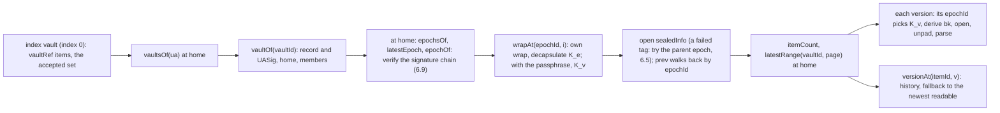
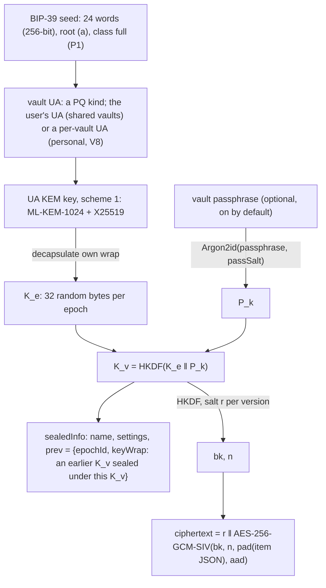

# PqVault: post-quantum notes and passwords in contract state — spec

Date 2026-11-17. Branch `pqvault` (from `ua-rs-sign` `d823d61f0`). Status: **SPECIFIED**, nothing built, **UNAUDITED**.
Revision 2 (same day): every finding of the Fable review `scratchpad/pqvault-review/20261117-12-fable-fable-high-spec.md`
(P1 F1–F5, P2 F6–F15, P3 F16–F22) applied; section 16 maps each finding to its fix.
Revision 3 (same day): the owner's rulings on the open points of section 14 (O1–O6, O8 as recommended; O7 and O9 stay open).
Revision 4 (same day): the owner's rulings N1 and N2 (section 3). **`PURPOSE_PQVAULT` is dropped**: Part R adds instead
one registry entry, an **open portable app namespace** `requirePortableApp` (section 4.1), so no later app needs a registry
change; PqVault signs under `appId = keccak256("scaas.pqvault.v1")`. **A vault has a mode fixed at creation**, portable
(path A) or chain-bound (path B, the registry's existing `requireAuthorized`, one instance, no replica) (section 5.15).
**The client stack is reversed**: `pqvault-core` depends on `scaas-sdk`, which holds no PqVault logic beyond two signing calls (CLI-PQV-13); it holds key
handles only and signs only under its own app purpose (sections 7, 8). PqChat and `PURPOSE_PQCHAT` do not change.
Revision 5 (same day): every finding of the Fable review r2 `scratchpad/pqvault-review/20261117-17-fable-fable-high-spec-r2.md`
(P1 R1, R2; P2 R3–R8; P3 R9–R14; info I1–I5) applied with the coordinator's calls; section 17 maps each finding to its fix.
Background and every option: the research note `docs/research/pqvault.md` (2026-11-17). The normative rules are in
[`docs/contracts/pqvault.md`](../../contracts/pqvault.md) (`CTR-PQV-*`) and
[`docs/clients/ua-libraries.md`](../../clients/ua-libraries.md#pqvault-clients) (`CLI-PQV-*`); this spec states the design
they rest on, the parts and their order. Plan: [`../plans/2026-11-17-pqvault.md`](../plans/2026-11-17-pqvault.md).
Revision 6 (2026-11-21): the owner's rulings O7 (b) and O8 (64 MiB / 3 / 4 pinned, no V0 timing run); a controller
call for sharing single notes through a reusable share box (section 6.7, within O1 (c)).

**Contents**

1. [Goal](#1-goal)
2. [Scope and non-goals](#2-scope-and-non-goals)
3. [Rulings and controller calls](#3-rulings-and-controller-calls)
4. [Part R: before the freeze](#4-part-r-before-the-freeze)
5. [Part V: the `PqVault` contract](#5-part-v-the-pqvault-contract)
6. [Cryptography](#6-cryptography)
7. [`pqvault-core`](#7-pqvault-core)
8. [The app-facing API of `pqvault-core`](#8-the-app-facing-api-of-pqvault-core)
9. [Client obligations](#9-client-obligations)
10. [Threat model summary](#10-threat-model-summary)
11. [Test strategy](#11-test-strategy)
12. [Other families](#12-other-families)
13. [Compared with Bitwarden and KeePass-format managers](#13-compared-with-bitwarden-and-keepass-format-managers)
14. [Open points for the owner](#14-open-points-for-the-owner)
15. [Rule ids](#15-rule-ids)
16. [Review findings and their fixes](#16-review-findings-and-their-fixes)
17. [Review r2 findings and their fixes](#17-review-r2-findings-and-their-fixes)

## 1. Goal

The owner (2026-11-17): PqVault is a
kind of thing like the PQ topics, storing data — notes, passwords — on chain. PqVault keeps a user's or a group's secrets
(logins, notes, cards, keys) as post-quantum encrypted items **in contract state**, recoverable on a new device from the
seed (and the vault passphrase) and the chain alone, shareable with other UAs, with every version kept and edits ordered
by the contract. It reuses PqChat's group machinery (records, KEM wraps, epochs, the home-instance slot, admins, leave,
remove) and adds an item model taken from PqChat topics (every version kept, an edit is the next version number, the
latest version readable from state).

Stack (revision 4, ruling N2): contract (EVM first) ← `pqvault-core` (Rust, an app core of its own) → `scaas-sdk` →
`ua-rs` and `scaas-rpc`. `pqvault-core` sits **above** the SDK: every signature, KEM, KDF and AEAD still runs in `ua-rs`,
reached through the SDK's app-core surface, on key handles; the SDK holds no PqVault logic beyond its two signing calls `sign_pqvault_record` / `verify_pqvault_record`, and all vault logic stays in `pqvault-core` (owner 2026-11-22, CLI-PQV-13). Apps: scaas-app's
`app-core-rust` with its `pqvault` feature (its contract section 12), and scaas-tui.

## 2. Scope and non-goals

**In scope.** Part R (before the EVM freeze, small): the registry's open portable app namespace `requirePortableApp`
(any app, PqVault the first) and every client place it touches; the code PqChat and PqVault share, extracted into a base
with proof that PqChat's behaviour is unchanged. Part V (may follow the freeze): the `PqVault` contract with its two
modes, its factory class, tests and pins, vectors, the node's rows, `pqvault-core` above the SDK and its app-facing API,
client rules.

**Non-goals (v1).** Deletion of bytes (impossible on a public chain: a delete is a tombstone version); real revocation of
what a removed member already read; a passphrase change that protects versions already written; per-item keys and
single-item sharing (share by copying items into a shared vault); a batch of edits (only creates batch, V6) and per-item
re-encrypting edits; files on chain beyond the 16 KiB item bound (V7); per-device KEM keys; an unlinkable mode hiding a
shared vault's members; searchable encryption (search is local); autofill integrations (per platform, later); passkey
storage; other families (section 12).

## 3. Rulings and controller calls

**Owner rulings** (2026-11-17: the research written at once, then, as proposed, the pqvault spec written at
once). Every decision V1–V12 of the research §11 is settled as
recommended there:

| Id | Ruling |
|---|---|
| V1 | Option B: a new factory contract `PqVault` on PqChat's record, wrap, epoch and home-slot rules with **≥ 1 member**; items as PqChat topics: every version kept, an edit must be the next version number, the latest version readable from state, recovery from state alone |
| V2 | ~~`PURPOSE_PQVAULT = keccak256("scaas.ua.purpose.pqvault.v1")` joins the registry's closed portable purpose set before the freeze~~ — **replaced the same day** by ruling N1 below: the registry gains an open portable app namespace before the freeze, and PqVault signs under its `appId` |
| V3 | The code shared with PqChat is extracted into a shared base, PqChat's storage-layout and gas pins proving PqChat unchanged; if that cannot be proven, copy it |
| V4 | Every member of the current epoch writes (creates and edits any item of the vault) |
| V5 | Revocation is a rekey only; old versions stay under their epochs; the client lists the passwords the removed member could read, to change at the services |
| V6 | A batch entry point creating many items under one signature |
| V7 | Small secrets on chain (inside an item), files off chain (key and hashes inside the item) |
| V8 | A personal vault is held by a per-vault UA derived from the seed; shared vaults by the members' own UAs |
| V9 | ~~No passphrase beyond the seed in v1~~ — **changed the same day** by ruling P2 below |
| V10 | A new generic factory class (not class 3, which clients read as `PqChat`) |
| V11 | ~~The SDK module is named `pqvault` (the SDK's `vault` is the seed vault)~~ — **replaced the same day** by ruling N2 below: no SDK module; `pqvault-core` is an app core above the SDK |
| V12 | The registry part and the shared-code part land before the freeze; the contract may come after |

**Owner rulings N1 and N2** (2026-11-17, after the owner noted that a closed portable list in an immutable registry makes
every later app wait for a registry change):

| Id | Ruling |
|---|---|
| N1 | PqVault and later apps go by (A) and (B): both are supported. **(A)**: one registry change before the freeze, an **open portable app namespace**, so any app gets portable (chain-free, replica-able) records without another registry change. **(B)**: the existing chain-bound `requireAuthorized` path, no registry change, one instance, no replicas. Replaces V2 |
| N2 | The dependency is reversed. `scaas-sdk` is the generic platform; app cores (`pqvault-core`, and any third party's) depend on it, and the SDK knows nothing about PqVault (amended by the owner 2026-11-22, CLI-PQV-13: the SDK holds no PqVault logic beyond its two signing calls `sign_pqvault_record` / `verify_pqvault_record`; all vault logic stays in `pqvault-core`). scaas-app links the SDK and the app cores in its one Rust library (`app-core-rust`, with the features `native-core`, `scaas`, `pqchat`, `pqvault`; scaas-app's contract section 12). Replaces V11 and the module placement of CLI-PQV-01 and of the SDK spec's R12 |

The same day the owner also reversed `pqchat-core`;
that ruling is recorded by the `scaas-sdk` spec. PqChat's contract and `PURPOSE_PQCHAT` do not change.
And the owner asked for a client e2e in the plan, for `pqchat-core` and
likewise for PqVault: a real-crypto client e2e on a local chain, then on the SCaaS testnet (plan V10e, section 11).

**Owner ruling (a)** (2026-11-17): a personal vault is a vault of **exactly one member** (the owner's UA, or the
per-vault UA of V8) whose random epoch key `K_e` is wrapped once, to that UA's own KEM key — the same contract and
cryptographic path as a shared vault. There is **no seed-derived personal-key mode**. Sharing it later is no rekey: by
ruling O1 (c) below, the client makes a new shared vault and copies the chosen live items into it (section 6.7).

**Owner rulings on the open points** (2026-11-17, the whole table as proposed; each as section 14
recommended):

| Id | Ruling |
|---|---|
| O1 | **(c).** A vault is personal or shared from its creation (`sealedInfo`'s `shared`, section 6.4). A shared vault links its epochs with `prev`, the client warning before each add how many items and old versions the new member will read. A personal vault is never rekeyed to add a member: sharing from it is a new shared vault under the user's own UA and a copy of the chosen live items by `createItems`, keeping the personal vault's history, tombstones, passphrase and per-vault UA private. No per-item re-encrypting edit is built. Ruling (a)'s "sharing later is a rekey" is replaced by this |
| O2 | **(a).** V3's proof may move PqChat's release-size pins, with old → new figures; behavioural pins frozen, 55 of 55 mutants, the claim worded "behaviour unchanged" (VC6) |
| O3 | **(b).** A member that left an epoch writes no item under it (`PqVaultNotMember`), as a removed member (VC3, section 5.6) |
| O4 | **(a).** Every passphrase change is a rekey (VC10), with the weakest-epoch statement of section 6.5; no rekey-free re-seal |
| O5 | **(a).** A shared vault has one passphrase per vault, agreed out of band, off allowed; the client refuses the user's personal vault passphrase and says a PqChat session is not out of band for a seed thief |
| O6 | **(a).** Factory class 4 (VC1); `CLASS_PQVAULT` beside `CLASS_PQCHAT` and the named creation config |
| O7 | **(b)** (owner 2026-11-21). A device-keystore-wrapped `P_k` behind biometrics is allowed per device, opt-in, off by default: on that device the device key and the seed then open the vault without the passphrase; the client says so when the user turns it on |
| O8 | `passKdf = 1` is **pinned at 64 MiB / 3 / 4** (owner 2026-11-21: pinned as recommended, no V0 timing run). Should an iOS AutoFill extension prove unable to run it, a smaller-memory set with more passes comes as a new `passKdf` id, never a change of id 1 |

**Owner rulings P1 and P2** (2026-11-17, after comparing PqVault with Bitwarden and AuthPass: points 1
and 2 as proposed, written into the spec):

| Id | Ruling |
|---|---|
| P1 | **Only a PQ-rooted 24-word (256-bit) seed may own a pqvault.** `pqvault-core` (revision 4: no longer the SDK, which only reports a seed set's authenticated `class`) refuses a classical-rooted seed set (root (c), the EOA signature, and root (d), the raw private key, of the SDK key research §5) and a phrase below 24 words, with a named error; the vault UA, a per-vault UA (V8) included, derives from such a seed (section 6.1) |
| P2 | **A vault passphrase is an option, on by default** (V9 changed). The epoch key that opens items combines the KEM-unwrapped `K_e` with `Argon2id(passphrase, salt)`, the salt per vault, random, in the vault's record with the parameter set's version; a stolen seed alone opens nothing, a stolen passphrase alone opens nothing; changing the passphrase re-encrypts no item; the passphrase is never stored or sent; a wrong one is detected by an AEAD check before any item is opened; forgetting it loses the vault (the UI warns); the per-vault choice is a flag in state (no passphrase value, no hint). Honest limit: versions written before a change stay under the old passphrase on chain (and section 6.5: history is as strong as the weakest epoch that links to it) |

**Controller calls** (owner may override; none is an owner ruling; recorded in `owner: no` register entries; open
alternatives are in section 14):

| Code | Call |
|---|---|
| VC1 | Factory class **4**, kind 0 (the next free class id in `src/`; classes 4 and 5 appear only as test mocks on their own test factory) |
| VC2 | Write names distinct from PqChat's (`createVault`, `rekeyVault`, `addVaultWraps`, `leaveVault`, `removeVaultMembers`, …), so no write selector is shared with PqChat; views such as `versionAt(bytes32,uint32)` share PqChat's selectors, harmless (the node keeps rows for writes only) |
| VC3 | A removed member of an epoch writes no item under it; nor does a member that left it (owner, O3 (b)) |
| VC4 | Blob forms: a version-1 item `abi.encode(item, sigHash, batchId)`, an edit `abi.encode(edit, sigHash)`, a batch header; group records `abi.encode(record, sig)` with the **full** `UASig` (VC15) |
| VC5 | One HKDF call per version gives key and nonce (`L = 44`) |
| VC6 | V3's acceptance: PqChat's layout, typehashes, vectors, ABI, `interfaceId`, every per-operation gas row, its tests, the node's PqChat allow-list test and **55 of 55** mutants hold with no test, pin or vector edited ("behaviour unchanged"); the release-size pins move with old → new figures |
| VC7 | `sealedInfo.prev = {epochId, keyWrap}` (revision 4, VC24; was `{epochId, key}`) links an epoch to the previous effective key; optional: a rekey to a weaker epoch may leave it out (section 6.7) |
| VC8 | The per-vault UA's derivation account `PQV_ACCOUNT`, the index vault (index 0) holding the user's vault list, a gap-limit scan as fallback (section 6.1) |
| VC9 | Item ciphertext between 32 and **16,416 B**, checked by the contract (the 16,384 B bucket plus salt and tag) |
| VC10 | P2's design: the passphrase key enters each epoch's effective key `K_v`; a passphrase change, or turning it on or off, is a rekey of the same members with a fresh salt (section 6.5) |
| VC11 | P2's parameters: Argon2id (RFC 9106, version 0x13), proposed `passKdf = 1` = 64 MiB, 3 passes, parallelism 4, 32-B output, no associated data; **pinned only after the timing and memory task V0, run on the owner's leave** |
| VC12 | A seed-migration tool: new vaults under a new seed, the latest version of every live item copied, a closing tombstone per old item, and the warning that old ciphertexts stay and every secret must be changed at its service |
| VC13 | Client hardening: clipboard auto-clear, exact-host autofill matching, auto-lock on idle (5 min default) and on screen lock, no secret in logs or on screen beyond an explicit reveal |
| VC14 | Until the audit round that covers the contract, `pqvault-core` and the `ua-rs` paths it uses, with its reviewers named, the app labels PqVault UNAUDITED, test data only (whether an outside firm is a condition: O9) |
| VC15 | The vault, epoch and remove records keep their full `UASig` in state; a client verifies the chain of signatures before it trusts an epoch (section 6.9) |
| VC16 | **Every `rekeyVault` needs an admin of the parent** (no member-authored rekey in a vault) |
| VC17 | Items and versions are read at the home instance; a replica's version counts only when the home holds the same record and `sigHash` at the same `(itemId, version)` (as PqChat's replica rule) |
| VC18 | A vault the user did not create stays **pending** until accepted; the accepted set is kept as `vaultRef` items in the user's index vault (section 9) |
| VC19 | Passphrase UX: a minimum length (16 characters, or a generated passphrase offered by default: 6 BIP-39 English words since owner 2026-11-22, CLI-PQV-15) and a strength meter; nothing beyond the length is enforced; a shared vault's passphrase may not equal an unlocked personal vault's |
| VC20 | (A)'s design (section 4.1): the registry entry `requirePortableApp(ua, appId, typedDigest, auth)`, `purpose = keccak256(abi.encode(keccak256("scaas.ua.purpose.app.v1"), appId))` computed by the registry, `appId ≠ 0`, otherwise `requirePortable`'s checks; decisions (i)–(vi) as section 4.1 states them |
| VC21 | An app's portable domain has exactly the fields `name, version, salt` with `salt = appId` (PqVault's `DS_V` gains it), its chain-bound domain `name, version, chainId, verifyingContract`: the two field sets differ (rule (c) of section 4.1 (ii)); by default one purpose per app on both paths, `appPurpose(appId)` (PqVault uses it; an app may name its own chain-bound purpose, never a SCaaS one) |
| VC22 | A vault's `mode` (0 portable, 1 chain-bound) is a field of `PqVaultCreate`, fixed at creation, kept in state when 1, and bound into `vaultId` with the home (section 5.3, review r2 R5); every later record of the vault is signed and checked in the mode's domain, the vault taken from the stored epoch or item (R11); mode 1 names this instance as its home (section 5.15) |
| VC23 | `pqvault-core`'s default is mode 0 (portable); mode 1 on the user's choice only (review r2 R10: the clause "or where the chain's registry lacks `requirePortableApp`" is withdrawn) |
| VC24 | `sealedInfo.prev` carries the earlier epoch's key **sealed** under a `KeyWrap` key derived from the new epoch's key (`prev = {epochId, keyWrap}`), and a `file` item its file key sealed under a derived `kFile` (never under `K_v`); every key handle has one usage, `Derive`, `Data` or `KeyWrap` (review r2 R2, section 6.10); never key bytes, so `pqvault-core` holds handles only (coordinator condition C1, section 7) |
| VC25 | Coordinator conditions C1 and C2 (section 7): `pqvault-core` holds key handles only, never key bytes; it signs only under its app purpose through the SDK's app signing call, which refuses every SCaaS purpose and every SCaaS contract's or the registry's domain by name. If either cannot be met, the task stops and the owner decides (review r2 R9) |

## 4. Part R: before the freeze

Branch `pqvault-r` from `main` once PR #18 (`ua-mtx-merge`) has merged, on the owner's word; it merges into the contracts
line like any pre-freeze round, and the contracts audit covers it. Two independent pieces, R-A (the app namespace, tasks
R1 and R2) and R-B (base, task R3). Revision 4: R-A replaces the former R-P (`PURPOSE_PQVAULT` in the closed list), which
is dropped with V2.

### 4.1 R-A: the open portable app namespace (N1 (A), VC20)

**Why an entry and not a purpose.** `requirePortable`'s purpose list is closed (`_portablePurpose`,
`UARegistryCoreLib.sol` near line 685: `POP_V2`, `KEM`, `PQZ_KEY`, `PQCHAT`, `PQZ_SCOPED_KEY`) and the registry is never
upgraded, so each new portable purpose would wait for a registry generation. The chain-bound path `requireAuthorized`
is already open (any contract, any purpose; the app's own EIP-712 domain binds the chain): that is path (B) and needs
nothing here. Path (A) needs one entry that takes an **app id** instead of a purpose and derives the purpose itself, so
an app can never name a SCaaS purpose through it.

```solidity
// IUARegistry (view; SPECIFIED, CTR-UA-45 / CTR-UA-46)
function requirePortableApp(bytes32 ua, bytes32 appId, bytes32 typedDigest, UASig calldata auth) external view;

// UAKinds
bytes32 internal constant APP_PURPOSE_NS = keccak256("scaas.ua.purpose.app.v1");
function appPurpose(bytes32 appId) internal pure returns (bytes32) {
    return keccak256(abi.encode(APP_PURPOSE_NS, appId));
}
```

`requirePortableApp` reverts `UAUnauthorized(ua)` when `appId == 0`; otherwise it runs exactly `requirePortable`'s checks
with `purpose = appPurpose(appId)` in place of a caller-chosen purpose: a registered single key by `signature` only over
`uaMessage(kind, purpose, typedDigest)`; an `msig` by `members` only, minimal, accepted slots only, two levels, derived
members over `memberDigest(ua, uaMessage(MSIG, purpose, typedDigest))` under `member`, native members as decision (ii)
states; a native id and an unregistered id refused; no write, no event, no new error. The body is the existing one, and
**`_sigOk` keeps its behaviour byte for byte** (review r2 R1; ruling A5-m3's guard stays its first line, and
`test_ua_portable_sigOkPortablePurposesOnly` stays unchanged and green): `_sigOk`'s single-key tail (from `if (members.length !=
0) return false;` to its end) is split out as `_single(cfg, kind, d, ua, purpose, digest, sig)`, so `_sigOk` =
`_portablePurpose` + its `msig` branch + `_single`, and `register`, the three Aux callers and the external twin
`portableOk` do not move. `_portable(ua, purpose, typedDigest, auth)` is today's `requirePortable` body, its single-key
branch `auth.keyData.length == 0 && auth.members.length == 0 && _single(...)`, its `msig` branch `_msig(...)` as today
(never `_sigOk`'s classical shortcut, which accepts a classical-only `msig` with no members and is right only for
`POP_V2` at registration); `requirePortable` = `_portablePurpose` + `_portable`; `requirePortableApp` = `appId ≠ 0`,
`appPurpose`, `_portable`. About the same byte count. PqVault uses `appId = PQVAULT_APP_ID = keccak256("scaas.pqvault.v1")`; PqChat keeps
`PURPOSE_PQCHAT` on `requirePortable`, unchanged.

**Decisions (controller calls, owner may override), each with its reason:**

- **(i) Domain separation.** Every SCaaS purpose is `keccak256` of an ASCII string `scaas.ua.purpose.<p>.v<n>` shorter
  than 64 bytes (the longest today, `scaas.ua.purpose.pqz-scoped-key.v1`, is 34 B); an app purpose is `keccak256` of
  exactly 64 bytes whose first word is `APP_PURPOSE_NS`. Equal values need a keccak collision between preimages of
  different lengths; reaching a chosen SCaaS purpose from an `appId` needs a preimage. Distinct `appId`s give distinct
  purposes for the same reason. So no comparison against the existing purposes is added (it would cost bytes and prove
  nothing the hash does not). Rule kept for the future: a new SCaaS purpose stays such an ASCII string, and
  `APP_PURPOSE_NS` itself is never used as a purpose (the SDK refuses it with the other `UAKinds` constants). The other
  direction holds already: `requirePortable` refuses every app purpose (closed list), so an app record never passes as a
  SCaaS record. The convention is `appId = keccak256("<the app's own name>.v<n>")`; two apps that pick the same `appId`
  share a purpose and a salt, and only their domain names, versions and struct types keep their digests apart. Every
  purpose a SCaaS contract passes to the registry today is a `UAKinds` constant (review r2 I1), and the SDK's generated
  purpose list asserts the string form in its drift test (R14).
- **(ii) Native members of an `msig`.** On the portable path a native member signs the record's typed digest itself
  (TS-D4: `eth_signTypedData_v4`, or ERC-1271 over it; the registry checks it by `UAStore.byCode` over the raw typed
  digest), so neither the purpose nor the `ua` is in what it signs: its signature is valid under **every** `appId` and
  every closed-list purpose for the same 32 bytes. Derived members and single keys sign the purpose, so for them app X's
  signature is refused under app Y and under every SCaaS purpose, by the registry. **What guards native members is the
  app contract computing the typed digest itself, in its own domain, from the record it checks** (review r2 R6): a
  contract check, so "authorization lives in contracts" holds. Neither `salt = appId` nor the SDK's checks is that guard:
  the registry sees only a digest and cannot check a salt, and the salt does not stop a hostile dapp or app. A
  structural fact is stronger than any name list: SCaaS portable domains are `EIP712Domain(string name,string version)`,
  an app portable domain has the extra `salt` field and so another domain typehash, and an app digest can never equal a
  SCaaS portable digest whatever its name. **Residual (stated in section 10):** a dapp outside SCaaS can obtain a native
  member's signature that an app contract accepts by phishing one typed-data request per member (a hardware wallet shows
  "SCaaS PqVault" and has no chain or contract to warn about); it needs the quorum, the same holds for PqChat today, and
  mode 1 does not remove it (a native member signs `UAAuth` over an opaque digest). **Decision: no registry change for
  native members.** Refusing them was weighed and not taken (it would remove hardware-wallet members from every portable
  app record); a registry-built domain (`requirePortableApp(ua, appId, structHash, …)`, about 100–150 B) was weighed and
  not taken (it would fix every app's wallet prompt to one generic name); both remain the owner's to choose, since the
  registry is immutable. **Three rules for every app contract** on this entry, all met by `PqVault`, written into
  CTR-UA-46 and the entry's NatSpec: (a) the contract computes the digest itself, in its own EIP-712 domain, never from a
  caller's bytes (else any 32 bytes an EOA ever signed verify); (b) every record names the signing UA in a field (a native
  member's signature binds no `ua`, so without the field it is valid for every `msig` holding that member); (c) the
  portable and chain-bound domains have different field sets (a single key's signature under `appPurpose(appId)` is the
  same message on `requirePortableApp` and `requireAuthorized`, so only the digest separates path A from path B).
- **(iii) Gen 2 → gen 1.** Gen 2 forwards a record it does not hold to its predecessor's `requirePortableApp` plainly and
  returns gen 1's verdict, as `requirePortable` does (`UARegistry.sol` near 692, UA8-D11). A predecessor without the entry
  (any registry built before it; `UARegistry` has no fallback) reverts with empty data, and a revert of any shape is a
  refusal of a void view, so such a record is never accepted. No mapping of that revert to a named error (review r2 R10:
  it would cost bytes and a `try` in an immutable contract for test deployments only, since every chain is reset before
  the freeze and every registry from then on carries the entry). No constructor probe (as `requirePortable`).
- **(iv) Size.** Baseline (`smartcontracts/evm/size-baseline.json`, forms of `scripts/size_gate.py`): `UARegistry` (plain)
  **32,334 B**, its T-2 notice line 33,516 B (1,182 B free) and T-1 error line 35,286 B (2,952 B free);
  `UARegistryCoreLib` (library) **33,796 B**, its T-2 line 33,903 B (**107 B free**) and T-1 line 35,694 B (1,898 B free).
  Expected [E]: the registry's entry (dispatch, `_elsewhere` plain forward, `_libView`) ≈ +100–250 B; the library's entry (dispatch, decode, one `keccak256`, the shared body) ≈ +80–200 B, which may cross the library's
  T-2 notice line (a notice, not an error) and stays ≥ 1.6 KB under T-1 (about 1.7 KB left for audit fixes in that
  library before the freeze, review r2 I3). Dropping R-P's `PURPOSE_PQVAULT` comparison
  (≈ +40–80 B on the library) offsets part of it. No module split: if a figure passes a T-1 line the task stops and
  reports (the owner's call, per the size rule).
- **(v) Vectors.** clientkeys first: `src/ua.js` `APP_PURPOSE_NS`, `appPurpose(appId)`; `scripts/ua-wallet-vectors.mjs`
  gains rows `portable-app` in `smartcontracts/vectors/ua/sign.json` (the purpose of `PQVAULT_APP_ID` and of a test
  `appId`, the `uaMessage` and member digests of each signing kind, a native member's row over the typed digest with
  `salt = appId`, an `appId` of 0 refused); `smartcontracts/vectors/ua/rs_signatures.json` regenerated by `ua-rs`
  (`cargo test --features vectors --test wallet_pq -- --ignored regenerate`), its row-count pins moved with old → new
  figures; `ua-rs` `ua_portable.rs` `app_purpose(app_id)` and the portable-app path of `wallet/uasig.rs` (a native member signs
  the typed digest). Other `ua-*` read `vectors/ua/` with no source change (the app namespace is not in `PURPOSES`). The
  drift tests that read `_portablePurpose` (clientkeys `test/ua-wallet.test.js` near 524, `ua-rs` `tests/wallet_sign.rs`
  near 318) stay at five names: the closed list does not change.
- **(vi) Rule ids.** `docs/contracts/accounts.md`: **CTR-UA-45** (owner N1: the open portable app namespace and the
  chain-bound path, both supported) and **CTR-UA-46** (this design: the entry, the purpose form, separation, native
  members and the domain salt, gen-2 forwarding), both SPECIFIED.

Every place, in two commits that each leave every suite green:

| Commit | Place | Change |
|---|---|---|
| R1 | `smartcontracts/evm/src/ua/UAKinds.sol` | `APP_PURPOSE_NS`, `appPurpose(appId)`, NatSpec |
| R1 | `src/ua/UARegistryCoreLib.sol` | `_single` split out of `_sigOk` (its behaviour unchanged); `_portable` from today's `requirePortable` body; `requirePortable` = `_portablePurpose` + `_portable`; `requirePortableApp` |
| R1 | `src/ua/UARegistry.sol`, `src/ua/IUARegistry.sol` | the entry and its plain gen-2 forward; NatSpec with rules (a)–(c) of decision (ii) |
| R1 | `test/ua/UARegistryPortableApp.t.sol` (new) | every PQ holder kind and a classical kind accepted under two `appId`s; an `msig` by quorum, derived and native members; `appId` 0 refused; a signature under app X refused under app Y (derived members); an app purpose refused by `requirePortable` and a SCaaS purpose's signature refused by `requirePortableApp`; a native id and an unregistered id refused; a classical-only `msig` with empty `members` refused; a native member's signature accepted under two different `appId`s (documenting decision (ii)); gen 2 forwarding to a gen 1 with the entry (accepted) and to a gen 1 built from the **pre-change `UARegistry` bytecode** (refused; not a stub, which could have a fallback); `appPurpose` pinned against the vectors |
| R1 | `test/ua/UARegistryPortable.t.sol`, `UARegistryUaPortable.t.sol` | unchanged and green, `test_ua_portable_sigOkPortablePurposesOnly` included (`_sigOk` keeps its guard) |
| R1 | `smartcontracts/evm/size-baseline.json` | `UARegistry` and `UARegistryCoreLib` old → new; the library's deployment still fits one transaction, else stop and ask |
| R1 | UA gas pins (`test/ua/UAGas.t.sol`, `UARegistryGroups.t.sol`, `--isolate`) | unchanged within tolerance; a move stops the task |
| R2 | clientkeys, the vectors, `ua-rs` | as decision (v) |
| — | other `ua-*`, `scaas-node` | no source change (a view; the node keeps rows for writes only, the selector audit lists non-view entries only) |
| R4 | `docs/contracts/accounts.md` (CTR-UA-45, CTR-UA-46) | SPECIFIED → BUILT |

### 4.2 R-B: the base shared with PqChat (V3)

**Boundary.** A new abstract contract `smartcontracts/evm/src/pqgroup/PqGroupBase.sol`, no state variable (no plain slot),
holding what `PqChat.sol` and `PqChatCore.sol` do for a key group and what `PqVault` needs unchanged:

- the `Epoch` struct (same fields, same order: its layout is PqChat's), the blob store (`_codeCap`, `_put`, `_get`,
  `_word`), the nonce bitmap (`_nonceUsed`, the bit set of `_useNonce`);
- the list checks (`_checkLists`, `_has`, `_memberAt`, `_uas`, `_keeps`), the wraps (`_land`, `_blob`, `_pack`, the
  `wrapAt` decoder), the epoch rules (`_known`, `_parentOf`, `_slotFree`, `_noneRemoved`; `_rights` as the plain/admin
  test over lists) and the env read;
- the group types stay `IPqChat.MemberKey` and `IPqChat.Wrap` (their EIP-712 type strings `MemberKey(…)`, `Wrap(…)` are
  already neutral). `IPqChat.sol` keeps its struct declarations, so its ABI, its `interfaceId` and the node's source parser
  (`guard.rs` `pqchat_writes`) do not move. Consequence: `PqVault`'s ABI names `IPqChat.MemberKey` / `IPqChat.Wrap` in its
  `internalType`, and the node's parser of `IPqVault.sol` resolves those types from `IPqChat.sol`.

What differs per contract reaches the base through internal virtual hooks, each contract implementing them over **its
own** ERC-7201 namespace: the storage (`_epochs()`, `_childOf()`, `_nonces()`, `_chain()`, `_removals()`, the per-UA index
push), the record decoding (`_lists(ep)`), and the errors (one hook `_fail(code, a, b)` mapped by each contract to its own
named errors, so PqChat keeps every selector and PqVault raises `PqVault*`). The base's functions take ids and decoded lists
(admins, members, author), never a record type, so each contract adds its own conditions (PqVault: admin-only rekeys,
CTR-PQV-13). The signature check (`_auth`: purpose and domain), the ids, the typehashes and every entry stay in each
contract. `PqChatCore` becomes `abstract contract PqChatCore is PqGroupBase` with its namespace struct `S` unchanged;
`PqChatTopics` keeps reading it. Today `_nonceUsed` / `_useNonce` read `_s()` directly and `_rights` / `_parentOf` /
`_indexAdded` take `PqChatEpoch calldata`: moving them behind hooks and lists can move gas; the ±500 tolerance decides and
R3b is the safety net.

**Acceptance: PqChat's behaviour unchanged (VC6).** All of these, on one tree, with no test, pin or vector edited:

1. `test/pqchat/PqChatLayout.t.sol` and `test/v2/layout/PqChat.json` pass.
2. `*TypehashIsPinned` in `test/pqchat/PqChatTypes.t.sol` pass; `smartcontracts/vectors/pqchat/` byte-identical.
3. The ABI is equal: `forge inspect PqChat abi` and `forge inspect PqChatTopics abi` before and after, compared as JSON
   (functions, events, errors, `internalType` included), and `type(IPqChat).interfaceId` equal.
4. Every per-operation row of `test/pqchat/PqChatGas.t.sol` passes at its pin (regular ±500, state exact).
5. Every `test/pqchat/*.t.sol` passes; the node's `pqchat_rows_equal_the_contract_both_directions` passes; the mutant set
   of `runs/2026-11-10-ua-mtx-merge-3c/` (**55 of 55**: the 40 of T91 and the 15 added after the Fable fixes,
   `fable-p1-1`, `fable-p1-2` and 13 `p48-*`, which guard exactly the moved code) re-pointed to the moved lines kills 55 of
   55. `mutants.py` replaces literal lines, several `revert PqChat…(…)` that become `_fail(…)`: the summary carries an
   old line → new line table per mutant showing each is the same change. The mutant script is the one instrument allowed
   to change.
6. May move, each with old → new figures in the commit: `RUNTIME` (28,776 B), `RELEASE_REGULAR`, `RELEASE_STATE`,
   `MODULE_RUNTIME`, `MODULE_REGULAR`, `MODULE_STATE` in `PqChatGas.t.sol`, and the `PqChat` / `PqChatTopics` rows of
   `size-baseline.json`. PqChat's bytecode moves, so it is redeployed and Blockscout-verified at the next reset, and its
   diff is in the audit scope.

**Fallback (R3b).** If 1–5 cannot all hold, R-B stops, reverts to the tree before it, and Part V copies the same functions
into `src/pqvault/PqVaultCore.sol` under PqVault's names; the register records which item failed, and the two are unified
at PqChat's next release. PqChat is then untouched before the freeze.

### 4.3 Part R gates

`forge test` at the default set over every directory (shared modules change), the set-sensitive tests at the other three
sets per AGENTS.md (R touches no PQZ code: `script/pqz/at-set.sh <set> test` with the set-sensitive match, `PqzSet.sol`
restored), the size gate, the layout and typehash pins, `cargo test` and clippy of `ua-rs` and `scaas-node` (`guard`
tests), `node --test` of clientkeys, the other `ua-*` jobs of the CI header, the docs check. Through `scripts/capped`,
foreground.

## 5. Part V: the `PqVault` contract

Status: SPECIFIED. Files: `smartcontracts/evm/src/pqvault/{IPqVault,PqVaultTypes,PqVault}.sol` over `PqGroupBase` (or
`PqVaultCore.sol` on the fallback). Normative text: [contracts/pqvault.md](../../contracts/pqvault.md).

### 5.1 The release (V10, VC1)

Class 4, kind 0 on `OpenFactory`'s generic path, exactly as `PqChat` (CTR-CHAT-02): `publishClassEnv(4, 0, envVersion,
env)`, `deployImplementation(ReleaseId(4, 0, v), …, IPqVault.initialize.selector, type(IPqVault).interfaceId, initcode,
implArgs)`, `setClassKindEnabled(4, 0, true, chainUid)` after the notice period, `createInstance(ReleaseId(4, 0, v), salt,
abi.encodeCall(IPqVault.initialize, (ownerUA)))`. Constructor `(ReleaseId id, address factory_, bytes implArgs)` refusing
`PqVaultEnv` unless class 4, kind 0, version ≥ 1, factory ≠ 0 (`implArgs` empty unless a body module is needed, section
5.14); `initialize(bytes32 ownerUA)` factory only, once, `ownerUA` 0 or `creating()`; the owner UA has no power;
`factoryInfo()`, `supportsInterface`, `validateEnv` (chain uid, registry, `params[0] ≥ 24,576`), `chainEnv()`,
`rescue(asset)` (CTR-GOV-26, covered by `test/governance/SingletonRescue.t.sol`). State in the ERC-7201 namespace
`scaas.pqvault`, root `0x5bab91edb5f7201959ccc400acb38a4632e4bb30c3ed3cf98f817b8f10b48800`; no plain slot; layout pinned in
`test/v2/layout/PqVault.json` and `PqVaultLayout.t.sol`. The node and clients take as a `PqVault` only an address the
chain's factory lists as class 4 with version ≠ 0; the node's named creation config `(4, 0, "PqVault initialize(bytes32
owner)")` beside PqChat's.

### 5.2 Domains, purpose and records (N1, VC20, VC21, VC22)

Two domains, one per mode (section 5.15); one purpose, `P_V = appPurpose(PQVAULT_APP_ID)`, `PQVAULT_APP_ID =
keccak256("scaas.pqvault.v1")` (section 4.1):

```text
DS_V    = keccak256(abi.encode(keccak256("EIP712Domain(string name,string version,bytes32 salt)"),
                              keccak256("SCaaS PqVault"), keccak256("1"), PQVAULT_APP_ID))                       mode 0
DS_B(c) = keccak256(abi.encode(keccak256("EIP712Domain(string name,string version,uint256 chainId,address verifyingContract)"),
                              keccak256("SCaaS PqVault"), keccak256("1"), block.chainid, address(c)))           mode 1
```

`DS_V` has no chain id and no address (a record is the same bytes in every instance: replicas work) and carries `salt =
PQVAULT_APP_ID` (VC21: exactly `name, version, salt`, so its typehash differs from every SCaaS portable domain's and from
`DS_B`'s; the guard for native `msig` members is that `PqVault` computes `typed` itself, section 4.1 (ii)). Every record
names its signer in a field (`creator`, `author`, `member`, `admin`: rule (b) of section 4.1 (ii)). `DS_B(c)` binds the chain
and the instance `c`, computed at run time (the instance is a clone). A record is `typed(s) = keccak256(0x1901 ‖ DS ‖
hashStruct(s))` in its vault's domain, signed as a `UASig` over `uaMessage(kind, P_V, typed(s))` and checked by
`IUARegistry.requirePortableApp(ua, PQVAULT_APP_ID, typed(s), sig)` in mode 0 or by `IUARegistry.requireAuthorized(ua,
P_V, typed(s), sig)` in mode 1 (one internal `_auth(vaultId, signer, structHash, sig)` for all seven signed writes). No
record carries a fee, a deadline or a submitter; no write reads `msg.sender` except `initialize`. Type strings (pinned by
`*TypehashIsPinned` against `smartcontracts/vectors/pqvault/`):

| Struct | Type string | Signed by |
|---|---|---|
| `MemberKey` | `MemberKey(bytes32 ua,uint64 keyId,bytes32 via)` | inside the vault and epoch types |
| `Wrap` | `Wrap(bytes32 member,uint64 keyId,bytes mlkemCt,bytes32 x25519Eph,bytes sealedKey)` | unsigned; `wrapHashes[i] = hashStruct(Wrap_i)` |
| `PqVaultCreate` | `PqVaultCreate(bytes32 creator,uint64 nonce,uint8 mode,bytes32 homeChain,address homeVaultContract,bytes32[] admins,MemberKey[] members,bytes32[] wrapHashes,uint16 passKdf,bytes32 passSalt,bytes sealedInfo,uint8 groupMode)MemberKey(bytes32 ua,uint64 keyId,bytes32 via)` | `creator` |
| `PqVaultEpoch` | `PqVaultEpoch(bytes32 vaultId,bytes32 author,uint64 nonce,uint64 epoch,bytes32 parentEpochId,bytes32[] admins,MemberKey[] members,bytes32[] wrapHashes,uint16 passKdf,bytes32 passSalt,bytes sealedInfo)MemberKey(bytes32 ua,uint64 keyId,bytes32 via)` | `author` (an admin of the parent) |
| `PqVaultLeave` | `PqVaultLeave(bytes32 vaultId,bytes32 epochId,bytes32 member,uint64 nonce)` | `member` |
| `PqVaultRemove` | `PqVaultRemove(bytes32 vaultId,bytes32 epochId,uint64 nextEpoch,bytes32[] members,bytes32 admin,uint64 nonce)` | `admin` |
| `PqVaultItem` | `PqVaultItem(bytes32 vaultId,bytes32 epochId,bytes32 author,uint64 nonce,bytes ciphertext)` | `author` |
| `PqVaultEdit` | `PqVaultEdit(bytes32 itemId,bytes32 epochId,bytes32 author,uint64 nonce,uint32 version,bytes ciphertext)` | `author` |
| `PqVaultBatch` | `PqVaultBatch(bytes32 vaultId,bytes32 epochId,bytes32 author,uint64 nonce,PqVaultItem[] items)PqVaultItem(bytes32 vaultId,bytes32 epochId,bytes32 author,uint64 nonce,bytes ciphertext)` | `author` |

`PqVaultCreate`, not `PqVault`: a struct may not share the contract's name. `mode` (0 portable, 1 chain-bound) is fixed
by the creator's signature (VC22). `ciphertext` and `sealedInfo` are the only `bytes` besides the wrap's crypto objects;
every other field is named and typed.

**The passphrase flag (P2).** `passKdf` names the epoch's passphrase parameter set (0 = no passphrase, 1 = Argon2id set 1
of section 6.5; clients refuse an id they do not know); `passSalt` is the vault's 32 random salt bytes for that set. The
contract checks only `(passKdf == 0) == (passSalt == 0)` (`PqVaultShape`); every rekey is an admin's (VC16), so a change
of the flag is always an admin's signed record. The contract never sees a passphrase, a derived key or a hint. The flag is
public: an observer learns whether a vault uses a passphrase, nothing more.

### 5.3 Ids and nonce scopes

```text
vaultId = keccak256(abi.encode(keccak256("scaas/pqvault/v1/vault"), creator, nonce, mode, homeChain, homeVaultContract))
                                                                                            epoch 0's id too
epochId = keccak256(abi.encode(keccak256("scaas/pqvault/v1/epoch"), vaultId, author, nonce))  epochs >= 1
itemId  = keccak256(abi.encode(keccak256("scaas/pqvault/v1/item"), vaultId, author, nonce))
batchId = keccak256(abi.encode(keccak256("scaas/pqvault/v1/batch"), vaultId, author, nonce))

scope(vault) = keccak256(abi.encode(keccak256("scaas/pqvault/v1/scope/vault"), creator))
scope(epoch) = keccak256(abi.encode(keccak256("scaas/pqvault/v1/scope/epoch"), vaultId, author))   rekeys, leaves, removes
scope(item)  = keccak256(abi.encode(keccak256("scaas/pqvault/v1/scope/item"), vaultId, author))    items, edits, batches
```

Bitmaps as PqChat (word `nonce >> 8`, bit `nonce & 0xff`, any order, never locked, checked after the signature; a used
nonce `PqVaultNonceUsed(scope, nonce)`). A batch uses its own nonce and each item's nonce in `scope(item)`, so a batch id
and every item id are distinct. **`vaultId` binds the mode and the home** (review r2 R5): two vaults of one creator and
nonce in different modes or at different homes have different ids, and so do their epochs and items, so a cross-mode or
cross-home coincidence needs a hash collision; replicas of a mode-0 vault share its home and therefore its id. Nothing
needs the id before the home is known; PqChat's ids do not move (each contract has its own). The client draws the creation
nonce as 64 random bits (the bitmap takes any order), so a replica created from a public record never burns a nonce the
user will pick.

### 5.4 Storage

```solidity
/// @custom:storage-location erc7201:scaas.pqvault
struct V {
    bytes32 ownerUA;                                   // +0
    bool initialized;                                  // +1
    mapping(bytes32 => Epoch) epochs;                  // +2  PqGroupBase.Epoch, PqChat's layout
    mapping(bytes32 => bytes32) childOf;               // +3  home only
    mapping(bytes32 => mapping(uint256 => uint256)) nonces; // +4
    mapping(bytes32 => bytes32[]) chain;               // +5  per vault: epochs >= 1 in completion order
    mapping(bytes32 => address[]) removals;            // +6  per epoch
    mapping(bytes32 => bytes32[]) vaults;              // +7  per UA (vaultsOf)
    mapping(bytes32 => bytes32[]) items;               // +8  per vault, creation order (itemsOf)
    mapping(bytes32 => address) record;                // +9  per item: its version-1 blob; 0 = unknown
    mapping(bytes32 => address[]) edits;               // +10 per item: versions 2.. (blob heads)
    mapping(bytes32 => address) batches;               // +11 per batch: its header blob
    mapping(bytes32 => uint8) modes;                   // +12 per vault: 1 = chain-bound (section 5.15); 0 = portable, never written
}
```

**Slots versus SSTORE2, by size** (EIP-8037 as the repo uses it: 1,530 state gas per byte, 97,920 per new slot, 183,600
per new account). A ciphertext in plain slots costs 64 state bytes per 32 data bytes; a blob costs 183,600 once plus 1,530
per byte. Break-even ≈ 120 B; a password item (288 B) is ≈ 2× dearer in slots (research §8.2). So every record, ciphertext
included, is an SSTORE2 blob through `_put` (one blob up to `min(params[0], 65,535) − 1` B, else a chain), and slots hold
only pointers and indexes. Never a hash in a slot with the bytes in calldata or an event.

**Blob forms (VC4, VC15).** Vault, epoch and remove records: `abi.encode(record, sig)`, the **full** `UASig`, so a client
can verify them from state (section 6.9); these records are rare. A version-1 item: `abi.encode(item, sigHash, batchId)`
(`batchId` 0 for a single create, the batch's `sigHash` for a batch item); an edit: `abi.encode(edit, sigHash)`; a batch
header: `abi.encode(vaultId, epochId, author, nonce, bytes32[] itemIds, sigHash)`. Items need no signature bytes in state:
their AEAD under an authenticated `K_v` rejects a forged version (section 6.9).

Per write [E: research §8.2 and the Fable review's recomputation; measured in V6]:

| Write | New slots and blobs | State gas | Regular |
|---|---|---:|---:|
| `createItem`, password (288 B ciphertext) | `record`, `items[v]` element (+ the list length and a nonce word when first); a ≈ 577 B blob | ≈ 1.26–1.46 M | ≈ 0.15 M |
| `editItem`, password | `edits[i]` element (+ length on the first edit) | ≈ 1.17 M | ≈ 0.15 M |
| `createItem`, 4 KiB note (4,128 B) | as above | ≈ 7.33 M | ≈ 0.35 M |
| `createVault`, 1 member, its one wrap (ruling (a)) | seven slots ≈ 0.69 M; the record ≈ 0.96 KB ≈ 1.65 M; the wrap 1,688 B: 183,600 + 1,689 × 1,530 = 2,767,770; the full `UASig` ≈ 1.1 M (FN-DSA-512) / ≈ 5.1 M (ML-DSA-65) | ≈ 6.2 M / ≈ 10.2 M | ≈ 0.3 M |

### 5.5 Vaults, epochs, wraps, members, roles

PqChat's rules CTR-CHAT-06 to CTR-CHAT-10 and CTR-CHAT-20, through the shared base, with these differences only:

- **At least 1 member** at `createVault` (PqChat: 2) and at `rekeyVault`. A personal vault (ruling (a)) is a one-member
  vault, `creator` its admin and sole member, one wrap of a random `K_e` to `creator`'s KEM key, landed in the same call.
  No other personal-key mode exists.
- `createVault(PqVaultCreate v, Wrap[] wraps, UASig sig) returns (bytes32 vaultId)`: members strictly sorted, one hash
  each, each holding `keyId` here (`PqVaultKemKey`), admins strictly sorted and registered, `creator` in both, home named,
  the passphrase field shape (`PqVaultShape`); `mode` 0 or 1, and in mode 1 `homeChain == chainUid` and
  `homeVaultContract == address(this)` (`PqVaultShape`, section 5.15); signature in the mode's domain; `scope(vault)` nonce;
  `modes[vaultId] = 1` in mode 1; the record kept with its `UASig`;
  `vaults[ua]` gains the vault for every member; the given wraps land. The instance is home when `homeChain == chainUid`
  and `homeVaultContract == address(this)`.
- `rekeyVault(PqVaultEpoch e, Wrap[] wraps, UASig sig) returns (bytes32 epochId)`: parent stored, complete, `epoch ==
  parent + 1`, at home `childOf(parent) == 0` (`PqVaultEpochTaken`); **the author is an admin of the parent, not removed
  from it (`PqVaultNotAdmin`), for every rekey** (VC16: a vault has no ratchet reason for member-authored rekeys; this keeps
  a plain member from taking the slot with wraps or a `sealedInfo` the others cannot open, and makes a passphrase change
  an admin's signed record without a second rule); the removal precedence of CTR-CHAT-20 holds; `vaults[ua]` gains it for
  each added member. Dropping a member that left is an admin's rekey; with no admin left, membership and keys are frozen
  (items stay writable under the last epoch).
- `addVaultWraps(bytes32 epochId, uint32 first, Wrap[] wraps)`: unsigned, anyone; each wrap against its signed hash, once.
  A front-runner landing the author's own wraps makes the author's chunk revert `PqVaultWrapStored`; the client re-reads
  `wrapAt` and sends only what is missing (no wrap can be injected).
- `leaveVault(PqVaultLeave l, UASig sig)`, `removeVaultMembers(PqVaultRemove r, UASig sig)` (1–`REMOVE_MAX` = 16 members):
  as `leave`, `remove`; the remove record kept with its `UASig`. The client never offers `leave` to a vault's only member
  (it would leave a vault nobody can rekey).
- Sharing a vault created shared is a `rekeyVault` to the new member set with a wrap per member, linked by `prev`; a vault
  created personal is never rekeyed to add a member: the client copies into a new shared vault (O1 (c), section 6.7). The
  contract cannot tell the two apart (the flag is sealed); the rule is the client's.

### 5.6 Write rights (V4, VC3, VC17)

An item write (`createItem`, `editItem`, `createItems`) names `epochId`. Accepted only when: the epoch is stored for the
item's vault and complete here (`PqVaultUnknown`, `PqVaultIncomplete`); at home it has no complete child
(`PqVaultEpochTaken`); `author` is a member of it (`PqVaultNotMember`), not removed from it and has not left it (`PqVaultNotMember`, VC3, O3 (b):
one cold `SLOAD` of the epoch's left flag, 2,100 gas on a write of ≥ 1.4 M). A
replica (mode 0 only: a mode-1 vault has none, section 5.15) takes a write under any complete epoch it holds, in its own
arrival order (a replica orders nothing). **Items and versions are read at home** (VC17): a replica's version counts only when the home holds the same record and `sigHash` at
the same `(itemId, version)`; a client reads rights, versions and the latest version from the home and uses a replica
only to fetch bytes it then checks against the home. Read access is cryptographic (whoever holds `K_v`); write rights are
the contract's.

### 5.7 Items, versions, the conflict rule

- `createItem(PqVaultItem it, UASig sig) returns (bytes32 itemId)`: rights of 5.6 for `it.vaultId`; `32 ≤
  ciphertext.length ≤ 16,416` (VC9, `PqVaultShape`); signature; `scope(item)` nonce; blob `abi.encode(it, sigHash,
  bytes32(0))` into `record[itemId]`, `itemId` appended to `items[vaultId]`; `PqVaultItemCreated(vaultId, itemId, author, 0,
  sig)`.
- `editItem(PqVaultEdit d, UASig sig)`: `record[itemId] ≠ 0` (`PqVaultUnknown(itemId)`); the vault is read from the
  version-1 blob (`_word`) and the named epoch must belong to it (`PqVaultUnknown(epochId)`); rights of 5.6 for that vault
  (any member, not only the item's creator: V4); `version == count + 1`, the first edit 2 (`PqVaultVersion(expected,
  got)`); the ciphertext bound; signature; nonce in the vault's `scope(item)` of `author`; blob `abi.encode(d, sigHash)`
  appended to `edits[itemId]`; `PqVaultItemEdited(itemId, version, author, sig)`.
- **Conflict.** Two devices or members that both write version `n + 1` race; the contract takes the first and refuses the
  other `PqVaultVersion(n + 2, n + 1)`. The refusal is the conflict signal: the client reads the newest version, merges
  (section 7) and signs `n + 2`. Nothing is overwritten.
- Every version stays, readable from state; the latest is `count` (`1 + edits.length`). A delete is a version whose
  plaintext is a tombstone (`{"type":"deleted"}`); the contract does not know it.
- An edit may name any complete epoch the rights allow, normally the latest: the version's `epochId` tells a reader which
  `K_v` opens it.
- A member can make an item's latest version unreadable (garbage, or a replayed ciphertext whose AAD fails): the client
  falls back to the newest readable version through `versionAt`, shows who wrote the unreadable one, and sends nothing
  about it (CLI-PQV-05).

### 5.8 Batch creation (V6)

`createItems(PqVaultBatch b, UASig sig) returns (bytes32 batchId)`: `items.length ≥ 1`; for each item `vaultId`, `epochId`,
`author` equal the batch's and the ciphertext bound holds (`PqVaultShape`); rights of 5.6 once; **one** signature over the
batch (the EIP-712 struct holds the items, so the signature covers every ciphertext); the batch nonce, then each item's,
in `scope(item)`; per item a version-1 blob `abi.encode(item, sigHash, batchId)` and its list entry; the header blob into
`batches[batchId]` (so the signed record is rebuilt from state: the item records in the listed order);
`PqVaultItemCreated` per item (empty `sig`) and `PqVaultBatchCreated(vaultId, batchId, author, count, sig)`.

**Sizes.** No protocol bound on `items.length`: the client sizes a batch to its chain, with `(regular + state) × 1.05 ≤`
the chain's block gas limit (EIP-8037 inclusion) and `regular × 1.05 < 2^24` where EIP-7825 applies. With 60 M and
FN-DSA-512 (verifier ≈ 2.3 M regular, once): a warm password item is ≈ 1.26 M state plus ≈ 0.15 M regular, the header of a
36-item batch ≈ 2.4 M, so **≈ 33–35 password items** per batch, or ≈ 7 notes of 4 KiB; regular stays at ≈ 8–11 M, under
2^24 [E]. A 500-item import is ≈ 15 batches, ≈ 0.8 G gas, against ≈ 1.95 G one record each (research §8.2). A batch item's
blob repeats `vaultId`, `epochId`, `author` and `sigHash` held by the header (≈ 128 B, ≈ 0.2 M state gas, ≈ 15 %): a size
lever if imports matter, not taken in v1. ML-DSA authors need the cached expanded key (an uncached ML-DSA verify does not
fit 2^24).

### 5.9 Reads for recovery from state alone

No view reads a log; a client keeps no vault list (as CTR-CHAT-14). Pages are `[offset, min(offset + min(limit, MAX),
count))`, an offset past the end empty, never a revert.

| View | Returns | Bound |
|---|---|---|
| `vaultCount(ua)`, `vaultsOf(ua, offset, limit)` | vault ids, one entry per member at create and per member a rekey adds; append-only, may repeat; includes vaults the UA never accepted (section 9) | `VAULTS_RANGE_MAX = 128` |
| `vaultOf(vaultId)` | `(PqVaultCreate, UASig)`; `PqVaultUnknown` for an epoch id | — |
| `epochCount`, `epochsOf(vaultId, offset, limit)`, `latestEpoch(vaultId)` | epoch 0 then epochs ≥ 1 as they complete here (at home the winning chain) | `EPOCHS_RANGE_MAX = 128` |
| `epochOf(epochId)` | `(PqVaultEpoch, UASig)` | — |
| `epochComplete`, `childOf`, `wrapAt(epochId, i)`, `leftIn`, `removedIn`, `removalCount`, `removalAt` (`(PqVaultRemove, UASig)`), `nonceUsed(scope, nonce)` | as PqChat | — |
| `itemCount(vaultId)`, `itemsOf(vaultId, offset, limit)` | item ids in creation order | `ITEMS_RANGE_MAX = 128` |
| `itemOf(itemId)` | `ItemView{vaultId, versionCount, batchId}`; `PqVaultUnknown` | — |
| `versionAt(itemId, version)` | `VersionView{epochId, author, nonce, version, ciphertext, sigHash}`, 1 the original; `PqVaultVersion(count, version)` outside `1..count` | — |
| `latestRange(vaultId, offset, limit)` | `LatestView[]{itemId, versionCount, epochId, author, ciphertext}` | `LATEST_RANGE_MAX = 16`: 16 × ≤ 16,416 B ciphertext ≈ 270 KB per call on every chain (VC9) |
| `batchOf(batchId)` | the header: `vaultId, epochId, author, nonce, itemIds, sigHash`; `PqVaultUnknown` | — |



### 5.10 Events

Notify only. `PqVaultCreated(vaultId, creator, homeChain)`, `PqVaultEpochAdded(vaultId, epochId, parentEpochId, epoch,
author)`, `PqVaultWraps(epochId, first, count)`, `PqVaultEpochComplete(epochId)`, `PqVaultLeft(vaultId, epochId, member)`,
`PqVaultRemoved(vaultId, epochId, admin, members)`; three carry the item `UASig` so a mirror can copy the record:
`PqVaultItemCreated(vaultId, itemId, author, batchId, sig)` (empty `sig` for a batch item: the batch event carries it),
`PqVaultItemEdited(itemId, version, author, sig)`, `PqVaultBatchCreated(vaultId, batchId, author, count, sig)`. No event
carries a ciphertext. Every record and ciphertext is in state; an item's signature bytes are only in its event and its
transaction (its `sigHash` is in state; items are authenticated by their AEAD, 6.9), the group records' signatures are in
state.

### 5.11 Errors

`PqVaultEnv`, `PqVaultNotFactory`, `PqVaultInitialized`, `PqVaultOwnerNotCreator(ua)`, `PqVaultShape`,
`PqVaultKemKey(ua, keyId)`, `PqVaultUnknown(id)`, `PqVaultIncomplete(epochId)`, `PqVaultEpochNumber(expected, got)`,
`PqVaultEpochTaken(parent, child)`, `PqVaultNotMember(ua)`, `PqVaultNotAdmin(ua)`, `PqVaultNonceUsed(scope, nonce)`,
`PqVaultWrapHash(epochId, i)`, `PqVaultWrapStored(epochId, i)`, `PqVaultRemovedKept(epochId, ua)`,
`PqVaultVersion(expected, got)`; the registry's `UAUnauthorized` / `UAVerifyGas` bubble; `EnvMissing` from the env code.

### 5.12 Every external entry

| Entry | Who | Checks | Errors |
|---|---|---|---|
| `createVault(v, wraps, sig)` | anyone submits; `creator` signs | 5.5 | `PqVaultShape`, `PqVaultKemKey`, registry, `PqVaultNonceUsed`, `PqVaultWrapHash` |
| `rekeyVault(e, wraps, sig)` | anyone; `author`, an admin of the parent, signs | 5.5 | `PqVaultUnknown`, `PqVaultIncomplete`, `PqVaultEpochNumber`, `PqVaultEpochTaken`, `PqVaultShape`, `PqVaultKemKey`, `PqVaultNotAdmin`, `PqVaultRemovedKept`, registry, `PqVaultNonceUsed`, `PqVaultWrapHash` |
| `addVaultWraps(epochId, first, wraps)` | anyone, unsigned | 5.5 | `PqVaultUnknown`, `PqVaultEpochTaken`, `PqVaultShape`, `PqVaultWrapHash`, `PqVaultWrapStored`, `PqVaultRemovedKept` |
| `leaveVault(l, sig)` | anyone; `member` signs | 5.5 | `PqVaultUnknown`, `PqVaultNotMember`, registry, `PqVaultNonceUsed` |
| `removeVaultMembers(r, sig)` | anyone; `admin` signs | 5.5 | `PqVaultUnknown`, `PqVaultIncomplete`, `PqVaultEpochTaken`, `PqVaultEpochNumber`, `PqVaultShape`, `PqVaultNotAdmin`, `PqVaultNotMember`, registry, `PqVaultNonceUsed` |
| `createItem(it, sig)` | anyone; `author` signs | 5.6, 5.7 | `PqVaultUnknown`, `PqVaultIncomplete`, `PqVaultEpochTaken`, `PqVaultNotMember`, `PqVaultShape`, registry, `PqVaultNonceUsed` |
| `editItem(d, sig)` | anyone; `author` signs | 5.6, 5.7 | the above and `PqVaultVersion` |
| `createItems(b, sig)` | anyone; `author` signs | 5.6, 5.8 | as `createItem` |
| `initialize`, `rescue`, introspection | 5.1 | | as PqChat |
| every view of 5.9 | view | | 5.9 |

Eight writes (seven signed, one unsigned), each one operation with named, typed parameters.

### 5.13 Relaying and the node

Every write is relayable by anyone with a fee of 0; a payer pays a relayer beside the record through `RelayFeeRouter`
(CTR-MTX-27). The node (Part V, `docs/node/job-api.md`):

- a contract kind `pqvault` in `typed.rs` with the eight rows, equal to `IPqVault.sol`'s writes both directions (from the
  source, resolving `IPqChat` types, and from forge's `methodIdentifiers`), each selector a row of `pqvault` and of no
  other kind (VC2); the `kinds` lists of the node tests (`guard.rs` near 1822 and 3090) and their row-count pins updated;
- `guard.rs`: `CLASS_PQVAULT = 4` beside `CLASS_PQCHAT`, `"pqvault" => Rule::FactoryClass(CLASS_PQVAULT)`, on the direct
  path and on `RelayFeeRouter.relay`'s inner call (the branch near lines 1159–1160 is written for `pqchat` only today:
  generalised to both kinds); the unsigned `addVaultWraps` relayed only paid or under `params.relay_unsigned_pqvault`
  (default `false`; `UNSIGNED_WRITE_NOT_PAID`);
- `typed.rs` `INSTANCE_CONFIGS` (near line 1093) gains `(4, 0, "PqVault initialize(bytes32 owner)")`, so
  `mtxCreateInstance` of class 4 has its named form; clientkeys `src/factory.js` `instanceInitCall` (near line 135) and
  `test/typed-ops.test.js` (near 975) the same;
- `selector_audit.json` gains `PqVault` (seven `SIGNED`, one `PERMISSIONLESS`), read by `SelectorAudit.t.sol`.

Job shape `{kind: "call", op: {entry, contract: "pqvault", token: <instance>, args, validUntil}}`, records and wraps as
named-field objects, hex forms `422 HEX_ARGS_REFUSED`. No vault key or plaintext ever reaches the node.

### 5.14 Gas and size

**Size [E].** `PqVault` ≈ 24–30 KB runtime: PqChat's release is 28,776 B with sessions, messages, the store and twenty
topic stubs; PqVault drops messages, the store and the stubs (≈ 4–6 KB) and adds three records, the batch loop and six
item views (≈ 5–7 KB). Against the 64 KiB ceiling: about half. Against the one-transaction deploy line (`(regular +
state) × 1.05 ≤ 60 M`, CTR-TOK-30: 33,594 B at PqChat's split): under it. If the built runtime passes 33,594 B the task
stops and reports to the owner (a body module is the owner's call).

**Gas pins expected** (`test/pqvault/PqVaultGas.t.sol`, `isolate = true`, regular ±500, state exact, the stand-in
verifier): `createVault` 1 member 1 wrap; `createVault` 2 members both wraps; `rekeyVault` 1 → 2 members (share) and 2 → 1
after a removal; `addVaultWraps` 1 wrap; `removeVaultMembers` 1 of 3; `leaveVault`; `createItem` 288 B (new list; warm);
`editItem` 288 B (first; later); `createItem` 4,128 B and 16,416 B; `createItems` 10 and the largest that fits 60 M with
FN-DSA-512's 2.3 M added (expected 33–35); the release (`RUNTIME`, deploy regular and state) and `createInstance`.

**Totals with a real verifier [E]:**

| Write | FN-DSA-512 | ML-DSA-65 cached | ML-DSA-65 by precompile |
|---|---:|---:|---:|
| password item, new | ≈ 3.9 M | ≈ 7.4 M | ≈ 1.8 M |
| password item, edit | ≈ 3.6 M | ≈ 7.1 M | ≈ 1.5 M |
| 4 KiB note, new | ≈ 10.0 M | ≈ 13.5 M | ≈ 7.9 M |
| personal vault: `createVault` (one wrap, full `UASig` in state) | ≈ 8.8 M | ≈ 16.3 M | ≈ 10.7 M |
| per-vault UA registration with its KEM key (V8), per hosting chain | ≈ 4–6 M | the same plus the expanded-key cache first: 9.58 M + 13.41 M (ML-DSA-65, accounts.md) | the same as FN-DSA-512 |
| share with one person (`rekeyVault` 1 → 2, two wraps, `UASig` in state) | ≈ 11.5 M | ≈ 19 M | ≈ 13.6 M |

Mode 1 (chain-bound) changes these by ≈ 0.1 % (section 5.15). A personal vault on a fresh per-vault UA therefore costs ≈
13–15 M with FN-DSA-512 per chain: the recommended kind for
per-vault UAs (no cache, cheapest), CLI-PQV-09. Part R adds no PqVault pin and keeps every PqChat and UA per-operation pin.

### 5.15 The two modes (N1, VC22, VC23)

Status: SPECIFIED. A vault's `mode` is a field of its `PqVaultCreate`, fixed by the creator's signature and never changed
(a rekey cannot change it: the epoch record has no such field, and every epoch is checked in the vault's mode).

| | Mode 0, portable (path A) | Mode 1, chain-bound (path B) |
|---|---|---|
| Domain | `DS_V` (no chain, no address, `salt = PQVAULT_APP_ID`) | `DS_B(this)`: `chainId`, `verifyingContract` |
| Registry check | `requirePortableApp(ua, PQVAULT_APP_ID, typed, sig)` (section 4.1) | `requireAuthorized(ua, P_V, typed, sig)`, no registry change |
| Instances | home plus replicas; items read at home (VC17) | one: the creating instance is the home (`homeChain == chainUid`, `homeVaultContract == this`, else `PqVaultShape`); a record verifies nowhere else, so no replica can exist |
| `UASig` | `requirePortable`'s forms: a single key `signature` only; an `msig` `members`, native members over the typed digest itself | `requireAuthorized`'s forms (TS-D12): a stored kind (every PQ kind) `signature` only, a non-stored classical kind `keyData` + `signature`; an `msig` `members`, native members over `UAAuth(ua, P_V, typed)` in the registry's chain-bound domain (CTR-UA-24) |
| State | nothing extra | `modes[vaultId] = 1` (one slot at creation) |
| Who may sign | registered UAs only (a native id is refused by the registry) | the same in effect: a native id passes `requireAuthorized`, so it can sign nothing in a vault only because admins and members must be registered with a KEM key (`PqVaultKemKey`), the same checks in both modes; a native id as author is refused `PqVaultNotMember` (a test, review r2 R14) |

**Shared, unchanged by the mode:** ids, nonce scopes, storage and blob forms (the full `UASig` of group records kept in
either form), epochs, wraps, the home slot, roles, items, versions, batches, every view, events, errors, the key schedule
and the AAD (which binds `homeChain` and `homeVaultContract`, the instance itself in mode 1).

**How the contract picks.** `createVault` reads `mode` from the record it verifies; every other signed write takes the
vault from **stored** state, the epoch the record names (for `editItem` the item's version-1 blob), requires the
record's `vaultId` to equal that vault where the record names one (`PqVaultUnknown`), then reads `modes[vaultId]` before
it builds the digest and calls the mode's registry entry (review r2 R11). One function, `_auth`, does this for all seven
signed writes, so the choice is made in one place.

**Recovery.** The same views. A mode-1 vault lives on one instance: its `vaultRef` (section 6.8) names that instance and
`mode: 1`; the client verifies its records (section 6.9) with `DS_B(home)`, reading from that home only. The per-vault UA of a personal mode-1 vault is
registered on that chain only.

**Vectors.** `records.json` holds every record type in both domains (a fixed `chainId` and instance address for `DS_B`),
`mode` 0 and 1, and the refusals: a mode-1 record replayed into a second instance, a mode flipped after signing, a native
member's mode-0 signature presented in mode 1 and the reverse. A mode-0 and a mode-1 vault with one `vaultId` cannot be
built (R5): the vectors show the two ids of one creator and nonce differ.

**Gas [E].** Every signed write in either mode reads `modes[vaultId]` cold: +2,100 regular. Mode 1 skips the registry's
library hop (≈ −3 to −5 k regular against mode 0) and computes `DS_B` at run time (≈ +0.3 k); `createVault` in mode 1
writes one more slot (97,920 state gas, ≈ 0.1 M). Against a password item of ≈ 3.9 M (FN-DSA-512) the difference is ≈
0.1 % either way; the gas pins of section 5.14 gain the mode-1 rows `createVault` 1 member, `createItem` 288 B,
`editItem` 288 B and `rekeyVault` 1 → 2.

**Size and risk [E].** Mode 1 adds ≈ 300–600 B to a ≈ 24–30 KB runtime (the second domain, the branch with two registry
call encodings, the slot, the home check): still about half the 64 KiB ceiling and under the 33,594 B deploy line. Replay
safety holds by construction: ids bind the mode and the home (R5), and `_auth` takes the vault from stored state (R11).
The mutants "mode never read", "mode always 1" and the vault-equality check dropped in each write stay as depth (section
11).

**What mode 1 costs a user.** No replica: the vault is as available as its one chain and instance; nothing about it is
portable to another chain. Its gain for PqVault is small (no dependence on `requirePortableApp`; records nobody can
replay into another instance); it exists by ruling N1 so PqVault runs on both paths an app can take. `pqvault-core`
creates mode 0 by default and mode 1 on the user's choice only (VC23).

## 6. Cryptography

Client-side (`pqvault-core` over the SDK's app-core surface, which runs each step in `ua-rs` on key handles: section 7);
the contract runs no KEM, KDF or cipher. Every primitive is `ua-rs`'s
(RustCrypto: `kem.rs`, `aead.rs`, and Argon2id added in Part V, section 6.5); randomness from the OS RNG inside the
libraries, fixed values only under feature `vectors` (CLI-UAL-02). `‖` is concatenation, `be16` / `be32` / `be64`
big-endian.

### 6.1 Seeds and the vault UA (P1, V8)



- **Only a PQ-rooted 24-word seed owns a vault (P1).** `pqvault-core` checks the seed set's derivation record (SDK key
  research §6.5: `class` and `warnings`) before it creates, accepts, unlocks or writes a vault for a UA: it refuses with
  `SeedNotPqRooted` a set whose `class` is `classical-rooted` (roots (c) and (d), and every BIP-85 child of them), a set
  carrying `below-24-words` (an imported 12–21-word phrase), and a key that is not derived from a seed (an imported raw
  key). A 24-word BIP-85 child of a full 24-word set is accepted. The user's own vault UA must also be of a PQ kind (a KEM
  holder is one already).
- **What P1 cannot give (honest).** It binds what this client does for its own user. Nothing on chain shows another
  member's seed class, so **a shared vault is only as quantum-safe as its weakest member's seed**: a member whose seed comes
  from an EOA signature or a raw classical key gives a future quantum attacker that member's KEM key, hence `K_e` of every
  epoch it was wrapped into and, through `prev`, the history linked to those epochs. Separately, a classical-kind **UA**
  (visible on chain) as admin can have its signatures forged by the same attacker (rekey, remove): the client warns when a
  member or admin of a vault has a classical UA kind and says that other members' seed roots cannot be checked.
- **The vault UA.** A shared vault's members are their own UAs. A personal vault (V8, ruling (a)) is held by a per-vault
  UA: `ua_secret(seed, kind, PQV_ACCOUNT, i)` of `ua-rs` `derive.rs` on the P1 seed, `kind` FN-DSA-512 by default (the
  cheapest PQ kind to register, no expanded-key cache), `i` the vault's index, `PQV_ACCOUNT` a constant fixed by the
  clientkeys vectors in Part V (VC8; proposal `0x70717600`). **Index 0 is the index vault**: created with the first vault the
  user makes or accepts; it holds `vaultRef` items (section 6.8) naming every other vault of the user (personal indexes,
  shared vault ids and homes, the accepted epoch). Recovery opens the index vault first and reads the rest from its
  `vaultRef` items; the gap-limit scan (20 empty indexes) is only the fallback when the index vault is lost or unreadable.
  The UA is registered with its KEM key on each chain hosting the vault, relayed at fee 0.
- **The KEM key** is the UA's (CTR-UA-32), the same on every device of the UA; `msig` UAs have none: a vault naming an
  `msig` wraps to its accepted members (`via`), as PqChat.
- **`K_e`**: 32 random bytes per epoch, never derived from another key; at a rekey a new one. **No seed-derived vault key
  exists** (ruling (a)).

### 6.2 Wrap (as UA-7 §6.2, own label)

```text
(mlkemCt, x25519Eph, ss) = KEM.Encaps(kemPk)            scheme 1; FIPS 203 §7.2 checks on ek before; all-zero X25519 refused
kek       = HKDF-SHA-256(ikm = ss, salt = empty,
                         info = "scaas/pqvault/v1/wrap" ‖ vaultId ‖ epochId ‖ member ‖ be64(keyId) ‖ 0x01 ‖ keccak256(kemPk), L = 32)
sealedKey = AES-256-GCM(kek, nonce = 0^96, K_e, aad = vaultId ‖ epochId ‖ member ‖ be64(keyId))      48 B
Wrap      = {member, keyId, mlkemCt (1,568 B), x25519Eph (32 B), sealedKey (48 B)}                 1,688 B packed in state
```

For epoch 0, `epochId = vaultId`. `nonce = 0` is safe: each `kek` encrypts once. A wrap that does not open is reported to
the user as "epoch N by <author> cannot be opened" (section 6.5), never to anyone else.

### 6.3 The effective epoch key `K_v`

```text
P_k = Argon2id(password = passphrase, salt = passSalt, params of passKdf, output 32 B)    passKdf ≠ 0; no secret, no associated data
P_k = empty                                                                              passKdf = 0
K_v = HKDF-SHA-256(ikm = K_e ‖ P_k, salt = empty, info = "scaas/pqvault/v1/vkey" ‖ vaultId ‖ epochId ‖ be16(passKdf), L = 32)
```

**The passphrase's bytes** (controller call 2026-11-21, the Fable code review F4): `passphrase` is RFC 8265's OpaqueString of
the text typed: every non-ASCII space (Unicode category Zs) mapped to U+0020, then Unicode NFC, then UTF-8; an empty result
or a control character (category Cc) is refused (`PassphraseInvalid`). So one passphrase typed on a platform that composes and
on one that decomposes (é, Vietnamese tone marks, Hangul) gives one `P_k`. `pass.json` `normalization` pins it (NFC and NFD
rows, one `P_k`; the raw NFD bytes give another). A later change of these bytes is a new `passKdf` id.

Argon2id takes no associated data: `K_v`'s HKDF info binds `vaultId`, `epochId` and `passKdf`, and `passSalt` is 32 random
bytes per vault, so nothing is lost, and `argon2` 0.6.0 (whose associated data is at most 32 B) and `@noble/hashes` compute
the same bytes. Every key below derives from `K_v`, never from `K_e` directly.

### 6.4 `sealedInfo` and item versions

`sealedInfo = n_i ‖ AES-256-GCM-SIV(kInfo, n_i, padInfo(canonical JSON))` (`padInfo`: `u32be(len) ‖ content ‖ zeros` to
1,024 B, the smallest bucket, so the size shows neither whether an epoch links `prev` nor a longer name (a 64-character name in
any script, an icon and settings fit beside `prev`); past 1,024 B the next power of two, at most 16,384 B; sealed 1,052 B in the
common case. Each byte is state gas: 1,052 B against PqChat's 284 B (the 256-B bucket) costs about +1.18 M state gas per vault
or epoch record (768 B × 1,530). The contract checks the structure only, 28 to 16,412 B (`PqVaultShape`), not the client's
padding: owner 2026-11-21 for the bucket, controller call 2026-11-21 for the bound, the Fable code review F12, F8), `kInfo = HKDF-SHA-256(ikm = K_v, salt = empty, info =
"scaas/pqvault/v1/info" ‖ vaultId ‖ epochId, L = 32)`, `n_i` 12 random bytes. Content `{"name", "shared", "icon"?, "prev"?,
"settings"?}`; `shared` is a boolean fixed at creation and copied unchanged by every rekey (a client refuses an epoch whose
`shared` differs from its parent's, O1 (c)); `prev = {"epochId": <0x-hex>, "keyWrap": <0x-hex>}`, absent in epoch 0 and
in a rekey that does not link (section 6.7). The vault name, icon and settings exist only here. Revision 4 (VC24, condition
C1): `prev` carries the earlier key **sealed**, never its bytes, so opening `sealedInfo` hands `pqvault-core` no key:

```text
kPrev   = HKDF-SHA-256(ikm = K_v, salt = empty, info = "scaas/pqvault/v1/prev" ‖ vaultId ‖ epochId ‖ prevEpochId, L = 32)   usage KeyWrap
keyWrap = n_k ‖ AES-256-GCM-SIV(kPrev, n_k, K_v(prevEpochId),
                                aad = "scaas/ua/v1/keywrap" ‖ u8(usage of K_v = Derive) ‖ vaultId ‖ epochId ‖ prevEpochId)
                                                                                         60 B, n_k 12 random bytes
```

`ua-rs` seals a key handle under a `KeyWrap` handle (`seal_key`) and opens it back into a handle of the recorded usage
(`open_key`); the key bytes stay in its key memory. The constant `"scaas/ua/v1/keywrap"` and the usage byte in the AAD
are what no `seal` call can produce, so a `Data` open of a `keyWrap`, or an `open_key` of a `seal` output, fails (section
6.10).

```text
r      = 16 random bytes, fresh for every version (never reused, never derived)
okm    = HKDF-SHA-256(ikm = K_v, salt = r,
                      info = "scaas/pqvault/v1/item" ‖ vaultId ‖ epochId ‖ itemId ‖ be32(version) ‖ author, L = 44)
bk     = okm[0:32];  n = okm[32:44]
aad    = abi.encode(vaultId, epochId, itemId, uint32 version, author, homeChain, homeVaultContract)       224 B
ciphertext = r ‖ AES-256-GCM-SIV(bk, n, pad(canonical JSON item), aad)                                 |pt| + 32 B, ≤ 16,416 B
```

- `K_v` is that of the epoch the record names (`epochId`). `itemId` of a new item is known before signing.
- The AAD binds the vault's **home** (from its `PqVaultCreate`), not the instance, so a replica's copy is byte-identical
  while a ciphertext cannot be replayed as another vault's, item's, version's or author's.
- **Nonce and salt rules.** Each `(K_v, r, ids)` gives its own `bk`, so a key encrypts once; two devices racing on the same
  `(itemId, version)` draw different `r`; GCM-SIV keeps an accidental repeat from becoming key-stream reuse. A reader refuses
  a ciphertext shorter than 32 B or longer than 16,416 B.

### 6.5 The vault passphrase (P2)

- **Two factors per epoch.** `K_v` needs `K_e` (the seed, through the KEM wrap) **and** `P_k` (the passphrase). A stolen
  seed opens the wraps but no `sealedInfo` and no item of that epoch; a stolen passphrase without the seed opens nothing.
  A seed thief can still guess the passphrase offline against any ciphertext of the vault, for ever (the target is public
  and permanent): Argon2id's cost and the passphrase's strength are the whole margin. Nobody without the seed can test a
  guess: every check needs `K_e`.
- **History is as strong as the weakest epoch that links to it.** `sealedInfo(N+1).prev` holds an earlier `K_v`, and
  `sealedInfo(N+1)` opens under `K_v(N+1)`. So whoever opens the newest linking epoch opens the history behind it: turning
  the passphrase **off**, changing to a **weaker** one, or adding a member to a shared vault (O1 (c)) with `prev` exposes every earlier linked
  version to the new epoch's weaker protection (seed only, the weaker passphrase, the new member's seed and devices). The
  client therefore warns before such a rekey, with the number of items and versions it would expose, and offers the rekey
  **without `prev`** (VC7): then older versions keep needing their old passphrase and keys, and a reader holding them
  still reads them; the new epoch starts without history.
- **Wrong passphrase, detected before any item.** Unlocking opens the latest epoch's `sealedInfo` (an AEAD under `kInfo`).
  If the tag fails, the client tries the parent epoch with the same passphrase: if that opens, the newest epoch is reported
  as "epoch N by <author> cannot be opened" and older items are shown read-only; if neither opens, `PassphraseWrong`. No
  item is decrypted with an unchecked key. The failure is local, never sent (ARCH-POS-13).
- **Change without re-encryption (VC10).** A passphrase change is a rekey of the same members by an admin with a fresh
  `passSalt` (and the new `passKdf` if the set changes): a new `K_e'`, the wraps to the same KEM keys, `prev` = the old
  epoch (if the new passphrase is not weaker, else the warning above). No item is re-encrypted. Turning the passphrase on
  or off is the same rekey. Why a rekey and not a re-sealed secret: a secret re-sealed under the new passphrase would leave
  the old seal on chain, so seed + old passphrase would still open every version, past and future.
- **Honest limit.** Versions written before a change stay under the old passphrase on chain for ever: whoever has the seed
  and the old passphrase reads them. A change protects only what is written after it, and only if no later epoch with
  weaker protection links back to it.
- **Downgrade refused unless signed.** A client accepts an epoch whose `passKdf` is 0 (or a weaker set) after a parent with
  a passphrase only from a verified record of an admin of the parent (section 6.9), and shows the change before writing.
- **Shared vaults.** The passphrase belongs to the vault: every member enters the same one, agreed out of band. A PqChat
  session with the same members is **not** out of band for a seed thief (the same seeds open it): say so in the UI. The
  client refuses a shared vault's passphrase equal to the one of an unlocked personal vault of the user (one Argon2id
  under that vault's salt). A removal should change it too; the admin's client offers the change with the removal's rekey.
  A shared vault may switch the option off.
- **Never stored, never sent.** The passphrase exists only while typed; `P_k` and `K_v` stay in `ua-rs` key memory
  (zeroized, `mlock` where the platform allows) until the auto-lock (VC13) or the app's exit. No hint, no recovery, no
  escrow: **a forgotten passphrase loses the vault** (the UI warns at creation and at every change, and offers a written
  copy to keep offline). A device-keystore-wrapped `P_k` behind biometrics is allowed per device, opt-in (O7 (b), owner
  2026-11-21): on that device the device key and the seed then suffice; without it the user retypes the passphrase after
  each auto-lock.
- **Strength (VC19).** `pqvault-core` offers a generated passphrase by default: 6 words of the BIP-39 English list drawn in `ua-rs` (≈ 66 bits; owner 2026-11-22, [CLI-PQV-15](../../decisions.md#CLI-PQV-15), replacing the 5-word 7,776-list proposal); a
  user-chosen one must be at least 16 characters; a strength meter shows the estimate. Nothing beyond the length is
  enforced or claimed.
- **Parameters (VC11, proposed, not pinned).** `passKdf = 1`: Argon2id (RFC 9106, version 0x13), memory 65,536 KiB, 3
  passes, parallelism 4, output 32 B, salt the 32-B `passSalt`: RFC 9106's second recommended option and Bitwarden's
  default. Timing and memory are **not measured**: task V0 measures a phone and a desktop **after the owner allows a timing
  run**, and checks the memory limit of an iOS AutoFill extension (reported failures above ≈ 48 MiB), which may force a
  smaller memory with more passes; the set is pinned only after V0 (O8). A new set (a new `passKdf`) comes with its
  vectors; clients refuse an unknown id; the contract stays the same.
- **Library.** `ua-rs` gains the `argon2` crate (RustCrypto, MIT OR Apache-2.0; `0.6.0` is in the local registry; the
  exact pin, its `blake2` agreeing with `ua-rs`'s, chosen in the task and recorded in `Cargo.toml` as the other pins),
  `default-features = false` with `alloc` and `zeroize`, no `password-hash`; a feature `pqvault`. clientkeys uses
  `@noble/hashes` (2.4.0, `argon2id`). The vectors (section 11) bind both to RFC 9106's test vector first, and the Rust
  reproducer of `pass.json` is green before the vectors are committed.

### 6.6 Padding

`pad(c) = be32(len c) ‖ c ‖ zeros` to the smallest of 256, 1,024, 4,096, 16,384 B (UA-7 §6.5, clientkeys `pqchat.js`
`pad`); `unpad` refuses anything `pad` would not write. At most the 16,384 B bucket per version (VC9: ciphertext ≤ 16,416
B); a login fits 256 B (252 B of JSON).

### 6.7 Rotation, sharing, revocation, history

- **Rekey** (an admin's, VC16) gives `K_e'` and `K_v'`; new versions are written under the newest epoch (the home refuses
  the old one once a child completes). No item is re-encrypted (V5).
- **History links (VC7).** `prev = {epochId, keyWrap}` names the epoch whose `K_v` it carries sealed (VC24): normally the parent, or the
  newest epoch the author could open (after an unopenable epoch). A reader walks back by `epochId` and checks each key
  against the `sealedInfo` of the epoch it names; a mismatch is shown ("epoch N by <author> carries a wrong history key")
  and the walk stops there. A member of the latest epoch who knows the current passphrase reads every version reachable
  through `prev`. Without `prev` the history before that epoch stays with those who already hold its keys.
- **Sharing (owner, O1 (c)).** A vault created shared links its epochs with `prev` (a new member reads the history; the
  client warns first, "X will read N items and M old versions, deleted ones included"). A vault created personal is never
  rekeyed to add a member: sharing from it makes a new shared vault under the user's own UA (≈ 8–10 M) and copies the
  chosen live items by `createItems` (≈ 1.3–1.4 M per password item, ≈ 140 M per 100), so the personal history,
  tombstones, passphrase and per-vault UA stay private. The copies are new items; the originals stay in the personal vault
  (the client may tombstone them on the user's word). No per-item re-encrypting edit is built.
- **Sharing one note (controller call, 2026-11-21, within O1 (c)).** To share single items with one person or one set of
  people, the client keeps one shared vault per recipient set, its share box, created on the first share and reused: each
  later share is one `createItems` into it. A recipient reads only what was put in its box. Unsharing is a tombstone of
  the copy; what the recipient already read stays read. No contract change, no per-item keys.
- **Revocation (V5).** A removed member keeps what it could open (every version under an epoch it was wrapped into, and
  through `prev` every earlier linked one). The admin's client lists the items whose latest version was readable by the
  removed member and asks the user to change those secrets at the services, and offers a passphrase change.
- **Seed compromise** gives the wraps; with the vault passphrase also known or guessed, every linked version opens.
  Remedy: the migration tool (VC12, section 7) to a new seed, then every secret changed at its service.

### 6.8 The item plaintext

Canonical JSON (UA-7 P49 form: keys sorted, no whitespace, UTF-8, byte strings `0x`-hex, integers in `[0, 2^53 − 1]`).
Common fields: `type` (required, 1–32 B ASCII letters), `title` (1–256 B), `ts` (ms, display only), `folder` (0–128 B),
`tags` (≤ 16, each ≤ 64 B). Types (pqvault-core holds the bounds): `login` (`username`, `password`, `urls` ≤ 16 × ≤ 2,048
B, each with a match mode, exact host and scheme by default, VC13; `notes`; `totp` allowed, but a separate `totp` item
keeps one leak from giving both factors), `note` (`mediaType` `text/plain` or `text/markdown`, `body`), `card`, `identity`,
`sshKey` (`privateKey`, `publicKey`, `passphrase`), `totp` (`secret`, `algorithm`, `digits`, `period`), `file` (UA-7 `file`
fields: `mediaType`, `name`, `size`, `sha256`, `ctSha256`, `url`, and in place of UA-7's `key` a `keyWrap`: the file key
(usage `Data`) sealed by `seal_key` under `kFile = HKDF-SHA-256(ikm = K_v, salt = empty, info = "scaas/pqvault/v1/file" ‖
vaultId ‖ epochId ‖ itemId ‖ be32(version), L = 32)`, usage `KeyWrap`, never under `K_v` itself (review r2 R2), so no
key byte reaches `pqvault-core`; its `seal_key` context is `vaultId ‖ epochId ‖ itemId ‖ be32(version)` after the key-wrap
constant and the usage byte `Data` (2), pinned by `items.json` (the Fable code review I8); the file off chain, V7), `vaultRef` (index vault only: `vaultId`, `homeChain`, `homeVaultContract`, `mode`, `index` for a personal vault,
`acceptedEpoch`, `state` `accepted` or
`declined`), `deleted` (tombstone, no other field). Small attachments (keys, recovery codes) live inline within the 16 KiB
bucket (V7). **Unknown fields and types are kept verbatim on edit** (a client never drops what a newer client wrote); an
unknown `type` is shown as unsupported and never acted on.

### 6.9 What a client verifies before it trusts state (VC15)

A view's answer comes from an RPC node, which can lie. Before a client encrypts anything under an epoch, it verifies from
the records in state (full `UASig` for vault, epoch and remove records):

1. `vaultOf`: the creator's signature over `typed(PqVaultCreate)` under `P_V`, in the domain its `mode` names (`DS_V`, or
   `DS_B(home)`); the creator's key data checked
   against the creator's UA id locally (`ua = keccak256(TAG(kind) ‖ keyData)` for derived UAs; an `msig` structure down
   to its members); `vaultId` recomputed.
2. each epoch from 1 to the latest: the author's signature, the author an admin of the verified parent, `parentEpochId`
   and the number, the removals named by verified `removeVaultMembers` records;
3. its own wrap against the epoch's signed `wrapHashes`, then decapsulation.

In mode 1 the client also requires that the instance it reads **is** the home and chain the record names, and that a
`vaultRef`'s `mode` equals the record's; and it verifies a native `msig` member's `UAAuth` in the domain of the registry
generation that holds the `msig` (version "1" or "2", `UARegistry.sol` near 175), so a gen-1 `msig` on a gen-2 chain
verifies (review r2 R12; a V10 test each). Every signature check runs in `ua-rs` through the SDK's
`verify_app_record` (section 7).

A forged epoch (an invented `K_e*` wrapped to the victim's public KEM key, a `passKdf` 0) fails step 2. What a lying node
can still do: hide the newest epoch, a removal or a version (ARCH-POS-15 lists, the highest version and epoch seen per
vault, strict majority as an option). Items need nothing more: a version decrypts only under an authenticated `K_v`, so
a node cannot invent one; its `author` is bound by the AAD and was checked by the contract. Recovery reads the home
instance (VC17).

### 6.10 Key usages (review r2 R2, VC24)

Every key handle carries one **usage**, fixed when it is made and never changed, and every `ua-rs` call refuses a handle
of another usage (`AppKeyUsage`): `Derive` (HKDF or HMAC input only), `Data` (`seal` / `open`), `KeyWrap` (`seal_key` /
`open_key`). **The usage is handle metadata, enforced at use; it never enters a derivation's info or any other byte**
(the `pqchat-core` spec review's K4, correcting review r2 R2's first form): every HKDF info of sections 6.2–6.4 and of
`kFile` is exactly as written there, and PqVault's keys of different purposes are kept apart by those distinct labels.
The one place a usage byte appears in PqVault's bytes is `keyWrap`'s AAD (`"scaas/ua/v1/keywrap" ‖ u8(usage)`, `Derive`
1, `Data` 2, `KeyWrap` 3): that is **a new format of the SDK's own key wrap**, not a UA-7 format, pinned by PqVault's
vectors; `seal` / `open` refuse an AAD starting with that constant, so a `keyWrap` never opens as data. PqVault's keys:

| Key | Usage | Made by |
|---|---|---|
| `K_e` | `Derive` | `kem_unwrap` of the member's wrap, or `random_key` at a rekey |
| `P_k` | `Derive` | `argon2id` of the passphrase |
| `K_v` | `Derive` | `derive(K_e, P_k)` (section 6.3) |
| `kInfo`, `bk` (with `n`) | `Data` | `derive(K_v, …)` (sections 6.4, 6.3) |
| `kPrev`, `kFile` | `KeyWrap` | `derive(K_v, …)` |
| a file key | `Data` | `random_key`, sealed by `kFile` |

So `open(&kPrev, …, keyWrap)` is refused (wrong usage, and the key-wrap AAD), `open_key` of a `seal` output fails its AAD,
`open(&K_v, …)` is refused (`Derive`), and the earlier `K_v` comes back from `open_key` as a `Derive` handle, never as bytes. These bytes are
fixed before V1's vectors.

## 7. `pqvault-core`

Status: PLANNED. A Rust crate `clients/pqvault-core/`, an **app core above `scaas-sdk`** (ruling N2): it depends on
`scaas-sdk` only (its feature `app-core`), not on `ua-rs` or `scaas-rpc` directly; the SDK holds no PqVault logic beyond
the two signing calls of C2, and all vault logic stays in `pqvault-core` (owner 2026-11-22, CLI-PQV-13). Every
signature, verification, KEM, AEAD, HKDF, Argon2id and random key still runs in `ua-rs` (CLI-UAL-01 holds), reached
through the SDK's app-core surface (the `scaas-sdk` spec's section 12, "App cores above the SDK"); every chain read goes
through the SDK to `scaas-rpc`'s node lists, decryption reads as `Purpose::FeedsDecryption`; every write is a relayed
submission of the SDK.

**Two conditions (coordinator, controller calls; VC25).** If either cannot be met, the task stops and the owner decides
(review r2 R9: the reversal is an owner ruling, so no controller condition undoes it by itself).

**What `pqvault-core` needs from the SDK** (review r2 R7; each in the `scaas-sdk` spec's section 12.2 and its plan's T21):
key handles with usages (section 6.10), `kem_wrap` / `kem_unwrap` with the wrap's KDF info pinned as `label ‖ aad ‖
scheme ‖ keccak256(kemPk)` (section 6.2's layout: `aad = vaultId ‖ epochId ‖ member ‖ be64(keyId)`; the scheme byte and
`keccak256(kemPk)` built by the SDK from the member's KEM key record at `keyId`, never passed by `pqvault-core`) and `kem_unwrap`
picking the UA's KEM secret by the wrap's `keyId` (a version whose secret is gone answers a named refusal, shown as
"epoch N cannot be opened"); `verify_app_record(ua, path, typed, sig)` for section 6.9 with the UA's record and key data
read as `Purpose::FeedsDecryption`; `random_bytes(n)` for `r` and the passphrase words, apart from `random_key`.

- **C1: secrets stay below the SDK.** `pqvault-core` gets key **handles** only: the KEM-unwrapped `K_e`, the passphrase
  output `P_k`, the effective key `K_v`, every key derived from them (`kInfo`, `kPrev`, `bk`) and a sealed earlier key
  (`prev.keyWrap`, VC24). Wrap, unwrap, HKDF, Argon2id, AEAD and key sealing run inside `ua-rs` on those handles; no key
  byte reaches `pqvault-core`. The only bytes that leave are plaintexts `pqvault-core` asks to decrypt for the user (an
  item's JSON, `sealedInfo`'s JSON, which holds no key since VC24). The passphrase reuse check of section 6.5 compares two
  handles inside `ua-rs` (a boolean comes out). Every handle has one usage (section 6.10). Handles and labels are scoped to
  the app core that made them: that **avoids collisions** among the cores an app's builder linked, it **does not
  isolate** (review r2 R4): any app that holds the user's unlocked seed set can act for that UA in every app namespace,
  PqVault's included (declare PqVault's `appId` and labels, sign its records, unwrap its wraps). Only reviewed app cores
  are linked into scaas-app's `app-core-rust`.
- **C2: no blind signing of SCaaS operations.** `pqvault-core` signs only through the SDK's PqVault signing call
  `sign_pqvault_record` (and verifies through `verify_pqvault_record`), thin calls of `ua-rs`'s dedicated path
  `wallet::pqvault` (owner 2026-11-22, [CLI-PQV-13](../../decisions.md#CLI-PQV-13): a dedicated signing path, as PqChat's
  records have): typed data only (never a digest), a primary type and `encodeType` of PqVault's seven records, the domain
  `DS_V` (`salt == PQVAULT_APP_ID`) on the portable path or `DS_B` on the chain-bound path under `P_V`, with the profile's
  checks of a chain-bound domain (its `chainId` the chain's; its `verifyingContract` no SCaaS contract of the profile, a
  factory instance of the scope's declared class; no factory class 4 required on this path, the caller checks the contract
  against its profile: owner 2026-11-22, CLI-PQV-13 (5)). The SDK's generic app signing call refuses every SCaaS
  purpose constant (the `UAKinds` list, `APP_PURPOSE_NS` included), every SCaaS app's purpose (PqVault's `P_V`, by its app
  id) and every domain that is a SCaaS contract's or the registry's, PqVault's included, by name: no other app core signs a
  vault record through it.

```rust
// records (named fields; serde for the node's job JSON)
pub struct VaultCreate { creator, nonce, mode: u8, home_chain, home_vault_contract, admins, members: Vec<MemberKey>, wrap_hashes,
                         pass_kdf: u16, pass_salt: [u8; 32], sealed_info }
pub struct VaultEpoch  { vault_id, author, nonce, epoch, parent_epoch_id, admins, members, wrap_hashes, pass_kdf, pass_salt, sealed_info }
pub struct ItemRecord  { vault_id, epoch_id, author, nonce, ciphertext }          // PqVaultItem
pub struct EditRecord  { item_id, epoch_id, author, nonce, version: u32, ciphertext }
pub struct BatchRecord { vault_id, epoch_id, author, nonce, items: Vec<ItemRecord> }
pub struct Signed<T>   { record: T, sig: UASig }                                  // sig from ua-rs through the SDK, never built here

pub struct EpochKey(scaas_sdk::app_core::KeyHandle);                              // K_v: a handle; the bytes stay in ua-rs (C1)
pub enum Passphrase<'a> { Off, On(&'a SecretStr) }                                // typed by the user, never stored
pub enum Link { Prev, None }                                                      // whether a rekey writes `prev` (6.7)

pub enum Error { SeedNotPqRooted, PassphraseWrong, PassphraseRequired, PassphraseTooShort, PassphraseReused,
                 EpochUnopenable { epoch: u64, author: [u8; 32] }, ChainUnverified, Pending, Unreadable,
                 Conflict(Merge), Chain(..), Ua(..) }

pub trait Vaults {
    fn create_vault(&self, account: &AccountRef, info: &VaultInfo, members: &[MemberKey], home: Home, mode: Mode, pass: Passphrase)
        -> Result<(Signed<VaultCreate>, Vec<Wrap>)>;                              // SeedNotPqRooted first (P1)
    fn accept(&self, account: &AccountRef, vault: &VaultState, decision: Accept) -> Result<Signed<ItemRecord>>; // a vaultRef in the index vault
    fn unlock(&self, account: &AccountRef, vault: &VaultState, pass: Passphrase) -> Result<Unlocked>; // verifies 6.9, then the sealedInfo tag
    fn rekey(&self, v: &Unlocked, members: &[MemberKey], admins: &[[u8; 32]], pass: Option<Passphrase>, link: Link)
        -> Result<(Signed<VaultEpoch>, Vec<Wrap>, Exposure)>;                     // Exposure: what a weaker epoch would open (6.5)
    fn leave(&self, v: &Unlocked) -> Result<Signed<VaultLeave>>;
    fn remove(&self, v: &Unlocked, members: &[[u8; 32]]) -> Result<(Signed<VaultRemove>, Vec<AffectedItem>)>;
    fn create_item(&self, v: &Unlocked, item: &Item) -> Result<Signed<ItemRecord>>;
    fn edit_item(&self, v: &Unlocked, base: &ItemVersion, item: &Item) -> Result<Signed<EditRecord>>;
    fn create_items(&self, v: &Unlocked, items: &[Item], limits: &ChainLimits) -> Result<Vec<Signed<BatchRecord>>>;
    fn recover(&self, account: &AccountRef, sdk: &Sdk, instances: &[Instance]) -> Result<Vec<VaultState>>; // locked; pending ones marked
    fn open_latest(&self, v: &Unlocked, sdk: &Sdk, page: Page) -> Result<Vec<ItemVersion>>;     // by chain location only
    fn history(&self, v: &Unlocked, sdk: &Sdk, item_id: [u8; 32]) -> Result<Vec<ItemVersion>>;
    fn merge(&self, base: &Item, ours: &Item, theirs: &Item) -> Merge;            // Clean(Item) | Conflict(Item, Vec<Field>)
    fn migrate(&self, from: &Unlocked, to: &AccountRef, home: Home, pass: Passphrase) -> Result<MigrationPlan>; // VC12
}
```

- **Through the SDK.** `AccountRef`, `Sdk`, `KeyHandle` and `UASig` are the SDK's; `Mode` is `Portable` (mode 0, the
  default, VC23) or `ChainBound` (mode 1). Signing goes through the SDK's app signing call with typed data (C2), reads
  through the SDK's reads, submission through the SDK's relayed submission; `pqvault-core` opens no RPC connection and
  holds no key bytes (C1).
- **P1 first.** Every call that creates, accepts, unlocks or writes for a UA checks the UA's seed set first (section 6.1;
  the seed set's `class` and warnings come from the SDK's authenticated index) and returns `SeedNotPqRooted` before any
  other work, any network call or any signature.
- **Pending (VC18).** A vault the user did not create is `Pending` until `accept`: never unlocked into the item list, never
  offered to `create_item`, `edit_item` or autofill. A per-vault UA accepts only the vault it created itself.
- **No decryption entry for caller bytes.** Every open takes a chain location (instance, item id, version) and reads the
  record itself; there is no `decrypt(bytes)`. `PassphraseWrong`, `EpochUnopenable` and `Unreadable` are local values,
  never sent.
- **Verification first (6.9).** `unlock` refuses `ChainUnverified` for an epoch whose signature chain does not verify.
- **Merge.** Three-way per field against the version the edit started from; a field changed on both sides keeps the newer
  value and records the other in the item's `history` field, and the UI asks; unknown fields survive.
- **Recovery** follows section 5.9 at the home through the RPC list; per item it keeps the highest `versionCount` seen
  and per vault the highest epoch, and refuses to show a lower one later (rollback), offering the strict-majority option.
  The queries for different vault UAs are spread over the nodes of the list and over time, never sent as one batch to one
  node (section 9). A vault with `passKdf ≠ 0` stays locked until `unlock`.
- **Local index.** Titles, URLs and tags for search are kept only in memory or in the device's encrypted store (the seed
  vault's protection), never in plaintext on disk; dropped at the auto-lock.
- **Batching.** `create_items` splits by `ChainLimits` (block gas limit, EIP-7825 cap if any, the author's verifier gas),
  never by a constant.
- **Migration (VC12).** `migrate` builds, for a new seed set (P1-checked), new vaults with the same members where the
  user is admin, and batches copying the latest version of every live item (tombstoned items skipped), then a closing
  tombstone version per old item saying where it moved. The plan states plainly, before anything is signed: **the old
  ciphertexts stay on chain for ever, readable with the old seed (and the old passphrase); every secret must be changed at
  its service**, and it lists those items.

## 8. The app-facing API of `pqvault-core`

Status: PLANNED. Revision 4 (N2): these calls are `pqvault-core`'s own API, not an SDK module; the SDK has no `pqvault`
module and no PqVault name. scaas-app reaches them through its one Rust library `app-core-rust` with the feature
`pqvault` (which implies `scaas`; scaas-app's contract section 12), and its bindings are generated over that library
with the SDK's. Apps see handles and redacted views; a key never leaves `ua-rs` (C1), and a secret value of an item
leaves `pqvault-core` only on the user's explicit reveal or copy.

| Call | Does |
|---|---|
| `pqvault.list(account) -> [VaultSummary]` | recovered vaults (pending, locked or unlocked; name once unlocked, member count and kinds, latest epoch, personal / shared, passphrase flag) |
| `pqvault.accept(vault) / decline(vault)` | after showing creator and members; a `vaultRef` in the index vault |
| `pqvault.create_personal(account, name, passphrase?)` | P1 check; a per-vault UA (V8), its registration, a one-member vault (ruling (a)); passphrase on unless turned off (P2); cost shown first |
| `pqvault.create_shared(account, name, members, passphrase?)` | a vault under the account's UA; the passphrase agreed out of band |
| `pqvault.unlock(vault, passphrase) / lock(vault)` | verification (6.9), then `PassphraseWrong` or `EpochUnopenable` before any item; auto-lock (VC13) |
| `pqvault.change_passphrase(vault, new?)` | an admin's rekey (6.5); shows what stays under the old one and what a weaker one would expose |
| `pqvault.generate_passphrase()` | 6 random words of the BIP-39 English list, drawn in `ua-rs` (VC19; CLI-PQV-10, CLI-PQV-15) |
| `pqvault.items(vault, filter) -> [ItemSummary]` | type, title, folder, tags, version count, author (from the local index) |
| `pqvault.item(vault, item_id) -> ItemHandle` | fields redacted; `reveal(field)` and `copy(field)` (VC13) |
| `pqvault.save(vault, draft, base_version?) -> Saved \| Conflict` | create or edit; on `PqVaultVersion` the merge result |
| `pqvault.delete(vault, item_id)` | a tombstone version; the result says the bytes stay |
| `pqvault.import(vault, source) -> ImportPlan` then `run(plan)` | batches sized to the chain (V6), cost shown first |
| `pqvault.share(vault, members, link)`, `remove(vault, members) -> [AffectedItem]`, `leave(vault)` | a shared vault: rekeys with the exposure shown (6.5, 6.7); `share` on a personal vault: a new shared vault and a copy of the chosen items, cost shown first (O1 (c)); `remove` lists what to change (V5) and offers a passphrase change; `leave` not offered to the only member |
| `pqvault.history(vault, item_id)` | every version, author and epoch |
| `pqvault.attach(vault, item_id, file) / fetch(...)` | V7: off-chain file, key and hashes in the item; fetch only on the user's action |
| `pqvault.autofill_candidates(vault, origin)` | accepted vaults only; items whose URL matches the origin by its match mode (exact host and scheme by default) |
| `pqvault.migrate(from_vaults, to_seed) -> MigrationPlan` then `run(plan)` | VC12, with its warning |

Writes return the signed record and the node job (named fields) or submit through the SDK's relayed submission (to
`scaas-rpc`'s lists); costs are estimated and shown before any write. Every call that would act for a UA of a seed set failing P1 returns `SeedNotPqRooted`.

## 9. Client obligations

- **Only PQ-rooted 24-word seeds (P1)**: `SeedNotPqRooted` before anything; the UI explains how to make a 24-word set and
  migrate.
- **Pending until accepted (VC18).** A vault the user did not create (it appears in `vaultsOf` because anyone can name any
  UA with a registered KEM key) is pending: the client shows its creator, admins and members (with their UA kinds) and
  waits for the user's decision; a pending or declined vault is never unlocked into the item list, never offered for save
  or autofill. The accepted set lives as `vaultRef` items in the user's index vault (6.1), so it survives a reinstall
  without a local list. A per-vault UA accepts only the vault it created itself.
- **The passphrase (P2, VC19)**: on by default at creation; a generated passphrase of 6 BIP-39 English words offered (CLI-PQV-10), a user-chosen one at
  least 16 characters, a strength meter; never stored, logged, sent, synced or hinted; the warning that a forgotten
  passphrase loses the vault, at creation and at every change; the exposure warning before a weaker rekey (6.5); a shared
  vault's passphrase only out of band and never equal to the user's personal one.
- **Metadata reduction** (as PqChat D10): titles, usernames, URLs, folders, tags, item types, vault names and settings
  exist only inside ciphertexts and `sealedInfo`; nothing about an item in the clear on chain, in a job's fields, a log or
  an analytics event; padding buckets always; batch writes for imports and migrations; submission through a relayer;
  personal vaults under per-vault UAs (V8), their gas paid at fee 0 or from an account not linked to the user's main UA.
- **Node-side linkage (honest).** A per-vault UA hides the link from chain observers, not from the nodes the client uses:
  a recovery that asks one node about the main UA and every per-vault UA in one session, or a registration and a vault
  creation sent through one relayer in a row, link them at that node. The client spreads reads for different vault UAs
  over the RPC list and over time, never batches them to one node, reads the index vault first so no scan is needed, and
  sends the registration and the creation through different relayers or apart in time; where it cannot, the UI says the
  operator of that node can link them.
- **Hardening (VC13).** A secret field is hidden by default, shown only on the user's explicit action for that field,
  hidden again after 30 s or when the app leaves the foreground; a screen showing one opts out of screenshots and the task
  switcher's preview where the platform allows (Android `FLAG_SECURE`). Copy only on the user's explicit action; the
  clipboard entry is marked sensitive where the platform allows (Android `EXTRA_IS_SENSITIVE`, the pasteboard's concealed
  type, Windows' clipboard-history exclusion) and cleared after 30 s if it still holds the copied value. **Autofill matches
  the exact host and scheme** by default (no subdomain or registrable-domain match unless the user sets it on that URL;
  never on an `http:` page for an `https:` item; never into a cross-origin frame), from accepted vaults only. **Auto-lock**
  after 5 min idle (user-set, at most 1 h) and at once on screen lock or app exit: `K_v`, `P_k` and every decrypted value
  dropped and zeroized. Never a secret in a log, crash report, notification, URL, error text or test snapshot.
- **No decryption oracle** (ARCH-POS-13, UA-7 P49): a client sends nothing that depends on whether a version written by
  another member opened, parsed or checked, or whether a passphrase check passed: no error write, receipt, auto-repair
  edit or retry; an unreadable version is shown as unreadable on the device only.
- **Verify before trusting (VC15)**: the signature chain of 6.9 before any write under an epoch.
- **Show who wrote what.** The author of every version and every membership and passphrase change per epoch are shown
  before the user writes a secret into a shared vault; a member or admin with a classical UA kind is flagged, with the
  note that other members' seed roots cannot be checked; autofill prefers items the user wrote.
- **Told plainly**: a removed member keeps what it read; a deleted item's bytes stay for ever; a passphrase change protects
  only what is written after it; a weaker linking epoch exposes history; a shared vault is as quantum-safe as its weakest
  member's seed; a migration leaves the old ciphertexts and needs every secret changed at its service; storing other
  wallets' seed phrases in a vault puts them behind this seed.
- **Audit before real data (VC14).** Until the audit round that covers the contract, `pqvault-core` and the `ua-rs` paths
  it uses, with its reviewers named, the app labels PqVault UNAUDITED and "test data only", and asks for an explicit
  confirmation before the first item.
- **Vectors**: every client reproduces `smartcontracts/vectors/pqvault/` with every unbound field non-zero in some row
  (`via`, `homeVaultContract`, a batch item, a `prev`, a passphrase-on epoch).

## 10. Threat model summary

| Threat | Outcome | Mitigation |
|---|---|---|
| Harvest now, decrypt later | a ciphertext opens only if ML-KEM-1024 **and** X25519 (the wrap), or AES-256, fall (with the passphrase on, also Argon2id's guessing cost); a shared vault falls with its weakest member's classical-rooted seed, and a classical-kind admin's signatures can be forged | hybrid KEM, AES-256; P1 for the user's own seed and a PQ kind for its vault UA; members' UA kinds flagged; other members' seed roots unverifiable (said plainly) |
| Seed or device theft | with the passphrase off, every version reachable opens; with it on, offline guessing of the passphrase, for ever | P2 on by default, Argon2id, a generated passphrase; seed vault protection; migration (VC12) |
| Passphrase theft alone | nothing opens | the seed (P2) |
| Weaker later epoch | a rekey switching the passphrase off, to a weaker one, or adding a member exposes the history it links | the exposure warning; a rekey without `prev` (6.5) |
| Unsolicited vault | an attacker's vault naming the user (a look-alike name) catches saves; its logins steer autofill | pending until accepted, accepted set in the index vault, autofill from accepted vaults only (VC18) |
| Public metadata | sharing graph, item counts, edit times, size buckets, authors, the passphrase flag are public for ever | section 9 reduction; per-vault UAs; buckets; batches |
| Node-side linkage | a node used for all reads links per-vault UAs to the user | reads spread over the list and over time; the index vault first (section 9) |
| Removed member | keeps what it could read; refused at write (VC3) and from new keys | rekey (V5), a passphrase change, the affected-items list |
| Malicious member | writes misleading items, floods versions at its gas, writes an unreadable latest version; cannot rekey (admin only) | author shown; own items preferred; fallback to the newest readable version; admins remove |
| Malicious admin | adds a member silently; changes the passphrase; writes an epoch others cannot open | membership and passphrase changes shown per epoch; `EpochUnopenable` with the author named; older items stay readable |
| Phishing through autofill | a look-alike or sub-domain page | exact host and scheme matching (VC13) |
| Phishing a native `msig` member (review r2 R6) | a dapp asks an external wallet to sign one `PqVault` typed record (a `PqVaultRemove`, a `PqVaultEpoch`) under PqVault's exact domain; the wallet shows "SCaaS PqVault" and, without a chain or contract in the domain, cannot warn; with the quorum's signatures the record is accepted, in either mode (mode 1: the member signs `UAAuth` over an opaque digest) | none in the contract or the registry: a public signature over a valid record is valid; the client shows every membership change per epoch and flags a vault whose admin is an `msig` with native members; the same residual holds for PqChat |
| Another app holding the user's seed | acts for the user's UAs in PqVault's namespace (signs its records, unwraps its wraps) | none: app scoping avoids collisions, it does not isolate (section 7, review r2 R4); link and use only reviewed app cores |
| Lying RPC node | can hide the newest epoch, a removal or a version; cannot forge an epoch (signature chain verified, 6.9) or a version (AEAD under an authenticated key) | RPC list, highest epoch and version seen, strict-majority option |
| Replica | a different version order, a removed member's write | items read at home; replica bytes checked against the home (VC17) |
| Relayer | refuses or delays; cannot alter (signed records) | another relayer or own account |
| Decryption oracle | a crafted version used to probe a client | nothing sent back about opens or passphrase checks (section 9) |
| Concurrent edits | the loser's version refused | the refusal is the signal; merge and retry |

Everything here is UNAUDITED.

## 11. Test strategy

- **Vectors first** (clientkeys writes, every other reader reproduces): `clients/clientkeys/src/pqvault.js` and
  `scripts/pqvault-vectors.mjs` → `smartcontracts/vectors/pqvault/{records,keys,items,pass}.json`: typehashes, `DS_V`,
  ids, scopes, typed digests and `uaMessage` digests of every record; wraps, `K_v` with the passphrase off and on,
  `kInfo`, `sealedInfo` with and without `prev` (`{epochId, keyWrap}`, `kPrev`); RFC 9106's Argon2id test vector, then `P_k` at the
  pinned set; per item `r`, `okm`, `bk`, `n`, `aad`, `pad`, ciphertext; a batch; a `vaultRef`; refusals (short and long
  ciphertext, bad padding, a wrong AAD field, a wrong passphrase failing at `sealedInfo`, an unknown `passKdf`, a wrong
  `prev` key). The Rust reproducer of `pass.json` (`ua-rs` Argon2id) is green before the files are committed. Forge reads
  them in `PqVaultTypes.t.sol`; `ua-rs` and `pqvault-core` reproduce them.
- **Forge unit** per entry (positive control first, then one change at a time per refusal): `PqVault.t.sol` (release,
  instances, `createVault` 1 and N members, wraps in chunks, the passphrase field shape, the full `UASig` read back),
  `PqVaultEpochs.t.sol` (PqChat's epoch suite ported: the removal attack, slot, replicas, leavers, removals, an `msig`
  admin; a rekey by a non-admin member refused, by an admin accepted; a removed admin refused), `PqVaultItems.t.sol`
  (create, edit by another member, version race, removed member refused, old epoch refused at home and taken in a
  replica, edit of an unknown item, an edit naming an epoch of another vault, ciphertext 31 / 32 / 16,416 / 16,417 B),
  `PqVaultBatch.t.sol` (mixed fields refused, one nonce reused inside a batch refused, each item nonce marked, header
  rebuilt from state equals the signed digest), `PqVaultRecovery.t.sol` (every view, paging, clamps, ends), `PqVaultLayout.t.sol`,
  `PqVaultGas.t.sol`; a `P_V` signature refused by `PqChat` and a `PURPOSE_PQCHAT` one by `PqVault`; **the modes**
  (`PqVaultModes.t.sol`): every write in mode 0 and mode 1 (positive controls), a mode-1 vault naming another home
  refused, the two `vaultId`s of one creator and nonce in mode 0 and mode 1 differ (R5), a mode-1 record replayed into a
  second instance refused, `mode` flipped after signing refused, `mode = 2` refused, an `msig` with a native member in
  each mode (typed digest in mode 0, `UAAuth` in mode 1), a native member's mode-0 signature refused in mode 1 and the
  reverse (R6), a record whose `vaultId` differs from its stored epoch's vault refused in each of the five writes that
  name one (R11), a native id as author refused `PqVaultNotMember` in mode 1 (R14).
- **Invariants** (`PqVaultInvariant.t.sol`, a handler over the eight writes with honest and hostile actors): `versionCount`
  never decreases and every stored version decodes; at home every epoch has at most one complete child; no removed member
  writes under an epoch it was removed from; every complete epoch ≥ 1 was authored by an admin of its parent; every
  stored ciphertext is 32–16,416 B; `itemsOf` and `vaultsOf` lengths only grow; every accepted write's nonce is marked.
- **Pins**: layout (`test/v2/layout/PqVault.json`), typehashes (`*TypehashIsPinned`), gas (5.14), size gate run; PqChat's
  pins unchanged (Part R, 4.2); UA pins unchanged (4.1).
- **Negative tests that can fail**: each refusal has its positive twin in the same test; a mutant run
  (`runs/<date>-pqvault/mutants.py`): drop the version check, the member check, the removed check in each of
  `createItem`, `editItem`, `createItems` (or the shared function), the item-write `EpochTaken` check apart from the
  rekey's, the edit's epoch-belongs-to-the-item's-vault check, the home-slot check, the batch field equality, each item
  nonce mark in a batch, the wrap-hash check, a nonce mark, the `≥ 1` member bound (to 0), the admin-only rekey rule (to
  "member"), the passphrase field shape (comparing `passKdf` only), the `≥ 32` and `≤ 16,416` bounds, the
  `LATEST_RANGE_MAX` clamp, the purpose (to `PURPOSE_PQCHAT`), the mode never read (always 0), the mode always 1,
  `DS_B` without `verifyingContract`, the mode-1 home check, `DS_V` without its salt, the mode or the home dropped from
  `vaultId`, the record-vault equality dropped in `rekeyVault`, `leaveVault`, `removeVaultMembers`, `createItem` and
  `createItems` (R11); each must be killed. Same class checked everywhere: every
  reproducer of the AAD and of each KDF info tested with a non-zero `homeVaultContract`, `via`, author ≠ creator and a
  passphrase-on epoch.
- **Node**: rows against `IPqVault.sol` both directions, `Rule::FactoryClass(4)` only on both paths, the named creation
  config, unsigned policy, `HEX_ARGS_REFUSED`, the selector audit; e2e on anvil (create, item, edit, batch, recovery).
- **Clients**: P1 refusals (roots (c), (d), a 12-word import, each refused before any call; a 24-word full set accepted);
  an unsolicited vault never reaches `items`, `save` or `autofill_candidates` until accepted; a forged epoch from one
  node of the list (invented wrap, `passKdf` 0) refused `ChainUnverified`; recovery against a local chain from the index
  vault, and by the scan fallback; unlock with the right, a wrong and no passphrase (a wrong one never reaches an item
  open); an unopenable newest epoch reported with its author, older items readable; a passphrase change then recovery with
  only the new passphrase; a rekey without `prev`; the exposure figure before a weaker rekey; merge cases; rollback
  refusal; fallback to the newest readable version; no-oracle (no network call after an unreadable version or a wrong
  passphrase); auto-lock zeroizes; fuzzed decoders bounded by length and depth; key usages (R2): `open` with a `KeyWrap`
  handle refused, `open_key` on a `seal` output refused, `open` with `K_v` refused; mode 1 (R12): an instance other than
  the record's home refused, a `vaultRef` whose `mode` differs refused, a gen-1 `msig`'s native member verified on a gen-2
  chain.
- **Real-crypto e2e** (plan V10e, owner 2026-11-17): the whole client through `pqvault-core` over the SDK on a local chain,
  real KEM wraps, Argon2id and AES-256-GCM-SIV: a personal vault with a version conflict, recovery on a second device from
  the seed and the passphrase alone, a wrong passphrase, a shared vault, sharing by copy, remove and rekey with the
  affected list, both modes (a replica checked against the home in mode 0), a mutant per decryption check; then the same on
  the SCaaS testnet on the owner's word. The node e2e and the on-chain matrix group may use stand-in bytes and say so.

## 12. Other families

PLANNED, each in its own `pqvault-<family>` round after that family's PqChat round, same records, ids, AAD and rules (one
rule on every chain). Storage notes (research §8.3): Solana rent-exempt accounts never closed (closing deletes the
ciphertext) and chunked writes under a 4,096 B transaction; NEAR per-record storage staking, async calls; Algorand boxes
(≤ 32 KiB, 2 KiB I/O per reference) in atomic groups; Soroban persistent entries with TTL (archived entries restored by
the reader's fee: the round says who pays); TON's storage rent can freeze an account (a never-lose-ciphertext risk that
round must settle); Move and Cosmos per-byte fees.

## 13. Compared with Bitwarden and KeePass-format managers

As those vendors publish their designs (not re-checked here; research §9).

| | PqVault | Bitwarden | KeePass-format (KeePassXC, AuthPass, …) |
|---|---|---|---|
| Where the ciphertext lives | public contract state, **for ever**, on every chain hosting the vault; anyone can copy it | the vendor's or a self-hosted server | a file the user keeps and syncs |
| Who can attack it offline | anyone, at any later time | whoever breaches the server | whoever gets the file |
| Online gate before the ciphertext | none | two-factor login and server throttling | none (the file itself) |
| Unlock factors | seed (24-word, PQ-rooted) **and** the vault passphrase by default | master password (PBKDF2 or Argon2id) | master password and optional key file |
| Post-quantum | ML-KEM-1024 + X25519 wraps, AES-256: a gain over products that share with RSA | classical (RSA for sharing) | no asymmetric part, so nothing for a quantum attacker beyond Grover: for a personal vault PqVault has no PQ gain over a file manager |
| Metadata | public: vault ids, members, item counts, edit times, size buckets, authors | the server sees it | inside the file |
| Deletion | none: a tombstone; old versions stay | server-side delete | rewrite the file |
| After a compromise | nothing written can ever be re-protected; only new secrets under a new seed help | rotate the account key; the server drops old ciphertext | re-encrypt the file under a new key |
| Revocation | forward only: a removed member keeps what it read | the same in practice for what was synced (keys rotate separately) | no sharing model |
| Seed or master secret compromise | every reachable version (with the passphrase, if also known or guessed) | the vault as stored | the file |
| Censorship and availability | any relayer or the user's own account; no server to lose | the server | the user's storage |
| Cost per write | gas: ≈ 1.8–7.4 M per password item (section 5.14) | none | none |
| Audit | **UNAUDITED** | audited by outside firms (vendor reports) | open source, reviewed |

PqVault's gains are a PQ key directory no server runs, recovery from the chain alone, and no single operator; its costs are
permanence of every ciphertext and its metadata, no deletion, no online gate, no re-protection after a compromise, gas, and
no audit yet. A user who wants none of the public permanence should keep a file-based or server manager.

## 14. Open points for the owner

**Revision 4 adds no open point**: N1 and N2 are owner rulings; VC20–VC25 are controller calls the owner may override
(the owner may in particular override VC23, the default mode, and VC21, the salt in `DS_V`).

**Settled** (owner 2026-11-17): O1–O6 and O8 as recommended, recorded in
section 3. **Settled 2026-11-21** (owner): O7 (b) and O8 pinned at 64 MiB / 3 / 4 without the V0 timing run, recorded in
section 3. **Still open:** O9, which carries no recommendation (the owner's commitment). The table keeps the options as
they were asked.

| Id | Question | Options | Recommendation |
|---|---|---|---|
| O1 | Sharing and history | (a) re-encrypt every live item under the new epoch by per-item edits (≈ 3.6 M per item, ≈ 360 M per 100); (b) link history with `prev` (a new member reads every old version, deleted ones included); (c) (b) only for a vault **created shared**, with a warning before each add; sharing **from a personal vault** = a new shared vault and a copy of the chosen live items by `createItems` (≈ 1.3–1.4 M per password item, ≈ 140 M per 100 items, plus ≈ 8–10 M for the new vault), keeping the personal history, tombstones, passphrase and per-vault UA private | **(c)**, and do not build per-item re-encrypting edits. Note: ruling (a) says "sharing later is a rekey"; (c) changes the client's default for personal vaults, so it is the owner's call; the spec keeps the rekey path meanwhile |
| O2 | V3's proof: may PqChat's release-size pins move? | (a) yes, old → new figures, behavioural pins frozen, 55 of 55 mutants, the claim worded "behaviour unchanged"; (b) bytecode identical or copy | **(a)** |
| O3 | A member that left the epoch: may it still write items until the next epoch? | (a) yes, as PqChat messages; (b) no (one cold SLOAD, 2,100 gas on a write of ≥ 1.4 M) | **(b)**, leaning: "left" then means what a user expects; if (a), show a leaver's writes as such |
| O4 | Passphrase changes | (a) every change is a rekey (VC10), with the weakest-epoch statement of 6.5; (b) also a rekey-free re-seal (the old seal stays on chain and protects nothing) | **(a)** |
| O5 | A shared vault's passphrase | (a) one per vault, agreed out of band, off allowed; (b) none for shared vaults | **(a)**, with the client refusing reuse of the user's personal vault passphrase and saying a PqChat session is not out of band for a seed thief |
| O6 | Factory class id | (a) 4 (VC1); (b) another free id | **(a)**; `CLASS_PQVAULT` beside `CLASS_PQCHAT` and the named creation config |
| O7 | A device-keystore-wrapped `P_k` behind biometrics | (a) not allowed (today); (b) allowed per device, opt-in: device + seed then suffice on that device | **open** (no recommendation); the review asks for a decision now because retyping pushes users toward weak passphrases or switching off |
| O8 | `passKdf = 1` parameters | pin 64 MiB / 3 / 4 as proposed, or a smaller memory with more passes if an iOS AutoFill extension cannot run it | decide after task V0 (a timing run only with the owner's leave) |
| O9 | Real secrets before an outside firm's audit? | (a) the audit round with its reviewers named suffices; (b) an outside firm is a condition | **open**: the owner's commitment; VC14 holds the label until then |

## 15. Rule ids

Defined in `docs/contracts/pqvault.md` (contract), `docs/contracts/accounts.md` (CTR-UA-45, CTR-UA-46) and
`docs/clients/ua-libraries.md` (clients), all SPECIFIED, each with
its `docs/decisions.md` entry; `owner: yes` entries hold only owner rulings, controller calls are in `owner: no` entries.

| Id | Rule | Register |
|---|---|---|
| CTR-PQV-01 | PqVault: PqChat's group rules with ≥ 1 member plus a topics-style item model, everything in state, nothing removed (V1, V4, V5, V7, V12) | owner |
| CTR-PQV-02 | The release: a new generic factory class on the generic path; owner without power (V10) | owner |
| CTR-PQV-03 | Typed records in the vault's mode's domain, signed under PqVault's app purpose, checked by `requirePortableApp` (mode 0) or `requireAuthorized` (mode 1); the passphrase flag (N1, P2; revision 4, was V2) | owner |
| CTR-PQV-04 | Ids and nonce scopes | controller |
| CTR-PQV-05 | Every record in SSTORE2 blobs in state, group records with their full `UASig`; events notify (VC4, VC15) | controller |
| CTR-PQV-06 | A vault has ≥ 1 member; a personal vault is a one-member vault wrapped to its own KEM key; no seed-derived key; PqChat's epoch, wrap, slot, leave and remove rules (V1, ruling (a)) | owner |
| CTR-PQV-07 | Every member of the current epoch writes items (V4) | owner |
| CTR-PQV-08 | Items: every version kept, an edit is `count + 1`, the latest in state; the refusal is the conflict signal (V1) | owner |
| CTR-PQV-09 | `createItems`: one signature over the items, sized by the client to its chain (V6) | owner |
| CTR-PQV-10 | Recovery from state alone through paged, bounded views (V1) | owner |
| CTR-PQV-11 | Every write relayable at fee 0; the unsigned write's policy is the node's | owner |
| CTR-PQV-12 | The base shared with PqChat, PqChat proven unchanged, else a copy (V3, V12) | owner |
| CTR-PQV-13 | Class 4; write names distinct from PqChat's; every rekey by an admin of the parent (VC1, VC2, VC16) | controller |
| CTR-PQV-14 | Item writes: a removed member refused; ciphertext 32–16,416 B; items read at home, replicas checked against it (VC3, VC9, VC17) | controller |
| CTR-PQV-15 | V3's acceptance list: behaviour unchanged by its pins and 55 mutants (VC6) | controller |
| CTR-PQV-16 | PqVault supports both paths: a vault is portable or chain-bound (N1) | owner |
| CTR-PQV-17 | The mode's mechanics: a signed field fixed at creation, the two domains, one `_auth`, the mode-1 home, `DS_V`'s salt, the default (VC21–VC23) | controller |
| CTR-UA-45 | The registry's open portable app namespace before the freeze, beside the open chain-bound path (N1), in `accounts.md` | owner |
| CTR-UA-46 | `requirePortableApp`'s design: the purpose form, separation, native members, gen-2 forwarding (VC20, VC21), in `accounts.md` | controller |
| CLI-PQV-01 | The stack: `pqvault-core` an app core above `scaas-sdk`, every crypto step in `ua-rs` through it, scaas-app's `app-core-rust` with its `pqvault` feature (N2; revision 4, was V11) | owner |
| CLI-PQV-02 | A personal vault uses the same random-`K_e` wrap as a shared one; no seed-derived vault key (ruling (a)) | owner |
| CLI-PQV-03 | Metadata reduction and per-vault UAs for personal vaults (V8) | owner |
| CLI-PQV-04 | Client hardening: screen, clipboard, autofill, auto-lock, logs (VC13) | controller |
| CLI-PQV-05 | No decryption oracle, RPC lists and rollback, told plainly, files off chain (V5, V7) | owner |
| CLI-PQV-06 | Only a PQ-rooted 24-word seed owns a vault (P1) | owner |
| CLI-PQV-07 | The vault passphrase: optional, on by default, Argon2id with `K_e` into the epoch key (P2) | owner |
| CLI-PQV-08 | Migration to a new seed and the UNAUDITED label until the audit (VC12, VC14) | controller |
| CLI-PQV-09 | The key schedule's bytes, the per-vault UA's derivation and the index vault (VC5, VC7, VC8) | controller |
| CLI-PQV-10 | The passphrase's mechanics: changes as admin rekeys, the weakest-epoch rule and its warning, the parameters, the length minimum (VC10, VC11, VC19) | controller |
| CLI-PQV-11 | Pending until accepted; the signature chain verified before trusting an epoch; members' kinds flagged; node-side linkage reduced (VC15, VC18) | controller |
| CLI-PQV-12 | Key handles of one usage only, sealed keys inside plaintexts, signing only under PqVault's app purpose; scoping avoids collisions, it does not isolate; else the owner decides (VC24, VC25) | controller |

## 16. Review findings and their fixes

| Finding | Fix (where) |
|---|---|
| F1 Argon2id associated data 53 B over the crate's 32 B | `ad` dropped; the `K_v` info binds the ids (6.3); Rust reproducer of `pass.json` before the vectors are committed (11, plan V1) |
| F2 `prev` makes history as weak as the weakest later epoch | 6.5 statement, exposure warning, rekey without `prev` (VC7, CLI-PQV-10) |
| F3 nobody accepts a vault | pending until accepted, `vaultRef` items in the index vault, autofill from accepted vaults only (VC18, 6.1, 6.8, 9, CLI-PQV-11) |
| F4 a lying node can forge an epoch | full `UASig` in state for vault, epoch and remove records; the chain verified client-side; downgrade only from a verified admin record (VC15, 5.4, 6.9, CTR-PQV-05, CLI-PQV-11); threat row corrected |
| F5 any member can rekey | every `rekeyVault` by an admin (VC16, CTR-PQV-13); `prev = {epochId, key}`; parent-epoch fallback and `EpochUnopenable` (6.5, 6.7) |
| F6 replica rule for items missing | items read at home, replicas checked against it (VC17, 5.6, CTR-PQV-14) |
| F7 no upper bound on a ciphertext | 32–16,416 B in the contract (VC9, 5.7, CTR-PQV-14); the page bound is now real |
| F8 `rs_signatures.json` and count pins; red window between R1 and R2 | 4.1 table: R1 filters `PURPOSE_PQVAULT` in the drift tests, R2 adds the clients, regenerates `sign.json` and `rs_signatures.json`, counts 27 → 36 (plan R1, R2) |
| F9 40 mutants named, 55 in the set | 55 of 55, old → new line table, "behaviour unchanged", redeploy and verify at the next reset (4.2, VC6, CTR-PQV-15) |
| F10 missing tasks and gates | `INSTANCE_CONFIGS`, clientkeys `factory.js`, the `RelayFeeRouter` branch, node `kinds` lists, `SingletonRescue.t.sol`, on-chain matrix and Blockscout, gate lines for V2/V4/V5/V7, size gate in V6, V0 timing on the owner's leave, extra mutants (5.13, 11, plan) |
| F11 shared vault as safe as its weakest member's seed | 6.1, 9, threat row; PQ kind required for the user's own vault UA; classical-kind members flagged |
| F12 passphrase minimum and enforcement | a length (16 characters) and a generated 5-word default, a strength meter, nothing more claimed (VC19, 6.5); reuse of the personal passphrase refused; biometrics option O7 |
| F13 controller calls inside `owner: yes` entries | split: owner entries hold only rulings; CTR-PQV-13, -14, -15 and CLI-PQV-09, -10, -11 carry the controller calls (15) |
| F14 "external audit by named reviewers" | "the audit round … with its reviewers named"; an outside firm is O9 |
| F15 per-vault UA cost and node linkage | registration row in 5.14 (FN-DSA-512 recommended); linkage and its reduction in 9 |
| F16 estimates | 5.4 and 5.8 recomputed (createVault ≈ 6.2 M state with the full `UASig`, batch 33–35) |
| F17 `leaveVault` of a sole member | never offered to the only member (5.5) |
| F18 comparison rows | "online gate", "after a compromise", the PQ row corrected (13) |
| F19 PqVault's ABI names `IPqChat` types | stated (4.2) |
| F20 client behaviours | fallback to the newest readable version (5.7); `addVaultWraps` front-running (5.5); member rekeys gone with F5 |
| F21 text points | "never the only copy" corrected (5.10); shared view selectors stated (VC2); cross-purpose test both ways (11) |
| F22 plan order | the Argon2 reproducer with V1; V0 before V1; R1 and R2 each green (plan) |

## 17. Review r2 findings and their fixes

Report `scratchpad/pqvault-review/20261117-17-fable-fable-high-spec-r2.md` (Fable, 2026-11-17: P0 0, P1 2, P2 6, P3 6,
info 5), applied with the coordinator's calls.

| Finding | Fix (where) |
|---|---|
| R1 (P1) the refactor removed `_sigOk`'s pinned guard | `_sigOk` unchanged; its single-key tail split out as `_single`; `_portable` from `requirePortable`'s body; a classical-only `msig` with no members refused; `test_ua_portable_sigOkPortablePurposesOnly` unchanged (4.1; plan R1; CTR-UA-46) |
| R2 (P1) `open` on a `keyWrap` returned the key | key usages `Derive` / `Data` / `KeyWrap`; `seal_key` with the key-wrap constant, the usage and the caller's AAD; the file key under `kFile` (6.4, 6.8, 6.10; CLI-PQV-09, CLI-PQV-12; the SDK spec 12.2) |
| R3 (P2) PqChat's ratchet on the surface | the SDK spec lists the calls PqChat's ratchet needs as required app-core surface for the `pqchat-core` spec (another branch) |
| R4 (P2) scoping claimed isolation | collision avoidance, not isolation; an app holding the seed acts in every namespace; the threat row; reviewed cores only (7, 10; CLI-PQV-12) |
| R5 (P2) ids coincide across modes and homes | `vaultId` binds `mode`, `homeChain`, `homeVaultContract`; 64-bit random creation nonce (5.3, 5.15; CTR-PQV-04, CTR-PQV-17) |
| R6 (P2) native members: wrong reason, no residual, no rules | the guard is the contract computing its own digest; the domain-typehash fact; the phishing row (10; PqChat's Change in `contracts/pqchat.md`); rules (a)–(c) for app contracts; the same-`appId` sentence corrected (4.1; CTR-UA-46) |
| R7 (P2) missing SDK calls | `verify_app_record`, `random_bytes`, `kem_unwrap` by `keyId`, the wrap's KDF info pinned (7; plan V9; the SDK spec 12.2) |
| R8 (P2) PqChat records as SDK entries | applied in the SDK spec (named typed entries for SCaaS contracts' records allowed) |
| R9 (P3) the fallback undid owner rulings | "the task stops and the owner decides" (VC25, 7; CLI-PQV-12) |
| R10 (P3) dead fallbacks | plain gen-2 forward, tested against the pre-change bytecode; VC23's second clause withdrawn (4.1, 5.15; CTR-UA-46, CTR-PQV-17) |
| R11 (P3) mode from the claimed vault | the vault from the stored epoch or item, the record's `vaultId` equal to it; five mutants (5.15, 11) |
| R12 (P3) §6.9 in mode 1 | the instance is the home, the `vaultRef`'s mode equals the record's, the registry generation's domain for `UAAuth` (6.9) |
| R13 (P3) V10e gaps | an `msig` with a native member in both modes, a rotated KEM key, passphrase off → on with a rekey without `prev`, a toy second app core; the usage mutant (plan V10e) |
| R14 (P3) wording | CTR-UA-46's cost; the purpose list is the guard on path B (the SDK spec); the native id in mode 1 and its test (5.15); the drift test asserts the purpose string form (4.1) |
| I1–I5 | no change needed; I3's headroom (about 1.7 KB in `UARegistryCoreLib` before the freeze) stated in 4.1 and plan R4 |
