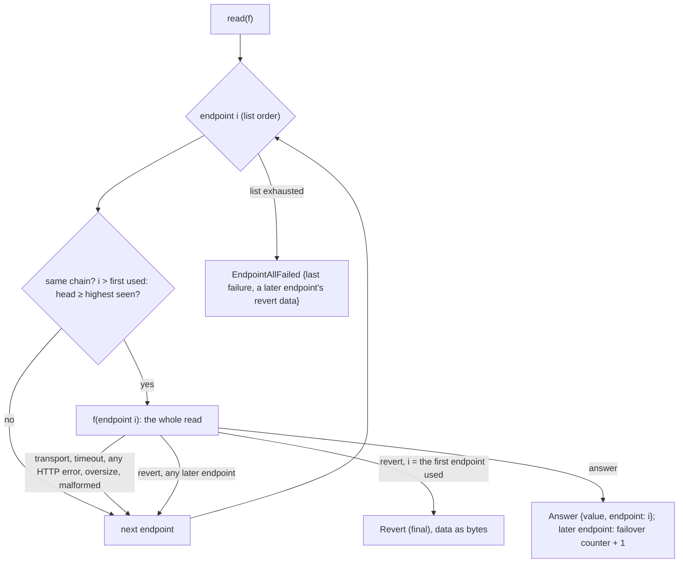

# `scaas-rpc`: the shared network crate: design

**Status:** SPECIFIED, nothing built. Branch `scaas-sdk` (from `ua-rs-sign` `d823d61f0`), worktree `.claude/worktrees/scaas-sdk`.
Work order: TODO item 8b, part of P6h, before the freeze (owner 2026-11-16). Order: `ua-rs-sign` → **`scaas-rpc`** → `scaas-sdk` →
CLI → bindings → app. Spec → review → fixes → code task by task ([plan](../plans/2026-11-17-scaas-rpc.md)). **Review:** Fable,
2026-11-17 (`20261117-11-fable-fable-high-spec.md`, kept outside the repository; P0 0, P1 8, P2 11, P3 9, info 3): every finding is
applied below; finding ids F1–F28, I1–I3 are cited where a rule changed. Rule ids introduced here (SPECIFIED, defined once in
[clients/scaas-rpc.md](../../clients/scaas-rpc.md), recorded in [decisions.md](../../decisions.md) §40): CLI-RPC-01 to
CLI-RPC-12. No contract, vector or signed byte format changes. Rows marked **follows** apply a stated rule; rows marked
**proposal** are the controller's and the owner may override them. The owner settled Q1–Q5 on 2026-11-17 (§15, CLI-RPC-50),
and Q6 the same day ((b), §15). UNAUDITED.

## 1. Owner rulings this spec follows

| # | Date | Ruling | Where |
|---|---|---|---|
| R1 | 2026-11-08 | Every RPC consumer takes a list of endpoints, `named` / `default` / `discovered`; reads fail over by default, the agreement option is a strict majority (⌊n/2⌋ + 1) of the same complete answer at the same block by hash; a discovered endpoint feeds a decryption only under agreement with at least three; writes send the same signed bytes to one or more nodes, never re-signed | [ARCH-POS-15](../../decisions.md#ARCH-POS-15) |
| R2 | 2026-11-11 | `scaas-rpc` is the shared network crate: a `ChainReader` per family (EVM via alloy first), the ARCH-POS-15 node list, the scaas-node client (jobs, gateway, indexer feeds), the same signed bytes to several nodes; the node adapters' read side and the verifier's `rpc_urls` move into it; lane-key sending stays in the node | TODO 8b |
| R3 | 2026-11-11 | The verifier's strict-majority option is built in `scaas-rpc`; until then its `rpc_urls` point only at nodes its operator trusts | CTR-PQZ-29 Change of 2026-11-11 |
| R4 | 2026-11-12 | The node's chain reads fail over through one helper; no failover endpoint's answer makes a job `dead`; the lane's own sends, nonces, fees and receipts stay on the first endpoint (Fable rechecks 2 to 7, "fix them") | ARCH-POS-15 Changes of 2026-11-12, [submit-lanes.md](../../node/submit-lanes.md#rpc-failover) |
| R5 | 2026-11-16 | `scaas-sdk` (+ `scaas-rpc`) and the app are built before the freeze | TODO 6, 8b |
| R6 | 2026-11-17 | "Ok, theo đề xuất, viết ngay": the `scaas-rpc` spec first, then `scaas-sdk` (another agent, consuming this API) | TODO 8b |
| R7 | 2026-11-17 | "Q1–Q5 theo đề xuất" (Q1–Q5 as proposed): the review's answers to §15 Q1–Q5 and the depth scan | §15, [CLI-RPC-50](../../decisions.md#CLI-RPC-50) |

Standing rules applied: explicit parameters (named fields in node JSON; the node refuses hex forms with `HEX_ARGS_REFUSED`), bounded
decode by length and depth, fail closed with named errors, never `dead` while a transaction may land, no assumption about a chain
(no gas price 0, no block limit of ours), one rule on every chain, no EIP-7702, every state-changing `mtx*` relayable with fee 0,
the node never holds subject keys ([NODE-GEN-01](../../node/README.md#NODE-GEN-01)), no consumer-specific name.

## 2. Goal, scope, non-goals

**Goal.** One crate applies ARCH-POS-15 for every Rust consumer: the node, `scaas-pqz-verifier`, `scaas-sdk`, the CLI and the
bindings get the same endpoint list, the same failover and strict-majority reads, the same bounds and the same send-merge rule,
and the SDK gets a typed client of the scaas-node gateway.

**In scope.**
1. The endpoint list (§4.1), identity (§4.2), failover (§4.3), strict majority (§4.4), the decryption rule (§4.5), timeouts
   (§4.6), sends to several endpoints (§4.7), transaction state (§4.8).
2. `ChainReader` and the EVM reader (alloy, on a bounded transport of the crate), lifted from the node's `chain.rs` (§5.1, §5.2).
3. The other nine families' transport and generic reads, lifted from the node's adapters (§5.3), **after** the EVM part and its
   review (F19).
4. The scaas-node client: gateway routes, error contract, per-endpoint auth, several nodes (§6).
5. Decode bounds (§7), errors (§8), logs (§9), tests (§10), the migration of the node and the verifier (§11), wasm32 (§12), the
   API the SDK consumes (§13).

**Non-goals.**
- No key, no signer, no signing (CLI-RPC-01). Signed bytes come from `ua-rs` or the node's lanes.
- No lane sends: the node keeps its pipeline (journal before broadcast, nonces, replacement, gap-fill, the expiry verdicts) and its
  `follow` rules that decide `dead` (`adapter.rs::follow`, `submit.rs`).
- No discovery mechanism: a caller may hand the crate `discovered` endpoints; finding them is the caller's.
- No default endpoint list: the release's reviewed list is the SDK's or the app's data.
- No event normalization to the node's feed items (NODE-IDX-05 stays the node's); the crate reads raw logs and events.
- No strict majority on a non-EVM family in this round (PLANNED): the reads that feed a decryption today (PQZ, Zether, chat
  ciphertexts in state) are EVM.
- No migration of the reference readers `pqz-read` and `zether-read-balance` (`curl`, synchronous, inside `ua-rs` and
  `zether-prover`, below this crate): they change their block choice themselves after this round (§15 Q3, settled).
- No websocket subscriptions: the node's feeds are long-poll (`wait=`).
- No job API client feature yet: `job-api` is added with its first route, when the node serves the job API (F27).

## 3. Crate layout

**Path:** `clients/scaas-rpc` (§15 Q1, settled), its own `Cargo.lock`, `publish = false`,
`SPDX-License-Identifier: LicenseRef-Vegan-Community-1.0`, `rust-version` the repository pin (`rust-toolchain.toml`, 1.97.1). The
node takes it by `path = "../clients/scaas-rpc"`, the verifier the same; neither of them is linked into the other.

**Dependencies (native):** `alloy ~1.6` with the node's read features (`std`, `provider-http`, `rpc-types`, `sol-types`, `network`,
`eips`, `consensus`, `json-rpc`; no `signer-*`), `reqwest 0.12` (`rustls-tls`, `json`, `stream`; every client built with
`redirect(Policy::none())`, F8), `tower` (the bounded alloy transport, F5), `serde`, `serde_json`, `tracing`, `futures`,
`web-time` (one clock for native and wasm32, F18), `zeroize`, `base64` / `bs58` / `stellar-xdr` only behind the family features that
need them (the versions the node pins), and `scaas-ua` with `default-features = false, features = ["json"]` for its flat JSON depth
scan (§7; settled with Q1–Q5, F20: `ua-rs` exposes the scan as `pub fn depth_within(bytes, max) -> Result<(), DepthError>` with
`DepthError::{Deep, Unbalanced}`; `bounded` stays as it is). No `tokio::time` call anywhere in the crate (F18). Nothing that holds a
chain key; `scripts/check_test_features.py` gains the crate's manifest. A native caller runs the crate inside a `tokio` runtime
(`reqwest` needs one, I3).

**Features.** `evm` (default; Hedera's EVM relay uses it), `soroban`, `solana`, `near`, `algorand`, `aptos`, `sui`, `cosmos`,
`ton`, `node-client` (default), `node-internal` (the raw reads the node needs: `raw_read`, `primary()`, `others()`; never enabled by
the SDK, F15, F23). The node enables what it uses; the verifier `evm`; the SDK what its apps need.

**Modules.**

| Module | Holds |
|---|---|
| `endpoint` | `Endpoint`, `Class`, `EndpointAuth`, `NodeList`, `Policy`, `Purpose`, config (serde), `redact_urls` |
| `pool` | the failover and agreement combinators over endpoint indices (no transport), the head floor, the agreed-block floor, the failover counters |
| `http` | the bounded JSON-RPC and REST transport (chunked body cap, depth scan, per-request timeout, no redirects); the `tower` service alloy runs on |
| `error` | `RpcError`, `EndpointFailure`, codes (§8) |
| `reader` | `ChainReader`, `Head`, `TxStatus`, `ChainIdentity` |
| `evm` | `EvmPool`: alloy providers per endpoint on the bounded transport, identity, reads, simulation, logs, fees, receipts, `broadcast`, `tx_state` |
| `<family>` | each family's pooled client and its `ChainReader` |
| `node` | `NodeClient` (gateway), `SubmitOutcome`, `NodeRefusal`, `IntentState`, `MergedState` |

## 4. The node-list model

### 4.1 Endpoint entry and configuration (CLI-RPC-02, **follows** R1)

```rust
pub enum Class { Named, Default, Discovered }
pub enum EndpointAuth { Bearer(Secret), Hmac(Secret), Header { name: HeaderName, value: Secret } } // Secret: Zeroizing, no Debug
pub struct Endpoint { url: Url /* never Debug-printed */, pub class: Class, pub label: Option<Label>, auth: Option<EndpointAuth> }
pub enum Policy { Failover, StrictMajority }
pub enum Purpose { Plain, FeedsDecryption }
pub struct NodeList { endpoints: Vec<Endpoint>, pub policy: Policy, pub timeout_ms: u64, pub slow_timeout_ms: u64,
                      pub read_timeout_ms: u64 }
```

`NodeList::new` refuses: an empty list (`EndpointListEmpty`); a scheme other than `http` / `https` (`EndpointScheme`); a zero
timeout (`Argument`); two endpoints whose parsed URLs are equal in scheme, host, port and path (`Argument`; F22: whether two
different URLs of one provider are independent is the operator's to judge); `strict_majority` with one endpoint (`Argument`, F11).
A `label` is at most 64 bytes with control characters removed (F21). **Credentials belong to an endpoint** (F8): an `auth` (a
gateway's bearer or HMAC secret, a family provider's API key header) is sent to that endpoint only; there is no list-wide
credential, and a configuration that gives one for a list of plain URL strings is refused when the list is built (`Argument`).
Configuration, the same shape in TOML and JSON:

```toml
# the node and the verifier today: strings are `named`, in order, without credentials
rpc_urls = ["https://rpc-a.example", "https://rpc-b.example"]
# the app's form (app-core contract §6), per chain and environment; a credential named by env var or file, per entry
rpc = [{ url = "https://rpc-a.example", class = "named", label = "own", api_key_env = "RPC_A_KEY", api_key_header = "X-API-Key" },
       { url = "https://rpc-b.example", class = "default" }]
rpc_policy = "failover"            # or "strict_majority" (needs two endpoints or more)
rpc_timeout_ms = 30000             # each request; the node's default
rpc_simulate_timeout_ms = 120000   # each request of a simulation; the node's default
rpc_read_timeout_ms = 60000        # one whole agreement read (§4.4)
```

The node keeps `rpc_urls`, `rpc_timeout_ms`, `rpc_simulate_timeout_ms`, `finality.quorum` and each family's one provider key as
today (the key goes to the endpoints it goes to today, §11.1); no node configuration changes in this round. The verifier gains
`rpc_policy` (§11.2).

**The app's endpoint lists** (app-core contract §6, §7) and this crate:

| App contract | `scaas-rpc` |
|---|---|
| `{url, class, label}`, classes `default`, `named`, `discovered`; `EndpointScheme` | the same names and the same refusal; plus a credential per entry |
| failover on transport, timeout, HTTP 5xx, malformed | on **any** HTTP error status (429, 401, 3xx included; redirects are never followed), F25 |
| a well-formed chain error is an answer, from any endpoint | a revert is final only from the first endpoint; a later endpoint's revert moves on and its data is kept in `EndpointAllFailed` ("reverted on a failover endpoint, no verdict"), R4, F25 |
| one pass; `EndpointAllFailed` | the same |
| `strict_majority` needs three endpoints; more than half; `EndpointNoMajority` | ⌊n/2⌋ + 1 of the list; `n = 1` refused; three only for a discovered endpoint feeding a decryption (R1); the app follows (§15 Q2, settled) |
| broadcast: the same bytes, never re-signed, "already known" accepted; `BroadcastRejected` "the chain refused the signed bytes" | the same, and never final (CLI-RPC-09): the app's text reads as final and changes (Q2, settled) |
| a decryption read never from a discovered endpoint alone (`scaas` build) | CLI-RPC-06 |
| no `EndpointListEmpty`, `NoTrustedEndpoint`, `AgreementNeedsThree` | the crate has them; the app contract appends them (Q2, settled) |

### 4.2 Identity (CLI-RPC-03, lifted from the node; F13)

`EvmPool` reads, for **every** endpoint including the first, `eth_chainId` and block 0's hash at the endpoint's first use, compares
them with the configured chain number and `chain_uid` (else, when no `chain_uid` is pinned, the first endpoint's block 0, as the
node does today), keeps the result in a `OnceLock` per endpoint, drops a mismatching endpoint with one log line, and asks an
unreadable one again next time. `strict_majority` and every `FeedsDecryption` read **require** a pinned `chain_uid`
(`Argument` otherwise): without one, a wrong first endpoint would define the chain and drop every honest endpoint. The SDK has it
from its profile (CLI-SGN-33). The node's first endpoint is also checked at lane start as today (NODE-GW-07). Other families
(§5.3) read the network id where the RPC exposes it, else trust the profile constant (NET-ALL-22).

### 4.3 Failover (CLI-RPC-04, **follows** R1, R4)

The node's `Chain::read_within` is the rule, moved as it is:



- "The first endpoint" is the first endpoint the read **uses**: endpoint 0, or under a `FeedsDecryption` read the first endpoint
  that is not `discovered` (F15).
- `raw_read(f)` / `raw_read_at(f)` (feature `node-internal`) take a closure over one endpoint's alloy provider; today's node call
  sites keep their closures unchanged. The SDK-facing reads all take a `Purpose` (F15); a decryption read cannot go through a read
  without one.
- `raw_read_at` returns the endpoint index with the value; the node's venue takes refusals read out of a value from the first
  endpoint only (as today).
- `failover_answers()` per pool and a total shared per chain table (the node's health metric `scaas_rpc_failover_answers_total`);
  the node's lanes compare the per-pool count before and after a job's checks and requeue `FAILOVER_ANSWER: …` (that rule stays
  in the node, reading the crate's counter).
- `saw_block(n)` raises the highest block seen; only the caller's first-endpoint heads and receipts feed it (the node's indexer,
  lanes, venue and health probe as today; the SDK after its own first-endpoint head reads). A later endpoint whose
  `eth_blockNumber` is below it is `BehindHead`.
- **First-endpoint reads (F4).** The lane's own nonce, fee, receipt and landed-fee reads and the final-block number stay on the
  first endpoint and never fail over. They move as `first_pending_nonce`, `first_nonce_at`, `first_fees`, `first_receipt`,
  `first_tx_fees`, `first_finalized_number` (endpoint 0 only, exactly today's `self.primary()` code); the node's `Chain` delegates
  to these and only these. The SDK's failover reads (`pending_nonce`, `fees`, `receipt`) are separate entry points (§13).
- The same carve-out holds **in every family** (F3): the lane's `tx_status`, `op_consumed`, lane sequence and landed-fee reads
  stay on the first endpoint; what fails over is `build`'s simulation and views, with the first-endpoint revert rule and the
  failover counter (§5.3, §11.1).

### 4.4 Strict majority (CLI-RPC-05, **follows** R1; block choice, fallback round, freshness, deadline and the fee rule are **proposals**)

`agree(choice, purpose, f)` on a list of `n ≥ 2` endpoints, `need = ⌊n/2⌋ + 1`, with a pinned `chain_uid` (§4.2):

1. **Block.** Every endpoint, concurrently, passes identity and names its block for `choice`: `Depth(d)` (head − d; the SDK's and
   the verifier's default is `Depth(1)`, F6), `Latest` (`eth_blockNumber`) or `Finalized` (the `finalized` tag's number). Sort the
   named numbers descending and take the `need`-th, `b`; fewer than `need` named is `EndpointNoMajority`. For safety a minority can
   neither drag `b` to an old state (the reference readers' smallest-number rule lets one endpoint do that) nor push it beyond what
   a majority named.
2. **Floor** (F12). The pool keeps the highest block it agreed on; `b` below it is `BehindHead` (counted as no majority), so two
   agreed reads never go backwards. `Agreed` returns `b` and the highest number any endpoint named, so a caller can show lag.
3. **Pin.** Each endpoint reads the header at `b`; the read runs pinned to that header's hash (EIP-1898
   `{blockHash, requireCanonical: true}` on every call, storage, code, balance and nonce read; logs to `b`). A header that answers
   another number is the endpoint's failure.
4. **Read.** `f` runs whole on every endpoint, concurrently, each request under `timeout_ms`, the whole read under one deadline,
   `read_timeout_ms` (default 60,000; F7). Each request's timeout is min(`timeout_ms`, the deadline's remainder).
5. **Compare.** Answers are `(T, b, hash)` with `T: Eq`: complete decoded values (alloy's typed results, `Bytes`, structs of
   them), projected to the fields the table below names (so honest clients that add a field, such as `blockTimestamp` on a log,
   still agree, I1). Never per field, never raw JSON text. A revert is a value with its data as bytes (`Result<T, Revert>`
   compares), so an agreed revert is an answer.
6. **Re-check and decide early** (F7). As soon as `need` endpoints hold equal answers, each of them reads the header at `b`
   again; a member whose hash moved leaves (`BlockChanged`). When `need` members have passed the re-check, the read returns
   `Agreed { value, number: b, hash, members, highest_named }` and the remaining endpoints' futures are dropped (sound: `n − need <
   need`, no other group can reach `need`). A failing endpoint counts against the majority; it is never removed from `n`.
7. **One fallback round** (F6). With no `need` members at `b`, the read runs once more at the next lower number any endpoint
   named (still at or above the floor), then stops: `EndpointNoMajority { n, need, largest }`. This closes the liveness hole of
   step 1: honest heads 100 and 99 and a liar naming 10^9 give `b = 100`, which only one honest endpoint holds; the second round at
   99 is held by both. At most two rounds, under the same deadline.

**Tolerance.** A wrong value needs ⌊n/2⌋ + 1 endpoints lying identically; a read stands while at most ⌈n/2⌉ − 1 endpoints fail or
lie. So `n = 2` detects one liar and tolerates no failure; tolerating one failure or liar needs `n ≥ 3`; an even `n` buys nothing
over `n − 1` (F11, F12).

**What is compared, by read.**

| Read | Compared value |
|---|---|
| `eth_call`, `eth_getStorageAt`, `eth_getCode`, `eth_getBalance`, nonce at the block | the decoded `Bytes` / `U256` / `u64`, or the revert's data |
| a composite read (the verifier's whole request, a PQZ words read) | the caller's struct of all its values |
| `eth_getLogs` over `[from, b]` | the complete list: `(block hash, tx hash, log index, address, topics, data)` per log |
| a receipt as of `b` | `None`, or `(block hash, block number, status, gas used, logs)`, counted only when its block hash is the endpoint's header hash at its number and the number is at most `b` |
| a transaction by hash as of `b` | `None`, or `(block hash, block number, from, nonce)` |
| block header | `(number, hash, parent hash)` |

**Head reads under `strict_majority`** (F14). Simulations and gas estimates stay failover (honest nodes differ; the chain decides;
the caller's gas cap bounds them). The **nonce** for a new transaction is the agreed committed nonce at `b` (`nonce_at_block`,
agreeable) plus the caller's own count of transactions it sent since; the crate never takes a pending nonce from one endpoint under
this policy. **Fee data** is the `need`-th highest of the endpoints' values for each of base fee and priority fee (the same order
statistic as the block: a minority moves it neither way, honest endpoints are never refused). Under `failover` the caller caps fee
and gas from its own configuration, never from the answering endpoint; the SDK does (§13).

**Mutants the tests must kill** (§10): `need = ⌊n/2⌋`; the smallest block instead of the `need`-th highest; a field-by-field
majority; no re-check; a failing endpoint removed from `n`; the block by number only; no fallback round; no floor; await every
endpoint instead of deciding early; `n = 1` accepted; the fee from one endpoint under `strict_majority`.

### 4.5 Reads that feed a decryption (CLI-RPC-06, **follows** R1)

Every read whose bytes enter a decryption carries `Purpose::FeedsDecryption`: PQZ and Zether words, and chat ciphertexts read
from state (the SDK's `confidential` and `chat` modules, F15). Under failover the pool skips `discovered` endpoints for that read
(`NoTrustedEndpoint` when none is left; the first endpoint used then decides reverts, §4.3). Under strict majority a list that holds
a `discovered` endpoint and has `n < 3` is refused before any request (`AgreementNeedsThree`). `named` and `default` serve alone.
Both need a pinned `chain_uid` (§4.2).

**Residual, recorded** (F15): ARCH-POS-15 is met to the letter (one unknown node can never choose the ciphertext), but at `n = 3`
with two or three `discovered` endpoints found from one source, one party may hold the majority. The stricter option, that the
agreeing group of a `FeedsDecryption` read hold at least one `named` or `default` member, is the owner's ruling Q6 (b) (§15).
Under `strict_majority` the agreeing group of a `FeedsDecryption` read also holds at least one `named` or `default` member (owner, Q6 (b)): a list with none of them is `NoTrustedEndpoint` before any request; `need` equal answers from discovered endpoints alone decide nothing, so the read waits for the rest of the round; a round whose agreeing group has no `named` or `default` member is no majority (`EndpointNoMajority`, after the fallback round).

### 4.6 Timeouts, retries, backoff

- Each request: `timeout_ms` (default 30,000, the node's `rpc_timeout_ms`); each request of a simulation: `slow_timeout_ms`
  (120,000, `rpc_simulate_timeout_ms`); one agreement read: `read_timeout_ms` (60,000). All above 0. A timeout is the endpoint's
  failure.
- Timeouts are the transport's (a per-request timeout on native, an abort signal on wasm32); the pool computes the remainder of a
  deadline from one clock (`web-time`) and never sleeps or arms a timer itself (F18).
- No retry inside a read: one pass over the list (failover), or at most two rounds (agreement, §4.4 step 7). Retries and their
  backoff are the caller's (the node's lane loop and `poll_ms`, the SDK's own).
- Requests per read are bounded: a log range is read in spans down to max(10 blocks, a twentieth of the window), at most about 25
  requests (the node's `logs_back`, moved); an agreement read is at most twice `n` times its failover cost plus `4n` header reads.

### 4.7 The same signed bytes to several endpoints (CLI-RPC-08, **follows** R1)

`broadcast(raw, fanout)` (EVM first; other families PLANNED, their lane sends stay in the node):

1. `id = keccak256(raw)`, computed once, before any request. A type-3 (blob) transaction in its network form (with its sidecar),
   whose hash is not `keccak256(raw)`, is refused by name (`Argument`, F24).
2. The same `raw` to the first endpoint or to all (`Fanout::{First, All}`, F27), concurrently.
3. Per endpoint: `accepted` (the answered hash equals `id`; an "already known" answer included, matched against each client's
   strings, listed in the plan's T7 and tested against anvil and Nethermind, F24); `refused { reason }` (a well-formed JSON-RPC
   error: "nonce too low", "replacement underpriced", "insufficient funds", …; at most 256 bytes, control characters removed, its
   URL redacted, F21); `unreachable` (transport, timeout, HTTP error); an answered hash that is not `id` is `refused { reason:
   "another transaction id" }`.
4. Merge: `BroadcastOutcome::Sent { id, accepted: [i…], others }` when one endpoint accepted; else
   `BroadcastOutcome::Rejected { id, outcomes }` (code `BroadcastRejected`, the app's name; an outcome, not an `RpcError`, F23).

`Rejected` is not a verdict (CLI-RPC-09): a dishonest endpoint can refuse and relay; a "nonce too low" can mean this very
transaction landed. The SDK keeps `id` and asks §4.8. A consumer never re-sends automatically on any outcome of §4.7 or §4.8.

### 4.8 Transaction state (CLI-RPC-09, **follows** "never `dead` while a transaction may land"; F1, F2)

`tx_state(id, from, nonce, choice)` on EVM. **Terminal states come only from a decisive read**: an agreed read (strict majority),
or under failover a read answered whole by the first endpoint of the list when it is not `discovered`. Any other endpoint's
answer gives the same facts, non-terminal, with its index.

| State | Fact (all from one decisive read at the final block `f`: `finalized`, or `choice`'s depth) | Terminal |
|---|---|---|
| `Final { number, hash, success }` | a receipt for `id` whose block hash is the endpoint's header hash at its number, number ≤ `f` | yes |
| `Replaced { by_nonce }` | `from`'s nonce at `f` (pinned by hash) is above `nonce`, **and** `eth_getTransactionByHash(id)` is null, **and** the receipt is null, in the same read of the same endpoint (or agreed) | yes |
| `Included { number, hash, success, endpoint }` | a receipt above `f`, or any receipt from a non-decisive endpoint | no |
| `Pending { endpoint? }` | none of the above (a send refused, unreachable, nothing seen, or `Replaced`'s facts from a non-decisive endpoint) | no |

**Under `strict_majority`** (owner 2026-11-17, T13 S7), `Replaced` and a relayed operation's failed-for-good need the
majority's agreed read at the **`finalized`** block: a read at `choice`'s depth that shows their facts reads the finalized block
again, and is `Pending` unless the facts hold there too (`basis: Basis::Majority`). Under `failover` they stay as above, endpoint 0's
alone, and say so: `basis: Basis::OneEndpoint`, whose text is "rests on one endpoint". `Final` and `landed` keep `f` as above.

`Replaced` never triggers an automatic re-send in a consumer: the user decides, after seeing it. An endpoint that does not index
old transactions answers null for a landed one: that is why `Replaced` needs all three facts from one decisive read, and why an
app restored after months asks a decisive endpoint (F1 (b)).

**A relayed `mtx*` operation** has no transaction of the subject. Its terminal facts, read the same way (a decisive read at `f`):
**landed** = the executed event of this operation's digest at or below `f`; **failed for good** = the subject's operation nonce
spent at `f` without this operation's executed event, or the envelope's `validUntil` below the timestamp of block `f` while the
nonce is unspent. The crate supplies the reads (`call_at`, `logs_range`); the SDK names the call through `ua-rs`'s ABI.

**Several scaas-nodes** (§6.4). The merged node state is **never terminal** and is named so a UI cannot show it as final:
`MergedState::Landed { by }` (a node reports `mined` / `final`: the SDK then reads the chain fact above), `InFlight` (otherwise),
`GivenUpByEveryNode` (every node the bytes were **sent to**, whatever it answered at submit, now reports `dead` or "unknown intent";
a node that cannot be reached keeps it `InFlight`). A terminal result of a relayed operation is only the chain fact above (F2).

## 5. Readers

### 5.1 `ChainReader` (all families)

```rust
#[cfg_attr(not(target_arch = "wasm32"), async_trait::async_trait)]
#[cfg_attr(target_arch = "wasm32", async_trait::async_trait(?Send))]
pub trait ChainReader: MaybeSend + MaybeSync {           // Send + Sync on native, nothing on wasm32 (F18)
    fn family(&self) -> Family;
    async fn identity(&self) -> Result<ChainIdentity, RpcError>;            // §4.2
    async fn final_head(&self) -> Result<Option<Head>, RpcError>;           // depth / tag / BFT, quorum as configured
    async fn block_hash(&self, height: u64) -> Result<String, RpcError>;    // "0x" + 64 hex
    async fn tx_status(&self, id: &str) -> Result<TxStatus, RpcError>;      // first endpoint only (F3)
    async fn sequence(&self, account: &str) -> Result<u64, RpcError>;       // committed, first endpoint only (F3)
    async fn balance(&self, account: &str) -> Result<Option<U256>, RpcError>; // native coin, smallest unit (F23)
    async fn tx_fee(&self, id: &str) -> Result<Option<u128>, RpcError>;     // what a landed tx paid, first endpoint only
}
```

`Family`, `Head` and `TxStatus` move from `scaas-node/src/adapter.rs`; the node re-exports them. Their doc comments are reworded on
the move where they name a consumer (F26). Accounts and ids are the family's canonical text forms (NET-ALL-*). `ChainAdapter` in
the node keeps its signatures and delegates these methods to its reader (its `sequence(lane)` maps the lane to its address).

### 5.2 The EVM reader (`EvmPool`)

**Bounded transport** (F5). alloy's `connect_reqwest` reads a whole answer (`resp.bytes()`, no cap). `EvmPool` builds its providers
on the crate's own transport instead: a `tower::Service<RequestPacket>` (`http::BoundedRpc`) that posts with the crate's
`reqwest` client (no redirects, per-request timeout, the endpoint's own credential), reads the answer through §7's bounded reader
(announced length, chunk cap, depth scan) and only then hands the bytes to alloy's `ResponsePacket` decode. Until its tests pass
through `EvmPool` (plan T4), CLI-RPC-07 is not BUILT for EVM.

What moves from `scaas-node/src/chain.rs`, unchanged in behaviour:

| Moves to `scaas_rpc::evm` | Stays in the node (`Chain`) |
|---|---|
| `SimError` (re-exported as `scaas_node::chain::SimError`), `classify`, `classify_sim`, `node_limit`, `is_contract`, `redact_urls` | `wallet`, `address`, `sign`, `send_raw` (lane keys) |
| `read` / `read_at` as `raw_read` / `raw_read_at` (`node-internal`), `read_within`, `same_chain`, `saw_block`, `seen_head`, `failover_answers`, the per-request timeouts, simulators | `compliance_registry` (the venue's pinned code hash) |
| failover reads: `call_tx`, `simulate`, `simulate_from`, `block_gas`, `uid`, `code`, `is_contract_at`, `block_hash`, `logs_back` (spans, R-6), `logs_since` | the reads over node types: `nonce_spent`, the executed lookup (`MetaRef`), the typed `IToken` / `IUALedger` reads |
| first-endpoint reads (F4): `first_pending_nonce`, `first_nonce_at`, `first_fees`, `first_receipt`, `first_tx_fees`, `first_finalized_number` | `ROTATION_LOOKBACK` and the PQZ fee and key-rotation windows |

New on `EvmPool` (SDK and verifier), each taking a `Purpose`: `read_at_block(choice, purpose, f)` (failover pinned by hash with
the re-check, or agreement, by the list's policy), the block-pinned convenience reads `call_at`, `storage_at`, `code_at`,
`balance_at`, `nonce_at_block`, `tx_by_hash_at`, `receipt_at`, `logs_range(from, to, filter)` (both bounds required, `to − from` at
most the span window, F23; a wallet pages its history itself), the head reads `pending_nonce`, `fees` (failover, or §4.4's rule
under strict majority), `simulate_from`, and `broadcast` (§4.7), `tx_state` (§4.8). `connect(list, chain_id, chain_uid)` for the
SDK and the verifier; for the node the same `connect`, then `with_shared(shared)` and `with_decode(decode)` (feature
`node-internal`; every endpoint, the first included, identity-checked as above: T13 point 6): one `EvmPool` per
node `Chain` as today (each lane's `Chain` builds its own providers), the highest-seen head and the total failover counter `Arc`s
shared per `[[chains]]` table and passed in.

No chain assumption: fees come from the chain, a zero gas price is a value like any other, the block gas limit is read from the
header (`block_gas`), never configured. An EIP-7702 designator is an EOA (`is_contract` stays as it is).

### 5.3 The other families (after the EVM part, F19)

Today (survey of 2026-11-17): every non-EVM adapter builds its own `reqwest` client (20 s timeout) and reads `rpc_urls[0]` only;
the others serve only quorum checks (`final_head` hash quorum in Aptos, Sui, Solana, Algorand, NEAR, Soroban; `agreed` block and
transaction bodies in Aptos, NEAR and Algorand); Cosmos and TON read one endpoint for everything; Hedera's own provider has no
timeout. No adapter bounds an answer's length; Soroban's XDR (depth 64), Algorand's msgpack (depth 64) and TON's BOC (4096 cells)
are bounded. What moves, per family, in two steps each (§11.1):

| Family | Transport that moves | Generic reads that move | Identity read | Head floor source (step (b)) | Stays in the adapter |
|---|---|---|---|---|---|
| hedera | onto `EvmPool` (its own first-endpoint provider goes) | `tx_status` (receipt + Hedera status), `sequence`, `final_head`, `block_hash` via EVM | `eth_chainId`, block 0 | `eth_blockNumber` (as EVM) | `build`, `sign` (`eth_gasPrice`), `submit`, Hedera status classes |
| cosmos | CometBFT RPC `get` / `rpc`, REST `post` | `final_head` (`status`), `block_hash`, `sequence` (auth accounts), `tx_status` (txs + block scan) | `status` `node_info.network` | `status` latest block height | `build` (simulate), smart queries, `submit` |
| aptos | REST `get_at` / `get` / `view`, GraphQL, `agreed` | `final_head` (+ quorum), `tx_status`, `sequence`, `balance`, `tx_fee` | ledger info `chain_id` | ledger info `block_height` | `build`, `events` parsing, `submit` |
| sui | JSON-RPC `rpc_at` / `rpc` | `final_head` (checkpoint quorum), `tx_status`, `sequence` (0) | `sui_getChainIdentifier` | latest checkpoint sequence number | `build` (dry run, coins), `events`, `submit` |
| solana | JSON-RPC `rpc_at` / `rpc`, `RpcError` | `final_head` (slot + quorum), `tx_status`, `sequence` (nonce account read only), `balance`, `tx_fee` | `getGenesisHash` | `getSlot` (confirmed) | nonce account creation, rebroadcast, `build`, `events`, `submit` |
| ton | TON Center v3 `Api` | `final_head` (`masterchainInfo`), `block_hash`, `sequence` | the profile constant (NET-ALL-22) for endpoint 0; a later endpoint's masterchain root hash at endpoint 0's last seen seqno (T24.6) | `masterchainInfo` seqno | `run_get` parsers, escrow follow-up, `events`, `submit` |
| algorand | algod `get_raw_at` / `get` / `post`, `AlgodError` | `final_head` (+ quorum), `block_hash`, `tx_status`, `sequence`, `balance` | `/v2/transactions/params` genesis hash | `/v2/status` last round | `build` (simulate), `start_check`, `events` (msgpack), `submit` |
| near | JSON-RPC `rpc_at`, `RpcError`, `agreed`, `view` | `final_head` (+ quorum), `block_hash` (walk-back), `tx_status`, `sequence`, `balance`, `tx_fee` | `status` `chain_id` + genesis hash | `block` (final) height | `build` checks, escrow follow-up, `events`, `submit` |
| soroban | JSON-RPC `call` / `rpc`, `ledger_hash` cache | `final_head` (+ quorum), `block_hash`, `tx_status`, `tx_fee`, `sequence`, `balance` (`getLedgerEntries`) | `getNetwork` passphrase hash | `getLatestLedger` sequence | simulation views, `op_consumed` views, `events`, `submit` |

In every family `tx_status`, `op_consumed`, the lane sequence and `tx_fee` read the first endpoint only (F3), so no failover
endpoint's status can make a job `dead` or `reverted` (`follow` reads `Unknown` and `Reverted` as verdicts, `adapter.rs:407-459`).
The head floor (the first endpoint's polled height, and the height of every transaction it reports mined, as EVM's receipts;
T24.2) guards only the reads that fail over, `build`'s simulations and views; Solana compares confirmed slots with confirmed
slots. Family API keys (`X-API-Key`, `X-Algo-API-Token`) become per-endpoint credentials (§4.1); in step (a) the adapter's one key
goes to exactly the endpoints it goes to today, in step (b) a later endpoint without its own key gets none (F8; built, plan T24.10: the node's `api_key_env` and
`algod_token_env` take a name, endpoint 0's key, or a list of names, one per `rpc_urls` entry).

## 6. The scaas-node client (CLI-RPC-10)

### 6.1 Routes

| Client call | Route | Node status |
|---|---|---|
| `submit_op(chain, op)` | `POST /v1/op {chain, op}` | BUILT |
| `submit_ua_metatx(req)` | `POST /v1/ua-metatx {chain, token, contract?, struct?, m, auth}` | BUILT |
| `dex_place`, `dex_cancel`, `dex_cancel_all`, `dex_markets`, `dex_depth`, `dex_trades`, `dex_ticker`, `dex_orders(maker)` | `/v1/dex/*` | BUILT |
| `gateway_info()` | `GET /v1/gateway` | SPECIFIED in the node: the client follows it |
| `submit_family_op(chain, op)` | `POST /v1/ops` | SPECIFIED: follows |
| `register_ua(req)` | `POST /v1/ua/register` | SPECIFIED: follows |
| `intent(id)` | `GET /v1/intents/{intent_id}` | SPECIFIED: follows |
| the job API (`info`, `submit` ≤ 50, `job`, `cancel`, the feeds, `watch`, `tokens`) | the job API | SPECIFIED in the node: a feature `job-api` added with its first route, server-side only |

A client call exists only for a route the node serves at the time of its plan task (no client of an unserved route; the SDK names
the ones it waits for). The DEX bodies are the gateway's (`{chain, sellToken, order, auth}` and so on, [dex-venue.md](../../node/dex-venue.md#routes)).
A client of a PQZ verifier's HTTP route (`/v1/pqz-verdict`, `/probe`), if the SDK needs one, belongs in `scaas_rpc::node` under the
same rules: per-endpoint credential, no redirects, bounded answers (I2). BUILT (owner 2026-11-19, C1; plan T11b): `VerifierClient`
(`verdict`, `probe` at `/v1/pqz-verdict/probe`), the list's policy as ARCH-POS-15: `failover` the first 2xx in list order, a 4xx
the verifier's refusal and final; `strict_majority` more than half of the endpoints with an equal `pqzVerdict` (a probe: an equal
answer); a request body above 8 MiB is `BodyTooLarge`, unsent.

### 6.2 Bodies, versions, errors

- **Bodies** are named-field JSON objects. `op` and `m` / `auth` are the values `ua-rs` builds (its typed-data messages and
  `UASig` JSON, `ServicePull::job`, the facades' JSON); the client checks that each is a JSON object, serialises the request once and
  never rewrites it. No hex bundle, no packed field: a node refuses those (`HEX_ARGS_REFUSED`, `HEX_DATA_REFUSED`).
- **Body caps** before sending: 64 KiB (`/v1/op`, `/v1/ua-metatx`, `/v1/ops`, DEX), 160 KiB (`/v1/ua/register`), 1 MiB (the PQZ
  chain profile's gateway, when `gateway_info` says so): `BodyTooLarge`, nothing sent.
- **Answers** bounded as §7 (1 MiB for a gateway answer). `202 {"status": "queued", "intent_id"?}` and `200` (a duplicate) are
  `queued`. An error is read by `code`, else the legacy `error` string (today's node answers `{"error": "<text>"}`), with `detail`
  and `revert_data` (`NodeRefused`); `RPC_UNAVAILABLE`, a 5xx, a 3xx and a transport failure are `unreachable`.
- **Versions.** Routes under `/v1`. `gateway_info().api` other than `1` is `NodeApiVersion`; `chain_uid` from it is compared by the
  SDK with its own pinned profile, never trusted alone (CLI-SGN-33, CLI-SGN-35).

### 6.3 Auth (F8)

Each gateway endpoint carries its own `EndpointAuth` (§4.1), as NODE-GW-02: `Bearer` (`Authorization: Bearer`), or `Hmac`
(`X-Scaas-Timestamp`, `X-Scaas-Nonce` (16 bytes from the OS RNG, base64url without padding) and `X-Scaas-Signature =
hex(HMAC-SHA256(secret, ts "." nonce "." METHOD " " path?query "\n" body))`), or none. A credential goes to its endpoint only; no
redirect is ever followed, so no request (and no header) is replayed to another host. Secrets are `Zeroizing`, never in `Debug` or
logs. An end-user app uses none (CLI-APP-03: an unauthenticated gateway behind a proxy). The job API's `X-Scaas-Key`
(NODE-JOB-05) comes with the `job-api` feature.

### 6.4 Several nodes

`NodeClient::new(list)` takes a `NodeList` of gateway base URLs, each with its own credential. Reads (`gateway_info`, DEX reads,
`intent`) fail over. A submit posts the same body (byte for byte) to the endpoints `Fanout` selects and merges by CLI-RPC-08:
`Queued { by: [i…], refused, unreachable }` when one queued it, else `NotQueued { outcomes }`; neither is final. A bound `relayer`
in the envelope means only that relayer's node can queue it (others answer `RELAYER_NOT_OURS`): the SDK picks the fan-out. Status
across nodes: `MergedState`, never terminal (§4.8).

### 6.5 Feeds

The change feeds (`GET /v1/jobs`, `GET /v1/events`, cursor + `wait=` long-poll, NODE-IDX-04, NODE-IDX-05) are job API routes:
server-side, with the `job-api` feature when the node serves them. An end-user app reads its history from the chain
(`logs_range`) or from an indexer the SDK chooses; that choice is `scaas-sdk`'s.

## 7. Decode bounds (CLI-RPC-07)

- **Length.** Every HTTP answer, the EVM providers' included (§5.2, F5), is read in chunks, refused past its cap, and refused
  before reading when `Content-Length` announces more (the node's verifier client, `pqz.rs::ask`, is the model and moves). Caps:
  16 MiB default (the reference reader's `MAX_ANSWER`); 1 MiB for node gateway answers; a family may set lower per call.
- **Depth.** `scaas_ua::json::depth_within(bytes, 64)` (F20): a flat scan counts nesting before `serde_json` runs (strings and
  escapes skipped, no recursion), so a deep answer never reaches a recursive parser; `Deep` is `AnswerTooDeep`, `Unbalanced` is
  `AnswerMalformed`. The bytes are then parsed once, into their type.
- **Binary.** Family decoders keep their caps (XDR 64 and `xdr_limits`, msgpack 64, BOC 4096 cells, Borsh lengths) and run on bytes
  already under the length cap.
- **Failure.** `AnswerTooLarge`, `AnswerTooDeep`, `AnswerMalformed` are the endpoint's failures (failover moves on; under agreement
  they count against the majority). Never a panic: every decoder returns `Err` (proptest, §10).
- **Request side.** Every list the crate sends is bounded by the caller's caps (log spans, `multiGet` chunks as the adapters keep
  them).

## 8. Errors

`RpcError` (the table in [scaas-rpc.md §8](../../clients/scaas-rpc.md#8-errors)) has `code() -> &'static str` returning the
variant's name; the names the app contract shares are the same (`EndpointScheme` = app 17, `EndpointAllFailed` = 18,
`EndpointNoMajority` = 19; `BroadcastRejected` = 20 is the code of the `Rejected` send outcome, not an error variant, F23).
`EndpointFailure` (per endpoint) carries the endpoint's index and label, the kind, and a short redacted text (at most 256 bytes,
control characters removed, F21). `Revert` carries the revert data as bytes (F10 (e)); `SimError` keeps its two arms (`Revert`
with the decoded text, `Transport`) for the node's call sites; `From<SimError>` maps into `RpcError`. Errors never carry a URL, a
body, a key or a ciphertext.

## 9. Observability (CLI-RPC-11)

`tracing` events at `warn` for an endpoint dropped, failed over, behind the head, outvoted or refused, with `chain`, `endpoint`
(index), `label`, the failure kind and the redacted error; never a URL, a body or a header. `redact_urls` replaces each
`scheme://…` token; it cannot see a key echoed without a scheme, so an endpoint's free text is also capped and stripped (F21), and
never logged above `warn`'s fields. Counters (no URL): failover answers per pool and per chain table (the node's metric), refusals
and outvotes per endpoint index. The node's existing log lines and metric names keep their text.

## 10. Test strategy

**Local only.** In-process fake endpoints (`axum` on `127.0.0.1:0`, as the node's `chain::tests::rpc()` does) and local chains:
`anvil` (foundry's) for EVM, a local Nethermind dev chain in a memory-capped container for the EIP-1898 check (F16), the families'
local networks through `smartcontracts/scripts/devnet.sh` and the node's e2e setup. Never the live testnet stack, its containers
or its RPC port.

**Fault injection** (fakes that answer by script): down, hung (no answer: timeout), slow (every request just under the timeout),
wrong chain id, same id with another block 0, behind the head, a revert, an error answer that is no revert, a node limit
(`execution aborted (timeout = 5s)`), an oversized body (announced and unannounced, through `Http` **and** through `EvmPool`), a deep
body (depth 65), malformed JSON, a 3xx to another fake (which must count zero requests), a lying value on one field, a lying block
hash, a far-future head, a reorg between read and re-check, a wrong transaction id on send, "already known", "nonce too low", an
extra field in a log or receipt (I1).

**Agreement cases** (each with its positive control first; one change at a time):

| Case | Expect |
|---|---|
| 3 honest | `Agreed`, 3 members |
| 3, one lies on one word | `Agreed`, 2 members, the liar outside |
| 3, two lie on different words | `EndpointNoMajority` (kills the field-by-field mutant) |
| 4, two agree, two fail | `EndpointNoMajority` (kills `need = ⌊n/2⌋` and "failing removed from n") |
| 3, one names block 1 (old state differs) | the block is the 2nd highest; `Agreed` at the head (kills the smallest-block mutant) |
| 3, honest heads 100 and 99, a liar names 10^9 | first round at 100 fails, the fallback round at 99 `Agreed` with 2 members (F6; kills "no fallback") |
| 5, honest 100, 100, 99, 99, a liar names 10^9 | the fallback round at 99, `Agreed` with 4 members (F6) |
| 3, two honest fast and equal, one hung | `Agreed` before `timeout_ms` (paused clock; kills "await all", F7) |
| 3, every request of one endpoint just under the timeout | the read ends within `read_timeout_ms` (F7) |
| agreed at 100, then two of three name 90 | `BehindHead`, no majority (F12; kills "no floor") |
| 3, one's block hash differs at the same number | it is outside the group (kills number-only pinning) |
| 3, reorg of one member during the read | `BlockChanged`; with the other two still equal: `Agreed`, else `EndpointNoMajority` (kills "no re-check") |
| `strict_majority` with `n = 1` | refused when the list is built (F11) |
| `strict_majority` without a pinned `chain_uid` | `Argument` (F13) |
| decryption read, a discovered endpoint, `n = 2` | `AgreementNeedsThree`, zero requests |
| decryption read, failover, only discovered | `NoTrustedEndpoint`, zero requests |
| decryption read, `strict_majority`, `n = 3`, all discovered | `NoTrustedEndpoint`, zero requests (Q6 (b)) |
| decryption read, `strict_majority`, `n = 3`: one named, two discovered agreeing, the named one differing | `EndpointNoMajority` after the fallback round (Q6 (b)) |
| decryption read, `strict_majority`, `n = 3`: two discovered answer first and agree, the named one answers equal later | `Agreed`, decided only on the named one's answer (Q6 (b)) |
| decryption read, failover, endpoint 0 discovered | endpoint 1 is the first used; its revert is final (F15 (d)) |
| two fakes differing only in an extra `blockTimestamp` | `Agreed` (I1) |
| fee under `strict_majority`, one endpoint answers a priority fee 10^6 times the others' | the `need`-th highest value (F14) |

**Failover cases.** The node's seven `chain::tests` (`chain_reads_fail_over_on_transport_errors_never_on_a_revert`,
`an_unspent_nonce_on_a_failover_answer_is_unread`, `each_log_span_has_its_own_timeout`,
`a_log_window_is_chunked_for_an_rpc_that_caps_the_range`, `a_hung_endpoint_and_the_block_gas_read_fail_over`,
`an_aborted_execution_is_transport`, `chain_uid_is_block_zero_and_a_wrong_pin_is_refused`) **stay in the node** as its wiring
tests (that `Chain` passes the table's shared head and total counter, the per-pool counter, the 120 s simulators), and the crate has
its own copies (F17). New: `the_lane_nonce_fee_and_receipt_never_fail_over` (endpoint 0 hung, endpoint 1 answering: an error, and
endpoint 1 counts zero requests; F4); per family `<f>_tx_status_never_fails_over` and
`<f>_an_unknown_from_a_lagging_endpoint_is_never_dead`, each with its control (F3).

**Transaction state** (F1, F2): a fake whose nonce is above and whose receipt is null, while a second fake holds the receipt, with
the first endpoint down: `Pending` (control: both facts from the first endpoint → `Replaced`); `Replaced` needs the null
transaction-by-hash too (control: the transaction known, receipt null → `Pending`); a receipt whose block hash is not the header's:
not counted; `a_node_that_timed_out_on_submit_keeps_it_in_flight`; `all_dead_is_given_up_not_failed`.

**Real chains**: three `anvil` instances on free ports (bound first, then passed; F28), started with the same `--chain-id` and
`--timestamp` (the test first asserts their block 0 hashes are equal, and fails, never skips, if not), one altered with
`anvil_setStorageAt` to disagree; `broadcast` of one signed transfer to two of them (`Sent`, both accepted, the same `id`), then
`tx_state` → `Included`, then `Final` at depth. The verifier's `ver-anvil` gains its strict-majority case (§11.2). The EIP-1898 check
on a local Nethermind: the five pinned reads with a canonical hash (an answer) and a made-up hash (an error) (F16).

**Node client**: a conformance test **in `scaas-node`** posts the client's serialised bodies to the node's own `gateway::router`
in-process (`tower::ServiceExt::oneshot`) and asserts the node accepts them, and that the client decodes each of the node's refusal
answers; the HMAC signer against the node's `gwauth` verifier, the same way; two fake gateways, the second recording its headers,
receive no credential of the first (F8).

**Negative tests that can fail**: every refusal test has a positive control in the same file; each agreement and failover rule has
a mutant (§4.4, the plan's per-task lists, including the "no behaviour change" tasks, F17) recorded in the task's run log with
"killed". **Fuzz**: `proptest` over every decoder entry (bounded reader, the bounded alloy transport, each family's answer parsers
that move): no panic, every failure an `Err`.

## 11. Migration

### 11.1 The node (EVM first; the families after the EVM part's review)

1. **EVM, no behaviour change.** `scaas_node::chain::Chain` keeps its public methods and holds an `EvmPool` (`connect` + `with_shared`);
   `SimError`, `classify`, `redact_urls`, `is_contract`, `quorum_ok` are re-exported at their old paths, so no call site changes; the
   lane's nonce, fee, receipt and final-number reads delegate to the `first_*` entry points (F4). One intended difference: an EVM
   answer above 16 MiB or deeper than 64 is the endpoint's failure (F5; today's node reads it whole). Gates before and after with
   the same counts plus the new tests: `cargo test` (every unit test, the seven `chain::tests` kept), `cargo clippy --all-targets --
   -D warnings`, `cargo test --test e2e -- --ignored`, `fuzz`; mutants of plan T5.
2. **Each other family, step (a), no behaviour change but the listed ones.** The family's transport and generic reads move into
   `scaas_rpc::<family>`; the adapter calls them on endpoint 0 exactly as today (the quorum helpers on all endpoints, as today; the
   family key to exactly the endpoints it goes to today). Intended differences, listed (F17): an answer above 16 MiB (or a JSON
   depth above 64) is refused; redirects are no longer followed; duplicate `rpc_urls` (equal by parsed URL) are refused at start (CLI-RPC-02); the family
   client keeps its 20 s timeout (not `timeout_ms`);
   Hedera's provider gains the EVM transport's timeout. Gates: the adapter's unit tests and `e2e_<family>` on its local network, the
   same counts; mutants of the plan's family task (a).
3. **Each other family, step (b), ARCH-POS-15 failover** (§15 Q4, settled). Only `build`'s simulations and views fail over, with R4's rule: a
   failover endpoint's simulation failure, view failure or value is no verdict (the family's `Revert` from a later endpoint becomes
   transport; refusals read while the failover count moved requeue, as EVM's); the head floor of §5.3 guards them. `tx_status`,
   `op_consumed`, the lane sequence and `tx_fee` stay on the first endpoint (F3). New tests per family: a first endpoint down → a
   `build` read answered by the second; a failover endpoint's revert → not `dead`; the two F3 tests of §10. This changes behaviour as
   ARCH-POS-15 asks ("every other consumer follows in its own round"); the family's e2e stays green. **A family without a runnable
   e2e baseline gets step (a) only, and only when its unit tests cover the moved reads; no step (b)** (F19).

**What stays in the node:** lane keys and every send (`sign`, `send_raw`, family `submit`, `resend_journaled`, nonce-account
creation), the lane runners and `follow` (`dead`, expiry, gap-fill, `op_consumed` verdicts) and the first-endpoint status reads they
call, `build` and its guard checks, event normalization and the indexer's ranges, cursors and `finality` (`safe_head`,
`next_range`), the venue's evidence rules, the PQZ verifier client (`pqz.rs`: its endpoint list is the node's `[pqz_verifier]` table;
its bounded reader becomes the crate's), the health and admin routes.

### 11.2 `scaas-pqz-verifier` (F9, F10)

1. **T8, transport only, no behaviour change.** `chain::Rpc` (the real `Chain` implementation) runs on per-index access to
   `EvmPool`'s bounded providers: `connect` keeps checking `eth_chainId` on every endpoint at start (the service starts with `connect_pinned`, which also runs the pool's identity check against the pinned `chain_uid`: T13 S11); `head`, `call`, `code` keep their
   signatures and pin by number as today; the trait `Chain` stays as the test seam, so `tests/service.rs` is untouched. `on_nodes` is
   **untouched**: it is the verifier's own failover, where a revert from any node is an answer and an answer is a refusal by name,
   never a signature (`fails_over_one_node_one_block` keeps passing). The verifier's classifier changes in T9, not here (§15 Q5, settled). One intended
   difference: an answer above 16 MiB is the node's failure (F5).
2. **T9, the reads-first path under `strict_majority` (a behaviour change, gated) and the classifier.** Under `rpc_policy = "failover"` (the default) nothing changes but the classifier (Q5, the last point below). Under
   `strict_majority` a request runs `reads_at(at) -> Reads`, then `check(&Reads)`:
   - The trait `Chain` gains `header(node, number) -> hash` and its `call` / `code` take a block reference that may be a hash; the
     real `Rpc` implements them with EIP-1898 objects; the fake answers by hash and refuses a number-only read.
   - `Reads` holds each read's **result** (`Result<value, Revert(bytes) | Unread>`), filled in the order of today's code (token code,
     `pqzVerifyConfig`, `proofSystemId`, the statement view, then every named key's record and code) and stopping at the first
     value-dependent dead end today's code would stop at; `Reads: Eq`, so an agreed revert compares by its data.
   - `check(&Reads)` walks today's order and returns today's refusal for the same chain state. Pinned by tests for the pairs that
     could swap (`VERDICT_ZERO` before any key refusal; `KEY_OWNED_ELSEWHERE` before `KEY_NOT_STORED`), each red against a
     reordering mutant, and by one test that the same request gives the same refusal under both policies.
   - **The cost rises, stated plainly:** under `strict_majority` every key read happens before the proof is checked, so a request
     with a garbage proof costs up to the key count (at most 9) × about 7 reads per key × `n`, before `VERDICT_ZERO`. The service's
     `concurrency`, `queue` and `rate_per_minute` bound it; an operator who turns the option on sizes them for it.
   - Both `verdict` and `probe` run under `agree` (`choice = Depth(1)`, every read pinned by hash: R-6 closed); no endpoint is asked
     after the proof is checked. New refusal `RPC_NO_MAJORITY` (503). `ver-anvil` gains: three anvils of equal genesis, one with an
     altered key record → the honest verdict; two altered → `RPC_NO_MAJORITY`, nothing signed. A mutant per entry point ("`probe` on
     failover under `strict_majority`").
   - `strict_majority` with one endpoint is refused at start (F11); a pinned `chain_uid` is already required by the verifier's
     configuration.
   - **The classifier (Q5, settled), under both policies:** the verifier reads an error answer as a revert by the crate's rule
     (revert data, a named revert, or an execution error that is not a node's own limit), its data as bytes; a revert stays a refusal
     by name, never a signature. Messages that change class (an execution error without revert data: was a failover, becomes a
     refusal) get a test each.
3. **Docs when BUILT:** ops.md, the example TOML and `pq-zero-knowledge.md` §9.5 write: under `failover` every endpoint must be a node
   the operator trusts; under `strict_majority` the operator trusts that fewer than ⌊n/2⌋ + 1 endpoints lie together (`n = 2`
   detects one liar and tolerates no failure; tolerance of one needs `n ≥ 3`).

## 12. wasm32 (F18)

The crate's core (`endpoint`, `pool`, `error`, `reader`, the bounded reader) uses no `tokio` runtime, no threads and no
`tokio::time`; deadlines come from one clock (`web-time`) and timeouts from the transport. On `wasm32-unknown-unknown` the transport
is `reqwest`'s fetch backend with an abort signal for the timeout (a stub transport from plan T2, the real one in T12);
`ChainReader` and the pool's closures carry `Send` bounds on native only (`async_trait(?Send)` on wasm32) from T3. The gate
`cargo check --target wasm32-unknown-unknown --no-default-features --features evm,node-client` runs in every crate task from T1, so
a bound that does not hold there is found before the SDK consumes the API. Docs say "compiles for wasm32, not run" until the SDK's
wasm binding round runs it. A browser caller meets CORS: public RPCs and a gateway with auth none and an exact origin (NODE-GW-04).

## 13. The API `scaas-sdk` consumes

A native caller runs inside a `tokio` runtime (I3). Feature `node-internal` is the node's only; nothing below needs it.

```rust
// endpoint lists
scaas_rpc::{Endpoint, Class, EndpointAuth, NodeList, Policy, Purpose, RpcError, EndpointFailure};
NodeList::new(endpoints, policy, timeout_ms, slow_timeout_ms, read_timeout_ms) -> Result<NodeList, RpcError>;
NodeList::from_urls(&[String]) -> Result<NodeList, RpcError>;          // all `named`, failover, no credentials

// EVM
scaas_rpc::evm::{EvmPool, BlockChoice, ReadAt, Agreed, Fanout, BroadcastOutcome, TxState};
EvmPool::connect(list, chain_id: u64, chain_uid: Option<B256>) -> Result<EvmPool, RpcError>; // Some required for strict_majority
pool.head() / finalized() / block_hash(n) / chain_uid();
pool.read_at_block(BlockChoice, Purpose, |p: ReadAt| async { … }) -> Result<Agreed<T>, RpcError>; // policy-driven
pool.call_at(&ReadAt, to, data) / storage_at / code_at / balance_at / nonce_at_block / tx_by_hash_at / receipt_at;
pool.logs_range(from, to, filter, Purpose) -> Result<Agreed<Vec<Log>>, RpcError>;  // both bounds, at most one span window
pool.simulate_from(from, to, data) -> Result<u64 /* gas */, SimError>;  // failover, head; the caller caps gas
pool.fees(Purpose) -> Result<Fees, RpcError>;                          // failover, or need-th highest under strict_majority
pool.pending_nonce(addr, Purpose) -> Result<u64, RpcError>;            // failover; agreed committed nonce under strict_majority
pool.receipt(id) -> Result<Option<Receipt>, RpcError>;                 // failover, non-terminal; tx_state decides
pool.broadcast(raw: &[u8], Fanout::{First, All}) -> BroadcastOutcome;  // CLI-RPC-08; Rejected's code `BroadcastRejected`
pool.tx_state(id, from, nonce, BlockChoice) -> Result<TxState, RpcError>; // CLI-RPC-09: terminal only from a decisive read

// every family (after the EVM part)
scaas_rpc::{ChainReader, Family, Head, TxStatus, ChainIdentity};
scaas_rpc::<family>::Client::connect(list, profile) -> impl ChainReader;

// scaas-node
scaas_rpc::node::{NodeClient, Fanout, SubmitOutcome, NodeRefusal, IntentState, MergedState};
NodeClient::new(list) ; client.submit_op(chain, &op_json, Fanout) ; client.submit_ua_metatx(&req, Fanout) ;
client.dex_place(&req) / dex_cancel / dex_cancel_all / dex_markets / dex_depth / dex_trades / dex_ticker / dex_orders(maker);
client.merged_state(&[IntentState]) -> MergedState;                    // never terminal
// as the node serves them: gateway_info(), submit_family_op(), register_ua(), intent(id)
```

`op_json` is the `serde_json::Value` `ua-rs` returns; the SDK never builds it by hand. Secrets never pass through `scaas-rpc` except
the per-endpoint credentials the caller puts in its list.

**§13 changes after review** (for the `scaas-sdk` spec):
1. `GatewayAuth` is gone: credentials are per endpoint (`EndpointAuth` in `Endpoint`); `NodeClient::new(list)` takes no auth (F8).
2. `NodeList::new` takes `read_timeout_ms`; `strict_majority` with one endpoint is refused; `strict_majority` and `FeedsDecryption`
   reads need `EvmPool::connect(…, Some(chain_uid))` (F7, F11, F13).
3. `logs_to(filter)` is `logs_range(from, to, filter, Purpose)` with both bounds and at most one span window; the SDK pages
   history itself (F23).
4. `fees` and `pending_nonce` take a `Purpose` and follow the list's policy (F14); the SDK caps fee and gas from its own
   configuration under `failover`.
5. New: `receipt`, `tx_by_hash_at`, `receipt_at`; `tx_state` is terminal only from a decisive read (F1).
6. `BroadcastRejected` is the code of `BroadcastOutcome::Rejected`, not an `RpcError`; `Fanout` is `{First, All}` (F23, F27).
7. `MergedState::{Landed, InFlight, GivenUpByEveryNode}` replaces a merged `dead`; none is terminal (F2).
8. `ChainReader::balance` returns `U256`; the trait is `?Send` on wasm32 (F18, F23).
9. The raw closure reads are `node-internal` only; every SDK read takes a `Purpose`, chat ciphertext reads included (F15).
10. The job API client is no feature yet: `job-api` arrives with its first route (F27).
11. The default `BlockChoice` for the SDK's agreed reads is `Depth(1)` (F6).

## 14. Rule ids

| Id | Rule | Owner |
|---|---|---|
| CLI-RPC-01 | one crate; no keys, signing or lane sends | yes (R2, R6) |
| CLI-RPC-02 | `{url, class, label, auth}`, order, policy, refusals | no (shape of R1 and the app contract) |
| CLI-RPC-03 | identity per endpoint, the first included | no (lifted, R4) |
| CLI-RPC-04 | failover; first-endpoint status reads in every family | yes (R1, R4) |
| CLI-RPC-05 | strict majority | no (R1's rule; block choice, fallback round, floor, deadline, `n = 1`, nonce and fee are proposals) |
| CLI-RPC-06 | decryption reads and discovered endpoints | yes (R1) |
| CLI-RPC-07 | bounds, the EVM transport included | no (standing rule) |
| CLI-RPC-08 | the same bytes to several endpoints | yes (R1) |
| CLI-RPC-09 | terminal only from a decisive read; merged node state never terminal | no (standing rule) |
| CLI-RPC-10 | the scaas-node client | no |
| CLI-RPC-11 | logs and errors redacted and capped | no (NODE-GW-06) |
| CLI-RPC-12 | the verifier's option | yes (R3) |
| CLI-RPC-50 | the owner's answers to Q1–Q5 and the depth scan (record) | yes (R7) |

## 15. Owner rulings on the questions, and the one still open

**Settled, owner 2026-11-17 ("Q1–Q5 as proposed"; recorded as [CLI-RPC-50](../../decisions.md#CLI-RPC-50)).** The answers are the
review's recommendations (Fable, 2026-11-17):

| # | Question | Ruling |
|---|---|---|
| Q1 | Where the crate lives | `clients/scaas-rpc` |
| Q2 | The app contract's differences (§4.1) | the app contract follows this crate: `strict_majority` with `n = 1` refused; failover moves on at any HTTP error status, not only 5xx; a failover endpoint's revert is no verdict, its data kept in `EndpointAllFailed`; `BroadcastRejected` and every send outcome never final, and the app's text says so; the app appends `EndpointListEmpty`, `NoTrustedEndpoint`, `AgreementNeedsThree`; `n = 2` allowed (detection, no failure tolerated), three needed only for a discovered endpoint feeding a decryption |
| Q3 | The reference readers | after this round, their agreement takes CLI-RPC-05's block choice (the `need`-th highest) **with** the fallback round (F6), inside `ua-rs` and `zether-prover`, keeping `curl`; no new dependency below the SDK |
| Q4 | Non-EVM failover | in this round, after T1–T13 are reviewed (the SDK unblocked first), family by family, F3's first-endpoint carve-out written and tested first, no step (b) for a family without an e2e baseline |
| Q5 | One revert classifier | the verifier takes the crate's (the node's) classifier (plan T9), the revert data kept as bytes, a revert still a refusal by name in the verifier |
| JSON | The depth scan (§3, F20) | `ua-rs` exposes its flat scan as `pub fn depth_within`; `bounded` stays crate-private |

**Settled the same day** (owner 2026-11-17, "Ok, theo đề xuất, chốt cả bảng": OK, as proposed, settle the whole table):
**Q6 (b)**, recorded as CLI-RPC-50's Change and in CLI-RPC-06; the rule is §4.5's last paragraph.

**Q6 — Discovered endpoints in a decryption majority** (§4.5, F15). (a) ARCH-POS-15 as stated: a discovered endpoint may serve a
`FeedsDecryption` read under agreement with `n ≥ 3`, however many of the list are discovered; (b) in addition, the agreeing group
of a `FeedsDecryption` read holds at least one `named` or `default` member. **Recommendation: (b)**: it costs nothing when the list
holds a named or default endpoint, and closes a majority of discovered endpoints found from one source; it is a rule on top of
ARCH-POS-15, so the owner's.
