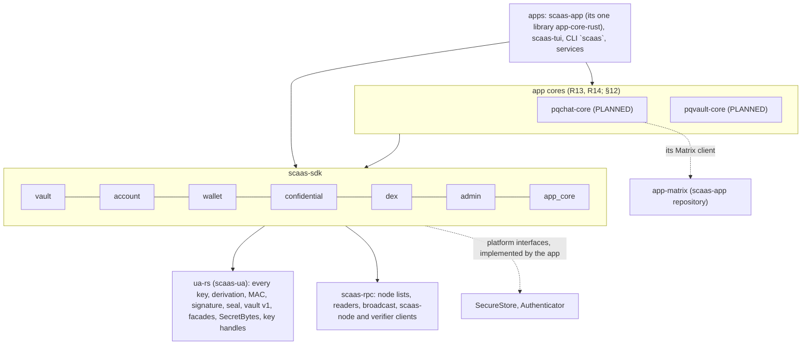
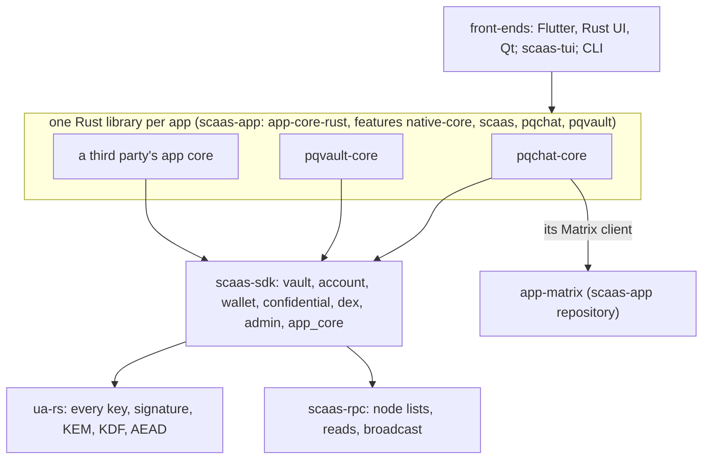

# `scaas-sdk`: the one API apps call: design

**Status:** SPECIFIED, nothing built. Branch `scaas-sdk` (from `ua-rs-sign` `d823d61f0`), worktree `.claude/worktrees/scaas-sdk`.
Work order: TODO item 8b, part of P6h, before the freeze (owner 2026-11-16). Order: `ua-rs-sign` → `scaas-rpc` → **`scaas-sdk`** →
CLI → bindings → app; the `scaas-tui` spec follows this one. Spec → review (Fable 2026-11-17: P0 0, P1 10, P2 19, P3 10, info 4;
every finding applied, §26) → owner's answers to §25 (2026-11-17: every question as recommended) → code task by task ([plan](../plans/2026-11-17-scaas-sdk.md)). Rule ids
introduced here (SPECIFIED, defined once in [clients/scaas-sdk.md](../../clients/scaas-sdk.md), recorded in
[decisions.md](../../decisions.md) §41): CLI-SDK-01 to CLI-SDK-18, and the records CLI-SDK-30 (owner rulings) and CLI-SDK-31
(controller calls). No contract or signed byte format changes. New formats and derivations, each with clientkeys rows and vectors
first: the keystore container and its index MAC (§6.1, §6.2), BIP-85 children and the manifest's `bip85Next` (§6.4), roots (c) and
(d) (§6.6, by the owner's answers Q-K4, Q-K5, Q-K18), the master fingerprint (§6.4), the same-DEK re-seal (§6.10). Rows marked **follows** apply a
stated rule; rows marked **proposal** are the controller's and the owner may override them (collected in §25). UNAUDITED.
**Revision 3 (same day): owner rulings R15–R17** ("Ok, theo đề xuất cả 4 điểm": OK, all four points as proposed): R8's
wording accepted (§12.5); a sponsored registration flow (§7.1); the `scaas-tui` review's six asks answered (§13.1, §13.3,
§13.4, §6.4, §14, §20).
**Revision 2 (same day): the Fable review r2** (`scratchpad/pqvault-review/20261117-17-fable-fable-high-spec-r2.md`, in
the pqvault worktree) applied to §12, §18, §22, §23.1 with the coordinator's calls: key usages, the ratchet calls
`pqchat-core` needs, verification and random bytes, scoping stated as collision avoidance, the exact portable domain
field set, `PqChat`'s records as named entries, "the owner decides".
**Revision (2026-11-17, after §25 was answered): owner rulings R13 and R14** reverse the dependency: app cores
(`pqchat-core`, `pqvault-core`, a third party's) sit above the SDK, which knows none of them; the `chat` module and the
`pqvault` placeholder leave the SDK, and §12 specifies the generic surface an app core uses, with two conditions (key
handles only; no blind signing of SCaaS operations).

## 1. Owner rulings this spec follows

| # | Date | Ruling | Where |
|---|---|---|---|
| R1 | 2026-11-11 | One Rust crate `scaas-sdk` is the only API apps call; modules `account` (UA, key handles, msig, passkey / SmartKeyAccount, recovery), `wallet` (balances, tokens, history, `mtx*` builders; "wallet(s)", not "assets"; singular), `vault`, `confidential` (Zether / PQZ provers, verdicts, disclosure), `dex` and `admin` (separate modules), `chat` → `pqchat-core`; bindings (UniFFI / FRB / C ABI / wasm) generated from the SDK, not hand-wrapped over `ua-rs`; signing only through `ua-rs`; order ua-rs-sign → scaas-rpc → scaas-sdk → CLI → bindings → app; the research's and the 2026-11-05 ruling's "scaas-wallet" renamed to this layout | TODO 8b |
| R2 | 2026-11-11 | `vault`: several independent seeds, each encrypted at rest / in the OS keychain with its own label and passphrase; import / export / remove; accounts per seed by index and kind as clientkeys `seed.js` / `vault.js` and the vectors fix; passkey and hardware keys beside seeds, not derived; an account names its seed id; secrets never leave the SDK, apps get handles | TODO 8b |
| R3 | 2026-11-11 | "Seeds sinh ra luôn dùng 24 words trở lên": every generated seed 24 words / 256-bit, BIP-85 children included; "nhận kèm cảnh báo": a 12–21-word import is accepted with a warning | TODO 8b; research `sdk-keys-and-derivation.md` §1 |
| R4 | 2026-11-11 | Seed sets from a classical key, (c) EOA signature + passphrase or (d) `KDF(privkey, passphrase, label, index)`, may carry PQ / KEM / PQZ keys, "Chấp nhận rủi ro này", marked classical-rooted; (c) needs a user-chosen passphrase ≥ 10 characters; (d)'s passphrase optional ("đồng ý, sửa theo đó"); no SDK-generated passphrase | TODO 8b; research §1 items 9, 10 |
| R5 | 2026-11-11 | KEM keys derived from the same seed node under their own label (ML-KEM KeyGen from a seed) | TODO 8b (BUILT in `ua-rs`: CLI-UAL-14, salt `scaas.ua.kem.v1`, per UA and version) |
| R6 | 2026-11-16 | `scaas-sdk` (+ `scaas-rpc`) and the app are built before the freeze; the app is `scaas-app` ("Chọn scaas-app"), never called "wallet" | TODO 6 |
| R7 | 2026-11-17 | The vault of scaas-app IS clientkeys / `ua-rs` vault v1 byte for byte: the default build (no `ua-rs`) implements that format itself and is checked by clientkeys' vectors; the `scaas` build opens the same file through `scaas-sdk` / `ua-rs` (secrets never leave the SDK); the app-core contract and the client docs follow | TODO 8b |
| R8 | 2026-11-17 | CLI-UAL-01 holds from `scaas-sdk` down; an app above it may sign other chains' native transactions with its own library and keep its own vault | [ua-libraries.md](../../clients/ua-libraries.md#CLI-UAL-01) Scope |
| R9 | 2026-11-17 | One matrix-rust-sdk stack in a shared crate below both chat paths, one login; in the `scaas` build `pqchat-core` sends its envelopes through that client as its Matrix store, and the SDK's `chat` reaches it through `pqchat-core` (this last clause replaced by R14) | [decisions.md](../../decisions.md) CTR-CHAT-01, Change of 2026-11-17 |
| R10 | 2026-11-17 | After the SDK spec, a `scaas-tui` spec (TUI over the SDK, using scaas-app's view-model contract) | TODO 8b |
| R11 | 2026-11-17 | `scaas-rpc` Q1–Q5 "as proposed": the crate at `clients/scaas-rpc`; the app contract follows the crate's failover, majority and send-outcome rules; the reference readers take the `need`-th-highest block choice in `ua-rs`; non-EVM failover after the EVM part's review; one revert classifier | [decisions.md](../../decisions.md) CLI-RPC-50 |
| R12 | 2026-11-17 | `pqvault` (TODO 8d): only a PQ-rooted 24-word seed may own a pqvault (classical-rooted seed sets refused); a vault passphrase (Argon2id) is an option, on by default | TODO 8d; since R13 a rule of `pqvault-core` above the SDK, which reports `class` from §6.2's authenticated index |
| R13 | 2026-11-17 | "Đồng ý đảo chiều" (agreed to reverse the dependency): `scaas-sdk` is the generic platform; app cores (`pqvault-core`, and any third party's) depend on it and the SDK knows nothing about PqVault; scaas-app links the SDK and the app cores in its one library. Replaces the module placement of R1 / R12 for `pqvault` (pqvault spec V11) | §12; pqvault spec revision 4 |
| R15 | 2026-11-17 | "Ok, theo đề xuất cả 4 điểm" (OK, all four points as proposed): the review r2 R8 wording is accepted: the SDK names no app core and holds no app logic, and holds named, typed signing entries for SCaaS contracts' record types (`PqChat`'s behind `pqchat-records`) | §12.5 |
| R16 | 2026-11-17 | (the same words) receiving to an unregistered derived UA stays refused (CTR-UA-06's Change on `ua-rs-sign`); a sponsored registration: the receiver's app makes its portable registration blob, the sender's app submits it, paying the gas, then pays | §7.1 |
| R17 | 2026-11-17 | (the same words) the `scaas-tui` spec review's asks (its §15 D9) answered as proposed | §6.4, §13.1, §13.3, §13.4, §14, §20 |
| R14 | 2026-11-17 | "OK, pqchat-core cũng đảo chiều luôn" (OK, reverse `pqchat-core` too): `pqchat-core` depends on the SDK like any app core and takes the app's live Matrix client itself; the SDK's `chat` module, its store attachment, the `chat` feature and the runtime requirement for chat leave the SDK. Replaces R1's `chat` → `pqchat-core` and R9's last clause | §12; CTR-CHAT-01's Change |

Standing rules applied: explicit named parameters and typed EIP-712, one entry point per operation; every state-changing `mtx*`
relayable, fee 0 too; no EIP-7702; every RPC consumer takes a list of nodes ([ARCH-POS-15](../../decisions.md#ARCH-POS-15), through
`scaas-rpc`); no decryption oracle ([ARCH-POS-13](../../decisions.md#ARCH-POS-13)); never lose ciphertext; bounded decodes by length
and depth; fail closed with named errors; secrets never in errors, logs or `Debug`; no chain assumption (no gas price 0, no block
limit of ours); one rule on every chain; no consumer-specific name; nothing deployed is upgraded; backup, do not delete.

**Rename (R1).** The "scaas-wallet" of the research notes, of the 2026-11-05 client-order ruling ("`pqchat-core` and `scaas-wallet`
both sign only through `ua-rs`, and neither depends on the other; the app joins them") and of ARCH-POS-15's 2026-11-08 text is,
in this layout: the SDK's **`wallet`** module for SCaaS assets, the SDK as a whole for "the library apps call", and **scaas-app**
for the end-user app. **Changed by R14 (2026-11-17):** `pqchat-core` depends on the SDK, like every app core; the SDK has no
`chat` module (§12). (Until then: "`pqchat-core` still does not depend on the SDK; the SDK's `chat` module depends on
`pqchat-core`".)

## 2. Goal, scope, non-goals

**Goal.** An app (scaas-app's `scaas` build, `scaas-tui`, the CLI, an integrator's service) reaches every SCaaS feature through one
Rust API with named parameters: seeds and keys stay inside it, every signature comes from `ua-rs`, every chain read and send goes
through `scaas-rpc`'s node lists, and the bindings for Dart / Flutter and later the browser are generated from that one
API; C++ / Qt reaches it through the app's one library's C ABI (§16.1, Q-B1 (b)).

**In scope.**
1. The crate, its modules and features (§3); the top object, chain profiles and persisted state (§4); references and secrets (§5).
2. `vault` (§6), `account` (§7), `wallet` (§8), `confidential` with the SDK's reading layer (§9), `dex` (§10), `admin` (§11),
   and the generic surface for app cores above the SDK, `app_core` (§12).
3. One operation model for every state-changing call: prepare, review, quote, sign, write ahead, send, follow (§13).
4. Async model and events (§14), errors (§15), bindings (§16), versioning (§17), tests (§18), migration (§19), the CLI (§20).
5. What the SDK needs added below it: `ua-rs` (§23.1), `scaas-rpc` (§23.2), `ua-rs-native` (§23.3).

**Non-goals.**
- No cryptography in the SDK: no key derivation, AEAD, KDF, MAC, hash of a signed format or signature outside `ua-rs` (R8,
  CLI-UAL-01). Public hashing that a byte format fixes (an address prediction, a typed digest, a fingerprint) is also `ua-rs`'s.
- No transport of its own: no HTTP client, no RPC client, no retry loop outside `scaas-rpc` (CLI-RPC-01).
- No Matrix client and no `matrix-sdk` dependency (R9). No UI, no view model: the view-model contract is scaas-app's.
- No app's logic and no app's name (R13, R14): PqChat's and PqVault's clients are app cores above the SDK (§12).
- No native transaction encoder for a non-EVM chain (the app's encoders, `ua-rs-native` §2); EVM transactions are built by `ua-rs`
  `EvmTx`, never encoded elsewhere and signed raw (§8.5).
- No job API client in an end-user build ([NODE-ADM-06](../../node/admin-auth.md#NODE-ADM-06)); `scaas-rpc` has no `job-api`
  feature yet (it arrives with the node's first job route, rpc §13 change 10).
- No passkey PRF as a seed root (R2; research §8: PRF as unlock only).
- No C ABI of the SDK's own in this round: C++ / Qt through the app's one library's C ABI (Q-B1 (b), owner 2026-11-18, §16.1), `ua-c` stays the C surface of the signer (§16.1, §26 F26).
- Not exposed in this round, kept in `ua-rs` as they are (never dropped): ERC-7739 wrapping (`TypedData::erc7739`, owner
  2026-11-16) beyond what `SmartKeyAccount` signing needs; MuSig2 and FROST session signing (the registry writes `registerMuSig2`,
  `registerFrost` are prepared like the others, §7, but no session API); `ServicePull` (server-side service flows); `regulated`'s
  pre-checks (`can_receive`, lists); the tender, asset-suite and settlement contracts. Each gets an entry when an app asks.

## 3. Crate layout

### 3.1 Layers



### 3.2 Path, dependencies

**Path:** `clients/scaas-sdk` (settled by CLI-RPC-50's Q1: client crates in `clients/`), its own `Cargo.lock`, `publish = false`,
`SPDX-License-Identifier: LicenseRef-Vegan-Community-1.0`, `rust-version` the repository pin. Dependencies: `scaas-ua` (`../ua-rs`,
**`default-features = false`**, features per SDK feature below: `scaas-ua`'s defaults enable `pqz` with `pqz-set-n2304-kmax4096`,
so a build asking for another set would enable two and fail; the SDK and the app's one library take it this way, held by a
`cargo tree -e features` test), `scaas-rpc` (`../scaas-rpc`), no app core (R13, R14: app cores depend on the SDK),
`tokio` (`rt`, `sync`, `time`, `macros`), `serde`, `serde_json`, `uuid` (v4), `tracing`, `thiserror`; `uniffi` and
`flutter_rust_bridge` only behind `uniffi` / `frb`. Nothing else that touches a key. Every dependency passes `cargo deny` and
`cargo audit` (the plan's gates).

### 3.3 Features

| Feature | Gives | `ua-rs` / `scaas-rpc` features | Default | Bit |
|---|---|---|---|---|
| `vault` | §6 | `scaas-ua/wallet` | yes (always: the other modules need it) | 0 |
| `account` | §7 | — | yes | 1 |
| `wallet` | §8 | `scaas-rpc/evm`, `node-client` | yes | 2 |
| `native-networks` | Bitcoin, NEAR, Polkadot keys and addresses (§8.5) | `ua-rs-native`'s networks (§23.3) | no until `ua-rs-native` merges | 3 |
| `zether` | §9 Zether | `scaas-ua/zether` | no | 4 |
| `pqz`, `pqz-set-<set>` | §9 PQZ; exactly one set, as `ua-rs` (a wallet serving two sets ships two builds) | `scaas-ua/pqz`, `pqz-set-<set>` | no | 5; 6–9 the four sets |
| `dex` | §10 | — | no | 10 |
| `admin` | §11 | — | no | 11 |
| ~~`chat`~~ | withdrawn by R14 (2026-11-17, nothing built); bit 12 is never reused | — | — | 12 |
| `mlock` | arena protection | `scaas-ua/mlock` | yes on native | 13 |
| `soroban`, `solana`, `near`, `algorand`, `aptos`, `sui`, `cosmos`, `ton` | that family's reads and sends | the same `scaas-rpc` feature | no | 14–21 |
| `file-store` | the native `FileStore` (§6.9) | — | yes on native | 22 |
| `raw-native` | the guarded raw-preimage entry (§8.6) | — | no | 23 |
| `classical-roots` | roots (c) and (d) (§6.6), after the owner's answers | `scaas-ua` roots | no | 24 |
| `opaque-calls` | `Execute` / `UAExecute` with an undecoded call under `AllowOpaqueCall` (§13.2) | — | no | 25 |
| `app-core` | §12: the generic surface for app cores (key handles, app record signing, reads, submission) | `scaas-ua/app-core` (§23.1 items 9, 10) | no (scaas-app's `scaas` feature turns it on) | 26 |
| `pqchat-records` | §12.5: one named entry per signed `PqChat` record struct | — (§23.1 item 11) | no (scaas-app's `pqchat` feature turns it on) | 27 |
| `uniffi`, `frb` | the binding annotations (§16) | — | no | — |
| `sync-api` | §16.1 (a′): the sync surface for third-party C++ apps (`*_blocking` twins, sync platform interfaces, cancel tokens), generated by UniFFI with `uniffi-bindgen-cpp` | — | no | — |

A module or entry compiled out is not a run-time branch: its calls do not exist in that build, and a binding built from it does
not carry them. A call whose kind needs a feature the build lacks (a PQZ token in a build without `pqz`) is `FeatureMissing` by name.
Build variants differ only by these compile-time features, never by generated code that drops functions.

### 3.4 Modules

| Module | One line |
|---|---|
| `vault` | the keystore of several seeds (vault v1 inside one authenticated container), generate / import / derive / remove, unlock / lock per seed, backup and device link, hidden sets |
| `account` | account rows, UA ids and registration, key references, `msig` structures and member signatures, passkey and secure-element P-256 keys, `SmartKeyAccount` and guardian recovery |
| `wallet` | chain profiles in use, tokens, balances, history, the token and mandate-wallet `mtx*` entries, EVM native sends, native addresses |
| `confidential` | Zether and PQZ: keys, provers, the SDK's reading layer, verdict requests, auditor reads |
| `dex` | markets and orders through the gateway's DEX routes, trade and wrap orders, cancels, liquidity orders |
| `admin` | `GovernanceRouter` operations, router creates, the rescue vault |
| `app_core` | the generic surface app cores above the SDK use (§12): their scope, account handles, app record signing and verification on both paths with the refusals of §12.4, key handles of one usage (§12.2, §12.3), random bytes, reads, relayed submission; the `PqChat` contract's record entries behind `pqchat-records` (§12.5); no app core named, no app logic |

### 3.5 wasm32

Built in this round: `cargo check --target wasm32-unknown-unknown --no-default-features --features vault,account,wallet` (CI).
`file-store` and `mlock` are off on wasm32; the app gives a `SecureStore` over IndexedDB; Falcon is `KindUnavailable` (as `ua-rs`);
scrypt at `N = 2^17` allocates 128 MiB in the page; JS strings holding a passphrase cannot be wiped (stated, as CLI-SGN-11); there
is no `catch_unwind`, so `ua-rs`'s panic lints carry the no-panic rule there. On wasm32 nothing needs a tokio runtime (closing review
P2-9, BUILT in T13 by `cargo check` only): heavy work runs inline on the page's thread, `submit`'s send task is
`wasm_bindgen_futures::spawn_local`, a subscription's timeout is `wasmtimer`'s (the JS clock). The wasm-bindgen binding and a browser
test runner are PLANNED (§16); no wasm32 test has run (`wasm-bindgen-test` is not in the offline tree).

## 4. The top object, configuration, state

```rust
pub struct SdkConfig {
    pub profiles: Vec<ChainProfile>,       // pinned by the app's release (NET-ALL-24); never fetched and trusted
    pub store: Arc<dyn SecureStore>,       // §6.9; FileStore on native by default
    pub authenticator: Option<Arc<dyn Authenticator>>, // §6.10; None: passphrase only, no passkey kinds
    pub rp_id: Option<String>,             // the deployment's passkey RP ID (Q-K7, CLI-APP-14); None: no passkey unlock
    pub runtime: RuntimeChoice,            // Adopt(handle) | Own (§14)
    pub limits: Limits,                    // below
}
pub struct ChainProfile {
    pub key: String,                       // "scaas-testnet", "<chain>-mainnet" / "<chain>-testnet"
    pub family: Family,                    // scaas-rpc's
    pub chain_id: Option<u64>,             // EVM and Hedera
    pub chain_uid: String,                 // 0x + 64 hex; NET-ALL-24; every SCaaS EIP-712 domain's salt (CLI-SGN-33)
    pub rpc: Vec<EndpointConfig>,          // CLI-RPC-02: {url, class, label, auth?}; auth per endpoint only
    pub rpc_policy: Policy,                // failover | strict_majority (n ≥ 2)
    pub gateways: Vec<EndpointConfig>,     // scaas-node gateways; empty: no gateway path on this chain
    pub registry: Option<String>, pub factory: Option<String>, pub router: Option<String>,
    pub tokens: Vec<TokenRef>,             // the release's reviewed list; more from the factory index (§8.2)
    pub dexes: Vec<DexRef>,                // NET-ALL-24's DEX list (CLI-SGN-35)
    pub verifiers: Vec<EndpointConfig>,    // §9.3: PQZ verifiers, a list with its own policy (owner 2026-11-19, T16-a)
    pub verifier_policy: Policy,           // failover | strict_majority, ARCH-POS-15
    pub finality: Finality,                // Finalized tag, or Depth(d): the block of every decisive and decryption read
    pub tx_gas_cap: Option<u64>,           // the per-transaction cap of the regular gas (EIP-7825 under EIP-8037); release data
}
pub struct Limits {
    pub max_fee_per_gas: String, pub max_gas: u64, pub max_cost: String, // per profile overrides allowed; FeeAboveCap above them
    pub watch_poll_ms: u64,                // 15,000
    pub max_watch: u32,                    // accounts × chains × tokens per poll, 256
    pub max_concurrent_heavy: u32,         // scrypt, Argon2id, proofs, slow keygen at once; 1
    pub event_queue: u32,                  // 1,024
}
impl Sdk {
    pub async fn open(config: SdkConfig) -> Result<Arc<Sdk>, SdkError>;  // reads the keystore and the state item; no network I/O
    pub fn vault(&self) -> Arc<Vault>;  pub fn account(&self) -> Arc<Account>;  pub fn wallet(&self) -> Arc<Wallet>;
    pub fn confidential(&self) -> Arc<Confidential>;  pub fn dex(&self) -> Arc<Dex>;  pub fn admin(&self) -> Arc<Admin>;
    pub fn subscribe(&self) -> Arc<Subscription>;                         // §14
    pub fn api_version() -> u32;  pub fn features() -> u64;               // §16.3
}
```

- **Profiles** come from the app's pinned release data; `Sdk::open` refuses a profile without `chain_uid`, two profiles with one
  `key`, an empty `rpc` list (`EndpointListEmpty`), `strict_majority` with one endpoint (CLI-RPC-02). Every `EvmPool` is connected
  with `Some(chain_uid)` (required for agreement and decryption reads, rpc §13 change 2). A gateway's `gateway_info().chain_uid` and a
  contract's `eip712Domain()` are compared with the profile, never trusted alone (CLI-SGN-33, CLI-SGN-35): a difference is
  `ProfileMismatch` and that source is not used. No chain value is assumed: fees, gas limits, block gas come from the chain, capped
  by `Limits` (§13.3).
- **Credentials** (rpc §13 change 1): an endpoint's `auth` (a provider's API key, a gateway's bearer or HMAC secret) belongs to that
  endpoint, is constructed by the app from its own secret source into `scaas-rpc`'s `EndpointAuth` (`Zeroizing`, no `Debug`), and is
  never in the keystore, `sdk.state` or an event. An end-user app uses none (CLI-APP-03).
- **Persisted state**, all through `SecureStore` (§6.9), none of it secret: `keystore` and `keystore.prev` (§6.1, §6.3),
  `keystore.head` (§6.3), and `sdk.state` (the operations of §13.4 and the history cursors of §8.4; `{v: 1, rev, ops: [...],
  cursors: {...}}`, ≤ 4 MiB, depth 5, ≤ 4,096 operations; written under the same lock and `rev` rule as the keystore). Everything
  else is memory: open wallets, pools, the event queues.

## 5. References and secrets (CLI-SDK-02)

Apps get **references**, never key objects: plain records with string ids, so every generator carries them and no handle lifetime
crosses a binding.

```rust
pub struct SeedId(pub String);                            // the keystore's seed id, or a SessionSet's id (never written)
pub enum KeyRef {
    Ua { seed: SeedId, kind: u16, account: u32, index: u32 },
    Native { seed: SeedId, network: String, index: u32, coin_type: Option<u32>, change: u32, path: Option<String> },
    Imported { seed: SeedId, network: String, n: u32 },   // a classical leaf of that seed (§6.7)
    Passkey { credential_id: Vec<u8>, key_data: Vec<u8> },// webauthn-p256 0x0100: x ‖ y ‖ rpIdHash
    SecureElement { handle: String, key_data: Vec<u8> },  // p256 0x0101: the platform's key label
    Watch { id: String },                                 // a UA id or a native address: reads only
}
pub struct AccountRef { pub id: String, pub key: KeyRef, pub name: String, pub verified: bool } // verified: §6.2
```

A `KeyRef` resolves inside the SDK to a `ua-rs` handle of the seed's open `Wallet`: a locked seed is `WalletLocked`, a revoked handle
`KeyRevoked` (CLI-UAL-09). A hidden set (§6.5) has its own random `SeedId`, so no reference can name the main set and the hidden
one alike. **Secrets cross the API only here**, each an explicit parameter of type `SecretBytes`, never a field of a record that is
returned:

| Direction | Secret | Call |
|---|---|---|
| in | vault passphrase, BIP-39 passphrase (as entered, never normalised by the SDK: Polkadot takes it raw, app contract §2.3), derivation passphrase | the `vault` calls that take them |
| in | an imported mnemonic, an imported private key | `vault.import_words`, `vault.import_key`, `vault.derive_from_key` |
| in | root (c)'s two EIP-712 signatures (the root's key material: whoever has them and the passphrase has the set) | `vault.derive_from_signature`; the typed data the wallet signs comes from `ua-rs` through the SDK, never built by the app |
| in (callback) | a passkey PRF output, a platform secret | `Authenticator::get_assertion`, `Authenticator::platform_secret` (§6.10): written by the app into a `SecretBytes` the SDK passes in |
| out | the words of a seed made here | `SeedBackup` (`ua-rs`): reveal once, three-word check, `take()` forgets (CLI-SGN-11) |
| out (sealed) | a backup, a device link | `vault.backup_seal`, `vault.link_seal` (`ua-rs`) |

**`SecretBytes`** is one implementation, in `ua-rs` (lifted from `ua-dart-frb`, §23.1): Rust-owned page-aligned blocks, `mlock` and
no-dump best effort, zeroed on drop, never `Clone` or `Debug`. A Rust caller builds it from `Zeroizing<Vec<u8>>`; every parameter
that holds a secret has this one type. Across a generated binding it is an object with an id; the bytes move only through two plain
copy calls under a registry lock, `scaas_sdk_secret_write(id, src, len)` and `scaas_sdk_secret_read(id, dst, cap)`, plus an explicit
`dispose(id)`: no pointer is handed to a garbage-collected language (its finalizer would outlive the block), and no generator codec
ever holds the bytes ([CLI-UAL-05](../../clients/ua-libraries.md#CLI-UAL-05)'s rule). Residual, stated: the host's own copies (a text
field's string, a JS string) are the host's.

No export of a raw key exists in the SDK (`ua-rs`'s `export_pqz_leaf_raw` is not exposed); a PQZ k-of-n backup goes through its
sealed shares only. No secret type implements `Debug` or `Display`; `ua-rs`'s `Vault` derives `Debug` (ciphertext and salts), so the
SDK never formats one (a test); `SdkError` carries no input (CLI-UAL-04 extended); `tracing` events carry ids, hashes, chain keys and
endpoint indices, never a URL (CLI-RPC-11), a body, a word, a passphrase, or an address of a hidden set.

## 6. `vault` (CLI-SDK-03 … CLI-SDK-06)

### 6.1 The keystore container (proposal for the container; vault v2 since owner 2026-11-19, T13b ruling 3)

One item `keystore` in the `SecureStore`. UTF-8 JSON, no byte-order mark.

```json
{
  "format": "scaas.keystore",
  "v": 2,
  "rev": 42,
  "seeds": [
    {
      "id": "0b9c2f0e-5d0e-4a51-9d3b-6a1f6f6f2a10",
      "label": "Main",
      "words": 24,
      "fingerprint": "73c5da0a",
      "origin": "generated",
      "class": "full",
      "warnings": [],
      "backup": "verified",
      "vaults": {
        "seed": "{\"v\":2,\"id\":\"0b9c2f0e-…\",\"label\":\"seed\",\"data\":{…},\"pin\":{…},\"prf\":{…}}",
        "manifest": "{\"v\":2,\"id\":\"0b9c2f0e-…\",\"label\":\"manifest\",…}",
        "native-import:evm:0": "{\"v\":2,\"id\":\"0b9c2f0e-…\",\"label\":\"native-import:evm:0\",…}"
      },
      "accounts": [
        {"id": "…", "name": "Daily", "kind": 305, "account": 0, "index": 0, "ua": "0x…"},
        {"id": "…", "name": "EVM", "network": "evm", "index": 0, "address": "0x…"},
        {"id": "…", "name": "DOT", "network": "polkadot", "index": 0, "path": "//polkadot", "ss58Prefix": 0, "address": "1…"}
      ],
      "indexMac": "<64 hex>"
    }
  ]
}
```

| Field | Rule |
|---|---|
| `format`, `v` | exactly `"scaas.keystore"` and `1`; else `VaultVersion`. The integrity fields (`rev`, `backup`, `indexMac`) are in `v: 1` from the start, so no later version can be downgraded to a form without them |
| `rev` | a counter raised by every write, never lowered (§6.3) |
| `seeds` | display order; ≤ 64; an empty list is a valid keystore |
| `id` | UUID v4, lower case, unique, never reused |
| `label` | the user's name for the seed: 1 to 64 Unicode scalar values, NFC, no control character, unique |
| `words` | 12, 15, 18, 21 or 24, equal to the `seed` vault's entropy length once opened (else `VaultFormat`, the seed stays locked) |
| `fingerprint` | the main set's BIP-32 master fingerprint (`ua-rs` `Wallet::fingerprint`, §23.1), 8 lower-case hex digits: duplicate detection without unlocking (`SeedExists`) |
| `origin` | `generated`, `imported`, `bip85`, `eoa-sig`, `raw-key`; no parent id, no index, no origin address (§6.8) |
| `class` | `full` or `classical-rooted` (R4); authenticated by `indexMac`, never recomputed |
| `warnings` | a set of `short_seed` (R3), `imported_key` (§6.7); at unlock `short_seed` is recomputed from the entropy length and `imported_key` from the opened imports |
| `backup` | `pending` (the words not yet verified by the three-word check) or `verified` |
| `vaults` | label → **the exact vault v1 JSON text** clientkeys `vault.js` writes and `ua-rs` `Vault::to_json` writes ([CLI-SGN-02](../../clients/signers-clientkeys.md#CLI-SGN-02), [CLI-UAL-18](../../clients/ua-libraries.md#CLI-UAL-18)), as a JSON string so its bytes are kept; the key equals the vault's own `label`; `seed` required; `manifest`, `native-import:<network>:<n>`, `pqz-held:<ua>:<version>:<pqzKeyHash>` as `ua-rs` seals them; ≤ 64 per seed, each ≤ 2 MiB |
| `accounts` | the accounts the user named, in order; ≤ 1,024; a UA row `{id, name, kind, account, index, ua}`, a native row `{id, name, network, index, coinType?, change?, path?, ss58Prefix?, address}` (the Bitcoin account type is in `network`, the Substrate chain in `ss58Prefix`), a passkey or secure-element row `{id, name, kind, keyData, credentialId? / handle?, ua}`, a watch row `{id, name, watch}` |
| `indexMac` | §6.2 |

An unknown field anywhere is `VaultFormat`; caps: 16 MiB, depth 5 (a flat scan before parsing, CLI-UAL-03's rule), each vault
string then read by `ua-rs`'s own bounded reader. Three front-ends share one file: a newer tool's write with a field an older one
does not know locks the older one out (`VaultFormat` / `VaultVersion`), by design; **a reader that refuses a container never writes
one** (no repair, no rewrite without the unknown field).

Every vault of one seed is sealed under that seed's vault passphrase (each with its own DEK, CLI-SGN-02) and, when passkey or
platform unlock is set up, carries a PRF envelope of one credential with one per-seed salt, so one assertion opens them all.

### 6.2 Integrity of the index (CLI-SDK-03; Fable F1)

**Vault v2** (owner 2026-11-19, T13b ruling 3; BUILT in clientkeys, `ua-rs` and the SDK, the vectors regenerated): a vault is
`{v: 2, id, label, data, pin, prf?}`, `id` a lower-case UUID v4, every AAD `<id>|<label>|<part>`. A seed's vaults carry the seed's
id: `ua-rs` draws a wallet's id at its first seal (`Wallet::vault_id`), reads it from its seed vault at open, seals every label
vault with it and refuses a label vault of another id (`WalletMismatch`); the SDK's new entry takes the wallet's id as the seed's.
The container is `v: 2`; its parse checks each vault text's `v` (2) and `id` (the seed's). Vault v1 and container v 1 are
`VaultVersion` (no migration: nothing is live); the device-move tombstone `{v: 2, moved}` stays `VaultVersion`. Clientkeys'
device-bound outer layer of CLI-SGN-17 (SPECIFIED, not built) is vault v3 (owner 2026-11-19). The index is authenticated beside the vaults, the vault texts included:

```text
k        = HKDF-SHA256(ikm = BIP-39 entropy of the seed vault, salt = "", info = utf8("scaas.keystore.index.v2"), 32)
indexMac = HMAC-SHA256(k, canonical(id, label, words, fingerprint, origin, class, warnings, backup, accounts, vaults))
canonical = the entry's JSON with exactly these fields, in this order, no white space, strings as clientkeys serialises them;
            vaults the label → vault text object, its keys sorted
```

- Computed and checked in `ua-rs` (`Wallet::index_mac(fields)`, §23.1; clientkeys `indexMac` first, rows in `vectors/keystore/`),
  never in the SDK. Checked at **every unlock**: a mismatch is `KeystoreMismatch`, the seed stays locked for signing, the app shows
  it. Because `id`, `label` and `words` are inside, a `seed` vault text moved under another entry, or two labels swapped, fails the
  MAC of the seed that opens (this replaces the AAD binding the app contract had, §22 M3).
- Rewritten on every index change and every vault change, so `rename`, `add_*`, `hide`, a backup state change, a warning change,
  an import and `disable_prf_unlock` **need the seed unlocked**; `enable_*_unlock` and `change_passphrase` open the seed vault
  with the passphrase they are given when the seed is locked.
- **Rows of a locked seed are `verified: false`** in `SeedInfo` / `AccountRef`. An address or UA id is shown for receiving, or used
  as a destination (an "own account" pick), only when it is re-derived from an unlocked seed or comes from a row whose MAC was
  checked in this session; otherwise the UI may show the row (a name, a balance) with the unverified mark only, never as a receive
  address or a destination (`AccountUnverified`).
- `class` and the non-recomputable marks come from the MAC'd index only; a front-end that needs `class` for a policy (R12's
  pqvault rule) reads it from a seed unlocked in this session.
- Residual, stated: `classical-rooted` is advisory across devices: the same 24 words imported elsewhere carry no mark (words carry
  nothing); the pqvault rule then rests on the device that made the set.

### 6.3 Several writers, rollback (Fable F2, F12)

- **Lock and revision.** Every read-modify-write of `keystore` (and of `sdk.state`) runs under the store's lock (the `FileStore`: an
  advisory lock on `keystore.lock`), and `put_if(name, prev_rev, bytes)` replaces the item only when its stored `rev` is `prev_rev`;
  otherwise `StoreConflict`, and the SDK reloads, reapplies the change and tries again (bounded: 3, then `StoreConflict` to the
  caller). The CLI, `scaas-tui` and the app may share one directory.
- **Previous copy.** Every replace keeps the replaced container as `keystore.prev` (one generation; backup, do not delete: the one
  file whose loss is final).
- **Anchor.** Where the platform has a keychain, the SDK writes `keystore.head = {rev, sha256}` (≤ 64 bytes) through the same
  `SecureStore` with its own policy (§6.9); at open a container whose `rev` is below the anchor, or whose hash differs at the same
  `rev`, raises `KeystoreRollback` (shown, not fatal: the user may accept an older copy deliberately, or restore `keystore.prev`):
  `Event::KeystoreRollback` from every read of the container while it holds, and `vault.keystore_rollback()` for the check after
  `Sdk::open`, where no subscriber exists yet (closing review P2-2; BUILT, T13).
- **An import is one write** (closing review P2-7; BUILT, T13): `import_key` writes the new vault and the re-sealed manifest only
  when the stored seed is still the one it read (its label free, its manifest the same), else `StoreConflict`; any failure after the
  open wallet took the key locks the seed, so no later re-seal writes a manifest listing an import without its vault.
- Residual, stated: a passphrase change re-wraps the pin envelope and keeps the DEK (CLI-UAL-19), so it protects nothing against
  someone who copied the container earlier and knows the old passphrase; the UI's text for "change passphrase" says "if the old
  passphrase may have leaked, move the funds to a new seed". Dropping the `prf` field (§6.10) likewise revokes nothing from an
  earlier copy.

### 6.4 Seeds

```rust
impl Vault {
    pub async fn seeds(&self) -> Vec<SeedInfo>;   // {id, label, words, origin, class, warnings, backup, unlocked, verified, accounts}
    pub async fn generate(&self, req: Generate) -> Result<NewSeed, SdkError>;            // NewSeed { info, backup: Arc<SeedBackup> }
    pub async fn import_words(&self, req: ImportWords) -> Result<SeedInfo, SdkError>;
    pub fn word_in_list(&self, word: Arc<SecretBytes>) -> bool;  // R17: one BIP-39 English word, checked in ua-rs; no list leaves it
    pub async fn derive_child(&self, req: DeriveChild) -> Result<NewSeed, SdkError>;     // BIP-85
    pub async fn confirm_backup(&self, seed: SeedId) -> Result<(), SdkError>;            // backup: verified, after the 3-word check
    pub async fn rename(&self, seed: SeedId, label: String) -> Result<(), SdkError>;     // seed unlocked (§6.2)
    pub async fn remove(&self, req: Remove) -> Result<(), SdkError>;  // Remove { seed, confirm: ConfirmRemove, unbacked: Option<ConfirmRemoveUnbacked> }
}
pub struct Generate { pub label: String, pub vault_passphrase: Arc<SecretBytes>, pub passkey: Option<PasskeyUnlock> }
pub struct ImportWords { pub label: String, pub words: Arc<SecretBytes>, pub vault_passphrase: Arc<SecretBytes>, pub passkey: Option<PasskeyUnlock> }
pub struct DeriveChild { pub parent: SeedId, pub label: String, pub vault_passphrase: Arc<SecretBytes> }
```

- **Generate** (follows R3): 32 bytes from the OS RNG inside `ua-rs` (`Wallet::generate`), 24 words; the container entry
  (`backup: pending`) is written before the backup is handed out; the `SeedBackup` is shown once with the three-word check
  (CLI-SGN-11, CLI-SGN-20: never shown again by any flow); `confirm_backup` after a passed check sets `verified`.
- **Import** (follows R3): 12 to 24 valid English words, NFKD, lower case, single spaces, checksum checked (`MnemonicInvalid`
  otherwise); 12 to 21 words is accepted with `short_seed` in `warnings` and the suggestion to move funds to a 24-word seed; an
  import is `backup: verified` (the user holds the words). `zether-prover` accepts 12 to 24 words as well, with the short-seed flag
  (`seed_from_mnemonic_warned`; §25 Q-K15, aligned by plan T23): a short seed's Zether keys equal the prover's from its words.
- **BIP-85 children** (follows R3): `m/83696968'/39'/0'/24'/<index>'` of the parent's **main set** (empty BIP-39 passphrase), 24
  words only, through `ua-rs` (§23.1); a hidden set derives no children (the call takes a stored `SeedId` only). The index is the
  parent's **high-water mark** `bip85Next`, kept in the parent's sealed manifest (written only when non-zero, as `importedUas` and
  `polkadotPaths`), raised at each derivation and never lowered: removing child 3 and deriving again gives child 4, never the same
  words. The child inherits the parent's `class` and `warnings`; `SeedExists` when its fingerprint is already held. The parent must
  be unlocked.
- **Passphrases** are user-chosen, never generated (R4). The vault passphrase follows vault v1's rule for a new envelope (≥ 8
  characters, not digits only, NFKC; `VaultPassphraseWeak`, the SDK's name for `ua-rs`'s `Argument` of that check); the derivation
  passphrase of roots (c) / (d) is ≥ 10 code points after NFKC (`DerivationPassphraseShort`). A strength meter is the UI's.
- **Rename** rewrites `label` and the MAC (seed unlocked). **Remove** needs the marker `ConfirmRemove`, and for a `backup: pending`
  seed also `ConfirmRemoveUnbacked` (a bindings caller passes markers as values, so the second one is checked at run time,
  `ConfirmationMissing`); it locks the seed, wipes its wallet and drops its entry (the previous container stays as
  `keystore.prev`). No unlock is needed (whoever can write the file can delete it anyway).

### 6.5 Hidden sets (Fable F24)

The BIP-39 passphrase is never stored ([CLI-UAL-18](../../clients/ua-libraries.md#CLI-UAL-18)). `unlock` opens the seed's main set
(empty BIP-39 passphrase), whose accounts are in the container. `open_hidden(seed, unlock, bip39_passphrase) -> SessionSet` opens a
second, session-only set from the same vault: a separate `ua-rs` `Wallet` with its own random `SeedId` (used in every reference to
it), gone at `lock`. **Nothing about it is written or emitted outside the caller's own calls:** no account row, no manifest vault,
no `sdk.state` operation or history cursor, no `KeystoreChanged` event, no `tracing` line with its addresses. Its operations are
followed in memory only; at `lock` (or the seed's `lock`) the SDK returns the list of its operations not yet terminal and emits
`HiddenOpsAbandoned { count }`, so the UI says they are no longer followed. A wrong passphrase is not an error (other addresses); the
UI rule is confirm-by-retyping at a hidden set's first use, since the SDK can store no check value. Residual, stated: the RPC
endpoints and gateways see both sets' addresses from one client. Research decision 11's default (§25 Q-K11).

### 6.6 Classical-rooted seed sets (follows R4; feature `classical-roots`)

`derive_from_signature` (root (c)): the SDK gives the app the fixed chain-free EIP-712 `KeyDerivation(string warning, address
account, uint32 set)` typed data from `ua-rs`; the app's external EVM wallet signs it twice; both signatures (`SecretBytes`) and the
derivation passphrase go to `ua-rs`, which requires them byte-equal, 65 bytes (a 64-byte EIP-2098 form converted explicitly), `r`,
`s` in range, `ecrecover` equal to `account`, normalises to low-s, uses `r ‖ s`, runs Argon2id over the NFKC passphrase and HKDF,
and returns the new seed's `Wallet` and `SeedBackup` (`OriginSignature` for any failed check). No RPC call names the origin address.
`derive_from_key` (root (d)): a **secp256k1 EVM private key only** (the Argon2id salt is bound to its address), an optional
passphrase, and `index` = the seed-set number; the key is wiped after use unless the user also keeps it as an imported leaf (§6.7).
Both seeds are `class: "classical-rooted"`, may carry every kind (PQ, PQZ, KEM: the owner accepted the risk), and the UI shows the
risk when such a key is made. The exact constructions are the owner's answers to research decisions 4, 5 and 18 (§25 Q-K4, Q-K5,
Q-K18, 2026-11-17) and plan T6's details, pinned by `smartcontracts/vectors/keys/roots.json`: `pw = Argon2id(0x13, m = 128 MiB,
t = 3, p = 4, NFKC passphrase, salt keccak256(tag ‖ address), 32 bytes)`; root (c) `= HKDF-SHA256(r ‖ low-s s, pw, tag ‖
u32be(set), 32)` with tag `scaas.sdk.root.eoa-sig.v1` (also the domain's `salt` as its keccak256); root (d) `= HKDF-SHA256(key, pw,
tag ‖ u32be(index), 32)` with tag `scaas.sdk.root.raw-key.v1`, and with an empty passphrase the HKDF salt `SHA-256(tag)`; the root
is the 24-word entropy. The feature `classical-roots` (bit 24) holds `key_derivation_typed_data`, `signature_from_compact` (the
explicit 64-byte conversion), `derive_from_signature` and `derive_from_key` (`network` `evm` only); `scaas-ua`'s feature `roots`.
- Residual, stated (owner 2026-11-19, T13b ruling 4): root (c)'s signature is moved into a `Zeroizing<[u8; 64]>` (its low-s
  `r ‖ s`) at once; the transient k256 `Signature` values while it is parsed and its key recovered (a `Copy` type without
  `Zeroize`) are not wiped.

### 6.7 Imported classical keys

`import_key(seed, network, secret, vault_passphrase)` installs a classical private key as a leaf of a seed through `ua-rs`
`import_native_key` (tagged with its network, refused for another, CLI-SGN-11; the four `ua-rs-native` networks refuse import), sealed
as the vault `native-import:<network>:<n>`. A **new** label vault needs a pin envelope (vault v1 requires `pin`), hence the
`vault_passphrase` parameter; with a passkey or platform unlock enabled, the call also asks the `Authenticator` once for the PRF so
the new vault carries the PRF envelope. The same holds for a PQZ key rebuilt from a k-of-n backup (`pqz-held:…`). The key is marked
`imported_key` with the migration prompt; it signs as its network's native key or as the derived kind of its own scheme (CLI-SGN-29
Change), never raw for a UA purpose; never exported in plain form (research decision 17; there is no call).

### 6.8 What the container does not record (Q-S4, partly)

No parent seed id, no BIP-85 index of a child, no origin address, no passkey credential of a root, no hidden set: each would link
seeds or name the classical origin on disk; the words are the backup and a re-derivation is checked by the fingerprint. What must
be authenticated is: `class`, the origin type and the warnings (in the MAC'd index, §6.2) and the BIP-85 high-water mark (in the
parent's sealed manifest, §6.4). The research's sealed derivation record is not built beyond that.

### 6.9 `SecureStore` (platform interface; Fable F14)

```rust
#[async_trait]
pub trait SecureStore: Send + Sync {
    async fn get(&self, name: String, reason: String) -> Result<Option<StoredItem>, StoreError>; // StoredItem { bytes, rev }
    async fn put_if(&self, name: String, prev_rev: Option<u64>, bytes: Vec<u8>, policy: StorePolicy) -> Result<(), StoreError>;
    async fn delete(&self, name: String) -> Result<(), StoreError>;
    async fn lock(&self, name: String) -> Result<Arc<StoreLock>, StoreError>;   // released on drop
}
pub struct StorePolicy { pub device_only: bool, pub no_cloud_backup: bool, pub user_presence: Presence }
pub enum StoreError { Conflict, Io, Unavailable, Unexpected }   // Unexpected: a foreign exception inside the callback
```

**Size contract by name.** `keystore`, `keystore.prev`, `sdk.state`: blobs up to 16 MiB (a file in the app's private directory,
or IndexedDB). `keystore.head`: at most 64 bytes, meant for the OS keychain (Keychain, Android Keystore-protected storage, the
Secret Service, Windows credentials, whose items hold 2,560 bytes). R2's "in the OS keychain" is met by **wrapping**, not by storing
the container there: the keychain holds the 32-byte platform secret behind a PRF envelope (`Authenticator::platform_secret`, §6.10)
and the anchor; the container stays a file. The SDK puts only vault ciphertexts and public fields: an implementation is in the
trusted computing base for availability and for the integrity it promises (`put_if`), never for confidentiality, and §6.2's MAC
and §6.3's anchor catch an item changed behind the SDK. `FileStore(dir)` is the default on native (temp file, `fsync`, rename,
`fsync` of the directory, mode `0600`, `keystore.lock`). `StorePolicy` defaults: `device_only`, `no_cloud_backup`, no user
presence (the app may gate an item; then listing seeds asks for it).

### 6.10 Unlock, lock, biometrics (CLI-SDK-06; Fable F3, F15, F25)

```rust
pub enum Unlock { Passphrase(Arc<SecretBytes>), Passkey, Platform }   // Passkey / Platform: the seed's PRF envelope
impl Vault {
    pub async fn unlock(&self, seed: SeedId, unlock: Unlock) -> Result<(), SdkError>;
    pub async fn open_hidden(&self, seed: SeedId, unlock: Unlock, bip39_passphrase: Arc<SecretBytes>) -> Result<SessionSet, SdkError>;
    pub async fn lock(&self, seed: SeedId) -> Vec<String>;  pub async fn lock_all(&self) -> Vec<String>;  // hidden ops abandoned
    pub async fn enable_passkey_unlock(&self, seed: SeedId, vault_passphrase: Arc<SecretBytes>) -> Result<(), SdkError>;
    pub async fn enable_platform_unlock(&self, seed: SeedId, vault_passphrase: Arc<SecretBytes>, policy: KeyPolicy) -> Result<(), SdkError>;
    pub async fn disable_prf_unlock(&self, seed: SeedId) -> Result<(), SdkError>;
    pub async fn change_passphrase(&self, seed: SeedId, old: Arc<SecretBytes>, new: Arc<SecretBytes>) -> Result<(), SdkError>;
}
#[async_trait]
pub trait Authenticator: Send + Sync {
    async fn create_passkey(&self, rp_id: String, user_name: String, exclude: Vec<Vec<u8>>) -> Result<PasskeyCreated, AuthError>;
    async fn get_assertion(&self, req: AssertionRequest, prf_out: Arc<SecretBytes>) -> Result<Assertion, AuthError>;
        // AssertionRequest { rp_id, challenge: Vec<u8> /* 32 */, allow, prf_salt: Option<Vec<u8>> }; PRF output written into prf_out
    async fn platform_secret(&self, handle: String, salt: Vec<u8>, reason: String, policy: Option<KeyPolicy>, out: Arc<SecretBytes>) -> Result<(), AuthError>;
        // HMAC(platform key, salt) of a Keychain / Android Keystore key under its KeyPolicy (biometryCurrentSet, enrollment
        // invalidation): `Some(policy)` when platform unlock is enabled (the key made under it), `None` at an unlock (closing review P2-8)
    async fn p256_generate(&self, policy: KeyPolicy) -> Result<SePublic, AuthError>;        // secure element, non-exportable
    async fn p256_sign(&self, handle: String, ua_msg: Vec<u8> /* 32 */, reason: String) -> Result<Vec<u8>, AuthError>; // MESSAGE mode
}
```

- **Unlock** opens the `seed` vault through `ua-rs` (`Wallet::open_vault`), checks the index MAC (§6.2), then opens the manifest.
  **Owner 2026-11-18 (b):** at a passkey or platform unlock `ua-rs` derives the PRF key-encryption key once (HKDF of the PRF output,
  the same for every vault of the seed) and keeps it in its arena (`mlock` where available, zeroized on lock, on drop and at
  `disable_prf_unlock`; never written, never across the FFI); import and `pqz-held` vaults open **on first use** with it, their
  secrets kept in the same memory until lock; no API change. Exposure, stated: the retained key opens every vault of the seed, so a
  memory read during the session exposes as much as opening everything would; fewer plaintext secrets stay resident. **The
  exception (owner 2026-11-18 (i)):** a **passphrase** unlock opens every vault at unlock (one scrypt at `N = 2^17`, 128 MiB, per
  vault) and never retains the passphrase: vault v1 derives a key per vault salt, so this path has no single key to keep, and keeping
  the passphrase would be worse (decisions CLI-SDK-06, Changes 2026-11-18). Scrypt runs run one at a time
  under `Limits::max_concurrent_heavy`. A wrong passphrase, an altered vault and an altered envelope are `VaultOpen`.
- **Re-seal under the same DEK** (§23.1): after every manifest change (a key at first use, `bip85Next`, `backup_generation`,
  `backup_senders`, `imports`, `pqzHeld`), the SDK calls `ua-rs`'s re-seal, which re-encrypts `data` under the vault's **same DEK**
  with a fresh IV and keeps both envelopes. The DEK of an opened vault is held in the `ua-rs` arena until `lock` (or reopened through
  either envelope), so a passkey session persists its changes and the PRF envelope survives. `ua-rs`'s own `WalletMismatch` check
  stays; the earlier "compare the accounts with the manifest" step is replaced by §6.2's MAC.
- **Passkey unlock** is vault v1's PRF envelope (CLI-SGN-02): `get_assertion` with the seed's PRF salt, UV required. No public key
  of the unlock credential is stored, so at unlock the assertion's signature and its UV flag cannot be verified: what enforces UV is
  the authenticator (CTAP2 `hmac-secret` keeps separate secrets with and without UV, so a non-UV evaluation gives another output) and
  the AEAD (a wrong PRF output is `VaultOpen`). The SDK refuses an answer without a PRF output (`AuthenticatorRefused`) and falls back
  to the passphrase. The full `webauthn_assertion` check (UV flag, challenge, origin, low-s, CLI-UAL-16) is for **signing** keys,
  whose key data is known (§7). The RP ID is per deployment, never a SCaaS constant ([CLI-APP-14](../../clients/app.md#CLI-APP-14)).
  A synced passkey makes the provider's account recovery a path to the DEK: the UI says so beside `device_only`.
- **Platform unlock (biometrics)**: `platform_secret` returns the HMAC of a Keychain / Keystore key whose access policy is the
  biometric gate (`biometryCurrentSet`, `setInvalidatedByBiometricEnrollment(true)`: research decision 8's default); `ua-rs`'s
  `PrfEnvelope` already accepts such a secret. An enrollment change invalidates the key; the passphrase and the words remain.
  Nothing is derived from a biometric; desktop Linux has passphrase only.
- **Lock** calls `ua-rs` `lock()` (every handle revoked for good, CLI-UAL-09), drops hidden sets, emits `SeedLocked`. New calls on a
  locking seed are refused at once (`WalletLocked`); `lock` waits for leases in flight (CLI-UAL-09), so a running proof delays it by
  at most that proof's time (the prover's bound, CTR-PQZ-18's target, unmeasured on devices): stated, since auto-lock is a security
  action. Auto-lock is the app's timer.
- **The SDK re-checks every signing-key platform answer** (UV flag, challenge and origin, low-s, the SPKI form) through `ua-rs`'s
  `webauthn_assertion` and its external-signer verification (CLI-UAL-07, CLI-UAL-16); the interfaces are never trusted for policy.

### 6.11 Backup, device link, export (R2's "export")

"Export" is exactly the sealed forms `ua-rs` builds, never a plain file and never the words again (CLI-SGN-20):
`backup_seal(seed, sender, recipients)` and `restore_backup` (`scaas/backup/v1`, its generation and rollback rules, CLI-UAL-12; the
generation persists through §6.10's re-seal), `link_seal` / `LinkSession` (device to device, the short code compared on both screens,
the session key over an authenticated channel only). The container item is never offered as an export. Research decision 9's
default; §25 Q-K9.

## 7. `account` (CLI-SDK-07)

| Area | Calls (named request records; each state-changing one is an operation of §13) | Below |
|---|---|---|
| Accounts | `accounts(seed)`, `add_ua(seed, kind, account, name)`, `add_native(seed, network, index, …)`, `add_watch(seed, id, name)`, `rename`, `hide` (a row leaves the list; no key is deleted); every change rewrites the MAC (seed unlocked) | `ua-rs` `Wallet::{ua_key, native_key, discover_candidates, index_mac}` |
| UA ids | `ua_of(key)`, `id_display(id, kind)` | `ua-rs` `derive_ua`, `id_display` |
| Registration | `prepare_register(key, attrs: RegisterAttrs { pqz_key: bool, kem: bool }, entry)` for each registry write (`register`, `registerMsig`, `registerWebAuthn`, `registerMuSig2`, `registerFrost`, `setKemKey`, `storePqzPop`, `setPqzKey`, `acceptMembership`, `updateMsig`): args by `ua_portable::registration_args`, the PoP by `sign_ua` (role Pop, CLI-UAL-17); then `registration_of`, `kem_repair` | gateway `POST /v1/ua/register` once served; until then self-relay (§13.3); a registration carrying its PQZ key's proof is quoted in one transaction first and goes in two steps, `register` without `pqzPop` then `storePqzPop` (F22's restart-safe flow), when that one transaction's whole gas is above half the chain's block gas limit (the node's latest block) or its regular gas above `tx_gas_cap` (owner 2026-11-20; also when its whole is above `Limits::max_gas` or the node cannot estimate it); each step quoted on its own (the regular bound from the gas table's rows, the whole max(the estimate, the table's)) and held to the same, else refused by name, nothing kept or sent (`GasAboveTxCap` for its regular gas, `GasAboveBlockShare` for its whole above half the block, `FeeAboveCap` above `Limits::max_gas`); `RegistryWrite::registration_gas` states one or two transactions, each step's gas and the total; after a restart between the two the second resumes from the stored state (F22, M1; BUILT: `account::register::tests` `pq_registration_one_transaction_above_2_24`, `…_two_steps_above_half_the_block`, `…_step_that_does_not_fit_refused`, `…_resumes_the_second_step`); `storePqzPop` is landed when `pqzPopOf(ua, v)` shows the proof stored, proven by a verifier or not, and `registration_of` gives `pqz_pop_stored` beside `pqz_proven` (owner 2026-11-19, S2); an ML-DSA key on a registry that caches expanded keys (`cacheExpandedKey(kind, pk, 0)` simulates; with the precompile it is refused) gets each part `expandedKeyOf(ua)` shows missing as its own write first, landed by that part's pointer (owner 2026-11-19, T1; CTR-UA-23 MD-3) |
| `msig` | `msig_structure(members, threshold)`, `msig_state(chain, ua)` (first and current structures, slots listed, enabled and accepted apart, `memberSigHashOf`, the update counter, active when the accepted weight reaches the threshold), `prepare_msig_register`, `prepare_accept_membership`, `prepare_update_msig` (CTR-UA-44) as registry writes landed by the record (`isRegistered`; the slot's bit in `msigStateOf(ua).accepted`; `msigStateOf(ua).version` at or past the update's), signing an operation as `KeyRef::Msig{ua, slots}` (`msig_sign(op, slots)`: every record read ahead, a slot or inner leaf not enabled and accepted refused before anything is signed), nested `inner` lookups; a slot or leaf not enabled and accepted `MsigSlotInactive` (M2); `prepare_update_msig` landed when `msigStateOf(ua).version` reached the update's and `msigOf(ua)` is its structure (M3), `holds_pqz_key` read by `pqzKeyAt(ua, 0)`, the verifier and family facts the caller's (M4); `Op::member_sign(op)`: one slot's `MemberSig` of a prepared operation after its check, named on the submitting device as `MsigSlot::Signed{index, member}` and combined with its own slots by `msig_combine` (M1); a native member's `registerMsig` PoP slot signs `registration_typed_data` (M1); a passkey or secure-element row signs a slot through the external flow, dry run first (M5) (owner 2026-11-19, "approved M1–M5 as proposed") | `ua-rs` `encodeMsig`, `msig_sig`, `msig_slot_sig_current`, `msig_combine`, `registration_typed_data`, `membership_sig`, `_current` forms, `plan_msig_update` |
| Passkey keys | `create_passkey_key(seed, name)`, the RP ID the SDK's configuration gives (`SdkConfig.rp_id`, never a parameter: the key is created and signs on the same RP ID; owner 2026-11-19, T4) → a `webauthn-p256` 0x0100 `KeyRef` of the stored key row (`AccountRow::Key` with its credential id); signing (owner 2026-11-19, S1, P1): the SDK runs `sign_scaas` through an `ExternalKey` that only refuses (the policy check passes before the user is asked), computes the challenge by `webauthn_challenge` over `scaas_purpose(td)` and the digest, asks the `Authenticator`, builds the assertion by `webauthn_assertion` (verified before use), and signs through an `ExternalKey` whose device returns it, which `ua-rs` verifies again; registered by `prepare_register` as `registerWebAuthn`, the PoP answered the same way (owner 2026-11-19, T2); never a payer (§13.3) | the `Signer` trait (CLI-UAL-07) implemented by the SDK over `Authenticator` |
| Secure-element keys | `create_se_key(policy)` → `p256` 0x0101 `KeyRef` of the stored key row (its handle); message mode: the element signs the 32-byte `ua_msg` (`ua_message` over `scaas_purpose(td)` and the digest), never a digest of it; the answer through `ExternalKey` as above; warned as non-recoverable without a second member or guardian | as above |
| Hardware / external EVM wallets | as native `evm-eoa` members signing EIP-712 (research decision 12's default), never a 0x0108 key | the `Signer` trait |
| `SmartKeyAccount` | `smart_account_address(first_key, guardian)` (counterfactual), `prepare_smart_deploy` (the factory's `deploy`, a native send of an EVM key, §8.5), the entries `AddKey`, `RemoveKey`, `RotateKey`, `SetGuardian`, `CancelRecovery`, `CancelNonce`, and `Execute` **only with a decoded call** (§13.2); signed as `AccountSig{keyIndex, …}`, `keyIndex` the caller's or read from the account (`nextKeyIndex()`, `keyAt(i)` matched to the signer's key, at most 64 slots), a signer the account does not hold `SignerNotAccountKey` (owner 2026-11-19, S3, P2) | typed ops (§21), CTR-ACC-01, CTR-ACC-03; the address by `ua-rs` (§23.1) |
| Guardian recovery | `initiate_recovery(guardian, account, new_key)`, `complete_recovery` (`prepare_complete_recovery`: anyone's native send after the delay), `cancel_recovery` | `initiateRecovery` is a direct call by the guardian today (CTR-ACC-03): from a guardian `SmartKeyAccount` through its relayed `Execute` carrying the decoded call `initiateRecovery(newKey)` (on the allow-list); §25 Q-K6 (a relayed `mtxInitiateRecovery`) |
| Seed recovery | `restore(seed)`: gap scan per kind (`discover_candidates`, default 20) and registry reads, results as account rows | reads round-robin across the profile's RPC list, one endpoint after the other, with no time spacing (owner 2026-11-18, Q3); restore-time discovery links (research §7.2) stated |
| EIP-7702 delegation | an `evm-eoa` account whose code is `0xef0100…` is shown with the delegation mark and warned (CLI-SGN-40 rule 3) | the SDK builds no type-4 transaction, so CLI-SGN-40's "clear delegation" offer cannot exist here: a recorded exception (CLI-SDK-31), the user clears it with another wallet |

Rules: an account names its seed id (R2); one account index per wallet for every attribute it registers (signing kinds, PQZ key,
KEM key, Zether key: research decision 13's default); passkey and secure-element keys sit beside seeds, not derived (R2); a derived UA
is single-key, no recovery (CTR-ACC-09), and the UI says so. An account name is at most 64 bytes and refuses control and format
characters (Unicode `Cf`: the bidirectional marks and overrides U+200E/200F, U+202A–202E, U+2066–2069, the zero-widths, …), the
rule §8.2 applies to an unlisted token's name (one helper; owner 2026-11-18, Q2); the same key twice is `AccountExists` (Q1).

### 7.1 Sponsored registration (R16; SPECIFIED, proposal)

A payment to an unregistered derived UA stays refused by the token (CTR-UA-06's Change); the SDK's `wallet` answers
`ReceiverUnregistered` before preparing one and offers this flow. A registration is portable and its PoP binds no caller
(CTR-UA-07), so anyone may submit it and pay its gas:

```rust
impl Account {
    // the receiver's app: public data only (the register arguments with the PoP; the KEM record and its signature when kem)
    pub async fn registration_blob(&self, key: KeyRef, attrs: RegisterAttrs) -> Result<RegistrationBlob, SdkError>;
    // the sender's app: checks, then the registry writes (self-relay, the sender's payer pays the gas)
    pub async fn prepare_submit_registration(&self, blob: RegistrationBlob, chain: String, expected_ua: String,
        payer: KeyRef) -> Result<Vec<Arc<RegistryWrite>>, SdkError>;   // `register` (split as §7 states), then `setKemKey`
}
// RegistrationBlob { v: 1, ua, kind, args: RegisterArgs (named fields, as `ua_portable::registration_args`), kem: Option<KemRecord> }
// RegistrationBlob::from_json(text) / to_json(): the text form passed out of band
```

The payer is an argument and the writes are `RegistryWrite` values, quoted and submitted as §7's registration (owner
2026-11-19, R2, "approved"): a registry write is a plain transaction of the payer, not a typed meta-transaction, so it is not
a `Prepared`.

- **The receiver** makes the blob with `ua-rs` (`ua_portable::registration_args`, the PoP by `sign_ua` role Pop); it holds no secret
  and is passed out of band (a QR code, a message) as named-field JSON, read by `RegistrationBlob::from_json`: at most
  768 KiB (786,432 B), depth 4, unknown fields refused (`Argument`). The cap fits the largest registration any parameter set
  allows (owner 2026-11-19, R1, "approved"), an upper bound taken part by part as compact JSON hex (`0x` and two characters a
  byte): a `pqzPop` at the largest proof any set's precompile takes (`MAX_PROOF_PQZH`, 327,680 B: 655,362 characters; PQZL's
  `MAX_PROOF_PQZL` is 98,304 B), a `pqzKey` of the largest set's `PK` (`n2816-kmax65536`, 22,528 B: 45,058), the largest
  signing kind's key data and PoP in the vectors (`slhdsa128s`: 15,780), and everything else of the vectors' largest blob
  (`mldsa65/n2816-kmax65536/kem-commit`, 130,241 characters less those four parts: 3,697, its KEM record among them):
  719,897 B, so 66,535 B (about 9 %) of headroom. The split stays the sender's (§7): a blob carrying a PQZ key's proof is
  submitted as `register` without `pqzPop`, then `storePqzPop`, when the full call does not fit one transaction (§7: its whole
  above half the block gas limit or its regular gas above the cap; owner 2026-11-20).
- **The sender's checks, all before anything is sent**, each a named refusal: the blob's UA equals `expected_ua`, the
  receiver the user means (`RegistrationUaMismatch`); the UA is recomputed from the blob's key data and kind
  (`RegistrationUaMismatch`); the kind is enabled on the target chain (`kindEnabled(kind)` read through the profile's list,
  `RegistrationKindDisabled`); **the PoP is verified locally** by `ua-rs` over `registrationDigest` (and the `R_REG` proof
  where the kind has one), `RegistrationPopInvalid`; when the blob's `attrs.kemPkHash` is set, the KEM record and its
  signature are present and verify, and a `setKemKey` follows the registration (`RegistrationKemMissing` otherwise); a UA
  already registered on that chain is no error: the registration is skipped, the KEM key added if missing.
- **No registry, no pay to a derived UA.** A profile naming no registry cannot show a derived UA registered, so `wallet`
  refuses a payment to one with `ReceiverUnregistered` (owner 2026-11-19, R3, "approved"); a native id is paid as before.
- **Then pay.** The registration lands first (followed to `Landed`, §13.5); the payment is prepared only after it, so a
  payment never reaches a still-unregistered UA. The quote shows the registration's gas as the sender's cost.
- **Linkage, stated in the UI:** the sender's payer address is linked on chain to the receiver's registration.

## 8. `wallet` (CLI-SDK-08, CLI-SDK-09, CLI-SDK-15, CLI-SDK-16)

### 8.1 Balances

`balances(account, chain)` → native balance (`ChainReader::balance`, `U256`) and every listed token's UA ledger or ERC-20 balance
by `call_at` at one block (`read_at_block` under the list's policy, `Purpose::Plain`). Confidential balances are §9's reading
layer, never `call_at`. Values are decimal strings of the smallest unit with the token's `decimals`; no floating point. A row of a
locked seed shows its balance with the unverified mark (§6.2).

### 8.2 Tokens

`tokens(chain)`: the profile's reviewed list, plus, on request, the factory's contract index
([CTR-TOK-27](../../contracts/token-wrappers.md#CTR-TOK-27)) read at one block; a token not on the profile's list is `unlisted`,
never silently trusted. Metadata (`name`, `symbol`, `decimals`, kind, `chainUid()`) is read once per session; an unlisted token's
`name` and `symbol` are bounded (64 bytes), stripped of control and format characters (Unicode `Cf`, the bidirectional ones
included; §7's rule), and never shown without the
`unlisted` mark. A token whose `chainUid()` differs from the profile is refused (`ProfileMismatch`).

### 8.3 Operations

One entry point per `(struct, domain kind)` pair of the typed table ([§21](#21-typed-operations-by-module)), each
`prepare_<op>(Request) -> Arc<Prepared>` with the struct's named fields as the request's fields, then `quote` and `submit` (§13).
The wallet's rows: the transfer on ids (`UAMetaTransfer`, `POST /v1/ua-metatx`, entry `mtxExecuteTransfer`), `mtxPay` with
`PayMeta` v3 (`payNo` as UUID, `save`), `UAPayeeFee`, `UARelayFee`, `UAPayWithTax` (regulated kinds), `UABurn`, `UACancelNonce`, the
wraps (`Wrap`, `WrapLeg`, `UAUnwrap`, `UAUnwrapLeg`, `AddReserve`, `WrapToUA`, `UAUnwrapToUA`), and the mandate wallet's
(`UASetMandate`, `UASetPayee`, `UARevokeMandate`, `UAPayUnderMandate`, `UADelegateRevoke`, and `UAExecute` **only with a decoded
call**, §13.2). Each is signed with its `Expect` (`Payment`, `PayeeFee`, `PayMeta`, `Op`, `Call`, `WrapOrder` …): `ua-rs` refuses a
non-zero unbound `relayer` / `feeRecipient` (CLI-UAL-13), so what the user reviewed is what is hashed. `fee` may be 0 on every entry;
the SDK never fills a fee the user did not choose. Built (plan T12): the domain kind is the contract's own, read from its ERC-5267 `eip712Domain()` (chain id, address
and salt the profile's, else `ProfileMismatch`); the subject is the signer's id; the transfer on ids is `ua-rs`'s `transfer_on_ids`
(owner 2026-11-18, ruling 6), posted to `POST /v1/ua-metatx`, a **plain transfer**: `entryRef = 0` on a lane the caller names, its
nonce read, under `Expect::Transfer` (owner 2026-11-19, ruling D), so it is not recorded on chain as a payment and a retry of the
same request reads the same lane nonce (one of the two can land). A pay's, a tax pay's and a mandate payment's `PayMeta` is named
by schema (`PayBody`), its `entryRef` its `metaPayId`; a salt the request leaves out is derived from the request (chain, token,
payer, payee, value, the meta's number, flag, schema and body), so a retry of the same pay takes the same pay lane (ruling D; two
pays of the same terms need a `payNo` or a salt of their own). A decoded `UAExecute` is signed under `Expect::Execute` (§13.2,
ruling C). A `UARelayFee` names the operation it pays for by its id (a row of this SDK: its contract the `target`, its signed
calldata hashed), and its gateway job carries that operation as `call` (`ua-rs` `relay_fee_op`, job-api's relay-fee job; owner
2026-11-19, ruling F).

### 8.4 History

`history(account, chain, before: Option<Cursor>, limit)`: the account's events (transfers, pays, wraps, mandate payments) read from
chain logs through `scaas-rpc` `logs_range(from, to, filter, Purpose::Plain)` (both bounds, at most one span window per call: the
SDK pages backwards itself, rpc §13 change 3), newest first, plus the account's operations of §13.4; cursors in `sdk.state` (never for
a hidden set). No indexer is required (the node's feeds are job-API routes, server-side); a profile may name an indexer later
(PLANNED). A watched account's new items arrive as `HistoryAdded` events (§14).

### 8.5 Native keys and EVM sends

- **EVM** (`evm`, `hedera_ecdsa`): `prepare_native_send(key, chain, to, value, data?, tx_type?)` builds an `EvmTx` of type 0, 1
  or 2 (owner 2026-11-18, ruling 3: 3 (blob) and 4 (EIP-7702) are `TxTypeRefused`; by default 2 where the chain's head has a base
  fee, else 0, no assumption about a chain; 2 asked on a chain without one is refused; chain id 0 refused) with the nonce from `pending_nonce(addr, Purpose::Plain)` (the agreed committed nonce
  plus the SDK's own count under `strict_majority`) and fees from `fees(Purpose::Plain)`, its gas the estimate of the call with its
  value (`scaas-rpc` `simulate_value`; owner 2026-11-19, T13b ruling 5), quoted and capped by `Limits` before review
  (§13.3: `FeeAboveCap`), signed by `ua-rs` `sign_transaction`, written ahead (§13.4), sent by `broadcast(raw, Fanout::All)`, and
  followed by `tx_state` (CLI-RPC-09). A sender whose code is an EIP-7702 designator may still send (its own transaction); the
  quote the user reviews carries the account's delegation mark (§7) so the app can warn (owner 2026-11-18, ruling 5). A self-relay
  of an operation takes the same rule of types (2 with a base fee, else 0). This is the only way an EVM key signs a transaction: an encoder elsewhere plus a raw digest is
  refused (§8.6).
- **Other native chains**: `native_address(key)` for every network `ua-rs` has (feature `native-networks` adds Bitcoin, NEAR,
  Polkadot); signing their transactions is §8.6.
- **No EIP-7702** anywhere: no authorization is built or signed (CLI-SGN-40); an EIP-7702 designator is an EOA for reads and carries
  the delegation mark (§7).

### 8.6 The raw native entry (feature `raw-native`; Fable F8)

For an app's own encoder (scaas-app's backends (a) / (b) in the `scaas` build) of a **non-EVM** chain:
`native_sign(key, request: NativeSignRequest, allow: AllowRawNative)`, where `AllowRawNative` is a marker value (in Rust a
zero-sized type, in a binding a value the build exports only when the app's build enables `raw-native`; never in the default
generated surface, so a front-end built without it cannot reach it). Rules, each refused by name (`RawDigestRefused`):

**Where the rules live** (coordinator ruling 2026-11-17, controller call, owner: no): every restriction below is enforced **in
the SDK's entry**, not by changing `ua-rs`'s existing calls. CLI-SGN-40 keeps `sign_digest` on native keys for other uses (Merkle
batch roots) and pinned vector rows do not change; `ua-rs-native` only **adds**
new envelope-building sign calls for NEAR, Sui, Stellar and Hedera Ed25519 (the app passes the transaction bytes,
`ua-rs` builds the chain's envelope and hashes inside).

1. **No EVM key.** Every secp256k1 key whose address is an EVM address (`evm`, `hedera_ecdsa`) is refused: EVM goes through `EvmTx`
   only (CLI-SGN-54 (3) of the `ua-rs-native` spec: never an EVM transaction hash or an EIP-7702 authorization raw).
2. **Envelope calls, never a bare digest**, for NEAR, Sui, Stellar and Hedera Ed25519: the entry calls `ua-rs-native`'s
   envelope-building sign call for that chain (NEAR: `sha256(borsh)`; Sui: the transaction intent prefix and BLAKE2b-256; Stellar: the
   network id, `ENVELOPE_TYPE_TX` and SHA-256; Hedera Ed25519: the body bytes), so the signed value cannot be another envelope type
   (Sui's personal-message intent, a Soroban authorization entry, an EIP-712 digest). The SDK never passes these chains' keys to
   `sign_digest` or a bare `sign_message`.
3. **GRAM is off the raw entry** (its cell hash has the same 32-byte form as its SCaaS payload); a GRAM key is refused.
4. **Refused off-chain envelopes, in the SDK as well**: the off-chain envelopes `ua-rs-native` §8 refuses (Solana OCMS, Aptos
   `APTOS\n`) are refused by the SDK before `ua-rs` is called. No first-byte rule: a `0x05` / `0x19 0x01` prefix refusal was
   withdrawn (coordinator, 2026-11-17, `ua-rs-native` closing review C1): only Ed25519 and sr25519 keys reach this entry, where
   `0x05` is ordinary chain data (Polkadot's `Balances` pallet, a Solana message with five signers, 1 in 256 hashed Substrate
   payloads), and no verifier checks those schemes over an EIP-7702 or EIP-712 preimage.
5. **A bare 32-byte digest only for the Bitcoin sighash** (BIP-143 / BIP-341), which the app's encoder computes; every other
   `Digest32` request is refused. Residual, recorded in CLI-SDK-16: a Bitcoin key's secret also controls an unfunded EVM address, and a
   32-byte sighash is opaque to `ua-rs`; the defence is the caller's obligation below.
6. **The caller's obligations** (CLI-SGN-54 of the `ua-rs-native` spec, as stated): the preimage built in this process by the app's
   encoder from the transaction the user reviewed, decoded (`NativeReview` is shown, never compared: the SDK cannot check it); never
   a UA key or a SCaaS kind; one key per network and purpose; an off-chain message only inside the chain's own envelope.

Coverage of the entry: Bitcoin (rule 5); NEAR, Sui, Stellar, Hedera Ed25519 (rule 2, once `ua-rs-native`'s envelope calls exist);
Solana, Aptos and Polkadot as messages under rule 4. Every refusal is `RawDigestRefused`. **Not covered: Cosmos and GRAM** (GRAM
refused by rule 3, Cosmos not listed); under Q-A1 (a) the app cannot open the seed for them in the `scaas` build, so each needs an
envelope call in `ua-rs` before the `scaas` build maps it: a question for the owner (found while writing the rulings into the app
contract, 2026-11-17).

## 9. `confidential` (CLI-SDK-10)

### 9.1 Zether (feature `zether`)

`zether_key(seed, account)` (EIP-2333 `m/12381/<coin>/<account>/7`, index 0 only, CLI-UAL-15), then the entries `zether_shield`
(`UAShield` on a Zether token), `zether_wrap_shield`, `UAZetherTransferSingle`, `UAZetherTransfer`, `UAZetherTransferCompact`,
`UAZetherUnshield`, `UAZetherUnshieldUnwrap`, `UARollOver`, `UARollOverSigned`, `UARollOverBatch`, `UASetRollOverMode`,
`ZetherRollOver`, `ZetherSetRollOverMode`, each a prepared operation whose proof runs in the `ZetherKey` facade's JSON `call`
(CLI-UAL-06: no request field carries a key). Words through §9.4. A proof's `valid_until_block` and the BSGS sizes of a balance
search (`table_bits`, `bound_bits`) are request fields the caller chooses (owner 2026-11-19, C6). The Zether UA's verify gas a
multi-recipient proof adds (the prover's gas-cap check) is the gas table's verify row for `0x0141` in §13.3's lookup order
(chain → module → reference), else the request field `ua_signer_gas` as the app's figure (owner 2026-11-19, "approved", P1). `ZetherRollOver` and
`ZetherSetRollOverMode` are signed under the purpose `zether-owner` (`sign_scaas`, owner 2026-11-19, C3); `UARollOverSigned` and
`UASetRollOverMode` carry that owner signature as `ownerSig`, their envelope signed under `metatx`. Disclosure: the `USE_DISCLOSURE` key `…/8` stays reserved until
its contract use is ruled; no disclosure call exists in this round.

### 9.2 PQZ (features `pqz`, `pqz-set-<set>`)

`pqz_key(seed, account, index, version)`, the three-key handles (`pqz_scoped_key`, CLI-UAL-09's `PqzKeyHandle`), and the entries
`pqz_shield` (`UAShield` on a PQZ token), `pqz_wrap_shield`, `UAPrepareAcc`, `UAPqzTransferSingle`, `UAPqzTransferSingleCompact`,
`UAPqzTransfer`, `UAPqzTransferCompact`, `UAPqzUnshield`, `UAPqzUnshieldUnwrap`, `UAPqzRollOver`, `PqzRollOver`; `PqzAuth` is not an
entry (the facade attaches it). A token whose `proofSystemId` is not this build's set is `PqzSetMismatch` before anything is parsed.
Proofs run under `Limits::max_concurrent_heavy` off the async workers; an `OpState::Proving` event marks it; a proof is not
cancellable once started (stated). Words through §9.4; auditor reads (`auditRead`) the same way. The k-of-n PQZ seed backup
(CLI-SGN-47's calls) is reached through the vault's sealed shares only.

The six debits (plan T16 part 3; controller calls P-T16-1, -4, -7, -8 of the owner's auto-run 2026-11-19): the reading layer reads
the holder's words and, as a second fixed set at the same final block, the current key of each recipient and of the token's auditor
by the token's key class (`PqzCore._keyOf`: `PRECOMPILE` the registry key, `OFFCHAIN` the scoped record of scope 0 or the token); a
key the token would refuse is `ReceiverUnregistered`. The envelope's binding (`envelope_binding`, the lane's nonce) is folded as the
token folds it (`bind_mode` for a transfer in the token's default form or `HASH` for a `…Compact` entry, as given for a burn,
`unwrap_envelope` for an unwrap); the facade's `proveTransfer` / `proveTransferMulti` / `proveBurn` runs off the async workers; the
arguments are the statement's parts. The holder signs `PqzAuth` (`ua-rs` `pqz_auth_message`, purpose `zether-auth`) before the entry,
attached as `extra.pqzAuth`; an `OFFCHAIN` token's checked verdict as `extra.pqzVerdict` (with `pqz_fee`), a `PRECOMPILE` token's empty
one. `accHint` is sent empty. A debit goes through a gateway or is self-relayed, like every `mtx*` write: the gateway's job
submission cap (NODE-GW-08, 1.25 MiB on every chain; scaas-rpc `node::OP_BODY_MAX`) fits the largest debit as JSON (its proof and
ciphertexts at most `MAX_INPUT`, 524,288 B, as hex, with the signatures and fields; ≈ 20 % headroom). P-T16-8, controller call
(owner auto-run 2026-11-19): it was self-relay only under the old 64 KiB cap. A token with the sealed opening (`PQZL_SPLIT_ID`) is `PqzOpeningUnsupported` before any account word is
parsed (P-T16-4). `PqzRollOver`, which only an opening token takes (`rollOverSigned` reverts `OpUnsupported` elsewhere) and which
needs the `pqz3k` handles' skip check, is not built in the SDK yet. An `OFFCHAIN` holder's key is the three-key model's scoped
key (CTR-PQZ-37), held by the `pqz3k` handle, not by the facade's `PqzKey`: until that handle proves debits, such a holder is
refused `LegKeyMismatch` (P-T16-7; fail closed).

### 9.3 Verdicts

A PQZ verifier-mode token needs the inline `PqzVerdict` ([CTR-PQZ-29](../../contracts/pq-zero-knowledge.md#CTR-PQZ-29)) from a
verifier the profile lists: `request_verdict(token, op)` posts the named fields to the verifier's `POST /v1/pqz-verdict` (and `/probe`
before a verifier transfer) through **`scaas-rpc`'s verifier client in `scaas_rpc::node`** (per-endpoint credential, no redirects,
bounded answers: rpc §6.1; a task the `scaas-rpc` plan must add, §23.2), checks the verdict's typed data (`pqz_verdict_typed_data`) and
its signer against the token's verifier, and attaches it. Refused or unreachable leaves the operation unsent (`VerdictRefused`), never
sent without it. A native-id verifier (an EOA) is checked by its address's empty code and its ECDSA signature over the registry's
`uaAuthDigest(verifier, pqz-verdict, digest)` (either generation's domain of the token's registry); an `msig` verifier is
`VerdictRefused` (controller call P-T16-3, owner auto-run 2026-11-19). `pqz_balance_all` sums every key version up to
`pqzVersions.latest`, each its own read (P-T16-5).

### 9.4 The SDK's reading layer (Fable F9)

The SDK is a reading layer under [CLI-UAL-30](../../clients/ua-libraries.md#CLI-UAL-30): `ua-rs` decrypts any internally consistent
fabricated words, so a layer that breaks requirements 1 to 7 exposes the full key-recovery oracle. Where each requirement lives:

| Requirement | In the SDK |
|---|---|
| 1 trusted sources ([CLI-UAL-31](../../clients/ua-libraries.md#CLI-UAL-31)) | the profile's list through `scaas-rpc`, every read `Purpose::FeedsDecryption` (CLI-RPC-06: no discovered endpoint alone; under `strict_majority` a named or default member in the agreeing group, the rpc spec's Q6 (b)) |
| 2 known chain ([CLI-UAL-32](../../clients/ua-libraries.md#CLI-UAL-32)) | `EvmPool::connect(…, Some(chain_uid))` with the profile's `(chain_id, chain_uid)`; an endpoint of another pair is dropped (CLI-RPC-03) |
| 3 one final block ([CLI-UAL-33](../../clients/ua-libraries.md#CLI-UAL-33)) | `BlockChoice::Finalized`, or the profile's `Finality::Depth(d)`; never the SDK's `Depth(1)` default for plain reads; every word of a request at that one block by number **and** hash (EIP-1898, `requireCanonical`) |
| 4 real storage ([CLI-UAL-34](../../clients/ua-libraries.md#CLI-UAL-34)) | `storage_at` for every word and `code_at` for each pointer, the code checked by what it must contain, not by `eth_getProof`: the token's code exactly a clone of a chain-neutral release with its `ChainEnv`, a key pointer's code `0x00 ‖ Y` with `UA(Y)` the UA it is the record of (owner 2026-11-19, C5); **`call_at` is never used for a confidential word** (a code review rule and a test) |
| 5 catalogued token ([CLI-UAL-35](../../clients/ua-libraries.md#CLI-UAL-35)) | the factory index `_rec[token]` read as storage (slot and packing from `ua-rs`'s layout constants, pinned by the vector `test/zether/ZetherStateVectors.t.sol` pins), `contractClass` TOKEN and a kind of the facade; the token's `ChainEnv` at its fixed offsets; else `TokenUncatalogued` (owner 2026-11-19, C4) |
| 6 the leg belongs to the handle ([CLI-UAL-36](../../clients/ua-libraries.md#CLI-UAL-36)) | the registry the token's `ChainEnv` names, read as storage at the same block: PQZ `pqzKeyOf(ua)` `proven` with the handle's key hash, Zether the registered `Y`: a holder must be registered before a balance read (owner 2026-11-19, C5); a missing record or one of another key is `LegKeyMismatch` (C4), except a recipient's missing record, `ReceiverUnregistered` (owner 2026-11-19, "approved", P2); auditor: `auditorUA`, `auditorMode`, the auditor copy on that leg |
| 7 nothing back ([CLI-UAL-37](../../clients/ua-libraries.md#CLI-UAL-37)) | below |

**The read closure** fetches a **fixed set of words** (fixed by the operation, the token and the handle, never by a decrypted or
partly parsed value) and returns them before any parsing that depends on a secret. Decryption and every word check run **after**
the pool returned, outside it: no error after the fetch re-enters the pool, so **a decryption or word-check failure never triggers a
failover read** (it would tell the next source the outcome). A failed decryption is reported to the holder only. The watch loop
(§14) reads a confidential token's words on its fixed schedule, never more or other words because a decrypted balance changed.
**The proof** is built against the same final block's words, as the reference readers do (`pqz-read` and `zether-read-balance`
read at `--depth` / `--finalized`, every read by block hash, CLI-UAL-40); if the state moved after that block, the contract refuses
the proof (a revert, never a wrong transfer) and the operation stays non-terminal (§13.5) until the user prepares it again at the
next final block.

### 9.5 Never a decryption oracle, never lose ciphertext

Nothing the SDK returns to a source, sends to a node, logs, or times depends on a decryption result (CLI-UAL-37); decrypted amounts
go to the holder only. The SDK never builds an operation that would drop a ciphertext from contract state; it keeps no ciphertext of
its own beyond the session (the chain holds them).

## 10. `dex`

Reads: `markets`, `depth`, `trades`, `ticker`, `orders(maker)` through `NodeClient`'s DEX calls (failover over the gateway list).
Writes: `prepare_trade_order` (the `TradeOrder` signed with `Expect::TradeOrder`; the DEX must be on the profile's list,
CLI-SGN-35; `minFill` shown as signed), `dex_place`, `prepare_cancel_order` (`CancelDexOrder`), `dex_cancel_all`, the token-side
`UAWrapOrder`, `CancelUAOrder`, `CancelUAWrapOrder`, and `prepare_liquidity_order` (`liquidity_order_typed_data`). The gateway's DEX
bodies are named-field JSON as [dex-venue.md](../../node/dex-venue.md#routes) defines; `scaas-rpc` sends them unchanged. An order's
life (open, filled, cancelled) is the venue's, read through the DEX routes; a cancel is a signed operation of §13. Built (plan T17;
decisions CLI-SDK-30, T17 change): `ChainProfile.dexes` / `wrappers`, `DexNotListed`, the form from the DEX's factory, the nonce
from the lane's floor, `place` and `cancel_all` posting to gateways that announce the profile's `chain_uid`, `sign_order` for the
liquidity order (its job is the planner's), the cancels and the wrap order as §13 operations followed by their order's event.

## 11. `admin`

One entry point per `GovernanceRouter` row of the typed table (roles, grants, features, admin transfer and accept and renounce, mint,
rates, markets, exchange target, listed-only, fee split, freeze, unfreeze, force transfer, pause, records, operator transfer, tax,
PQZ verifier settings, verifier fee, proof store, wrap limits and members, supply caps, allow and deny lists, KYC provider,
compliance, chain entries, token / DEX / class environments and release approvals and deprecations, kind switches), the router's
creates (`UACreateToken`, `UACreateDex`, `UACreateInstance`, with the CREATE3 address preview `create3_address`; their rows carry
`routerCalldata`, `relayRef` and `lane` beside `calldata`), the router's `UACancelNonce`, and the rescue vault
(`rescue_vault_typed_data`). Named `admin_<struct in snake case>`; the completeness test holds the list equal to the table (§18).
Submission: these are not door-A entries ([gateway.md](../../node/gateway.md#NODE-GW-03)); §13.3's self-relay, or a server-side
service with the job API when it exists. Off by default in an app build. Built (plan T18; decisions CLI-SDK-30, T18 change):
the 62 router entries from one macro over `scaas-ua`'s table, nested structs as named-field JSON text, `chain_uid` the target's
word (the profile's by default), `create3_address`, `sign_rescue_vault`, the set-auditor consents; the completeness table
`scaas_sdk::surface` (149 pairs today: 147 mapped, `PqzAuth` excluded, `PqzRollOver` PLANNED).

## 12. App cores above the SDK (CLI-SDK-14, CLI-SDK-19, CLI-SDK-20; SPECIFIED, proposal)

Owner R13 and R14 (2026-11-17): the dependency is reversed. `scaas-sdk` is the generic platform; **app cores** depend on it
and the SDK knows none of them. This section replaced the SDK's `chat` module and the `pqvault` placeholder the same day.
Every row below except the two rulings is a controller proposal (the owner may override); the two conditions of §12.3 and
§12.4 are the coordinator's.

### 12.1 Layout

- **An app core** is a Rust crate holding one app's client logic (its records, key schedule, merge, recovery, transport
  adapters): `pqchat-core`, `pqvault-core`, or a third party's. It depends on `scaas-sdk` with the feature `app-core` and
  on nothing else that touches a key or a node: no `scaas-ua`, no `scaas-rpc` directly. The SDK names no app core and holds
  no app logic (a `cargo tree` test: the SDK depends on no app core and on no Matrix SDK); the record types of SCaaS
  contracts, `PqChat`'s among them, are named typed SDK entries like every SCaaS contract's (§12.5, review r2 R8).
- **One Rust library per app** (CLI-SDK-12): scaas-app links the SDK and its app cores in its one library `app-core-rust`
  (scaas-app's contract section 12): features `native-core` (on by default, the app core proper), `scaas`, and `pqchat`,
  `pqvault`, each implying `scaas`; the Rust and Flutter front-ends link it whole, the Qt front-end without `native-core`.
  The SDK defines no aggregating crate of its own.
- **`pqchat-core`** (R14) takes the app's live Matrix client itself (`app-matrix`, one matrix-rust-sdk stack, one login,
  CTR-CHAT-01's Change of 2026-11-17). The attachment and its release before the app's logout, the runtime it shares with
  that client, and envelopes arriving while a seed is locked (kept and processed at unlock, never dropped, never answered
  with an error the sender sees) are `pqchat-core`'s rules now (Fable F27's fixes move with them). The SDK no longer
  requires an adopted runtime: `RuntimeChoice::Adopt` stays a choice (§14), `RuntimeRequired` is withdrawn (nothing built).
- **`pqvault-core`** (R13) is the first app core specified against this surface (the pqvault spec, its sections 7 and 8).



### 12.2 The generic surface (module `app_core`, feature `app-core`, bit 26)

| An app core needs | SDK call (proposal) | Runs in |
|---|---|---|
| its own scope | `AppCore::new(sdk, AppDesc { app_id: Option<[u8; 32]>, name, class: Option<u16>, labels })`: every handle, label and signature below is scoped to this object; `app_id ≠ 0` when given; a scope **without** `app_id` holds handles and labels only and signs nothing under an app purpose (review r2 R8: `pqchat-core`, which signs only SCaaS records through §12.5's entries) | SDK |
| UA and account handles | `AccountRef` (§5), the UA id and kind, its KEM key versions, the seed set's authenticated `class` and warnings (§6.2); never a key | SDK, `ua-rs` |
| portable record signing (path A) | `sign_app_record(account, AppPath::Portable, typed)` → `UASig` for `requirePortableApp(ua, app_id, typed_digest, sig)`: typed data (EIP-712 JSON: types, primary type, domain, message), never a digest; purpose `appPurpose(app_id)` | `ua-rs` hashes and signs |
| chain-bound record signing (path B) | `sign_app_record(account, AppPath::ChainBound { chain, purpose: Option<[u8; 32]> }, typed)` → `UASig` for `requireAuthorized(ua, purpose, typed_digest, sig)`; purpose `appPurpose(app_id)` unless the app names its own | `ua-rs` |
| record verification (review r2 R7) | `verify_app_record(ua, path, typed, sig) -> bool`, in either domain, for every kind, an `msig` down to its members, the key data checked against the UA id, a native member's `UAAuth` in the domain of the registry generation holding the `msig`; the UA's record and key data read as `Purpose::FeedsDecryption` | `ua-rs`, `scaas-rpc` |
| random bytes (R7) | `random_bytes(n)`: non-key randomness (a salt, a nonce prefix, passphrase words), apart from `random_key` | `ua-rs` |
| key handles, each with one usage (review r2 R2) | `random_key(usage)`; `kem_wrap(recipient, kem_version, &key, label, aad)` (the SDK reads the recipient's KEM key at `kem_version` and builds the scheme byte and `kemPkHash = keccak256(kemPk)` itself; the app core never passes them, review K5); `kem_unwrap(account, wrap, label, aad) -> KeyHandle` (`Derive`; picks the UA's KEM secret by the wrap's `keyId`, `KemKeyGone` for a version whose secret is gone); `derive(&[&KeyHandle], salt, info, usage, len) -> KeyHandle` (`info = label ‖ context`, the context binary, byte for byte as the app's format pins it); `argon2id(SecretBytes, salt, params) -> KeyHandle` (`Derive`); `seal(&key, nonce: Random \| FromKey, aad, pt)`; `open(&key, aad, ct) -> Plaintext`; `seal_key(&under, &key, aad)`, `open_key(&under, bytes, aad) -> KeyHandle` (the recorded usage); `same_key(&a, &b) -> bool`; `seal_to(recipient, label, aad, pt)`, `open_sealed(account, label, expected_sender, ct) -> Plaintext` (CLI-UAL-11) | `ua-rs` (AES-256-GCM-SIV / GCM, HKDF-SHA-256, Argon2id, ML-KEM-1024 + X25519) |
| for a ratchet, **required for `pqchat-core`** (review r2 R3; to be confirmed by the `pqchat-core` spec, written on branch `pqchat-core`) | `mac_derive(&key, data, usage, len) -> KeyHandle` (HMAC-SHA-256 into a handle: UA-7 §6.3's `HMAC(ck, 0x01)`, `HMAC(ck, 0x02)`, the message exactly `data`); `mac_public(&key, label_and_data, len ≤ 8) -> bytes`, one public MAC output of at most 8 bytes, the label under the scope's prefix, only on a key the scope unwrapped or drew (UA-7's hint; review K4); a `seal` nonce source `FromHandle(&key, range)` (`HMAC(ck, 0x03)[0:12]`); `destroy(handle)` (a sender deletes `ck_i` after use); `app_root_key(account) -> KeyHandle`, a per-app, per-account storage root derived by `ua-rs` from the seed: HKDF-SHA-256(ikm = the BIP-39 seed, salt empty, info = `"scaas/app/v1/root" ‖ app_id ‖ ua`, 32) (owner 2026-11-20, confirmed; `Derive`; for skipped keys and chain positions that survive a restart, sealed by `seal_key`; for a scope without `app_id`, under a fixed label the app declares); `kem_wrap_to_key(kem_pk, &key, label, aad)` beside the recipient form (device linking to a fresh ephemeral KEM key, UA-7 P6) | `ua-rs` |
| reads | the SDK's chain reads through `scaas-rpc`'s lists (ARCH-POS-15); a ciphertext the app core will decrypt is read as `Purpose::FeedsDecryption` under §9.4 | `scaas-rpc` |
| relayed submission | `prepare_app_call(chain, contract, entry, named args, signed records) -> Prepared`, reviewed and quoted, then `submit` (§13: self-relay, or a gateway once the node takes the app's kind), fee 0 allowed | SDK, `scaas-rpc` |

**Usages** (review r2 R2). A handle's usage is fixed when it is made and never changes: `Derive` (HKDF or HMAC input
only), `Data` (`seal` / `open`), `KeyWrap` (`seal_key` / `open_key`); every call refuses a handle of another usage
(`AppKeyUsage`). **The usage is handle metadata, recorded when the handle is made and enforced at every use; it never
enters a derivation's info, an HMAC message, a nonce or any other byte** (review K4 of the `pqchat-core` spec review, which
corrects review r2 R2's first form): every derivation's bytes stay exactly as UA-7, clientkeys `pqchat.js` and the pqvault
spec pin them, and keys of different purposes are kept apart by the labels and HMAC inputs those formats already fix; a
`FromHandle` nonce is read from a `Derive` handle's HMAC output. `seal_key` authenticates `aad' = "scaas/ua/v1/keywrap"
‖ u8(usage of the wrapped key) ‖ aad` (`Derive` 1, `Data` 2, `KeyWrap` 3): this key-wrap AAD is **a new format of the SDK's
own**, not UA-7's (UA-7 has no `seal_key`), used by PqVault's `keyWrap` and pinned by its vectors; and `seal` / `open`
refuse an `aad` that starts with `"scaas/ua/v1/keywrap"`, so an `open` of a key wrap and an `open_key` of a `seal` output
both fail whatever the key bytes. **The KEM wrap's KDF info is pinned** (R7): `info = label ‖ aad ‖ u8(scheme) ‖
keccak256(kemPk)`, the scheme byte and the hash built by the SDK from the recipient's record (K5), and the wrapped key
sealed by AES-256-GCM with the nonce `0^96` and AAD `aad` (UA-7 §6.2, clientkeys `pqchat.js`; the pqvault spec's §6.2
layout). **Arena:** UA-7 keeps up to 2,000 skipped message keys per chain (its O6); at about 64 B of key
material each that is about 128 KiB per chain plus bookkeeping; T21 states the arena's limit and refuses past it
(`AppArenaFull`), never by dropping a key.

Review (§13.1): `sign_app_record` shows the domain's `name` and the `app_id` **taken from the typed data** (never
`AppDesc.name` alone), the path, the domain's other fields and every message field (source `Signed`) before it signs.

### 12.3 Condition C1: secrets stay below the SDK

R7 holds. An app core gets key **handles** only (`KeyHandle`: arena-held in `ua-rs`, zeroized, of one usage, never
`Clone`, `Debug` or a byte accessor, released by `destroy` or at the seed's lock by `ua-rs`'s leases, CLI-UAL-09): a
KEM-unwrapped key, a derived key, an Argon2id output. Wrap, unwrap, HKDF, HMAC, Argon2id and AEAD run inside `ua-rs` on
those handles; no key byte reaches the app core. **The only bytes that leave are plaintexts the app core asks to decrypt
for the user** (`Plaintext`, a `SecretBytes`). A key the app must store goes out sealed (`seal_key`), never in clear.

**What scoping does and does not do** (review r2 R4). Handles are scoped to their `AppCore` (`AppHandleForeign`
otherwise), and `kem_unwrap`, `derive`, `mac_derive`, `seal_to` and `open_sealed` take only labels under the core's
declared `labels` prefixes; two cores in one process may not declare prefixes where one is a prefix of the other, in
either order (`AppLabelRefused`). This **avoids collisions** among the cores an app's builder chose to link and keeps one
core from using another's keys **by mistake**; it **does not isolate**: `app_id`, `name` and `labels` are self-declared,
and the cores share one address space with `ua-rs`. **An app that holds the user's unlocked seed set acts for that UA in
every app namespace**: a third party's app built on the SDK can declare PqVault's `appId` and labels, sign PqVault
records under PqVault's domain and unwrap the user's vault wraps. C1 keeps key bytes out of an app core's memory and C2
keeps SCaaS value operations out of its reach; neither separates one app's data from another app the user gives the same
seed. Hence: only reviewed app cores are linked into scaas-app's `app-core-rust` (a point for scaas-app's contract, §22
M20), and the user is told that a seed opened in another app opens its PqVault and PqChat data there too.

### 12.4 Condition C2: no blind signing of SCaaS operations for an app

`sign_app_record` signs only (A) portable typed data under `appPurpose(app_id)`, whose domain has **exactly** the fields
`name, version, salt` with `salt == app_id` (`AppSaltMismatch`, `AppDomainRefused` for another field set), or (B)
chain-bound typed data under the app's own purpose, whose domain's `chainId` is the profile's and whose
`verifyingContract` is the app's contract. It refuses, by name:

- **every SCaaS purpose constant** (`AppPurposeRefused`): a purpose on the `UAKinds` list, `APP_PURPOSE_NS` included,
  generated from `smartcontracts/evm/src/ua/UAKinds.sol` and pinned by a drift test as the `_portablePurpose` drift tests
  are; the drift test also asserts that each constant is `keccak256` of an ASCII `scaas.ua.purpose.*` string shorter than
  64 bytes (the form the app namespace's separation rests on; review r2 R14). **On path B this purpose list is the
  guard**: a path-B signature binds the app's purpose for every signer kind (native members through `UAAuth`), so the
  contract list below is depth;
- **every domain of a SCaaS contract or of the registry** (`AppDomainRefused`): a domain `name` on the list of EIP-712
  domain names of `smartcontracts/evm/src/` whose records a SCaaS purpose signs (the registry's "SCaaS UARegistry" and
  "SCaaS UA Portable" among them; generated, drift-tested); a `verifyingContract` that is the profile's registry,
  factory or router, a listed token or DEX, or a factory instance of a class other than `AppDesc.class` (a token outside
  the factory is not on the list; the purpose list covers it); a `chainId` other than the profile's;
- **any digest**: the call takes typed data only, so it cannot sign a hash it did not build (CLI-SGN-29).

A structural fact stronger than the name list (review r2 R6): every SCaaS portable domain is `EIP712Domain(string
name,string version)`, and an app portable domain has the extra `salt` field and so another domain typehash, so an app
portable digest never equals a SCaaS portable digest whatever its name. PqVault's domain (`salt =
keccak256("scaas.pqvault.v1")`) is not on the list, since only its app purpose signs its records. Neither the salt nor
these refusals protects a **native** `msig` member against a hostile dapp or app: what protects it is that the app
contract computes the digest itself (the pqvault spec §4.1 (ii)).

**If either condition cannot be met for an app core, the task stops and the owner decides** (review r2 R9: R13 and R14
are owner rulings, so no controller condition undoes them by itself).

### 12.5 SCaaS contracts' records as named SDK entries; the open points for `pqchat-core`

The SDK names no app **core** and holds no app **logic**; the record types of **SCaaS contracts** are allowed as named,
typed SDK entries (review r2 R8; **accepted by the owner, R15**). `PqChat` is a
SCaaS contract (factory class 3, `PURPOSE_PQCHAT` on the registry's closed list), so the SDK gives one entry per signed
`PqChat` record struct, the public-topics records included, behind its own feature `pqchat-records` (bit 27; a build
without it has none), each built by `ua-rs` from named fields and reviewed, as CLI-SDK-08 does for tokens and the DEX;
each computes what it can itself (`wrapHashes` from the `Wrap` objects, ids from their fields). `pqchat-core` passing
ciphertexts, `sealedInfo` and ids is not passing a digest: the signed digest is always a `DS_C` struct hash built below
the SDK. A signature made this way is accepted only by a `PqChat` instance, so a wrong or hostile `pqchat-core` can
damage chats and nothing else. `DS_C` and `PURPOSE_PQCHAT` stay on `sign_app_record`'s refusal lists.

Open points for `pqchat-core`, to be settled by its spec (branch `pqchat-core`, written by another agent; not here):

- **The ratchet** (review r2 R3): the calls of §12.2's ratchet row are required; whether UA-7's pinned vectors
  (clientkeys `pqchat.js`) reproduce through them is that spec's first test.
- **Call keys**: UA-7's SFrame keys feed a WebRTC frame encryptor outside `ua-rs`; until that encryptor runs on handles,
  that part of `pqchat-core` does not meet C1. Open, decided with UA-7's call tasks.

## 13. Operations: prepare, review, quote, sign, write ahead, send, follow (CLI-SDK-08, CLI-SDK-09)

### 13.1 Prepare and review (Fable F16)

```rust
pub struct Prepared { /* opaque object (Arc) in every binding; kept in the SDK's table */ }
impl Prepared {
    pub fn id(&self) -> String;                 // the typed digest, computed by ua-rs (the node's in-flight key too)
    pub fn chain(&self) -> String;  pub fn entry(&self) -> String;   // "mtxPay", "mtxExecuteTransfer", …
    pub fn review(&self) -> Vec<ReviewField>;   // ReviewField { name, value, display, source: Signed | Request | Derived }
    pub fn opaque(&self) -> bool;               // an undecoded call under AllowOpaqueCall (§13.2)
    pub fn signer(&self) -> KeyRef;  pub fn expires_at(&self) -> u64;
}
```

`prepare_*` reads what it needs (the lane nonce, `chainUid`, token decimals, a relayer fee quote if the user asked for one), builds
the typed data with `ua-rs` `scaas_typed_data` and the `Expect` that matches the request, and returns an opaque `Prepared` kept in
the SDK's table: a generator copies records by value with every field public, so the typed data, the `Expect` and the named-entry
JSON are never in a record a caller could rebuild (a `Prepared` not in the table is refused, `PreparedUnknown`). It holds no secret
and signs nothing. `review` lists every field with its source: `Signed` (a field of the signed struct, decoded: `payNo` as UUID text,
`save`, `fee`, `relayer`), `Request` (for a confidential operation the plaintext amount and recipient the SDK encrypted, since the
signed struct holds only ciphertexts and a proof), `Derived` (the fee, the relayer, the expiry the SDK chose, `fee.due`: the amount the relayer takes as the signing check computes it
(`ua-rs` `fee_due`; a PERCENT envelope's `fee` is a rate, closing review P2-4; the quote's `fee_to_relayer` too), and **every token
or market the operation touches, with its address and its mark**, listed or `unlisted`, R17 from the `scaas-tui` review's D9
(b)). The UI shows it (the
TUI's signing screen shows every field, R10). A `Prepared` older than its `expires_at` or whose lane nonce moved is `PreparedStale`.

### 13.2 What is signed (Fable F7)

Only typed SCaaS structs (EIP-712 in the contract's salted domain), `UASig` purposes `ua-rs` builds (`sign_scaas` takes each
entry's purpose from the contract that checks it: `payee-fee`, `trade`, `zether-owner` for `ZetherRollOver` and
`ZetherSetRollOverMode` (owner 2026-11-19, C3), `zether-auth` for `PqzRollOver` (CTR-PQZ-41) and `auditor-consent` for
`AuditorConsent` (CTR-PQZ-43) (owner 2026-11-19, "approved", C3+), `metatx` otherwise), EVM transactions of type 0, 1 or 2, and
§8.6's guarded native messages. No call takes a digest for a UA key (CLI-SGN-29); `Expect::Any` is not exposed.

**`Execute` and `UAExecute`** carry `address target, uint256 value, bytes data`: as one hex field they would be blind signing with
the account's full authority. So the SDK's execute entries take a **decoded call**: (a) a named call `ua-rs` builds from named
fields, reviewed field by field and signed under a check that rebuilds `data` from the decoded call, so the signer itself refuses
anything else (owner 2026-11-19, ruling C): a mandate wallet's `UAExecute` under `Expect::Execute` (BUILT, T13: an ERC-20
`transfer(to, amount)` of a token the wallet holds), a `SmartKeyAccount`'s `Execute` self-call (`initiateRecovery(newKey)`, …)
under `Expect::Call` with its allow-list of selectors (plan T13 of the build plan); (b) any other call only with the marker `AllowOpaqueCall` (feature `opaque-calls`, absent from the
default binding surface), the review flagged `opaque: true` with target, value, selector and data length. Without the marker an
undecoded call is `OpaqueCallRefused`.

### 13.3 Submission paths and the quote (Fable F6, F22, F23, F36)

| Path | When | How |
|---|---|---|
| `Gateway` | the entry is one the node's gateway takes (door A: a registered token's `mtx*` entries on `POST /v1/op`, `POST /v1/ua-metatx`, the DEX routes, `POST /v1/ua/register` once served) | `NodeClient::new(list)` (credentials per endpoint), the named-entry JSON `ua-rs` builds, the same body to the gateways `Fanout::{First, All}` selects; `SubmitOutcome` merged (CLI-RPC-08) |
| `SelfRelay { payer: KeyRef }` | any entry (every `mtx*` entry is relayable by anyone), and the only path for entries no gateway takes: `SmartKeyAccount`, `MandateWallet`, router and registry writes without a gateway | the entry's calldata from `ua-rs` (§23.1), a transaction (type 2 with a base fee, else 0) from the holder's own native EOA (`payer`, which pays gas), `broadcast(raw, Fanout::All)` to the RPC list |
| job API | server-side builds only, when `scaas-rpc` has the feature | never in an end-user build (NODE-ADM-06) |

```rust
impl Op {
    pub async fn quote(&self, prepared: Arc<Prepared>, path: SubmitPath) -> Result<SubmitQuote, SdkError>;
    pub async fn quote_with_gas(&self, prepared: Arc<Prepared>, path: SubmitPath, gas: u64) -> Result<SubmitQuote, SdkError>;
    // SubmitQuote { path, payer?, gas_limit, gas?, gas_from?, max_fee_per_gas, max_priority_fee_per_gas, max_cost,
    //               fee_to_relayer, gateways? }
    pub async fn submit(&self, prepared: Arc<Prepared>, quote: SubmitQuote) -> Result<OpId, SdkError>; // returns once the row is written (R17)
    pub async fn resend(&self, op: OpId, quote: SubmitQuote) -> Result<(), SdkError>;   // the same signed bytes, user-initiated
}
```

- **The quote makes no signature** (owner 2026-11-18, ruling 1; security). No signature is made, simulated or sent at quote
  time; `submit` signs **once**; the simulation of the signed calldata follows the write ahead (§13.4), and a need above the
  confirmed quote is `SimRefused` (ruling A), which also catches a table figure that undershoots, with nothing sent.
- **The gas table** (owner 2026-11-19, ruling B and the gas-table rulings; BUILT in the SDK; the forge measurement and generator
  BUILT for the rows listed below, the rest PLANNED)
  answers one question: how much execution gas an operation costs. Since part 3b (below) its figure is a base row keyed by
  (entry, domain kind, fresh lane or not) plus a verify row keyed by the signer kind; the quote adds the intrinsic cost and
  the calldata at 64 gas a byte, then a margin of half.
  The SDK carries **no gas figure in code**. Lookup order: the chain's measured rows (`ChainProfile.gas`, shipped with the
  chain's release data beside its addresses in `deployments/<chain-key>.json`, measured on that chain after each deploy by a
  script, like the Blockscout verify step) → the module tables the profile opts in to (`ChainProfile.gas_opt_in`, in its
  order; a module above the SDK ships its own file, given in `SdkConfig.gas_tables`) → the SCaaS reference table
  (`clients/scaas-sdk/gas/reference.json`, forge-generated, data beside the SDK) only when the profile names `reference` →
  the figure the app passes on the call (`quote_with_gas`; above `Limits::max_gas` it is `FeeAboveCap`) → none. A table is
  never read without the profile's explicit opt-in; `Sdk::open` refuses an opt-in naming no table, a module table named
  `reference`, of another family, or two of one name (`Argument`). The quote names the source in `gas_from` (`Chain`,
  `Module(name)`, `Reference`, `App`; a native send's `Estimate`), so the app and the operator see a figure not measured on
  the chain. Every figure is the measured worst case rounded up to the next multiple of 1,000 (an exact multiple stays), the
  measured figure and its source named beside it; every file's parse holds measured ≤ table < measured + 1,000.
- **Every path carries the figure.** `SubmitQuote.gas` is the operation's gas (with the margin) on every path, `None` when
  no source has a figure. Self-relay: `gas_limit` = `gas`, and with the fees `max_cost`, confirmed before signing; without a
  figure `GasUnquoted`. Gateway (relayed): `gas_limit` and `max_cost` stay 0 (the holder sends no transaction and pays no
  native gas); `gas` is for the user and the app only, to choose the token fee (which may be 0), and is never sent to the
  gateway; without a figure the quote reports `gas: None` and the relayed submit is not refused for it (owner 2026-11-19,
  "agreed: a relayed op with no gas figure may still be sent"). The SDK never converts a token fee to or from gas; the
  relayer decides by itself whether a job's token fee is enough. The node does not use the gas table: it receives signed
  calldata and simulates it itself; the table serves the user before signing, on every path. Not built (optional in the
  ruling): a suggested token fee from an app-supplied token / native rate.
- **The gas table format** (one plain JSON format for the chain's measured rows, a module's table and the reference table,
  readable by any consumer without a new generator; BUILT, `v: 2` since part 3b, a `v: 1` file is refused): `{"format":
  "scaas.gas-table", "v": 2, "name", "family", "assumptions": [text], "base": [{"entry", "kind", "fresh", "gas",
  "measured", "source", "calldata_gas"?, "per_byte"?, "save"?, "fee_extra"?, "ua_extra"?, "item"?, "per_item"?,
  "stand_in"?}], "verify": [{"signer", "gas", "measured", "source", "sig_bytes", "margin"?, "item"?, "per_item"?,
  "stand_in"?}]}`. `name`: a module's
  name, `reference`, or the chain key; `family`: `evm` (the only one today); `assumptions`: the settings the figures hold
  under (for the reference table: Foundry's `amsterdam` settings of `foundry.toml`, `isolate = true`, the precompile prices
  used, what is a stand-in); `entry`: the contract function (`mtxPay`, …); `kind`: the EIP-712 domain kind (`token`,
  `zether`, `pqz`, `wallet`, `account`, `dex`, `gov_router`); `signer`: the UA kind number (`0`: a native EVM key, the
  reference signer, whose verify row is 0 by definition and names no file); `fresh`: the lane's nonce is 0; `gas`: execution
  gas in gas units, a multiple of 1,000, positive in a base row (a verify row's may be 0); `measured`: the worst measured
  execution gas, `gasTotalUsed − 15,000 (the Amsterdam intrinsic cost) − the call's standard calldata gas (4 a zero byte, 16
  a non-zero byte)` plus the call's EIP-8037 state gas (owner 2026-11-19, twice: below; where the EIP-7976 floor bound the
  total it is an upper bound of the execution gas);
  the SDK still adds 21,000 + 64 gas a byte (no assumption that a chain runs Amsterdam); `source`: where it was measured
  (`<repo path>#<key>[,<key>…]` of a measurement file for the reference table); `calldata_gas`: optional, the standard
  calldata gas subtracted per source key (a pin of whole transactions; without it a source key's value is the execution gas
  itself); `per_byte`: optional, `{"input", "gas", "source"}`, the part of the row that grows with one variable-length input
  of the operation (owner 2026-11-19, ruling B): `gas` whole gas (1–1,000, the measured slope rounded up) for each byte of
  `input`, `meta.body` (a pay entry's `PayMeta` body as the contract receives it, `scaas-ua`'s encoding) or `data`
  (`mtxExecute`'s call data); the SDK adds `gas × the input's length` to the base row, and a row whose input the operation
  lacks does not answer; `source` names the measured slopes; `save`: optional, `{"gas", "measured", "source"}` held like a
  row's figure, the fixed gas a pay entry adds when it saves its `PayMeta` record (`save` set; owner 2026-11-19, ruling 1;
  BUILT), the worst per-variant difference between the saved record and the unsaved pay on a fresh lane (`source` items
  `<a>-<b>`, one key less another); the SDK adds it when the operation saves, and a saving operation on a row without it
  does not answer; `fee_extra`: optional, the same shape, the gas a fee > 0 adds, measured in the worst case (a fee of 1 to
  an unbound recipient, the relayer, holding nothing: the new slot; ruling 3; BUILT); the SDK adds it when the fee it
  computed for the relayer is > 0, a row without it adds nothing (`mtxRelayFee`, `mtxPayWithPayeeFee`: their fee is their
  payment, in the row; the wrap-in entries `mtxWrap`, `mtxWrapLeg`, `mtxAddReserve`, `mtxWrapToUA`, whose fee is charged in
  units the signer holds before the call: measured with a signer who already holds units, the fee row less the same call at
  fee 0, `source` items `<fee>-<held>`; owner 2026-11-19, A6; BUILT); `ua_extra`: optional, the same shape, the regular gas
  a derived-UA signer adds on the entry over the native reference signer beyond its verify row (a derived id's ledger debit:
  its ledger slot, the pool's balance, the `UATransfer` event); measured per base row as the worst per-variant difference of
  the derived reference signer (secp256k1, 0x0108, `ua_signer` of the input list) and the native one on a fresh lane, less
  that kind's verify delta (`source` items `<ua>-<fresh>-<verify delta>`); absent where that is not positive (the entry has
  no such cost) and on the wrap-in entries (signed by a native address only); the SDK adds it, once, when either party
  whose debit the entry performs is a derived UA: the signer, or the owner of the attached signature (`mtxPayWithPayeeFee`:
  the payer, debited the amount, beside the signing payee, debited the fee; an attached signature of unknown kind counts as
  derived; owner 2026-11-19, G1, "approved": a derived payer under a native payee undershot by about 14,000), or a third
  party the entry debits (PR A review, finding 4; BUILT): `mtxOperatorTransfer`'s `account`, `mtxForceTransfer`'s record
  holder (named only by `recordId`, so counted as derived, fail closed); no other entry debits a third party (`mtxMintToUA`
  credits). The router rows' `ua_extra` is measured on derived signers, not on a derived holder (the fixtures' holder is a
  native id; `mtxForceTransfer` has none): a derived holder's own ledger cost is PLANNED on the forge harness (owner
  2026-11-19, A1; BUILT). G2 (owner 2026-11-19, "approved"; BUILT): measured on every variant a derived signer can sign,
  on the fixtures' deploy-configured registries (G4): the token kinds with the regulated ones (kinds 8–13), Zether and
  PQZ with their confidential entries, the order entries, the mandate wallets, and the router (each governance sequence
  run once more with its signing native ids replaced by derived UAs; a role a native key cannot hold keeps its ERC-1271
  wallet, whose rows add nothing); none on an entry only a native address signs (`ua_native` of the input list: the
  wrap-in entries, `mtxWrapShield`, the `account` and `dex` kinds). Until a variant is measured the SDK does not
  undershoot: the generator lists it in the row's `ua_extra.unmeasured`, its figure the largest measured for the entry on
  another variant, and a kind with none takes the largest measured for the same entry and lane state on another kind
  (`from_kind`); none is in use today. Measured: token, Zether and PQZ 31–140,242 (the ledger debit of a derived id),
  `gov_router` 26–48 (absent on 15 entries: the wallet-signed roles and the entries whose derived run costs no more),
  the wallets 164–177. Q1 (owner 2026-11-19, "approved"; BUILT): `mtxPayWithPayeeFee` with a derived payer and a derived
  payee, both debited: the second derived party adds −4,852 over the first beyond its verify row
  (`ua_extra.second_party`, information only), so the one `ua_extra` covers both and the SDK adds it once;
  `sig_bytes` (verify rows): required in every verify row, the reference signer's included (owner 2026-11-19, A4; BUILT: a
  verify row without it is refused by name, `GasSigBytesMissing`), the signer kind's signature length in calldata, its
  `UASig` key data and signature ABI-padded (for an `msig`, per member; the SDK signs no `msig`) (ruling 2; BUILT); a
  variable-length kind at its longest, its verify gas at its worst case (A5; WebAuthn, Q2 (owner 2026-11-19, "approved";
  BUILT): at ua-rs's cap, authenticatorData and clientDataJSON 1,024 bytes together (`WEBAUTHN_MAX_ASSERTION`), in its
  worst case there, the longest origin the cap leaves, which `WebAuthnClientData.parse` scans byte by byte: delta 217,896,
  `sig_bytes` 1,344 (the longest vector before: 33,670, 608); the cap vector's shape, a 21-byte origin and a filler member,
  is 182,593 cheaper; `ua-rs` does not cap the origin (W1, owner 2026-11-19, "keep as is"): a passkey's quote carries the
  cap's worst case, about 218,000 verify gas, the excess refunded by the EVM; SLH-DSA-128s at the forced worst case, every hypertree layer's WOTS+ message 0, the most work any input can
  force, measured as the vector's check plus what the forced path adds over the same path on the vector); the SDK adds 64
  gas a byte of it on top of the calldata of the operation built with an empty signature. A verify row's gas is the
  kind's worst case (owner 2026-11-19, the sampled check's ruling 2, "approved" and "OK, as proposed": the table is never
  under the measured cost; an undershoot is fixed by raising the figure): (a) where the worst case can be determined, the
  verify row is measured at it (SLH-DSA-128s above; ed25519, whose cost depends on the data only through the additions of
  its double-scalar multiplication: every 4-bit window of `S` and of `k = SHA-512(R ‖ A ‖ M) mod L` nonzero, forced with
  `S` all ones and `R` ground for `k`, the worst of eight keys, 2,876 above the vector; BUILT); (b) where it cannot (FN-DSA:
  rejection sampling in `HashToPoint`, no number of Keccak blocks is impossible), the most expensive of 64 signatures with
  varied data (the vector's with its 40-byte salt replaced by 64 derived salts: FN-DSA-512 1,371 above the vector,
  FN-DSA-1024 71,735, one block more) plus `margin`: optional, gas added to the row's figure as its own field, so the table
  shows what is measured and what is added (1,000 on both FN-DSA rows, the owner's figure: owner 2026-11-19, G5,
  "approved", the agent having chosen it; 1–100,000 in the parse); the SDK adds it with the
  verify gas, for an attached signature too (BUILT). The other kinds' costs do not depend on the data beyond a few gas
  (fixed-size precompile calls and MODEXP; BIP-340's parity flip, the pairing kinds' zero checks), inside each row's
  rounding; WebAuthn's grows with its clientDataJSON (Q2: at ua-rs's cap, the longest origin the cap allows; the row's
  `sig_bytes` that assertion's). **The WebAuthn cap** (owner 2026-11-19, G3, "approved"; BUILT): `ua-rs` encodes or accepts from an
  authenticator an assertion of at most 1,024 bytes of `authData` and `clientDataJSON` together
  (`WEBAUTHN_MAX_ASSERTION`; longer: `WebAuthnTooLong`, nothing returned; clientkeys alike; a vector row at the cap and
  one above it in `sign.json`). The cap holds in every `UASig` builder too, on any `Signer`'s answer to a `WebAuthn`
  request (a third party's that skips `webauthn_assertion`): `ua_sig`, `ua_sig_app`, an `msig` member slot, a sealed
  container's sender; clientkeys' `msigMemberSigs` on a member's `signMember`; a non-canonical answer, whose length cannot be
  read, `WebAuthnAssertion` (owner 2026-11-19, Q3, "approved"; BUILT). The same cap on a `SmartKeyAccount` passkey's
  assertion (clientkeys `encodeAssertion`) and on the NEAR / Algorand passkey path (`metaop.js` `passkeyAssertion`):
  `WebAuthnTooLong` (Q4; BUILT; `ua-rs` builds no account passkey signature). clientkeys' caps read an `ArrayBuffer` (what an
  authenticator returns) or another view as its bytes, and refuse anything else, `WebAuthnAssertion` (PR A review, finding 5;
  BUILT: `assertionCapped`, `webauthnAssertion`). A real assertion's `authData` is 37 bytes plus at most an extension's CBOR (about 100), its
  `clientDataJSON` 113 bytes of fixed members plus the origin (at most 267) plus a browser's extra members (about 190),
  about 770 at worst, so 1,024 leaves about a third of headroom; the chains take any length. **The signed calldata**
  (G3; BUILT): after signing and before anything is written, the SDK recomputes a self-relay's gas from the signed
  calldata, for every signer kind: the bytes beyond what the quote counted (the unsigned calldata plus the verify row's
  `sig_bytes`, the unsigned calldata only for an app's figure) at 64 gas a byte with the margin, added; never below the
  quote's figure; the transaction is signed with that gas limit (its cost held to the caps again, `FeeAboveCap`, and to the chain's per-transaction cap and block gas limit, `GasAboveTxCap`, as the quote holds it: PR A review, finding 3), and above
  `Limits::max_gas` the operation is refused, `SignedGasAboveCap`, nothing written or sent. A gateway operation's
  self-relay `resend` recomputes its gas the same way from the row's stored signed calldata (the row keeps the signer's
  kind and the unsigned calldata's length from `submit`), its base the larger of the payer's quote and the row's own
  figure, recomputed from the row's entry, domain kind, signer kind, lane state, stored message and arguments (the row keeps
  the operation's `extra` too), so a payer's quote of another operation never lowers it (PR A review, finding 2; BUILT):
  never below the payer's quote, above `max_gas`
  `SignedGasAboveCap`, the row unchanged and nothing sent (owner 2026-11-19, Q5, "approved"; BUILT); `stand_in`: present when the path relied
  on a stand-in verifier or a mocked precompile (the figure may undershoot on a real chain; a text naming the stand-in).
  `item` and `per_item` (owner 2026-11-19, I1, "approved"; BUILT in the SDK, the measurements PLANNED: part 2 on the
  forge harness): optional, on base and verify rows, always together, for a row whose cost grows with a count; `item`
  names what is counted, one of six, `legs`, `accounts`, `entries`, `members`, `env_items` or `orders`, and the SDK reads
  the count from the operation's signed fields: `legs` the length of `args.legs` (Zether and PQZ `mtxConfidentialTransfer`,
  `mtxConfidentialTransferCompact`), of a list parameter `legs` (`mtxSetWrapLimits`) or of `mtxCreateToken`'s
  `extra.config.legs` (K2), `accounts` the length of `uas` (`mtxRollOverBatch`) or of a list parameter `accounts`
  (`mtxSetAllowed`, `mtxSetDenied`, `mtxSetCompliance`), `entries` a rollover's `n` (PQZ `mtxRollOver`,
  `mtxRollOverSigned`) plus its `skip` marks where it has them (P1), `members` a `0x0121` UA's n on its verify row
  (`bls12381-multi` spec §8.4; not read yet: the SDK has no `0x0121` signer), `env_items` the elements of an env publish's
  four `Env` arrays (`env.deps`, `env.params`, `env.libs`, `env.libCodeHashes`) together (P1, K2), `orders` a DEX cancel's
  orders, 1 for its one `order` (K2); `per_item`: `{"gas", "base_count", "source"}`, `gas` whole gas (1–2^24, EIP-7825's
  transaction cap: a Zether leg is about 3.1 M; the worst measured slope rounded up) for each counted item, `source` the
  slopes' keys (PR A review, finding 6: the built range and items). **The count
  convention**: the row's `gas` (and `measured`) is its figure at a count of 0, the line's intercept fitted through the
  measured counts, and `base_count` states it: 0, any other value refused, so a table written at another base count fails
  to parse instead of being misread. The quote adds `per_item × count` to the row (`gas + per_item × count`, on top of
  every other part: verify, `ua_extra`, `fee_extra`, `margin`, `per_byte`, `save`), the count at most 65,536, the sum
  saturating. **Fail closed**: an operation whose row (base, or the signer's verify row) has a `per_item` whose count the
  SDK cannot read from it, or above 65,536, is refused, `GasCountUnknown`, on every path, never quoted from a later table
  or the app's figure instead, but a PQZ rollover's `n` (`entries`, `mtxRollOver`, `mtxRollOverSigned`, any `uint256`) is
  held to the contract's own bound, the build's set's `ROLL_MAX` (`PqzSet.ROLL_MAX`: 80, 64, 48, 32 for `n2048-kmax1024`,
  `n2304-kmax4096`, `n2560-kmax16384`, `n2816-kmax65536`; a test holds the SDK's figures equal to each set's `PqzSet.sol`),
  so an app's huge `n` meaning "all" is quoted at `ROLL_MAX` (owner 2026-11-19, K1, "approved"; BUILT); an attached signature's verify row with one is refused too (its count is not read). The
  parse refuses by name `per_item` without `item` or the reverse (`GasItemUnpaired`) and an `item` the SDK does not read
  (`GasItemUnknown`). Absent, the row adds nothing and reads no count: every existing table reads unchanged.
  These optional fields extend `v: 2` without a version bump (owner 2026-11-19): a reader of a file without them reads it
  as before, nothing is misread. **No unknown key** (PR A review, finding 1; BUILT): a key outside the format, at the top, on a
  base or verify row, or inside a row's `per_byte`, `per_item`, `save`, `fee_extra`, `ua_extra` or `ua_extra.second_party`,
  is refused by name, `GasFieldUnknown`, so a misspelt part is never dropped from a quote and a reader older than a new
  part refuses the table instead of misreading it; the keys read besides the figures: `assumptions`, `stand_in`,
  `calldata_gas` (its keys the source's, not checked), and the generator's `ua_extra.second_party`, `ua_extra.unmeasured`,
  `ua_extra.from_kind`. **Two signatures** (ruling 4; BUILT): `mtxPayWithPayeeFee` carries the payer's `UASig`
  beside the signer's (in the SDK the payee prepares and signs it; the payer's rides attached); ruling 4 applies to the
  attached signature, the other party's carried in the calldata, in the SDK the payer's (owner 2026-11-19, A2); the SDK reads
  the attached signature's kind (the native key for empty key data on a native id; else the accepted kind whose id of the
  key data is the payment's `from`) and adds that kind's verify gas only, not its `sig_bytes`: its bytes are in the unsigned
  calldata already, counted at 64 gas a byte there (A3; BUILT); a kind it cannot determine (members, a stored kind's empty
  key data, no match) adds the dearest verify gas of the accepted kinds (the native key, 0x0101–0x0108,
  0x0130–0x0135), and an accepted kind without a row leaves the operation unquoted. **`mtxExecute`** (ruling 5; BUILT):
  the quote is the wallet's rows plus the app's figure for the inner call, given through `quote_with_gas` (extended, no
  new method: for `mtxExecute` its figure is the inner call's, added, never a total); without it, or without the rows, a
  self-relay is `GasUnquoted` and a relayed quote reports `gas: None`. Bounds of the SDK's parse: 1 MiB (W3), 1,024 rows (base and verify
  together), names of at most 64 characters `[A-Za-z0-9_:.-]`, no base key or signer twice; a verify row without `sig_bytes`
  is `GasSigBytesMissing` (A4), an unpaired `item` / `per_item` `GasItemUnpaired`, an unknown `item` `GasItemUnknown` (I1),
  a key outside the format `GasFieldUnknown` (PR A review, finding 1), any other failure `Argument`
  (`GasTable::parse`). The reference table is generated (BUILT, owner 2026-11-19, part 3b): `clients/scaas-sdk/gas/generate.py` reads an
  input list (`gas/inputs.json`: the forge runs, the entries per domain kind, the per-byte inputs, the verify signer kinds,
  the assumptions; a module runs it with its own list) and the forge measurement file it names
  (`smartcontracts/evm/test/vectors/sdk_gas.json`, written by `test/gas/SdkGas*.t.sol`, each value a pin), regenerates the
  whole table (`--measure` first re-measures, each forge test alone: a suite's tests run in parallel and parallel writers lose
  keys) and has `--check` for CI. PLANNED: the measurement on the SCaaS testnet after reset 6 (the owner's call).
- **The split table, format v2** (owner 2026-11-19, "OK" and "approved"; BUILT in the SDK: the format, the parse, the
  independent lookup, `gas_from` naming both sources (`GasSources {base, verify}`), the app's total; the forge measurement,
  the generator and the coverage test BUILT for the rows listed below, the rest PLANNED; it changes ruling B's key):
  (a) **base** rows keyed by (entry, domain kind, fresh lane or not), measured with one reference signer, the native EVM key
  (its path makes no registry call); (b) **verify** rows keyed by signer kind (each UA kind `ua_key` derives that can sign
  alone, so not the MuSig2 participants 0x0110 / 0x0112, plus the native key at 0), the delta over the reference signer. The
  figure is base + verify, each rounded up to 1,000, then the intrinsic cost, the calldata and the margin as today. Both
  parts live in one `scaas.gas-table` file, `v: 2` (`base` and `verify` arrays), for the chain's rows, a module's table and
  the reference table alike. Base and verify are looked up independently, each in the order chain → module (opted in) →
  reference (opted in); `gas_from` names both sources; an app figure (`quote_with_gas`) stays one total figure overriding
  both: it is used when the base or the verify part has no row anywhere, never added to a part found. Measurement: forge builds the calldata with the Solidity helpers held byte-equal to the `ua-rs` vectors; a token kind
  stores the worst of its Normal and Wrapped variants, the wrap-family entries measured on Wrapped only; a kind forge cannot
  sign is composed: its delta measured on the repo's real verifier through `registry.requireAuthorized` with the vector
  signatures (calldata subtracted) over the native reference; ML-DSA on its precompile at the calibrated prices (44: 59,000,
  65: 100,000, 87: 135,000); FN-DSA-512 and any kind like it on the path the registry executes, an estimate marked
  `stand_in` where that path is a precompile not yet existing. A sampled end-to-end check on the forge-signable kinds
  (native, P-256, secp256k1, ed25519) holds measured ≤ base + verify < measured + 2,000. The generator takes an input list
  (entries × kinds; signer kinds), regenerates the whole table and has `--check` for CI; the SDK's coverage test fails when an
  entry, kind and lane state the SDK can quote has no base row, or a signer kind it accepts has no verify row. A module's own
  setup for third parties is designed with PqVault, the first module that needs it.
  **Built (part 3b's measurement round, owner 2026-11-19, rulings A–C, "approved"):** base rows, both lane states, for the
  `token`, `zether` and `pqz` kinds' `mtxExecuteTransfer`, `mtxPay`, `mtxPayWithPayeeFee`, `mtxPayWithTax`, `mtxRelayFee`,
  `mtxCancelNonce`, `mtxBurn` and the wrap family (`mtxWrap`, `mtxWrapLeg`, `mtxAddReserve`, `mtxWrapToUA`, `mtxUnwrap`,
  `mtxUnwrapLeg`, `mtxUnwrapToUA`), the `wallet` kind's seven entries (`MandateWallet`) and `gov_router` `mtxCancelNonce`: 100
  rows. (A) Each token-kind row is the worst over Normal, Wrapped and the regulated variants that have the entry (kinds 8–13,
  with the registry check, `KYC`, kinds 10–13 by the deny mask since they refuse a required one, and `TAX` at 10 %); the
  regulated variant is the worst of every entry measured. (B) Per-byte parts: the pay entries' `PayMeta` body 9 gas a byte
  (measured 8.87–8.88), `mtxPayUnderMandate`'s 10 (9.51), `mtxExecute`'s `data` 1 (0.74); measured between two lengths below
  the one where EIP-7976's calldata floor (15,000 + 64 a calldata byte) binds the transaction, which the harness refuses as a
  row (the floor's own cost is in the SDK's 64 gas a calldata byte). A saved `PayMeta` record's fixed cost (three new slots,
  330,657 gas) is the row's `save` since the rulings of 2026-11-19 (above). (C) EIP-8037's cost per state byte is a constant, `CPSB` = 1530 (EIP-8037's
  parameter table; revm 43 `CPSB_GLAMSTERDAM`, Foundry 1.8.5; Nethermind 2.2.0 `GasCostOf.CostPerStateByte`; the chainspec
  only names the fork's timestamp): it does not depend on the block gas limit or another chain parameter, so the table
  stores state gas as gas, its CPSB stated in the assumptions. Verify rows: the native key and 0x0100–0x0108, through the
  copy-cost forwarder (the token's own `MtxPipelineLib._authorize`, so both sides run what a token runs; until 2026-11-19 a
  bare `SigCheck.isValid` as the native side, 938 gas cheaper than the token's native path, which put every delta about 707
  high) on the real verifiers with `smartcontracts/vectors/ua/signatures.json` (both sides metered inside one
  contract: the native check's own transaction sits on the calldata floor). The PQ kinds' verify
  rows (BUILT, owner 2026-11-19): 0x0130–0x0135 on `pq_signatures.json` through the same forwarder, key data empty as for a
  stored kind; ML-DSA-44 / -65 / -87 on `GasBurner` stand-ins for their precompiles at the calibrated 59,000 / 100,000 /
  135,000 (+ 6 a message word), marked `stand_in` (a chain without the precompile runs the registry's cached path, far
  dearer); SLH-DSA-128s and FN-DSA-512 / -1024 on their pure-Solidity verifiers (no precompile exists for them, so not
  stand-ins). Reference: 100 base, 17 verify rows; stand-in rows 0x0130, 0x0131, 0x0134. The coverage test
  (`reference_table_covers_every_quotable_key`) holds every entry the SDK prepares in exactly one of `QUOTABLE` (rows on both
  lanes) and `UNMEASURED`, and every accepted signer kind to a verify row with `sig_bytes`. The sampled end-to-end
  measurement is BUILT (`SdkGasSample.t.sol`: `mtxExecuteTransfer`, `mtxPay`, `mtxCancelNonce`, `mtxBurn` on `NormalToken`,
  both lanes, by the native key, P-256, ed25519 and secp256k1). Its check (`sampled_end_to_end_check`: the SDK's own
  composition, base at the sampled variant's own figure + verify (with `margin`) + `ua_extra`, against each run) is BUILT and
  passes, in two parts (owner 2026-11-19, "approved" and "approved, as proposed"): (1) the composition check, measured ≤
  composed < measured + 3,000 (three parts each rounded up to 1,000; it was 2,000), for every kind, a data-dependent kind's
  cell signed by a signature of its verify row's worst-case class (ed25519: a valid signature with every window of `S` and
  `k` nonzero, found by moving the clock, hence `validUntil`); (2) the safety check, for the kinds whose verify gas depends
  on the data (ed25519, FN-DSA-512 / -1024; marked in the test, `DATA_DEPENDENT`): ordinary signatures never above the
  table, the lower bound only (ed25519: the most expensive of 32 signatures per cell, the clock moved 1,000,000 + i
  seconds; FN-DSA, not forge-signable: 64 further salts on its verify row, `verify_<kind>_safety_extra`, never above the row
  with its margin). Slack: native 111–801, P-256 1,270–2,274, ed25519 1,934–2,931 (safety 2,310–3,772 above), secp256k1
  1,593–2,582. P-256's earlier overshoot (up to 2,350 at the 2,000 bound) was the forwarder's cheaper native reference
  (above), not a double count. The Zether UA kind's verify row (0x0141, owner 2026-11-19, P1; BUILT): Schnorr under the
  Zether tag on `ZetherSchnorrBls12381Verifier`, the vector's signature with empty key data (a stored kind), delta 51,229,
  `sig_bytes` 160, no data dependence (one three-point G1MSM and fixed-size hashes); `pqz-mlwe` (0x0142) is not a signing
  kind (`UAKinds.isSigning`) and signs no operation, so it has no verify row. **G4 (owner 2026-11-19, "approved"; BUILT):**
  every row is measured with the UA registry, the governance router and the release envs as a real deploy configures them
  (`DeployBase`, `Deploy.s.sol`; `test/gas/SdkGasDeploy.sol`): the gen-1 kind table on the real verifiers at the deploy's
  caps (classical and group kinds, `zether-bls12381`, ML-DSA-44 / -65 on the cache, FN-DSA-512 / -1024, SLH-DSA-128s; a
  fixture keeps its own verifier where its registrations rely on one: the PQZ fixtures' ML-DSA-65 precompile stand-in and
  `pqz-mlwe` key verifier, the router fixture's ML-DSA-44 stand-in), budget 12,000,000, `msig` on, and the chain's
  `SmartKeyAccount` implementation in the registry, the router and every release env (before, none named one), so a native
  signer's check reads its clone code hash; the regulated kinds' stand-in registry is a real one. Each fixture's own
  contracts keep their addresses (the account factory and the kind table come from a deployer of their own). Moves: a
  token kind's native rows +323 to +327 gas (+652 / +653 with `mtxPayWithPayeeFee`'s two native signatures; +2,648 on the
  regulated `…ToUA` rows, whose credited UA is now looked up in a real registry), the router's +116 to +129, the verify
  deltas −129 (the native side +129), the derived rows +194 to +198 (wallet ±20); of 278 base rows 65 rose by 1,000 and
  the 4 regulated `…ToUA` rows by 3,000, none fell; the `account` and `dex` rows did not move. **Built (item 8, owner 2026-11-19):** 178 more base rows
  (100 → 278), measured as above. Order entries (`token` / `zether` / `pqz` `mtxCancelOrder`, `mtxInvalidateNonces`,
  `mtxWrapOrder`; the `dex` kind's `mtxCancelOrders` and `mtxInvalidateNonces`): no meta-tx lane (the SDK keys a struct without
  an envelope as used, `mtxWrapOrder` by its order nonce), so both rows are the worst state, nothing of the signer's on the
  batch written yet; these calls sit on EIP-7976's calldata floor, so they are measured inside the transaction (a meter's
  `gasleft` around the call less its own 3,038, held equal to the transaction's figure on two rows off the floor). `account`
  (`SmartKeyAccount`, key 0 in an `AccountSig`): its seven entries, `mtxExecute`'s `data` 2 gas a byte. `gov_router`: 60
  entries, each signed by the role it needs (an ERC-1271 wallet where the bit is contract-only), its target in the state its
  governance sequence reaches, the worst over a Normal, a regulated kind 8, a Wrapped, a hybrid, the DEX, the factory, the
  compliance registry, an `OFFCHAIN` PQZ token and a Zether token; the list, directory and env entries at the sizes the
  assumptions state. Confidential: `zether` `mtxShield`, `mtxWrapShield`, `mtxConfidentialTransferSingle`, `mtxUnshield`,
  `mtxUnshieldUnwrap`, `mtxRollOver`, `mtxRollOverSigned`, `mtxSetRollOverMode` (real proofs); `pqz` `mtxShield`,
  `mtxWrapShield`, `mtxPrepareAcc`. PLANNED (`UNMEASURED`, by reason): a cost growing with a count the row has no part for
  (`mtxConfidentialTransfer` and `…Compact` on both kinds, `zether` `mtxRollOverBatch`, `pqz` `mtxRollOver` and
  `mtxRollOverSigned`); the PQZ debits (`…Single`, `…SingleCompact`, `mtxUnshield`, `mtxUnshieldUnwrap`: the proof's
  precompile and the holder's ML-DSA authorization have no forge path yet); `gov_router` `mtxSetAuditorUA` (the new
  auditor's consent, a second signature the fixture mocks).
  **Execution gas includes state gas** (owner 2026-11-19, "approved", on the first fixture's finding): under Foundry's
  `amsterdam` settings `gasTotalUsed` is regular gas only and a new storage slot is charged as state gas (EIP-8037,
  `lastFrameGas().gasStateUsed`, 97,920 a new slot there), so every figure (a base row, a verify delta, the sampled
  end-to-end bound) is regular execution gas (`gasTotalUsed − 15,000 − the standard calldata gas`) plus the call's state
  gas; fresh and used rows differ as the chain charges them (e.g. `mtxExecuteTransfer` on `NormalToken`: 260,809 fresh,
  162,889 used, of which state gas 195,840 / 97,920). Rounding up to 1,000 and the two per-row bounds apply to the sum; the
  measurement file (`smartcontracts/evm/test/vectors/sdk_gas.json`) holds `<key>` (the sum), `<key>_regular` and
  `<key>_state`, so a reader of a row's source sees the split. The quote's `gas_limit` covers regular + state (EIP-8037's
  inclusion rule); `max_cost` stays `gas_limit × max fee per gas`. **Requirement, not a caveat:** a chain running the SCaaS
  contracts runs Glamsterdam (Amsterdam: EIP-8037, 64 KiB code size; owner 2026-11-19), so the reference table's
  Amsterdam / EIP-8037 basis holds on every SCaaS chain.
- **Other families** (owner 2026-11-19, "ok"): the table and its generator are EVM only (the SDK submits on EVM only today).
  The principle holds on every chain (one rule): no fee figures in SDK code; each chain's figures travel with its release
  data; a reference table only on the profile's explicit opt-in; the quote names its source; no figure → no quote
  (`GasUnquoted`); simulate before send. The row shape and the generator are per family (Soroban resources, Solana compute
  units, NEAR gas, Algorand fees, Move gas units, Cosmos gas, TON gas and forward fees), each measured with that family's own
  test harness and settled in that family's SDK round; for Soroban, whose simulation is mandatory, that round may decide
  that simulation plus a margin needs no table. SPECIFIED (principle), PLANNED (the per-family rounds).
- **The quote is reviewed.** `quote` reads gas (as above), fees (`fees(Purpose::Plain)`) and the nonce; the UI
  shows the payer, gas limit, maximum fee per gas and **maximum cost** beside the operation's own fee, and the user confirms both.
  `submit` takes exactly that quote. Above `Limits::{max_fee_per_gas, max_gas, max_cost}` (per profile) the quote is refused
  (`FeeAboveCap`); under `failover` these caps come from the SDK's configuration, never from the answering endpoint (rpc §4.4).
- **No chain assumption.** The rule assumes the chain applies EIP-8037 (as the SCaaS contracts' Amsterdam rules do):
  `tx_gas_cap` is the cap of the regular gas; a chain capping the whole gas limit (EIP-7825 alone) is not supported
  (merged-tree review M19, 2026-11-20). A quote's regular gas above the profile's `tx_gas_cap` (EIP-7825 on chains that
  enforce it; `anvil` does not by default), or its gas limit (regular + state) above the block gas limit, is `GasAboveTxCap`; inclusion is by
  regular plus state gas (EIP-8037), so a quote never concludes from `gas_used` that a large transaction fits. Under EIP-8037
  the 2^24 cap holds the regular gas only and the gas limit may exceed it (controller call, owner auto-run 2026-11-19;
  [CLI-SDK-30](../../decisions.md#CLI-SDK-30)'s Change of that call; BUILT): the quote carries `regular_gas`, the bound of the
  gas limit's regular part with the margin, from the rows' `regular` figures (a base row's `regular` and, on a counted row,
  its `per_item.regular` slope, generated by `gas/generate.py` from the measurement's `<key>_regular` split; every other part
  counted whole), at most the gas limit; a row without them, an app's figure or a native send's estimate holds the whole
  figure to the cap. The signed re-quote (G3) adds the signature's growth to it; a registration's raise to its simulation
  counts as regular. `Limits::max_gas` (default 2^24) stays the app's own cap over the whole gas limit (`FeeAboveCap`); an app
  that quotes larger transactions raises it. The PQ registration split is §7's.
- **Registry writes** (controller call, owner auto-run 2026-11-19; BUILT: `account::register::tests`
  `reference_rows_cover_every_registry_write`, `registration_regular_above_the_cap_refused`): a successful estimate is never read
  as proof that the regular gas fits (anvil and a node that does not enforce the cap pass anything). A registry write is
  quoted like an operation where the gas table has its form's rows, all at a fresh lane (the registry's first write of its
  kind; the forge suite `test/gas/SdkGasRegistry.t.sol`, generated rows `fresh_only`): `register` by the registering UA's kind
  (`ua-<kind>`, `registerWebAuthn` for `0x0100`), plus `kem` (a KEM key, full or committed) and `pqz-key` (a PQZ key, its proof
  later) or `pqz-pop` (with its proof), each an addition; `storePqzPop` (`pqz`), `setKemKey` (`kem`), `cacheExpandedKey`
  (`ua-0x0130`, `ua-0x0131`: the worst part); `registerMsig`, `acceptMembership`, `updateMsig` (`msig`, counted by `members`,
  measured to 16) plus each signing slot's verify row (its kind's excess over the native reference, an EOA member 0); and
  `registerBlsMulti` as before. The quote's regular bound is the rows' (with the intrinsic cost and 64 gas a calldata byte), its
  gas limit max(the node's estimate, the rows' figure). The margin (owner 2026-11-20, approved lowering the registry-write
  margin): a registry write is measured fixed cost, so a row whose measured part holds no data-dependent verify, the intrinsic
  cost and the calldata (64 gas a byte: at or above what a transaction pays for it) are quoted as measured; the margin of half
  stays on the parts whose gas depends on the data, a `register` row of ed25519 (`0x0102`) or FN-DSA (`0x0132`, `0x0135`) and an
  `msig` slot's verify row of one of them (a counted row is quoted only up to its measured count, M18). Checked against a
  node: the quote of an ML-DSA-65 registration with its PQZ key stands 1.03 to 1.18 above the gas the local Nethermind copy used
  per step, and fits one transaction on a 200 M block (about 97.8 M whole, 12.6 M regular). A form without every row (a kind without one, an `msig` slot
  of a kind without a verify row, `cacheExpandedKey` of ML-DSA-87, whose cache a deploy never asks) keeps the node's estimate,
  whole, held to the cap; an `msig` above the counts measured is `GasCountUnknown`.
- **Payer checks.** The payer's code is read before a self-relay: an EIP-7702 designator (`0xef0100…`) is `PayerDelegated` (a
  delegated direct caller reverts `CallerDelegated` after spending the gas). The payer's address is linked on chain to the subject
  (stated in the UI). A holder with no native key (passkey-only, PQ-only) has no self-relay path and depends on a gateway (§25 Q-S1).
- **`Auto`** picks `Gateway` when the profile has gateways and the entry is door-A, else `SelfRelay` when a payer is given, else
  `SubmitPathNone`. A bound `relayer` restricts the gateways to that relayer's node (others answer `RELAYER_NOT_OURS`). Fee 0 is
  accepted on every path (a gateway may refuse it by its own sponsor policy: the node's answer, read by `code`).
- **`resend`** offers, at the user's request only, the same signed bytes on another path, e.g. a self-relay of an operation a
  gateway queued and never sent, when its `relayer` is unbound; never re-signed; never automatic (rpc §4.7); that
  self-relay's gas recomputed from the stored signed calldata (Q5, "The signed calldata" above).

### 13.4 Write ahead, and what a dropped call means (Fable F5)

- **The signing window** (owner 2026-11-19, T13b ruling 1; BUILT): `prepare` holds an envelope's `validUntil` to the SDK's clock
  (`SdkConfig::clock`, injectable; the device's by default; a test's fixed one): a `validUntil` already past, or further ahead
  than the chain's window (`ChainProfile::max_valid_secs`, else `Limits::max_valid_secs`, one day by default), is
  `ValidUntilRefused`; the signing check's window is the same figure. An endpoint whose clock runs ahead cannot stretch a
  signature's life.
- **A retry after a lapse** (T13b ruling 7; BUILT): a `submit` of the same struct and message on the same lane and nonce as an
  earlier operation of this SDK (only its `validUntil` another) returns that operation's id, nothing signed, until a chain fact
  makes the earlier one `Expired`; then it signs on the same lane (a new operation).
- **Retention** (T13b ruling 2; BUILT): a terminal row (`landed`, `reverted`, `consumed`, `expired`) stays in `sdk.state`
  `Limits::state_retention_secs` (90 days by default) after it ended (`ended_at`, the SDK's clock), then the next write prunes it;
  a non-terminal row is never pruned.

The order is fixed: **sign → write the operation's row with its signed body to `sdk.state` (state `signed`) → simulate a
self-relay's signed calldata from the payer → send → state `sent`** (owner 2026-11-19, ruling A; BUILT, T13): the simulation
sends the signed calldata to an endpoint, so it comes after the row. A simulation that reverts, fails or needs more gas than the
confirmed quote sends nothing and leaves the row `signed` with the detail `SimRefused`: the operation is tracked like any other to
a chain fact (`Landed`, `Consumed`, `Expired`), it is not sent at restart, `resend` tries again, and the app may offer the lane's
cancel. The row's `from_block` is the profile's final block when the operation was signed (never the head, which an endpoint
ahead on a fork could name). The row is public data: `{op, chain, entry, from, lane, nonce, valid_until, digest, body (the named-entry JSON, or the raw
transaction and its id), path, gateways, payer?, tx_ids, state}`. From the signature on, `submit` runs as a task on the SDK's
runtime to the persisted `sent` state, whatever happens to the caller's future. **`submit` returns the `OpId` once the row
is written** (state `signed`); every send result after that arrives as `OpState` events, never as an `Err` of `submit`, so a
caller never sees a send error it could take for "not paid" and pay again (R17, the `scaas-tui` review's D9 (a)). An `Err`
of `submit` means nothing was written or sent (a signature made before a failed write never leaves the SDK); one `Prepared` is
submitted once (a second `submit` is `PreparedUnknown`), and a gateway quote, built by `quote` or by hand, is checked as `quote`
checks it. A `submit` whose signing fails puts the value back in the table, submittable again; a registry write (§7) the same
when the payer's transaction fails to sign (owner 2026-11-19, R4, "approved"). After a restart a row still `signed` is sent (its
first send, the same bytes); a row `sent` is never sent again automatically (rpc §4.7), only by `resend`. A dropped future means, per
call class: a read is abandoned; a vault or keystore write completes or leaves the old item (§6.3); a `submit` completes to `sent`.
A hidden set's operations are memory-only and abandoned at `lock` with the list returned (§6.5).

### 13.5 Following (Fable F4; follows the revised CLI-RPC-09)

**Terminal only on a chain fact from a decisive read** at the profile's final block `f` (an agreed read, or under failover the
first endpoint when it is not `discovered`, rpc §4.8):

| Operation state | Fact | Terminal |
|---|---|---|
| `Landed { block, hash }` | the executed event of this operation's digest at or below `f`: `UAMetaTransactionExecuted(…, digest, …)` on tokens, `MandateWallet` and `GovernanceRouter` (`UAMetaTxBase`, `GovernanceRouterBase`); `MetaTransactionExecuted(…, digest, …)` on `SmartKeyAccount` (`MetaTxBase`); for a registry write (no nonce, no digest event): the written record present at `f` (`registrationOf`, `kemKeyAt`, `pqzKeyOf`, the membership) | yes |
| `Consumed` | the subject's operation nonce on that lane spent at `f` without this digest's event | yes |
| `Expired` | `validUntil` below the timestamp of block `f` while the nonce is unspent | yes |
| `Reverted { block, hash }` | an EVM native send final at or below `f` and reverted (the node's `reverted` verdict; owner 2026-11-18, ruling 4); a replaced one is `Consumed` | yes |
| `InFlight { detail }` | anything else | no |

`detail` shows what is known, never as an end: `Queued` / `Sent`, `MergedState::{Landed, InFlight, GivenUpByEveryNode}` of the
gateways (never terminal: one node's `dead` covers its own transactions only, and a node that already broadcast may land it), a
self-relay transaction's `TxState` (`Included`, `Final { success: false }` shown as `TxFinalFailed`, `Replaced` shown as
`TxReplaced`): a failed or replaced self-relay transaction is **not** a failed operation, since the signed operation is public in its
calldata and any relayer can still land it until its nonce is spent or `validUntil` passes. A registry write never expires, so it
stays `InFlight` until its record appears (or a different record for that id appears: `Consumed`). An EVM native send (no
operation nonce) follows `tx_state`'s own terminal facts from a decisive read: `Final` successful `Landed`, `Final` failed
`Reverted`, `Replaced` `Consumed`. While non-terminal the user may
wait, `resend` (§13.3), or end it for good by `UACancelNonce` / `CancelNonce` on that lane (an operation of its own, which then makes
this one `Consumed`). After a restart every row resumes from the chain.

## 14. Async model and events (CLI-SDK-11)

- **Runtime.** The Rust API is `async` and needs a tokio runtime: `scaas-rpc` uses `reqwest` and tokio timers.
  `RuntimeChoice::Adopt(handle)` takes the app's runtime (the app's one library may share it with its Matrix client);
  `Own` starts a multi-thread runtime with two workers. Neither is required by any module (R14: the chat store left the
  SDK). **Every exported
  async function spawns its body onto the SDK's runtime and awaits the join handle**, so a generator that polls the future from a
  foreign executor (UniFFI) never runs `reqwest` or a timer outside a reactor; UniFFI's own `async_runtime = "tokio"` (a global
  `async-compat` runtime, a third one) is not used. A `JoinError` of a spawned or blocking task is `Internal`. On wasm32 the futures
  run on the page's event loop.
- **Heavy work.** scrypt, Argon2id, proofs and slow key generation run off the async workers, at most `Limits::max_concurrent_heavy`
  at once (default 1: a phone, wasm32), queued otherwise.
- **Concurrency.** Calls may run concurrently; keystore and state writes take the store lock and the `rev` check (§6.3); a seed's
  lock refuses new calls at once and waits for its calls in flight (`ua-rs`'s leases, CLI-UAL-09).
- **Events.** `Sdk::subscribe() -> Arc<Subscription>`, a bounded queue (`Limits::event_queue`) per subscriber;
  `next(timeout_ms) -> Option<Event>` (`async`), and in Rust also a `Stream` adapter outside the binding surface. A slow subscriber
  gets `Lagged { missed }` and re-reads state; nothing blocks the SDK. Events: `SeedUnlocked`, `SeedLocked`, `KeystoreChanged`,
  `KeystoreMismatch`, `KeystoreRollback`, `HiddenOpsAbandoned`, `OpState { op, state }`, `BalanceChanged { account, chain, token }`,
  `HistoryAdded { account, chain, items }`, `EndpointDropped { chain, index, label, reason }`, `StateChanged { rev }` (R17:
another process changed `sdk.state`; found by a cheap read of the item's `rev` on each watch poll, or at once where the
`SecureStore` reports a change; `Sdk::state_rev()` is the same read on demand). App cores report their own
  events (R14: no `Chat*` event in the SDK). No event
  names a hidden set's account.
- **Watching.** `watch` accepts only an account a keystore row names (an unknown id is `Argument`); `history` accepts any id and
  stores nothing (owner 2026-11-19, C2). `watch(account, chains)` polls heads at `Limits::watch_poll_ms`, at most `Limits::max_watch` (account, chain, token)
  triples per poll (no websockets, as `scaas-rpc`); confidential tokens on §9.4's fixed schedule.
- **No callback crosses a binding for events.** The only foreign-implemented interfaces are `SecureStore` and `Authenticator` (§6.9,
  §6.10), each awaited with the platform's own prompt; their errors include `Unexpected`, the generator's variant for a foreign
  exception, so a host exception never panics the Rust side.
- **TUI fit (R10).** Every screen of the view-model contract maps to calls and events of this API: list (`seeds`, `accounts`,
  `balances`, `tokens`, `history`), act (`prepare_*` with named fields), review (`Prepared::review`, `SubmitQuote`), confirm (`submit`),
  follow (`OpState`). No call returns a secret to a screen except `SeedBackup`'s one reveal.

## 15. Errors (CLI-SDK-13)

`SdkError` has `code() -> &'static str` (the variant's name, stable, appended only) and carries no input, URL, body, key or
ciphertext. Codes of the layers below pass through by their own names: every `ua-rs` code (`KeyRevoked`, `WalletLocked`,
`PolicyRefused`, `VaultOpen`, `VaultParams`, `VaultVersion`, `WalletMismatch`, `PqzSetMismatch`, `KindUnavailable`,
`ExternalSignature` …, and the UA codes), every `scaas-rpc` error (`EndpointAllFailed`, `EndpointNoMajority`, `NoTrustedEndpoint`,
`AgreementNeedsThree`, `Revert`, `NodeRefused { code, detail, revert_data }`, `NodeApiVersion`, `BodyTooLarge` …). `ua-rs`'s
`Argument` is mapped per call where scaas-app's contract has a name (`MnemonicInvalid` for an imported phrase, `VaultPassphraseWeak`
for a new vault passphrase, `VaultFormat` for a vault text), and passes as `Argument` elsewhere; a test holds that no code name has two
meanings across the layers. Names the app contract also uses mean the same thing in both (`VaultOpen`, `VaultParams`, `VaultVersion`,
`VaultFormat`, `VaultIo`, `MnemonicInvalid`, `ChainUnknown`, `EndpointScheme`, `EndpointAllFailed`, `EndpointNoMajority`,
`AbiMismatch`, `Internal`). **`BroadcastRejected` is not an error**: it is the code of `scaas-rpc`'s `BroadcastOutcome::Rejected`,
an outcome that is never final, shown in `OpState`'s detail (rpc §13 change 6). **`NodeRefused.detail` is untrusted text** from a
gateway: the UI shows a message by `code`, and `detail` only as marked raw text, if at all.

| SDK code | When |
|---|---|
| `VaultFormat` | the keystore or a seed entry not of §6.1's shape, an unknown field, a duplicate id or label, `words` unequal to the entropy |
| `VaultIo` | the `SecureStore` failed; the old item is intact |
| `StoreConflict` | the item changed under the SDK three times in a row (§6.3) |
| `KeystoreMismatch` | the index MAC does not verify at unlock; an account row the open seed does not derive |
| `KeystoreRollback` | the container's `rev` / hash below the anchor (shown, not fatal) |
| `AccountUnverified` | a row of a locked seed used as a receive address or a destination (§6.2) |
| `SeedUnknown`, `SeedExists`, `LabelTaken` | no such seed; a seed of that fingerprint is held; the label is in use |
| `ValidUntilRefused` | an operation's `validUntil` already past on the SDK's clock, or further ahead than the chain's window (owner 2026-11-19, T13b ruling 1) |
| `GasUnquoted` | a relayed operation's quote found no row of the gas table for its key (owner 2026-11-18, ruling 1; owner 2026-11-19, ruling B); a signed operation whose simulation needs more gas than the confirmed quote is the in-flight detail `SimRefused`, never an error (ruling A) |
| `GasSigBytesMissing` | a gas table's verify row without `sig_bytes` (owner 2026-11-19, A4); any other fault of a table is `Argument` |
| `SignedGasAboveCap` | a self-relay whose gas, recomputed after signing from the signed calldata (owner 2026-11-19, G3), exceeds `Limits::max_gas`: nothing written or sent |
| `GasItemUnpaired`, `GasItemUnknown` | a gas table's row with `per_item` but no `item` or the reverse; an `item` the SDK does not read (owner 2026-11-19, I1) |
| `GasFieldUnknown` | a gas table with a key outside the format, at the top, on a row or inside a row's part (PR A review, finding 1): refused, never dropped from a quote |
| `GasCountUnknown` | an operation whose gas row grows with a count (`per_item`) the SDK cannot read from it, or above 65,536 (owner 2026-11-19, I1): refused on every path |
| `BlsMultiBelowThreshold` | a `bls12381-multi` group's valid partials do not reach its threshold (bls-multi plan Task 17; [CTR-UA-56](../../contracts/accounts.md#CTR-UA-56)): nothing written or sent, the prepared operation kept |
| `AccountExists` | an account row whose key (the same UA, native key or watched id) the seed lists already (owner 2026-11-18, Q1); a bad name stays `Argument` |
| `ConfirmationMissing` | `remove` of a `pending` seed without `ConfirmRemoveUnbacked` |
| `MnemonicInvalid` | word count, word list or checksum of an imported phrase |
| `VaultPassphraseWeak`, `DerivationPassphraseShort` | a new vault passphrase under vault v1's rule; a derivation passphrase under 10 code points |
| `OriginSignature` | root (c): the two signatures differ, a wrong length, `r` / `s` out of range, `ecrecover` not the account |
| `AuthenticatorRefused` | the platform refused, UV clear on a signing key, no PRF, an assertion that does not verify; no `Authenticator` or no RP ID in the configuration for a passkey key (owner 2026-11-19, T4) |
| `ChainUnknown`, `ProfileMismatch` | no profile of that key; a gateway's or contract's `chain_uid` not the profile's |
| `FeatureMissing` | the build lacks the module, kind or family |
| `PreparedStale`, `PreparedUnknown` | a `Prepared` past its time or whose lane nonce moved; one not in the SDK's table |
| `OpaqueCallRefused` | an `Execute` / `UAExecute` with an undecoded call and no `AllowOpaqueCall` |
| `FeeAboveCap`, `GasAboveTxCap` | a quote above the profile's caps; regular gas above the chain's per-transaction cap, or a gas limit above its block limit |
| `PayerDelegated` | a self-relay payer whose code is an EIP-7702 designator |
| `SubmitPathNone` | no gateway takes the entry and no payer was given |
| `VerdictRefused` | the PQZ verifier refused or did not answer; nothing sent |
| `TokenUncatalogued` | §9.4 R5: a confidential token the profile's factory does not catalogue as a token of the family, or whose code is not the factory's clone (owner 2026-11-19, C4) |
| `LegKeyMismatch` | §9.4 R6: the holder's registry record missing, or a UA's record holding another kind or key than the read expects (the holder's leg not the handle's key, a recipient's record not its UA's key) (owner 2026-11-19, C4; a recipient with no record is `ReceiverUnregistered`, P2) |
| `TxTypeRefused` | an EVM transaction type the SDK has no shape for (type 4) |
| `RawDigestRefused` | §8.6: an EVM key, a UA key or SCaaS kind, a refused prefix, an identity family without its envelope (the name of `ua-rs`'s C status) |
| `AppDomainRefused` | §12.4: the typed data's domain is a SCaaS contract's or the registry's, or names another chain or a SCaaS address |
| `AppPurposeRefused` | §12.4: a purpose on the `UAKinds` list (`APP_PURPOSE_NS` included) |
| `AppSaltMismatch` | §12.4: a portable app record whose domain `salt` is not the app's id |
| `AppHandleForeign` | §12.3: a key handle of another `AppCore` |
| `AppLabelRefused` | §12.3: a label outside the app's declared prefixes, or a prefix overlapping another core's |
| `AppKeyUsage` | §12.2: a key handle of another usage (`Derive`, `Data`, `KeyWrap`) |
| `AppArenaFull` | §12.2: the arena's stated limit of key handles reached; no key dropped |
| `KemKeyGone` | §12.2: the UA's KEM secret of the wrap's `keyId` is not held |
| `ReceiverUnregistered` | §7.1: a payment to a derived UA that has no registration on the chain, or on a profile naming no registry (fail closed; owner 2026-11-19, R3); §9.4 R6: a confidential transfer's recipient UA with no registry record (owner 2026-11-19, P2) |
| `RegistrationUaMismatch` | §7.1: the blob's UA is not the intended receiver, or not the one its key data gives |
| `RegistrationKindDisabled` | §7.1: the blob's kind is not enabled on the target chain |
| `RegistrationPopInvalid` | §7.1: the blob's PoP does not verify locally |
| `RegistrationKemMissing` | §7.1: `kemPkHash` set but the KEM record or its signature missing or invalid |
| `AbiMismatch` | a binding and the library disagree on `api_version` or feature bits (§16.3) |
| `Internal` | no better name (a `JoinError` included); carries nothing |
| `SignerNotAccountKey` | §7: a `SmartKeyAccount` entry's signer that is no key of the account (owner 2026-11-19, P2) |
| `PqzOpeningUnsupported` | §9.2: a PQZ token with the sealed opening (`proofSystemId` `PQZL_SPLIT_ID`, CTR-PQZ-38), whose keys and debits are the `pqz3k` handles', not built in the SDK yet; nothing read past the token's own words, nothing proven or sent (controller call P-T16-4, owner auto-run 2026-11-19) |
| `MsigSlotInactive` | §7: an `msig` slot or an inner leaf asked to sign that is not both enabled and accepted; nothing signed (owner 2026-11-19, M2) |
| `GasAboveBlockShare` | §7: a registration step (a registration carrying its PQZ key's proof, in one transaction or in two) whose gas (regular + state) is above half the chain's block gas limit; nothing kept or sent (owner 2026-11-20) |
| `PqzAuditorNative` | §11: a PQZ auditor consent whose auditor is a native (address) key, refused before anything is read or signed: a native id holds no PQZ key (CTR-UA-32), so the token refuses it on chain anyway (controller call (owner auto-run 2026-11-19)) |

A warning is not an error: `short_seed` and `imported_key` come back beside a success.

## 16. Bindings (CLI-SDK-12; Fable F10, F21, F26)

### 16.1 One API, generated per target

**Surface rules** (the public Rust API is the binding surface): module objects are `Arc` and accessors return `Arc<Module>`;
arguments and results are owned `String`, `Vec<u8>`, integers, records and enums; ids are strings; no fixed-size arrays, slices,
lifetimes, generics, `impl Trait` or `Zeroizing` in an exported signature; secrets only as `Arc<SecretBytes>` (§5); `Prepared` and
`Subscription` are objects; every exported async function spawns on the SDK's runtime (§14); errors are enums with `code()`;
`RuntimeChoice::Adopt(handle)`, the `Stream` adapter and the `app_core` surface are Rust-only (outside the generated surface: a
binding's `SdkConfig` takes `Own`; app cores are linked inside the app's one library and expose their own API). The two
platform interfaces are the only foreign-implemented ones: UniFFI callback interfaces for Kotlin / Swift / Python; for
Dart, FRB 2 carries closures (`DartFnFuture`), not trait objects, so the Dart side gives the two interfaces as a record of async
closures that the SDK wraps into the traits: the one adapter, declared once in the SDK's `frb` module and generated by FRB, recorded
as such.

| Target | Generator | Async | Secrets | Status |
|---|---|---|---|---|
| Rust (scaas-app's Rust front-end, `scaas-tui`, the CLI, services) | none: the crate | native | `SecretBytes` | SPECIFIED |
| Dart / Flutter | `flutter_rust_bridge` 2 (the repository's pin, as `ua-dart-frb`) | `Future` | the copy calls of §5, never the bridge's codec | SPECIFIED |
| C++ / Qt | none from the SDK: scaas-app's `app-core-rust` C ABI (cbindgen), as `app-matrix` (Q-B1 (b), owner 2026-11-18) | the Rust side's one tokio runtime; each async call returns through a completion callback the Qt side posts to its GUI thread | the copy calls of §5, through that C ABI | SPECIFIED (the app's) |
| C++, third-party apps ((a′), owner 2026-11-18) | UniFFI (pinned) with `uniffi-bindgen-cpp` (pinned), over the feature `sync-api` | none: `*_blocking` twins on the SDK's runtime; cancel tokens; sync platform interfaces | the copy calls of §5 | SPECIFIED (plan T20b) |
| C# | UniFFI with `uniffi-bindgen-cs` (pinned), after its spike | the async API if the generator carries it, else `sync-api` | the copy calls of §5 | SPECIFIED (plan T20c, this round) |
| Python | official UniFFI (pinned) | async | the copy calls of §5 | SPECIFIED (plan T20d; pytest smoke) |
| Kotlin | official UniFFI (pinned) | async | the copy calls of §5 | SPECIFIED (plan T20e; JVM test smoke) |
| Java | `uniffi-bindgen-java` (third-party, pinned), after its spike; fallback a thin Java facade over the Kotlin binding (`kotlinx-coroutines-jdk8`) | async as `CompletableFuture` if the generator carries it, else `sync-api` through it, else the facade's `CompletableFuture` | the copy calls of §5 | SPECIFIED (plan T20e2; JVM smoke) |
| Swift | official UniFFI (pinned) | async | the copy calls of §5 | SPECIFIED (plan T20f; Swift on Linux if the toolchain allows, else compile-only, the reason stated) |
| Go | `uniffi-bindgen-go` (pinned), after its spike | async if the generator carries it, else `sync-api` | the copy calls of §5 | SPECIFIED (plan T20h) |
| JS / TS (browser) | `wasm-bindgen` over the same API | async (`Promise`) | copy calls into wasm memory; JS strings cannot be wiped (stated); the browser storage rules of plan T20g | SPECIFIED (plan T20g; open questions for the owner) |

**No C ABI of the SDK's own.** UniFFI's `extern "C"` layer is an internal protocol (`RustBuffer`, call-status out-parameters,
checksummed symbol names) with no stability promise: it is not a C API an integrator can call. R1 names a C ABI; in this round the C
surface stays `ua-c` (the signer), and a real SDK C header over an explicit layer would be hand wrapping.

**C++ / Qt (owner 2026-11-18, Q-B1 (b), "Như đề xuất").** The plan's spike
([record](../../../clients/scaas-sdk/runs/2026-11-17-scaas-sdk-t3-spike.md)) found `uniffi-bindgen-cpp` v0.10.0+v0.31.0, its latest
tag, refusing to generate any library that holds an async function or an async foreign interface ("Cpp bindgen does not support
async functions!"), while every exported SDK call and both platform interfaces are async. So no C++ binding is generated from the
SDK: Qt reaches it through scaas-app's `app-core-rust` C ABI (cbindgen), the mechanism `app-matrix` uses. The Rust side owns the
one tokio runtime; each async SDK call returns through a completion callback, which the Qt side posts to its GUI thread. That C ABI
is the app's (its contract, §22), not the SDK's; the SDK's surface rules above still hold beneath it.

**C++ for third-party apps: the sync surface (a′) (owner 2026-11-18, "do (b) as now, and add (a′) for third parties, that is,
a sync version").** The feature is named `sync-api` (owner, the same day): the surface serves every UniFFI generator without async support (C++,
C#, maybe Go); Kotlin, Swift and Python use the async API directly through official UniFFI. All of them are in this round's plan (owner 2026-11-18, "Đưa tất cả vào plan": put everything in the plan), one task each
after the Dart task and before the CLI: Python, Kotlin and Swift through official UniFFI over the async API; JS / TS through
`wasm-bindgen` over the async API, browser target; Go through `uniffi-bindgen-go` after a spike (async if supported, else
`sync-api`). C# is in this round (owner, the same
day; plan T20c, after the C++ task, before the CLI): it opens with a spike of `uniffi-bindgen-cs` (its version recorded): async
carried, C# uses the async API; otherwise `sync-api`; then generation, a dotnet smoke test and a CI job. Which consumer
uses which: scaas-app's Qt front-end uses (b); a third party's C++ app links the SDK built
with the feature `sync-api` (off by default) and the C++ that UniFFI with `uniffi-bindgen-cpp` (pinned) generates from it, whose
sync path the spike passed. In that surface: every exported async call has a thin `<call>_blocking` twin, `block_on` on the SDK's
runtime over the same body, written by one macro (never codegen that drops functions); a test holds that every exported async
call has its twin; a call that may be cancelled takes an explicit cancel token (`CancelToken`, cancelled from another thread,
with the effect §13.4 gives a dropped future); `SecureStore` and `Authenticator` are sync foreign interfaces there (the SDK runs
them on a blocking thread), PRF outputs and secrets still through the copy calls; events stay the pull subscription
(`next_blocking(timeout_ms)`). A UI thread must not call a `*_blocking` call. The surface rules above hold for it otherwise.

**No panic crosses the boundary.** The app's one library builds with `panic = "unwind"` (as `ua-c`); every exported call runs under
the generator's panic catch, a `JoinError` is `Internal`; wasm32 has no `catch_unwind`, so `ua-rs`'s clippy denials
(`unwrap_used`, `expect_used`, `panic`, `indexing_slicing`) apply to `src/` of the SDK too.

### 16.2 One Rust library per app

An app links **one** Rust static library: its own crate (in the app's repository) that depends on `scaas-sdk` and on its app
cores. For scaas-app that is `app-core-rust` (scaas-app's contract section 12): features `native-core` (on by default),
`scaas`, `pqchat` and `pqvault` (each implying `scaas`), linking `app-matrix`; Rust and Flutter link it whole, Qt without
`native-core`; the SDK defines no aggregating crate of its own. The generators run over that library (UniFFI's library mode collects every
linked crate's exported items; FRB scans the crates the app names). Two Rust libraries in one process would carry two allocators,
two runtimes and two copies of `ua-rs`'s arena: not allowed. This repository builds a reference library `clients/scaas-sdk/ffi` (a
`staticlib` + `cdylib` crate with no code beyond re-exports and the two secret copy calls) for the SDK's own binding tests.

### 16.3 Load checks

`Sdk::api_version()` (1, and it stays 1 until a first release (owner 2026-11-18); from then raised by any change of the binding surface a generated binding could misread) and
`Sdk::features()` (§3.3's bits, appended only). Each generated binding embeds the values it was generated against and refuses a
library with another `api_version` or without a feature it needs, at load, with `AbiMismatch` (UniFFI's own contract-version and
checksum checks run too). A test-only `ua-rs` `vectors` build is refused.

## 17. Versioning

The crate is `0.x` until the audit; the binding surface is versioned by `api_version` (§16.3), the keystore by its `v` (§6.1),
`sdk.state` by its `v`; error codes, event names and feature bits are appended, never reused. The container's integrity fields
(`rev`, `backup`, `indexMac`) are in `v: 1` from the start. A change of a byte format the SDK writes is a new `v` with vectors in every
reader at once (clientkeys first, §18), and the old `v` stays readable while any build that wrote it may exist. Nothing is live with
value, so no migration code is written for `v: 1` today.

## 18. Test strategy

- **Local only.** In-process fakes (`axum` on `127.0.0.1:0`, as `scaas-rpc`), `anvil`, a local `scaas-node` from this tree, the
  families' local networks through `smartcontracts/scripts/devnet.sh`, and a **fake chain that enforces a per-transaction gas cap**
  (EIP-7825; `anvil` does not by default). Never the live testnet stack, its containers or its RPC port.
- **Vectors.** clientkeys writes every row first: the keystore container (`smartcontracts/vectors/keystore/keystore.json`: valid
  files, the index MAC rows, and one refused file per rule of §6.1 with its error name), the fingerprint, BIP-85 children and
  `bip85Next`, the same-DEK re-seal, roots (c) / (d) after the owner's answers (`vectors/keys/`, research §6.6's rows, negatives
  included); the SDK reads `ua/vault.json`, `ua/rs_vault.json`, `typed/typed_ops.json`, `metatx/paymeta.json` as they are. A container
  written by the SDK opens in clientkeys and the reverse.
- **Completeness.** Every `(struct, domain kind)` pair of `typed/typed_ops.json` (145; 144 with an entry, `PqzAuth` the one named
  exclusion) maps to exactly one SDK entry point, and an entry point's pairs lie in one module and one feature; a test reads the file
  and the SDK's table both ways (the allow-list rule).
- **Negative tests that can fail**, each with its positive control: every `VaultFormat` rule; `MnemonicInvalid`; `short_seed`
  carried to a BIP-85 child; `bip85Next` never reused after a removal; `KeystoreMismatch` for an edited label, class, row or a moved
  `seed` vault text; `AccountUnverified` for a locked seed's row as a destination; two `Sdk` instances over one directory writing
  interleaved (both seeds present, `StoreConflict` retried); `KeystoreRollback` against the anchor; a passkey session's import
  persisted and opening by passkey afterwards; `PreparedStale`, `PreparedUnknown`; `OpaqueCallRefused`; `FeeAboveCap` from an endpoint
  answering huge fees under `failover`; `PayerDelegated`; `GasAboveTxCap` on the capped fake chain; `RawDigestRefused` for an EVM key,
  a UA key, a refused off-chain envelope and an identity family; a Polkadot payload starting `0x0500` and a Solana message
  starting `0x05` signed (the withdrawn prefix rule stays withdrawn); `TxTypeRefused`; `NoTrustedEndpoint` on a confidential read with only
  discovered endpoints; `ProfileMismatch`; the operation states: all gateways `dead` with the nonce unspent and `validUntil` ahead is
  still `InFlight`, a self-relay `Final { success: false }` is not terminal; a kill between the row write and the send, resumed, the
  same bytes sent once, one landing.
- **The reading layer** (§9.4): one test per requirement 2 to 6 with its control (another chain pair; words at two blocks; a word
  served by a view; an uncatalogued token; a leg of another key), the closure's fixed word set, and the mutant "failover on a
  decryption failure" that a request-log comparison must catch.
- **Secrets.** Every secret input runs through every error path; no `Display`, `Debug`, error code, event or `tracing` line contains it
  (a capturing subscriber); no `Vault` is ever formatted; compile-fail doc tests show `SecretBytes` is neither `Clone` nor `Debug`.
- **Property tests** of the container parser and of `sdk.state` (random bytes and mutations under the caps: never a panic, every
  refusal a named error).
- **Supply chain.** `cargo deny check` and `cargo audit` over the SDK's lockfile, `uniffi`, `uniffi-bindgen-cpp`, `flutter_rust_bridge`,
  `tokio`, `uuid`, `tracing` included; a `cargo tree -e features` test that `scaas-ua` enables exactly one PQZ set.
- **End to end** (ignored by default, foreground through `scripts/capped`): generate → register a **PQ kind** (self-relay with the
  split while the gateway route is not served) → pay with `PayMeta` (gateway) → `SmartKeyAccount` `AddKey` (self-relay) → `Landed` on
  `anvil` with a local node; one Zether and one PQZ shield → transfer → balance read at the default set; a DEX order and cancel.
- **Sponsored registration (§7.1).** A positive control on `anvil` (the receiver's blob made by one `Sdk`, submitted and
  paid by another, the payment landing after the registration), then one change at a time: another `expected_ua`; key
  data that does not give the UA; a kind disabled on the chain; a PoP over another digest; `kemPkHash` set without the KEM
  record; an already registered UA (skipped, no error); a blob one byte above the cap (the largest real blob, padded to the
  cap, passes) or with an unknown field; a pay to a derived UA on a profile with no registry. Mutants: drop the UA
  check; drop the local PoP check (the refusal then comes from the chain after gas is spent); prepare the payment before
  the registration lands.
- **The `scaas-tui` review's asks (R17).** `submit` returns after the row write with a send error only as `OpState`; the
  review lists every token or market touched with its mark; `word_in_list` on a listed and an unlisted word; `StateChanged`
  when a second process writes `sdk.state`; the CLI refusing an unpinned profile file in a release build.
- **App cores (§12).** For each path a positive control (a portable record that `requirePortableApp` accepts on `anvil`, a
  chain-bound record that `requireAuthorized` accepts), then one change at a time, each refusal named: a `UAKinds` purpose
  on path B (`AppPurposeRefused`, one row per constant from the generated list), `APP_PURPOSE_NS`; a domain named
  "SCaaS UARegistry", "SCaaS UA Portable" and each generated SCaaS name (`AppDomainRefused`); a `verifyingContract` equal
  to the profile's registry, factory, router, a listed token, a factory instance of another class; another `chainId`;
  `salt ≠ app_id` on path A (`AppSaltMismatch`); a handle of another `AppCore` (`AppHandleForeign`); a label outside the
  app's prefixes and one another app declares (`AppLabelRefused`); a compile-fail test that `KeyHandle` has no byte
  accessor, `Clone` or `Debug`; `open` returns only `Plaintext`; every handle released at the seed's lock; the review of
  `sign_app_record` lists every field, the domain name and `app_id` from the typed data; `cargo tree`: the SDK depends on
  no app core and no Matrix SDK. Review r2: a portable domain with a field set other than `name, version, salt` refused;
  `open` with a `KeyWrap` handle, `open` with a `Derive` handle and `open_key` on a `seal` output refused (`AppKeyUsage`,
  AAD failure); a `seal` whose `aad` starts with the key-wrap constant refused; the usage never in the bytes: UA-7's
  `messages.json` / `keys.json` rows and the pqvault rows reproduce with usages set (review K4); `kem_wrap` builds
  `kemPkHash` from the recipient's record at `kem_version` and a stale version's hash is never used (K5); two cores with overlapping label prefixes refused in either order; `kem_unwrap` of an old `keyId` and of
  a gone one (`KemKeyGone`); `verify_app_record` on both paths with a derived, a native and a nested `msig` signer; the
  drift test's string-form assertion red on a constant that is not a `scaas.ua.purpose.*` string; the arena limit
  (`AppArenaFull`); each `pqchat-records` entry computing `wrapHashes` and ids itself, absent without its feature. Mutants,
  each killed: drop the purpose list check; drop the domain-name check; drop the `verifyingContract` check; drop the
  `chainId` check; accept any salt; accept any portable field set; accept a foreign handle; accept any label; allow an
  overlapping prefix; add a byte accessor to `KeyHandle`; drop the usage check; drop the key-wrap constant from
  `seal_key`'s AAD; mix the usage into `derive`'s info (a pinned row red); take `kemPkHash` from the caller.
- **Bindings.** The spike (§25 Q-B1) right after the container task, and then one generated test per target (Dart, C++) running the
  same vector rows and the e2e smoke; generated-file drift tests as `ua-c`'s header test.

## 19. Migration from today's bindings

Today apps reach `ua-rs` through hand-written wrappers: `ua-c` (C ABI 6), `ua-cxx`, `ua-qt` (`UaWallet`), `ua-dart-frb` (its Dart
facade), `ua-py`, `ua-go`, `ua-cs` ([ua-libraries.md](../../clients/ua-libraries.md#the-wallet-surface-of-ua-rs-built)). The SDK
does not delete or change them: they are `ua-rs`'s bindings for clients that need the signer without the SDK (integrators' services,
the independent cross-check ports), and their APIs stay. `ua-dart-frb`'s `SecretBytes` moves into `ua-rs` for the SDK (§23.1) and
`ua-dart-frb` uses that one implementation. An app moves to the SDK's generated binding when that binding is BUILT for its target;
then the app-facing wallet facades (`ua-qt`'s `UaWallet`, `ua-dart-frb`'s `lib/src/wallet.dart`) are superseded for apps and, on the
owner's word, copied to their package's `legacy/scaas-sdk/` while the package keeps building its identity calls. Nothing moves in
this round.

## 20. The CLI

`scaas` (`clients/scaas-cli`, after the SDK): a thin Rust front-end over `scaas-sdk`, no logic of its own. One subcommand per SDK call
(`scaas vault generate --label Main`, `scaas wallet pay --account … --to … --amount … --pay-no <uuid> --save`), named flags only, JSON
output (`--json`) or a table; it prints the review **and the quote** and asks for confirmation (`--yes` for scripts, never for a seed
reveal). Passphrases, words and keys are read from the terminal without echo or from a file descriptor (`--passphrase-fd`), never
from argv or the environment; no secret printed except the one reveal at `generate`. **Profiles are pinned** (R17): a release
build takes the release's profiles compiled in or shipped beside it with a digest the binary pins (a mismatch refused); a
`--profiles` file is accepted only in a `dev-profiles` build, which says so on every run; an overlay may add a credential by
file and lower caps, never change a `chain_uid`, a contract or an RPC list. It is the reference client of the e2e tests;
it shares its call and action names with `scaas-tui`, and neither calls the other (R17, replacing "the base `scaas-tui`
reuses for its commands"). `FileStore` in `$XDG_DATA_HOME/scaas`, shared
with the TUI and the app under §6.3's lock.

## 21. Typed operations by module

Keyed by `(struct, domain kind)` (domain kinds `token`, `zether`, `pqz`, `wallet`, `account`, `dex`, `gov_router`): 145 pairs, 144
with an entry point, `PqzAuth` the one exclusion (no `abi`, `selector` or `calldata`: attached by the PQZ facade).

| Module | Rows of `typed_ops.json` (111 structs) |
|---|---|
| `account` | `SmartKeyAccount`: `CancelNonce`, `AddKey`, `RemoveKey`, `RotateKey`, `SetGuardian`, `CancelRecovery`, `Execute` (decoded call only) |
| `wallet` | on `token`, `zether`, `pqz` domains: `UACancelNonce`, `UABurn`, `Wrap`, `WrapLeg`, `UAUnwrap`, `UAUnwrapLeg`, `AddReserve`, `WrapToUA`, `UAUnwrapToUA`, `UAPayeeFee`, `UARelayFee`, `UAPayWithTax`; `MandateWallet` (`wallet` domain): `UACancelNonce`, `UASetMandate`, `UASetPayee`, `UARevokeMandate`, `UAPayUnderMandate`, `UADelegateRevoke`, `UAExecute` (decoded call only) |
| `confidential` | `zether_shield` / `pqz_shield` (`UAShield`), `zether_wrap_shield` / `pqz_wrap_shield` (`WrapShield`), Zether's eleven (`UARollOver`, `UAZetherTransferSingle`, `UAZetherTransfer`, `UAZetherTransferCompact`, `UAZetherUnshield`, `UAZetherUnshieldUnwrap`, `UARollOverSigned`, `UASetRollOverMode`, `UARollOverBatch`, `ZetherRollOver`, `ZetherSetRollOverMode`), PQZ's nine with an entry (`UAPqzRollOver`, `UAPrepareAcc`, `UAPqzTransferSingle`, `UAPqzTransferSingleCompact`, `UAPqzTransfer`, `UAPqzTransferCompact`, `UAPqzUnshield`, `UAPqzUnshieldUnwrap`, `PqzRollOver`) and `PqzAuth` excluded |
| `dex` | on `token`, `zether`, `pqz`: `UAWrapOrder`, `CancelUAOrder`, `CancelUAWrapOrder`; `CancelDexOrder` (`dex`) |
| `admin` | every row only on `GovernanceRouter` (59, `UAGrantRole` … `UASetChainEntries`) and `UACancelNonce` on `gov_router` |

Outside the table: the transfer on ids (`UAMetaTransfer`, `/v1/ua-metatx`) and `mtxPay` with `PayMeta` (`pay.rs`), wallet's; dex's
`TradeOrder` and liquidity orders; account's registry writes (`ua_portable`); admin's rescue vault. The completeness test (§18) holds this
table.

## 22. Agreement with the app contract

Compared with scaas-app's `app-common/spec/app-core-contract.md` as it stood on 2026-11-17. The owner ruled R7 and R11 the same day,
after that text: the contract's vault and endpoint sections follow them. Mismatches, each with the side that moves:

| # | Contract | This spec | Moves |
|---|---|---|---|
| M1 | §2.1 `vault.json`, `format: "scaas-app.vault"`, one envelope per seed `{id, label, words, kdf, aead}` | the `scaas.keystore` container holding vault v1 objects byte for byte, with `rev`, `backup`, `indexMac` (§6.1) | the contract (R7) |
| M2 | §2.2 one AES-GCM envelope keyed by scrypt directly; scrypt `logN = 17` only | vault v1: a random DEK, a `pin` envelope (`N ∈ {2^15, 2^16, 2^17}` opens, `2^17` written, re-wrap) and an optional `prf` envelope | the contract (R7); its refusal rows move to `vectors/keystore/` |
| M3 | §2.2 id, label and word count bound in the AAD | lost with vault v1 (its inner label `seed` is the same for every seed); replaced by the per-seed index MAC computed in `ua-rs` (§6.2) | the contract adopts the MAC |
| M4 | §2.4, §5 `unlock` hands the mnemonic and BIP-39 passphrase to every backend, `ua-rs` "the same way" | the SDK opens the vault itself; no mnemonic leaves it (R7, R8) | the contract; native chains in the `scaas` build: §25 Q-A1 |
| M5 | §7 numbers 1–28 with `Locked`, `MnemonicInvalid`, `VaultFormat`, `VaultIo` | the SDK uses `MnemonicInvalid`, `VaultFormat`, `VaultIo` with the same meaning, and `ua-rs`'s `WalletLocked` where the contract says `Locked` | the contract maps `WalletLocked` to `Locked` and adds the SDK's other names when the app shows them; numbers stay the app's ABI's |
| M6 | §2.3 the flag `short_seed` | the same name in `warnings` | aligned |
| M7 | §6 failover "a well-formed chain error is an answer"; `strict_majority` needs three | `scaas-rpc`'s CLI-RPC-04 / CLI-RPC-05 | settled: the contract follows the crate (R11, CLI-RPC-50) |
| M8 | §10 point 6: the account list is not secret, its file written with the view-model contract | the container's `accounts`, authenticated by the index MAC; rows of a locked seed unverified (§6.2) | the contract adopts it, or names another file (§25 Q-S6) |
| M9 | §2 has no passkey or platform unlock | vault v1's `prf` envelope (passkey PRF or a Keychain / Keystore HMAC); the default build must at least keep a `prf` field it does not use | the contract |
| M10 | §1 chain ids `gram`, `hedera`, `bitcoin` | the SDK's native calls take `ua-rs` network names; profiles use `<chain>-mainnet` / `<chain>-testnet` keys | aligned: the app maps at its boundary |
| M11 | §11 chat: one client in `app-matrix`, `pqchat-core` uses it | §12.1 (R14): `pqchat-core` takes that client itself, above the SDK; attachment, runtime and logout order are `pqchat-core`'s, no longer the SDK's | aligned (holds more directly: the SDK is no longer between them) |
| M19 | §12 (at scaas-app commit `e2d4ded`) the one Rust library `app-core-rust`, features `native-core`, `scaas`, `pqchat`, `pqvault` | §12.1, §16.2 name it and define no aggregating crate | aligned |
| M20 | §12 says which app cores the library links | §12.3 (review r2 R4): only reviewed app cores; a seed opened in another app opens its app data there too, said to the user | the contract |
| M21 | §12 the app's chat and payment flows | §7.1: the receiver's app makes a registration blob, the sender's app submits it and pays; a payment to an unregistered derived UA is `ReceiverUnregistered` | the contract adds the blob's exchange screens |
| M12 | §2.4 write: temp file, `fsync`, rename, `fsync` dir, `0600` | `FileStore` the same, plus the lock, `rev`, `keystore.prev`, the anchor (§6.3) | the contract adopts the lock and `rev` |
| M13 | §1 "no screen, script or web page reaches a raw 'sign this message' call" | the raw entry exists only behind `raw-native`, never in the default generated surface, with §8.6's refusals | aligned when the app builds its front-ends without `raw-native` and calls it from its core only |
| M14 | §4, `evm` / `hedera` in the `scaas` build: "(c) signs, (b) encodes" (Trust Wallet Core builds, `ua-rs` signs its hash raw) | EVM keys sign only through `EvmTx` (§8.5, §8.6 rule 1; CLI-SGN-54 (3) of the `ua-rs-native` spec) | the contract: `evm` / `hedera` in the `scaas` build are (c) for encoding and signing |
| M15 | §7 no. 20 `BroadcastRejected` "the chain refused the signed bytes", an error | an outcome, never final (rpc §4.7) | settled (R11): the contract's text changes |
| M16 | §10 point 6: the row needs the Substrate chain and the Bitcoin account type | `ss58Prefix` in the native row; the Bitcoin type in `network` (`bitcoin_p2wpkh` / `bitcoin_p2tr`) | aligned by this spec's row shape |
| M17 | §2.3 the BIP-39 passphrase kept "as entered" | `open_hidden`'s `SecretBytes` reaches `ua-rs` unnormalised (§5) | aligned |
| M18 | §2.4 one vault passphrase per seed, the passphrase in hand at every write | label vaults need the passphrase only when created; changes re-seal under the same DEK (§6.10) | the contract adopts the re-seal |

## 23. What the SDK needs below it

### 23.1 `ua-rs` additions (each with clientkeys rows first and vectors; CLI-UAL-01)

1. **`Wallet::fingerprint()`**: the main set's BIP-32 master fingerprint; clientkeys `masterFingerprint`; a vector row. Needed before
   the container vectors.
2. **The index MAC** (§6.2): `Wallet::index_mac(fields) -> [u8; 32]` and its check; clientkeys `indexMac`; rows in
   `vectors/keystore/` (valid, and each field changed refused).
3. **Re-seal under the same DEK** (§6.10): the vault's DEK held in the arena from opening to `lock` (CLI-UAL-10's arena), and
   `Wallet::reseal_label_vault(label)` / `Vault::reseal_data(unlock, secret)` re-encrypting `data` under the same DEK with a fresh IV,
   both envelopes kept; clientkeys `resealData`; vector rows (the re-sealed vault opens by passphrase and by PRF). No format change.
4. **BIP-85 BIP-39 children** (`m/83696968'/39'/0'/24'/i'`, 24 words only): `Wallet::bip85_child() -> (Wallet, SeedBackup)` taking
   the index from the manifest's `bip85Next` (written only when non-zero) and raising it; clientkeys `bip85Child`; vectors
   `keys/bip85.json` (the BIP's own vectors for every word count, the repository mnemonic's children 0–2 at 24 words, `bip85Next`
   rows).
5. **Roots (c) and (d)** after the owner's answers to research decisions 4, 5, 18: `Wallet::from_eoa_signature`,
   `Wallet::from_private_key` (secp256k1 EVM only), and the typed data of the derivation message; clientkeys twins; vectors as
   research §6.6 (3) and (4).
6. **The named-entry JSON and the calldata of every `(struct, domain kind)` pair**, split by domain kind (`token`, `zether`, `pqz`,
   `wallet`, `account`, `dex`, `router`), the router rows' `routerCalldata`, `relayRef` and `lane` included, tested against the
   vectors **and** the node's own table (`CALL_TABLE`, `typed.rs`) both ways; clientkeys `OP_BUILDERS` is the reference.
7. **The `SmartKeyAccount` counterfactual address** (`SmartKeyAccountFactory`'s EIP-1167 clone by CREATE2, salt
   `keccak256(abi.encode(firstKey, guardian))`, CTR-ACC-01), if `ua-rs` `factory` lacks it; clientkeys row first.
8. **`SecretBytes`** lifted from `ua-dart-frb` into `ua-rs` (one implementation, its `unsafe` in one place), with the id registry
   and the two copy calls of §5.
9. **Key handles for app cores** (§12.2, §12.3; feature `app-core`): `KeyHandle` in the arena with one usage (`Derive`,
   `Data`, `KeyWrap`; no `Clone`, `Debug` or accessor; scoped, leased, `destroy`; a stated arena limit), `random_key`,
   `random_bytes`, KEM wrap and unwrap of a handle (the info `label ‖ aad ‖ u8(scheme) ‖ keccak256(kemPk)`, the secret
   picked by `keyId`), `kem_wrap_to_key`, HKDF over handles (one output giving a key and a nonce), `mac_derive`
   (HMAC-SHA-256 into a handle), the nonce sources `FromKey` and `FromHandle`, Argon2id into a handle, AEAD by handle,
   `seal_key` / `open_key` with the key-wrap constant and the usage in the AAD, `same_key`, `seal_to` / `open_sealed`
   with an expected sender, `app_root_key`, `verify_app_record`; clientkeys twins first and rows in
   `smartcontracts/vectors/` (the first app's: `vectors/pqvault/`); no app's label or constant in `ua-rs`.
10. **App record signing** (§12.4): EIP-712 typed data hashed by `ua-rs`'s generic hasher; `appPurpose(app_id)`; the
   portable-app `UASig` path (a native `msig` member signs the typed digest; the pqvault plan's R2 adds it with the
   registry's `requirePortableApp`) and the chain-bound path (`UAAuth` for native members); the portable domain's exact
   field set; the refusal lists generated from `smartcontracts/evm/src/` with their drift tests (the purposes' string form
   asserted).
11. **`PqChat` record entries** (§12.5; feature `pqchat-records`): one per signed `PqChat` struct, the topics records
   included, from named fields, `wrapHashes` and ids computed; against `smartcontracts/vectors/pqchat/`.

### 23.2 `scaas-rpc`

Consumed as its revised spec §13 states, with its "§13 changes after review": per-endpoint credentials (`EndpointAuth`),
`NodeClient::new(list)` without auth; `NodeList::new(…, read_timeout_ms)`; `EvmPool::connect(…, Some(chain_uid))` for agreement and
decryption reads; `logs_range(from, to, filter, Purpose)` paged by the SDK; `fees(Purpose)`, `pending_nonce(addr, Purpose)` with the
SDK's caps under `failover`; `receipt`, `tx_by_hash_at`, `receipt_at`; `tx_state` terminal only from a decisive read; `Fanout::{First,
All}`; `BroadcastOutcome` (an outcome); `MergedState` (never terminal); `ChainReader::balance` as `U256`; every read with a
`Purpose`; no `job-api` feature yet; `Depth(1)` the default for plain agreed reads only (decryption reads use the profile's finality,
§9.4). Settled by R11: the path (Q1), the app contract's rules (Q2, M7, M15), the reference readers (Q3), non-EVM failover after the
EVM part's review (Q4), one revert classifier (Q5). Settled since: **Q6 (b)** (a named or default member in a decryption majority), which
§9.4 follows.

**Requested of the `scaas-rpc` plan** (not edited from here): a task for the PQZ verifier client in `scaas_rpc::node`
(`/v1/pqz-verdict`, `/probe`; per-endpoint credential, no redirects, bounded answers, rpc §6.1), before this plan's T15. The SDK does
not make the bounded transport public. BUILT before T16 (owner 2026-11-19, C1): `scaas_rpc::node::VerifierClient`, the rpc plan's T11b.

### 23.3 `ua-rs-native`

The `Network` variants `bitcoin_p2wpkh`, `bitcoin_p2tr`, `near`, `polkadot`, `bitcoin_key`, `polkadot_key(path)`, `address()`,
`witness_program()`, `ss58_address(prefix)`, `sign_message` behind `AllowRawDigest` and its guard (its spec §10): the SDK's
`native-networks` and `raw-native` features and the native account rows (`change`, `path`, `ss58Prefix`). **Additive only**
(coordinator ruling, §8.6): new envelope-building sign calls for NEAR, Sui, Stellar and Hedera Ed25519 (the `0x05` /
`0x19 0x01` refusal of `sign_message` was withdrawn by that branch's closing review C1). `ua-rs`'s existing calls (`sign_digest` on native keys, CLI-SGN-40) and pinned rows do not
change; the SDK enforces the rest of §8.6 in its own entry. Until that branch merges, the `native-networks` and `raw-native` features do
not compile and the SDK's native calls cover the nine existing networks.

## 24. Rule ids

| Id | Rule | Owner |
|---|---|---|
| CLI-SDK-01 | one crate, the only API apps call; modules; signing only through `ua-rs`, network only through `scaas-rpc`; no cryptography of its own | yes (R1, R8) |
| CLI-SDK-02 | secrets never leave the SDK: references, one `SecretBytes` moved by copy calls, the named exits; nothing secret in errors, events, logs or `Debug` | yes (R2, R7) |
| CLI-SDK-03 | the keystore: several seeds, vault v1 byte for byte in one `scaas.keystore` container, the index MAC, the lock, `rev`, the previous copy and the anchor | yes (R2, R7); container and integrity no |
| CLI-SDK-04 | seeds: 24 words generated (BIP-85 included, `bip85Next` never reused), 12–21-word imports with `short_seed`; user-chosen passphrases; BIP-39 passphrase never stored; hidden sets unrecorded | yes (R3, R4); index and hidden-set rules no |
| CLI-SDK-05 | classical-rooted seed sets (c) and (d): passphrase floors, the mark inherited and authenticated, every kind allowed, constructions pending, feature absent until then | yes (R4) |
| CLI-SDK-06 | unlock and lock per seed; passphrase, passkey PRF or platform secret; re-seal under the same DEK; biometrics a gate only | no |
| CLI-SDK-07 | accounts name their seed id; derivation as clientkeys; one account index per wallet per attribute; passkey / secure-element keys beside seeds | yes (R2); index rule no |
| CLI-SDK-08 | one entry point per `(struct, domain kind)`; prepare, review every field with its source, sign that review under its `Expect`; decoded calls for `Execute` / `UAExecute`; fee 0; no raw digest for a UA key; no EIP-7702 | yes (standing owner rules); the rest no |
| CLI-SDK-09 | submission paths, the reviewed and capped quote, write ahead, following to a chain fact (revised CLI-RPC-09) | no |
| CLI-SDK-10 | the SDK's reading layer (requirements 1–7), decryption failures never fail over, final-block reads, verdicts before sending | yes (ARCH-POS-13, ARCH-POS-15 as stated) |
| CLI-SDK-11 | async on tokio, every exported call on the SDK's runtime; bounded heavy work; events by subscription; no event callback across a binding | no |
| CLI-SDK-12 | bindings generated from the SDK's one API (FRB, UniFFI with C++, wasm-bindgen later); no SDK C ABI of its own this round; one Rust library per app; load checks; no panic across | yes (R1); generators and the C ABI point no |
| CLI-SDK-13 | named stable error codes; lower layers' codes pass through; `BroadcastRejected` an outcome; `detail` untrusted | no |
| CLI-SDK-14 | no `chat` module: `pqchat-core` is an app core above the SDK and takes the app's live Matrix client itself; no Matrix client in the SDK (changed 2026-11-17 by R14) | yes (R9, R14) |
| CLI-SDK-15 | chain profiles pinned by the app; `chain_uid` compared; credentials per endpoint; no chain assumption | no |
| CLI-SDK-16 | native chains: EVM only through `EvmTx`; one guarded raw entry behind its own feature, native non-EVM keys only, with the refusals and the residual | yes (TODO 8c (5), R8) |
| CLI-SDK-17 | the CLI `scaas`: thin over the SDK; secrets never from argv or the environment | no |
| CLI-SDK-18 | the SDK's operation states: terminal only on `Landed`, `Consumed`, `Expired` from a decisive read; everything else in flight | no |
| CLI-SDK-19 | app cores above the SDK: the SDK names no app; app cores depend on it; one Rust library per app (`app-core-rust` for scaas-app) | yes (R13, R14) |
| CLI-SDK-20 | the `app_core` surface and its two conditions: key handles of one usage only, plaintexts the only bytes out; app record signing on both paths with the named refusals; scoping avoids collisions, it does not isolate; SCaaS contracts' records as named entries; else the owner decides | no (coordinator conditions; surface a proposal) |
| CLI-SDK-30 | record: the owner rulings R1–R17 verbatim | yes |
| CLI-SDK-31 | record: the controller calls of §25's list | no |

## 25. Open questions for the owner

**All settled** (owner 2026-11-17, "Ok, theo đề xuất, chốt cả bảng": OK, as proposed, settle the whole table): each question
below is answered by its recommendation, the carried Q-K rows by their default, Q-K4 with `m = 128 MiB` (131,072 KiB), and the
rpc spec's Q6 by (b). Recorded as CLI-SDK-30's Change; the calls CLI-SDK-31 lists under these questions are now owner rulings.
Two details are left to the tasks, not the owner: Q-K18's label string and fixed salt constant (T6, with their vectors), and
Q-B1's choice between (a) and its fallback (b), which the spike decides (T3). The options stay below as they were asked; Fable's
review answers (2026-11-17) are folded into the recommendations. Research
`sdk-keys-and-derivation.md` §14's decisions settled by 8b are not repeated: 1 (root sources: (a), (c), (d); no passkey root, R2),
2 (BIP-85 children, R3), 3 (no PRF root), 10 (KEM from the seed: R5, BUILT). **Settled since:** Q-S5 (the crate path:
`clients/scaas-sdk`, R11 / CLI-RPC-50's Q1).

**Q-A1 — Native chains in the `scaas` build while `ua-rs` lacks them.** The app contract keeps some chains on backends (a) / (b) in
the `scaas` build until `ua-rs` signs them; those backends need the mnemonic, but R7 says secrets never leave the SDK. (a) In the
`scaas` build every native chain signs through the SDK; (b) as (a), and until `ua-rs-native` merges the app core also opens the seed
for those chains (two holders for that interval); (c) the app core keeps its own copy for good. **Recommendation: (a), after
`ua-rs-native` merges** (it already has Bitcoin, NEAR and Polkadot in clientkeys, so no chain is withdrawn): EVM through `EvmTx`, never
encoded elsewhere and signed raw (M14); every other chain through §8.6's guarded raw entry. (b) and (c) put the mnemonic in two holders,
against R7.

**Q-B1 — The C++ (Qt) binding.** **Settled (owner 2026-11-18, "Như đề xuất"): (b)**, after the spike showed (a) cannot carry
async (§16.1, the spike record); then refined the same day ("Thực hiện (b) như hiện tại, nhưng bổ sung (a') cho bên thứ 3 - tức
thêm bản sync": do (b) as now, and add (a′) for third parties, a sync version): (a′) the `sync-api` surface for third-party
C++ apps (§16.1). (a) UniFFI and `uniffi-bindgen-cpp` (generated), with the two foreign async interfaces and the PRF
return path proven by the early spike; (b) the app's own library exposes the SDK to Qt through the mechanism it uses for `app-matrix`
(the app's choice, generated over the SDK's API); (c) a `cxx` bridge (hand-written per call, as `ua-cxx`); (d) a real SDK C header over
an explicit layer (hand wrapping, needs the owner's word). **Recommendation: (a), decided by the spike before the API is built; (b) the
fallback if C++ cannot carry the callbacks or async**; no SDK C ABI in this round (`ua-c` stays the signer's C surface): "UniFFI's
scaffolding is the C ABI" is withdrawn.

**Q-S1 — Submit path for entries no gateway takes** (`SmartKeyAccount`, `MandateWallet`, router, factory). (a) Self-relay from the
holder's own native EOA, which pays gas; (b) the node adds these entries to door A (a node change, its own round); (c) only a
server-side service with the job API. **Recommendation: (a) now, with the reviewed and capped quote, the delegated-payer check and the
PQ registration split (§13.3, §7); (b) asked of the node's next round**: a holder with no native key depends on (b), and the UI says so.

**Q-S2 — The keystore container.** (a) One item, vault v1 objects as JSON text strings, with `rev`, `backup`, the index MAC, the store
lock, `keystore.prev` and the anchor (§6.1–§6.3); (b) one item per vault plus an index item; (c) vault v1 objects nested as JSON
objects. **Recommendation: (a)**.

**Q-S3 — Module names.** (a) `vault` (seeds, the owner's name) and a future `pqvault` (notes); (b) rename the seed module `keys` or
`seeds`; (c) `vault` for seeds and `notes` for `pqvault`. **Recommendation: (a)**; the `RescueVault` contract stays in `admin` under its
own name. **Superseded 2026-11-17 by R13:** there is no SDK `pqvault` module; `pqvault-core` is an app core above the SDK
(§12), and `vault` stays the seed module.

**Q-S4 — The sealed derivation record** (research §6.5). (a) None: only public fields; (b) a sealed record per seed; (c) the middle way:
no parent id, set index or origin address anywhere, but `class`, the origin type and the warnings authenticated by the index MAC and
the BIP-85 high-water mark sealed in the parent's manifest. **Recommendation: (c)** (Fable: "disagree in part" with (a)).

**Q-S6 — The account list at rest.** (a) Public in the container, authenticated by the index MAC, rows of a locked seed unverified and
never a receive address or a destination (§6.2); (b) only in the sealed manifest (nothing readable before unlock). **Recommendation:
(a), only with the MAC and the unverified rule**.

Carried from the research's §14 (settled by the owner as these defaults, 2026-11-17):

| # | Question | Default (recommendation) |
|---|---|---|
| Q-K4 | Argon2id for roots (c) / (d), fixed for ever | version `0x13`, `t = 3, p = 4`, empty secret and data, tag `argon2id-v1`; **`m = 128 MiB`** (owner 2026-11-17, Fable's advice) rather than 64 MiB: the vault's scrypt already needs 128 MiB on every target, the derivation runs once per set (the words are the recovery), and the parameter can never be raised later |
| Q-K5 | the EIP-712 derivation message | chain-free domain `{name: "SCaaS key derivation", version: "1", salt}`, `KeyDerivation(warning, account, set)`, frozen after the per-wallet test matrix; the typed data built by `ua-rs`, the signatures in `SecretBytes` |
| Q-K6 | relayed guardian recovery | `mtxInitiateRecovery` in the next `SmartKeyAccount` catalogue version as the target, in the contract work before the audit target if the owner wants it there; the guardian `SmartKeyAccount`'s decoded `Execute` as the interim |
| Q-K7 | passkey RP ID | per deployment configuration; no global SCaaS RP ID |
| Q-K8 | biometric invalidation | `biometryCurrentSet` / Keystore enrollment invalidation for unlock (`platform_secret`, §6.10) and value signing; recovery by the passphrase envelope or the words |
| Q-K9 | export between devices | the sealed backup and the device link only; no file; words never re-shown |
| Q-K11 | hidden sets in any record | never recorded, with their own session ids and nothing emitted (§6.5) |
| Q-K12 | hardware wallets as UA members | native `evm-eoa` members signing EIP-712; no 0x0108 key from a hardware wallet |
| Q-K13 | per-wallet guardians | one guardian account per wallet, with a per-wallet account index for every attribute |
| Q-K14 | a PQ-required `msig` template | an account template, not the default |
| Q-K15 | `zether-prover` and 12–21-word seeds | align it with the ruling (accept 12–24 with the warning); a plan task once answered |
| Q-K16 | guardian key path | `m/22776'/0'/<a_g>'/2'/0'` with `a_g` in a reserved range (e.g. `2^30 + i`), not a new `kindNo`; vectors before first use |
| Q-K17 | export of an imported classical key | never in plain form |
| Q-K18 | exact form of root (d) | research §5.5, fixed as: a secp256k1 EVM key only, the Argon2id salt from the address, `index` = the seed-set number; the label string and the fixed salt constant to fix |
| rpc Q6 | a named or default member in a decryption majority (the `scaas-rpc` spec's question) | (b), settled (rpc spec §15); §9.4 follows it |

## 26. Review response (Fable, 2026-11-17: P0 0, P1 10, P2 19, P3 10, info 4)

Report: `scratchpad/scaas-sdk-review/20261117-12-fable-fable-high-spec.md` (kept outside the repository's tracked files). Every
finding applied as the report proposes.

| Finding | Fix | Where |
|---|---|---|
| F1 (P1) public index trusted while locked | per-seed `indexMac` in `ua-rs`, checked at every unlock, rewritten on every index change; rows of a locked seed `verified: false`, never a receive address or a destination (`AccountUnverified`); `class` and marks from the MAC'd index | §6.1, §6.2, §5, §7, §22 M3, M8 |
| F2 (P1) no cross-process lock or revision | store lock, `rev`, `put_if` → `StoreConflict` with reload and retry, `keystore.prev` | §6.3, §6.9, §15 |
| F3 (P1) label vaults sealable only with the passphrase | `ua-rs` re-seal under the same DEK held in the arena, both envelopes kept; new label vaults take `vault_passphrase` (+ PRF); the manifest comparison replaced by the MAC | §6.7, §6.10, §23.1 |
| F4 (P1) states before the rpc review | §13.5 on the revised CLI-RPC-09: `Landed`, `Consumed`, `Expired` terminal, the executed events named per contract, registry writes by their record; a failed self-relay transaction not a failed operation; cancel by `CancelNonce`; CLI-SDK-18 | §13.5 |
| F5 (P1) no write-ahead, no cancellation rule | sign → row with the signed body → send; `submit` a task on the SDK's runtime; dropped futures per call class; `signed` rows sent at restart, `sent` rows never automatically | §13.4 |
| F6 (P1) self-relay cost unreviewed and uncapped | `quote` → `SubmitQuote` reviewed with the operation; `Limits` caps, `FeeAboveCap`; the payer link and the no-native-key case stated | §4, §13.3 |
| F7 (P1) `Execute` / `UAExecute` arbitrary calls | decoded calls: `UAExecute` under `Expect::Execute` (`data` rebuilt from the decoded call; owner 2026-11-19, ruling C), `Execute` under `Expect::Call` with the allow-list; otherwise `AllowOpaqueCall` (feature `opaque-calls`), review `opaque: true`; `OpaqueCallRefused` | §13.2, §7, §8.3 |
| F8 (P1) raw entry reaches EVM and SCaaS identity keys | enforced in the SDK's entry (coordinator ruling): `raw-native` feature off by default with a marker; EVM-address keys refused (EVM via `EvmTx`); `ua-rs-native`'s envelope calls for NEAR, Sui, Stellar, Hedera Ed25519, never a bare digest; GRAM off the entry; a bare digest only for the Bitcoin sighash; `0x05` / `0x1901` refused by the SDK too; `ua-rs-native` only additive | §8.5, §8.6, §23.3, §22 M13, M14 |
| F9 (P1) the reading layer one sentence | §9.4: requirements 1–7 placed, the closure's fixed word set, no failover after a decryption failure, final-block reads (not `Depth(1)`), storage and code hashes (never views), layout from `ua-rs`, the watch schedule, the proof's block; tests per requirement | §9.4, §18 |
| F10 (P1) binding surface asserted, spike late | surface rules; the two foreign async interfaces and the PRF return in the spike; spawn-on-runtime rule; the spike moved right after the container task and gating the rest | §16.1, §14, plan T3 |
| F11 (P2) BIP-85 index reuse | `bip85Next` high-water mark in the parent's manifest; hidden sets derive no children; the parent's main set | §6.4, §23.1 |
| F12 (P2) undetectable rollback | `rev`, the anchor `keystore.head`, `KeystoreRollback`; the passphrase-change residual stated; integrity fields in `v: 1` | §6.1, §6.3, §17 |
| F13 (P2) `backup` missing from the format | `backup` in the entry (MAC'd), `confirm_backup`, `ConfirmRemoveUnbacked` | §6.1, §6.4 |
| F14 (P2) the keychain does not fit the item | size contract by name; the keychain holds the platform secret and the anchor; the container a file | §6.9 |
| F15 (P2) passkey re-check overstated, no biometric path | what enforces UV at unlock stated; `platform_secret`; `disable_prf_unlock`; the synced-passkey residual | §6.10 |
| F16 (P2) `Prepared` with private fields | an opaque object in the SDK's table, `PreparedUnknown`; `ReviewField.source` | §13.1 |
| F17 (P2) rpc §13 changes not taken | absorbed; M7 and Q-S5 settled; Q6 followed; the verifier client requested of the rpc plan, no `pub` transport | §23.2, §8.4, §9.3, §15 |
| F18 (P2) unreviewed rpc, gates that do not compile | vault tasks independent of rpc T13, network tasks after it; `pqz-set-n2304-kmax4096` in `F`; `default-features = false`; other sets checked | §3.2, plan |
| F19 (P2) completeness | keyed by `(struct, domain kind)`, 145 / 144, `zether_shield` / `pqz_shield`, `PqzAuth` excluded, router extras | §21, §18, §23.1 |
| F20 (P2) fingerprint, one `SecretBytes` | `Wallet::fingerprint()`; `SecretBytes` in `ua-rs` only | §23.1, §5 |
| F21 (P2) `SecretBytes` by pointer | id + copy calls under a registry lock, explicit dispose; root (c)'s signatures as secrets; one type per parameter | §5 |
| F22 (P2) CLI-SGN-40 rule 3, delegated payer | the delegation mark and warning, the recorded exception; `PayerDelegated` | §7, §13.3 |
| F23 (P2) self-relay gas | the PQ registration split, `tx_gas_cap`, `GasAboveTxCap`, EIP-8037; a capped fake chain and a PQ kind in the e2e | §7, §13.3, §18 |
| F24 (P2) hidden sets | own session id, nothing emitted, `HiddenOpsAbandoned`, the RPC residual, the retype rule | §6.5, §5 |
| F25 (P2) unlock cost, heavy concurrency | the cost stated, imports opened on first use, `max_concurrent_heavy`, the lock-wait bound | §6.10, §14 |
| F26 (P2) "UniFFI scaffolding is the C ABI" | withdrawn; no SDK C ABI this round; no panic across; `Unexpected` callback errors | §16.1, §2, §25 Q-B1 |
| F27 (P2) chat runtime, lifetime, locked seed | the app's runtime required, `detach` before logout, events kept for unlock, `FeedsDecryption` | §12 |
| F28 (P2) unlisted mismatches | M3 (the loss), M13–M18 added; M7 settled | §22 |
| F29 (P2) T8 one task | split by domain kind with mutant classes, tested against the node's table | §23.1, plan T8a–T8g |
| F30 (P3) roots answer `FeatureMissing` | feature `classical-roots`, absent until built | §3.3, §6.6 |
| F31 (P3) `detail` and `Argument` | `detail` untrusted; `Argument` mapped per call; one meaning per code | §15 |
| F32 (P3) unlisted token text | bounded, stripped, always marked | §8.2 |
| F33 (P3) unnamed `ua-rs` surfaces | listed in the non-goals; MuSig2 / FROST registry writes prepared | §2, §7 |
| F34 (P3) watch cap | `Limits::max_watch` | §4, §14 |
| F35 (P3) supply chain, property tests | `cargo deny` / `cargo audit` gates; parser property tests | §18, plan |
| F36 (P3) self-relay of a gateway-queued op | `resend`, user-initiated, the same bytes | §13.3 |
| F37 (P3) unknown fields lock older tools out | stated; a refusing reader never writes | §6.1 |
| F38 (P3) plan gaps | a Q-K15 task, the non-EVM family tasks with gates, a keystore-vectors CI job | plan |
| F39 (P3) root (d) key types, advisory class | secp256k1 EVM only; `classical-rooted` advisory across devices | §6.6, §6.2 |
| I1 | the research note's `7622'` paths: the code's `22776'` is used here; the note is corrected when next touched (not this round's file) | §25 Q-K16 |
| I2 | `ua-rs`'s `Vault` derives `Debug`: the SDK never formats one, a test | §5, §18 |
| I3 | the pqvault placeholder points at TODO 8d (R12) and §6.2's `class` | §3.4, §1 |
| I4 | CLI-SDK-30 holds the owner's words in full on its Source line; CLI-SDK-31 updated for F1, F11, F16 | decisions.md §41 |

After R13 and R14 (same day): F27's fixes (runtime, detach before logout, events kept for unlock) move to `pqchat-core`
with the chat module (§12.1); I3's placeholder is gone (§12).
