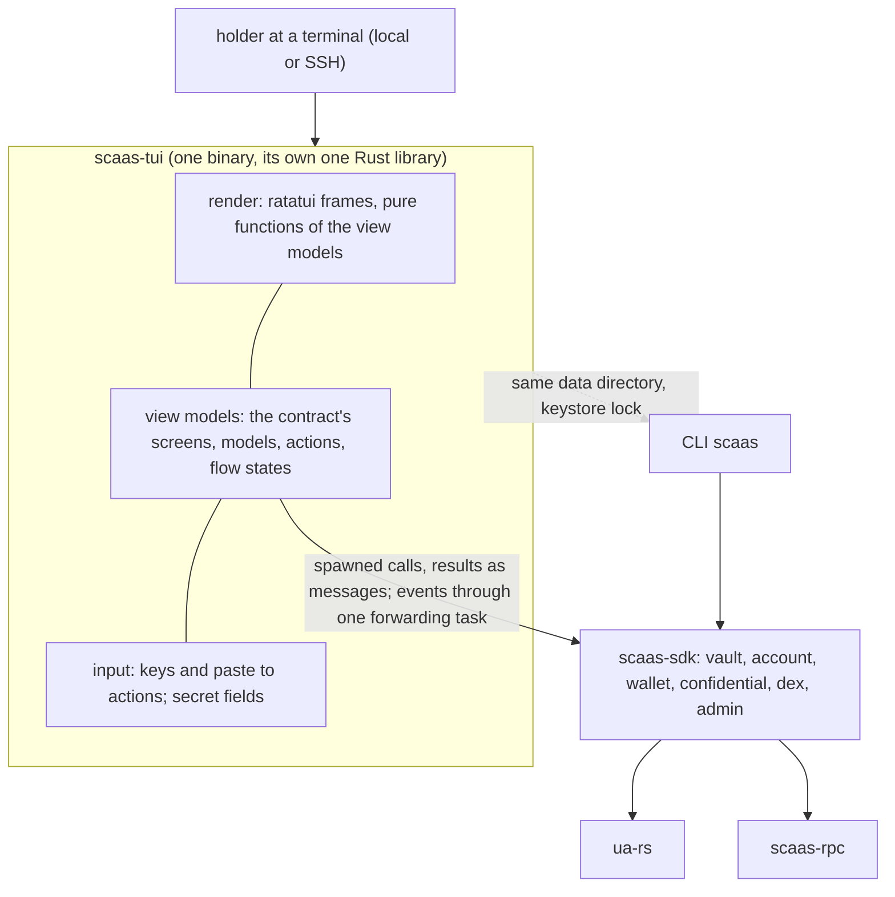
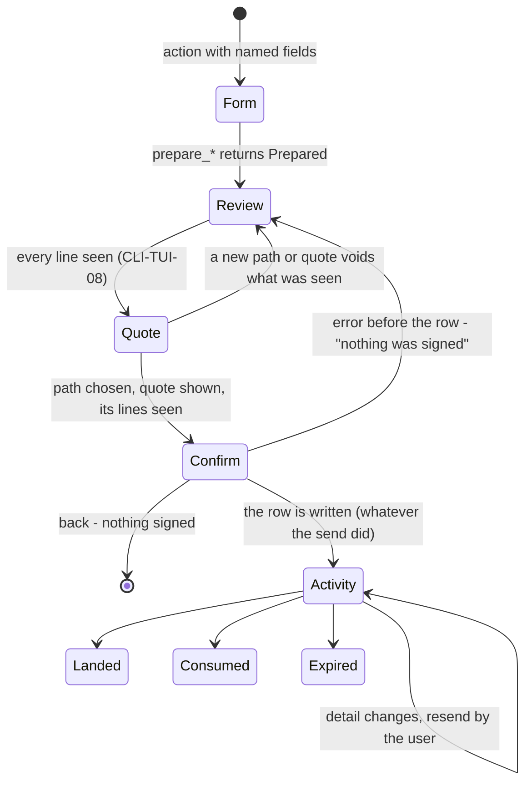

# `scaas-tui`: the terminal front-end over `scaas-sdk`: design

**Status:** SPECIFIED, nothing built. A **frame** (owner 2026-11-17, "cứ viết spec, để có khung sẵn"): every part that rests on an
SDK section not yet settled is marked **depends** with the section it waits for (collected in §15). Branch `scaas-tui` (from
`scaas-sdk` `0da3423ae`), worktree `.claude/worktrees/scaas-tui`. Work order: TODO item 8b, after the `scaas-sdk` spec
(owner 2026-11-17). Spec → review (Fable 2026-11-17: P0 0, P1 4, P2 14, P3 10, info 5; every finding applied, §18) → the owner's
answers to §16 (Q-T2, Q-T5, Q-T6, Q-T7 answered 2026-11-24, §1 O8) → code task by task. Rule ids introduced here (SPECIFIED, defined once in
[clients/scaas-tui.md](../../clients/scaas-tui.md), recorded in [decisions.md](../../decisions.md) §42): CLI-TUI-01 to CLI-TUI-17, and
the record CLI-TUI-30 (owner rulings). Owner rules carry the owner's words only; the controller's means and proposals are rules of
their own (`owner: no`). No contract, signed byte format, SDK rule or node rule changes; what this spec asks of the SDK is in §15.
Claims about terminal and library behaviour marked **verify at T1** rest on memory and are checked against the pinned versions in
plan T1 before anything is built on them. [Plan](../plans/2026-11-17-scaas-tui.md). UNAUDITED.

**Reads:** the [scaas-sdk spec](2026-11-17-scaas-sdk.md) and [rules](../../clients/scaas-sdk.md) (CLI-SDK-*) as at `0da3423ae`, and
its section **"App cores above the SDK"** (spec §12, rules §7, being written on branch `scaas-sdk` while this spec was written: the
`chat` module and the `pqvault` placeholder leave the SDK, `pqchat-core` and `pqvault-core` sit above it). This spec names SDK calls,
events and codes and does not restate their rules. [scaas-rpc](../../clients/scaas-rpc.md), [CLI-UAL-01](../../clients/ua-libraries.md#CLI-UAL-01),
scaas-app's `README.md`, `app-common/spec/app-core-contract.md` (§11 chat, §12 one Rust library) and `app-common/viewmodel/README.md`.

## 1. Owner rulings this spec follows

| # | Date | Ruling (quoted) | Where |
|---|---|---|---|
| O1 | 2026-11-09 | "Terminal UI for wallet + chat (owner 2026-11-09, as recommended): a new client `clients/scaas-tui` (Ratatui + Crossterm), after `pqchat-core` and the wallet module are stable; a thin layer over the same library API as the CLI and the app (no separate code path; it signs only through `ua-rs`, linked directly, one binary, works over SSH). Rules: no secret on screen, in scrollback, the clipboard or a log; the signing screen shows every named field (e.g. `payNo` as UUID, `save`), with a test. Spec first, then the estimate." | TODO 11 |
| O2 | 2026-11-17 | "Ok, theo đề xuất, viết TUI sau SDK": the `scaas-tui` spec and plan after the SDK spec, same branch; over `scaas-sdk`; the view-model contract of scaas-app `app-common/viewmodel/` as its **fourth front-end**; **SCaaS only** (no native-chain app core, no Trust Wallet Core) | TODO 8b |
| O3 | 2026-11-17 | App cores sit above the SDK, `pqchat-core` and `pqvault-core` too: "Đồng ý đảo chiều", "pqchat-core cũng đảo chiều luôn" | SDK spec §12; scaas-app contract §12 |
| O4 | 2026-11-17 | "cứ viết spec, để có khung sẵn": this spec is a frame | this header |
| O5 | 2026-11-17 | CLI-UAL-01 holds from `scaas-sdk` down | [ua-libraries.md](../../clients/ua-libraries.md#CLI-UAL-01) |
| O6 | 2026-11-17 | One matrix-rust-sdk stack below both chat paths, one login per app (decisions CTR-CHAT-01, Change of 2026-11-17) | the TUI's `pqchat` feature (O8, §5.10) |
| O7 | 2026-11-16 | the end-user app is scaas-app, never called "wallet" | TODO 6 |
| O8 | 2026-11-24 | "Q-T2: TUI có link pqchat-core và pqvault-core không: Có. Q-T5: Đúng. Q-T6: Đúng. Q-T7: Đúng." (Q-T2: does the TUI link `pqchat-core` and `pqvault-core`? Yes. Q-T5, Q-T6, Q-T7: agreed, as recommended) | §16; CLI-TUI-01, CLI-TUI-13, CLI-TUI-14, CLI-TUI-15; §5.10 |

**How O1 reads after O2 and O3.** O1's "linked directly" to `ua-rs` is replaced by O2: the TUI links `scaas-sdk` only (which links
`ua-rs`). O1's "wallet + chat" is narrowed by O3: chat is `pqchat-core`'s, an app core above the SDK; O8 settles that the TUI links it,
and `pqvault-core`, each as a crate behind its own feature (§3, §5.10). O1's toolkit (Ratatui + Crossterm, as recommended) and its three rules stand: CLI-TUI-01 (thin,
one binary, over SSH), CLI-TUI-04 (no secret on screen, in scrollback, the clipboard or a log), CLI-TUI-02 (every named field on the
signing screen, with a test).

Standing rules applied: every state-changing `mtx*` relayable, fee 0 too; no EIP-7702; explicit named parameters; every RPC consumer
takes a list of nodes (ARCH-POS-15); no decryption oracle (ARCH-POS-13); never lose ciphertext; fail closed with named errors; no
consumer-specific name; no chain assumption; never report `dead` while a transaction may still land.

## 2. Goal, scope, non-goals (SPECIFIED)

**Goal.** A holder runs one binary in a terminal, locally or over SSH, and does through `scaas-sdk` what the SDK offers for SCaaS:
manage seeds, see accounts and balances, send and pay with a full review, follow every operation to its chain fact, use confidential
tokens and the DEX, and (in an admin build) governance. The screens are the view-model contract's; the TUI is its fourth front-end.

**In scope.** The crate `clients/scaas-tui` (§3); its view-model layer and screens (§5); the review screen (§6); endpoint lists (§7);
terminal secret handling (§8); untrusted text (§9); configuration, profiles and limits (§10); errors (§11); accessibility (§12); the
threat model (§13); tests (§14).

**Non-goals.**
- No logic below the view model: no cryptography, transport, signer, byte format, retry or state machine of an operation; the SDK
  has them (CLI-TUI-17).
- No native chains: no `native-core`, no Trust Wallet Core, no SDK `native-networks` or `raw-native`. One exception, CLI-TUI-13
  (owner 2026-11-24, Q-T5): the EVM payer key the SDK's self-relay needs; its native send stays out of the build until the SDK
  reports its ends (§15 D8).
- No undecoded call: the SDK feature `opaque-calls` is never enabled in a TUI build.
- No passkey or platform unlock in this frame: the TUI passes no `Authenticator` (the SDK then offers passphrase unlock only, §4 of
  the SDK spec). A FIDO2 `hmac-secret` authenticator over USB is a later option, not designed here.
- Chat and vault only through the app cores `pqchat-core` and `pqvault-core` (O8, §5.10): the TUI adds no chat or vault logic of
  its own.
- No QR codes, no mouse, no themes beyond colour, monochrome and ASCII.
- No job API (server-side only, NODE-ADM-06).
- The secret rules are claimed only on the platforms the plan gates (Linux; macOS when CI has a runner). Signals, `RLIMIT_CORE` and
  the hang-up lock are Unix; a Windows build makes no such claim (Fable I4).

## 3. Place, crate, features (SPECIFIED; proposal for the layout)

- **Path** `clients/scaas-tui`, its own `Cargo.lock`, `publish = false`, `SPDX-License-Identifier: LicenseRef-Vegan-Community-1.0`,
  `rust-version` the repository pin. Dependencies: `scaas-sdk` (path), `ratatui` and `crossterm` (Q-T1; exact versions pinned at the
  plan's T1), `tokio` (with `signal`; the SDK adopts the TUI's runtime, `RuntimeChoice::Adopt`), `libc` or `rustix` (`RLIMIT_CORE`,
  `PR_SET_DUMPABLE`, `PT_DENY_ATTACH`, file modes), `zeroize`, `serde` and `toml` (configuration). Dev-dependencies, chosen and pinned
  at T1: a PTY crate, a VT parser and a terminal-emulator crate (§14). Nothing else that touches a key or a node.
- **Features** pass through to the SDK, one PQZ set per build as the SDK requires: `zether`, `pqz` with one `pqz-set-<set>`, `dex`,
  `admin` (off by default, as the SDK's), default `zether,pqz,pqz-set-n2304-kmax4096,dex`; `dev-profiles` (CLI-TUI-11, off, never in a
  release); `pqvault` (links `pqvault-core`) and `pqchat` (links `pqchat-core` and the one Matrix stack, §5.10), O8. A screen whose SDK feature is off does not exist in the build. `native-networks`, `raw-native`, `opaque-calls` are refused
  twice (CLI-TUI-17): a `cargo tree -e features` test, and at start when `Sdk::features()` reports one of their bits. An app core
  appears in the tree only under its own feature, and `matrix-sdk` only under `pqchat`, as one copy (O6); the tree test checks both.
- **Not the CLI** (CLI-SDK-17): the CLI is one subcommand per SDK call for scripts and the e2e tests, and exits; the TUI is a session
  that subscribes to the SDK's events, keeps screens current, locks on idle and follows operations. Neither calls the other; action
  names equal the CLI's subcommand names. The SDK spec's §20 calls the CLI "the base `scaas-tui` reuses for its commands"; this spec
  reads it as shared names only, and asks the SDK branch to change that sentence to say so (Fable U24; §15 D9).
- **Process model** (Fable U10). One tokio runtime; one `Sdk` (`Sdk::open` with the pinned profiles of §10, `FileStore` in the shared
  data directory, `authenticator: None`, `RuntimeChoice::Adopt`). The event loop never awaits an SDK call: every call is a spawned task
  whose result returns to the loop as a message, and one task forwards `Subscription::next` into a channel (the SDK states no cancel
  safety for `next` inside a `select!`). The loop selects over terminal input, that channel, the results and a one-second tick; a
  frame is drawn after any change. Input stays live while an unlock (scrypt) or a proof runs.

## 4. Toolkit (open point Q-T1; recommendation as ruled on 2026-11-09)

| Option | For | Against |
|---|---|---|
| (a) `ratatui` + `crossterm` backend | the de-facto Rust TUI library; immediate-mode frames from plain state (fits view models); `TestBackend` gives headless frames for golden tests; crossterm runs on Linux, macOS and Windows, has bracketed paste, alternate screen, scrollback purge | ratatui changes its API between minor versions (pin exactly) |
| (b) `ratatui` + `termion` | small | Unix only; no Windows |
| (c) `cursive` | retained widgets, dialogs ready-made | its own widget state beside the view models (two states); harder headless frames |
| (d) a component layer over ratatui (`tui-realm`) | message passing | one more dependency and state model for little gain |

**Recommendation: (a)**, the owner's 2026-11-09 choice ("as recommended"), restated here because the brief asked for it as an open
point. No other UI dependency: widgets are ratatui's (`Paragraph`, `Table`, `List`, `Tabs`, `Block`).

## 5. View models and screens (SPECIFIED; depends on the view-model contract, §15 D1)

### 5.1 The view-model layer

scaas-app's view-model contract (`app-common/viewmodel/view-model-contract.md`, task B10 there, **not written yet**) will give, for
each kept screen, its models and roles, its actions with named parameters, its events and the states of its flow, with no toolkit
type. The TUI implements it in Rust as `src/vm/`: one module per screen, each a plain struct of models (rows with named roles and ids),
an enum of flow states, a function per action that spawns an SDK call, and a function per SDK message that updates the models; no
SDK message moves focus or opens anything that takes keys (CLI-TUI-08 (7)). Rendering (`src/ui/`) is a pure function from a view model
and the terminal size to a ratatui frame and records which lines each completed frame drew (CLI-TUI-08 (1)); input (`src/input/`)
maps keys to actions. Until B10 lands, the TUI's view models carry the names below, marked provisional; when B10 lands they take the
contract's names, and screens the contract lacks (confidential, DEX, admin, endpoints) are handed to scaas-app's owner as additions
(Q-T3). The TUI's signing-safety state (seen lines, the confirm gate, the marks, the in-flight wording) goes with them: it belongs in
the contract for every front-end, or is declared TUI-only there (Fable I1).

### 5.2 Screen map

| TUI screen | View-model screen (planned in B10) | SDK calls | SDK events | SDK plan task |
|---|---|---|---|---|
| Seeds | onboarding, settings | `vault.seeds`, `generate`, `import_words`, `derive_child`, `unlock`, `open_hidden`, `lock`, `lock_all`, `rename`, `remove`, `change_passphrase` | `SeedUnlocked`, `SeedLocked`, `KeystoreChanged`, `KeystoreMismatch`, `KeystoreRollback`, `HiddenOpsAbandoned` | T4, T5 |
| Backup | backup | the `SeedBackup` reveal and three-word check, `confirm_backup`; `backup_seal`, `restore_backup`, `link_seal` / `LinkSession` | — | T4 |
| Accounts | accounts and assets | `account.accounts`, `add_ua`, `add_watch`, `rename`, `hide`, `ua_of`, `id_display`, `restore`; registration (`prepare_register` …) | `KeystoreChanged` | T9, T13 |
| Balances and tokens | accounts and assets | `wallet.balances`, `tokens`, `watch` | `BalanceChanged`, `Lagged` | T11, T14 |
| Receive | receive | `ua_of`, `id_display`; refused for an unverified row (`AccountUnverified`) | — | T9 |
| Send and pay | send and review | `prepare_*` of the transfer on ids and `mtxPay` with `PayMeta`; then §5.5 | `OpState` | T12 |
| Review | send and review | `Prepared::review`, `Op::quote`, `Op::submit` | — | T10 |
| Activity | activity | `wallet.history`, the operations of `sdk.state`, `Op::resend`, cancel by `UACancelNonce` / `CancelNonce` | `OpState`, `HistoryAdded` | T10, T14 |
| Confidential | none (addition, Q-T3) | `confidential.zether_*`, `pqz_*`, `request_verdict`, the reading layer's balances | `OpState::Proving`, `BalanceChanged` | T15, T16 |
| DEX | none (addition) | `dex.markets`, `depth`, `trades`, `ticker`, `orders`, `prepare_trade_order`, `prepare_cancel_order`, `dex_cancel_all` | `OpState` | T17 |
| Admin (feature `admin`) | none (addition) | `admin_<struct>` entries; **depends** on Q-T4 | `OpState` | T18 |
| Endpoints | settings (addition for the list) | the profiles in use; health from `EndpointDropped` | `EndpointDropped` | T1, T11 |
| Settings | settings | the TUI's own config (§10): idle lock, colour, ASCII, lowered caps | — | — |

### 5.3 Seeds and backup

```mermaid
stateDiagram-v2
  [*] --> Locked
  Locked --> Unlocking: unlock (passphrase field)
  Unlocking --> Unlocked: SeedUnlocked
  Unlocking --> Locked: VaultOpen / KeystoreMismatch shown by code
  Unlocked --> Locked: lock, lock_all, idle deadline, hang-up, suspend, SeedLocked
  [*] --> Generating: generate (label, passphrase twice)
  Generating --> Gate: NewSeed (backup pending)
  Gate --> Reveal: the user types reveal
  Reveal --> Check: cells overwritten, two full frames
  Check --> Unlocked: three words right, confirm_backup
  Check --> Check: a word wrong
```

- **Generate**: label, vault passphrase typed twice (secret fields, CLI-TUI-16), `VaultPassphraseWeak` shown by code. Before the
  words, the gate of CLI-TUI-15 (owner 2026-11-24, Q-T7): the typed word `reveal` always, and a warning when `SSH_CONNECTION`, `SSH_TTY`,
  `TMUX` or `STY` is set or the terminal does not confirm the alternate screen (a DECRQM query of mode 1049; **verify at T1** which
  terminals answer it). The words appear once (numbered, 24 lines or a 4 × 6 grid). Leaving the screen overwrites its cells, homes the
  cursor and draws two full frames; where the alternate screen was not confirmed the TUI then offers a scrollback purge (CLI-TUI-16).
  The words are never shown again by any flow. The three-word check takes three words in secret fields. A seed whose backup is
  `pending` carries that mark everywhere.
- **Import** (Fable U27): one secret field per word, numbered; after each word the field says only "word n: in the list" or "not in
  the list" (the check is an SDK call over the word as `SecretBytes`, asked of SDK T4, §15 D9; the TUI holds no word list); then the
  vault passphrase twice; `MnemonicInvalid` by code; `short_seed` shown wherever the seed is listed, with the SDK's advice. A paste
  into the first word field that holds 12 to 24 words fills the fields in order.
- **Unlock / lock**: per seed; `lock_all` on one key; the idle deadline (default 5 minutes, §10), a terminal hang-up and a suspend
  (`SIGTSTP`) call `lock_all`. A lock that waits for a proof in flight says so (SDK §6.10). On `SeedLocked` the view models forget that
  seed's decrypted values, forms, prepared values and quotes (CLI-TUI-16, Fable U17).
- **Hidden sets**: `open_hidden` with the BIP-39 passphrase typed twice at a set's first use in the session (the SDK can store no
  check value). The activity screen marks a hidden set's in-flight rows "not followed after lock" before any lock, and
  `HiddenOpsAbandoned { count }` is shown at lock (Fable I3). Nothing of a hidden set is written by the TUI either.
- **Remove**: a confirmation by typing the seed's label; for a `pending` seed a second one (`ConfirmRemoveUnbacked`).
- **Sealed exits**: backup to recipients and device link; the link's short code shown for comparison on both screens.
- **Classical-rooted sets** (SDK feature `classical-roots`): **depends** on SDK T6; the screen exists once the SDK has the calls.

### 5.4 Accounts, balances, receive

Accounts are listed per seed with kind, UA id (`id_display`), name, and the **unverified** mark for rows of a locked seed. Balances
are the SDK's decimal strings with the token's decimals and symbol; unlisted tokens carry the `unlisted` mark, drawn before their name
at a fixed column, and their name through the allow-list (CLI-SDK-15, CLI-TUI-05). A row with an EIP-7702 delegation carries the SDK's
mark and warning. Receive shows the full UA id and address, grouped in fours for reading aloud, never shortened; for an unverified row
it shows `AccountUnverified` instead. Registration (including the PQ split into `register` then `storePqzPop`) runs through §5.5.
Selection in every list follows the row's id (CLI-TUI-08 (7)).

### 5.5 Operations: prepare, review, quote, confirm, follow

- **Form**: one field per named request field, typed (an amount as a decimal string, `payNo` as a UUID, `save` as a yes/no, a fee
  that may be 0 and is never filled by the TUI). The form shows the in-flight operations of its lane and refuses a second operation on
  that lane, or with a `payNo` already in flight, offering wait, resend or cancel (CLI-TUI-09).
- **Review and quote**: §6. `PreparedStale` sends the user back to the form with the fields kept; the new prepared value starts with
  nothing seen.
- **Path**: `Auto` by default; the user may choose `Gateway` or `SelfRelay { payer }` (CLI-TUI-13 for the payer). A new path gives a
  new quote and voids what was seen of the old one. `SubmitPathNone`, `FeeAboveCap`, `GasAboveTxCap`, `PayerDelegated` shown by code.
- **After confirm** (CLI-TUI-09, Fable U2): an error before the SDK wrote the row (`PreparedStale`, `WalletLocked`, `FeeAboveCap`,
  `StoreConflict` …) returns to the review saying "nothing was signed"; once the row exists the result is an activity row in flight,
  never an error dialog, whatever the send did (every gateway unreachable, `BroadcastRejected`). **Depends** on SDK T10 for an
  unambiguous result: `submit` returns the `OpId` once the row is written and send results arrive as `OpState` (§15 D9).
- **Follow** (CLI-TUI-03): the activity screen lists the operations with the SDK's state and detail. A relayed operation shows
  `InFlight { Queued | Sent | merged gateway state | TxFinalFailed | TxReplaced }` in words, never "failed", and ends `Landed { block,
  hash }`, `Consumed` or `Expired`. An EVM native send (CLI-TUI-13, held out until the SDK reports its ends) ends on `Final` or `Replaced` from a decisive
  read (SDK §13.5, Fable U12). Actions on an in-flight row: wait; resend (the same bytes, on a path the user picks, the stored
  operation's fields shown from its row beside the new quote, both seen before confirm, Fable U26); cancel the lane's nonce (a new
  operation, its own review). After a restart the list resumes from the SDK's state, the rows the SDK sent at open listed first; the
  list is re-read when the screen gains focus (another process may have changed `sdk.state`, Fable I2).
- **Quit and hang-up** wait at most 30 s, said on screen, for every signed row to reach `sent`, then lock and exit (Fable U10).

### 5.6 Confidential tokens (depends on SDK T15, T16)

Shield, transfer, unshield and rollover for Zether and PQZ through the SDK's entries; the review shows the plaintext amount and
recipient as `Request` fields (the signed struct holds ciphertexts and a proof). While a proof runs the screen shows `Proving` and that
it cannot be cancelled. A verifier-mode PQZ token shows `VerdictRefused` by code; nothing is sent. `PqzSetMismatch` names the build's
set. A decrypted balance is drawn for the holder only and nothing the TUI does depends on it (no automatic rollover, no refresh
triggered by a value; CLI-TUI-03, ARCH-POS-13); it is forgotten at the seed's lock.

### 5.7 DEX (depends on SDK T17)

Markets, depth, recent trades, ticker and the holder's orders through the SDK's reads; a trade order's form and review show `minFill`
as signed and the market's pair with each token's address and mark (CLI-TUI-08 (8)); a DEX not on the profile's list is refused by the
SDK (CLI-SGN-35) and shown by code. Cancels are operations.

### 5.8 Admin (feature `admin`; depends on SDK T18 and Q-T4)

One form per `GovernanceRouter` entry and the router's creates, with the CREATE3 address preview. The SDK offers ~60 admin entries;
how the TUI gets each entry's named fields is Q-T4. Off by default.

### 5.9 Endpoints and settings

§7 and §10.

### 5.10 App cores: vault and chat (O8; features `pqvault`, `pqchat`; plan T14)

The TUI links `pqvault-core` and `pqchat-core` as crates and draws their screens over their view models (the contract's chat
screens; the vault screens of the pqvault plan's V12). Their rules hold unchanged: every signature, KEM, KDF and AEAD runs in
`ua-rs` through the SDK, the app core holds key handles only, and no key byte reaches it or the TUI
([CLI-PQC-03](../../clients/pqchat-core.md#CLI-PQC-03), [CLI-PQC-04](../../clients/pqchat-core.md#CLI-PQC-04),
[CLI-PQV-12](../../clients/ua-libraries.md#CLI-PQV-12), [CLI-PQV-13](../../decisions.md#CLI-PQV-13)). A record the app core signs
with a review goes through §6; the PqChat message entry signs without a per-message prompt, as CLI-PQC-04 states.

- **Vault** (`pqvault`): pending vaults and accept or decline, with creator, admins and members' kinds (CLI-PQV-11); the list;
  unlock with the vault passphrase in a secret field (CLI-TUI-16), `PassphraseWrong` by code; items listed by type and title;
  an item drawn with its secret fields (a login's `password`, a `totp` secret, an `sshKey`, a card's number) hidden; a secret field
  revealed only on the user's key for that field, hidden again after 30 s, its cells overwritten as CLI-TUI-16 says (CLI-PQV-04);
  edit with the merge result on a conflict; delete as a tombstone with "the bytes stay"; share, remove and leave with the exposure
  and affected lists; passphrase change; the UNAUDITED label (CLI-PQV-08). Never copied: CLI-TUI-14 lets the clipboard hold public
  values only, so CLI-PQV-04's copy with a 30 s clear is not offered in the TUI; no autofill in a terminal. `SeedNotPqRooted` for a
  classical-rooted seed set (CLI-PQV-06). Unlocked vaults lock with the seed, at the idle deadline, hang-up and suspend.
- **Chat** (`pqchat`): the Matrix login is the one stack's (O6, CLI-PQC-05), its password a secret field; sessions recovered from
  contract state alone (CLI-PQC-09) and listed with their pending, accepted and declined state; a pending session's preview
  (creator, members, name, cost of accepting) and nothing else until accepted (CLI-PQC-08); the message timeline in the crate's
  order with each message's author and epoch; a compose field; members, rekey, remove and leave as reviewed records; a tree session
  (CLI-PQC-17) refused by name until the crate builds it, then with its warnings shown and no automatic receipt; a message held
  while the seed was locked shown at unlock (CLI-PQC-10); an unreadable or `too-far` message shown on this device only, and nothing
  sent because of it (ARCH-POS-13).
- **Secrets on the terminal**: decrypted message bodies, vault items and `sealedInfo` are outside text (CLI-TUI-05) and are
  forgotten at `SeedLocked` with the other decrypted values (CLI-TUI-16); never written to a log, never on the clipboard
  (CLI-TUI-04, CLI-TUI-14), never in the window title or a notification.
- **Depends**: the chat part on scaas-app's `app-matrix` as a crate pinned by revision (O6; replaced 2026-11-27 by this repository's `scaas-matrix`, CLI-PQC-20, with Matrix rooms beside PqChat sessions, CLI-PQC-19); the store key and device anchor of
  CLI-PQC-09 on a terminal, from the app contract's desktop answer.

## 6. The review screen (CLI-TUI-02, CLI-TUI-08; SPECIFIED)

- **Every field, decoded, with its source** (CLI-TUI-02). One row per `ReviewField` of `Prepared::review` in the SDK's order: name,
  the SDK's `display` value, source (`signed`, `request`, `derived`). `payNo` as UUID text, `save`, `fee`, `relayer`, `validUntil` as a
  UTC time and the raw value. Then the chain key, the entry name (`mtxPay`, `mtxExecuteTransfer` …), the signer reference,
  `expires_at`.
- **Token standing** (Fable U18). For every token or market the operation touches, a `derived` row with the token's contract address
  whole and its `unlisted` mark; asked of SDK T10 to list them in `review()`, added by the TUI from `tokens` until then (§15 D9).
- **Whole and exact values** (Fable U5). No ellipsis in an address, id, amount or hash: a long value wraps. Amounts are the SDK's
  decimal strings; no arithmetic, no floating point. A string value passes the value filter of CLI-TUI-05: never bounded or stripped,
  any character the allow-list would drop drawn as an escape (`\u{202E}`) and the row marked "contains hidden characters".
- **The gate** (CLI-TUI-08, Fable U1, U11):
  1. what was seen is a set of rendered lines, counted only when drawn in a completed frame, keyed to `(Prepared::id(), the quote)`;
     a new quote, path or prepared value starts it empty;
  2. scrolling by line (`↓`, `j`) or page (`PgDn`, `Space`); no jump to the end; a field taller than the view scrolls in sub-pages;
  3. on entering review, quote and confirm the input queue is drained; the confirm key counts only if it arrives after the frame that
     drew the last unseen line, the quote and the confirm prompt, and 500 ms after that frame;
  4. a paste never acts as keys; in a form, an unbracketed burst of keys (more than 8 within 20 ms) is taken as a paste and no
     newline inside it submits; **verify at T1** that crossterm reports bracketed paste and key-event kinds on the gated terminals;
  5. the confirm key is `Ctrl-Y`, which no form takes as input; `KeyEventKind::Repeat` never confirms (where the terminal does not
     report repeat, a second `Ctrl-Y` within the settle interval is ignored);
  6. confirm is dead while help, a node-detail popup, an error line or the too-small message covers the prompt, or the last completed
     frame did not show the prompt (a resize below 80 × 24 kills it);
  7. events change models, never focus; selection by id.
- **`Prepared::opaque()`** is always false in a TUI build; a true value keeps confirm dead, a test.
- **The quote** follows the review: path, payer (and that its address is linked on chain to the subject), gas limit, maximum fee per
  gas, maximum priority fee, **maximum cost**, the caps that apply (CLI-TUI-12), the fee to the relayer, the gateways and the fan-out
  (the profile's, CLI-TUI-06).
- **What confirm does.** `submit(prepared, quote)` with the objects shown, nothing rebuilt; then §5.5's two outcomes. A second key
  press does nothing while the submission runs.

## 7. Endpoint lists (CLI-TUI-06; SPECIFIED)

- The endpoints screen lists, per profile: the policy (`failover` or `strict_majority` with `n`), the RPC list and the gateway list
  apart, and per endpoint its index, label, class (`named`, `default`), host and health (answers, failovers, the last
  `EndpointDropped` reason through the allow-list). The first endpoint of each list is marked "decides": it answers terminal states
  and the lane's status reads, and for decryption reads the first non-discovered one does (CLI-RPC-04, CLI-RPC-09).
- Overlay endpoints are appended to a list unless marked `first` (Fable U13); the overlay may strengthen a policy (`failover` to
  `strict_majority`) and never weaken a release's; the fan-out to gateways (`Fanout::First` or `All`) is the profile's value.
- No `discovered` class appears: the TUI discovers nothing, a narrowing of ARCH-POS-15 (which allows all three classes) proposed here,
  the owner may override (Fable U24). A read that feeds a decryption therefore always has a non-discovered source when the list is
  not empty.
- Under `strict_majority` the screen states what `n` tolerates (CLI-RPC-05: `n = 2` detects one liar and tolerates no failure,
  tolerance of one needs `n ≥ 3`). The SDK refuses `strict_majority` with one endpoint.
- Errors `EndpointAllFailed`, `EndpointNoMajority`, `NoTrustedEndpoint`, `AgreementNeedsThree`, `ProfileMismatch` shown by code with
  the endpoints screen one key away.
- Never a full URL (it may carry a credential): the host without userinfo, an IDN as punycode, or the label only where the user sets
  `show = "label"` (providers that put a key in the subdomain) (Fable U22).

## 8. The terminal's secret handling (CLI-TUI-04, CLI-TUI-16; SPECIFIED)

| Concern | Rule |
|---|---|
| Echo | Secret fields draw a fixed placeholder that does not change with input: no characters, no mask, no count. No reveal toggle (O1: no secret on screen); the one exception is a new seed's words (§5.3, CLI-TUI-15). Fields are modal: inside one every printable key is input, only `Esc`, `Tab`, `Enter` leave it, and the footer names the mode (Fable U23) |
| Input path | Raw-mode key events and bracketed paste go into a fixed-capacity `Zeroizing<Vec<u8>>` (1 KiB for a word or passphrase, 4 KiB for a phrase; input beyond it is refused, so the buffer never reallocates, Fable U20); a pasted `String` is zeroized after the copy; the bytes move into one `SecretBytes` and the buffer is zeroed. Never argv, the environment or the config file |
| Scrollback | Drawing is in the alternate screen. Leaving a secret screen (reveal, a form with a secret field), locking, suspending, exiting and panicking each overwrite the cells with spaces, home the cursor and draw two full frames, not only an erase-display (in tmux with the alternate screen off, an erase-display is said to move the visible lines into history: **verify at T1**, Fable U8). A scrollback purge (CSI 3 J) runs only where the alternate screen was not confirmed, right after a reveal, with the user's consent; never at exit when the alternate screen worked (it would destroy the user's own scrollback) |
| Panic, `Internal` | CLI-TUI-10: the hook restores the terminal, clears it, prints only the panic's location (no message, which may hold data) and aborts; an `Internal` from the SDK locks all, restores, clears and exits. Nothing is drawn or read after the mode was restored (Fable U3) |
| Signals | `SIGHUP` (an SSH drop) and `SIGTERM`: wait at most 30 s for signed rows to reach `sent` (§5.5), `lock_all`, restore, exit. `SIGTSTP`: `lock_all`, clear, restore, stop; `SIGCONT`: re-enter raw mode and the alternate screen, check the idle deadline, draw the seed list. `SIGINT` in raw mode is a key, handled as "back" |
| Clipboard | Never a secret, whatever the setting (CLI-TUI-04). Anything else only under CLI-TUI-14 (owner 2026-11-24, Q-T6): off by default |
| Window title, notifications | Never set from data |
| Logs | No log by default. With `--log <file>`: created `0600`, opened append-only, a symlink refused (`O_NOFOLLOW`); the SDK's `tracing` lines (no secret, URL or body there, CLI-SDK-02) and the TUI's own (screen names, action names, codes), never a form value |
| Core dumps, tracing | `RLIMIT_CORE` 0 at start; on Linux `prctl(PR_SET_DUMPABLE, 0)` (also blocks a same-user `ptrace` and `/proc/<pid>/mem`), on macOS `ptrace(PT_DENY_ATTACH)` (Fable U19); the SDK's `mlock` feature on |
| Idle | The idle deadline is a wall-clock instant (`CLOCK_REALTIME`, or `CLOCK_BOOTTIME` on Linux, which keeps running across suspend), compared at each tick and at `SIGCONT`; past it, `lock_all` and the seed list (Fable U9) |
| Lock | On `SeedLocked` the view models drop that seed's decrypted values, forms, prepared values and quotes before the next frame (Fable U17) |
| SSH | Works over SSH (O1): the keystore and the process are on the host the TUI runs on; the reveal gate warns (CLI-TUI-15). mosh's local echo prediction is believed to stay hidden for input the server never echoes: **verify at T1** by a manual check before "works over SSH" is written BUILT (Fable I5) |

**Residuals, stated.** Exits the process cannot handle run no hook: `SIGKILL` (this machine's `systemd-oomd` among others),
`SIGSTOP`, a stack overflow, an `abort()` in a dependency, an allocation failure; the screen and the tty mode stay as they were, the
reveal included (Fable U9). A recorder of the byte stream or of typed input (`script`, asciinema, a multiplexer's `pipe-pane` or log,
`screen` logging, another attached client, a bastion's session recorder, PuTTY's or a terminal's "log to file") receives what was
drawn or typed; the alternate screen, the clears and the purge cannot reach it (Fable U8, U21). A terminal without an alternate screen
keeps what was drawn in its scrollback unless purged. The reveal's words pass through a `String`, ratatui's two cell buffers and the
stdout buffer, which are not locked or zeroed: `mlock` covers `SecretBytes`, not the draw path (Fable U20). The terminal emulator's and
crossterm's own input buffers are not the TUI's to zero. Text the user pastes was on the clipboard before.

## 9. Untrusted text (CLI-TUI-05; SPECIFIED)

- **A type.** Outside text (from a chain, a node, a profile, the keystore's labels, an endpoint) enters the TUI only as `Inert`, built
  by one of two functions in `src/ui/text.rs`; render functions take `Inert` and the TUI's own `&'static str`, no other string type
  (Fable U6, U7), so a screen that forgets the filter does not compile.
- **`inert_label(text, max_bytes)`**, an allow-list: for names and symbols from a chain or a node, printable ASCII (U+0020–U+007E)
  passes and everything else is drawn as a visible escape `\u{XXXX}`; for seed and account labels the user wrote, letters, numbers,
  punctuation, symbols and space separators (general categories L, N, P, S, Zs) of a known single or double width pass, no format
  character (Cf, which covers U+061C, U+200B–U+200F, U+202A–U+202E, U+2060–U+2069, U+FEFF, the tags U+E0000–U+E007F) and no line or
  paragraph separator. Bounded: 64 bytes for a name or symbol, 256 for a node's `detail` (as CLI-RPC-11), cut on a character boundary
  and marked `…(cut)`.
- **`inert_value(text)`** for review and quote values (Fable U5): the same allow-list, **no bound** and nothing removed: every
  character the allow-list would not pass is drawn as its escape, and the row is marked "contains hidden characters".
- **Links** (Fable U28): `://` in outside text is drawn as `:⁄⁄` (or `:/ /` in ASCII mode) so no terminal makes it clickable.
- **Marks first.** `unlisted`, `unverified`, `delegated` are drawn before the outside string at a fixed column, so a string's width or
  direction cannot push them out of their cell.
- **Node codes.** A node `code` is shown only when it matches `[A-Za-z0-9_]{1,64}`, else `<invalid code>`; `revert_data` as hex only.
  A node's `detail` appears only after a key press, framed as "raw text from the node".
- **Outside the screen.** Text printed before the terminal is set up or after it is restored (start-up refusals, `Sdk::open`'s code)
  goes through one print function with the same filter.
- **Verify at T1** (Fable U7): ratatui's `Buffer::set_stringn` is believed to drop graphemes with control characters already; if so,
  a test that only scans for ESC cannot fail. The tests (§14) therefore use classes ratatui passes (U+202E, U+061C, a zero-width
  character) and assert on the frame, and the byte-stream test parses with a VT parser.

## 10. Configuration, profiles and limits (CLI-TUI-06, CLI-TUI-11, CLI-TUI-12; SPECIFIED; proposal for the files)

| Source | Holds | Never holds |
|---|---|---|
| the release profiles, compiled into the binary (or shipped beside it with a digest the binary pins; a mismatch refused) (CLI-TUI-11, Fable U4) | the chain profiles of CLI-SDK-15: chain key, family, chain id, `chain_uid`, RPC list with classes, gateways and fan-out, contracts, tokens, DEXes, verifiers, finality, the per-transaction gas cap; and the default `Limits` per profile | secrets |
| `--profiles <file>`, only in a `dev-profiles` build | a profile file for tests and development; every screen and the review carry a fixed banner with the file's SHA-256 | — |
| overlay `$XDG_CONFIG_HOME/scaas/endpoints.toml` (proposal: one file for the CLI and the TUI, Q-T8) | per profile key: an `rpc` and a `gateways` list of extra `named` endpoints (`url`, `label`, `first`, `show`), a stronger policy, per endpoint the **name** of a credential file (preferred) or environment variable | a credential's value; a token, DEX, verifier, contract or `chain_uid` change; a removed pinned endpoint; a weaker policy |
| `$XDG_CONFIG_HOME/scaas/tui.toml` | idle lock (default 300 s, 0 refused), colour on / off, ASCII on / off, the clipboard opt-in (CLI-TUI-14), the default profile, per profile **lower** values for `max_fee_per_gas`, `max_gas`, `max_cost` (CLI-TUI-12) | anything secret; a cap above the build's |
| data `$XDG_DATA_HOME/scaas` | the SDK's `FileStore`: keystore, `keystore.prev`, `keystore.head`, `sdk.state` (shared with the CLI and the app under the store lock) | — |

Every file is bounded (64 KiB for the TUI's, the SDK's bounds for its own) and parsed with unknown fields refused. An overlay entry
for an unknown profile key, a credential given as a value, a credential file readable by group or others (refused as `ssh` refuses a
key file), a policy the SDK refuses, or a cap above the build's stops the start with a named message. The file form of a credential is
preferred over the environment, which is readable in `/proc/<pid>/environ` and inherited by children (Fable U22). End-user use needs
no credential (CLI-APP-03); the reference form exists for a holder who runs their own provider account. The same pinning question is
put to the CLI (SDK §20, §15 D9).

## 11. Errors (SPECIFIED)

- The TUI shows an error by its SDK `code()` and a message from its own table (`src/ui/messages.rs`, one English line per code it
  knows, appended only, as the codes are). An unknown SDK code is shown as itself; a node `code` under §9's pattern rule. `ua-rs`,
  `scaas-rpc` and node codes keep their own names (CLI-SDK-13); a node refusal shows its node `code`, its `detail` only on request.
- After confirm, errors follow CLI-TUI-09: "nothing was signed" before the row, an activity row after it.
- Warnings (`short_seed`, `imported_key`, `unlisted`, the delegation mark, `classical-rooted`) are marks beside a success, never
  error dialogs.
- `Lagged { missed }` makes the screen re-read its state; it is not shown as an error.
- `Internal` ends the process under CLI-TUI-10. Any other error never ends the session. The process exits non-zero only when the
  terminal cannot be set up, a config file or a profile digest is refused, `Sdk::features()` reports a refused bit, `Sdk::open` fails
  (its code printed after the terminal is restored), or on `Internal` or a panic.

## 12. Accessibility in a terminal (CLI-TUI-07; SPECIFIED)

- Meaning by word or symbol, colour only as an extra: states read `landed`, `in flight: sent`, `unverified`, `unlisted`.
- `NO_COLOR` (any value) and `colour = false` draw without colour; `ascii = true` (or a non-UTF-8 locale) replaces box drawing and
  symbols with ASCII.
- Keys are modal (CLI-TUI-16). Outside a field: arrows and `h j k l`, `PgUp` / `PgDn`, `Tab` between panes, `Enter` to act, `Esc`
  back, `?` help, `L` lock all, `q` quit (with a confirmation while an operation is being prepared, and the wait of §5.5 while one is
  signed and not yet sent), `Ctrl-Y` confirm on the confirm screen only. Inside a field every printable key is input. The footer lists
  the mode and the keys the current screen takes.
- 80 × 24 is the smallest layout; below it a single message asks for a larger terminal, and confirm is dead. Layouts are tested at
  80 × 24 and 120 × 40.
- Text is English; numbers and times are not localised (UTC, ISO 8601). A linear, screen-reader-oriented mode is not in this frame.

## 13. Threat model (SPECIFIED)

| Asset | Threat | Defence | Residual |
|---|---|---|---|
| words, passphrases, imported keys | shoulder surfing, screen sharing | no echo, no reveal toggle; the words once, behind the typed `reveal`, cleared on leave | a camera at reveal time |
| the same | scrollback, multiplexer history | alternate screen; cells overwritten, two full frames; a purge where the alternate screen is unconfirmed, with consent (§8) | recorders of the byte stream or typed input |
| the same | echo after a crash | a panic or `Internal` restores and exits; nothing drawn or read after (CLI-TUI-10) | exits that run no hook (§8) |
| the same | clipboard sniffers | never a secret; nothing at all by default | the user's own paste |
| the same | logs, crash output, core dumps, a same-user debugger | no secret in any log line; panic hook prints a location only; `RLIMIT_CORE` 0, `PR_SET_DUMPABLE` 0 / `PT_DENY_ATTACH`; SDK `mlock` | swap without `mlock`; root |
| the same | an SSH host compromise | none: the keystore lives on the host the TUI runs on; the reveal warns | stated |
| unlocked seeds | a walk-away, a closed lid, a stopped process | idle deadline on a clock that runs across suspend; lock at `SIGTSTP` and hang-up; view models forget at lock | `SIGSTOP` (no handler) |
| what the user signs | a confirm before reading: a jump, a held key, type-ahead, a paste of `<id>\n…y` | the line-set gate per prepared value and quote, drained input, a settle interval, `Ctrl-Y` no form takes, no repeat, paste never keys (CLI-TUI-08) | a user who confirms without reading |
| the same | a key redirected by a reorder or a resize | selection by id, events never move focus, confirm dead when the prompt is not on the last frame | — |
| the same | a familiar symbol on an unlisted token; hidden characters in a signed string | each token's address and mark on the review; values escaped, never stripped (CLI-TUI-08 (8), CLI-TUI-05) | look-alike glyphs in labels the user wrote |
| funds | a double payment after a send error | two outcomes only; the lane and `payNo` blocked while one is in flight (CLI-TUI-09) | — |
| the terminal | escape injection or bidi reordering from chain data or a node | the `Inert` type and the allow-list; marks first; `://` broken (CLI-TUI-05) | — |
| trust marks, decisive reads | a replaced profile file putting an attacker's node first as `default` | profiles compiled in or digest-pinned; `--profiles` only in a development build, bannered (CLI-TUI-11) | a modified binary |
| fees | a lying endpoint quoting a huge fee under failover | the build's caps, lowered only, shown on the quote (CLI-TUI-12) | — |
| endpoint lists | a lying endpoint, a discovered endpoint for a decryption read, an added endpoint becoming decisive | the SDK and `scaas-rpc` rules; no discovery; overlay endpoints appended unless `first`, shown as "decides"; policy never weakened (CLI-TUI-06) | — |
| credentials of endpoints | in a config file, on screen, in `/proc` | names only; file preferred, mode checked; host without userinfo or the label only | the file's own protection |
| decrypted amounts | a decryption oracle through the TUI's behaviour; a reader after the lock | nothing the TUI sends, reads or times depends on a decrypted value; forgotten at lock | — |
| the keystore | a concurrent CLI or app process | the SDK's store lock and `rev` rule; activity re-read on focus | the TUI gets no event for another process's change |

## 14. Tests (SPECIFIED)

- **Headless render over the view models.** Every screen's view model is built from fixed data (no SDK, no network) and rendered on
  ratatui's `TestBackend` at 80 × 24 and 120 × 40, colour and monochrome, UTF-8 and ASCII; the frame's text is compared with a golden
  file `clients/scaas-tui/tests/golden/<screen>-<state>-<w>x<h>[-mono][-ascii].txt`. Goldens are rewritten only with
  `SCAAS_TUI_BLESS=1` and reviewed in the commit diff (Q-T9: plain files, no snapshot crate).
- **A PTY harness** (Fable U16), one dev-dependency, starts the real binary on a pseudo-terminal and drives it with bytes, so
  crossterm's parser, raw mode and echo are real: the guard and the mode restored on every handled exit; a panic injected on a worker
  thread and an `Internal` from a fake (U3: the process exits, no later byte is echoed); hang-up and suspend locks; bracketed and
  unbracketed paste, key repeat (U1); a resize on the confirm screen (U11); echo off after every path.
- **Screen replay** (Fable U15). The PTY's output is replayed through a terminal-emulator crate and the screen is checked after every
  event: three consecutive words of the generated phrase, in order, are visible only in the `Reveal` state and never after it,
  whatever the redraws. Fixtures use fixed entropy. Typed secrets in tests are high-entropy canaries (no dictionary word) searched in
  the raw bytes: none. The byte stream is also parsed by a VT parser with an allow-list of sequence kinds (CSI cursor, erase, SGR, the
  modes 1049 and 2004); any OSC, DCS, APC or PM is a failure (except OSC 52 in the clipboard test with CLI-TUI-14 turned on).
- **Inert text.** Each screen that shows outside text gets strings of every class (U+202E, U+061C, zero-width, Hebrew letters, CSI,
  OSC 52, `https://`), and the frame is checked: escapes drawn, marks at their column, no link. Each screen task carries the mutant
  "remove the filter from one screen" (with the `Inert` type it is a compile error; the mutant shows the type holds).
- **Review completeness, closed both ways** (Fable U25). Every operation the TUI offers is matched against the SDK's entry list in
  both directions (as the admin task does); for each, every `ReviewField` name and display appears in the frames before confirm. A
  property test: any `Vec<ReviewField>` of 0 to 200 rows with long values and hidden characters, at widths 80 to 200, is fully drawn
  and gated: confirm refused until every line was drawn, by line or page only.
- **The gate.** Confirm refused before the last line and the quote were drawn, within the settle interval, from type-ahead, from a
  paste, from a repeat, under an overlay, below 80 × 24, and after a new quote or path until the new lines were drawn.
- **Outcomes.** Fake gateway down: confirm gives an in-flight activity row and no error dialog; an error before the row gives "nothing
  was signed"; a second operation on the lane or with the same `payNo` refused (U2).
- **States.** The SDK's relayed `InFlight` details (all gateways given up, `TxFinalFailed`, `TxReplaced`) never drawn as an end; a
  native send's `Final` and `Replaced` drawn as ends (U12, once in the build); no action sent without a key press (an hour of
  virtual ticks, 0 writes beyond locks); the idle lock after a clock jump (U9); view models empty of a locked seed's values (U17).
- **Feature tree and start check.** `cargo tree -e features`: no `native-networks`, `raw-native`, `opaque-calls`, `matrix-sdk`, app
  core, or Trust Wallet Core crate; one PQZ set. At start, a fake `Sdk::features()` with a refused bit stops the process.
- **Mutants** per task (the plan), each turning a named test red, as the SDK plan's runner does.
- **End to end** on `anvil` with a local `scaas-node`, through the SDK and through the PTY for unlock and one transfer (the plan's
  e2e task): unlock, a token transfer with review, `Landed`; a confidential shield and transfer if the SDK has them by then. A step
  not run gets its own `not run` row in the summary.

## 15. What depends on unsettled parts, and what is asked of the SDK

| # | Depends on | What waits | Until then |
|---|---|---|---|
| D1 | scaas-app's view-model contract (task B10 there: not written) | the screen names and roles of §5; where the signing-safety state lives (Fable I1) | provisional names; additions for confidential, DEX, admin, endpoints (Q-T3) |
| D2 | the SDK's `app_core` surface (SDK T21, built), `pqvault-core` and `pqchat-core` (built), scaas-app's `app-matrix` for chat (O6) | the vault and chat screens of §5.10 (Q-T2 answered, O8) | absent until plan T14; the chat part until `app-matrix` can be linked |
| D3 | the SDK API itself (SPECIFIED, nothing built; SDK T3, the binding spike, fixes the surface rules) | every call name of §5.2 | names as in the SDK spec at `0da3423ae`; renamed with the SDK |
| D4 | SDK T6 (`classical-roots`) | the classical-rooted seed screens | absent |
| D5 | SDK T15, T16 (confidential) and the rpc verifier client | §5.6 | absent from the build until built |
| D6 | SDK T18 and Q-T4 (admin entry fields) | §5.8 | absent |
| D7 | SDK T22 (the CLI) and the overlay file (§10) | one endpoint overlay for both | the TUI reads the overlay alone |
| D8 | the SDK's self-relay payer (§13.3 there) and its native-send ends in `OpState` (Q-T5 agreed, O8) | CLI-TUI-13 | gateway path only; no native send |
| D9 | asks of the SDK, to be put on branch `scaas-sdk` | (a) T10: `submit` returns the `OpId` once the row is written, send results as `OpState` (U2); (b) T10: `review()` lists each token or market touched with its address and mark (U18); (c) T4: a word-in-list check over one word as `SecretBytes` (U27); (d) §20: the sentence on the CLI as "the base `scaas-tui` reuses" reworded to shared names (U24), and the profile-pinning question for the CLI (U4); (e) an event or a cheap read when another process changes `sdk.state` (I2) | the TUI's fallbacks stated in §5.3, §5.5, §6 |

## 16. Open points, with recommendations

| # | Question | Options | Recommendation |
|---|---|---|---|
| Q-T1 | Toolkit | §4 (a)–(d) | (a) `ratatui` + `crossterm`, as ruled on 2026-11-09 |
| Q-T2 | Does the TUI link app cores? **Answered 2026-11-24 (O8): yes, both**, behind `pqvault` and `pqchat` (§3, §5.10, plan T14) | (a) none; (b) `pqvault-core` behind a feature `pqvault` when it exists (it needs only the SDK's `app_core` surface); (c) `pqchat-core` behind `pqchat`, which needs a Matrix client: the one matrix-rust-sdk stack of O6 (scaas-app's `app-matrix`, pinned by revision), never a second stack | (a) in the first build; (b) as a later task once `pqvault-core` and SDK T21 are built, since it adds no new stack; (c) only after `pqchat-core` and `app-matrix` exist and the owner asks, because it brings a Matrix login and store into a SCaaS-only terminal program and a cross-repository dependency. Either way the TUI stays one binary and its own one Rust library, linking the app core as a crate (SDK §12) |
| Q-T3 | Screens the view-model contract will not have (confidential, DEX, admin, endpoint list), and the signing-safety state | (a) the TUI keeps them local; (b) propose them to the contract as `scaas`-build screens | (b): handed to scaas-app's owner as a list (as the SDK's T25 hands its M-list), the confirm gate and in-flight wording with them, so the four front-ends gate signing alike; the TUI keeps (a) until then |
| Q-T4 | How the admin forms get each entry's named fields | (a) one hand-written form per entry in the TUI; (b) the SDK lists each entry's request fields and types (`entries()` / `describe(entry)`), one generic form | (b), asked of SDK T18, with the completeness test both ways; (a) only for the few entries the TUI ships if the SDK says no |
| Q-T5 (**agreed 2026-11-24, O8**) | Does "SCaaS only" admit the EVM payer key? (CLI-TUI-13) | (a) no native key: gateway path only; (b) the payer key, its balance and an EVM native send through the SDK | (b): self-relay is the only path for entries no gateway takes (SDK §13.3) and needs gas; all through SDK calls signed by `ua-rs`; no other native network; the native send only once the SDK reports its ends |
| Q-T6 (**agreed 2026-11-24, O8**) | Clipboard (CLI-TUI-14) | (a) never; (b) opt-in OSC 52 for public values only | (b), off by default; a secret never, whatever the setting |
| Q-T7 (**agreed 2026-11-24, O8**) | Seed reveal gate (CLI-TUI-15) | (a) refuse over SSH; (b) the typed `reveal` only over SSH; (c) the typed `reveal` always, SSH, multiplexer and an unconfirmed alternate screen adding a warning | (c): the SSH check is a heuristic (`sudo`, a later multiplexer, containers and web terminals lose it, Fable U21); a refusal would push users to worse paths |
| Q-T8 | Endpoint overlay file | (a) the TUI's own; (b) one file for the CLI and the TUI | (b), asked of SDK T22 |
| Q-T9 | Golden frame format | (a) plain text files and a bless variable; (b) a snapshot crate | (a): no new dependency, diffs readable in review |
| Q-T10 | A command palette with CLI syntax | (a) none; (b) `:` parses the CLI's subcommands | (a) in the first build; action names equal the CLI's subcommand names so (b) can come later without renaming |
| Q-T11 | Platforms | Linux and macOS gated in CI; Windows | Linux gated, macOS when CI has a runner; Windows builds (crossterm supports it) but is not gated and claims none of the secret rules |

## 17. Rule ids

| Id | Rule | Owner |
|---|---|---|
| CLI-TUI-01 | a thin front-end over `scaas-sdk`, one binary, over SSH, the contract's fourth front-end, SCaaS only; links `pqchat-core` and `pqvault-core` | yes (O1, O2, O8) |
| CLI-TUI-02 | every named field on the signing screen before signing, with a test | yes (O1) |
| CLI-TUI-03 | every write from a user action; the SDK's states, two classes of ends | no (follows CLI-SDK-18) |
| CLI-TUI-04 | no secret on screen, in scrollback, on the clipboard or in a log | yes (O1) |
| CLI-TUI-05 | outside text through a typed allow-list; values escaped, never stripped | no |
| CLI-TUI-06 | named endpoints only, appended unless `first`, policy never weakened, no discovery (proposal), no full URL, credentials by reference | no (follows ARCH-POS-15) |
| CLI-TUI-07 | keyboard, modal keys, no colour-only meaning, ASCII, 80 × 24 | no |
| CLI-TUI-08 | the confirm gate: line set per prepared value and quote, settled prompt, no paste, no repeat, no jump; focus and selection; whole values and token standing | no |
| CLI-TUI-09 | two outcomes after confirm; a busy lane or `payNo` blocked; quit waits for `sent` | no |
| CLI-TUI-10 | a panic or `Internal` ends the process after the terminal is restored | no |
| CLI-TUI-11 | release profiles integrity-pinned; `--profiles` only in a development build, bannered | no |
| CLI-TUI-12 | fee and gas caps from the build, lowered only, on the quote | no |
| CLI-TUI-13 | the EVM payer key through the SDK | yes (O8, Q-T5) |
| CLI-TUI-14 | clipboard opt-in for public values | yes (O8, Q-T6) |
| CLI-TUI-15 | the typed `reveal` gate and its warnings | yes (O8, Q-T7) |
| CLI-TUI-16 | the means behind CLI-TUI-04 | no |
| CLI-TUI-17 | the build and process held to the SDK's surface | no |
| CLI-TUI-30 | record: the owner rulings of §1 | yes |

## 18. Review response (Fable, 2026-11-17: P0 0, P1 4, P2 14, P3 10, info 5)

Report `scratchpad/scaas-tui-review/20261117-18-fable-fable-high-spec.md` (git-ignored, kept outside the tracked files), reviewed at
`34eefaa67`. Every finding applied as it proposes; the P1s are rules before plan T3 (secrets) and T5 (review and operations).

| Finding | Applied |
|---|---|
| U1 (P1) confirm gated on "drawn once" | CLI-TUI-08 (1)–(6): a line set per prepared value and quote, line or page scrolling, tall fields in sub-pages, input drained, settle interval, paste never keys, `Ctrl-Y`, no repeat; §6; tests §14; plan T5 |
| U2 (P1) double payment after a send error | CLI-TUI-09: two outcomes, lane and `payNo` blocked; §5.5; ask D9 (a); plan T5 |
| U3 (P1) panic hook with the process alive | CLI-TUI-10: restore then abort; `Internal` ends the process; PTY test with a worker panic; plan T1, T3 |
| U4 (P1) unpinned profiles, caps nowhere | CLI-TUI-11 (compiled in or digest-pinned, `dev-profiles` banner), CLI-TUI-12 (caps lowered only, on the quote); §10; plan T1, T6 |
| U5 (P2) `inert()` against whole values | `inert_value`: no bound, escapes, "contains hidden characters"; CLI-TUI-05, CLI-TUI-08 (8); §6, §9 |
| U6 (P2) deny-list holes | allow-list, the `Inert` type, marks first, node `code` pattern, one print function; CLI-TUI-05; §9 |
| U7 (P2) ESC tests that cannot fail | **verify at T1**; tests on classes ratatui passes, VT-parser allow-list of sequence kinds, the filter mutant per screen; §9, §14 |
| U8 (P2) clear into history, late purge | overwrite and two frames; purge only where the alternate screen is unconfirmed, after a reveal, with consent; DECRQM and `TMUX` / `STY` in the gate; **verify at T1**; CLI-TUI-15, CLI-TUI-16; §8 |
| U9 (P2) "every exit path", idle across suspend | "every exit path the process handles", the rest residuals; idle deadline on a clock that runs across suspend; `SIGTSTP` locks; CLI-TUI-16; §8 |
| U10 (P2) event loop, quit during submission | spawned calls, a forwarding task for events; quit and hang-up wait 30 s for `sent`; rows sent at open first; §3, §5.5, CLI-TUI-09 |
| U11 (P2) seen state, focus, selection | CLI-TUI-08 (1), (6), (7); §5.1, §6; tests |
| U12 (P2) native-send ends | CLI-TUI-03's two classes; native send held out (CLI-TUI-13, D8) |
| U13 (P2) overlay order, gateways, policy | CLI-TUI-06: separate lists, appended unless `first` ("decides"), strengthen only, fan-out the profile's; §7, §10 |
| U14 (P2) owner rules carrying proposals | CLI-TUI-01, CLI-TUI-02, CLI-TUI-04 hold the owner's words only; the means and proposals moved to CLI-TUI-08 … CLI-TUI-17, `owner: no`, the proposals tagged with their Q-T |
| U15 (P2) secret scan not writable | screen replay through a terminal emulator, fixed entropy, high-entropy canaries; §14; plan T3 |
| U16 (P2) no real terminal in tests | the PTY harness; e2e through it for unlock and one transfer; `not run` rows; §14; plan T1, T11 |
| U17 (P2) view models after lock | forgotten at `SeedLocked`; CLI-TUI-16; §5.3, §8; test and mutant in plan T3, T8 |
| U18 (P2) token standing on the review | each token's address and mark as `derived` rows; CLI-TUI-08 (8); ask D9 (b); §6 |
| U19 (P3) core dumps, ptrace | `PR_SET_DUMPABLE`, `PT_DENY_ATTACH`; `libc` / `rustix` and tokio `signal` in §3 |
| U20 (P3) copies the TUI does not own | fixed-capacity buffers; two full frames after the reveal; the draw-path residual; §8 |
| U21 (P3) SSH heuristic | the typed `reveal` always (Q-T7 (c)); recorders of typed input in the residuals |
| U22 (P3) files | `--log` `0600`, append, no symlink; credential file mode checked, file preferred over env; host without userinfo, punycode, label only; §7, §8, §10 |
| U23 (P3) key map not modal | modal fields, mode in the footer; CLI-TUI-07, CLI-TUI-16; §12 |
| U24 (P3) readings of other documents | the SDK §20 sentence change asked (D9 (d)); no discovery stated as a narrowing of ARCH-POS-15, a proposal (CLI-TUI-06, §7) |
| U25 (P3) completeness not closed | both ways against the SDK's entry list, the `ReviewField` property test; the start check on `Sdk::features()` (CLI-TUI-17); §14 |
| U26 (P3) resend shows the quote only | the stored operation's fields beside the new quote; CLI-TUI-03; §5.5 |
| U27 (P3) blind 24-word entry | per-word fields with an in-list check through the SDK (D9 (c)); §5.3 |
| U28 (P3) auto-linked text | `://` drawn broken; CLI-TUI-05; §9 |
| I1 | the signing-safety state goes to the contract or is declared TUI-only there; §5.1, Q-T3, D1 |
| I2 | activity re-read on focus (CLI-TUI-17); ask D9 (e) |
| I3 | "not followed after lock" on a hidden set's in-flight rows; §5.3 |
| I4 | the secret rules claimed only on gated platforms; §2, Q-T11, rules doc header |
| I5 | mosh: **verify at T1** by a manual check before "works over SSH" is BUILT; §8 |
