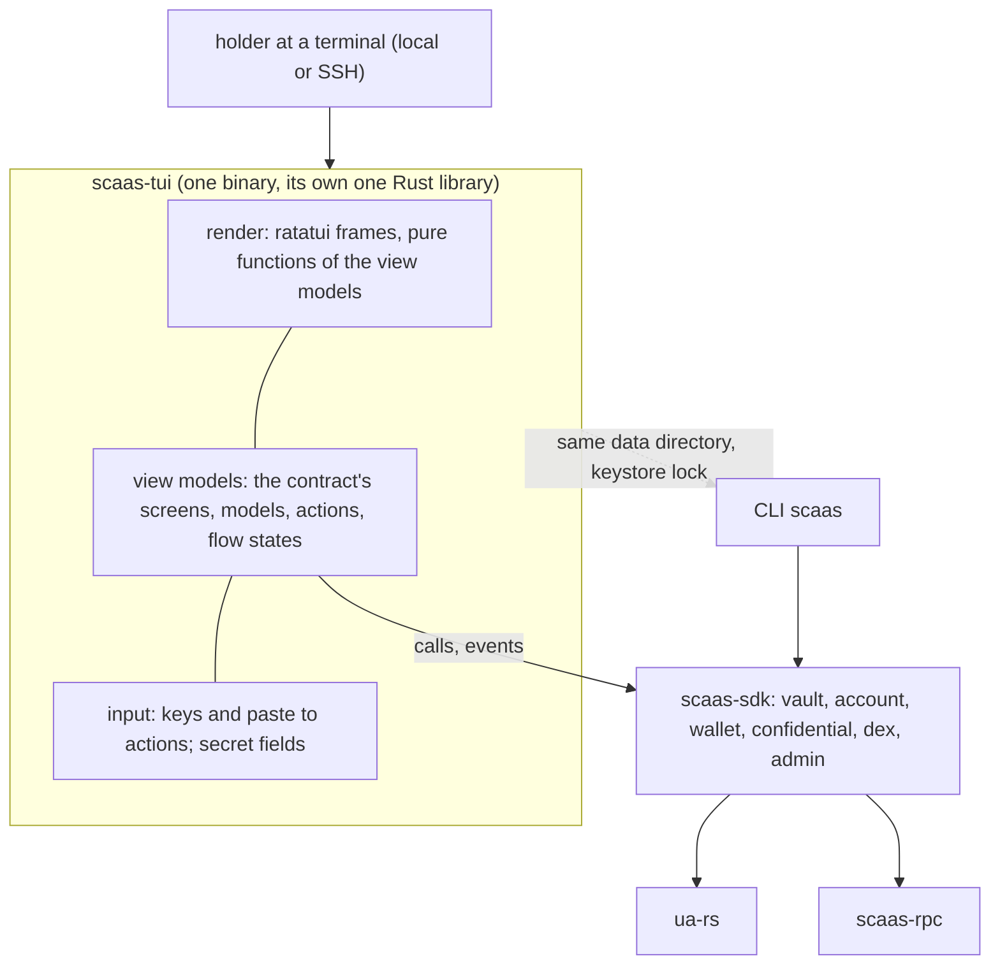
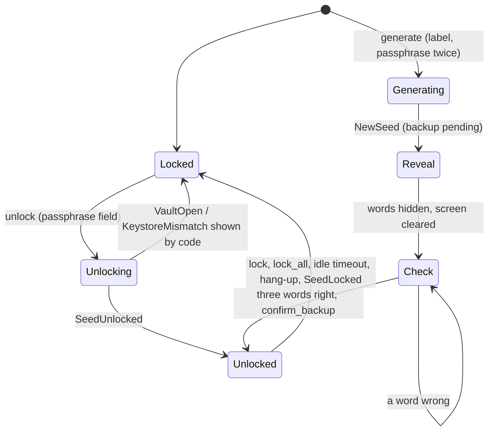
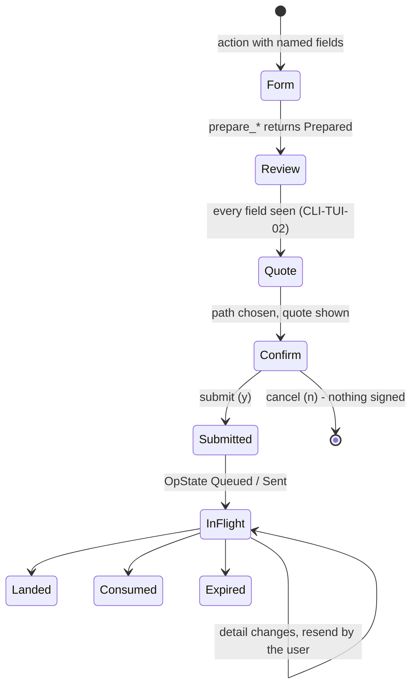

# `scaas-tui`: the terminal front-end over `scaas-sdk`: design

**Status:** SPECIFIED, nothing built. A **frame** (owner 2026-11-17, "cứ viết spec, để có khung sẵn"): every part that rests on an
SDK section not yet settled is marked **depends** with the section it waits for (collected in §15). Branch `scaas-tui` (from
`scaas-sdk` `0da3423ae`), worktree `.claude/worktrees/scaas-tui`. Work order: TODO item 8b, after the `scaas-sdk` spec
(owner 2026-11-17). Rule ids introduced here (SPECIFIED, defined once in [clients/scaas-tui.md](../../clients/scaas-tui.md),
recorded in [decisions.md](../../decisions.md) §42): CLI-TUI-01 to CLI-TUI-07, and the record CLI-TUI-30 (owner rulings). No contract,
signed byte format, SDK rule or node rule changes. Rows marked **proposal** are the controller's; the owner may override them (open
points in §16). [Plan](../plans/2026-11-17-scaas-tui.md). UNAUDITED.

**Reads:** the [scaas-sdk spec](2026-11-17-scaas-sdk.md) and [rules](../../clients/scaas-sdk.md) (CLI-SDK-*) as at `0da3423ae`, and
its section **"App cores above the SDK"** (spec §12, rules §7, being written on branch `scaas-sdk` while this spec was written: the
`chat` module and the `pqvault` placeholder leave the SDK, `pqchat-core` and `pqvault-core` sit above it). This spec names SDK calls,
events and codes and does not restate their rules. [scaas-rpc](../../clients/scaas-rpc.md), [CLI-UAL-01](../../clients/ua-libraries.md#CLI-UAL-01),
scaas-app's `README.md`, `app-common/spec/app-core-contract.md` (§11 chat, §12 one Rust library) and `app-common/viewmodel/README.md`.

## 1. Owner rulings this spec follows

| # | Date | Ruling (quoted) | Where |
|---|---|---|---|
| O1 | 2026-11-09 | "Terminal UI for wallet + chat (owner 2026-11-09, as recommended): a new client `clients/scaas-tui` (Ratatui + Crossterm), after `pqchat-core` and the wallet module are stable; a thin layer over the same library API as the CLI and the app (no separate code path; it signs only through `ua-rs`, linked directly, one binary, works over SSH). Rules: no secret on screen, in scrollback, the clipboard or a log; the signing screen shows every named field (e.g. `payNo` as UUID, `save`), with a test. Spec first, then the estimate." | TODO 11 |
| O2 | 2026-11-17 | "Ok, theo đề xuất, viết TUI sau SDK": the `scaas-tui` spec and plan after the SDK spec, same branch; over `scaas-sdk`; the view-model contract of scaas-app `app-common/viewmodel/` as its **fourth front-end**; **SCaaS only** (no native-chain app core, no Trust Wallet Core) | TODO 8b |
| O3 | 2026-11-17 | App cores sit above the SDK, `pqchat-core` and `pqvault-core` too: "Đồng ý đảo chiều", "pqchat-core cũng đảo chiều luôn" | SDK spec §12; scaas-app contract §12 |
| O4 | 2026-11-17 | "cứ viết spec, để có khung sẵn": this spec is a frame | this header |
| O5 | 2026-11-17 | CLI-UAL-01 holds from `scaas-sdk` down | [ua-libraries.md](../../clients/ua-libraries.md#CLI-UAL-01) |
| O6 | 2026-11-17 | One matrix-rust-sdk stack below both chat paths, one login per app (decisions CTR-CHAT-01, Change of 2026-11-17) | relevant only if the TUI ever links `pqchat-core` (§16 Q-T2) |
| O7 | 2026-11-16 | the end-user app is scaas-app, never called "wallet" | TODO 6 |

**How O1 reads after O2 and O3.** O1's "linked directly" to `ua-rs` is replaced by O2: the TUI links `scaas-sdk` only (which links
`ua-rs`). O1's "wallet + chat" is narrowed by O3: chat is `pqchat-core`'s, an app core above the SDK, and whether the TUI links it is
an open point (Q-T2), not a ruling. O1's toolkit (Ratatui + Crossterm, as recommended) and its three rules (no secret on screen, in
scrollback, the clipboard or a log; every named field on the signing screen; a test) stand: CLI-TUI-04, CLI-TUI-02.

Standing rules applied: every state-changing `mtx*` relayable, fee 0 too; no EIP-7702; explicit named parameters; every RPC consumer
takes a list of nodes (ARCH-POS-15); no decryption oracle (ARCH-POS-13); never lose ciphertext; fail closed with named errors; no
consumer-specific name; no chain assumption; never report `dead` while a transaction may still land.

## 2. Goal, scope, non-goals (SPECIFIED)

**Goal.** A holder runs one binary in a terminal, locally or over SSH, and does through `scaas-sdk` what the SDK offers for SCaaS:
manage seeds, see accounts and balances, send and pay with a full review, follow every operation to its chain fact, use confidential
tokens and the DEX, and (in an admin build) governance. The screens are the view-model contract's; the TUI is its fourth front-end.

**In scope.** The crate `clients/scaas-tui` (§3); its view-model layer and screens (§5); the review screen (§6); endpoint lists (§7);
terminal secret handling (§8); untrusted text (§9); configuration (§10); errors (§11); accessibility (§12); the threat model (§13);
tests (§14).

**Non-goals.**
- No logic below the view model: no cryptography, transport, signer, byte format, retry or state machine of an operation; the SDK
  has them (CLI-TUI-01).
- No native chains: no `native-core`, no Trust Wallet Core, no SDK `native-networks` or `raw-native`. One exception, **proposal**
  (Q-T5): the EVM payer key the SDK's self-relay needs (its address, balance and an EVM native send, all SDK calls).
- No undecoded call: the SDK feature `opaque-calls` is never enabled in a TUI build.
- No passkey or platform unlock in this frame: the TUI passes no `Authenticator` (the SDK then offers passphrase unlock only, §4 of
  the SDK spec). A FIDO2 `hmac-secret` authenticator over USB is a later option, not designed here.
- No chat and no pqvault in the first build (Q-T2).
- No QR codes, no mouse, no themes beyond colour, monochrome and ASCII.
- No job API (server-side only, NODE-ADM-06).

## 3. Place, crate, features (SPECIFIED; proposal for the layout)

- **Path** `clients/scaas-tui`, its own `Cargo.lock`, `publish = false`, `SPDX-License-Identifier: LicenseRef-Vegan-Community-1.0`,
  `rust-version` the repository pin. Dependencies: `scaas-sdk` (path), `ratatui` and `crossterm` (Q-T1; exact versions pinned at the
  plan's T1), `tokio` (the SDK adopts the TUI's runtime, `RuntimeChoice::Adopt`), `zeroize`, `serde` and `toml` (configuration).
  Nothing else that touches a key or a node.
- **Features** pass through to the SDK, one PQZ set per build as the SDK requires: `zether`, `pqz` with one `pqz-set-<set>`, `dex`,
  `admin` (off by default, as the SDK's), default `zether,pqz,pqz-set-n2304-kmax4096,dex`. A screen whose SDK feature is off does not
  exist in the build (no run-time branch). `native-networks`, `raw-native`, `opaque-calls` are refused by a `cargo tree -e features`
  test, as are `matrix-sdk` and any app core while Q-T2 is open.
- **Not the CLI** (CLI-SDK-17): the CLI is one subcommand per SDK call with named flags, JSON or a table, for scripts and the e2e
  tests, and exits; the TUI is a session that subscribes to the SDK's events, keeps screens current, locks on idle and follows
  operations. Neither calls the other; both take the SDK's names. The SDK spec's §20 calls the CLI "the base `scaas-tui` reuses for
  its commands": read here as one action name per SDK call in both (the TUI's action names are the CLI's subcommand names); a
  command palette that parses CLI syntax is Q-T10.
- **Process model.** One tokio runtime; one `Sdk` (`Sdk::open` with the profiles of §10, `FileStore` in the shared data directory,
  `authenticator: None`, `RuntimeChoice::Adopt`); one event loop that selects over terminal input (crossterm's event stream), the
  SDK's `Subscription::next`, and a one-second tick for the idle timer; a frame is drawn after any change.

## 4. Toolkit (open point Q-T1; recommendation as ruled on 2026-11-09)

| Option | For | Against |
|---|---|---|
| (a) `ratatui` + `crossterm` backend | the de-facto Rust TUI library; immediate-mode frames from plain state (fits view models); `TestBackend` gives headless frames for golden tests; crossterm runs on Linux, macOS and Windows, has bracketed paste, alternate screen, scrollback purge | ratatui changes its API between minor versions (pin exactly) |
| (b) `ratatui` + `termion` | small | Unix only; no Windows |
| (c) `cursive` | retained widgets, dialogs ready-made | its own widget state beside the view models (two states); harder headless frames |
| (d) a component layer over ratatui (`tui-realm`) | message passing | one more dependency and state model for little gain |

**Recommendation: (a)**, the owner's 2026-11-09 choice ("as recommended"), restated here because the brief asked for it as an open
point. No other UI dependency: widgets are ratatui's (`Paragraph`, `Table`, `List`, `Tabs`, `Block`).

## 5. View models and screens (SPECIFIED; depends on the view-model contract, §15 D1)

### 5.1 The view-model layer

scaas-app's view-model contract (`app-common/viewmodel/view-model-contract.md`, task B10 there, **not written yet**) will give, for
each kept screen, its models and roles, its actions with named parameters, its events and the states of its flow, with no toolkit
type. The TUI implements it in Rust as `src/vm/`: one module per screen, each a plain struct of models (rows with named roles),
an enum of flow states, a function per action that calls the SDK, and a function per SDK event that updates the models. Rendering
(`src/ui/`) is a pure function from a view model and the terminal size to a ratatui frame; input (`src/input/`) maps keys to actions.
Until B10 lands, the TUI's view models carry the names below, marked provisional; when B10 lands they take the contract's names, and
screens the contract lacks (confidential, DEX, admin, endpoints) are handed to scaas-app's owner as additions (Q-T3).

### 5.2 Screen map

| TUI screen | View-model screen (planned in B10) | SDK calls | SDK events | SDK plan task |
|---|---|---|---|---|
| Seeds | onboarding, settings | `vault.seeds`, `generate`, `import_words`, `derive_child`, `unlock`, `open_hidden`, `lock`, `lock_all`, `rename`, `remove`, `change_passphrase` | `SeedUnlocked`, `SeedLocked`, `KeystoreChanged`, `KeystoreMismatch`, `KeystoreRollback`, `HiddenOpsAbandoned` | T4, T5 |
| Backup | backup | the `SeedBackup` reveal and three-word check, `confirm_backup`; `backup_seal`, `restore_backup`, `link_seal` / `LinkSession` | — | T4 |
| Accounts | accounts and assets | `account.accounts`, `add_ua`, `add_watch`, `rename`, `hide`, `ua_of`, `id_display`, `restore`; registration (`prepare_register` …) | `KeystoreChanged` | T9, T13 |
| Balances and tokens | accounts and assets | `wallet.balances`, `tokens`, `watch` | `BalanceChanged`, `Lagged` | T11, T14 |
| Receive | receive | `ua_of`, `id_display`; refused for an unverified row (`AccountUnverified`) | — | T9 |
| Send and pay | send and review | `prepare_*` of the transfer on ids and `mtxPay` with `PayMeta`; then §5.5 | `OpState` | T12 |
| Review | send and review | `Prepared::review`, `Op::quote`, `Op::submit` | — | T10 |
| Activity | activity | `wallet.history`, the operations of `sdk.state`, `Op::resend`, cancel by `UACancelNonce` / `CancelNonce` | `OpState`, `HistoryAdded` | T10, T14 |
| Confidential | none (addition, Q-T3) | `confidential.zether_*`, `pqz_*`, `request_verdict`, the reading layer's balances | `OpState::Proving`, `BalanceChanged` | T15, T16 |
| DEX | none (addition) | `dex.markets`, `depth`, `trades`, `ticker`, `orders`, `prepare_trade_order`, `prepare_cancel_order`, `dex_cancel_all` | `OpState` | T17 |
| Admin (feature `admin`) | none (addition) | `admin_<struct>` entries; **depends** on Q-T4 | `OpState` | T18 |
| Endpoints | settings (addition for the list) | the profiles in use; health from `EndpointDropped` | `EndpointDropped` | T1, T11 |
| Settings | settings | the TUI's own config (§10): idle lock, colour, ASCII | — | — |

### 5.3 Seeds and backup

- **Generate**: label, vault passphrase typed twice (CLI-TUI-04 fields), `VaultPassphraseWeak` shown by code. The words appear once on
  the reveal screen (numbered, 24 lines or a 4 × 6 grid), with an SSH warning when `SSH_CONNECTION` or `SSH_TTY` is set (Q-T7:
  warn and ask the user to type `reveal`; not refused). Leaving the screen clears it (§8); the words are never shown again by any
  flow. The three-word check takes three words in secret fields. A seed whose backup is `pending` carries that mark everywhere.
- **Import**: label, the words in one secret field (typed or pasted; the field shows nothing, §8), the vault passphrase twice;
  `MnemonicInvalid` by code; `short_seed` shown wherever the seed is listed, with the SDK's advice.
- **Unlock / lock**: per seed; `lock_all` on one key; the idle timer (default 5 minutes, §10) and a terminal hang-up call `lock_all`.
  A lock that waits for a proof in flight says so (SDK §6.10).
- **Hidden sets**: `open_hidden` with the BIP-39 passphrase typed twice at a set's first use in the session (the SDK can store no
  check value); `HiddenOpsAbandoned { count }` shown at lock. Nothing of a hidden set is written by the TUI either.
- **Remove**: a confirmation by typing the seed's label; for a `pending` seed a second one (`ConfirmRemoveUnbacked`).
- **Sealed exits**: backup to recipients and device link; the link's short code shown for comparison on both screens.
- **Classical-rooted sets** (SDK feature `classical-roots`): **depends** on SDK T6; the screen exists once the SDK has the calls.

### 5.4 Accounts, balances, receive

Accounts are listed per seed with kind, UA id (`id_display`), name, and the **unverified** mark for rows of a locked seed. Balances
are the SDK's decimal strings with the token's decimals and symbol; unlisted tokens carry the `unlisted` mark and their sanitised
name (CLI-SDK-15, CLI-TUI-05). A row with an EIP-7702 delegation carries the SDK's mark and warning. Receive shows the full UA id
and address, grouped in fours for reading aloud, never shortened; for an unverified row it shows `AccountUnverified` instead.
Registration (including the PQ split into `register` then `storePqzPop`) runs through §5.5.

### 5.5 Operations: prepare, review, quote, confirm, follow

- **Form**: one field per named request field, typed (an amount as a decimal string, `payNo` as a UUID, `save` as a yes/no, a fee
  that may be 0 and is never filled by the TUI).
- **Review and quote**: §6. `PreparedStale` sends the user back to the form with the fields kept.
- **Path**: `Auto` by default; the user may choose `Gateway` or `SelfRelay { payer }` (Q-T5 for the payer). `SubmitPathNone`,
  `FeeAboveCap`, `GasAboveTxCap`, `PayerDelegated` shown by code.
- **Follow**: the activity screen lists the operations with the SDK's state and detail (CLI-TUI-03): `InFlight { Queued | Sent |
  merged gateway state | TxFinalFailed | TxReplaced }` in words, never "failed"; `Landed { block, hash }`, `Consumed`, `Expired` as
  ends. Actions on an in-flight row: wait, resend (the same bytes, on a path the user picks, the quote reviewed again), cancel the
  lane's nonce (a new operation, its own review). After a restart the list resumes from the SDK's state.

### 5.6 Confidential tokens (depends on SDK T15, T16)

Shield, transfer, unshield and rollover for Zether and PQZ through the SDK's entries; the review shows the plaintext amount and
recipient as `Request` fields (the signed struct holds ciphertexts and a proof). While a proof runs the screen shows `Proving` and that
it cannot be cancelled. A verifier-mode PQZ token shows `VerdictRefused` by code; nothing is sent. `PqzSetMismatch` names the build's
set. A decrypted balance is drawn for the holder only and nothing the TUI does depends on it (no automatic rollover, no refresh
triggered by a value; CLI-TUI-03, ARCH-POS-13).

### 5.7 DEX (depends on SDK T17)

Markets, depth, recent trades, ticker and the holder's orders through the SDK's reads; a trade order's form and review show `minFill`
as signed; a DEX not on the profile's list is refused by the SDK (CLI-SGN-35) and shown by code. Cancels are operations.

### 5.8 Admin (feature `admin`; depends on SDK T18 and Q-T4)

One form per `GovernanceRouter` entry and the router's creates, with the CREATE3 address preview. The SDK offers ~60 admin entries;
how the TUI gets each entry's named fields is Q-T4. Off by default.

### 5.9 Endpoints and settings

§7 and §10.

## 6. The review screen (CLI-TUI-02; SPECIFIED)

- **Every field, decoded, with its source.** One row per `ReviewField` of `Prepared::review` in the SDK's order: name, the SDK's
  `display` value, source (`signed`, `request`, `derived`). `payNo` as UUID text, `save`, `fee`, `relayer`, `validUntil` as a UTC time
  and the raw value. Then the chain key, the entry name (`mtxPay`, `mtxExecuteTransfer` …), the signer reference, `expires_at`.
- **Whole values.** No ellipsis in an address, id, amount or hash: a long value wraps over lines. Amounts are the SDK's decimal
  strings; the TUI does no arithmetic on them and uses no floating point.
- **No blind signing.** The confirm key is disabled until every row and the quote have been on screen at least once (the view model
  records the furthest row shown); a row the TUI cannot render (an unknown source, a value over the screen's bound) keeps it disabled
  and says why. `Prepared::opaque()` is always false in a TUI build (`opaque-calls` off); a true value keeps confirm disabled, a test.
- **The quote** follows the review: path, payer (and that its address is linked on chain to the subject), gas limit, maximum fee per
  gas, maximum priority fee, **maximum cost**, the fee to the relayer, the gateways chosen. Both are confirmed by one key after both
  were shown.
- **What confirm does.** `submit(prepared, quote)` with the objects shown, nothing rebuilt. A second key press does nothing while the
  submission runs.

## 7. Endpoint lists (CLI-TUI-06; SPECIFIED)

- The endpoints screen lists, per profile: the policy (`failover` or `strict_majority` with `n`), and per endpoint its index,
  label, class (`named`, `default`), host and health (answers, failovers, the last `EndpointDropped` reason). No `discovered` class
  appears: the TUI discovers nothing, so a read that feeds a decryption always has a non-discovered source when the list is not empty.
- Under `strict_majority` the screen states what `n` tolerates (CLI-RPC-05: `n = 2` detects one liar and tolerates no failure,
  tolerance of one needs `n ≥ 3`). The overlay (§10) may set the policy; the SDK refuses `strict_majority` with one endpoint.
- Errors `EndpointAllFailed`, `EndpointNoMajority`, `NoTrustedEndpoint`, `AgreementNeedsThree`, `ProfileMismatch` shown by code with
  the endpoints screen one key away.
- Never a full URL (it may carry a credential): host only, and the label.

## 8. The terminal's secret handling (CLI-TUI-04; SPECIFIED)

| Concern | Rule |
|---|---|
| Echo | Secret fields draw a fixed placeholder ("input hidden") that does not change with what is typed: no characters, no mask, no count. No reveal toggle (O1: no secret on screen); the one exception is a new seed's words (§5.3) |
| Input path | Raw mode key events and bracketed paste go into a `Zeroizing<Vec<u8>>`; a pasted `String` is zeroized after the copy; the bytes move into one `SecretBytes` and the TUI's buffer is zeroed. Never argv, the environment or the config file |
| Scrollback | Everything is drawn in the alternate screen. Leaving a secret screen (reveal, a secret field's form), locking, suspending (`SIGTSTP`), exiting and panicking each clear the screen; exit also purges scrollback where the terminal supports it, then leaves the alternate screen and restores the mode |
| Panic, signals | A panic hook restores the terminal, clears it and prints only the panic's location (no message, which may hold data). `SIGHUP` (an SSH drop) and `SIGTERM` call `lock_all` then exit; `SIGINT` in raw mode is a key, handled as "back" |
| Clipboard | Nothing by default. Q-T6: an opt-in, off by default, copies public values only (a UA id, an address, an operation's digest) by OSC 52; a secret is never copied, whatever the setting |
| Window title, notifications | Never set from data |
| Logs | The TUI writes no log by default; with `--log <file>` it writes the SDK's `tracing` lines (no secret, URL or body there, CLI-SDK-02) and the TUI's own (screen names, action names, codes), never a field value of a form |
| Core dumps | `RLIMIT_CORE` 0 at start on Unix; the SDK's `mlock` feature on |
| Idle | `lock_all` after the idle timeout; the screen returns to the seed list |
| SSH | Works over SSH (O1): the keystore and the process are on the host the TUI runs on; the reveal warns (§5.3) |

**Residuals, stated.** A terminal recorder (`script`, asciinema, a multiplexer's log) receives the byte stream, the reveal included;
the alternate screen and the purge cannot reach it. A terminal without an alternate screen keeps what was drawn in its scrollback
until the clear. The terminal emulator's and crossterm's own input buffers are not the TUI's to zero. Text the user pastes was on the
clipboard before.

## 9. Untrusted text (CLI-TUI-05; SPECIFIED)

One function `inert(text, max_bytes)` in `src/ui/text.rs` is the only way a string from outside the TUI reaches a widget: it removes
C0 and C1 controls (ESC included, so no CSI, OSC or DCS sequence passes), DEL, the bidirectional controls U+202A–U+202E and
U+2066–U+2069, and U+200E / U+200F, then bounds the result (64 bytes for a name or symbol, 256 for a node's `detail`, as CLI-RPC-11).
Applies to token names and symbols (on top of the SDK's own sanitising of unlisted tokens), seed and account labels, endpoint labels,
a node's `detail`, history items. A node's `detail` appears only after a key press, framed as "raw text from the node". A test feeds
every class of character through every screen that shows outside text and scans the backend's byte stream for any ESC that the TUI's
own drawing did not emit.

## 10. Configuration and profiles (CLI-TUI-06; SPECIFIED; proposal for the files)

| File | Holds | Never holds |
|---|---|---|
| profiles (`--profiles <file>`, the same file and format as the CLI's) | the release's pinned chain profiles (CLI-SDK-15: chain key, family, chain id, `chain_uid`, RPC list, gateways, contracts, tokens, DEXes, verifiers, finality, the per-transaction gas cap) | secrets |
| overlay `$XDG_CONFIG_HOME/scaas/endpoints.toml` (proposal: one file for the CLI and the TUI, asked of the SDK's T22) | per profile key: extra `named` endpoints (URL, label), the policy, per endpoint the **name** of an environment variable or file holding its credential | a credential's value; a token, DEX, contract or `chain_uid` change; a removed pinned endpoint |
| `$XDG_CONFIG_HOME/scaas/tui.toml` | idle lock (default 300 s, 0 refused), colour on / off, ASCII on / off, the OSC 52 opt-in (Q-T6), the default profile | anything secret |
| data `$XDG_DATA_HOME/scaas` | the SDK's `FileStore`: keystore, `keystore.prev`, `keystore.head`, `sdk.state` (shared with the CLI and the app under the store lock) | — |

Every file is bounded (64 KiB for the TUI's, the SDK's bounds for its own) and parsed with unknown fields refused. An overlay entry
for an unknown profile key, a credential given as a value, or a policy the SDK refuses stops the start with a named message. End-user
use needs no credential (CLI-APP-03); the reference form exists for a holder who runs their own provider account.

## 11. Errors (SPECIFIED)

- The TUI shows an error by its SDK `code()` and a message from its own table (`src/ui/messages.rs`, one English line per code it
  knows, appended only, as the codes are). An unknown code is shown as itself. `ua-rs`, `scaas-rpc` and node codes keep their own
  names (CLI-SDK-13); a node refusal shows its node `code`, its `detail` only on request (§9).
- Warnings (`short_seed`, `imported_key`, `unlisted`, the delegation mark, `classical-rooted`) are marks beside a success, never
  error dialogs.
- `Lagged { missed }` makes the screen re-read its state; it is not shown as an error.
- An error never ends the session. The process exits non-zero only when the terminal cannot be set up, a config file is refused, or
  `Sdk::open` fails (its code printed after the terminal is restored).

## 12. Accessibility in a terminal (CLI-TUI-07; SPECIFIED)

- Meaning by word or symbol, colour only as an extra: states read `landed`, `in flight: sent`, `unverified`, `unlisted`.
- `NO_COLOR` (any value) and `colour = false` draw without colour; `ascii = true` (or a non-UTF-8 locale) replaces box drawing and
  symbols with ASCII.
- Keyboard only: arrows and `h j k l`, `Tab` between panes, `Enter` to act, `Esc` back, `?` help, `L` lock all, `q` quit (with a
  confirmation when an operation is being prepared). The footer lists the keys the current screen takes.
- 80 × 24 is the smallest layout; below it a single message asks for a larger terminal. Layouts are tested at 80 × 24 and 120 × 40.
- Text is English; numbers and times are not localised (UTC, ISO 8601). A linear, screen-reader-oriented mode is not in this frame.

## 13. Threat model (SPECIFIED)

| Asset | Threat | Defence | Residual |
|---|---|---|---|
| words, passphrases, imported keys | shoulder surfing, screen sharing | no echo, no reveal toggle; the words shown once, cleared on leave | a camera at reveal time |
| the same | scrollback, multiplexer history | alternate screen, clear, purge (§8) | terminals without an alternate screen; recorders of the byte stream |
| the same | clipboard sniffers | no clipboard write of a secret, nothing by default | the user's own paste |
| the same | logs, crash output, core dumps | no secret in any log line; panic hook prints a location only; `RLIMIT_CORE` 0; SDK `mlock` | swap without `mlock`, a debugger as the same user |
| the same | an SSH host compromise | none: the keystore lives on the host the TUI runs on; the reveal warns | stated |
| what the user signs | a forged or partial review; a confirm before reading | every field from `Prepared::review`, whole values, confirm only after all were shown (CLI-TUI-02); no raw or opaque signing in the build | a user who confirms without reading |
| the terminal | escape injection from chain data or a node (a token named with CSI / OSC sequences that move the cursor, rewrite the review, set the clipboard or the title) | `inert()` on every outside string (CLI-TUI-05) | glyphs that look alike (an address is shown whole, the UA id by `id_display`) |
| endpoint lists | a lying endpoint, a discovered endpoint for a decryption read | the SDK and `scaas-rpc` rules; the TUI discovers nothing and shows the policy (CLI-TUI-06) | a profile file the user replaced |
| credentials of endpoints | in a config file, on screen | names of env vars or files only; never a full URL on screen | the env var or file's own protection |
| decrypted amounts | a decryption oracle through the TUI's behaviour | nothing the TUI sends, reads or times depends on a decrypted value (§5.6) | — |
| operations | shown as failed while they may land; a double submit | the SDK's states only; one submit per confirm (CLI-TUI-03) | — |
| the keystore | a concurrent CLI or app process | the SDK's store lock and `rev` rule | — |

## 14. Tests (SPECIFIED)

- **Headless render over the view models.** Every screen's view model is built from fixed data (no SDK, no network) and rendered on
  ratatui's `TestBackend` at 80 × 24 and 120 × 40, colour and monochrome, UTF-8 and ASCII; the frame's text is compared with a golden
  file `clients/scaas-tui/tests/golden/<screen>-<state>-<w>x<h>[-mono][-ascii].txt`. Goldens are rewritten only with
  `SCAAS_TUI_BLESS=1` and reviewed in the commit diff (Q-T9: plain files, no snapshot crate).
- **Flow tests over the real SDK** with a temporary data directory (vault flows need no network) and the SDK's in-process fakes for
  the RPC and the gateway: generate → reveal → check → unlock → lock; import; idle lock; hang-up lock; a review with every field.
- **Byte-stream secret scans.** A `CrosstermBackend` over a capturing writer records every byte the terminal would receive through a
  whole flow; the test searches it for each passphrase, word and key used (plain, and in every encoding the TUI could emit): none,
  except the reveal screen's words exactly once; and for OSC 52, OSC 0/2, and an ESC the TUI did not emit (§9). The alternate-screen
  enter / leave, the clears and the purge are checked in the stream, and a panic in a child process leaves a restored, cleared
  terminal.
- **Review completeness.** For each operation the TUI offers: every `ReviewField` name and display appears in the frames shown before
  confirm; confirm is refused before the last row was shown; a row the TUI cannot render keeps it refused; `opaque() == true` keeps it
  refused.
- **States.** The SDK's `InFlight` details (all gateways given up, `TxFinalFailed`, `TxReplaced`) are never drawn as an end; no
  action is sent without a key press (a test advances the tick for an hour of virtual time and counts SDK writes: 0 beyond locks).
- **Feature tree.** `cargo tree -e features`: no `native-networks`, `raw-native`, `opaque-calls`, `matrix-sdk`, app core, or Trust
  Wallet Core crate; one PQZ set.
- **Mutants** per task (the plan), each turning a named test red, as the SDK plan's runner does.
- **End to end** on `anvil` with a local `scaas-node`, through the SDK (the plan's e2e task): unlock, a token transfer with review,
  `Landed`; a confidential shield and transfer if the SDK has them by then.

## 15. What depends on unsettled parts

| # | Depends on | What waits | Until then |
|---|---|---|---|
| D1 | scaas-app's view-model contract (task B10 there: not written) | the screen names and roles of §5 | provisional names; additions for confidential, DEX, admin, endpoints (Q-T3) |
| D2 | the SDK's section "App cores above the SDK" (rewritten on branch `scaas-sdk`, SPECIFIED as proposal) | chat and pqvault screens; whether the TUI links an app core (Q-T2) | none in the build |
| D3 | the SDK API itself (SPECIFIED, nothing built; SDK T3, the binding spike, fixes the surface rules) | every call name of §5.2 | names as in the SDK spec at `0da3423ae`; renamed with the SDK |
| D4 | SDK T6 (`classical-roots`) | the classical-rooted seed screens | absent |
| D5 | SDK T15, T16 (confidential) and the rpc verifier client | §5.6 | absent from the build until built |
| D6 | SDK T18 and Q-T4 (admin entry fields) | §5.8 | absent |
| D7 | SDK T22 (the CLI) and the overlay file (§10) | one endpoint overlay for both | the TUI reads the overlay alone |
| D8 | the SDK's self-relay payer (§13.3 there) and Q-T5 | the payer row and the EVM native send | gateway path only |

## 16. Open points, with recommendations

| # | Question | Options | Recommendation |
|---|---|---|---|
| Q-T1 | Toolkit | §4 (a)–(d) | (a) `ratatui` + `crossterm`, as ruled on 2026-11-09 |
| Q-T2 | Does the TUI link app cores? | (a) none; (b) `pqvault-core` behind a feature `pqvault` when it exists (it needs only the SDK's `app_core` surface); (c) `pqchat-core` behind `pqchat`, which needs a Matrix client: the one matrix-rust-sdk stack of O6 (scaas-app's `app-matrix`, pinned by revision), never a second stack | (a) in the first build; (b) as a later task once `pqvault-core` and SDK T21 are built, since it adds no new stack; (c) only after `pqchat-core` and `app-matrix` exist and the owner asks, because it brings a Matrix login and store into a SCaaS-only terminal program and a cross-repository dependency. Either way the TUI stays one binary and its own one Rust library, linking the app core as a crate (SDK §12) |
| Q-T3 | Screens the view-model contract will not have (confidential, DEX, admin, endpoint list) | (a) the TUI keeps them local; (b) propose them to the contract as `scaas`-build screens | (b): handed to scaas-app's owner as a list (as the SDK's T25 hands its M-list), so the app's front-ends get the same models; the TUI keeps (a) until then |
| Q-T4 | How the admin forms get each entry's named fields | (a) one hand-written form per entry in the TUI; (b) the SDK lists each entry's request fields and types (`entries()` / `describe(entry)`), one generic form | (b), asked of SDK T18, with the completeness test both ways; (a) only for the few entries the TUI ships if the SDK says no |
| Q-T5 | Does "SCaaS only" admit the EVM payer key? | (a) no native key: gateway path only; (b) the payer key, its balance and an EVM native send through the SDK | (b): self-relay is the only path for entries no gateway takes (SDK §13.3) and needs gas; all through SDK calls signed by `ua-rs`; no other native network |
| Q-T6 | Clipboard | (a) never; (b) opt-in OSC 52 for public values only | (b), off by default; a secret never, whatever the setting |
| Q-T7 | Seed reveal over SSH | (a) refuse; (b) warn and ask to type `reveal` | (b): SSH is a supported use (O1); a refusal would push users to worse paths |
| Q-T8 | Endpoint overlay file | (a) the TUI's own; (b) one file for the CLI and the TUI | (b), asked of SDK T22 |
| Q-T9 | Golden frame format | (a) plain text files and a bless variable; (b) a snapshot crate | (a): no new dependency, diffs readable in review |
| Q-T10 | A command palette with CLI syntax | (a) none; (b) `:` parses the CLI's subcommands | (a) in the first build; action names equal the CLI's subcommand names so (b) can come later without renaming |
| Q-T11 | Platforms | Linux and macOS gated in CI; Windows | Linux gated, macOS when CI has a runner; Windows builds (crossterm supports it) but is not gated |

## 17. Rule ids

| Id | Rule | Owner |
|---|---|---|
| CLI-TUI-01 | front-end over `scaas-sdk` only, SCaaS only, no logic of its own; not the CLI | yes (O1, O2) |
| CLI-TUI-02 | every review field on screen before signing; no blind signing | yes (O1) |
| CLI-TUI-03 | every write from a user action; the SDK's operation states | no (follows CLI-SDK-18) |
| CLI-TUI-04 | no secret echoed, in scrollback, on the clipboard or in a log | yes (O1) |
| CLI-TUI-05 | outside text made inert before it reaches the terminal | no |
| CLI-TUI-06 | pinned profiles, named endpoints only, no full URL, credentials by reference | no (follows ARCH-POS-15, CLI-SDK-15) |
| CLI-TUI-07 | keyboard, no colour-only meaning, ASCII, 80 × 24 | no |
| CLI-TUI-30 | record: the owner rulings of §1 | yes |
