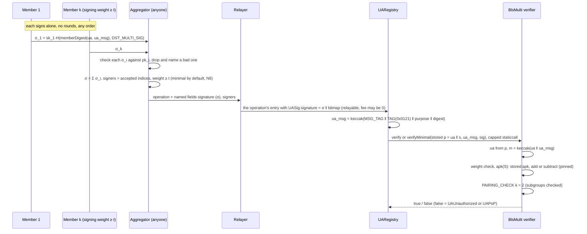

# `bls12381-multi` (0x0121): BLS12-381 same-message weighted multi-signature as a UA kind — design

**Status:** SPECIFIED, nothing built. **UNAUDITED**: every cryptographic construction here (the aggregate check, the
distinct-message proof of possession, the cross-group binding) is a design, not reviewed code; the batched PoP (§4) is
flagged for the external audit.
Owner 2026-11-19: `bls12381-multi`, number `0x0121`, reserved since UA design rev 1.3 where it was cut for "no consumer"
(history spec `2026-10-06-universal-account-design.md` §18 L10, §17 item 3); "no consumer" is not a reason, build it.
Owner 2026-11-19 (through the coordinator): the kind has several variants; this spec starts with them and proposes which
become kinds.

**Revision 2 (2026-11-19), after the Fable review 2026-11-19** (P0 0 / P1 2 / P2 7 / P3 8, verdict "build after fixes") and
the owner's rulings on it (§0.1):

| Finding | Resolution |
|---|---|
| F1 (P1) gas model without EIP-8037 state gas; cap argued from 24,576 B | §8 rewritten: two columns (regular, state) for registration and verify at n = 2, 16, 32, 64; the EIP-170 sentence deleted (the ceiling is 64 KiB); the binding constraints listed; the gate on **regular** gas vs 75 % of 2^24; inclusion is regular + state vs a block limit nobody assumes; cap 64 kept as a state-gas judgement (owner ruling Q4) |
| F2 (P1) a stored `0x0121` signature exists once the kind is in MEMBER | owner ruling Q7 keeps extra signers; resolved by the review's second option: `≥ t` on the verify path, a canonical **minimal** form on every stored or hash-committed path (§5.3), and a new verifier entry `verifyMinimal` (§5.3, §7, §12) |
| F3 (P2) soundness sentence overclaims | §4 states the actual argument (algebraic group model + random oracle), its two conditions, that no published proof of the batched form is known to the reviewer, the textbook fallback and why it is not taken; marked for the external audit; tests (i)–(iii) added |
| F4 (P2) domain separation by preimage length only | owner ruling Q11: two DSTs of the kind's own (§3) |
| F5 (P2) keyHash on `apk` lets an old `pop` squat the set | owner ruling Q5: no keyHash, as `msig` (§2) |
| F6 (P2) `σ ‖ signers` at the node boundary | ABI keeps the 160-byte object; node JSON, scaas-sdk and every client API carry named `signature` and `signers`; the old single hex is `HEX_ARGS_REFUSED` (§5.1, §9) |
| F7 (P2) weighted threshold missing | per-member `u16` weights in `0x0121` itself, default 1, `Σ_{i∈S} w_i ≥ t` (§1 V7, §2, §5) |
| F8 (P2) a quarter of the stored key bytes are padding | the key pointer stores 48-byte limbs (194 B a member instead of 258 B, ≈ −6.4 M state gas at n = 64); `registrationOf` and `blsMultiKeyOf` return `d` byte-identical (§2, §8) |
| F9 (P2) no registration quote; sponsorship of a 26 M registration | registration and verify rows in the SDK gas-table format with a base and a per-member figure; the node's sponsorship books and caps regular + state (§8.4, §9, §12) |
| F10 (P3) §4 wording | the shared-message sentence corrected (against the aggregate check `pop = x·H(m)` suffices); `pop ≠ O` (§4) |
| F11 (P3) "`apk` first lets the n-of-n path read 260 bytes" | sentence dropped: every verify reads and hashes the whole key data (§2, §8) |
| F12 (P3) members whose keys sum to O vote without signing | threat row and documented test (§11) |
| F13 (P3) `apk(S)` path open | pinned: add when `2k ≤ n + 1`, else subtract; all n takes the stored `apk` (§5.2) |
| F14 (P3) G2ADD calls in `validateKeyData` uncapped | n G2MSM checks before any G2ADD, each G2ADD capped at 2× its price, the `UAVerifyGas` pre-check kept (§2, §7) |
| F15 (P3) threat rows | (a) aggregates subtract, (b) partials cannot be withdrawn, (c) one withholding member blocks registration; (d) moot without keyHash (§11) |
| F16 (P3) bn254 decision | recorded as an owner decision with the Hedera consequence (§0.1, §1 V4) |
| F17 (P3) families | the cap is checked against each family's storage limit in its round and never lowered per chain; unverified host-function claims marked "to confirm" (§10) |
| Positions on Q1–Q12 | all taken as the reviewer stated them (owner: "the rest as proposed"); the answered questions leave §13 |

**Revision 3 (2026-11-19):** the owner approved revision 2's three open questions as proposed (R2-Q1 `ua` in the key
pointer, R2-Q2 `per_member` in the gas table, R2-Q3 no weight bound beyond `msig`'s); they are rulings in §0.1, applied in
§2, §3, §5, §6, §7, §8, §11 and §12; §13 is empty.

**Revision 4 (2026-11-19):** fixes the Fable fix-check of revision 3 (`20261119-fable-fable-high-spec-rev3-check`, verdict
"build after fixes", P2 1 / P3 6) and applies the owner's revision-4 rulings (§0.1): the plan's ten choices, the N1
mechanism, R2-Q1's two conditions, and software BLS12-381 where a chain has no precompile.

| Finding | Resolution |
|---|---|
| N1 (P2) stored-path dispatch not the code's | dispatch table (path × purpose → entry, key-data form, DST) in §5.3; an `msig` member of kind `0x0121` on a stored path by a **direct call** from `UARegistryCoreLib._memberOk` to `verifyMinimal` (owner ruling), no new registry entry; `_single` branches `pop` → `verifyPop(d)`, every other purpose → `verifyMinimal(p)`; only the registration PoP is under `DST_MULTI_POP` (§4 condition 2); §12 corrected; the report's two tests (§5.3); bytes and gas estimated (§5.3) |
| N2 (P3) `keyOf` returns the raw pointer | `keyOf(ua)` returns `apk` in EIP-2537 form (§2), a vector row and a test |
| N3 (P3) the subtract path's G2 negation | Fp negation per component in Solidity, `neg(0) = 0`, so O maps to O and a zero component stays canonical; ≈ 0.2 k gas once on the subtract path (§5.2, §8.2); the cancelling-pair test (§5.4) |
| N4 (P3) a `0x0121` member's cost in the `msig` bound | at-budget row with `0x0121` members at n = 64; `MSIG_MEMBER_GAS` moved old → new if the row needs it (§6, §8.3) |
| N5 (P3) member signer takes what it should derive | `member_pop(sk, key_data)` and `member_sign(sk, key_data, ua_msg)` derive `popMsg` and `ua`; `aggregate_pop` checks each `π_i` and names a bad one (§5.4, §9) |
| N6 (P3) the aggregator's default | minimal unless the caller asks for surplus; "identical record" means the record fields, not the evidence hashes (§5.3, §5.4) |
| N7 (P3) small bounds | each verifier entry checks the length of its own form (`p` or `d`; they collide at n = 48 / 64); the node bounds `signers` to ≤ 64 strictly increasing indices `< 64`; F12's test in §5.4 |
| F2 (partly) | closed by N1 |
| F12 (partly) | closed by N7 (c): the test is in §5.4 |

The normative rules it extends are [CTR-UA-01](../../contracts/accounts.md#CTR-UA-01) (no BLS key or signature at
infinity), [CTR-UA-03](../../contracts/accounts.md#CTR-UA-03) (ids), [CTR-UA-07](../../contracts/accounts.md#CTR-UA-07)
(portable PoP, identical record or revert, minimal stored `msig` signatures), [CTR-UA-08](../../contracts/accounts.md#CTR-UA-08)
(rogue-key defence per aggregate kind), [CTR-UA-09](../../contracts/accounts.md#CTR-UA-09) / [CTR-UA-38](../../contracts/accounts.md#CTR-UA-38)
(structures, two levels), [CTR-UA-10](../../contracts/accounts.md#CTR-UA-10) / [CTR-UA-11](../../contracts/accounts.md#CTR-UA-11)
(one key one purpose, keyHash per group), [CTR-UA-12](../../contracts/accounts.md#CTR-UA-12) (tagged message),
[CTR-UA-23](../../contracts/accounts.md#CTR-UA-23) (budget rule), [CTR-UA-34](../../contracts/accounts.md#CTR-UA-34)
(relayer-checked mode), [CTR-UA-36](../../contracts/accounts.md#CTR-UA-36) (explicit registry ABI),
[CTR-UA-37](../../contracts/accounts.md#CTR-UA-37) / [CTR-UA-44](../../contracts/accounts.md#CTR-UA-44) (acceptance,
`updateMsig`), [CTR-UA-46](../../contracts/accounts.md#CTR-UA-46) (app namespace) and
[NET-ALL-84](../../networks/README.md#NET-ALL-84) (the per-family checklist).

Rows marked **owner** are the owner's rulings (§0.1); **follows** applies a stated rule; **proposal** is the controller's and
the owner may override it; **spec choice (controller may override)** marks revision 4's own choices; §13 holds one open
question (Q-SW1, the software path's registration). Rule ids `CTR-UA-47` … `CTR-UA-56` are **placeholders**: the next
free numbers today (the highest defined is `CTR-UA-46`); landing assigns the real ones and writes the `decisions.md` entries.

## 0. Decisions

| # | Item | Decision | Basis |
|---|---|---|---|
| B1 | Which variants become kinds (§1) | **one kind**, `0x0121` `bls12381-multi`: weighted t-of-n with a signer bitmap; plain t-of-n is all weights 1; n-of-n verifies through the stored aggregate key with no per-member work. Threshold BLS (Shamir / DKG), a bn254 counterpart, a min-pubkey variant and distinct-message aggregation are **not** kinds | owner ("the rest as proposed"), §1 |
| B2 | Key data and id (`CTR-UA-47`) | `apk (256) ‖ u16 t ‖ u16 n ‖ n × (pk_i (256) ‖ u16 w_i)`, EIP-2537 G2 encoding, `pk_i` strictly increasing, `apk = Σ pk_i`, 2 ≤ n ≤ 64, `w_i ≥ 1`, `1 ≤ t ≤ Σ w_i`, no other weight bound; id `keccak256(TAG(0x0121) ‖ d)`, tag `scaas.ua.bls12381-multi.v1`; **no keyHash**; the key pointer stores `ua (32) ‖ s` (`s` in 48-byte limbs), `vkLength(0x0121) ≠ 0`; `keyOf` returns `apk` | owner: Q4 (cap 64), Q5 (no keyHash), R2-Q1 (`ua` stored) and its two conditions, R2-Q3 (weights as `msig`), F7, F8; N2 spec choice |
| B3 | Messages and DSTs (`CTR-UA-48`) | members sign `memberDigest(ua, ua_msg)` under `DST_MULTI_SIG`; the PoP uses `DST_MULTI_POP` over per-member messages; neither is `0x0106`'s | owner: Q11, §3 |
| B4 | Rogue-key defence (`CTR-UA-49`) | **every** member's proof of possession, checked on chain at registration as one aggregate over **distinct per-member messages** bound to the group's registration digest (n + 1 pairings); argument in the algebraic group model, flagged for the external audit | owner ("the rest as proposed", F3), §4 |
| B5 | Signature and verification (`CTR-UA-50`) | ABI: `sig = σ (128) ‖ signers (32)`; verify path: `Σ_{i∈S} w_i ≥ t`; stored paths: the minimal form (every signer necessary; with unit weights `popcount == t`), checked by a new `verifyMinimal` entry, reached on a stored path for an `msig` member by a direct call from the `msig` library (§5.3 dispatch table); each entry checks the length of its own key-data form; `apk(S)` pinned (stored `apk`, add, or subtract with a per-component Fp negation); one PAIRING_CHECK k = 2; node and SDK carry named `signature` and `signers` | owner: Q7, F2, F6, F13, N1 mechanism, R2-Q1 conditions; §5 |
| B6 | Registration and nesting (`CTR-UA-51`) | a stored kind; typed `registerBlsMulti`; no KEM, no PQZ key; in SIGNING and MEMBER; portable as every kind; app purposes as every kind | CTR-UA-07 / 31 / 36 / 46 — **follows**; MEMBER owner ("the rest as proposed") |
| B7 | Gas and cap (`CTR-UA-52`) | registration ≈ 0.25 M + 76 k·n regular and ≈ 1.65 M + 0.30 M·n state; verify ≈ 170 k + the read of the stored form + ≤ ⌊(n − 1)/2⌋ G2ADD, state 0 (estimates); cap 64; gate on regular gas vs 75 % of 2^24; quoted from the SDK gas table as `gas + per_member × n` | owner: Q4, R2-Q2 (`per_member`), F1; §8 |
| B8 | Byte formats everywhere at once (`CTR-UA-53`) | contracts, ua-rs, clientkeys, every `ua-*` reader, vectors, node typed rows, scaas-sdk land in one round | AGENTS.md — **follows** |
| B9 | Families (`CTR-UA-54`) | every family supports the kind: host functions or precompiles where present, else a software BLS12-381 implementation with the same checks and the same cap; a missing precompile is never a reason to disable it; infeasibility is reported to the owner with numbers (§8.5, §10, §13 Q-SW1) | owner 2026-11-19, [ARCH-POS-18](../../decisions.md#ARCH-POS-18); NET-ALL-20 one rule |
| B10 | Member keys (`CTR-UA-55`) | `0x0106`-format keys derived on the `0x0121` path (CTR-UA-10 layer 1); participant keys are not claimed | MuSig2 / FROST precedent — **follows** |
| B11 | Partial signatures (`CTR-UA-56`) | the aggregator checks every partial signature against its member key before summing; an invalid partial is named and dropped; it emits a minimal set unless the caller asks for surplus (N6) | proposal, §5.4; N6 |

### 0.1 Owner rulings 2026-11-19

Recorded as rulings, not proposals. The `decisions.md` entries land with the rules (§9).

- **Q7, extra signers.** "Allow extra signers." A signature with more signing weight than `t` is accepted on the
  operation-verify path; every path that stores or hash-commits a `0x0121` signature takes the canonical minimal form
  (§5.3). This resolves review F2 by its second option.
- **Q11, DSTs.** "As proposed" (the review's proposal: distinct DSTs for 0x0121, signing and PoP, not shared with 0x0106). Defined in §3.
- **Q4, cap.** "As proposed" (keep the cap of 64 members, re-justified per review F1): two-column gas (regular and state), the gate on
  regular gas vs 2^24, inclusion as regular + state vs the block limit, at the 64 KiB ceiling (§8).
- **Q5, keyHash.** "As proposed" (no key hash on the aggregate key, same as `msig`). (§2.)
- **All other findings and positions.** "The rest as proposed": every other finding of the Fable review 2026-11-19 is
  taken as the reviewer proposed it (the table above), and its positions on Q1, Q2, Q3, Q6, Q8, Q9, Q10, Q12 are the
  answers: one kind (Q1); threshold BLS registers as a plain `0x0106` key, shown attestation-only, and `accounts.md` says
  such a UA is a group the chain does not see (Q2); no `bls-bn254-multi`, an owner decision whose consequence is that
  Hedera and any chain without EIP-2537 has no near-flat group kind (Q3, F16); `σ ‖ signers` as one ABI object with named
  fields at the node and SDK (Q6, F6); a member key may also be a `0x0106` UA (Q8); `0x0121` in MEMBER (Q9); no update path
  (Q10); all n members at registration, which is what makes every subset's aggregate key safe (Q12).

Owner 2026-11-19 on the three questions revision 2 left open: "approved", each as proposed. They are numbered R2-Q1 to
R2-Q3 here so they do not read as revision 1's Q1–Q3 above.

- **R2-Q1, `ua` in the key pointer.** The key pointer stores `ua (32) ‖ s`, so a verify takes `ua` from state and skips
  the expansion of `s` into `d` and the keccak of `d` (≈ 15 k less per verify at n = 64, ≈ 3 k at n = 16) for 32 bytes
  (≈ 49 k state gas) once; no interface change; the registry alone writes the pointer, so the stored `ua` is as trusted as
  the stored keys (§2, §3, §5.2, §8).
- **R2-Q2, `per_member` in the gas table.** The SDK gas-table format gets one optional `per_member` field on base and verify
  rows, absent = 0, so every existing table reads unchanged; the quote is `gas + per_member × n` (§8.4, §12).
- **R2-Q3, weight bounds.** No refusal of a member weight above `t`: follow `msig` exactly, which refuses only weight 0 and
  `t` above the total. Equivalent access structures under different ids are harmless without a keyHash (§2).

Owner 2026-11-19 on revision 4: "Approved all 10 choices; run revision 4" (the plan's ten choices, the N1 mechanism the
controller proposed, Fable's two conditions on R2-Q1).

- **The plan's ten choices** are rulings ("approved", 2026-11-19); the plan lists them. The one that changes this spec:
  **the Soroban arm moves to the later `ua-soroban` round** (the plan's choice 7): the Soroban registry's `0x0121` arm,
  the node's relayer check with `minimal` on the stored paths, and the Soroban adapter's list land there with their
  own tests; until then the Soroban registry refuses `0x0121` as a kind it does not know (fail closed) (§9, §10). Also choice
  6: forge gas rows run without asking first, because forge gas is deterministic, not calibration.
- **N1 mechanism.** An `msig` member of kind `0x0121` on a stored path is checked by a **direct call from the `msig`
  library to the verifier's `verifyMinimal`** (`verify` on the non-stored paths), not through `requireAuthorized`, and no new
  registry entry: the registry interface does not change (§5.3).
- **R2-Q1's two conditions are rules.** `vkLength(0x0121) ≠ 0`, so `_derived` takes the stored branch (with a test, §2); and
  each verifier entry checks the length of its own key-data form (`d` at n = 48 and `p` at n = 64 are both 12,644 bytes) (§2,
  §5.2, §7).
- **EVM supports the maximum; other chains the same.** Owner 2026-11-19: "Note also: EVM supports the maximum, even PQZ
  although the chain has no native PQ support. Other chains must be able to support it the same way." A missing precompile
  or host function is not a reason to disable `0x0121`: where EIP-2537 (or the family's BLS12-381 host functions) is absent,
  the kind runs on a software BLS12-381 implementation, as PQZ and the PQ kinds run without native PQ, with the same checks
  (subgroup, infinity, minimal rule), never weaker, and the same cap. The deploy probe chooses precompile or software path,
  not enabled or disabled. Where the software path does not fit a transaction, the numbers go to the owner (§8.5, §13).
  The rule is [ARCH-POS-18](../../decisions.md#ARCH-POS-18) (maximal support), linked here, not restated. Owner, same day:
  "Where gas is too high and the kind must be disabled, that needs confirmation": disabling `0x0121` on any chain needs the
  owner's explicit confirmation for that kind and chain; this spec never disables it on its own, and every such case is a §13
  question with numbers. This supersedes the Hedera consequence recorded under Q3 above (§1 V4).

## 1. Variants — SPECIFIED (decided, §0.1)

EIP-2537 prices used below (final EIP, as in `docs/research/02-account-registry.md` §2.5.2): G1ADD 375, G2ADD 600,
G1MSM 12,000 (k = 1), G2MSM 22,500 (k = 1), PAIRING_CHECK 32,600·k + 37,700, MAP_FP_TO_G1 5,500, MAP_FP2_TO_G2 23,800.
Measured: `bls12381-minsig` verify ~159 k inside the bounded self-call plus ~6 k registry overhead (accounts.md §1.15);
`msig` over `bls12381-minsig` members ~172 k per member (controller measurement 2026-11-19). A hash-to-G1 is ≈ 16 k
(two maps, one G1ADD, `expand_message_xmd` on SHA-256, the mod-p reductions). Every other figure here is an estimate that
the round's measurement replaces.

The cryptography is the proof-of-possession scheme of the IETF draft `draft-irtf-cfrg-bls-signature` (sections
"Proof of possession" and `FastAggregateVerify`): many keys sign one message, anyone sums the signatures, the verifier sums
the keys, and every key must carry a proof of possession first, because a sum of keys is otherwise open to rogue keys.

| # | Variant | On chain | Security | Gas (EVM, estimate) | Decision |
|---|---|---|---|---|---|
| V1 | **n-of-n, aggregate key stored** | `apk = Σ pk_i` computed and checked once at registration; verify = one min-sig check against `apk` | every member must sign; rogue keys need the per-member PoP (§4); the chain can show all n members proved possession | ≈ 170 k + key-data overhead, any n | **inside the kind**: any signature whose bitmap names all n takes the stored `apk` (no per-member work) |
| V2 | **t-of-n with a signer bitmap** | `apk(S)` from the stored keys at verify, ≤ ⌊(n − 1)/2⌋ G2ADD (§5.2); signing weight ≥ t | as V1; the bitmap names who signed (accountable subgroup) | ≈ 170 k + key-data overhead + ≈ 0.8 k per G2ADD | **the kind** (`0x0121`), all weights 1 |
| V3 | **threshold BLS** (Shamir shares, DKG; t partials combined by Lagrange interpolation off chain) | one group key `Y`, one signature; verifies exactly as `0x0106` | the chain sees one key: the threshold, the share distribution and party distinctness are attestation-only (as FROST's, accounts.md §1.6.1); a DKG-checked kind would carry t × n G2 Feldman commitments (64 KB at t = n = 16) | as `0x0106`, ~165 k | **no kind**: a threshold group registers its group key as `bls12381-minsig` (`0x0106`); its PoP is a threshold signature under `0x0106`'s `DST_POP`. `accounts.md` says such a UA is a group the chain does not see (as FROST's caveat). A DKG-checked kind can take a free number in `0x0122`–`0x012F` later if the owner wants it |
| V4 | **bn254 counterpart** (`bls-bn254-multi` beside `0x0107`) | no G2 addition precompile on bn254 (EIP-196/197 have G1 only): G2 sums in Solidity Fp2 arithmetic; no G2 subgroup precompile | ~100-bit pairing security (research §2.5.1) | per-signer Fp2 Jacobian addition in Solidity, several thousand gas each (estimate), plus a pairing-based subgroup check per member key at registration | **no kind** (owner decision). Consequence, as amended by the revision-4 ruling (§0.1): Hedera and any chain without EIP-2537 runs `0x0121` itself on the software BLS12-381 path (§8.5, §10), at the cost §8.5 estimates; `msig` over `0x0107`, MuSig2 or FROST on bn254 stay the cheaper alternatives there |
| V5 | **min-pubkey-size** (pk in G1, sig in G2) | `apk(S)` by G1ADD (375 instead of 600), 128-byte keys; hash-to-G2 (2 × 23,800 instead of 2 × 5,500); 256-byte signature | same | per verify +36.6 k (map) + 128 B calldata, per G2ADD −225 gas: break-even above the cap; registration saves ≈ 35 k regular and half the key state per member | **min-sig, as `0x0106`**: verify is the frequent operation; one hash-to-G1 code path (`HashToCurve.hashToG1`, KAT-tested) and no hash-to-G2 in the repo; members' keys stay `0x0106`-format |
| V6 | **distinct-message aggregation** (`AggregateVerify`, n + 1 pairings for n messages) | batches signatures of **different** operations or UAs | each message must be distinct; one bad signature fails the whole batch | 32.6 k per extra pair + 16 k per message, against ~165 k per single verify | **not a UA kind**: a UA authorises one operation, so it signs one `ua_msg`; distinct messages arise only when a relayer batches several operations, a batch-verify entry point, not an account, and it would break per-operation fail-closed isolation. The kind's own registration uses this check internally for the member PoPs (§4) |
| V7 | **weighted t-of-n** (review F7) | a `u16` weight per member in the key data; `Σ_{i∈S} w_i ≥ t` instead of `popcount(S) ≥ t` | no change to the cryptography: weights only count the bitmap; the same rogue-key and binding arguments hold for every subset | one read and one addition per signer (≈ 50 gas), 2 B of key data per member (≈ 3 k state gas) | **inside the kind** (owner "the rest as proposed"): `msig` is a weighted threshold and `0x0121` is its near-flat counterpart for BLS members; a key cannot be listed twice (strict order), so weights cannot be emulated. Default weight 1 |

**Why one kind for V1, V2 and V7.** A separate n-of-n or unweighted kind would save at most the bitmap (32 B of
calldata), the weights (2 B a member) and the per-signer weight sum: the n-of-n path inside `0x0121` already uses the stored
`apk` with no additions. A second kind would double the verifier, the vectors and every client for that.

**Its place.** `bls12381-multi` is the only non-interactive group kind whose verification stays near-flat in the number of
signers. `msig` is non-interactive but pays one full verification per signer (~172 k each for `0x0106` members, 10–28.5 k
for native EOA members); MuSig2 and FROST verify as one signature but need interactive signing rounds. Members of `0x0121`
sign alone, at any time, in any order; anyone sums.

## 2. Key data, identity and the stored form (`CTR-UA-47`) — SPECIFIED

```
d          = apk (256) ‖ u16 t ‖ u16 n ‖ n × (pk_i (256) ‖ u16 w_i)          length 260 + 258·n
pk_i, apk  = EIP-2537 G2 encoding (four 64-byte big-endian Fp limbs, top 16 bytes zero)
kind_tag   = "scaas.ua.bls12381-multi.v1"
UA         = keccak256(TAG(0x0121) ‖ d)                                      as every derived kind (§1.6)
keyHash    = none                                                            as msig (owner ruling Q5)
s          = c(apk) (192) ‖ u16 t ‖ u16 n ‖ n × (c(pk_i) (192) ‖ u16 w_i)    length 196 + 194·n
stored p   = ua (32) ‖ s                                                     length 228 + 194·n, at keyPtr (owner ruling R2-Q1)
c(P)       = the four 48-byte limbs of P, the 16 zero bytes of each dropped (lossless: canonical limbs are < p < 2^384)
```

**Rule.** Key data is valid iff: `2 ≤ n ≤ 64`; every `w_i ≥ 1`; `1 ≤ t ≤ Σ w_i` (`t` is a `u16`; the sum is taken in 256
bits), and no other weight bound: a weight above `t` is valid (owner ruling R2-Q3, exactly `msig`'s rule, which refuses
only weight 0 and `t` above the total); length `260 + 258·n`; every `pk_i` canonical, on the curve, in the prime-order G2 subgroup and not the identity
(G2MSM with scalar 1 per key, as `0x0106`'s `_bls` check); `pk_1 < pk_2 < … < pk_n` as 256-byte big-endian strings (no
duplicate, one canonical order); `apk` byte-equal to the G2ADD sum of the `pk_i`, and not the identity. Anything else is
`UAKeyData(0x0121)`. **Order of checks** (F14): length, `n`, weights and `t` first; then the n G2MSM subgroup checks, each
capped at 2× its price as `_bls` caps its MSM; only then the (n − 1) G2ADD calls, each capped at 2× its price; a caller
starting with less gas than the caps plus 1/64 reverts `UAVerifyGas` (the existing pre-check), never `UAKeyData`.
Typed form (CTR-UA-36): `struct BlsMultiMember { bytes key; uint16 weight; }`, `struct BlsMultiKey { bytes aggKey; uint16
threshold; BlsMultiMember[] members; }`, entry `registerBlsMulti(BlsMultiKey key, UAAttrs attrs, bytes pop, bytes pqzPop)`,
view `blsMultiKeyOf(ua)`; `register(0x0121, d, …)` takes the packed form and gives the same id (as `registerMuSig2`). The
SDK and every client builder default each weight to 1.

**Stored form** (F8, owner ruling R2-Q1). The key pointer holds `p = ua ‖ s`, not `d`: 194 bytes a member instead of
258, ≈ 98 k less state gas per member, ≈ 6.4 M at n = 64 (§8), plus the 32-byte `ua` the registry computed at registration
(≈ 49 k state gas once). `registrationOf`, `blsMultiKeyOf` and the registration event return or carry `d` byte-identical
(the registry skips `ua` and expands `s`: a 16-byte zero prefix per limb). The verifier receives `p` from the registry,
takes `ua` from its first 32 bytes, and expands in memory only the points it adds (§5.2): no expansion of the whole `s`, no
keccak of `d` at verify. Only the registry writes `p`, so the stored `ua` is as trusted as the stored keys. The alternative, no stored keys (key data in calldata as `0x0106`), costs
≈ 0.2–0.5 M per verify at n = 64 and loses after ≈ 50–100 verifies.

**`vkLength` and the two forms** (owner ruling 2026-11-19, R2-Q1's conditions). `UAStore.vkLength(0x0121)` is **not 0**, so
`UARegistry._derived` takes the stored branch (refuses non-empty `auth.keyData`, reads `keyPtr`) for `0x0121` as the signer
and as a member. `vkLength` stays a function of the kind alone, and `p`'s length depends on n, so the value is a flag, not a
cut length: it returns 228, the fixed part of `p` (`ua ‖ c(apk) ‖ t ‖ n`) (spec choice, controller may override); `_record`
writes `p = ua ‖ compress(d)` and `UAStore.registration` expands `p` to `d` with an empty rest, both in a `0x0121` branch
taken before any use of `vkLength` as a length. The two forms collide in length (`d` at n = 48 and `p` at n = 64 are both
12,644 bytes: `260 + 258·48 = 228 + 194·64`), so each verifier entry checks its own form from the `n` it reads:
`verify` and `verifyMinimal` take only `p` and require `p.length == 228 + 194·n` (`u16` n at byte offset 226); `verifyPop` takes
only `d` and requires `d.length == 260 + 258·n` (`u16` n at byte offset 258). Neither accepts the other form.

**`keyOf`** (N2). `UARegistry.keyOf(ua)` returns `SSTORE2.read(keyPtr)` for every stored kind today, which would be `p` for
`0x0121`, a form no client is given. For `0x0121` it returns **`apk` in EIP-2537 form (256 bytes)**, the group key as
MuSig2's `Q` and FROST's `Y` (spec choice, controller may override: `d` is already `registrationOf` and `blsMultiKeyOf`, and
`apk` needs only the expansion of one point in `UARegistry`, not the whole `s`). `p` is never returned by any view.

**Rationale.** The layout is `msig`'s member shape (`key ‖ u16 weight`, strictly ordered) on MuSig2's group shape
(`Q ‖ u16 n ‖ n × pk_i`), so parsers and typed views follow existing shapes. The sort makes the id unique per member set,
weights and threshold. The cap is §8's. The member keys are the `0x0106` encoding, so one key validation, one encoder and
one test set serve both kinds. Every verify reads the whole stored form (the bitmap and the weights decide which points
it needs), so `apk` first saves nothing at verify; it stays first as MuSig2's `Q` does.

**No keyHash** (owner ruling Q5, review F5). `0x0121` is a structure for [CTR-UA-11](../../contracts/accounts.md#CTR-UA-11)
("structures have no keyHash, members do"): `apk` signs only for all-n signatures, so claiming it would let any complete
`pop` the members ever produced for the same set at another threshold or weights (a dropped proposal held by any
coordinator) be registered by anyone, on any chain, and block the group they did want with `UAKeyInUse`, including the
portable copy of a UA live elsewhere. Two groups over one member set with different thresholds or weights coexist.
Cross-kind use of `apk` as a `0x0106` key is separated by the DSTs (§3), not by keyHash. Participant keys are not claimed
(CTR-UA-11): a member key may sit in several groups.

**Tests.** Valid rows at n = 2, 16, 64 with t = 1, t = Σ w, a weighted row (weights {3, 1, 1}, t = 3) and a row with a weight
above `t` (weights {5, 1}, t = 2; R2-Q3: it reverts if a `w_i ≤ t` bound is added — the mutant); refusals, each
one change from a valid row: n = 1, n = 65, t = 0, t = Σ w + 1, a weight 0, wrong length, unsorted pair, duplicate key, a
key off the curve, a key on the curve outside the subgroup, a key at infinity, a non-canonical limb (≥ p, non-zero top
bytes), `apk` ≠ the sum, `apk` = the sum but at infinity (two keys that cancel); packed and typed forms giving the same id;
`registrationOf` returning `d` byte-identical from `p`; the first 32 bytes of `p` equal to the registered id (R2-Q1: the
security test beside §5.4's mutant); `vkLength(0x0121) ≠ 0` pinned, and `requireAuthorized` of a `0x0121` id with
`auth.keyData = d`, and with `auth.keyData = p`, both refused (it passes if `vkLength` returns 0 for `0x0121` — the mutant);
`verify` given a 12,644-byte `d` (n = 48) and `verifyPop` given a 12,644-byte `p` (n = 64) both refused (each passes if its
entry checks the length against the other form — the mutant); `keyOf` of a `0x0121` id equal to the pinned `apk` vector row
(N2); (set, t = 3) registered from an old `pop`, then (set, t = 2): both
register (the F5 row; it reverts `UAKeyInUse` if a keyHash on `apk` is put back — the mutant); a starved G2ADD call
reverts `UAVerifyGas`, not `UAKeyData`.

## 3. Messages and DSTs (`CTR-UA-48`) — SPECIFIED

```
ua_msg        = keccak256(MSG_TAG ‖ TAG(0x0121) ‖ purposeTag ‖ digest)       CTR-UA-12, as every kind
m             = memberDigest(ua, ua_msg) = keccak256(ua ‖ ua_msg)              what every member signs
σ_i           = sk_i · H_G1(m, DST_MULTI_SIG)                                  partial signature
σ             = Σ_{i∈S} σ_i                                                    anyone aggregates
DST_MULTI_SIG = "SCAAS-UA-V1_BLS12381G1_XMD:SHA-256_SSWU_RO_MULTI_SIG_"        53 bytes, signing (owner ruling Q11)
DST_MULTI_POP = "SCAAS-UA-V1_BLS12381G1_XMD:SHA-256_SSWU_RO_MULTI_POP_"        53 bytes, proof of possession (§4)
```

BLS uses `ua_msg`, never `pq_msg` (that is ML-DSA / SLH-DSA only, CTR-UA-23).

**Rule.** The signed message is `memberDigest(ua, ua_msg)` under `DST_MULTI_SIG`; the PoP messages (§4) are signed under
`DST_MULTI_POP`. Neither DST is `0x0106`'s (`…_RO_SIG_`, `…_RO_POP_`), and neither is used by any other kind. The verifier
takes `ua` from the stored key pointer `p = ua ‖ s` (written by the registry at registration as `keccak256(TAG(0x0121) ‖ d)`,
owner ruling R2-Q1, §2), so the registry passes `ua_msg` as for every kind. This is an exception to CTR-UA-12's "every derived-UA signature is over `ua_msg`", written into
CTR-UA-12 on landing (§12).

**Rationale: the UA must be bound.** A single key is its own UA, so `ua_msg` needs no id. A group is not: the aggregate of a
signer set S verifies against `apk(S)`, which is the same point for **every** group that contains S with enough weight on
S. Where the operation's digest does not name the UA (the registry's `requireAuthorized(ua, purpose, digest)` takes the
caller's digest; CTR-UA-46 asks app contracts to name the signer, but the registry must not depend on it), a signature made
for group G1 would also authorise G2. `msig` meets the same problem with `memberDigest` (§1.5 purpose `member`); this kind
reuses it.

**Rationale: distinct DSTs** (owner ruling Q11, review F4). A member key may also be a `0x0106` UA (Q8) and may sit in
several groups. With shared DSTs the separation between a key signing alone and signing in a group would rest on keccak
preimage lengths (128-byte `ua_msg` against the 64-byte `memberDigest`; 128-byte `popMsg` against the 288-byte PoP message),
a convention a later kind or message format could break without touching this spec, and §4's condition 2 depends on it.
Distinct DSTs make it a domain separation of the hash-to-curve itself, at no gas (`CurveSigs.bls12381` takes the DST as an
argument). The IETF draft shares one DST across `Sign` and `FastAggregateVerify` because they are one scheme over one key
registration; here they are two kinds with two registrations. `memberDigest` stays for the group binding.

**Tests.** A member partial verified as a `0x0106` signature and a `0x0106` signature verified as a one-signer `0x0121`
aggregate both fail, **with identical 32-byte message inputs forced** (a harness feeding the same `bytes32` to both
verifiers; it passes if the DSTs are made equal — the mutant); an aggregate for group G1 (members {A, B}, t = 2) presented
for G2 (members {A, B, C}, t = 2) with the same `ua_msg` fails (it passes if `memberDigest` is removed — the mutant); a
signature under `DST_MULTI_POP` instead of `DST_MULTI_SIG` fails; KAT rows of `H_G1` under both DSTs in the vectors.

## 4. Rogue-key defence: the member proofs of possession (`CTR-UA-49`) — SPECIFIED (UNAUDITED, external audit item)

```
popMsg     = uaMessage(0x0121, PURPOSE_POP_V2, registrationDigest(...))      what the registry passes, CTR-UA-07
m_i        = keccak256(popMsg ‖ pk_i)                                          one message per member
π_i        = sk_i · H_G1(m_i, DST_MULTI_POP)                                    member i's proof
pop        = Σ_{i=1..n} π_i                                                    one G1 point, 128 bytes
check      : pop ≠ O  and  e(pop, −g2) · Π_i e(H_G1(m_i, DST_MULTI_POP), pk_i) == 1    one PAIRING_CHECK, k = n + 1
```

**Rule.** Registration needs every member: `pop` is the sum of all n member proofs, each over its own message `m_i`, checked
as one distinct-message aggregate (n hash-to-G1, one PAIRING_CHECK with n + 1 pairs). A wrong `pop` is `UAPoP`. Neither
the threshold nor the weights lower it: a group registers with all n.

**The argument** (UNAUDITED; review F3). Model: the algebraic group model (AGM) with `H_G1` a random oracle; type-3
pairing, so no efficient map between G1 and G2. Take an honest key `pk_H = a·g2` and adversarial keys. An algebraic
adversary's G2 outputs are `pk_j = α_j·g2 + β_j·pk_H` (and the same per further honest key). The check then requires
`pop = a·H_H + Σ_j α_j·H_j + a·Σ_j β_j·H_j`, with `H_j = H_G1(m_j, DST_MULTI_POP)`. The adversary knows `a·P` only for
points `P` the honest key signed under `DST_MULTI_POP`, and the honest key signs under it only its own
`m_H = keccak256(popMsg' ‖ pk_H)` for the groups it consents to. `pk_j ≠ pk_H` (strict order), so `m_j` is never an
honest-signed message short of a keccak collision. Hence `Σ_j β_j·H_j` must vanish, with the `H_j` fixed **after** every
`β_j` (each `m_j` depends on all of `d` through `popMsg`): a discrete-log relation among random points, negligible. So every
adversarial key has `β_j = 0`, a known secret, and this holds for **every** subset the bitmap later selects, not only the
full set. Rogue keys `x·g2 − pk_H`, split rogue keys (`P`, `x·g2 − P` with `P` of unknown log, or another user's key) and
multi-member cancellations all fail on this line. A plain-ROM rewinding reduction looks possible but loose.

**The two conditions that carry it.** (1) `m_i` binds `pk_i` and, through `popMsg`, the full key data, so the hash points
cannot be chosen around. (2) No honest key ever signs, under `DST_MULTI_POP`, a message another member's slot could use:
today by the kind's own DST (§3), not only by preimage lengths. Hence **nothing but the registration PoP is ever signed or
checked under `DST_MULTI_POP`**: `verifyPop` runs only on `register` step 6 for a `0x0121` signer under purpose `pop` v2;
every other purpose, the portable and app purposes included, is `verify` or `verifyMinimal` under `DST_MULTI_SIG` (§5.3's
dispatch table; `0x0106` signs all its portable purposes under its `DST_POP`, and `0x0121` must not copy that, N1).

**What is not claimed.** This is not "the unforgeability of the BGLS aggregate under co-CDH": a `0x0121` forgery is a
same-message aggregate, not a BGLS forgery, and the Ristenpart–Yilek reduction for PoP needs each adversarial `sk_j·h`
separately, which one aggregate equation does not give when the signer subset is chosen later. **No published proof of
exactly this batched-PoP form is known to the reviewer**; the IETF draft's `PopVerify` is per key. The external audit
must cover it. The textbook fallback is n individual `PopVerify` checks (2n pairings and n × 128 B of `pop` stored, ≈ 196 k
state gas each): not taken, for cost; it stays the change to make if the audit refuses the argument.

**Shared message** (F10). With one shared message `m` for every member, the aggregate check is
`e(pop, g2) = e(H(m), apk)`, a signature by `apk` alone, so a rogue member with `pk_M = x·g2 − pk_H` needs **nothing** from the
honest one: `pop = x·H(m)`. (`π_M = x·H(m) − π_H` is the attack on individually checked shared-message PoPs.) The per-member
message is what makes it a proof of possession; the binding to `popMsg` makes it a consent to this group.

**What it gives.** Every listed key proved possession (rogue keys refused); every member consented to this exact group,
weights, threshold and registration record (`popMsg` covers the UA, hence the key data); the `pop` is **unique** (BLS
signatures are deterministic and all n are needed), so a front-runner yields the identical record or a revert (CTR-UA-07);
the registration is portable, since `registrationDigest` is chain-free.

**Alternatives considered.**

| Option | Verify cost | Registration | Why not |
|---|---|---|---|
| Members must be registered `0x0106` UAs, the group lists their ids (the `msig` way) | an extra record read per signer, or a copy of the keys anyway | n `0x0106` registrations (≈ 1.3 M each, mostly state) per chain before the group, then the group | a member's `0x0106` PoP is reusable and proves no consent to this group; n + 1 registrations per chain on every copy |
| n individual `PopVerify` (textbook proof) | as chosen | 2n pairings; n × 128 B `pop` stored (≈ 196 k state gas each) | ≈ 2× the pairings and the state of the aggregate; kept as the fallback if the audit refuses §4's argument |
| KeyAgg coefficients (Boneh–Drijvers–Neven: `apk = Σ a_i·pk_i`, `a_i = H(pk_i, {pk})`) as MuSig2 | t-of-n needs a G2MSM over the signers with their coefficients at every verify (thousands of gas per signer against 600); members multiply their signature by `a_i` | no PoP needed | per-signer cost at verify, the thing this kind exists to avoid; the IETF draft standardises PoP, not coefficients |
| **Distinct-message aggregate PoP bound to the group (chosen)** | none at verify | n + 1 pairings, n hash-to-G1 | — |

**Tests.** Positive control at n = 2, 16, 64; a `pop` missing one member's `π_i` fails; the classic rogue row
(`pk_M = x·g2 − pk_H`, `pop = x·H(m)` under a shared message) passes a shared-message check and fails this one (the mutant
that makes `m_i` independent of `pk_i` must turn it green); (i) split rogue keys `pk_1 = P`, `pk_2 = x·g2 − P` (P a
hash-to-G2 output) with the best `pop` the attacker can form fails; (ii) two rogue members around one honest key,
`pk_M1 = x·g2 − pk_H`, `pk_M2 = y·g2 + pk_H` (their sum has a known secret, neither alone has), with the best `pop` the
attacker can form fails; (iii) the mutant "`popMsg` does not cover `d`" (`m_i = keccak256(pk_i)`) stays red on (i) and (ii)
and is recorded as the weaker form; `π_i` made under `DST_MULTI_SIG` or `0x0106`'s `DST_POP` fails; a `pop` for the same
keys and another threshold or weights fails (the UA differs); `pop = O` fails; a valid `pop` copied to a second chain's
registry yields the same record.

## 5. Signature and verification (`CTR-UA-50`) — SPECIFIED

### 5.1 Signature bytes and fields

**ABI.** `sig = σ (128, G1, EIP-2537) ‖ signers (32, uint256 big-endian)`, exactly 160 bytes; bit i of `signers` (least
significant = bit 0) selects member i, the (i + 1)-th in key-data order. One crypto object at the contract boundary, like a
Schnorr `R ‖ z`: an accountable-subgroup multi-signature is the aggregate point together with the set it is over, and a
typed field in `UASig` would move every selector. `UASig` carries it as `signature`, with `keyData` empty (a stored kind)
and `members` empty; any other field set is refused as for every stored kind.

**Named fields everywhere else** (review F6; owner "the rest as proposed"). Node job JSON, scaas-sdk and every client API
carry two named fields: `signature` (the 128-byte σ) and `signers` (the member indices, strictly increasing, each `< n`),
as `MemberSig.index` names who signed in an `msig`. The node builds the 160 bytes from them; a job carrying the 160 bytes
as one hex field is refused `HEX_ARGS_REFUSED` ([job-api.md](../../node/job-api.md)).

### 5.2 Check

```
reject unless: p.length == 228 + 194·n (n read from p; §2: never the d form); sig.length == 160; σ ≠ O;
               signers >> n == 0; signers ≠ 0
ua ‖ s  = p                                      the stored key pointer (keyPtr), never caller-supplied (R2-Q1)
m       = keccak256(ua ‖ ua_msg)
W(S)    = Σ_{i∈S} w_i                            reject unless W(S) ≥ t
                                                 stored paths (§5.3): also reject unless W(S) − min_{i∈S} w_i < t
k       = popcount(signers)
apk(S)  = apk                                    when k == n
        = Σ_{i∈S} pk_i, (k − 1) G2ADD            when 2k ≤ n + 1
        = apk + neg(Σ_{i∉S} pk_i), (n − k) G2ADD otherwise (the non-signers summed, negated once, added to apk)
neg(x, y) = (x, (fneg(y0), fneg(y1)))           fneg(0) = 0, else p_381 − y_j: O maps to O (N3)
reject if apk(S) is the identity
accept iff PAIRING_CHECK( (σ, −g2), (H_G1(m, DST_MULTI_SIG), apk(S)) ) == 1
```

The points of `s` are expanded to EIP-2537 form (a 16-byte zero prefix per limb) only where they enter a G2ADD or the
pairing: `apk`, or the keys summed.

**Pinned path** (F13). The choice is a function of (k, n) alone, so `CHECK_GAS` is taken from one path: at most
`min(k − 1, n − k)` G2ADD, ≤ 31 at n = 64.

**The negation** (N3). EIP-2537 has no G2 negation and `Bls12381.sol` has only the constant `NEG_G2_GENERATOR`. The subtract
path negates the non-signers' sum in Solidity: `−(x, y) = (x, −y)` over Fp2, each Fp component `y_j` (a 64-byte limb, top 16
bytes zero) replaced by `p_381 − y_j`, **except that 0 stays 0**. Without that exception a sum equal to O (all 256 bytes zero,
e.g. F12's cancelling pair among the non-signers) or a point with one zero component would become the non-canonical
`p_381`, and the precompile would refuse a valid signature. With it, O maps to O and G2ADD(apk, O) = apk. Price ≈ 0.2 k gas
(two 2-word subtractions with borrow, two zero tests, memory; estimate), once per subtract-path verify, in `CHECK_GAS`
(spec choice, controller may override: the alternatives cost more, negating `H` in G1 with a third pairing pair +32.6 k, a
G2MSM by `r − 1` 22.5 k).

**Weights.** The weights only count the bitmap; σ and `apk(S)` are the same as unweighted. With all weights 1, `W(S)` is
`popcount(signers)` and the stored-path condition is `popcount == t`.

**Subgroups and G2ADD.** G2ADD checks only that its inputs are on the curve, not the subgroup (EIP-2537; research note
§2.5.3). Here it only adds stored keys and `apk`, each subgroup-checked at registration (§2), and a sum or difference of
subgroup points stays in the subgroup. PAIRING_CHECK subgroup-checks its inputs again (σ and `apk(S)`), so a point outside
the subgroup fails closed even if a stored key were wrong. The signature is never added on chain.

**Infinity** (CTR-UA-01). `σ = O` is refused before the pairing. `apk(S) = O` is refused (with `σ ≠ O` the equation could not
hold anyway: fail-closed clarity, not the only guard). Keys and `apk` at infinity never register (§2). Members whose keys
sum to O is §11's row.

**Malleability and replay.** σ is unique for (S, m): BLS signing is deterministic, and the subgroup checks leave one encoding
per point. Bits at or above n are refused, so `signers` has one form per set. On the verify path a party holding partials
with more than t of weight can submit a different subset: a different valid authorisation by members who did sign, never a
forgery, and SCaaS never uses signature bytes as an identifier for an authorisation (replay protection is in the digests'
nonces and lanes). Replay across kinds dies at `TAG(kind)` and the DSTs, across groups at `memberDigest`, across chains and
contracts at the operation's own digest.

**Failure.** The verifier is a `UASafeVerifier`: a malformed point, an out-of-gas or any revert inside its check returns
`false`; too little gas for the cap is `UAVerifyGas`. The registry maps `false` to its existing errors: `UAUnauthorized(ua)`
on an authorisation, `UAPoP` at registration and on a stored `pop`. No new error.

### 5.3 Verify path and stored paths (owner ruling Q7, review F2)

**Verify path: `W(S) ≥ t`.** Every authorisation the registry neither stores nor hash-commits: `requireAuthorized` and every
operation that calls it (the registry's hot path, `UARegistry`), with `0x0121` as the signer or as an `msig` member. Extra
signers are accepted (owner: "allow extra signers"); with them all n takes the stored `apk`.

**Stored paths: the minimal form.** Every path where a `0x0121` signature, as the signer or as an `msig` member at either
level, is stored or hash-committed or copied byte for byte: the three portable purposes of CTR-UA-07 (`pop` v2, `kem` in
`setKemKey`, `pqz-key` in `setPqzKey`), `requirePortable` and `requirePortableApp` (CTR-UA-46), `acceptMembership`
(CTR-UA-37) and `updateMsig` (CTR-UA-44). These are the paths where `UARegistryCoreLib._msig` already requires every `msig`
slot to be necessary. The form: `W(S) ≥ t` **and** `W(S) − min_{i∈S} w_i < t` (every signer necessary, CTR-UA-07's slot
rule applied inside the kind); with unit weights, `popcount(signers) == t`. Failure is the path's existing error (`UAPoP` in
`register`, `UAUnauthorized` elsewhere). The kind's own registration `pop` (§4) is not a threshold signature and needs all n.

**Tie-break.** When several minimal sets could sign, the stored form is whichever minimal set the submitter chose. No
canonical choice among minimal sets is required, and none is checkable: the chain cannot know which other members would
have signed.

**Why CTR-UA-07 stays sound.** CTR-UA-07 promises the identical **record** or a revert. The record (the UA, its kind, its
KEM and PQZ attributes, the outer structure's data) is fixed by the signed digest; only the evidence can differ. A
front-runner holding a submitted minimal `(σ, S)` cannot turn it into another set: σ is deterministic for (S, m), removing a
member needs that member's partial, and adding one would no longer be minimal. From two aggregates over the same `m` with
S1 ⊂ S2 anyone obtains the aggregate of S2 ∖ S1 (§11), and so possibly another minimal set, but only from partials the
members signed for this very digest. So a front-run lands the same record with other valid minimal evidence, made by
members who did consent, or reverts: exactly what CTR-UA-07 already tolerates for two different minimal `msig` slot sets. "Identical record" means the
record's fields: two minimal sets give different evidence hashes in state (an `msig` slot's `memberSigHash`, the `pop`'s
hash), as two `msig` slot sets do today (N6).
What the minimal form removes is the surplus variants (C(n, t) minimal sets exist for one message, but no non-minimal
ones), so a stored signature never carries a signer whose consent the threshold did not need.

**How the verifier knows the path.** A new entry, not a flag on every verifier:

```solidity
/// The stored form (CTR-UA-07, this spec §5.3): `verify` and every signer necessary. Only kinds whose signatures have a
/// surplus form implement it (today `0x0121`); the registry calls it on the stored paths for those kinds.
interface IUAMinimalVerifier is IUAPopVerifier {
    function verifyMinimal(bytes calldata keyData, bytes32 message, bytes calldata sig) external view returns (bool);
}
```

`UAKinds.hasSurplusForm(kind)` is true for `0x0121` only (a closed set like SIGNING and MEMBER). Every other kind keeps
`verify` on both paths, so no other verifier changes. Inside `BlsMultiBls12381Verifier`, the `UASafeVerifier` self-call
takes a mode (verify, minimal, pop) instead of today's `pop` flag.

**Dispatch** (N1; owner ruling on the mechanism, §0.1). Which entry, key-data form and DST each path uses:

| Path | Code | Entry | Key data | DST, rule | Cap |
|---|---|---|---|---|---|
| `register` / `registerBlsMulti` step 6, signer `0x0121`, purpose `pop` v2 | `UARegistryCoreLib._consent` → `_sigOk` → `_single` | `verifyPop` | `d` (the caller's, validated in steps 1–4) | `DST_MULTI_POP`, all n (§4) | `verifyBudget`, no hold (as the group kinds) |
| `requireAuthorized`, signer `0x0121`, any purpose | `UARegistry._derived` | `verify` | `p` from `keyPtr` | `DST_MULTI_SIG`, `W(S) ≥ t` | `verifyCap`, hold |
| `requireAuthorized`, `0x0121` as an `msig` member at either level | `UARegistry._memberOk` → `_derived` (purpose `member`) | `verify` | `p` of the member's record | `DST_MULTI_SIG`, `W(S) ≥ t` | `verifyCap`, hold |
| `requirePortable` / `requirePortableApp`, signer `0x0121`, any portable purpose but `pop` v2 that the holder rules let through, every app purpose | `UARegistryCoreLib._portable` → `_single` | `verifyMinimal` | `p` from `keyPtr` | `DST_MULTI_SIG`, minimal | `verifyCap`, hold |
| `0x0121` as an `msig` member on a stored path: an `msig`'s registration `pop` slot, `requirePortable` / `requirePortableApp` of an `msig`, `setKemKey`, `setPqzKey`, `acceptMembership`, `updateMsig` | `UARegistryCoreLib._memberOk`, under `_msig` at either level | `verifyMinimal`, **direct call** | `p` of the member's record | `DST_MULTI_SIG`, minimal | `verifyCap(0x0121)`, hold |

Only the first row is under `DST_MULTI_POP` (§4 condition 2). `_single` therefore branches for a surplus-form kind: purpose
`pop` v2 → `verifyPop(d)`; any other purpose → `verifyMinimal(p)`, `p` read from the record's `keyPtr`. It does not copy
`0x0106`, whose portable purposes all go to `verifyPop` under its `DST_POP`.

**The library knows the path by construction.** Every check `UARegistryCoreLib` makes is a stored path: its `_msig` runs only
under `_sigOk` (`register`, `setKemKey`, `setPqzKey` through the Aux library's `portableOk`), `_portable` (`requirePortable`,
`requirePortableApp`), `msigOk` (`updateMsig` row 9) and `acceptMembership`; the hot path's `_msig`, `_memberOk` and
`_derived` are `UARegistry`'s own. So `_memberOk` in the library takes, for a member kind with `hasSurplusForm`, a branch
before today's `UAStore.via(address(this), …)`: the member's record must be held here with that kind (else `false`), `p =
SSTORE2.read(records[id].keyPtr)`, `message = uaMessage(0x0121, PURPOSE_MEMBER, md)`, and `UAStore.capped(verifier,
verifyCap, verifyMinimal(p, message, sig), 1, true)`. Every other member kind keeps the `requireAuthorized` hop.

**Where the library gets the verifier.** It has no getter for a member kind's verifier address (its header: "this library
needs no member's verifier address"; `verifyCap` and `kindEnabled` are getters, the address is not). The registry's `_lib`
appends a **fourth word, `_cfg(0x0121)`** (address and cap in one word, as `_cfgKind`) after the three it appends today;
`UARegistryAuxLib._core` forwards the last 128 bytes instead of 96; `_cfgKind`, `_cfgPqz` and `_cloneHash` read 32 bytes
further from the end. No selector, no getter, no ABI change: the registry interface is unchanged (spec choice, controller
may override; the other route, a getter such as `kindConfig(kind)`, is a new selector the ruling excludes). An address of 0
(this generation does not enable `0x0121`) is `false` on a stored path, in `_memberOk` and in `_single` alike, never a
hand-off to the predecessor's `requireAuthorized`, which would check `verify`, not the minimal form.

**Cost of the mechanism** (estimates, marked for the round to measure, plan Task 8). Bytes: `UARegistryCoreLib` +≈ 0.45–0.65 KB
(the `_memberOk` branch ≈ 0.25–0.35 KB: record read and kind check, `SSTORE2.read`, `uaMessage`, the `verifyMinimal`
encoding, `capped`, all helpers already linked; the `_single` branch ≈ 0.15–0.25 KB; the fourth-word reader ≈ 0, the
offsets are constants), against 34,116 B today and the 64 KiB ceiling; `UARegistry` +≈ 40–60 B (`_lib` stores one more
word; the `0x0121` config immutable exists anyway for the kind table); `UARegistryAuxLib` ≈ 0 (one constant). Gas: per
`0x0121` member on a stored path ≈ 3–5 k **less** than the `requireAuthorized` hop it replaces (the self-call, the `UASig`
encoding and decoding, `_authorized`'s dispatch, `via`'s try/catch), the record read, `SSTORE2.read` and capped call being
the same; every library DELEGATECALL carries 32 more bytes (≈ 10 gas); the hot path does not change.

Off chain the same split: ua-rs and clientkeys `verify(…, minimal: bool)`. The node's relayer check (`check_*` with
`portable = true`) and Soroban's `check_msig(…, portable = true)` pass `minimal = true` when the Soroban arm lands, in the
`ua-soroban` round (owner ruling, §0.1).

**Tests** (each must fail on the defect). A PQ-eligible `msig` holding a `0x0121` member (t = 2, n = 3) whose `pop` slot
carries the 3-signer aggregate reverts `UAPoP` (it registers if `verifyMinimal` is replaced by `verify` — the mutant); the
same with a 2-signer aggregate registers; the same rows for `setKemKey`, `acceptMembership`, `updateMsig` and
`requirePortableApp`; the same 3-signer aggregate authorises through `requireAuthorized`; weighted (weights {3, 1, 1},
t = 3): member 1 alone authorises and is minimal, members 2 + 3 do not authorise, {1, 2} authorises but is refused on a
stored path (4 − 1 = 3 ≥ t); a mutant computing `min` over all members instead of S stays red on that row.
N1 rows: `registerBlsMulti` whose `pop` is a valid t-of-n signature over `popMsg` under `DST_MULTI_SIG` reverts `UAPoP` (it
registers if `pop` v2 is sent to `verify` or `verifyMinimal` — the mutant); `requirePortableApp` with an n-member
distinct-message aggregate under `DST_MULTI_POP` over the app message reverts `UAUnauthorized` (it passes if `_single` keeps
`verifyPop` for app purposes — the mutant); the `msig` `pop` row above covers the member path (it registers if `_memberOk`
keeps the `requireAuthorized` hop — the mutant); a `0x0121` member on a stored path in a registry whose `_cfg(0x0121)` is 0
is refused, never handed to the predecessor.

### 5.4 Partial signatures and aggregation (`CTR-UA-56`)

**Rule.** The aggregator (ua-rs, clientkeys, anyone) checks each partial `σ_i` against `pk_i` on `m` under `DST_MULTI_SIG`
(one off-chain pairing check each, subgroup and infinity included) before summing, refuses a duplicate index or one outside
0..n − 1, and names and drops an invalid partial; it builds `signers` from the accepted indices and refuses to emit a
signature below t of weight. It emits a **minimal** set by default (dropping surplus signers, as `clientkeys` and `ua-rs`
build only minimal `msig` sets) and a surplus set only when the caller asks for it (N6): an app purpose may be checked by
`requireAuthorized` (surplus accepted) or by `requirePortableApp` (minimal) over the same message, and the aggregator cannot
always know which; a minimal set is valid on both, a surplus one only on the verify path, whose only gain is the all-n and
near-n paths' gas.

**The member's side derives what it signs** (N5). `member_pop(sk, key_data)` finds the member's own `pk_i` in the key data,
derives the record `UAPortableRecord{ua, 0x0121, 0, UAKemRecord{ua, 0, 0, 0}}`, the registration digest and `popMsg` from it,
and signs `m_i`; it takes no `popMsg` from a coordinator, so a `π_i` is a consent to the group the member was shown (rogue-key
soundness does not depend on it: `m_i` always ends in the member's own `pk_i`). `member_sign(sk, key_data, ua_msg)` derives
`ua = keccak256(TAG(0x0121) ‖ d)` itself. `aggregate_pop(key_data, parts)` checks each `π_i` against `pk_i` on `m_i` under
`DST_MULTI_POP` and names a bad one, as `aggregate` does for partials. **Rationale:** one bad partial otherwise spoils the aggregate without saying whose it was;
the chain cannot tell which member was wrong. The chain's check stays the only authority; the aggregator's checks are
availability, not security.



**Tests.** Positive control at k = t and k = n (both apk paths, equal results) and at a k where the subtract path is
pinned; one bit set at or above n; weight t − 1; `signers = 0`; σ at infinity; σ off the subgroup; a valid σ with one extra
bit set; a valid σ with one bit cleared; signature length 159 and 161; a stored-key mutation (one byte of `pk_2` in the
fixture) must fail; one byte of the stored `ua` changed in a verifier fixture must fail (it passes if the verifier
recomputes `ua` from `d` instead of reading it — the mutant, R2-Q1); the aggregator refuses a forged partial and names its index, and a dropped partial still yields a valid
aggregate when t of weight remain; `aggregate` emits a minimal set by default and a surplus set only on request (N6);
`member_pop` refuses key data that does not list the signer's key, and a `π_i` made for key data d1 is named as bad by
`aggregate_pop(d2, …)` for another group listing the same key (N5); F12's documented row: keys `pk`, `−pk`, `pk_c`, t = 3,
all three bits set, σ signed by `pk_c` alone verifies (the stored `apk` is `pk_c`; recorded as §11's residual, not a
defect); N3's row: keys `pk`, `−pk`, `pk_c`, `pk_d`, `pk_e`, `pk_f` (n = 6), signers everyone but the cancelling pair (k = 4,
the subtract path, the non-signers summing to O) verifies (it fails if the negation maps 0 to `p_381` — the mutant), and a
unit row of the negation on an Fp2 value with one zero component keeps that component 0.

## 6. Registration record, nesting, portability, app purposes (`CTR-UA-51`) — SPECIFIED

- **Stored kind.** `keyPtr` holds `p = ua ‖ s`, `228 + 194·n` bytes (§2; `UAStore.vkLength(0x0121) ≠ 0` marks the kind as
  stored, a flag rather than the length, since the length depends on n), so the registration blob holds only the rest (`""`) and `pop`. Verify reads the key data
  from state, never from calldata (the caller cannot choose the member list). Registration steps follow §1.8: key-data
  validation (§2), id, `UAIdInNativeSpace`, no keyHash (Q5), `verifyPop` (§4), the record, the kind's list (CTR-UA-29:
  `0x0121` gets its own list like every kind).
- **No KEM key, no PQZ key.** Holders are the single PQ signing kinds only; `0x0121` reverts `UAKemHolder` / `UAPqzHolder` on a
  non-empty `attrs` or `pqzPop` (**follows** the holder rules). It is classical and never PQ-eligible.
- **CTR-UA-07.** The record is `UAPortableRecord{ua, 0x0121, 0, UAKemRecord{ua, 0, 0, 0}}`; the `pop` covers it through
  `popMsg`. A front-run gives the identical record (the `pop` is unique, §4) or a revert.
- **Portable copies (CTR-UA-31).** The same `registerBlsMulti` call on another chain whose registry enables `0x0121`. No
  member must be registered there first.
- **`msig` membership (CTR-UA-38).** `0x0121` is in MEMBER, like MuSig2 and FROST (owner, Q9): one verifier call on chain, no
  member list the `msig` levels count. An `msig` holding a `0x0121` member is still two levels at most; the `0x0121` verifier
  binds its own UA inside (`memberDigest` twice: the `msig`'s, then its own). On the stored paths the member's signature is
  in the minimal form (§5.3) inside an `msig` slot set that is itself minimal. Its cost in the structure bound is its
  `verifyCap` (§8) plus `MSIG_MEMBER_GAS`, and the second is where it may not fit (N4): the registry's own read and copies of
  `p` (up to 12,644 B: `extcodecopy`, the ABI encoding of the call) run outside the verifier's cap, inside `MSIG_MEMBER_GAS`
  (45,000; measured 21,224 for a derived member whose key is at most 2.6 KB), and the registry frame's memory grows by
  ≈ 25 KB per such member, never freed, so its quadratic cost rises with each one: at 16 members of n = 64 ≈ 0.35 M in all,
  ≈ 22 k a member on average and ≈ 40 k for the last (estimates). The at-budget row (§8.3) decides; `MSIG_MEMBER_GAS` moves
  old → new in the commit if the row needs it. `0x0121` itself never lists an `msig` or any non-BLS member (its members are keys, not UAs).
- **App namespace (CTR-UA-46).** `requirePortableApp` and `requireAuthorized` under `appPurpose(appId)` work as for every
  SIGNING kind; the app purpose enters `ua_msg`, the UA enters `m`; `requirePortableApp` is a stored path (§5.3).
- **No membership change.** Key data is immutable; a new member set, weights or threshold is a new UA (as MuSig2 / FROST;
  `msig`'s `updateMsig` has no counterpart here; owner, Q10). Without a keyHash the old and the new UA can both register.

**Tests.** Typed and packed registration give the same id and record; KEM or PQZ attributes revert; a copy to a second
registry; an `msig` with a `0x0121` member authorises and its stored `pop` is minimal at both levels (§5.3 rows); an inner
`msig` with a `0x0121` member can sit inside an outer `msig` (the `0x0121` member adds no level, CTR-UA-38); a `0x0121`
signature without the outer structure's `memberDigest` fails as an `msig` slot; app-purpose signatures under two `appId`s
do not cross.

## 7. Verifier and registry on EVM — SPECIFIED

- `BlsMultiBls12381Verifier is UASafeVerifier, IUAMinimalVerifier` (`src/ua/verifiers/`, CTR-UA-41 naming): `verify` and
  `verifyMinimal` take the stored `p = ua ‖ s` (length `228 + 194·n` checked) and run §5.2 in their mode; `verifyPop` takes the
  registration key data `d` (length `260 + 258·n` checked) and runs §4; neither accepts the other form (§2);
  `_checkGas` returns `POP_GAS` for the PoP (≈ 3.2 M at n = 64, measured then a margin) and `CHECK_GAS` otherwise (§8).
  Reuses `HashToCurve.hashToG1`, `Bls12381.verifyMinSig` style pairing input and `CurveSigs` helpers (with the two new DSTs);
  adds the limb expansion, the G2ADD loop (each call capped), the per-component Fp negation of the subtract path (§5.2) and
  the weight sum.
- `UAKinds`: `BLS12381_MULTI = 0x0121`, name, tag, no group (`keyHashOf` none, as `msig`), `validateKeyData` → `_blsMulti`
  in §2's check order, SIGNING and MEMBER (an explicit term: `0x0121` lies outside `_singleSigning`'s ranges),
  `hasSurplusForm`.
- `IUAVerifier.sol`: the new `IUAMinimalVerifier` (§5.3). `IUARegistry` / `UARegistry`: `BlsMultiMember`, `BlsMultiKey`,
  `registerBlsMulti`, `blsMultiKeyOf`. `UARegistryCoreLib`: §5.3's dispatch (`_single` branches `pop` v2 → `verifyPop(d)`, else
  `verifyMinimal(p)`; `_memberOk` calls `verifyMinimal` directly for a surplus-form member), the write of `ua ‖ s` at
  registration, the expansion of `s` in `registrationOf`. `UARegistry._lib` appends the fourth word `_cfg(0x0121)`;
  `UARegistryAuxLib._core` forwards 128 bytes; `keyOf` returns `apk` for `0x0121` (§2); `UAStore.vkLength(0x0121) ≠ 0`. **Size gate:** count bytes before and after (`UARegistry` 32,477 B, `UARegistryAuxLib` 33,685 B,
  `UARegistryCoreLib` 34,116 B in `size-baseline.json` today) against the 64 KiB ceiling; the typed entry and view go where
  `registerMuSig2` / `muSig2KeyOf` live. The ratchet moves only with the figures in the commit.
- `DeployBase._deployUARegistry`: the EIP-2537 probe (the same probe as `0x0106`, G2ADD `0x0d` added to it) **chooses the
  path, not whether the kind exists** ([ARCH-POS-18](../../decisions.md#ARCH-POS-18)): where it passes,
  `BlsMultiBls12381Verifier`; where it fails, the software verifier of §8.5, once the owner has answered §13 Q-SW1. Until then
  a chain without EIP-2537 gets no `0x0121` verifier, and the deploy book records it as "software path pending §13 Q-SW1"
  by name, never as a silent disable (spec choice, controller may override; the plain fact is that the software
  registration does not fit a transaction, §8.5). `_checkGen1Kinds` requires `0x0121` beside `0x0105` / `0x0106` where the
  probe passes. A new kind needs a new registry generation
  (nothing deployed is upgraded); every chain is test-only, so it lands with the next reset.

## 8. Gas and the member cap (`CTR-UA-52`) — SPECIFIED (estimates; the round measures)

Two columns throughout, as accounts.md §1.15: **regular** gas (execution and calldata; what EIP-7825's 2^24 per-transaction
cap bounds) and **state** gas (EIP-8037: 1530 per new state byte, 97,920 per new slot, charged on top). A transaction is
included only if regular + state fits the block's limit; the block's `gas_used = max(Σ regular, Σ state)` is accounting,
not an inclusion test. No figure assumes a block limit or a gas price.

### 8.1 Registration

```
regular(n) ≈ 0.25 M                         registry path (~0.12 M), PoP constant 37.7 k + the pop's pair 32.6 k, calls
           + 76 k · n                        G2MSM 22.5 k + hash-to-G1 16 k + pair 32.6 k + G2ADD 0.6 k + calldata ≈ 3.4 k + copies
state(n)   ≈ 1.3 M                           record, list, registration blob (≈ msig-classical's 1.12 M) + the key pointer's account
           + 1530 · (228 + 194·n)            the stored p = ua ‖ s (§2); ≈ 1.65 M + 0.297 M · n
```

| n | stored `p` (B) | regular | state | regular + state | state if `ua ‖ d` were stored (F8) |
|---:|---:|---:|---:|---:|---:|
| 2 | 616 | ~0.40 M | ~2.24 M | ~2.6 M | ~2.54 M |
| 16 | 3,332 | ~1.47 M | ~6.40 M | ~7.9 M | ~8.06 M |
| 32 | 6,436 | ~2.68 M | ~11.15 M | ~13.8 M | ~14.38 M |
| 64 | 12,644 | ~5.11 M | ~20.65 M | ~25.8 M | ~27.01 M |

A registration fits a block only if regular + state ≤ that block's limit: at n = 64, ≈ 25.8 M. The registry assumes no
limit; a chain whose limit is lower cannot include the largest groups, and the client registers a smaller one (one cap on
every chain, never lowered per chain). `POP_GAS` (inside the registration's regular gas) ≈ 48.6 k · n + ≈ 0.1 M ≈ 3.2 M at
n = 64, measured then a margin.

### 8.2 Verify

Verify writes nothing: state 0. Regular gas, registry included, k signers of n:

```
verify(n, k) ≈ 170 k                                 σ check (159 k measured for 0x0106) + registry ~6 k + 160 B calldata + cold keyPtr read
             + o(n)                                  read p (copy, memory; ua stored, R2-Q1): ≈ 0.5 k (n = 2), 1 k (16), 1.5 k (32), 3 k (64)
             + min(k − 1, n − k) × ≈ 0.8 k           G2ADD 600 + call, expansion of the key, memory, weight sum; 0 when all n signed
             + ≈ 0.2 k on the subtract path           the Fp negation of the non-signers' sum (§5.2, N3)
```

| n | k = 1 | k = ⌊(n+1)/2⌋ (worst) | k = n − 1 | k = n | `msig` of k `0x0106` at the worst k |
|---:|---:|---:|---:|---:|---:|
| 2 | ~171 k | ~171 k | ~171 k | ~171 k | ~172 k |
| 16 | ~171 k | ~177 k (k = 8) | ~172 k | ~171 k | ~1.38 M |
| 32 | ~172 k | ~184 k (k = 16) | ~173 k | ~172 k | ~2.75 M |
| 64 | ~173 k | ~198 k (k = 32) | ~174 k | ~173 k | — (`msig` cap 16) |

**Break-even.** Against `msig` of `0x0106` members, `0x0121` is cheaper from two signers on. Against `msig` of native EOA
members (10–28.5 k each: the measured worst cold member overhead is 28.5 k, accounts.md §1.15), from about 6 to 17
signers; against bare ECDSA (4.5 k per signer, research §2.5.4) from about 37. Calldata: 160 B against `msig`'s ≈ 225 B per
member slot. `CHECK_GAS`: the measured worst case (n = 64, k = 32) plus the usual margin (estimate ≈ 240 k); the per-chain
`verifyCap` and the `msig` structure bound use it.

### 8.3 The cap: 64 members (owner ruling Q4)

The binding constraints, at the 64 KiB ceiling (Glamsterdam is required on every SCaaS chain; no EIP-170 argument):

| Constraint | Bound | n where it binds |
|---|---|---|
| Registration regular gas ≤ 75 % of EIP-7825's 2^24 (12,582,912) | 0.25 M + 76 k · n | ≈ 162 |
| `POP_GAS` within `UA_VERIFY_BUDGET` = min(12 M, ⌊0.7 × 2^24⌋) = 11,744,051 (§1.8 step 6) | 48.6 k · n + 0.1 M | ≈ 239 |
| The signer bitmap | 256 bits | 256 |
| One SSTORE2 pointer of 64 KiB | 228 + 194 · n ≤ 65,536 | 336 |
| State gas of a registration (regular + state must fit some block) | ≈ 0.30 M per member | none fixed: no block limit is assumed |

The regular-gas constraints allow ≈ 160; the cap is a **state-gas judgement**: 64 members cost ≈ 20.65 M state and ≈ 25.8 M
in all per registration per chain; 32 would halve that, 128 is feasible on regular gas alone. One constant on every chain.
**Measurement gate** (on regular gas only): if the measured regular gas of `registerBlsMulti` at n = 64 exceeds 75 % of
2^24, the cap is 32. The measurement also publishes the regular + state row per n with the inclusion sentence above.

**Tests.** `UAGas.t.sol` rows `registerBlsMulti` at n = 2, 16, 32, 64 under `--isolate`, Amsterdam, two columns; a pin that
the state column equals `1530 × (new code bytes) + 97,920 × (new slots)`; the state per member ≤ 194 × 1530 + ε (fails if
`d` is stored instead of `s`); verify rows at (n, k) = (2, 2), (16, 8), (64, 1), (64, 32), (64, 33) (the subtract path, with
the negation), (64, 64). **At-budget row** (N4), beside `test_T_GAS_msigPqAtBudget`: an `msig` whose members are `0x0121`
UAs at n = 64, as many as the bound admits, registered exactly at `verifyBudget`, authorises within `verifyBudget` on the
hot path and on a stored path (the direct call of §5.3); if it starves, `MSIG_MEMBER_GAS` moves old → new in the commit.

### 8.4 Quote and sponsorship (review F9)

Registration is permissionless and relayable; a sponsored `registerBlsMulti` at n = 64 costs about 20× a single-key
registration. The figures go into the SDK's gas table ([scaas-sdk spec §13.3](2026-11-17-scaas-sdk.md), "The gas table
format") as a base and a per-member figure: a base row `{"entry": "registerBlsMulti", "kind": "account", "gas": <base>,
"per_member": <per member>, …}` and a verify row `{"signer": 289, "gas": <base>, "per_member": <per member>, …}`, the quote
being `gas + per_member × n` at the UA's n (verify at the worst k, ⌊(n + 1)/2⌋, which is linear in n: ≈ 171 k + ≈ 0.45 k · n).
The base row's figure includes the state gas, as the format's `measured` already does since part 3b. `per_member` is a new
optional field of the format, absent = 0, so every existing table reads unchanged (owner ruling R2-Q2, §12). The node does not read the table: it simulates the signed calldata, and a sponsorship
policy ([NODE-SPN-01](../../node/sponsorship.md#NODE-SPN-01)) books and caps the job's regular **plus** state gas, so a
64-member registration is priced at its full ≈ 26 M; that sentence goes into the node spec, not into a consumer (§12).

### 8.5 The software path (owner 2026-11-19, [ARCH-POS-18](../../decisions.md#ARCH-POS-18)) — estimate, the round measures

Where the deploy probe finds no EIP-2537 (Hedera; any EVM chain without it), `0x0121` runs on a Solidity BLS12-381: Fp and Fp2
arithmetic on two 256-bit words, G1 and G2 Jacobian addition, the G2 subgroup check (ψ endomorphism), the G1 subgroup check
of σ (which the precompile's pairing does today), hash-to-G1 (RFC 9380 SSWU with the 11-isogeny, our DSTs), and a
multi-pairing (optimal ate Miller loops, one final exponentiation). Same checks, same cap, same bytes; only the gas differs.
No Solidity BLS12-381 pairing is measured in this repo and none is cited here: every figure below is an unreviewed
estimate of this revision, from operation counts, and the round replaces it.

Unit cost: one 381-bit Fp multiplication with reduction in inline assembly ≈ 150–400 gas (about 10–16 word products with the
`mulmod(a, b, not(0))` high-word trick, carries, a Montgomery reduction). Counts in Fp multiplications (rough, from the
usual optimal-ate operation counts): Miller loop ≈ 5,000–7,000 per pair; final exponentiation ≈ 6,000–9,000 once;
hash-to-G1 ≈ 1,500–2,500 (a square root is a 381-bit exponentiation); a G2 subgroup check ≈ 2,000–4,000; a G1 subgroup
check ≈ 600–1,200; a G2 Jacobian addition ≈ 50; one Fp inversion ≈ 500.

| Operation | Fp multiplications | Gas (≈ 150–400 each) | Limit it meets |
|---|---:|---:|---|
| verify, n = 64, k = 32 (2 Miller loops, 1 final exp., 1 hash, σ subgroup, 31 G2 additions, 1 inversion) | ≈ 20,000–29,000 | **≈ 3–12 M** | `UA_VERIFY_BUDGET` 11,744,051 (EIP-7825 chains), 10.5 M (Hedera); fits at the low end, may not at the high end |
| registration, per member (Miller loop, hash, G2 subgroup check) | ≈ 8,500–13,500 | ≈ 1.3–5.4 M | — |
| registration, n = 2 (3 Miller loops, 1 final exp., 2 hashes, 2 subgroup checks) | ≈ 28,000–43,000 | ≈ 4–17 M | the gate of §8.3, 75 % of 2^24 = 12,582,912; Hedera's 15 M per transaction |
| registration, n = 64 (65 Miller loops, 1 final exp., 64 hashes, 64 subgroup checks) | ≈ 555,000–880,000 | **≈ 83–350 M** | 2^24 = 16,777,216 and Hedera's 15 M: **5 to 23 times over** |

**What follows.** Verify probably fits one transaction (the measurement decides; above the budget it is reported, not
adjusted). Registration does not fit one transaction at the cap on any chain without EIP-2537: at the low end only
n ≤ ≈ 8 would fit 12.58 M, at the high end not even n = 2. The cap is one constant on every chain (owner ruling Q4), so a
smaller n on this path is not an option. The ways out are the owner's: §13 Q-SW1. Nothing here disables the kind; until the
answer the deploy records "software path pending §13 Q-SW1" (§7).

## 9. Work list for the round (`CTR-UA-53`) — PLANNED

Byte formats change everywhere at once; the vectors are the authority.

| Layer | Work |
|---|---|
| EVM | §7: verifier with `verify` / `verifyMinimal` / `verifyPop`, `IUAMinimalVerifier`, `UAKinds` (incl. `hasSurplusForm`, no keyHash), typed entry and view, the `ua ‖ s` write and the `registrationOf` expansion, §5.3's dispatch with the direct `verifyMinimal` call and the fourth appended word, `keyOf` → `apk`, `vkLength(0x0121) ≠ 0`, the per-form length checks, the subtract path's Fp negation, `DeployBase` path choice and gen-1 gate, size gate counted, the N4 at-budget row (`MSIG_MEMBER_GAS` old → new if needed), gas pins with old → new figures; `test/ua/` suites for §2–§6 rows, `UAGas.t.sol` two-column rows (§8.3), mutants (no `memberDigest`, equal DSTs, `m_i` without `pk_i`, `popMsg` without `d`, `verify` instead of `verifyMinimal` on a stored path, `min` over all members, weight `>` instead of `≥`, no high-bit check, no identity check on `apk(S)`, keyHash on `apk` put back, a `w_i ≤ t` bound added, `ua` recomputed instead of read from `p`, `vkLength(0x0121) = 0`, a verifier entry accepting the other key-data form, `pop` v2 sent to `verify` / `verifyMinimal`, `verifyPop` kept for app purposes, `_memberOk` keeping the `requireAuthorized` hop, the negation mapping 0 to `p_381`); the software path of §8.5 (a Solidity BLS12-381 library with KATs against the precompile, its gas measured at a non-EIP-2537 configuration) **measured and reported to the owner** (§13 Q-SW1), not deployed before the answer |
| ua-rs | `keydata.rs` parse `0x0121` (`d` and `s`); `verify.rs` the §5.2 check with `minimal`; a `bls_multi` module: `member_key` (the `0x0121` path), `member_pop(sk, key_data)` (derives the record, the digest and `popMsg`, N5), `aggregate_pop(key_data, parts)` (checks each `π_i`, names a bad one), `member_sign(sk, key_data, ua_msg)` (derives `ua`), `aggregate(key_data, ua_msg, partials, surplus)` with §5.4's checks, minimal unless `surplus` (N6); registration builder for `registerBlsMulti` (weights default 1); API types with named `signature` and `signers` |
| clientkeys | the same in JS (the existing BLS12-381 dependency used for `0x0106`), typed builder, `ua-verify.js` row |
| other `ua-*` (c, cxx, qt, cs, py, go, dart, dart-frb) | key-data parse and verify (both paths) against the shared rows; signing only where that library already signs `0x0106` |
| vectors | `kinds.json` valid / invalid key data (§2 list, weighted rows, `d` ↔ `s`), `groups.json` (or a `bls_multi` section) for PoP and signatures (§4, §5 rows, the rogue-key, split-key and cross-group rows, verify vs minimal rows), `H_G1` KATs under both DSTs, `portable.json` registration rows; regenerated by their generators, read by every language |
| node | `typed.rs` `TYPED` row for `registerBlsMulti` (named `members[].key`, `members[].weight`), `guard.rs` per-kind shape (named `signature` 128 B and `signers` index list, the node building the 160 bytes; `keyData` and `members` empty; one 160-byte hex refused `HEX_ARGS_REFUSED`; `signers` bounded before anything else to at most 64 strictly increasing indices, each `< 64`: the node cannot know n without a chain read, so `< n` is the chain's check, N7), `selector_audit.json`; allow-lists equal to the contract's in both directions; sponsorship books regular + state (§8.4) |
| Soroban | **PLANNED in the `ua-soroban` round** (owner ruling 2026-11-19, the plan's choice 7): the Soroban registry's `0x0121` arm, the node's relayer check with `minimal` on the stored paths, the Soroban adapter's kind list, with their own tests; until then the Soroban registry refuses `0x0121` as a kind it does not know (fail closed) |
| scaas-sdk | signer kind `0x0121` (collect partials, aggregate, submit; minimal by default, N6); named `signature` / `signers`; the gas rows of §8.4 with the optional `per_member` (absent = 0, R2-Q2); the registration quote as a function of n |
| docs | §12's changes, `decisions.md` entries for the ten rules and the owner rulings of §0.1 (revision 1, R2-Q1 to R2-Q3 and revision 4), the signer doc (CLI-SGN) for the derivation path |

## 10. Families (`CTR-UA-54`, NET-ALL-84) — SPECIFIED (EVM), PLANNED (others)

**Shared rule** ([ARCH-POS-18](../../decisions.md#ARCH-POS-18), owner 2026-11-19). Every family **must support** `0x0121`:
through its BLS12-381 host functions or precompiles where present (a pairing check, G2 addition or MSM, a hash-to-G1 that
can use our DSTs or a map-to-curve to build it), else through a software BLS12-381 in the family's own language, with the
same checks: subgroup checks on G2 keys at registration and on the pairing inputs (σ's G1 check in software where no host
pairing does it), infinity, the verify and the minimal rule (§5.3). A missing host function is never a reason to disable
the kind. Each family round measures its path and reports infeasibility to the owner with numbers; disabling `0x0121` on a
chain needs the owner's explicit confirmation for that kind and chain (owner 2026-11-19), and a relayer-checked interim
(CTR-UA-34) is a weaker check that needs the same confirmation. Never a weaker check: no verification without subgroup checks, no "n-of-n only" shortcut, no hash-only
record. **Storage** (F17): a 64-member record holds ≈ 12.6 KB of key data on EVM (each family stores its own form; `d` is
16,772 B); each family's round checks the cap against its entry limit and rent model (NET-ALL-84 row 11). The cap is one
constant: a family that cannot hold it reports the numbers to the owner (a §13-style question); it never lowers the cap and
never disables the kind on its own.

| Family | BLS12-381 on chain (each family round confirms against its own doc before relying on it) | Status for `0x0121` |
|---|---|---|
| EVM | EIP-2537 where the deploy probe passes (Ethereum since Pectra; Gnosis, Celo measured; the SCaaS testnet); elsewhere the software path (§8.5) | **Chain** on the precompile path where the probe passes; the software path where it fails, verify estimated to fit, registration over the per-transaction cap: §13 Q-SW1, recorded "software path pending" until answered |
| Hedera | no EIP-2537 (bn254 only, hedera.md); 15 M gas per transaction | **must support** on the software path (§8.5): as EVM without EIP-2537, against Hedera's 15 M; §13 Q-SW1 |
| Soroban | CAP-59 host functions (soroban.md); `0x0106` is relayer-checked there today (NET-SOR registry `checked` list) | **PLANNED in the `ua-soroban` round** (owner ruling, §0.1): CAP-59 where it carries our checks, else software; until that round the registry refuses `0x0121` (fail closed); a relayer-checked interim only with the owner's confirmation |
| Solana | SIMD-0388 syscalls (solana.md; activation and compute units to confirm) | no UA registry yet; **must support** in `ua-solana`: syscalls where present, else software; the round measures and reports infeasibility to the owner |
| NEAR | BLS12-381 host functions (to confirm; not in near.md) | no UA registry yet; **must support**: host functions where present, else software; the NEAR UA round measures and reports infeasibility to the owner |
| Algorand | AVM elliptic-curve opcodes for BLS12-381 (to confirm; not in algorand.md); opcode budget to measure | no UA registry yet; **must support**: opcodes where present, else software; the Algorand UA round measures and reports infeasibility to the owner |
| Aptos / Sui (Move) | Sui `group_ops` BLS12-381 with pairing (sui.md); Aptos `crypto_algebra` (to confirm; not in aptos.md); whether the host's hash-to-G1 accepts our DSTs decides | **must support**: host functions where present (a hash-to-G1 that refuses our DSTs is built in Move from the map), else software; each Move round measures and reports infeasibility to the owner |
| TON | TVM `BLS_*` opcodes with pairing and MSM (ton.md) | **must support**: opcodes where present, else software; the TON UA round measures and reports infeasibility to the owner |
| Cosmos | CosmWasm 2+ `bls12_381_pairing_equality` and G1/G2 operations (cosmos.md) | **must support**: host functions where present, else software; the Cosmos UA round measures and reports infeasibility to the owner |

NET-ALL-84 rows: 1, 2 (the portable `register`, typed `register_bls_multi`), 6–9, 12, 15–21 are the shared answers
unchanged; row 3 (kinds enabled) and row 10 (`msig` members) take the table above; row 11 (storage) the paragraph above;
rows 4, 13, 14 do not apply (classical, no Zether, no PQZ key); row 5 pins the family's BLS library at its round.

## 11. Threat model — SPECIFIED (UNAUDITED)

| Threat | Defence | Residual |
|---|---|---|
| Rogue key (a member chooses its key from others') | per-member PoP over distinct messages, all n, checked on chain (§4) | argument in the AGM + ROM, no published proof of the batched form: external audit item |
| Small-subgroup or invalid-curve key | G2MSM per key at registration; PAIRING_CHECK on `apk(S)` and σ | — |
| Identity key or signature (trivial pairing) | refused at registration and verify (CTR-UA-01) | — |
| Members whose keys sum to O (F12) | none possible: a subset C with `Σ_C pk_i = O`, each with a valid PoP, lets any disjoint S verify with bitmap S ∪ C, C's weight counting without C signing; exactly as if C published its secret keys, gives a minority nothing beyond its own weight, undetectable at registration; documented by §5.4's row (`pk`, `−pk`, `pk_c`, t = 3), and the subtract path's negation keeps such a C among the non-signers valid (N3) | attestation-only, as "n keys are n parties" |
| Cross-group replay (S in two groups) | `memberDigest(ua, ua_msg)` | — |
| Cross-kind replay (a partial as a `0x0106` signature) | distinct DSTs (§3), `TAG(kind)` in `ua_msg` | — |
| Untrusted aggregator | cannot forge; can withhold, choose among surplus partials on the verify path, or submit a spoiled aggregate (caught off chain by §5.4, on chain fails closed) | liveness only |
| Anyone seeing two aggregates over one `m` with S1 ⊂ S2 (F15 a) | obtains the aggregate of S2 ∖ S1 and can build further valid sets; harmless (same operation, same nonce) and on stored paths only other minimal evidence (§5.3) | — |
| A partial cannot be withdrawn (F15 b) | it stays usable until the operation's nonce or `validUntil` ends it | as any signature |
| One member withholds its `π_i` (F15 c) | none: registration needs all n (Q12) | liveness of registration |
| Surplus signers in stored evidence | the minimal form on every stored path (§5.3) | — |
| Caller-chosen member list or UA | verify reads `p = ua ‖ s` from `keyPtr`, never calldata | — |
| Gas griefing | n ≤ 64; `CHECK_GAS` / `POP_GAS` caps in `UASafeVerifier`; capped G2MSM and G2ADD in `validateKeyData` | — |
| Sponsored registration cost (F9) | the quote and the node's sponsorship price regular + state (§8.4) | the sponsor's policy |
| Key compromise of members holding ≥ t of weight | none at the kind level: a threshold is what it is; a new UA with new keys | as any threshold |
| Who holds which key; that n keys are n parties | not checkable: attestation-only, like MuSig2 / FROST | shown as such |
| Quantum adversary | none: BLS falls to Shor; `0x0121` is never PQ-eligible | a PQ-dominant `msig` is the PQ route |
| Implementation | the same hash-to-curve and pairing code as `0x0106` (KAT-tested), new code in the limb expansion, the G2ADD loop, the negation, the weight rules and the PoP | UNAUDITED until an audit round covers it |
| Software BLS12-381 path (§8.5) | the same checks as the precompile path, σ's G1 subgroup check done in software since no precompile pairing does it; KATs against the precompile's results | a whole new curve implementation: UNAUDITED, an external audit item before any chain runs it |
| A stored path reached through the predecessor (a generation without `0x0121`) | `false`, never a hand-off to `requireAuthorized`, which checks `verify`, not the minimal form (§5.3) | — |

## 12. Conflicts with current code and docs, and the changes on landing

- `accounts.md` [CTR-UA-09](../../contracts/accounts.md#CTR-UA-09): "A `bls12381-multi` kind was cut — no consumer, and `msig`
  over `bls12381-minsig` covers it; number `0x0121` stays reserved." Contradicts the owner's 2026-11-19 ruling; replaced by a
  pointer to the new rules.
- `accounts.md` §1.6 kind table: the `0x0121` row says *reserved (was `bls12381-multi`, cut)*; becomes the kind row. The
  "Validation at registration" paragraph caps groups at 16: `0x0121` adds `n ≤ 64`, weights ≥ 1, `t ≤ Σ w`. The closed sets
  SIGNING and MEMBER gain `0x0121`; a new closed set "surplus form" holds it.
- [CTR-UA-07](../../contracts/accounts.md#CTR-UA-07)'s "Minimal form of a stored `msig` signature" gains the `0x0121` rule
  (§5.3) as the slot rule applied inside the kind, with the verify / stored path split and `verifyMinimal`.
- [CTR-UA-08](../../contracts/accounts.md#CTR-UA-08)'s table gains the `0x0121` row (per-member distinct-message PoP under
  `DST_MULTI_POP`, AGM argument, audit item).
- [CTR-UA-11](../../contracts/accounts.md#CTR-UA-11): `0x0121` is a structure with no keyHash, as `msig` (Q5).
- [CTR-UA-12](../../contracts/accounts.md#CTR-UA-12) ("every derived-UA signature is over `ua_msg`"): the `0x0121` member
  message `memberDigest(ua, ua_msg)` under `DST_MULTI_SIG` is written in as the exception.
- §1.9 verifier table and per-chain enablement, §1.13.2 status table ("BLS aggregation … BUILT" refers to `0x0106` /
  `0x0107` only), §1.15 gas rows (two columns), §1.16 vectors; §1.6.1 gains Q2's sentence: a threshold-BLS `0x0106` UA is a
  group the chain does not see.
- `IUAVerifier.sol`: new `IUAMinimalVerifier` (§5.3); `IUAPopVerifier`'s comment names the BLS min-sig kinds and the group
  kinds, and `0x0121` is both (its `verifyPop` runs a group check under `DST_MULTI_POP`).
- Code: `UAKinds._singleSigning` ranges skip `0x0121`; `UAStore.vkLength` is fixed per kind today; `_checkGen1Kinds` lists
  the EIP-2537 kinds; no kind's key pointer holds its `ua` today (R2-Q1 adds it for `0x0121`); `UAPrecompileProbe` does not probe G2ADD `0x0d` today; the `UASafeVerifier` self-call takes a `pop` flag, not a mode.
- Code, corrected in revision 4 (N1): `UARegistryCoreLib._single` calls `verifyPop(d)` for **every** portable purpose and
  every app purpose (with the expanded `d` from `UAStore.registration`); for `0x0121` it branches (`pop` v2 → `verifyPop(d)`,
  else `verifyMinimal(p)`). `UARegistryCoreLib._memberOk` calls no verifier: a derived member goes through
  `UAStore.via(address(this), …)`, the registry's `requireAuthorized`, which calls `verify`; for `0x0121` it calls
  `verifyMinimal` directly (§5.3), with the verifier from a fourth word `UARegistry._lib` appends (`UARegistryAuxLib._core`
  forwards 128 bytes; the library header's "needs no member's verifier address" gains the exception). `UAStore.vkLength` is a
  function of the kind and returns 0 for every non-stored kind; `0x0121` returns a non-zero flag and `_record` /
  `registration` take a `0x0121` branch (§2). `UARegistry.keyOf` returns the raw pointer for every stored kind; `0x0121`
  returns `apk` (§2). `UARegistry._cfg` maps no slot to `0x0121` today (the kind table gains one). `Bls12381.sol` has no G2
  negation (§5.2 adds one in the verifier).
- The brief's "members hold `bls12381-minsig` keys": the keys are `0x0106`-format, but CTR-UA-10 layer 1 has wallets derive
  them on the `0x0121` path (as MuSig2 / FROST participants); a registered `0x0106` key may still be listed, the chain cannot
  tell (Q8), and the DSTs keep the two uses apart.
- scaas-sdk spec §13.3, the gas table format: a new optional `per_member` field on base and verify rows, absent = 0
  (owner ruling R2-Q2, §8.4), with the parse bound and the quote rule `gas + per_member × n`; the version step is the
  SDK's call.
- `docs/node/sponsorship.md` NODE-SPN-01: a policy books and caps a job's regular plus state gas (§8.4). `docs/node/job-api.md`:
  the `0x0121` named `signature` / `signers` fields and the `HEX_ARGS_REFUSED` row.
- Soroban's kind lists (soroban.md, `checked`): in the `ua-soroban` round (§0.1). NET-ALL-84 rows 3 and 11 per family, and
  hedera.md's `0x0121` line, say "must support" (§10, ARCH-POS-18) instead of a disabled kind.
- History (`2026-10-06-universal-account-design.md` R296, R297, §17 item 3, §18 L10) stays as written: history.
- [ARCH-POS-18](../../decisions.md#ARCH-POS-18) (maximal support) applies to `0x0105` / `0x0106` as well (e.g. on Hedera);
  this spec does not change their behaviour, and the controller tracks that survey separately.

## 13. Open questions for the owner

Q1–Q12 of revision 1, R2-Q1 to R2-Q3 of revision 2 and revision 4's rulings are answered (§0.1). One question is open; it is
a question, not a ruling, and this spec chooses none of its options.

**Q-SW1. The software path's registration does not fit one transaction.** Numbers (§8.5, estimates the round replaces): a
`registerBlsMulti` at n = 64 on a chain without EIP-2537 costs ≈ 83–350 M regular gas (65 Miller loops, 64 hashes to G1, 64
G2 subgroup checks, one final exponentiation, at ≈ 150–400 gas per Fp multiplication), against EIP-7825's 2^24 =
16,777,216 per transaction (the §8.3 gate: 12,582,912) and Hedera's 15 M: 5 to 23 times over. At the low end n ≤ ≈ 8 fits,
at the high end not n = 2. Verify (n = 64, k = 32) is ≈ 3–12 M, likely within `UA_VERIFY_BUDGET` (11,744,051; Hedera 10.5 M),
not certainly. Excluded by rulings: a smaller n on that path (the cap is one constant, Q4) and any weaker check
([ARCH-POS-18](../../decisions.md#ARCH-POS-18)). The options seen:

1. **Staged registration, one PoP equation.** As ML-DSA's expanded key is cached in parts (`cacheExpandedKey`, CTR-UA-23)
   before `register`: anyone runs per-member parts across transactions (each key's subgroup check, its `H_G1(m_i)`, its
   Miller loop, the running Fp12 product, 576 B, kept in state with the progress); `register` runs the final exponentiation
   and writes the record. ≈ 10–40 transactions at n = 64 (estimate); a new registry entry and state; the record and the §4
   argument unchanged.
2. **Staged registration, textbook per-member PoP** (§4's fallback): each member's `PopVerify` (2 pairings, a hash, a subgroup
   check, ≈ 3–12 M) in its own transaction, a checked bit stored per member; n transactions and n × 128 B of `π_i` in state
   (≈ 196 k state gas each); the same in every chain's form, or only on the software path (two PoP forms).
3. **Disable `0x0121` on such a chain**, only with the owner's explicit confirmation for that kind and chain (owner
   2026-11-19, ARCH-POS-18), recorded as its own `decisions.md` entry.

If the measured software verify also exceeds `UA_VERIFY_BUDGET`, the round stops and adds that number here; staging is not
available to an authorisation, which is one call.

## 14. Sources

- Fable review 2026-11-19 of revision 1 (P0 0 / P1 2 / P2 7 / P3 8; findings F1–F17 and its positions on Q1–Q12).
- Fable fix-check 2026-11-19 of revision 3 (`20261119-fable-fable-high-spec-rev3-check`; P2 1 / P3 6, findings N1–N7, F2 and
  F12 partly closed).
- [ARCH-POS-18](../../decisions.md#ARCH-POS-18) (maximal support, owner 2026-11-19).
- IETF CFRG, `draft-irtf-cfrg-bls-signature` (BLS signatures): the proof-of-possession scheme, `PopProve` / `PopVerify`,
  `AggregateVerify`, `FastAggregateVerify`.
- RFC 9380 (hashing to elliptic curves): `BLS12381G1_XMD:SHA-256_SSWU_RO_`.
- EIP-2537 (BLS12-381 precompiles): addresses `0x0b`–`0x11`, prices, the subgroup checks of MSM and pairing, none in ADD.
- EIP-7825 (per-transaction gas cap 2^24), EIP-8037 (state gas: 1530 per state byte, 97,920 per new slot; inclusion by
  regular + state).
- Boneh, Gentry, Lynn, Shacham, "Aggregate and Verifiably Encrypted Signatures from Bilinear Maps" (EUROCRYPT 2003):
  distinct-message aggregation. Boneh, Drijvers, Neven, "Compact Multi-Signatures for Smaller Blockchains" (ASIACRYPT 2018):
  the coefficient alternative. Ristenpart, Yilek, "The Power of Proofs-of-Possession" (EUROCRYPT 2007). Fuchsbauer, Kiltz,
  Loss, "The Algebraic Group Model and its Applications" (CRYPTO 2018): the model of §4's argument.
- In the repo: `docs/research/02-account-registry.md` §2.5.2–2.5.4 (variant table, subgroup trap, break-even);
  `smartcontracts/evm/src/ua/verifiers/PairingVerifiers.sol` (`BlsMinSigBls12381Verifier`, `UASafeVerifier`);
  `src/ua/IUAVerifier.sol`; `src/common/Bls12381.sol`, `src/common/CurveSigs.sol`; `src/ua/UAKinds.sol`;
  `src/ua/UARegistryCoreLib.sol` (`_record`, `_msig`, `_memberOk`); [scaas-sdk spec](2026-11-17-scaas-sdk.md) §13.3.
