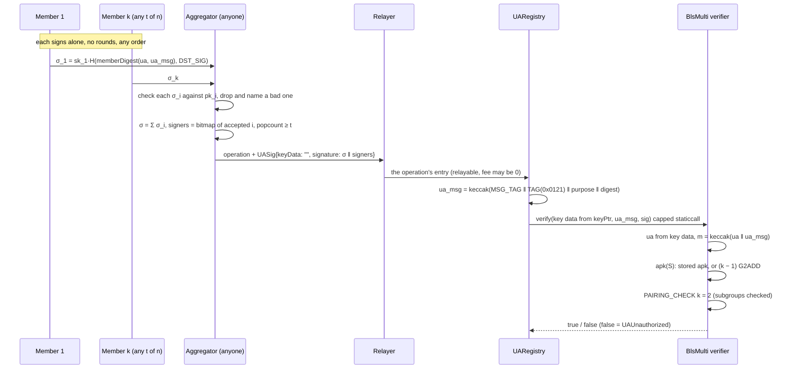

# `bls12381-multi` (0x0121): BLS12-381 same-message multi-signature as a UA kind — design

**Status:** SPECIFIED, nothing built. **UNAUDITED**: every cryptographic construction here (the aggregate check, the
distinct-message proof of possession, the cross-group binding) is a design, not reviewed code.
Owner 2026-11-19: `bls12381-multi`, number `0x0121`, reserved since UA design rev 1.3 where it was cut for "no consumer"
(history spec `2026-10-06-universal-account-design.md` §18 L10, §17 item 3); "no consumer" is not a reason, build it.
Owner 2026-11-19 (through the coordinator): the kind has several variants; this spec starts with them and proposes which
become kinds.

The normative rules it extends are [CTR-UA-01](../../contracts/accounts.md#CTR-UA-01) (no BLS key or signature at
infinity), [CTR-UA-03](../../contracts/accounts.md#CTR-UA-03) (ids), [CTR-UA-07](../../contracts/accounts.md#CTR-UA-07)
(portable PoP, identical record or revert), [CTR-UA-08](../../contracts/accounts.md#CTR-UA-08) (rogue-key defence per
aggregate kind), [CTR-UA-09](../../contracts/accounts.md#CTR-UA-09) / [CTR-UA-38](../../contracts/accounts.md#CTR-UA-38)
(structures, two levels), [CTR-UA-10](../../contracts/accounts.md#CTR-UA-10) / [CTR-UA-11](../../contracts/accounts.md#CTR-UA-11)
(one key one purpose, keyHash per group), [CTR-UA-12](../../contracts/accounts.md#CTR-UA-12) (tagged message),
[CTR-UA-34](../../contracts/accounts.md#CTR-UA-34) (relayer-checked mode), [CTR-UA-36](../../contracts/accounts.md#CTR-UA-36)
(explicit registry ABI), [CTR-UA-46](../../contracts/accounts.md#CTR-UA-46) (app namespace) and
[NET-ALL-84](../../networks/README.md#NET-ALL-84) (the per-family checklist).

Rows marked **follows** apply a stated rule and need no ruling. Rows marked **proposal** are the controller's; the owner may
override them; §13 lists what only the owner decides. Rule ids `CTR-UA-47` … `CTR-UA-56` are **placeholders**: the next free
numbers today (the highest defined is `CTR-UA-46`); landing assigns the real ones and writes the `decisions.md` entries.

## 0. Decisions proposed

| # | Item | Proposal | Basis |
|---|---|---|---|
| B1 | Which variants become kinds (§1) | **one kind**, `0x0121` `bls12381-multi`: t-of-n (1 ≤ t ≤ n) with a signer bitmap; n-of-n is `t = n` of the same kind, verified through the stored aggregate key with no per-member work. Threshold BLS (Shamir / DKG), a bn254 counterpart, a min-pubkey variant and distinct-message aggregation are **not** kinds | proposal, §1 |
| B2 | Key data and id (`CTR-UA-47`) | `apk (256) ‖ u16 t ‖ u16 n ‖ n × pk_i (256)`, EIP-2537 G2 encoding, `pk_i` strictly increasing, `apk = Σ pk_i`, 2 ≤ n ≤ 64; id `keccak256(TAG(0x0121) ‖ d)`, tag `scaas.ua.bls12381-multi.v1`; keyHash group `bls12381-g2` over `apk` | MuSig2 layout precedent — **follows**; the cap 64 is a proposal (§8) |
| B3 | Messages and DSTs (`CTR-UA-48`) | members sign `memberDigest(ua, ua_msg)` with `0x0106`'s `DST_SIG`; the PoP uses `0x0106`'s `DST_POP` over per-member messages; no new DST | proposal, §3 |
| B4 | Rogue-key defence (`CTR-UA-49`) | **every** member's proof of possession, checked on chain at registration as one aggregate over **distinct per-member messages** bound to the group's registration digest (n + 1 pairings); not KeyAgg coefficients, not a reference to registered `0x0106` UAs | proposal, §4 |
| B5 | Signature and verification (`CTR-UA-50`) | `sig = σ (128) ‖ signers (32)`; `popcount(signers) ≥ t`, bits ≥ n zero; `apk(S)` by G2ADD over the selected stored keys (or `apk` itself when all n signed); one PAIRING_CHECK k = 2 | proposal, §5 |
| B6 | Registration and nesting (`CTR-UA-51`) | a stored kind (`keyPtr` holds the whole key data); typed `registerBlsMulti`; no KEM, no PQZ key; in SIGNING and MEMBER (an `msig` member like MuSig2 / FROST); portable as every kind; app purposes as every kind | CTR-UA-07 / 31 / 36 / 46 — **follows**; MEMBER is a proposal |
| B7 | Gas and cap (`CTR-UA-52`) | verify ≈ 170 k + ≈ 0.75 k per extra signer (estimate), flat against `msig` of n `0x0106` (~172 k per member); member cap 64 (EIP-170 storage bound and the register estimate under EIP-7825) | proposal, §8 |
| B8 | Byte formats everywhere at once (`CTR-UA-53`) | contracts, ua-rs, clientkeys, every `ua-*` reader, vectors, node typed rows, scaas-sdk land in one round | AGENTS.md — **follows** |
| B9 | Families (`CTR-UA-54`) | verified on chain only where a BLS12-381 pairing, G2 addition and a hash-to-G1 with our DST exist; elsewhere `UAKindDisabled` or relayer-checked by CTR-UA-34, never a weaker check | NET-ALL-20 one rule — **follows** |
| B10 | Member keys (`CTR-UA-55`) | `0x0106`-format keys derived on the `0x0121` path (CTR-UA-10 layer 1); participant keys are not claimed in `keyOwner` | MuSig2 / FROST precedent — **follows** |
| B11 | Partial signatures (`CTR-UA-56`) | the aggregator checks every partial signature against its member key before summing; an invalid partial is named and dropped | proposal, §5.4 |

## 1. Variants — PLANNED (proposal; the kind decision is the owner's)

EIP-2537 prices used below (final EIP, as in `docs/research/02-account-registry.md` §2.5.2): G1ADD 375, G2ADD 600,
G1MSM 12,000 (k = 1), G2MSM 22,500 (k = 1), PAIRING_CHECK 32,600·k + 37,700, MAP_FP_TO_G1 5,500, MAP_FP2_TO_G2 23,800.
Measured: `bls12381-minsig` verify ~159 k inside the bounded self-call plus ~6 k registry overhead (accounts.md §1.15);
`msig` over `bls12381-minsig` members ~172 k per member (controller measurement 2026-11-19). A hash-to-G1 is ≈ 16 k
(two maps, one G1ADD, `expand_message_xmd` on SHA-256, the mod-p reductions). Every other figure here is an estimate that
the round's measurement replaces.

The cryptography is the proof-of-possession scheme of the IETF draft `draft-irtf-cfrg-bls-signature` (sections
"Proof of possession" and `FastAggregateVerify`): many keys sign one message, anyone sums the signatures, the verifier sums
the keys, and every key must carry a proof of possession first, because a sum of keys is otherwise open to rogue keys.

| # | Variant | On chain | Security | Gas (EVM, estimate) | Proposal |
|---|---|---|---|---|---|
| V1 | **n-of-n, aggregate key stored** | `apk = Σ pk_i` computed and checked once at registration; verify = one min-sig check against `apk` | every member must sign; rogue keys need the per-member PoP (§4); the chain can show all n members proved possession | ≈ 170 k flat, any n | **inside the kind**: `t = n`, or any signature whose bitmap names all n, takes the stored `apk` (no per-member work) |
| V2 | **t-of-n with a signer bitmap** | `apk(S) = Σ_{i∈S} pk_i` at verify, (k − 1) G2ADD over the stored keys; `popcount(S) ≥ t` | as V1; the bitmap names who signed (accountable subgroup); an aggregator holding more than t partials picks which t | ≈ 170 k + ≈ 0.75 k per signer beyond the first | **the kind** (`0x0121`) |
| V3 | **threshold BLS** (Shamir shares, DKG; t partials combined by Lagrange interpolation off chain) | one group key `Y`, one signature; verifies exactly as `0x0106` | the chain sees one key: the threshold, the share distribution and party distinctness are attestation-only (as FROST's, accounts.md §1.6.1); a DKG-checked kind would carry t × n G2 Feldman commitments (64 KB at t = n = 16) | as `0x0106`, ~165 k | **no kind**: a threshold group registers its group key as `bls12381-minsig` (`0x0106`); its PoP is a threshold signature under `DST_POP` (BLS is linear, so t partials of the PoP combine like any message). Shown with the attestation-only caveat. A DKG-checked kind (FROST-parity) can take a free number in `0x0122`–`0x012F` later if the owner wants it |
| V4 | **bn254 counterpart** (`bls-bn254-multi` beside `0x0107`) | no G2 addition precompile on bn254 (EIP-196/197 have G1 only): G2 sums in Solidity Fp2 arithmetic; no G2 subgroup precompile (`0x0107` uses a pairing-based check per key) | ~100-bit pairing security (research §2.5.1) | per-signer Fp2 Jacobian addition in Solidity, several thousand gas each (estimate), plus a pairing-based subgroup check per member key at registration | **no kind**: weaker curve, costlier sums; a chain without EIP-2537 uses `msig` over `0x0107`, MuSig2 or FROST on bn254 |
| V5 | **min-pubkey-size** (pk in G1, sig in G2) | `apk(S)` by G1ADD (375 instead of 600), 128-byte keys; hash-to-G2 (2 × 23,800 instead of 2 × 5,500); 256-byte signature | same | per verify +36.6 k (map) + 128 B calldata, per signer −225 gas: break-even ≈ 170 signers, above the cap; registration saves ≈ 35 k per member (G1MSM and half the storage) | **min-sig, as `0x0106`**: verify is the frequent operation; one hash-to-G1 code path (`HashToCurve.hashToG1`, KAT-tested) and no hash-to-G2 in the repo; members' keys stay `0x0106`-format |
| V6 | **distinct-message aggregation** (`AggregateVerify`, n + 1 pairings for n messages) | batches signatures of **different** operations or UAs | each message must be distinct; one bad signature fails the whole batch | 32.6 k per extra pair + 16 k per message, against ~165 k per single verify | **not a UA kind**: a UA authorises one operation, so it signs one `ua_msg`; distinct messages arise only when a relayer batches several operations, which is a batch-verify entry point, not an account. It would also break per-operation fail-closed isolation (one invalid signature voids every operation in the batch). Not proposed now. The kind's own registration uses this check internally for the member PoPs (§4) |

**Why one kind for V1 and V2.** A separate n-of-n kind would save at most the bitmap (32 B of calldata) and the read of the
member keys (≈ 1–4 k at n = 16–64): the n-of-n fast path inside `0x0121` already uses the stored `apk` with no additions.
A second kind would double the verifier, the vectors and every client for that.

**Its place.** `bls12381-multi` is the only non-interactive group kind whose verification stays near-flat in the number of
signers. `msig` is non-interactive but pays one full verification per signer (~172 k each for `0x0106` members, 10–28.5 k
for native EOA members); MuSig2 and FROST verify as one signature but need interactive signing rounds (nonce commitments,
and for MuSig2 every member). Members of `0x0121` sign alone, at any time, in any order; anyone sums.

## 2. Key data and identity (`CTR-UA-47`) — SPECIFIED

```
d          = apk (256) ‖ u16 t ‖ u16 n ‖ pk_1 (256) ‖ … ‖ pk_n (256)        length 260 + 256·n
pk_i, apk  = EIP-2537 G2 encoding (four 64-byte big-endian Fp limbs, top 16 bytes zero)
kind_tag   = "scaas.ua.bls12381-multi.v1"
UA         = keccak256(TAG(0x0121) ‖ d)                                      as every derived kind (§1.6)
keyHash    = keccak256(GROUP("bls12381-g2") ‖ apk)                            CTR-UA-11
```

**Rule.** Key data is valid iff: `2 ≤ n ≤ 64`; `1 ≤ t ≤ n`; length `260 + 256·n`; every `pk_i` canonical, on the curve, in
the prime-order G2 subgroup and not the identity (G2MSM with scalar 1 per key, as `0x0106`'s `_bls` check); `pk_1 < pk_2 <
… < pk_n` as 256-byte big-endian strings (no duplicate, one canonical order); `apk` byte-equal to the G2ADD sum of the
`pk_i`, and not the identity. Anything else is `UAKeyData(0x0121)`. Typed form (CTR-UA-36):
`struct BlsMultiKey { bytes aggKey; uint16 threshold; bytes[] memberKeys; }`, entry
`registerBlsMulti(BlsMultiKey key, UAAttrs attrs, bytes pop, bytes pqzPop)`, view `blsMultiKeyOf(ua)`; `register(0x0121, d, …)`
takes the packed form and gives the same id (as `registerMuSig2`).

**Rationale.** The layout is MuSig2's (`Q ‖ u16 n ‖ n × pk_i`) with a threshold, so parsers and typed views follow an existing
shape. `apk` first lets the n-of-n path read 260 bytes, and the keyHash cover the group's point. The sort makes the id
unique per member set and threshold. The cap is §8's. The member keys are the `0x0106` encoding, so one key validation, one
encoder and one test set serve both kinds.

**keyHash.** Over `apk`, the group's point, as for MuSig2 / FROST: an `apk` already registered as a `0x0106` key, or a second
group with the same member set (any threshold), reverts `UAKeyInUse`. Participant keys are not claimed (CTR-UA-11): a member
key may sit in several groups. Whether two groups over the same set with different thresholds should coexist is Q5.

**Tests.** Valid rows at n = 2, 16, 64 and t = 1, t = n; refusals, each one change from a valid row: n = 1, n = 65, t = 0,
t = n + 1, wrong length, unsorted pair, duplicate key, a key off the curve, a key on the curve outside the subgroup, a key
at infinity, a non-canonical limb (≥ p, non-zero top bytes), `apk` ≠ the sum, `apk` = the sum but at infinity (two keys
that cancel), packed and typed forms giving the same id, `UAKeyInUse` against a `0x0106` registration of `apk`.

## 3. Messages and DSTs (`CTR-UA-48`) — SPECIFIED

```
ua_msg     = keccak256(MSG_TAG ‖ TAG(0x0121) ‖ purposeTag ‖ digest)          CTR-UA-12, as every kind
m          = memberDigest(ua, ua_msg) = keccak256(ua ‖ ua_msg)                 what every member signs
σ_i        = sk_i · H_G1(m, DST_SIG)                                           partial signature
σ          = Σ_{i∈S} σ_i                                                       anyone aggregates
DST_SIG    = "SCAAS-UA-V1_BLS12381G1_XMD:SHA-256_SSWU_RO_SIG_"                 = 0x0106's
DST_POP    = "SCAAS-UA-V1_BLS12381G1_XMD:SHA-256_SSWU_RO_POP_"                 = 0x0106's (§4)
```

BLS uses `ua_msg`, never `pq_msg` (that is ML-DSA / SLH-DSA only, CTR-UA-23).

**Rule.** The signed message is `memberDigest(ua, ua_msg)`. The verifier computes `ua` from the key data it is given
(`keccak256(TAG(0x0121) ‖ d)`), so the registry passes `ua_msg` as for every kind and needs no per-kind message code.

**Rationale: the UA must be bound.** A single key is its own UA, so `ua_msg` needs no id. A t-of-n group is not: the
aggregate of a signer set S verifies against `apk(S)`, which is the same point for **every** group that contains S with a
threshold ≤ |S|. Where the operation's digest does not name the UA (the registry's `requireAuthorized(ua, purpose, digest)`
takes the caller's digest; CTR-UA-46 asks app contracts to name the signer, but the registry must not depend on it), a
signature made for group G1 would also authorise G2. `msig` meets the same problem with `memberDigest` (§1.5 purpose
`member`); this kind reuses it. Cost: one keccak over the key data (≈ 1–3 k at n = 16–64) and one over 64 bytes.

**Rationale: one DST for `0x0106` and `0x0121`.** Domain separation between a member signing alone (`0x0106`) and inside a
group comes from the message: a `0x0106` signature is over `keccak256(MSG_TAG ‖ TAG(0x0106) ‖ …)` (128-byte preimage), a
`0x0121` partial over `keccak256(ua ‖ ua_msg)` (64-byte preimage, with `TAG(0x0121)` inside `ua_msg`). A partial can serve
as a `0x0106` signature only through a keccak collision. The IETF draft runs `Sign`, `AggregateVerify` and
`FastAggregateVerify` of the proof-of-possession scheme under one signing DST and gives `PopProve` its own; this keeps that
shape and adds no second hash-to-curve constant. CTR-UA-12 already makes "kind tags separate kinds" the one place of that
rule. A distinct DST would be free in gas (`CurveSigs.bls12381` takes the DST as an argument) and is the alternative in Q11.

**Tests.** A partial signature replayed as a `0x0106` signature by the same key fails; a `0x0106` signature presented as a
one-signer `0x0121` aggregate fails; an aggregate for group G1 (members {A, B}, t = 2) presented for G2 (members {A, B, C},
t = 2) with the same `ua_msg` fails (the cross-group row: it must pass if `memberDigest` is removed — the mutant); a
signature under `DST_POP` instead of `DST_SIG` fails.

## 4. Rogue-key defence: the member proofs of possession (`CTR-UA-49`) — SPECIFIED

```
popMsg     = uaMessage(0x0121, PURPOSE_POP_V2, registrationDigest(...))      what the registry passes, CTR-UA-07
m_i        = keccak256(popMsg ‖ pk_i)                                          one message per member
π_i        = sk_i · H_G1(m_i, DST_POP)                                          member i's proof
pop        = Σ_{i=1..n} π_i                                                    one G1 point, 128 bytes
check      : π ≠ O  and  e(pop, −g2) · Π_i e(H_G1(m_i, DST_POP), pk_i) == 1    one PAIRING_CHECK, k = n + 1
```

**Rule.** Registration needs every member: `pop` is the sum of all n member proofs, each over its own message `m_i`, checked
as one distinct-message aggregate (n hash-to-G1, one PAIRING_CHECK with n + 1 pairs). A wrong `pop` is `UAPoP`. The
threshold does not lower it: a t-of-n group registers with all n.

**Why this is sound** (UNAUDITED argument). A rogue member M publishes `pk_M = g2^x − pk_H` so that `apk = g2^x`. The check
then needs `σ = sk_H·H(m_H) + sk_M·H(m_M) = π_H + x·H(m_M) − sk_H·H(m_M)`: a signature of the honest key on `m_M` under
`DST_POP`, which H never makes (H signs only `m_H`, and `m_M ≠ m_H` because the keys differ). This is the unforgeability of
the BGLS aggregate over distinct messages under co-CDH in the random-oracle model. With **one shared message** for every
member the same attack works: `π_M = x·H(m) − π_H` is computable from the honest `π_H` in the same record. The per-member
message is what makes it a proof of possession; the binding to `popMsg` makes it a consent to this group.

**What it gives.** Every listed key proved possession (rogue keys refused); every member consented to this exact group,
threshold and registration record (`popMsg` covers the UA, hence the key data); the `pop` is **unique** (BLS signatures are
deterministic and all n are needed), so a front-runner yields the identical record or a revert (CTR-UA-07); the
registration is portable, since `registrationDigest` is chain-free.

**Alternatives considered.**

| Option | Verify cost | Registration | Why not |
|---|---|---|---|
| Members must be registered `0x0106` UAs, the group lists their ids (the `msig` way) | an extra record read per signer, or a copy of the keys anyway | n `0x0106` registrations (~246 k each) per chain before the group, then the group | a member's `0x0106` PoP is reusable and proves no consent to this group; n + 1 registrations per chain on every copy |
| The group record carries each member's own `0x0106` PoP, checked one by one | as chosen | n × ~165 k (2 pairings each) | ≈ 2× the pairings of the aggregate (2n against n + 1); not bound to this group |
| KeyAgg coefficients (Boneh–Drijvers–Neven: `apk = Σ a_i·pk_i`, `a_i = H(pk_i, {pk})`) as MuSig2 | t-of-n needs a G2MSM over the signers with their coefficients at every verify (k × 22,500 × the EIP-2537 discount, thousands of gas per signer against 600); members multiply their signature by `a_i` | no PoP needed | per-signer cost at verify, the thing this kind exists to avoid; the IETF draft standardises PoP, not coefficients |
| **Distinct-message aggregate PoP bound to the group (chosen)** | none at verify | n + 1 pairings, n hash-to-G1 | — |

**Tests.** Positive control at n = 2, 16, 64; a `pop` missing one member's `π_i` fails; the shared-message rogue-key attack
(a constructed `pk_M = x·g2 − pk_H` with `π_M = x·H(m) − π_H`) passes a shared-message check and fails this one (the
mutant that makes `m_i` independent of `pk_i` must turn it green); `π_i` made under `DST_SIG` fails; a `pop` for the same
keys and another threshold fails (the UA differs); `pop = O` fails; a valid `pop` copied to a second chain's registry
yields the same record.

## 5. Signature and verification (`CTR-UA-50`) — SPECIFIED

### 5.1 Signature bytes

`sig = σ (128, G1, EIP-2537) ‖ signers (32, uint256 big-endian)`, exactly 160 bytes; bit i of `signers` (least significant
= bit 0) selects `pk_{i+1}` in key-data order. One crypto object, like a Schnorr `R ‖ z`: an accountable-subgroup
multi-signature is the aggregate point together with the set it is over. `UASig` carries it as `signature`, with `keyData`
empty (a stored kind) and `members` empty; any other field set is refused as for every stored kind. The layout under the
explicit-parameters rule is Q6.

### 5.2 Check

```
reject unless: sig.length == 160; σ ≠ O; signers >> n == 0; popcount(signers) ≥ t
ua      = keccak256(TAG(0x0121) ‖ d)            d = the stored key data (keyPtr), never caller-supplied
m       = keccak256(ua ‖ ua_msg)
apk(S)  = apk                                  when signers has all n bits
        = Σ_{i∈S} pk_i  by (k − 1) G2ADD       otherwise   (or apk − Σ_{i∉S} pk_i: the same point)
reject if apk(S) is the identity
accept iff PAIRING_CHECK( (σ, −g2), (H_G1(m, DST_SIG), apk(S)) ) == 1
```

**Subgroups and G2ADD.** G2ADD checks only that its inputs are on the curve, not the subgroup (EIP-2537; research note
§2.5.3). Here it only adds stored keys, each subgroup-checked by G2MSM at registration (§2), and a sum of subgroup points
stays in the subgroup. PAIRING_CHECK subgroup-checks its inputs again (`σ` and `apk(S)`), so a point outside the subgroup
fails closed even if a stored key were wrong. The signature is never added on chain.

**Infinity** (CTR-UA-01). `σ = O` is refused before the pairing. `apk(S) = O` is refused (with `σ ≠ O` the equation could not
hold anyway, so this is fail-closed clarity, not the only guard). Keys and `apk` at infinity never register (§2).

**Malleability and replay.** σ is unique for (S, m): BLS signing is deterministic, and the subgroup checks leave one encoding
per point. Bits at or above n are refused, so `signers` has one form per set. A party that holds more than t partial
signatures can submit a different subset: that is a different valid authorisation by members who did sign, never a
forgery, and SCaaS never uses signature bytes as an identifier (replay protection is in the digests' nonces and lanes).
Replay across kinds dies at `TAG(kind)`, across groups at `memberDigest`, across chains and contracts at the operation's
own digest.

**Failure.** The verifier is a `UASafeVerifier`: a malformed point, an out-of-gas or any revert inside `check` returns
`false`; too little gas for the cap is `UAVerifyGas`. The registry maps `false` to its existing errors: `UAUnauthorized(ua)`
on an authorisation, `UAPoP` at registration. No new error.

### 5.3 Threshold rule for stored signatures

`0x0121` holds no KEM key and no PQZ key (§6), so the only signature the registry stores is the registration `pop`, which
needs all n members and is unique. The minimal-form rule of CTR-UA-07 therefore has nothing to apply to; if the kind ever
becomes a KEM or PQZ holder, its stored signatures take `popcount(signers) == t`. Authorisations take
`popcount(signers) ≥ t` (Q7).

### 5.4 Partial signatures and aggregation (`CTR-UA-56`)

**Rule.** The aggregator (ua-rs, clientkeys, anyone) checks each partial `σ_i` against `pk_i` on `m` (one off-chain
pairing check each, subgroup and infinity included) before summing, refuses a duplicate index or one outside 1..n, and
names and drops an invalid partial; it builds `signers` from the accepted indices and refuses to emit a signature below t.
**Rationale:** one bad partial otherwise spoils the aggregate without saying whose it was; the chain cannot tell which
member was wrong. The chain's check stays the only authority; the aggregator's checks are availability, not security.



**Tests.** Positive control at k = t and k = n (both apk paths, equal results); one bit set at or above n; popcount t − 1;
σ at infinity; σ off the subgroup; a valid σ with one extra bit set; a valid σ with one bit cleared; signature length 159
and 161; a stored-key mutation (one byte of `pk_2` in the fixture) must fail; the aggregator refuses a forged partial and
names its index, and a dropped partial still yields a valid aggregate when t remain.

## 6. Registration record, nesting, portability, app purposes (`CTR-UA-51`) — SPECIFIED

- **Stored kind.** `keyPtr` holds the whole key data (`UAStore.vkLength` returns `d.length` for `0x0121`: the first variable
  length; the others are fixed), so the registration blob holds only the rest (`""`) and `pop`. Verify reads the key data
  from state, never from calldata (the caller cannot choose the member list). Registration steps follow §1.8: key-data
  validation (§2), id, `UAIdInNativeSpace`, keyHash on `apk` (`UAKeyInUse`), `verifyPop` (§4), the record, the kind's list
  (CTR-UA-29: `0x0121` gets its own list like every kind).
- **No KEM key, no PQZ key.** Holders are the single PQ signing kinds only; `0x0121` reverts `UAKemHolder` / `UAPqzHolder` on a
  non-empty `attrs` or `pqzPop` (**follows** the holder rules). It is classical and never PQ-eligible.
- **CTR-UA-07.** The record is `UAPortableRecord{ua, 0x0121, 0, UAKemRecord{ua, 0, 0, 0}}`; the `pop` covers it through
  `popMsg`. A front-run gives the identical record (the `pop` is unique, §4) or a revert.
- **Portable copies (CTR-UA-31).** The same `registerBlsMulti` call on another chain whose registry enables `0x0121`. No
  member must be registered there first.
- **`msig` membership (CTR-UA-38).** Proposal: `0x0121` is in MEMBER, like MuSig2 and FROST: one verifier call on chain, no
  member list the `msig` levels count. An `msig` holding a `0x0121` member is still two levels at most; the `0x0121` verifier
  binds its own UA inside (`memberDigest` twice: the `msig`'s, then its own). Its member cap in the structure bound is its
  `verifyCap` (§8). `0x0121` itself never lists an `msig` or any non-BLS member (its members are keys, not UAs).
- **App namespace (CTR-UA-46).** `requirePortableApp` and `requireAuthorized` under `appPurpose(appId)` work as for every
  SIGNING kind; the app purpose enters `ua_msg`, the UA enters `m`.
- **No membership change.** Key data is immutable; a new member set or threshold is a new UA (as MuSig2 / FROST; `msig`'s
  `updateMsig` has no counterpart here). Q10.

**Tests.** Typed and packed registration give the same id and record; KEM or PQZ attributes revert; a copy to a second
registry; an `msig` with a `0x0121` member authorises and its stored `pop` stays minimal; an inner `msig` with a `0x0121`
member can sit inside an outer `msig` (the `0x0121` member adds no level, CTR-UA-38); a `0x0121` signature without the outer
structure's `memberDigest` fails as an `msig` slot; app-purpose signatures under two `appId`s do not cross.

## 7. Verifier and registry on EVM — SPECIFIED

- `BlsMultiBls12381Verifier is UASafeVerifier` (`src/ua/verifiers/`, CTR-UA-41 naming): `check(d, m, sig, pop)`;
  `verify` takes the stored key data, `verifyPop` the registration key data and runs §4; `_checkGas(pop)` returns `POP_GAS`
  for the PoP (≈ 3.5–4 M at n = 64, measured then a margin) and `CHECK_GAS` otherwise. Reuses `HashToCurve.hashToG1`,
  `Bls12381.verifyMinSig` style pairing input, and `CurveSigs` helpers; adds a G2ADD loop.
- `UAKinds`: `BLS12381_MULTI = 0x0121`, name, tag, `groupName` → `bls12381-g2`, `keyHashOf` → `apk`, `validateKeyData` →
  `_blsMulti`, SIGNING and MEMBER (an explicit term: `0x0121` lies outside `_singleSigning`'s ranges).
- `IUARegistry` / `UARegistry`: `BlsMultiKey`, `registerBlsMulti`, `blsMultiKeyOf`. **Size gate:** count bytes before and
  after (`UARegistry` 32,477 B, `UARegistryAuxLib` 33,685 B, `UARegistryCoreLib` 34,116 B in `size-baseline.json` today);
  the typed entry and view go where the existing `registerMuSig2` / `muSig2KeyOf` live. The ratchet moves only with the
  figures in the commit.
- `DeployBase._deployUARegistry`: enable `0x0121` where the EIP-2537 probe passes (the same probe as `0x0106`, G2ADD `0x0d`
  added to it), and `_checkGen1Kinds` requires it beside `0x0105` / `0x0106`. A new kind needs a new registry generation
  (nothing deployed is upgraded); every chain is test-only, so it lands with the next reset.

## 8. Gas and the member cap (`CTR-UA-52`) — SPECIFIED (estimates; the round measures)

**Verify** (EVM, registry included, k signers of n):

```
verify(n, k) ≈ 170 k                              σ check (159 k measured for 0x0106) + registry ~6 k + 160 B calldata + cold keyPtr read
             + key-data copy and its keccak for ua ≈ 2 k at n = 16, ≈ 7 k at n = 64
             + (k − 1) × ≈ 750                    G2ADD 600 + call and memory; 0 when all n signed
```

| Signers k | `msig` of k `0x0106` (~172 k each) | `0x0121`, all n = k signed | `0x0121`, k of n = 64 |
|---:|---:|---:|---:|
| 1 | ~172 k | — (n ≥ 2) | ~177 k |
| 2 | ~344 k | ~171 k | ~178 k |
| 8 | ~1.38 M | ~172 k | ~182 k |
| 16 | ~2.75 M | ~172 k | ~188 k |
| 63 | — (`msig` cap 16) | — | ~224 k (≈ 178 k by subtracting the one non-signer) |
| 64 | — | ~177 k | ~177 k |

**Break-even.** Against `msig` of `0x0106` members, `0x0121` is cheaper from two signers on. Against `msig` of native EOA
members (10–28.5 k each: the measured worst cold member overhead is 28.5 k, accounts.md §1.15), from about 6 to 17
signers; against bare ECDSA (4.5 k per signer, research §2.5.4) from about 37. Calldata: 160 B against `msig`'s ≈ 225 B per
member slot.

**Registration** (one time per chain): `22.5 k·n` (G2MSM key checks) + `0.6 k·(n − 1)` (the `apk` sum) + `16 k·n` (PoP hashes) +
`32.6 k·(n + 1) + 37.7 k` (PoP pairing) + `200 gas·(260 + 256·n) + 32 k` (SSTORE2 of the key data) + record, list, keyHash,
event and calldata: ≈ 0.55 M at n = 2, ≈ 2.4 M at n = 16, ≈ 8.5 M at n = 64.

**Cap: 64 members** (proposal). The kind's worth grows with n, and 16 (the `msig`, MuSig2, FROST cap) stops where BLS
starts to pay against EOA `msig`s. 64 keeps the stored key data (16,644 B) under EIP-170's 24,576-byte code limit, so
SSTORE2 works on every EVM chain without EIP-7907, and the registration estimate (≈ 8.5 M) at about half of EIP-7825's
per-transaction cap of 2^24 = 16,777,216 gas. **Measurement gate:** if the measured registration at n = 64 exceeds 75 % of
2^24 (the budget-rule share, CTR-UA-23), the cap is 32. Verify caps: `CHECK_GAS` from the measured n = 64, k = 63 case plus
the usual margin (estimate ≈ 260 k); the per-chain `verifyCap` and the `msig` structure bound use it. No assumption about a
chain's block limit or gas price: the budget rule decides per chain.

## 9. Work list for the round (`CTR-UA-53`) — PLANNED

Byte formats change everywhere at once; the vectors are the authority.

| Layer | Work |
|---|---|
| EVM | §7: verifier, `UAKinds`, typed entry and view, `DeployBase` enable and gen-1 gate, size gate counted, gas pins with old → new figures; `test/ua/` suites for §2–§6 rows, `UAGas.t.sol` rows at n = 2 / 16 / 64, mutants (no `memberDigest`, `m_i` without `pk_i`, popcount `>` instead of `≥`, no high-bit check, no identity check on `apk(S)`) |
| ua-rs | `keydata.rs` parse `0x0121`; `verify.rs` the §5.2 check; a `bls_multi` module: `member_key` (the `0x0121` path), `member_pop(sk, key_data, pop_msg)`, `aggregate_pop`, `member_sign(sk, ua, ua_msg)`, `aggregate(key_data, ua_msg, partials)` with §5.4's checks; registration builder for `registerBlsMulti` |
| clientkeys | the same in JS (the existing BLS12-381 dependency used for `0x0106`), typed builder, `ua-verify.js` row |
| other `ua-*` (c, cxx, qt, cs, py, go, dart, dart-frb) | key-data parse and verify against the shared rows; signing only where that library already signs `0x0106` |
| vectors | `kinds.json` valid / invalid key data (§2 list), `groups.json` (or a `bls_multi` section) for PoP and signatures (§4, §5 rows, the rogue-key and cross-group rows), `portable.json` registration rows; regenerated by their generators, read by every language |
| node | `typed.rs` `TYPED` row for `registerBlsMulti`, `guard.rs` per-kind shape (`signature` 160 B, `keyData` and `members` empty), `selector_audit.json`; allow-lists equal to the contract's in both directions; the Soroban adapter's relayer-checked kind list |
| scaas-sdk | signer kind `0x0121` (collect partials, aggregate, submit); the gas verify row per chain for `0x0121` as a function of (n, k), the quote taking the UA's n and the worst k |
| docs | §12's changes, `decisions.md` entries for the ten rules, the signer doc (CLI-SGN) for the derivation path |

## 10. Families (`CTR-UA-54`, NET-ALL-84) — SPECIFIED (EVM), PLANNED (others)

**Shared rule.** A family verifies `0x0121` on chain only where it has a BLS12-381 pairing check, G2 addition (or MSM) and a
hash-to-G1 that can use our DST (or a map-to-curve to build it), with subgroup checks on G2 keys at registration and on the
pairing inputs. Where it cannot, the kind is `UAKindDisabled` (or the family's equivalent), or, on a family running
CTR-UA-34's relayer-checked mode, stored relayer-checked: never signable, never receivable. Never a weaker check: no
verification without subgroup checks, no "n-of-n only" shortcut, no hash-only record.

| Family | BLS12-381 on chain (to verify in the family's round where not stated in its doc) | Status for `0x0121` |
|---|---|---|
| EVM | EIP-2537 where the deploy probe passes (Ethereum since Pectra; Gnosis, Celo measured; the SCaaS testnet) | **Chain** where the probe passes, as `0x0106` |
| Hedera | no EIP-2537 (bn254 only, hedera.md) | `UAKindDisabled` |
| Soroban | CAP-59 host functions (soroban.md); `0x0106` is relayer-checked there today (NET-SOR registry `checked` list) | relayer-checked like `0x0106` until a Soroban round makes the BLS kinds `Chain` through CAP-59 |
| Solana | SIMD-0388 syscalls, active on mainnet (solana.md); compute units to measure | no UA registry yet; candidate in `ua-solana` |
| NEAR | BLS12-381 host functions (not yet confirmed in near.md) | no UA registry yet; the NEAR UA round decides |
| Algorand | AVM elliptic-curve opcodes for BLS12-381 (not yet confirmed in algorand.md); opcode budget to measure | no UA registry yet; the Algorand UA round decides |
| Aptos / Sui (Move) | Sui `group_ops` BLS12-381 with pairing (sui.md); Aptos `crypto_algebra` (not yet confirmed in aptos.md); whether the host's hash-to-G1 accepts our DST decides | each Move round decides |
| TON | TVM `BLS_*` opcodes with pairing and MSM (ton.md) | the TON UA round decides |
| Cosmos | CosmWasm 2+ `bls12_381_pairing_equality` and G1/G2 operations (cosmos.md) | the Cosmos UA round decides |

NET-ALL-84 rows: 1, 2 (the portable `register`, typed `register_bls_multi`), 6–9, 11–12, 15–21 are the shared answers
unchanged; row 3 (kinds enabled) and row 10 (`msig` members) take the table above; rows 4, 13, 14 do not apply (classical,
no Zether, no PQZ key); row 5 pins the family's BLS library at its round.

## 11. Threat model — SPECIFIED (UNAUDITED)

| Threat | Defence | Residual |
|---|---|---|
| Rogue key (a member chooses its key from others') | per-member PoP over distinct messages, all n, checked on chain (§4) | — |
| Small-subgroup or invalid-curve key | G2MSM per key at registration; PAIRING_CHECK on `apk(S)` and σ | — |
| Identity key or signature (trivial pairing) | refused at registration and verify (CTR-UA-01) | — |
| Cross-group replay (S ⊂ two groups) | `memberDigest(ua, ua_msg)` | — |
| Cross-kind replay (a partial as a `0x0106` signature) | `TAG(kind)` in `ua_msg`, different preimage lengths | keccak collision |
| Untrusted aggregator | cannot forge; can withhold, choose among surplus partials, or submit a spoiled aggregate (caught off chain by §5.4, on chain fails closed) | liveness only |
| Caller-chosen member list | verify reads key data from `keyPtr`, never calldata | — |
| Gas griefing | n ≤ 64; `CHECK_GAS` / `POP_GAS` caps in `UASafeVerifier` | — |
| Key compromise of ≥ t members | none at the kind level: a t-of-n is what it is; a new UA with new keys | as any threshold |
| Who holds which key; that n keys are n parties | not checkable: attestation-only, like MuSig2 / FROST | shown as such |
| Quantum adversary | none: BLS falls to Shor; `0x0121` is never PQ-eligible | a PQ-dominant `msig` is the PQ route |
| Implementation | the same hash-to-curve and pairing code as `0x0106` (KAT-tested), new code only in the G2ADD loop and the PoP | UNAUDITED until an audit round covers it |

## 12. Conflicts with current code and docs, and the changes on landing

- `accounts.md` [CTR-UA-09](../../contracts/accounts.md#CTR-UA-09): "A `bls12381-multi` kind was cut — no consumer, and `msig`
  over `bls12381-minsig` covers it; number `0x0121` stays reserved." Contradicts the owner's 2026-11-19 ruling; replaced by a
  pointer to the new rules.
- `accounts.md` §1.6 kind table: the `0x0121` row says *reserved (was `bls12381-multi`, cut)*; becomes the kind row. The
  "Validation at registration" paragraph caps groups at 16 (`count` ≤ 16 for `msig`, `n` ≤ 16 for MuSig2 / FROST): `0x0121`
  adds `n ≤ 64`. The closed sets SIGNING and MEMBER gain `0x0121`.
- [CTR-UA-08](../../contracts/accounts.md#CTR-UA-08)'s table gains the `0x0121` row (per-member distinct-message PoP).
- §1.9 verifier table and per-chain enablement, §1.13.2 status table ("BLS aggregation … BUILT" refers to `0x0106` /
  `0x0107` only), §1.15 gas rows, §1.16 vectors.
- `UAKinds._singleSigning` ranges skip `0x0121`; `UAStore.vkLength` is fixed per kind today; `_checkGen1Kinds` lists the
  EIP-2537 kinds; `UAPrecompileProbe` does not probe G2ADD `0x0d` today (the `0x0106` path never adds in G2).
- `IUAPopVerifier`'s comment names the BLS min-sig kinds and the group kinds; `0x0121` is both (its `verifyPop` runs a group
  check under `DST_POP`).
- The brief's "members hold `bls12381-minsig` keys": the keys are `0x0106`-format, but CTR-UA-10 layer 1 has wallets derive
  them on the `0x0121` path (as MuSig2 / FROST participants); a registered `0x0106` key may still be listed, the chain cannot
  tell.
- Soroban's relayer-checked list (soroban.md, `checked`) and NET-ALL-84 row 3 per family.
- History (`2026-10-06-universal-account-design.md` R296, R297, §17 item 3, §18 L10) stays as written: history.

## 13. Open questions for the owner (each answer is a **proposal**, not a ruling)

| # | Question | Proposed answer |
|---|---|---|
| Q1 | Which variants become kinds? | One kind, `0x0121`, t-of-n with the n-of-n fast path inside it (§1 V1 + V2) |
| Q2 | Threshold BLS (Shamir / DKG): a kind? | No kind now: the group key registers as `0x0106`, shown attestation-only; a DKG-checked kind later in `0x0122`–`0x012F` only if wanted |
| Q3 | `bls-bn254-multi`? | No: ~100-bit, Solidity G2 sums, a pairing-based subgroup check per key |
| Q4 | Member cap | 64, dropping to 32 if the measured n = 64 registration exceeds 75 % of 2^24 |
| Q5 | Two groups over the same member set with different thresholds | Not allowed: keyHash on `apk` (one point, one UA, as MuSig2 / FROST). Alternative: no keyHash, like `msig` |
| Q6 | `σ ‖ signers` as one 160-byte `signature` under the explicit-parameters rule | Yes, one crypto object (as `R ‖ z`); the alternative, the signer indices as typed `UASig.members` slots, costs ≈ 160 B of calldata per signer |
| Q7 | More signers than t in an authorisation | Accept (`popcount ≥ t`): an extra signer costs one G2ADD and all n take the cheapest path; `msig` refuses slots past its threshold because each costs a full verification |
| Q8 | May a member key also be a registered `0x0106` UA? | Allowed on chain (participant keys are not claimed); our wallets derive member keys on the `0x0121` path |
| Q9 | `0x0121` as an `msig` member | Yes, in MEMBER like MuSig2 / FROST |
| Q10 | Changing members or threshold | No update path: a new UA (as MuSig2 / FROST) |
| Q11 | A DST of its own instead of `0x0106`'s | No: `ua_msg`'s kind tag and `memberDigest` separate the domains (CTR-UA-12); a distinct DST costs nothing and stays the fallback if the owner prefers belt and braces |
| Q12 | All n members at registration, also for t-of-n | Yes: it is the rogue-key defence and each member's consent |

## 14. Sources

- IETF CFRG, `draft-irtf-cfrg-bls-signature` (BLS signatures): the proof-of-possession scheme, `PopProve` / `PopVerify`,
  `AggregateVerify`, `FastAggregateVerify`.
- RFC 9380 (hashing to elliptic curves): `BLS12381G1_XMD:SHA-256_SSWU_RO_`.
- EIP-2537 (BLS12-381 precompiles): addresses `0x0b`–`0x11`, prices, the subgroup checks of MSM and pairing, none in ADD.
- EIP-170 (contract code size), EIP-7825 (per-transaction gas cap 2^24).
- Boneh, Gentry, Lynn, Shacham, "Aggregate and Verifiably Encrypted Signatures from Bilinear Maps" (EUROCRYPT 2003):
  distinct-message aggregation. Boneh, Drijvers, Neven, "Compact Multi-Signatures for Smaller Blockchains" (ASIACRYPT 2018):
  the coefficient alternative. Ristenpart, Yilek, "The Power of Proofs-of-Possession" (EUROCRYPT 2007).
- In the repo: `docs/research/02-account-registry.md` §2.5.2–2.5.4 (variant table, subgroup trap, break-even);
  `smartcontracts/evm/src/ua/verifiers/PairingVerifiers.sol` (`BlsMinSigBls12381Verifier`, `UASafeVerifier`);
  `src/common/Bls12381.sol`, `src/common/CurveSigs.sol`; `src/ua/UAKinds.sol`; `src/ua/UARegistryCoreLib.sol` (`_record`).
