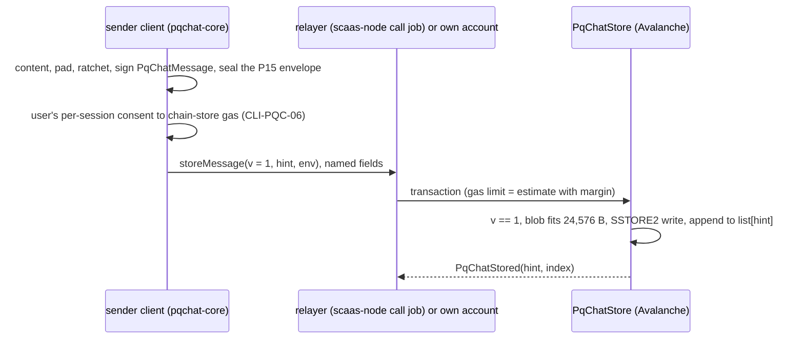

# Avalanche and Polkadot EVMs, an Avalanche message store, and Arweave for encrypted files: design

**Status:** SPECIFIED, nothing built. UNAUDITED: every construction below is a design, not a reviewed protocol. **Revision 2**
(2026-11-21): Fable's spec review (P0 0, P1 1, P2 11, P3 9, info 5) applied; §14 maps each finding to its fix; the revision's
controller calls are C5, C7, C8, C10–C14 revised and C15–C23 new (ARCH-POS-20, owner: no). Branch
`research-avax-dot-arweave`. Decision [ARCH-POS-19](../../decisions.md#ARCH-POS-19) (owner 2026-11-21) and its Change line (the
owner's answers Q1, Q2, Q4, Q5; the controller calls Q3, Q6, Q7, Q8); research
[`2026-11-21-avax-polkadot-arweave.md`](../../research/2026-11-21-avax-polkadot-arweave.md) (cited "note §n"); plan
[`2026-11-21-avax-polkadot-arweave.md`](../plans/2026-11-21-avax-polkadot-arweave.md). Rule ids introduced here (SPECIFIED, each
defined once in its component doc, recorded in [decisions.md](../../decisions.md)): NET-EVM-16, NET-EVM-17, NET-EVM-18,
CTR-CHAT-22, CLI-RPC-13, CLI-RPC-14, CLI-UAL-64, CLI-UAL-65, CLI-SDK-21, and in revision 2 NET-EVM-19 and NODE-SPN-05; this
spec's controller calls are [ARCH-POS-20](../../decisions.md#ARCH-POS-20) (owner: no, the owner may override any); NET-ALL-25 is
reworded (Q8, then C18). Rows marked **follows** apply a stated rule; rows marked **proposal** are the controller's. Open points
O1–O5 (§12) are settled by the owner; §12 names the tasks each one gated. Review before code: Fable (design, security, crypto),
done for revision 1 (§14); Codex only on the owner's request.

**Contents**

1. [Rulings this spec follows](#1-rulings-this-spec-follows)
2. [Controller calls](#2-controller-calls)
3. [Goal, scope, non-goals](#3-goal-scope-non-goals)
4. [Part A: the Avalanche draft profile](#4-part-a-the-avalanche-draft-profile)
5. [Part B: the Avalanche message and text store](#5-part-b-the-avalanche-message-and-text-store)
6. [Part C: Polkadot Hub, then Moonbeam](#6-part-c-polkadot-hub-then-moonbeam)
7. [Part D: Arweave for encrypted files](#7-part-d-arweave-for-encrypted-files)
8. [Part E: NET-ALL-25 reworded](#8-part-e-net-all-25-reworded)
9. [Threat model](#9-threat-model)
10. [Rule ids and where they live](#10-rule-ids-and-where-they-live)
11. [Tests and gates](#11-tests-and-gates)
12. [Open points](#12-open-points)
13. [Sources](#13-sources)
14. [Revision 2: review findings and fixes](#14-revision-2-review-findings-and-fixes)

## 1. Rulings this spec follows

| # | Date | Ruling | Where |
|---|---|---|---|
| R1 | 2026-11-21 | Avalanche's EVM (C-Chain, Fuji) and Polkadot's EVMs become chain profiles under the EVM family's rules; Arweave joins as a store of ciphertext only (PqChat messages and images, files embedded in a message or a vault item); `scaas-rpc` gains the profiles and an Arweave reader and uploader under CLI-RPC-01..11; attachments join the `pqchat-core` round | [ARCH-POS-19](../../decisions.md#ARCH-POS-19) |
| R2 | 2026-11-21 | **Q1**: wait for C-Chain's Amsterdam fork; a draft Avalanche profile and its `scaas-rpc` part now; a contract within the chain's code size deploys earlier, per contract; Avalanche may serve now as a store path for messages and text, as HCS does on Hedera (a store contract within the chain's limits, in PqChat's store list) | ARCH-POS-19 Change |
| R3 | 2026-11-21 | **Q2**: Polkadot Hub first, Moonbeam second | ARCH-POS-19 Change |
| R4 | 2026-11-21 | **Q4**: UA-7's `url` gains `ar://<id>` | ARCH-POS-19 Change |
| R5 | 2026-11-21 | **Q5**: uploads paid by an operator payer (credit sharing), small items on the free tier; the client never holds operator credentials; the payer link between uploads is a stated metadata cost | ARCH-POS-19 Change |
| R6 | 2026-11-21 | `pqchat-core` O9 (b): the file sealed under a fresh key by an SDK call, the ciphertext on Arweave (`ar://<id>`), `ctSha256` checked before opening, size padded; `pqchat-core` plan T10b, after this work | CLI-PQC-02 on branch `pqchat-core-build` |
| R7 | 2026-11-21 | Controller calls of ARCH-POS-19 (owner: no): **Q3** the software BLS12-381 path is built and measured, no kind disabled; **Q6** size buckets in powers of two; **Q7** Turbo probed with both ed25519 signature types before one is chosen; **Q8** NET-ALL-25 reworded to the `(chainId, chain_uid)` pair | ARCH-POS-19 Change |

Standing rules applied: [NET-EVM-06](../../networks/evm.md#NET-EVM-06) (Glamsterdam before a public chain is deployed; every
profile compiles for `amsterdam`), the deploy condition per contract (owner 2026-11-09), NET-ALL-22 (a chain is
`(chainId, chain_uid)`), ARCH-POS-13 (never a decryption oracle), ARCH-POS-15 and CLI-RPC-02..11 (lists, failover, strict majority,
bounds, logs), ARCH-POS-18 (maximal support), CTR-CHAT-05 and CTR-CHAT-13 (PqChat's records and stored payloads in state),
CTR-CHAT-19 (every write relayable, fee 0 too), CLI-SDK-20 (key handles only, app-core label prefixes) and CLI-SDK-30's app root key,
explicit parameters, bounded decode, one rule on every chain, no assumption about a chain, no EIP-7702, no built binaries.

## 2. Controller calls

Recorded as [ARCH-POS-20](../../decisions.md#ARCH-POS-20) (owner: no). Each names where it is applied.

| Id | Call | Why | Applied in |
|---|---|---|---|
| C1 | A new standalone contract `PqChatStore` serves the Avalanche store path; `PqChat` is not reused | `PqChat` is 29,111 B and its clone needs `OpenFactory` (34,999 B), both above Avalanche's 24,576 B; no split store exists (3C-D2 kept `storeMessage` in `PqChat`) | §5.1, CTR-CHAT-22 |
| C2 | Its payloads stay in contract state (SSTORE2), never only in events | CTR-CHAT-05 binds every PqChat store; recovery from state (CTR-CHAT-14, CLI-PQC-09) and one reader path for every chain store; cost ≈ 7–8 × an event-only store (§5.2) | §5.2, CTR-CHAT-22 |
| C3 | Its blob limit is the constant 24,576 B (EIP-170), not a chain value | One bytecode and one address on every chain; the largest envelope (24,416 B) holds the 16,384-B bucket with every signer | §5.3, CTR-CHAT-22 |
| C4 | The store-list entry `{"kind": "chainstore", "chainId", "chainUid", "contract"}`; a client trusts the contract by its runtime code hash pinned in release data, after the chain pair check | No factory lists it; C-Chain and Fuji share `chain_uid` | §5.5, UA-7 §4.2 |
| C5 | Before a chain's Amsterdam fork a contract deploys only when its `amsterdam` build fits the chain's code and gas caps, passes an allow-list opcode scan, passes its tests **executed at the chain's fork** on the artifact's bytes with a control that must fail, and finds every precompile it calls; a testnet round trip before mainnet (rev. 2, F7, F8) | Owner Q1 "per contract" made concrete without a second compile target (NET-EVM-06 unchanged) | §4.5, NET-EVM-18 |
| C6 | Avalanche lanes and readers: `tag finalized`; logs read at or below `finalized`; no receipt yet is `Pending`; the gas limit is the estimate with the lane's margin, never a fixed padding; at most 16 transactions in flight per key | The chain's facts after Helicon (note §2.3, §2.4) | §4.3, §4.4, NET-EVM-16 |
| C7 | Polkadot Hub is `enabled` only after the probes every profile passes (C19) and the weight measurement; its gas cap is a profile value from that measurement; the storage deposit is part of the fee (rev. 2, F10) | CLI-RPC-03 and CLI-RPC-05 compare hashes and pin blocks by hash; Hub's gas has no Ethereum figure | §6, NET-EVM-17 |
| C8 | The Arweave upload key is derived per file inside the one `ua-rs` call that seals the file: `HKDF-SHA-256(ikm = app root key ‖ file key, salt = empty, info = "scaas/arweave/v1/upload" ‖ type ‖ ctSha256, L = 32)`, `ctSha256` computed there over the object, never passed by a caller; its `UploadSign` handle signs only the item `ua-rs` built over that object; ed25519 (default) or secp256k1; never a UA or wallet key (rev. 2, F2, F13) | Rotation at its finest: no two files share an owner key; one key signs one byte string; a seed holder alone cannot link uploads; vectors pin it | §7.3, CLI-UAL-64 |
| C9 | A data item has no target, no anchor and no tags (one fixed `Content-Type: application/octet-stream` tag only if the Q7 probe shows one is needed) | Every public field is the same on every item | §7.2, CLI-UAL-64 |
| C10 | The padding is **inside** the AEAD: the plaintext `size (8 B) ‖ file ‖ zero pad` up to the bucket is encrypted, so the object at `ar://<id>` is exactly bucket + 16 B and `ctSha256` is its SHA-256; buckets from 2^16 B to the platform's cap, in integers (rev. 2, F1, F20) | Q6 made concrete; padding outside the AEAD let any reader strip the zeros and learn the exact size | §7.4, CLI-UAL-65, UA-7 §6.4.1 Change |
| C11 | An upload posts the same signed bytes to the bundler list; the client keeps them until the item is settled (C16) and re-posts the same bytes on C20's schedule, never re-signed and never a new key | CLI-RPC-08's send rule; Turbo's receipt is not a promise of retrieval | §7.8, §7.11, CLI-RPC-14 |
| C12 | Every Arweave read of an attachment is a read that feeds a decryption (CLI-RPC-06); its exact length is bucket + 16 (C17); a gateway whose bytes fail the caller's check is that gateway's failure | ARCH-POS-15 applied to gateways; the check is cheap here | §7.7, CLI-RPC-13 |
| C13 | The free tier is used only for objects in the 2^16-B bucket, best effort; anything larger, or a free-tier refusal, goes to the operator payer; until the payer runs, larger objects serve tests only (rev. 2, F16) | A 2^16-B object plus 16 B and its header (≤ 150 B) is under Turbo's 107,520-B free limit; the next bucket is not; the free tier is 10 MiB per IP for life | §7.9, CLI-SDK-21 |
| C14 | PqVault `file` items use the same calls, with PqVault's app root key; an item naming an `ar://` object is written only after one gateway read of it passed (rev. 2, F14) | One upload path; a vault item never names an object nobody can read | §7.10 |
| C15 | `open_file` checks the tag, the frame, the zero pad, `size` and the plaintext `sha256` in `ua-rs` before any plaintext leaves it; a cache is keyed by the plaintext `sha256`; no separate key commitment (rev. 2, F3) | GCM does not commit to the key; the signed `sha256` binds one message to one file | §7.6, §9, CLI-UAL-65 |
| C16 | "Settled" = a strict majority of at least two gateways of different operators report the item's block, at least `depth` (default 50) below the tip, and one data read returns the kept bytes (rev. 2, F4) | One gateway's word, or a shallow block, is no reason to drop the only copy | §7.7, §7.11, CLI-RPC-13 |
| C17 | Reads are bounded to the exact length bucket + 16, an announced other length refused unread, no `Range`; in-memory cap 2^30 B (64-bit) and 2^27 B (wasm32) (rev. 2, F5) | One-shot GCM needs the whole object in memory; phones and wasm32 have less | §7.4, §7.7, CLI-RPC-13 |
| C18 | NET-ALL-25 reworded to hold for `homeChain` records; the deploy gate refuses a `homeChain` kind on a profile whose `chain_uid` another profile shares (rev. 2, F9) | Authorization lives in the deploy gate, not only in clients | §8, NET-ALL-25 |
| C19 | One probe set H1–H8 for every EVM profile before `enabled` (rev. 2, F10) | One rule on every chain | §6.2, NET-EVM-19 |
| C20 | An unsettled item is re-posted, the same bytes, at 24 h, 72 h and 7 days, with a new payer approval on a payment refusal; then `UploadUnsettled`, shown; the one exception to CLI-RPC-08's "no automatic re-send" (rev. 2, F14) | The same bytes and id cannot land twice; the sender's device holds the only copy | §7.11, CLI-SDK-21, CLI-RPC-08 |
| C21 | The payer is a node service, off by default, written in the node docs; anonymous requests behind a gateway credential with per-credential and per-IP budgets; one object per approval, short expiry; no UA-signed fallback (O1, O2 conditions) | The node is open; a per-IP budget alone makes the operator a free publisher; a UA signature links a UA to its upload keys | §7.9, NODE-SPN-05 |
| C22 | NET-EVM-16, NET-EVM-17, CLI-UAL-65 and CLI-SDK-21 marked `owner: no` (rev. 2, F11) | They hold controller calls; only the owner's words are `owner: yes` (ARCH-POS-19 Q1, Q2, Q4, Q5 cited) | decisions.md |
| C23 | `PqChatStore`'s release data pins the init-code hash, the runtime code hash and the address; deployer, SSTORE2 and `eth_getCode` probed per chain (rev. 2, F18) | Another compiler setting gives another address while the runtime hash still passes | §5.3, CTR-CHAT-22 |

## 3. Goal, scope, non-goals

**Goal.** Customers on Avalanche and Polkadot get draft chain profiles that become deployable per contract as the chains allow;
PqChat gets a store path on Avalanche now; PqChat attachments and PqVault files get a permanent ciphertext store on Arweave, uploaded
and read by every client the same way.

**In scope.** Parts A–E below; the rule texts of §10; vectors for ANS-104 data items, buckets, upload keys and `ar://` URLs.

**Non-goals.**

- No deploy of any SCaaS contract set on Avalanche, Polkadot Hub or Moonbeam beyond `PqChatStore` (§5): each waits for its code
  cap and NET-EVM-06 (note §6.1). No second compile target, no module split for a 24,576-B chain (the owner's).
- No own Avalanche L1 or Polkadot precompile (note Q1 (c)); no `resolc` / PVM build (note Q2 (c)).
- No store path on Polkadot Hub or Moonbeam in this spec: `PqChatStore` is the same contract and a later profile may list it.
- No Arweave message store kind (O4): messages reach Arweave only as `file` attachments.
- No native Arweave RSA-PSS wallet, no AR payment, no Irys route (it no longer reaches Arweave, note §4.2).
- No operator payer service built in this plan: O1 and O2 are settled and its rule is written ([NODE-SPN-05](../../node/sponsorship.md#NODE-SPN-05)), the service gets its own plan; the payer field is plumbed, the service is not.
- No change to `PqChat`, its typed records, typehashes or gas pins; no change to UA-7's signed bytes other than the `url` scheme
  and the `chainstore` store-list entry (and, in revision 2, `chainId` in the `chain` entry (O3) and the framed `ct` of an `ar://`
  file (C10)).
- No calls, HCS, Waku or libp2p in `pqchat-core` (CLI-PQC-02 unchanged).

## 4. Part A: the Avalanche draft profile

### 4.1 Facts (note §2)

| | C-Chain | Fuji |
|---|---|---|
| Chain id, key | 43114, `avalanche-mainnet` | 43113, `avalanche-testnet` |
| `chain_uid` | `0x31ced5b9…a96b`, **shared** (`chain-uids.json` rows exist) | same |
| EVM level | Cancun (`libevm` v1.13.14), P-256 at `0x100`; no Prague, Osaka or Amsterdam | same |
| Code caps | runtime 24,576 B, init 49,152 B, no option | same |
| Block cap | Σ gas limits ≤ 20 T: 80 M live | 32 M live |
| Charge | `max(gasUsed, gasLimit / 2)` (ACP-194) | same |
| Finality | `finalized` = `safe` = last settled block, ≈ 5 s behind `latest`; no reorg after acceptance | same |
| Deterministic deployer | `0x4e59b44847b379578588920cA78FbF26c0B4956C` present | present |

### 4.2 The profile (NET-EVM-16, **follows** R2)

`avalanche-mainnet` and `avalanche-testnet` are seeded `draft`: `src/chains/<key>/README.md` states the facts above as
`base-testnet`'s does; the `chain-uids.json` rows stay; the node's example configuration carries a commented row with
`finality.mode = "tag"`; the SDK's pinned profile data gains both. `enabled` follows the operator gate of every public profile
(finality p99 over 7 days, an RPC quorum of at least 2, a passing deployment) and the probes H1–H8 of §6.2 (NET-EVM-19), as on
every EVM profile: §4.1's facts come from the note, and after Helicon a block is accepted before it executes, which is where a
read by hash may differ (H7, H8). No SCaaS contract set deploys before C-Chain has the
Amsterdam fork and EIP-7954 (NET-EVM-06); a single contract may deploy earlier under NET-EVM-18 (§4.5). Watch: the ACP list and
`libevm` releases for Prague and later.

### 4.3 The `scaas-rpc` part (**follows** CLI-RPC-03, CLI-RPC-05, CLI-RPC-09)

Configuration only; `EvmPool::connect(list, chain_id, chain_uid)` is chain-neutral. Tests make three facts explicit:

1. **Identity on a shared genesis.** An endpoint answering `eth_chainId` 43113 with C-Chain's block 0 hash is dropped from a
   43114 list, and the reverse (CLI-RPC-03 compares both; NET-ALL-25 as reworded).
2. **Final reads.** `finalized` is `BlockNumberOrTag::Finalized`; a pinned read names the settled block's hash (EIP-1898). Avalanche's
   header extra fields do not matter: the crate takes the hash the RPC reports.
3. **Logs.** `eth_getLogs` returns nothing for a block not yet executed, so a log read above the final block is not evidence of
   absence: the node's indexer reads logs only at or below its final block (it does under `tag`), and a `scaas-rpc` caller that asks
   above `finalized` gets the answer labelled as not final.

`eth_getProof` and filters are not used. A header's `gasUsed` is the sum of gas limits: the crate reads real gas from receipts.

### 4.4 Node lanes and the indexer (C6)

- A transaction is accepted before it executes; until its receipt exists it is `Pending`, never `dead` (the standing rule; a test
  with a mock chain that delays receipts after acceptance).
- The gas limit is the lane's estimate with its usual margin; a fixed high limit pays at least half of it (ACP-194). The fee cap read
  from `baseFeePerGas` / `eth_baseFee` is an upper bound, not the price paid.
- The pool keeps 16 executable transactions per account: a lane key keeps at most 16 in flight on this profile.
- Acceptance checks balance ≥ gas limit × worst-case price + value: the lane's balance alert uses that figure.
- The per-transaction ceiling is the live block cap (sum of gas limits); the deploy gate reads it, never a constant.

### 4.5 Deploying before the chain's Amsterdam fork (NET-EVM-18, C5)

A contract deploys on a chain without Amsterdam only when all hold, checked by the deploy script before it sends:

1. its runtime and init code (the `amsterdam` build, NET-EVM-06 unchanged) are within the chain's caps;
2. its deploy transaction is within the chain's live block or transaction cap at the chain's own pricing;
3. **an allow-list scan**: every byte in code position of the runtime and init code is an opcode the chain's fork defines. The
   walk takes each opcode's immediate length from the compile target's (`amsterdam`) table: `PUSH1`–`PUSH32`, and any opcode
   with an immediate that `amsterdam` adds and solc emits. Code and data boundaries come from the compiler's output (the
   metadata length, the constructor arguments, the runtime appended to the init code), never from guessing at raw bytes. A
   byte the scan cannot place is a refusal; a false refusal goes to the owner, which is the fail-closed side;
4. **its tests execute at the chain's fork** on the `amsterdam` artifact's bytes, never a recompile. `forge test` runs its own
   EVM at its `evm_version`, also when it forks an `anvil`, so the mechanism is named: real transactions to `anvil --hardfork
   <the chain's fork>`, or a forge profile whose `evm_version` is that fork and which loads the pinned artifact's bytes. The
   same run holds a **control that must fail**: a fixture whose `amsterdam` artifact uses an opcode the fork lacks (`CLZ` for
   Cancun), whose test is red; a run whose control is green is void. Gas figures at that fork are recorded, never compared with
   the Amsterdam pins;
5. **every precompile the contract calls exists on the chain**: the contract's precompile addresses are declared in the release
   data, and each answers a known-answer `eth_call` on the chain at deploy time. `PqChatStore` declares none.

`anvil` is not the chain's client (`libevm` on Avalanche), so before a mainnet deploy the chain's testnet runs a real round trip
of the contract (for `PqChatStore` on Fuji: `storeMessage` with a 24,416-B `env`, read back by `storedAt` and compared). If (3)
or (5) fails for a contract, it waits and goes to the owner (plan stop condition): a per-contract build for an older fork changes
NET-EVM-06, and a missing precompile means ARCH-POS-18's software path, never a disabled kind. Today only `PqChatStore` qualifies.

### 4.6 Precompiles and software paths (ARCH-POS-18)

P-256 at `0x100` serves passkeys natively. No EIP-2537: Zether runs the software BLS12-381 path (Q3: built and measured under the
`bls12381-multi` spec's software path; numbers to the owner if a transfer does not fit; no kind disabled). No PQ precompile: PQZ
tokens run `OFFCHAIN` (CTR-PQZ-27), UA PQ kinds use the Solidity verifiers. None of this deploys before the code cap rises.

## 5. Part B: the Avalanche message and text store

### 5.1 Why a new contract (C1)

The size baseline (`smartcontracts/evm/size-baseline.json`) settles it: `PqChat` is 29,111 B and a `PqChat` instance is a clone made
by `OpenFactory` (34,999 B) with a factory-appended `ChainEnv`; both are above 24,576 B. There is no split store to reuse:
`storeMessage` lives in `PqChat` (3C-D2), and the release's only module, `PqChatTopics` (16,449 B), holds topics, not the store. So
the store path is a new contract, `PqChatStore`, with exactly the store part of `PqChat`'s ABI (CTR-CHAT-13), so a client reads it
with the code it uses for a `chain` store.

### 5.2 Ciphertext only, and where it is kept (C2)

The HCS analogue (UA-7 P26) keeps messages on mirror nodes only, outside consensus state, and the repository's never-lose-ciphertext
rule names PQZ and Zether. PqChat's own rule is stricter and binds every PqChat store: CTR-CHAT-05 keeps "a stored `env`" in state,
"never only a hash with the bytes in calldata or an event". The choice is **state**: each payload is one SSTORE2 blob, as
`PqChat.storeMessage` keeps it. Reasons: CTR-CHAT-05 as stated; recovery from contract state alone (CTR-CHAT-14, CLI-PQC-09), which
an event store would break; reads by `eth_call` on any node, while logs need an index that pruned and public RPCs bound or drop; one
reader for `chain` and `chainstore`.

**Cost of the choice** (measured in plan T8; envelopes of non-zero bytes; each row at a new hint, then at a warm one). Cancun:
receipts' `gasUsed` on `anvil --hardfork cancun` (the gate step `chatstore-cancun`). Amsterdam: the pins of
`test/pqchat/PqChatStoreGas.t.sol` (`isolate = true`), regular + EIP-8037 state gas. The two are never compared. The event-only
column stays an estimate ([E]).

| Envelope (signer) | Cancun, state (SSTORE2) | Amsterdam, regular + state | Event only [E] | Ratio (Cancun) |
|---|---:|---:|---:|---:|
| 2,400 B (a 1,024-B bucket, FN-DSA-512) | 618,331 / 601,231 (was ≈ 0.64 M [E]) | 177,048 + 4,248,810 / 177,048 + 4,150,890 | ≈ 0.08 M | ≈ 8 × |
| 5,100 B (a 1,024-B bucket, ML-DSA-65) | 1,175,119 / 1,158,019 (was ≈ 1.22 M [E]) | 351,128 + 8,410,410 / 351,128 + 8,312,490 | ≈ 0.15 M | ≈ 8 × |
| 24,416 B (the largest) | 5,422,078 / 5,404,978 (was ≈ 5.4 M [E]) | 1,586,072 + 37,933,290 / 1,586,072 + 37,835,370 | ≈ 0.6 M | ≈ 9 × |

The state figure is dominated by the code deposit (200 gas per byte at Cancun, 32,000 per `CREATE`), then calldata (16 per byte);
the new hint's list slot costs 17,100 more than a warm one at Cancun. At C-Chain's live `baseFeePerGas` of 7.5 gwei, an upper bound
since Helicon, the 5,100-B row costs at most ≈ 0.009 AVAX; the price actually paid is lower and is measured. The Amsterdam rows
equal `PqChat`'s own `storeMessage` rows (pqchat.md §12): the same SSTORE2 write of the same payload.

### 5.3 The contract (CTR-CHAT-22)

```solidity
// SPDX-License-Identifier: LicenseRef-Vegan-Community-1.0
interface IPqChatStore {
    event PqChatStored(bytes8 indexed hint, uint256 index);   // the same event as IPqChat's
    error PqChatShape();                                        // the same error
    function storeMessage(uint8 v, bytes8 hint, bytes calldata env) external returns (uint256 index);
    function storedCount(bytes8 hint) external view returns (uint256);
    function storedAt(bytes8 hint, uint256 index) external view returns (bytes memory);
    function storedRange(bytes8 hint, uint256 offset, uint256 limit) external view returns (bytes[] memory);
}
```

- **Behaviour = CTR-CHAT-13's.** `storeMessage` by anyone, unsigned; only `v == 1` and that `abi.encode(v, hint, env)` plus the
  leading `STOP` fits one blob of at most **24,576 B** (C3; so `env` ≤ 24,416 B), else `PqChatShape`; appends the payload to the
  list of `hint`; emits `PqChatStored(hint, index)`. `storedRange` clamps to `STORED_RANGE_MAX = 16`; an offset past the end is an
  empty page, never a revert.
- **Nothing else.** No constructor argument, no owner, no admin, no pause, no upgrade, no registry, no `chainUid` (it checks no
  signature and binds no digest, so NET-ALL-22's `chainUid()` does not apply), no fee, no `msg.sender` read. ERC-165 for
  `IPqChatStore`. Storage in the ERC-7201 namespace `scaas.pqchatstore`, layout pinned.
- **Selectors and topic equal `IPqChat`'s** for the four functions, the event and the error (a test), so the reader is one.
- **Size.** Runtime ≤ 24,576 B asserted in a test and by the size gate ([E] a few KiB).
- **Deployment** (C23). Through the deterministic deployer `0x4e59…956c` with salt `0`, the `amsterdam` build under NET-EVM-18,
  so the address is the same on every chain. The release data pins the **init-code hash**, the runtime code hash and the
  address: the script refuses a local build whose init-code hash differs (another compiler setting would give another address
  while the runtime hash still passed), and treats the pinned address already holding the pinned runtime code as done (anyone
  may deploy it first; that is harmless, with no constructor argument). Before a profile lists the store, probes on that chain:
  the deployer's code present (on Hub it may be absent: it was deployed by a pre-EIP-155 transaction), an SSTORE2 write and
  read, and `eth_getCode` equal to the pinned bytes. Verified on the chain's explorer after every deploy. A deploy to Fuji or
  C-Chain is the owner's word (plan).

### 5.4 Writing



The client sends the same envelope it sends to every other listed store (UA-7 P27). The 1,024-B rule of UA-7 §6.5 applies as for
`postMessage`. `receipt` is off by default while a chain store is listed (CLI-PQC-06); `typing` never goes to a chain store.
**Relay** (CTR-CHAT-19): the write is unsigned, so the node relays it only when paid through `RelayFeeRouter` or under the operator's
lane policy, never for unsigned spam by default; the node's call-table row checks the target's runtime code hash against the release
data, as it checks a `PqChat` instance by the factory (plan T9; the rule goes in `docs/node/job-api.md` when built). No SCaaS set
is deployed on Avalanche, so no `RelayFeeRouter` is there: the paths today are the operator's lane policy, or the user's own
account (AVAX), which shows the user's address beside the hint on chain (a stated residual, §9).

### 5.5 Listing and reading (C4)

The session's `sealedInfo` lists the store as `{"kind": "chainstore", "chainId": <decimal u64>, "chainUid": <bytes32 hex>,
"contract": <address>}` (UA-7 §4.2, P27). Entries are distinct by `(chainId, chainUid, contract)`. `chainId` is required because
C-Chain and Fuji share `chainUid`. It counts as a message store. The same envelope goes to every listed store (UA-7 P27), so a session's envelope is bounded by the
smallest blob bound among its listed stores (a `chain` store takes up to the chain's code limit, a `chainstore` `env` ≤ 24,416 B),
else stores would diverge. A client that does not implement the kind refuses to send
(`StoreUnsupported`, CLI-PQC-06) and stays readable from the stores it implements. The entry adds about 175 B of canonical JSON
to `sealedInfo`, which may move it to the next padding bucket (UA-7 §6.5); nothing else in the session changes.

```mermaid
sequenceDiagram
  participant B as member client
  participant R as scaas-rpc (list, trusted read)
  participant S as PqChatStore
  participant H as home chain PqChat and the UA registry
  B->>R: chain pair check (eth_chainId, block 0 hash) against chainstore entry
  B->>R: eth_getCode(contract) at final block
  R-->>B: code; keccak256 equals the pinned PqChatStore hash, else the store is refused
  B->>R: storedCount(hint), storedRange(hint, offset, 16) at finalized, marked feeds-decryption
  R-->>B: payloads (each at most 24,576 B, a page at most 16)
  B->>B: decode (v, hint, env), open the envelope
  B->>H: author's UA key, epoch membership by the home's order (trusted reads)
  B->>B: verify the portable signature, nonce scope and counter, dedupe by messageId; drop silently on any failure
```

The reader's checks are those of HCS and `storeMessage` (UA-7 P25, P29): nothing on Avalanche vouches for a payload; the registry and
the home `PqChat` are on another chain. A payload under a superseded epoch from a UA absent in the child is marked or dropped (UA-7
P29's limit). Reads that feed a decryption go through `scaas-rpc` under CLI-RPC-06; the user is told that the store is public
and permanent, and that a Fuji store is a test store whose data can be lost (UA-7 P27).

## 6. Part C: Polkadot Hub, then Moonbeam

### 6.1 Profiles (NET-EVM-17, **follows** R3)

| Key | Chain id | RPC (public) | Finality |
|---|---|---|---|
| `polkadot-hub-mainnet` | 420420419 | `https://eth-rpc.polkadot.io/` | `tag finalized` (GRANDPA) |
| `polkadot-hub-testnet` (Paseo) | 420420417 | `https://eth-rpc-testnet.polkadot.io/` | same |
| `polkadot-hub-westend` | 420420421 | `https://westend-asset-hub-eth-rpc.polkadot.io` | same |
| `moonbeam-mainnet` (second) | 1284 | public providers | `tag finalized` (relay-finalized; `safe` = `finalized`) |
| `moonbeam-testnet` (Moonbase Alpha, second) | 1287 | public providers | same |

Seeded `draft` with `chain-uids.json` rows read from two sources each (plan), and `src/chains/<key>/README.md`. Hub runs unmodified
solc bytecode on REVM with a hard 24,576-B runtime cap, so nothing but `PqChatStore`-sized contracts deploys before Hub raises its
cap; no SCaaS set deploys before NET-EVM-06 holds there. Native Polkadot accounts are not needed: `eth-rpc` takes secp256k1 Ethereum
transactions.

### 6.2 Probes before `enabled` (C7, C19; NET-EVM-19)

One probe set for **every EVM profile** (Avalanche, Polkadot Hub, Moonbeam, and any later one), never a rule for one chain kind.
Public reads, no spend, from at least two independent RPC providers:

| Probe | Pass | Why |
|---|---|---|
| H1 block 0 hash | `eth_getBlockByNumber("0x0").hash` equal on two independent RPC providers, unchanged over 7 days | CLI-RPC-03 pins `chain_uid` to it |
| H2 EIP-1898 | `eth_call`, `eth_getStorageAt`, `eth_getCode`, `eth_getBalance`, `eth_getTransactionCount` answer with `{blockHash, requireCanonical: true}` for a canonical hash and refuse a made-up one | CLI-RPC-05 pins every agreed read by hash |
| H3 `latest` reorgs | `latest` sampled each block for 24 h, compared later with the canonical chain; replaced heads counted | Displays of pending state; the finality mode is `tag finalized` either way |
| H4 hash lookup | a block asked by its hash returns that hash or an error, never another block (Hub's `eth-rpc` maps Ethereum and Substrate hashes) | A pinned read must not read another block |
| H5 finality delay | p99 of `latest` − `finalized` over 7 days | the operator gate |
| H6 logs | `eth_getLogs` range limits; no filter methods needed | the indexer's spans |
| H7 `finalized` | the tag is served and its number never moves back over the window | the lanes and the indexer read it as final |
| H8 read by a fresh hash | a read pinned by the hash of the newest head, sent as soon as the head is seen, is answered from that block's state (compared with the same read once final) or refused, never from another state; on Avalanche a block accepted and not yet executed is refused | a strict-majority read pinned by such a hash must not answer from another state |

A probe runs one foreground sample per invocation; the 24-h and 7-day windows are the operator's scheduler calling it, never a
background shell or a sleep loop. A probe that fails stops `enabled` and goes to the owner (plan stop condition): CLI-RPC-03 or
CLI-RPC-05 cannot hold on that chain.

### 6.3 Weight-to-gas measurement (C7)

Hub folds `ref_time`, `proof_size` and the storage deposit into one gas figure (`gas = fee in wei ÷ base fee`); `evm_block_gas_limit`
is `u64::MAX`, and a transaction is capped at 50 % of the maximum extrinsic weight, which has no Ethereum figure. So every
SCaaS line priced in Ethereum gas (the 60 M deploy line, a 23 M PQZ op, a 5.8 M ML-DSA-65 verify) is measured again. On Paseo (owner's
word), a test-only `GasProbe` contract (≤ 24,576 B) and `PqChatStore` are deployed and each probe records `eth_estimateGas`, the
receipt's `gasUsed`, the effective price, the fee in PAS, the extrinsic's `ref_time` and `proof_size` (Substrate events) and the
deposit reserved:

| Probe | Varies | Learns |
|---|---|---|
| value transfer | — | the base |
| `keccak256` loop | 10^3, 10^4, 10^5 rounds | compute: Hub gas per Ethereum gas |
| new storage slots | 1, 16, 128 | the deposit per item and per byte, the weight per write |
| SSTORE2 blob | 1 KiB, 8 KiB, 24 KiB | code deposit per byte |
| `storeMessage` | 2,400 B, 5,100 B | the store path's real cost |
| the largest compute that fits | binary search on the loop | the per-transaction ceiling in Ethereum-equivalent gas |

Result: a table in `smartcontracts/evm/runs/`, a profile value `max_tx_gas` (Hub gas units) that `scaas-rpc` and the node use as the
fee and gas cap of CLI-RPC-05 for Hub, and the per-op verdict "fits / does not fit" for the 60 M lines. An op that does not fit goes to
the owner with numbers (ARCH-POS-18); nothing is disabled here.

### 6.4 The storage deposit

The caller pays a deposit per item and per byte (Hub: `DepositPerItem` 0.2 DOT, `DepositPerByte` 0.00001 DOT, child-trie items
0.002 DOT; [E] ≈ 0.00264 DOT per new 32-byte slot), refunded only when the storage is cleared. PqChat, PqVault and `PqChatStore` clear
nothing, so on Hub the deposit is a fee, part of the gas figure the adapter reports. For a relayed write the lane pays it: the node's
fee quote is the gas figure, which includes it; the lane's balance alert adds the existential deposit (0.01 DOT). Measured, not
assumed (§6.3).

### 6.5 Moonbeam (second)

After Hub's probes and measurement: H1–H8 on Moonbeam's RPC, as on every profile; the Frontier configuration live on Moonbeam (code cap, EIP-7702,
`CLZ`) confirmed by reads and a Moonbase deploy of `PqChatStore` (owner's word). Moonbeam has EIP-2537 at `0x0b`–`0x11` (Zether's
hardware path) and P-256 at `0x100`, 52 M gas per transaction, 60 M per block, and storage-growth gas of 366 per byte with 160 KiB per
block: a 24-KiB blob costs ≈ 9 M storage gas, an effective gas of `max(legacy, PoV, storage)`. Its gas is Ethereum gas, so its lines
are checked, not re-measured from scratch.

## 7. Part D: Arweave for encrypted files

### 7.1 The flow

```mermaid
sequenceDiagram
  participant A as app core (pqchat-core / pqvault-core)
  participant K as scaas-sdk
  participant U as ua-rs
  participant R as scaas-rpc
  participant B as bundlers (list)
  participant G as gateways (list)
  A->>K: seal_for_arweave(file) on the user's send
  K->>U: one call: fresh file key (handle), frame = size ‖ file ‖ zero pad, object = AES-256-GCM(key, 0^96, frame)
  U->>U: ctSha256 = SHA-256(object); upload key from app root key ‖ file key and ctSha256; build, sign, verify the item
  U-->>K: item (opaque), id = base64url(SHA-256(signature)), ctSha256
  K-->>A: url = ar://id, ctSha256, sha256, size, key (as seal_file gives it), item
  A->>A: keep the item; the file content {url, ctSha256, sha256, size, key}; the message or vault item goes out as today
  A->>K: upload_file(item)
  K->>R: upload(item, paid_by) (no key in scaas-rpc)
  R->>B: POST /tx, the same bytes to one or more
  B-->>R: receipt; its id equals the local id, else not accepted
  K->>R: settled(id, depth, ctSha256) later; the item is kept until true
  A->>K: fetch_file(url, size, ctSha256) on the user's action
  K->>R: data(id, len = bucket(size) + 16, feeds decryption, check = SHA-256 equals ctSha256)
  R->>G: GET /raw/id, failover (or strict majority); an announced other length refused unread
  G-->>R: bytes, read incrementally up to len
  R-->>K: bytes that passed the check
  K->>U: open_file(object, key, size, sha256): tag, frame len = size, zero pad, SHA-256(file) = sha256
  U-->>A: plaintext only after every check
```

### 7.2 ANS-104 data items in `ua-rs` (CLI-UAL-64)

`ua-rs` builds, signs and parses ANS-104 data items **as `arbundles` builds them** (note §4.1), not as the ANS-104 text reads:

- Layout: signature type (2 B, little-endian, confirmed by the Q7 probe), signature, owner, target presence byte + 32 B, anchor
  presence byte + 32 B, tag count (8 B), tag bytes length (8 B), tags (Avro array of `{name: bytes, value: bytes}`), data. A
  presence byte other than 0 or 1 is refused; tags ≤ 128, name ≤ 1,024 B, value ≤ 3,072 B, both non-empty, ≤ 4,096 tag bytes in total;
  an item is at least 80 B. The parser refuses a negative Avro block count, trailing tag bytes and a header tag count that differs
  from the Avro count (stricter than `arbundles`'s reader).
- Signed message: the 48-byte deep hash of `["dataitem", "1", <signature type as decimal text>, owner, target, anchor, <raw Avro tag
  bytes>, data]`; an absent target or anchor is an empty blob; an empty tag list is 0 bytes. Deep hash (SHA-384): a blob →
  `SHA384(SHA384("blob" ‖ decimal length) ‖ SHA384(data))`; a list → `acc = SHA384("list" ‖ decimal count)`, then
  `acc = SHA384(acc ‖ deepHash(item))` per item.
- Types: **2** (ed25519: raw signature over the 48 bytes, owner the 32-byte key) or **4** (the same bytes, the type Turbo documents)
  as the Q7 probe decides, default ed25519; **3** (secp256k1: EIP-191 `personal_sign` over the 48 bytes, prefix
  `"\x19Ethereum Signed Message:\n48"`, signature `r ‖ s ‖ v` 65 B with **`v ∈ {27, 28}` and low `s`** (`s ≤ n/2`), both produced
  by the builder and checked by the parser, owner the uncompressed 65-byte key) built and tested for a bundler that takes only EVM
  signers. No type 1 (RSA-PSS), no other type.
- id = base64url, no padding, of SHA-256 of the signature: 43 characters.
- Items per C9: no target, no anchor, no tags. Header sizes: 116 B (types 2 and 4), 150 B (type 3). The builder and the parser
  still handle tags, a target and an anchor: the node's payer builds its approval as an item with tags (NODE-SPN-05), and the
  vectors cover them.
- The signature is verified inside `ua-rs` before the item is returned.
- **Cross-check both ways** (F6): for each of types 2, 3 and 4, with the same key and data, the item `ua-rs` and clientkeys build
  is byte-identical to the one a pinned `arbundles` builds (ed25519 and RFC 6979 are deterministic), and `arbundles`' own
  verification accepts ours; an `arbundles`-built item parses and its id matches. Rows with one tag, 64 tags, a 64-byte name (the
  two-byte varint edge), a target and an anchor; refusals for a negative block count, trailing tag bytes, a header tag count other
  than the Avro count, an empty name.

### 7.3 The upload key (C8)

Never a UA key, a wallet key or a key that holds funds. Per file, derived inside the one `ua-rs` call that seals the file
(`seal_for_arweave`, §7.6), so no caller passes the hash it binds:

```text
object = AES-256-GCM(file key, 0^96, frame)            (§7.4; the file key behind its handle)
ctSha256 = SHA-256(object)                             (computed here, never passed in)
seed = HKDF-SHA-256(ikm = app root key (32 B, CLI-SDK-30, per appId and UA) ‖ file key (32 B), salt = empty,
                    info = "scaas/arweave/v1/upload" ‖ type (1 B: 2, 3 or 4) ‖ ctSha256 (32 B), L = 32)
ed25519: the 32 bytes are the private seed (RFC 8032)
secp256k1: the 32 bytes as a big-endian scalar; 0 or ≥ n: info gains a counter byte 0x01, 0x02, … until valid
```

The key lives behind a handle of a new single usage, `UploadSign` (CLI-SDK-20's usages gain it), created inside that call and bound
to one type and one `ctSha256`. Its only operation signs an item `ua-rs` built (a type with no public constructor): it recomputes
SHA-256 of the item's data, refuses (`AppKeyUsage`) unless it equals the bound hash, and signs the deep hash it computes. It takes no
caller digest and no message. **Invariant: one upload key signs exactly one byte string** (the data, the owner and the empty
target, anchor and tags are fixed, and both signature schemes are deterministic). The label prefix `scaas/arweave/` is the SDK's;
an app core may not declare a prefix that overlaps it (CLI-SDK-20). Two files never share an owner key, so the owner key links no
two uploads. Clientkeys vectors pin the derivation from the existing app-root-key rows and fixed file keys.

**What the derivation exposes** (F13, stated): whoever holds the BIP-39 seed later and a file's key (from a message that holder
can still open) can recompute that file's upload key and link the public object to the UA; without the file key the seed alone
links nothing, so files of sessions whose keys are gone stay unlinked. The sender who still has the file and its key can rebuild
the identical item (same id) and re-upload it: harmless, it is the same object. A crash before the item is kept costs nothing:
the message was not sent, so the app core seals again under a fresh file key.

### 7.4 The object and its bucket (C10, C17, Q6)

The padding is **inside** the AEAD (F1). The earlier form, `ct ‖ 0x00…`, hid nothing: the GCM tag ends in a non-zero byte with
probability 255/256, so anyone who fetched the public object stripped the zeros and had `size + 16`.

```text
bucket(size) = the smallest power of two that is at least max(2^16, size + 8)   (integer arithmetic only, never floating point)
frame        = size (8 B, big-endian) ‖ file ‖ 0x00 × (bucket(size) − 8 − size)
object       = AES-256-GCM(file key, 0^96, frame)            exactly bucket(size) + 16 B
ctSha256     = SHA-256(object)
```

This replaces UA-7's `ct = AES-256-GCM(key, 0^96, file)` for a `file` content whose `url` is `ar://` (UA-7 §6.4.1 Change); a `store`
copy of such a file holds the same object, so the content carries one hash; a content without an `ar://` `url` keeps UA-7's form.
Nothing is built or deployed, so this is a spec and vectors change only.

**The largest bucket** is the smaller of the bundler profile's largest single request (set by the Turbo probe) and the platform's
in-memory cap: **2^30 B on 64-bit targets, 2^27 B on wasm32** (one-shot GCM needs the whole object in memory, and its plaintext
must never be released before the tag is verified, so a larger object waits for a chunked AEAD, its own spec). Above it the writer
refuses (`FileTooLarge`); a reader refuses a signed `size` whose bucket is above its own cap before any request, and tells the user
why (a file sent from a desktop may be too large for a browser).

**The reader**, before decryption: the object's length is exactly `bucket(size) + 16` (an announced other length refused unread; no
`Range` request, since a range of `size + 16` bytes would tell the gateway the size) and SHA-256 of the object equals `ctSha256`.
After the tag verifies: the frame's first 8 bytes equal the signed `size`, every pad byte is zero, and SHA-256 of the file equals the
signed `sha256` (C15). Every altered byte of the object fails the tag or `ctSha256`, so a lying gateway learns nothing from the
client's failover (I1).

A 2^16-B bucket gives an object of 65,552 B, plus a 150-B header, under Turbo's free limit of 107,520 B; the next bucket is not.
Cost [E] at Turbo's USD 46.19 per GiB: 2^20 B ≈ $0.045, 2^24 B ≈ $0.72, 2^30 B ≈ $46. Padding costs at most 2 × plus 24 B. Above the
largest single request Turbo's chunked upload is PLANNED and `seal_for_arweave` refuses (`FileTooLarge`).

### 7.5 UA-7's `url` gains `ar://` (CLI-UAL-65, **follows** R4)

UA-7 §6.4.1 `file.url`: 1–2,048 B, `https://`, `ipfs://` or `ar://<id>`, `<id>` exactly 43 characters of canonical base64url (no
padding, the last character one of `AEIMQUYcgkosw048`, since 32 bytes leave 2 bits zero); anything else after the id is refused. A
`url` of the `ar://` form names the object of §7.4. PqVault's `file` item carries the same fields (`url`, with `keyWrap` in
place of `key`), so it accepts `ar://` by the same rule. **Vectors:** new rows in `smartcontracts/vectors/pqchat/` (a `file` content with
an `ar://` URL; refusals: 42 and 44 characters, `+` or `/`, `=` padding, a non-canonical last character, a trailing path, an
upper-case scheme), written by clientkeys first and read by every client that reads that directory today (clientkeys, `ua-rs`) and
by each `ua-*` when it implements PqChat (UA-7 plan T11–T20). The other changes of this part get their own files:
`smartcontracts/vectors/arweave/` (data items, deep hashes, ids, upload keys, frames, buckets, objects).

### 7.6 The SDK calls (CLI-SDK-21)

Beside `seal_file` / `open_file` (O9 (b), being built on branch `sdk-complete`):

- `seal_for_arweave(app, file) -> ArweaveFile { url, ct_sha256, sha256, size, key, item }`: one `ua-rs` call (§7.3, §7.4): a fresh
  file key handle, the frame and the object, `ctSha256`, the upload key, the item built, signed and verified. `key` comes out as
  `seal_file` gives it (PqChat: in the `file` content; PqVault: sealed under `kFile`); `url = ar://<id>` is known before any upload,
  so the message can name it. Refuses `FileTooLarge` above the largest bucket.
- `upload_file(app, item) -> UploadOutcome`: takes only an item `ua-rs` built; a kept item is reloaded from the app core's store by a
  `ua-rs` parser that verifies its signature and the C9 shape. Posts through `scaas-rpc` (CLI-RPC-14) to the release's bundler list,
  only on the user's send. Payer by C13: the 2^16-B bucket goes on the free tier, best effort; a larger bucket, or a free-tier
  refusal, carries `x-paid-by` with the operator payer's address after the node's payer (NODE-SPN-05) approved that upload address;
  while no payer is configured that is `PayerUnavailable`. The client never holds an operator credential (R5): the app's gateway
  credential (O2) only lets its requests be counted against a budget. The item is kept until settlement (§7.11).
- `fetch_file(app, url, size, ct_sha256) -> FileObject`: refuses a malformed `url`, and a `size` whose bucket is above the platform's
  cap, before any request; reads through `scaas-rpc` (CLI-RPC-13) with the exact length `bucket(size) + 16`, marked feeds-decryption,
  SHA-256 equal to `ct_sha256` as the gateway's acceptance check. A failure is `FileHashMismatch` (or the read's error), shown on the
  device only; nothing the client sends depends on it (ARCH-POS-13). Fetched only on the user's action, or automatically for the
  2^16-B bucket if the app allows it.
- `open_file(app, object, key, size, sha256) -> Plaintext` (C15, F3): inside `ua-rs`, the tag, then the frame's `len` equal to `size`,
  the zero pad, and SHA-256 of the file equal to `sha256`, before any plaintext byte leaves `ua-rs`; the same `size` and `sha256`
  check applies to a file opened from a `store` in UA-7's form. A cache of opened files is keyed by the plaintext `sha256` (or by
  id and key together), never by the id or `ctSha256` alone. This also asks `sdk-complete`'s `open_file` to take `size` and
  `sha256` (a note for that branch).
- Configuration: the gateway and bundler lists (CLI-RPC-02 shape) are the release's pinned data; `named` entries from the operator
  or holder; `depth` for settlement (C16).
- The user is told, before the first upload, that an Arweave object is **public and permanent**: a `redact` hides the message,
  never the object, and anyone who ever held the message can still open the file (F17).

### 7.7 `scaas-rpc`: the gateway reader (CLI-RPC-13, C12, C16, C17)

A module `arweave` (feature `arweave`), under CLI-RPC-01..11:

- **Lists** (CLI-RPC-02): gateways `{url, class, label, auth}` with the operator each belongs to, `default` = the release's reviewed
  list (`arweave.net` and well-staked ar.io gateways of at least two operators), `named` = the operator's or holder's, `discovered` =
  passed by the caller (from the Gateway Address Registry); the crate discovers nothing and follows no redirect.
- **Identity** (CLI-RPC-03): a gateway answers `GET /info` with the configured `network` (`arweave.N.1`), else it is dropped for the
  process.
- **`data(id, len, purpose, check)`** = `GET /raw/{id}`: `id` checked as 43 canonical base64url characters before any request; `len`
  above the platform's cap (2^30 + 16 B on 64-bit targets, 2^27 + 16 B on wasm32) refused before any request; an announced length
  other than `len` refused unread; the body read incrementally, its SHA-256 computed as it arrives, into a buffer of at most `len`
  bytes, a body longer or shorter than `len` refused; no `Range` request. A body that fails the caller's `check` is that gateway's
  failure (`EndpointAnswerRefused`), so failover moves on. **Failover** by default: one gateway answers the whole read.
  **Strict majority**: ⌊n/2⌋ + 1 gateways return bytes with the same SHA-256, which also pass `check`; there is no block, the id
  fixes the content. **Purpose** (CLI-RPC-06): every attachment read is `FeedsDecryption`: discovered gateways are skipped under
  failover, and need `n ≥ 3` and a named or default member under agreement.
- **`status(id)`**: GraphQL `transactions(ids: [id])` per gateway for its bundle, block and the tip height; each answer capped at
  64 KiB, depth 64.
- **`settled(id, depth, object_sha256)`** (C16, F4): true only when (a) a strict majority of at least two gateways run by different
  operators (`default` or `named`; discovered gateways never count) report the item in one block, (b) that block is at least `depth`
  blocks below the tip they report (`depth` a list setting, default 50; Arweave blocks come about every 2 minutes), and (c) one `data`
  read returns bytes whose SHA-256 is `object_sha256`. Gateways may serve a bundler's data from an optimistic cache before it is on
  Arweave, so (c) alone is not enough, and one gateway's block height is not either. With fewer than two such gateways nothing is
  ever settled, and the client keeps its copy.
- **Logs** (CLI-RPC-11): ids and sizes only; never bytes, URLs or credentials. Compiles for wasm32.

### 7.8 `scaas-rpc`: the bundler uploader (CLI-RPC-14, C11)

- **`upload(item, paid_by) -> Merged`**: parses the item's header within bounds (types 2, 3, 4 only), computes the id locally, posts the
  same bytes (`POST /tx`, `application/octet-stream`) to the first or to every bundler of the list (`default` = Turbo's
  `upload.ardrive.io`). A receipt whose `id` differs counts as not accepting. Per bundler: `accepted` (receipt kept, capped), `refused`
  (reason kept; HTTP 402 reported as `PaymentRequired`) or `unreachable`; merged `Sent` / `Rejected` as CLI-RPC-08; never final.
- No key, no signing, no payment in the crate. `paid_by` is the caller's field, sent as `x-paid-by` as given, to that bundler only.
- The body cap is the largest single-request object plus 1,024 B. The crate re-sends nothing.

### 7.9 Who pays, and what it costs in metadata (R5, C13, C21)

- **Free tier**: objects in the 2^16-B bucket (Turbo: ≤ 107,520 B per item, **10 MiB per IP for life**, so about 160 objects, shared
  by everyone behind one carrier NAT). It is **best effort**: a free-tier refusal goes to the payer. Until the node's payer runs,
  objects above the 2^16-B bucket serve tests only (F16). Metadata: the bundler sees the IP and counts it.
- **Operator payer** (NODE-SPN-05; owner O1 (a), O2 (a); conditions C21): a node service, **off by default**. The app core's SDK asks
  the operator's node, with the app's gateway credential, for an approval of one upload address and one bucket; the request carries
  no UA, no UA signature and no file bytes, and is served within per-credential and per-IP budgets. The node's payer key (Turbo
  credits only, never a chain key or role) approves (`shareCredits`) exactly one object's price to that address with a short
  expiry; the upload then carries `x-paid-by`. There is no UA-signed fallback. Metadata, stated: the approval and the receipt's
  `payer` link every funded upload key to the operator's payer address, publicly; the operator learns which IP asked for which
  upload key, which Turbo learns anyway; the payer names a service, not a person, as long as one payer serves many users. A per-user
  payer is not offered: it would link all of a user's uploads.
- **Known alternative, not proposed** (I3): the operator's service could sign and post the item itself (no per-file key, no
  approvals, and Turbo never sees the user's IP), with the same public link "upload ↔ operator". The owner chose credit sharing
  (Q5); the choice is named so it is a known one.

### 7.10 PqVault `file` items (C14)

PqVault's `file` item (UA-7 `file` fields with `keyWrap` under `kFile`, branch `pqvault-v`) points to Arweave by `url = ar://<id>`:
`pqvault-core` calls the SDK's `seal_for_arweave` (the key then sealed under `kFile`), `upload_file`, `fetch_file` and `open_file`
with PqVault's app root key. The vault item that names the object is written on chain only after one gateway read of the object
has passed the `ctSha256` check, so a vault never names an object nobody can read. Files go off chain, fetched only on the user's
action (CLI-PQV-05). Small attachments still live inline in the 16 KiB item bucket.

### 7.11 Settlement and re-posting (C11, C16, C20)

A Turbo receipt is acceptance, not retrieval. The app core keeps the signed item until `settled` (§7.7) is true. While it is not:

- the SDK re-posts the **same bytes** (same id) to the bundler list at 24 h, 72 h and 7 days after the send; it never re-signs, never
  uses another key and never changes the message already sent. This bounded schedule is the one exception to CLI-RPC-08's "no
  consumer re-sends automatically", allowed because the bytes and the id are the same and nothing can land twice;
- a re-post refused for payment (HTTP 402, the approval expired) asks the node's payer again for the same upload address, then
  re-posts;
- after the 7-day re-post the file is `UploadUnsettled`: the user is shown it, may re-post the same bytes by hand, and the bytes are
  kept until settlement or the user's deletion.

A message names the `ar://` id before settlement: a reader that cannot fetch yet sees the file as pending. The kept bytes cover a
bundler's refusal only until settlement and only on the sender's device; that is a stated residual of O5 (a).

## 8. Part E: NET-ALL-25 reworded

Old: "A chain we run that forks becomes a new chain, and no two chain profiles share a genesis hash." That is false for public chains
already listed (`avalanche-mainnet` and `avalanche-testnet` share `0x31ced5b9…a96b`; Ethereum and ETC share theirs), while
`chain-uids.json`, NET-ALL-22 and NET-EVM-13 already key on `(chainId, chain_uid)`. New (Q8, then C18 in revision 2, applied in
[networks/README.md](../../networks/README.md#NET-ALL-25)):

> A chain we run that forks becomes a new chain, and no two chain profiles share the pair `(chainId, chain_uid)`. … A private chain's
> genesis hash stays unique (its `extraData` nonce), and the deploy gate and the node refuse a private chain whose genesis hash is
> already present in any profile. Public chains may share a genesis; their profiles are separated by the chain id, and the deploy
> gate and the node refuse a profile whose pair is already present. A digest that binds the chain id beside `chain_uid` is told
> apart on a shared genesis; a record that names its chain by `chain_uid` alone is not: PqChat's `PqChatSession` and `PqTopic`
> and PqVault's records name their home by `homeChain` and a contract address, and on a shared genesis with a deterministic factory
> both hold on both chains. So the deploy gate refuses a kind that keeps such records (`PqChat`, `OpenFactory`, `PqVault`, and any
> later kind with a `homeChain` field) on a profile whose `chain_uid` another profile shares, until those records carry the chain
> id; clients refuse such a home as well. A portable record binds no chain by design.

Revision 1 said "every chain-bound SCaaS digest binds the chain id beside `chain_uid`", which is false for `homeChain` records
(F9). The rewording is a **controller call** (C18, owner: no), and the owner may override it. The guard sits where authorization
lives, in the deploy gate; the client refusal of O3 (a) comes on top. Typed records that carry the chain id (O3 (b): new
typehashes, a contract change) are the condition for any `PqChat`, `OpenFactory` or `PqVault` deploy on such a pair.

What the code must show (plan T1): the deploy gate, the book resolver and the node's profile check accept the two Avalanche rows and
refuse a duplicate pair; a private genesis hash repeated under a new chain id is still refused; the deploy gate refuses `PqChat`,
`OpenFactory` and `PqVault` on `avalanche-mainnet` or `avalanche-testnet`; an audit lists every digest that binds `chain_uid` and
whether it binds the chain id; and `chain-uids.json` gains the field that marks a chain as private (ours), since its rows carry only
`network` and `testnet` today.

<a id="t1-digest-audit"></a>**§8.1 T1's digest audit** (branch `chains-arweave`, EVM contracts under `src/`, `legacy/` out). The field
is `private` (true for a chain SCaaS runs) on every `chain-uids.json` row; `homeChainKinds` there is the deploy gate's one list.

| Digest or read | Binds `chain_uid` | Binds the chain id | On a shared genesis |
|---|---|---|---|
| `SaltedEIP712` domains (`EIP712Domain(name,version,chainId,verifyingContract,salt)`, salt = `chain_uid`): every `mtx*` envelope of `MetaTxBase` / `UAMetaTxBase` (tokens, `GovernanceRouter`, its `UA_SET_*` words), `UARegistry`, `UAStore`, `SCaaSDex`, `SCaaSDexLiquidityModule` | yes | yes, `block.chainid` live | told apart |
| `LiquidityLib.separator` (the DEX order domain), `UAKinds`' chain-bound domain | yes | yes | told apart |
| Typed words inside those domains that repeat `chain_uid` (`AuditorConsent`, PQZ `RollOver`, the governance `UA_SET_ALLOWED` / `UA_SET_DENIED` / `UA_SET_CHAIN_ENTRIES` words) | yes | yes, by the domain | told apart |
| PQZ and Zether transcripts and tags (`PqzCore` entry and op tags, `PqzLayer`, `ZetherLayer`, `ZetherDisclosure`) | where named | yes, `block.chainid` in the hash | told apart |
| PqChat's portable domain (`EIP712Domain(name,version)`, "SCaaS PqChat"): `PqChatSession`, `PqTopic` (`homeChain`), `EntryRef` (`chainUid`) | yes | **no** | refused: `PqChat` in `homeChainKinds` |
| `UAKinds.pqzScopedKeyDigest` (portable domain; `chainUid`, `token`) | yes | **no** | refused with the tokens: `OpenFactory` in `homeChainKinds` |
| `OpenFactory` release and DEX keys (`keccak256(tag, chainUid, factory, …)`): addresses, not signatures | yes | no | refused: `OpenFactory` |
| PqVault records (`homeChain`; on branch `pqvault-v`, not in this tree) | yes | **no** | refused: `PqVault` |
| `RescueVault` (`EIP712Domain(name,version,verifyingContract)`), the UA portable domain ("SCaaS UA Portable") | no | no | chain-neutral by design: replay on every chain is the rule |
| `chainEnv()` reads (`IFactoryToken.ChainEnv.chainUid`) | a read | no field | a read, no digest |

## 9. Threat model

| Threat | Effect | Answer |
|---|---|---|
| **Arweave metadata** | Every upload is public forever: owner key, size bucket, time, receipt `payer`; the bundler sees the IP; the payer approvals link upload keys to the operator | Per-file upload keys (C8), no tags (C9), power-of-two buckets with the padding inside the AEAD (C10: the public object shows the bucket only), one operator payer for many users (R5); residuals, stated: upload on the user's send, so the time links to the message's time and, beside a `chainstore` write, to the session's hint; per-IP free-tier counting and the operator's request log (C21) |
| **Permanence** | A `redact` hides a message but the object stays on Arweave for good, decryptable by anyone who ever held the message | The user notice "public and permanent" before the first upload (§7.6); a stated residual |
| **Cross-store link** | A session that keeps a file in Matrix (`store`) and on Arweave lets the Matrix server match its copy to the public object by content | The same object at both places (one `ctSha256`); a stated residual: a client that wants no such link names one location |
| **Seed holder later** | Whoever holds the BIP-39 seed tests public objects against upload keys | The upload key also needs the file key (C8), so only files whose messages the holder can still open are linked; stated (§7.3) |
| **Single vendor** | Turbo is the only bundler reaching Arweave (Irys left): it can refuse, delay, change price or the free tier, or go away | The signed bytes are kept and re-posted (C11); the bundler list takes a second route when one exists (O5); settled data is on Arweave whoever bundled it; no key or funds sit with Turbo beyond the operator's credits |
| **Bundler lies** | A receipt for another id, or a receipt for data it never settles | The id is computed locally and compared (CLI-RPC-14); settlement is read later through gateways, never taken from the receipt; the bytes kept and re-posted on a bounded schedule (§7.11) |
| **Gateway lies** | Wrong bytes, a truncated or oversized body, a false "settled", withheld data | The exact length and `ctSha256` checked before decryption, and `ctSha256` is signed in the message (ARCH-POS-13: a gateway cannot make a client decrypt bytes of its choosing); an announced other length refused unread, a platform cap; failover past a refused body; "settled" only by a strict majority of at least two gateways of different operators, at a depth, with the bytes read back (C16, CLI-RPC-13), so the client keeps its copy until then; strict majority optionally for data; discovered gateways never alone (CLI-RPC-06) |
| **Memory exhaustion** | A session member signs a `size` near the cap and names any large object | The exact length refused unread when announced; the platform cap (2^30 B, 2^27 B on wasm32) checked before any request; the size shown before the user's action (C17) |
| **Two keys, one object** | AES-GCM does not commit to the key: a sender builds one object that opens under two keys to two files and names it in two messages | `open_file` checks `size` and the signed plaintext `sha256` before any plaintext leaves `ua-rs`, and a cache is keyed by the plaintext `sha256` (C15). No separate key commitment: the file keys are random and arrive in signed messages, so there is no partitioning-oracle setting; the signed `sha256` binds one message to one file |
| **Gateway learns readers** | A gateway sees which id an IP fetches | Fetch on the user's action (CLI-PQV-05); the reader may name its own gateway; a stated residual |
| **Avalanche store metadata** | On chain: the 8-byte hint (links an epoch's stored messages on every chain they are copied to), size, submitter, time | As CTR-CHAT-13 on every chain store; the store list itself stays in `sealedInfo` |
| **Avalanche store spam or RPC lies** | Junk payloads; an RPC hides or invents payloads | Unsigned by design: clients check every payload (UA-7 P25); trusted reads under CLI-RPC-06; other listed stores replicate |
| **Shared genesis** | An endpoint of Fuji answers for C-Chain; a `homeChain` record of Fuji is "home" on C-Chain too | Chain id and block 0 hash both checked (CLI-RPC-03, NET-ALL-25); `chainstore` and `chain` entries carry the chain id; the deploy gate refuses a `homeChain` kind on a shared genesis (C18), clients refuse such a home (O3) |
| **RPC specifics** (every profile) | A hash lookup answers another block; block 0 hash unstable; a read pinned by an accepted, unexecuted block's hash answers from another state | Probes H1–H8 before `enabled`, on every EVM profile (§6.2, NET-EVM-19) |
| **Upload key misuse** | The handle signs something other than its one item, or a caller makes one key sign many items | `UploadSign` is bound to the `ctSha256` `ua-rs` computed; it signs only an item `ua-rs` built after re-checking its data hash; one key, one byte string (C8); the key holds no funds and no role, and an approval covers one object (C21) |
| **Payer key and payer abuse** | The operator's payer key is stolen; anyone uses the payer as a free publisher | The key holds Turbo credits only, never a chain key or role; off by default; requests behind a gateway credential with per-credential and per-IP budgets; one object per approval, short expiry (NODE-SPN-05) |
| **Pre-Amsterdam deploy** | A contract holds an opcode or calls a precompile the chain lacks and reverts there for good at its one pinned address | The allow-list scan, execution at the chain's fork with a failing control, the precompile check, a testnet round trip (NET-EVM-18) |

## 10. Rule ids and where they live

| Id | Rule | Normative text | Status |
|---|---|---|---|
| NET-ALL-25 | No two chain profiles share `(chainId, chain_uid)` (reworded, Q8) | [networks/README.md](../../networks/README.md#NET-ALL-25) | the pair check SPECIFIED |
| NET-EVM-16 | Avalanche C-Chain and Fuji: draft profiles and their lane and reader facts | [networks/evm.md](../../networks/evm.md#NET-EVM-16) | SPECIFIED |
| NET-EVM-17 | Polkadot Hub first, Moonbeam second: draft profiles, probes and measurement before `enabled` | [networks/evm.md](../../networks/evm.md#NET-EVM-17) | SPECIFIED |
| NET-EVM-18 | A contract deploys before a chain's Amsterdam fork only when its `amsterdam` build fits that chain | [networks/evm.md](../../networks/evm.md#NET-EVM-18) | SPECIFIED |
| NET-EVM-19 | Every EVM profile passes one probe set (H1–H8) before `enabled` (revision 2) | [networks/evm.md](../../networks/evm.md#NET-EVM-19) | SPECIFIED |
| CTR-CHAT-22 | `PqChatStore`: the standalone store | [contracts/pqchat.md](../../contracts/pqchat.md#CTR-CHAT-22) | SPECIFIED |
| CLI-RPC-13 | Arweave gateway reads | [clients/scaas-rpc.md](../../clients/scaas-rpc.md#CLI-RPC-13) | SPECIFIED |
| CLI-RPC-14 | Arweave bundler uploads | [clients/scaas-rpc.md](../../clients/scaas-rpc.md#CLI-RPC-14) | SPECIFIED |
| CLI-UAL-64 | ANS-104 data items and the per-file upload key in `ua-rs` | [clients/ua-libraries.md](../../clients/ua-libraries.md#CLI-UAL-64) | SPECIFIED |
| CLI-UAL-65 | The file object on Arweave: `ar://`, buckets, read checks | [clients/ua-libraries.md](../../clients/ua-libraries.md#CLI-UAL-65) | SPECIFIED |
| CLI-SDK-21 | `seal_for_arweave`, `upload_file`, `fetch_file`, `open_file`, settlement and re-posts, the free tier and the operator payer | [clients/scaas-sdk.md](../../clients/scaas-sdk.md#CLI-SDK-21) | SPECIFIED |
| NODE-SPN-05 | The Arweave credit payer: a node service, off by default (revision 2) | [node/sponsorship.md](../../node/sponsorship.md#NODE-SPN-05) | SPECIFIED |
| ARCH-POS-20 | This spec's controller calls C1–C23 | [decisions.md](../../decisions.md#ARCH-POS-20) | current |

UA-7 changes applied in its spec with a Change note: §4.2 and P27 gain `chainstore`, the smallest-store bound and (O3) `chainId` in
the `chain` entry; §6.4.1's `url` gains `ar://`, and for an `ar://` file the padding inside the AEAD (C10). The settled open points'
rules are in NODE-SPN-05 (O1, O2), NET-ALL-25 and UA-7 §4.2 (O3), and §3's non-goals (O4, O5).

## 11. Tests and gates

Every task in the plan writes its tests first, sees them fail for the stated reason, and keeps its mutants (one change each, each
killed by a named test). Highlights:

- **Vectors first**: clientkeys writes `smartcontracts/vectors/arweave/*.json` and the new `pqchat` rows; `ua-rs` reproduces them byte for
  byte; positive controls beside every refusal; items cross-checked both ways against a pinned `arbundles` (byte-identical builds,
  `arbundles` accepting ours) with tag, target and anchor rows, in a generator directory with its own lock file, outside
  clientkeys' tree; frames and buckets at every edge (§7.4).
- **`PqChatStore`** (forge, default set): the CTR-CHAT-13 behaviour, the boundary `env` 24,416 accepted and 24,417 refused, selectors and
  topic equal `IPqChat`'s, no constructor argument, runtime ≤ 24,576 B, layout pinned, gas pins; the Cancun check of NET-EVM-18 (the
  allow-list scan, the tests executed at Cancun on the artifact's bytes with the `CLZ` control red, no precompile) with its Cancun gas
  figures; init-code hash, runtime hash and address pinned.
- **`scaas-rpc`**: shared-genesis identity, logs above `finalized`, the Arweave module against a local mock server (identity, the exact
  length and the platform cap, an announced other length refused unread, failover past a refused body, strict majority by hash,
  decryption mark, `settled` with one gateway, with a shallow block and with mismatched bytes all false, id mismatch, 402), wasm32 check.
- **Node**: receipts delayed after acceptance stay `Pending`; the `PqChatStore` call row and its code-hash check.
- **Gates**: per AGENTS.md: forge at the default set for the touched directories plus the set-sensitive run at the round end; the size
  gate; `cargo test` and `clippy` of each touched crate through `scripts/capped`; clientkeys tests; `docs_check` `check` and `paths`.

## 12. Open points

**Settled (owner 2026-11-21, "ok" on the recommendations; [ARCH-POS-20](../../decisions.md#ARCH-POS-20)):** O1 (a) a node service, O2 (a) anonymous with budgets per IP and gateway credential, O3 (a) `chainId` in the `chain` entry and shared-genesis homes refused, O4 (a) no Arweave message store kind now, O5 (a) Turbo alone with the signed bytes kept. Uploads above the 2^16-B bucket go through the node's payer once it is built. The text below keeps the options as asked.

**What each gated, and the conditions of revision 2** (F21; controller calls C18, C21):

| Point | Gated (plan) | Condition applied |
|---|---|---|
| O1 | the payer path of T20, T18's paid probe, the payer service (its own plan) | Off by default; the payer key holds credits only; the rule written in the node docs, [NODE-SPN-05](../../node/sponsorship.md#NODE-SPN-05) (the node is open, so the guarantee is the node's) |
| O2 | the same | Anonymous requests only behind a gateway credential, with per-credential and per-IP budgets; one object per approval, short expiry; **no UA-signed fallback**: if abuse shows the budgets cannot hold, the options go to the owner |
| O3 | T1 (the deploy-gate refusal), T7 (the `chain` entry gains `chainId`) | The deploy gate refuses `PqChat`, `OpenFactory` and `PqVault` on a profile whose `chain_uid` another profile shares (C18), beside the clients' refusal; (b) is the condition before any such deploy on a shared genesis |
| O4 | none | — |
| O5 | T20's re-post | The kept bytes cover a refusal only until settlement and only on the sender's device (§7.11); the default gateway list holds at least two operators |

**O1 — Where the operator payer runs.** (a) A node service: a gateway route under the node's sponsorship policy, off by default, its
payer key holding Turbo credits only, never a chain key or contract role (the lane-key rule, NODE-GEN-01, applied to credits). (b) A
separate process beside the node, like the PQZ verifier, with its own key custody. (c) The app vendor's own server, outside SCaaS.
**Recommendation: (a)**: the owner's analogy is the relayer that pays gas; one binary, one policy engine, one gateway auth, and the
node stays open to every consumer.

**O2 — How a payer request is authorised.** (a) Anonymous: the request carries only the upload address and the bucket; budgets per IP and
per gateway credential. (b) Signed by the user's UA (a new typed record), budgets per UA. **Recommendation: (a)**: the operator then
learns IP ↔ upload key only, which Turbo learns anyway, and no new signed format is needed; (b) only if abuse shows (a) cannot hold, since it
links each UA to its upload keys at the operator.

**O3 — `chainId` in the `chain` store entry, and PqChat homes on a shared genesis.** The `chain` entry and the typed records' `homeChain`
name a chain by `chain_uid` alone; on C-Chain and Fuji the factory, and so every instance, would have the same address. (a) Add
`chainId` to the `chain` entry now (JSON in `sealedInfo`, vectors; nothing deployed) and have clients refuse a session homed on a chain
whose `chain_uid` another profile shares, until a typed-record change carries the chain id. (b) Change the typed records now (new
typehashes, contract change). (c) Nothing until PqChat can deploy on such a pair. **Recommendation: (a)**: cheap, fail-closed, and no
pinned typehash moves.

**O4 — Arweave as a message store kind.** ARCH-POS-19 (2) names messages. (a) Not now: a message larger than its store's bucket already
goes as a `file` (UA-7 §6.4.1), so its content reaches Arweave that way; HCS-like delivery needs a public index by tag (the hint, like a
chain store) and an upload per message. (b) A store kind `arweave` with GraphQL discovery by a hint tag. **Recommendation: (a)**, revisited
after attachments run.

**O5 — A second route to Arweave.** (a) Turbo alone, the single-vendor risk stated, the signed bytes kept for re-posting. (b) Run a
bundler ourselves (Turbo's service is open source) with an Arweave wallet to post bundles: an RSA key and AR payments this spec avoids.
(c) Post items as Arweave L1 transactions: the same. **Recommendation: (a) now**; (b) when a customer requires a second route, as its own
spec.

## 13. Sources

Research note [`2026-11-21-avax-polkadot-arweave.md`](../../research/2026-11-21-avax-polkadot-arweave.md) (facts with their URLs, §9);
`smartcontracts/evm/size-baseline.json` (`PqChat` 29,111 B, `OpenFactory` 34,999 B); `smartcontracts/evm/chain-uids.json` (the Avalanche
rows); [contracts/pqchat.md](../../contracts/pqchat.md) (CTR-CHAT-05, CTR-CHAT-13, §12); the UA-7 spec
[`2026-10-25-ua7-pq-e2e-sessions.md`](2026-10-25-ua7-pq-e2e-sessions.md) (§4.2, §6.4.1, §6.5, P25–P29); the `pqchat-core` spec and
plan on branch `pqchat-core-build` (O9, T10b, CLI-PQC-02); the PqVault spec on branch `pqvault-v` (§6.8 `file`, `kFile`);
[clients/scaas-rpc.md](../../clients/scaas-rpc.md); [clients/scaas-sdk.md](../../clients/scaas-sdk.md) (CLI-SDK-20) and decisions
CLI-SDK-30 (the app root key); `docs/plans` 3C-D2 in [`2026-11-04-ua-mtx-merge.md`](../plans/2026-11-04-ua-mtx-merge.md).

## 14. Revision 2: review findings and fixes

Fable's review of revision 1 (commit `74c1e9ede`), 2026-11-21: P0 0, P1 1, P2 11, P3 9, info 5. Every P1, P2 and P3 is fixed;
the info items are applied where cheap. Fixes marked **controller call** are recorded in ARCH-POS-20 (owner: no).

| Finding | Fix | Where |
|---|---|---|
| **F1** (P1) zero padding outside the AEAD: the GCM tag's non-zero last byte lets anyone strip the zeros and learn the exact size | Controller call: the padding is inside the AEAD; the plaintext `size (8 B) ‖ file ‖ zero pad` up to the bucket is encrypted, the object is exactly bucket + 16 B, `ctSha256` covers it; after decryption the frame and the zero pad are checked; the outside zero tail dropped; UA-7 §6.4.1 Change for `ar://` files; vectors for frames and objects (C10) | §7.4, §7.5, CLI-UAL-65, CLI-SDK-21, UA-7 §6.4.1, plan T16, T17 |
| **F2** (P2) the upload key derived from a caller's `ctSha256`, so one key could sign many items | Controller call: the key derived inside the one `ua-rs` call that seals the file, from the app root key and the file key, with `ctSha256` computed there; `UploadSign` bound to that hash, signing only an item `ua-rs` built after re-checking its data hash; one key, one byte string; `upload_file(app, item)` (C8) | §7.3, §7.6, CLI-UAL-64, CLI-SDK-21, plan T17 |
| **F3** (P2) no plaintext `sha256` / `size` check named; GCM not key-committing | Controller call: `open_file(app, object, key, size, sha256)` checks both in `ua-rs` before any plaintext leaves it; a cache keyed by the plaintext `sha256`; no separate key commitment, with the reason (C15) | §7.6, §9, CLI-UAL-65, CLI-SDK-21, plan T17, T20 |
| **F4** (P2) "settled" on one gateway's word, no depth; the client drops its copy | Controller call: `settled` needs a strict majority of at least two gateways of different operators, a depth (default 50) and the bytes read back; the client keeps its copy until then; threat table and CLI-RPC-13 agree (C16) | §7.7, §7.11, §9, CLI-RPC-13, plan T19 |
| **F5** (P2) reads up to 2^31 B in memory; a wrong announced length read anyway | Controller call: the exact length bucket + 16, an announced other length refused unread, read incrementally with a bound, no `Range`; in-memory cap 2^30 B (64-bit), 2^27 B (wasm32), checked before any request (C17) | §7.4, §7.7, CLI-RPC-13, CLI-UAL-65, plan T19, T20 |
| **F6** (P2) cross-check one way and no-tag rows only; type 3 `v`, low `s` unpinned | Controller call: byte-identical to `arbundles` and accepted by it, both ways, for types 2, 3, 4; rows with tags, a target, an anchor and the varint edge; the listed refusals; `v ∈ {27, 28}` and low `s` pinned; the extra mutants | §7.2, CLI-UAL-64, plan T16 |
| **F7** (P2) check (4) could run under Amsterdam rules; T10's smoke test proves nothing | Controller call: the tests execute at the chain's fork on the artifact's bytes (mechanism named), with a `CLZ` control that must be red; a Fuji round trip with a 24,416-B `env` read back and compared (C5) | §4.5, NET-EVM-18, plan T4, T6, T10 |
| **F8** (P2) a deny-list scan; no precompile check | Controller call: an allow-list scan walking immediates by the compile target's table with boundaries from the compiler; check (5) for precompiles (C5) | §4.5, NET-EVM-18, plan T4 |
| **F9** (P2) NET-ALL-25's sentence false for `homeChain` records; only a client guard | Controller call (the owner may override the rewording): the rule names the records that bind a chain by `chain_uid` alone; the deploy gate refuses `PqChat`, `OpenFactory`, `PqVault` on a shared genesis; T1's audit and the private-chain field (C18) | §8, NET-ALL-25, plan T1 |
| **F10** (P2) probes only for Polkadot Hub | Controller call: one probe set H1–H8 for every EVM profile, with H7 (`finalized` never moves back) and H8 (a read by a fresh head's hash); NET-EVM-19 (C19) | §4.2, §6.2, §6.5, NET-EVM-16, NET-EVM-17, NET-EVM-19, plan T2, T12, T15 |
| **F11** (P2) four entries `owner: yes` carry controller calls | NET-EVM-16, NET-EVM-17, CLI-UAL-65, CLI-SDK-21 set to `owner: no`, the owner's parts cited as ARCH-POS-19 Q1, Q2, Q4, Q5 (C22) | decisions.md |
| **F12** (P2) two mutants cannot be killed | T20: a counting signer (one sign per item, zero on a re-post) kills "a re-post that signs again"; "a re-post under a fresh key" killed by the bytes comparison. T17: "`UploadSign` signs without re-checking the item's data hash against its bound `ctSha256`" killed by a handle bound to one object refusing an item over another | plan T17, T20 |
| **F13** (P3) the seed links every upload; not stated | The derivation also needs the file key, so the seed alone links nothing; the remaining link and the re-upload property stated | §7.3, §9 |
| **F14** (P3) the 24-h re-post contradicts CLI-RPC-08 and never ends | Controller call: re-posts at 24 h, 72 h, 7 days, a new payer approval on a 402, then `UploadUnsettled` shown; the exception written into CLI-RPC-08; a PqVault item written after one gateway read passed (C14, C20) | §7.10, §7.11, CLI-RPC-08, CLI-SDK-21, plan T20 |
| **F15** (P3) the paid path never probed | T18 probes approval and upload with `x-paid-by` for each type with the owner's credits, records the address form into the vectors; throwaway keys | plan T18 |
| **F16** (P3) the free tier is 10 MiB per IP for life | Stated best effort; larger objects serve tests only until the payer runs (C13) | §7.9, CLI-SDK-21 |
| **F17** (P3) permanence and cross-store links not told or listed | The user notice before the first upload; three residuals in §9 | §7.6, §9, CLI-SDK-21 |
| **F18** (P3) runtime hash only; deployer and SSTORE2 assumed on Hub and Moonbeam | Init-code hash and address pinned, an existing deployment taken as done; per-chain probes of the deployer, SSTORE2 and `eth_getCode` (C23) | §5.3, CTR-CHAT-22, plan T6, T13, T15 |
| **F19** (P3) three unstated store rules | The smallest-store bound; the clause defining a store kind by chain kind dropped from the UA-7 note; the relay paths without `RelayFeeRouter` | §5.4, §5.5, CTR-CHAT-22, UA-7 §4.2 |
| **F20** (P3) bucket edges | Integer arithmetic stated; rows for `size = 0` and `size + 8 = 2^k − 1, 2^k, 2^k + 1` for `k` 16 to 31; a signed `size` above the cap refused before any request | §7.4, CLI-UAL-65, plan T16 |
| **F21** (P3) plan and text hygiene | §12 names the tasks each open point gated; probe windows as one foreground sample per invocation; `evm.md`'s table seeds Hub and Moonbeam `draft`; T1 defines the private-chain field | §6.2, §8, §12, `networks/evm.md`, plan T1, T12 |
| I1 no decryption oracle on the read path | Kept: every altered byte fails the tag or `ctSha256` before any plaintext is used | §7.4 |
| I2 the tag parser has no untrusted input today | Kept for the payer's approval item; F6's rows make it worth having | §7.2 |
| I3 a simpler paid shape | Named as a known alternative, not proposed against Q5 | §7.9 |
| I4 `arbundles` pulls in several chain SDKs | The cross-check generator in its own directory with its own lock file | §11, plan T16 |
| I5 facts not re-verified | T11, T12 and T18 read them from the sources; the probes of NET-EVM-19 cover Avalanche | plan T11, T12, T18 |

