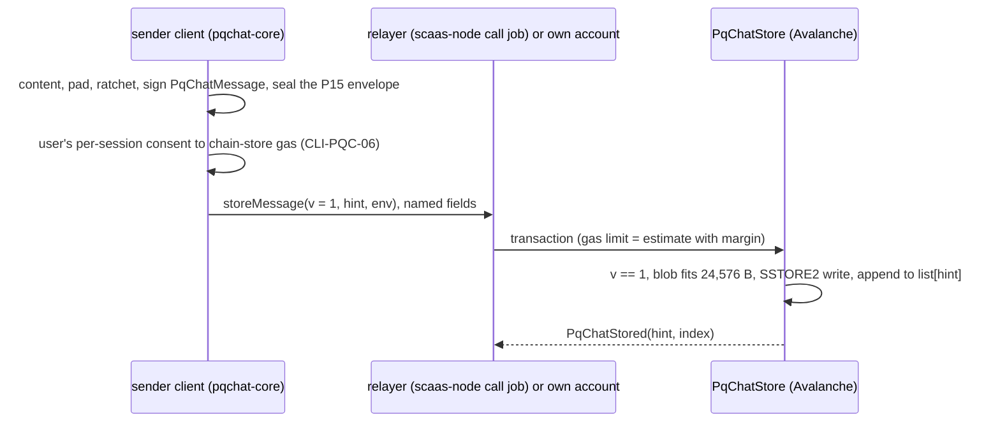

# Avalanche and Polkadot EVMs, an Avalanche message store, and Arweave for encrypted files: design

**Status:** SPECIFIED, nothing built. UNAUDITED: every construction below is a design, not a reviewed protocol. Branch
`research-avax-dot-arweave`. Decision [ARCH-POS-19](../../decisions.md#ARCH-POS-19) (owner 2026-11-21) and its Change line (the
owner's answers Q1, Q2, Q4, Q5; the controller calls Q3, Q6, Q7, Q8); research
[`2026-11-21-avax-polkadot-arweave.md`](../../research/2026-11-21-avax-polkadot-arweave.md) (cited "note §n"); plan
[`2026-11-21-avax-polkadot-arweave.md`](../plans/2026-11-21-avax-polkadot-arweave.md). Rule ids introduced here (SPECIFIED, each
defined once in its component doc, recorded in [decisions.md](../../decisions.md)): NET-EVM-16, NET-EVM-17, NET-EVM-18,
CTR-CHAT-22, CLI-RPC-13, CLI-RPC-14, CLI-UAL-64, CLI-UAL-65, CLI-SDK-21; this spec's controller calls are
[ARCH-POS-20](../../decisions.md#ARCH-POS-20) (owner: no, the owner may override any); NET-ALL-25 is reworded (Q8). Rows marked
**follows** apply a stated rule; rows marked **proposal** are the controller's. Open points O1–O5 (§12) are for the owner; each
blocks only the tasks it names. Review before code: Fable (design, security, crypto), as for every crypto spec; Codex only on the
owner's request.

**Contents**

1. [Rulings this spec follows](#1-rulings-this-spec-follows)
2. [Controller calls](#2-controller-calls)
3. [Goal, scope, non-goals](#3-goal-scope-non-goals)
4. [Part A: the Avalanche draft profile](#4-part-a-the-avalanche-draft-profile)
5. [Part B: the Avalanche message and text store](#5-part-b-the-avalanche-message-and-text-store)
6. [Part C: Polkadot Hub, then Moonbeam](#6-part-c-polkadot-hub-then-moonbeam)
7. [Part D: Arweave for encrypted files](#7-part-d-arweave-for-encrypted-files)
8. [Part E: NET-ALL-25 reworded](#8-part-e-net-all-25-reworded)
9. [Threat model](#9-threat-model)
10. [Rule ids and where they live](#10-rule-ids-and-where-they-live)
11. [Tests and gates](#11-tests-and-gates)
12. [Open points](#12-open-points)
13. [Sources](#13-sources)

## 1. Rulings this spec follows

| # | Date | Ruling | Where |
|---|---|---|---|
| R1 | 2026-11-21 | Avalanche's EVM (C-Chain, Fuji) and Polkadot's EVMs become chain profiles under the EVM family's rules; Arweave joins as a store of ciphertext only (PqChat messages and images, files embedded in a message or a vault item); `scaas-rpc` gains the profiles and an Arweave reader and uploader under CLI-RPC-01..11; attachments join the `pqchat-core` round | [ARCH-POS-19](../../decisions.md#ARCH-POS-19) |
| R2 | 2026-11-21 | **Q1**: wait for C-Chain's Amsterdam fork; a draft Avalanche profile and its `scaas-rpc` part now; a contract within the chain's code size deploys earlier, per contract; Avalanche may serve now as a store path for messages and text, as HCS does on Hedera (a store contract within the chain's limits, in PqChat's store list) | ARCH-POS-19 Change |
| R3 | 2026-11-21 | **Q2**: Polkadot Hub first, Moonbeam second | ARCH-POS-19 Change |
| R4 | 2026-11-21 | **Q4**: UA-7's `url` gains `ar://<id>` | ARCH-POS-19 Change |
| R5 | 2026-11-21 | **Q5**: uploads paid by an operator payer (credit sharing), small items on the free tier; the client never holds operator credentials; the payer link between uploads is a stated metadata cost | ARCH-POS-19 Change |
| R6 | 2026-11-21 | `pqchat-core` O9 (b): the file sealed under a fresh key by an SDK call, the ciphertext on Arweave (`ar://<id>`), `ctSha256` checked before opening, size padded; `pqchat-core` plan T10b, after this work | CLI-PQC-02 on branch `pqchat-core-build` |
| R7 | 2026-11-21 | Controller calls of ARCH-POS-19 (owner: no): **Q3** the software BLS12-381 path is built and measured, no kind disabled; **Q6** size buckets in powers of two; **Q7** Turbo probed with both ed25519 signature types before one is chosen; **Q8** NET-ALL-25 reworded to the `(chainId, chain_uid)` pair | ARCH-POS-19 Change |

Standing rules applied: [NET-EVM-06](../../networks/evm.md#NET-EVM-06) (Glamsterdam before a public chain is deployed; every
profile compiles for `amsterdam`), the deploy condition per contract (owner 2026-11-09), NET-ALL-22 (a chain is
`(chainId, chain_uid)`), ARCH-POS-13 (never a decryption oracle), ARCH-POS-15 and CLI-RPC-02..11 (lists, failover, strict majority,
bounds, logs), ARCH-POS-18 (maximal support), CTR-CHAT-05 and CTR-CHAT-13 (PqChat's records and stored payloads in state),
CTR-CHAT-19 (every write relayable, fee 0 too), CLI-SDK-20 (key handles only, app-core label prefixes) and CLI-SDK-30's app root key,
explicit parameters, bounded decode, one rule on every chain, no assumption about a chain, no EIP-7702, no built binaries.

## 2. Controller calls

Recorded as [ARCH-POS-20](../../decisions.md#ARCH-POS-20) (owner: no). Each names where it is applied.

| Id | Call | Why | Applied in |
|---|---|---|---|
| C1 | A new standalone contract `PqChatStore` serves the Avalanche store path; `PqChat` is not reused | `PqChat` is 29,111 B and its clone needs `OpenFactory` (34,999 B), both above Avalanche's 24,576 B; no split store exists (3C-D2 kept `storeMessage` in `PqChat`) | §5.1, CTR-CHAT-22 |
| C2 | Its payloads stay in contract state (SSTORE2), never only in events | CTR-CHAT-05 binds every PqChat store; recovery from state (CTR-CHAT-14, CLI-PQC-09) and one reader path for every chain store; cost ≈ 7–8 × an event-only store (§5.2) | §5.2, CTR-CHAT-22 |
| C3 | Its blob limit is the constant 24,576 B (EIP-170), not a chain value | One bytecode and one address on every chain; the largest envelope (24,416 B) holds the 16,384-B bucket with every signer | §5.3, CTR-CHAT-22 |
| C4 | The store-list entry `{"kind": "chainstore", "chainId", "chainUid", "contract"}`; a client trusts the contract by its runtime code hash pinned in release data, after the chain pair check | No factory lists it; C-Chain and Fuji share `chain_uid` | §5.5, UA-7 §4.2 |
| C5 | Before a chain's Amsterdam fork a contract deploys only when its `amsterdam` build fits the chain's code and gas caps, holds no opcode the chain lacks, and passes its tests on `anvil` at the chain's fork | Owner Q1 "per contract" made concrete without a second compile target (NET-EVM-06 unchanged) | §4.5, NET-EVM-18 |
| C6 | Avalanche lanes and readers: `tag finalized`; logs read at or below `finalized`; no receipt yet is `Pending`; the gas limit is the estimate with the lane's margin, never a fixed padding; at most 16 transactions in flight per key | The chain's facts after Helicon (note §2.3, §2.4) | §4.3, §4.4, NET-EVM-16 |
| C7 | Polkadot Hub is `enabled` only after its probes (block 0 hash, EIP-1898, `latest` reorgs, finality delay) and the weight measurement; its gas cap is a profile value from that measurement; the storage deposit is part of the fee | CLI-RPC-03 and CLI-RPC-05 compare hashes and pin blocks by hash; Hub's gas has no Ethereum figure | §6, NET-EVM-17 |
| C8 | The Arweave upload key is derived per file: `HKDF-SHA-256(ikm = the app root key, salt = empty, info = "scaas/arweave/v1/upload" ‖ type ‖ ctSha256, L = 32)`, used for ed25519 (default) or secp256k1; never a UA or wallet key | Rotation at its finest: no two files share an owner key; deterministic, so a crash re-signs the same id; vectors pin it | §7.3, CLI-UAL-64 |
| C9 | A data item has no target, no anchor and no tags (one fixed `Content-Type: application/octet-stream` tag only if the Q7 probe shows one is needed) | Every public field is the same on every item | §7.2, CLI-UAL-64 |
| C10 | The object at `ar://<id>` is `ct ‖ 0x00…` up to its bucket; `ctSha256` stays SHA-256 of `ct` (UA-7 unchanged); buckets 2^16 to 2^31 B | Q6 made concrete; padding outside the AEAD changes no UA-7 byte | §7.4, CLI-UAL-65 |
| C11 | An upload posts the same signed bytes to the bundler list; the client keeps them until the item is seen settled and re-posts the same bytes, never re-signed and never a new key | CLI-RPC-08's send rule; Turbo's receipt is not a promise of retrieval | §7.8, §7.11, CLI-RPC-14 |
| C12 | Every Arweave read of an attachment is a read that feeds a decryption (CLI-RPC-06); its bound is the bucket; a gateway whose bytes fail the caller's check is that gateway's failure | ARCH-POS-15 applied to gateways; the check is cheap here | §7.7, CLI-RPC-13 |
| C13 | The free tier is used only for objects in the 2^16-B bucket; anything larger, or a free-tier refusal, goes to the operator payer | A 2^16-B object plus its header (≤ 150 B) is under Turbo's 107,520-B free limit; the next bucket is not | §7.9, CLI-SDK-21 |
| C14 | PqVault `file` items use the same calls, with PqVault's app root key | One upload path | §7.10 |

## 3. Goal, scope, non-goals

**Goal.** Customers on Avalanche and Polkadot get draft chain profiles that become deployable per contract as the chains allow;
PqChat gets a store path on Avalanche now; PqChat attachments and PqVault files get a permanent ciphertext store on Arweave, uploaded
and read by every client the same way.

**In scope.** Parts A–E below; the rule texts of §10; vectors for ANS-104 data items, buckets, upload keys and `ar://` URLs.

**Non-goals.**

- No deploy of any SCaaS contract set on Avalanche, Polkadot Hub or Moonbeam beyond `PqChatStore` (§5): each waits for its code
  cap and NET-EVM-06 (note §6.1). No second compile target, no module split for a 24,576-B chain (the owner's).
- No own Avalanche L1 or Polkadot precompile (note Q1 (c)); no `resolc` / PVM build (note Q2 (c)).
- No store path on Polkadot Hub or Moonbeam in this spec: `PqChatStore` is the same contract and a later profile may list it.
- No Arweave message store kind (O4): messages reach Arweave only as `file` attachments.
- No native Arweave RSA-PSS wallet, no AR payment, no Irys route (it no longer reaches Arweave, note §4.2).
- No operator payer service built until O1 and O2 are answered; the payer field is plumbed, the service is not.
- No change to `PqChat`, its typed records, typehashes or gas pins; no change to UA-7's signed bytes other than the `url` scheme
  and the `chainstore` store-list entry.
- No calls, HCS, Waku or libp2p in `pqchat-core` (CLI-PQC-02 unchanged).

## 4. Part A: the Avalanche draft profile

### 4.1 Facts (note §2)

| | C-Chain | Fuji |
|---|---|---|
| Chain id, key | 43114, `avalanche-mainnet` | 43113, `avalanche-testnet` |
| `chain_uid` | `0x31ced5b9…a96b`, **shared** (`chain-uids.json` rows exist) | same |
| EVM level | Cancun (`libevm` v1.13.14), P-256 at `0x100`; no Prague, Osaka or Amsterdam | same |
| Code caps | runtime 24,576 B, init 49,152 B, no option | same |
| Block cap | Σ gas limits ≤ 20 T: 80 M live | 32 M live |
| Charge | `max(gasUsed, gasLimit / 2)` (ACP-194) | same |
| Finality | `finalized` = `safe` = last settled block, ≈ 5 s behind `latest`; no reorg after acceptance | same |
| Deterministic deployer | `0x4e59b44847b379578588920cA78FbF26c0B4956C` present | present |

### 4.2 The profile (NET-EVM-16, **follows** R2)

`avalanche-mainnet` and `avalanche-testnet` are seeded `draft`: `src/chains/<key>/README.md` states the facts above as
`base-testnet`'s does; the `chain-uids.json` rows stay; the node's example configuration carries a commented row with
`finality.mode = "tag"`; the SDK's pinned profile data gains both. `enabled` follows the operator gate of every public profile
(finality p99 over 7 days, an RPC quorum of at least 2, a passing deployment). No SCaaS contract set deploys before C-Chain has the
Amsterdam fork and EIP-7954 (NET-EVM-06); a single contract may deploy earlier under NET-EVM-18 (§4.5). Watch: the ACP list and
`libevm` releases for Prague and later.

### 4.3 The `scaas-rpc` part (**follows** CLI-RPC-03, CLI-RPC-05, CLI-RPC-09)

Configuration only; `EvmPool::connect(list, chain_id, chain_uid)` is chain-neutral. Tests make three facts explicit:

1. **Identity on a shared genesis.** An endpoint answering `eth_chainId` 43113 with C-Chain's block 0 hash is dropped from a
   43114 list, and the reverse (CLI-RPC-03 compares both; NET-ALL-25 as reworded).
2. **Final reads.** `finalized` is `BlockNumberOrTag::Finalized`; a pinned read names the settled block's hash (EIP-1898). Avalanche's
   header extra fields do not matter: the crate takes the hash the RPC reports.
3. **Logs.** `eth_getLogs` returns nothing for a block not yet executed, so a log read above the final block is not evidence of
   absence: the node's indexer reads logs only at or below its final block (it does under `tag`), and a `scaas-rpc` caller that asks
   above `finalized` gets the answer labelled as not final.

`eth_getProof` and filters are not used. A header's `gasUsed` is the sum of gas limits: the crate reads real gas from receipts.

### 4.4 Node lanes and the indexer (C6)

- A transaction is accepted before it executes; until its receipt exists it is `Pending`, never `dead` (the standing rule; a test
  with a mock chain that delays receipts after acceptance).
- The gas limit is the lane's estimate with its usual margin; a fixed high limit pays at least half of it (ACP-194). The fee cap read
  from `baseFeePerGas` / `eth_baseFee` is an upper bound, not the price paid.
- The pool keeps 16 executable transactions per account: a lane key keeps at most 16 in flight on this profile.
- Acceptance checks balance ≥ gas limit × worst-case price + value: the lane's balance alert uses that figure.
- The per-transaction ceiling is the live block cap (sum of gas limits); the deploy gate reads it, never a constant.

### 4.5 Deploying before the chain's Amsterdam fork (NET-EVM-18, C5)

A contract deploys on a chain without Amsterdam only when all hold, checked by the deploy script before it sends:

1. its runtime and init code (the `amsterdam` build, NET-EVM-06 unchanged) are within the chain's caps;
2. its deploy transaction is within the chain's live block or transaction cap at the chain's own pricing;
3. a linear disassembly of its runtime and init code finds no opcode the chain's fork lacks (for Cancun: none of Osaka's `CLZ` or
   any opcode Amsterdam adds);
4. its test suite passes against `anvil --hardfork <the chain's fork>` with the deployed `amsterdam` bytecode (gas figures at that
   fork recorded, never compared with the Amsterdam pins).

If (3) fails for a contract, it waits: a per-contract build for an older fork changes NET-EVM-06 and is the owner's (plan stop
condition). Today only `PqChatStore` qualifies.

### 4.6 Precompiles and software paths (ARCH-POS-18)

P-256 at `0x100` serves passkeys natively. No EIP-2537: Zether runs the software BLS12-381 path (Q3: built and measured under the
`bls12381-multi` spec's software path; numbers to the owner if a transfer does not fit; no kind disabled). No PQ precompile: PQZ
tokens run `OFFCHAIN` (CTR-PQZ-27), UA PQ kinds use the Solidity verifiers. None of this deploys before the code cap rises.

## 5. Part B: the Avalanche message and text store

### 5.1 Why a new contract (C1)

The size baseline (`smartcontracts/evm/size-baseline.json`) settles it: `PqChat` is 29,111 B and a `PqChat` instance is a clone made
by `OpenFactory` (34,999 B) with a factory-appended `ChainEnv`; both are above 24,576 B. There is no split store to reuse:
`storeMessage` lives in `PqChat` (3C-D2), and the release's only module, `PqChatTopics` (16,449 B), holds topics, not the store. So
the store path is a new contract, `PqChatStore`, with exactly the store part of `PqChat`'s ABI (CTR-CHAT-13), so a client reads it
with the code it uses for a `chain` store.

### 5.2 Ciphertext only, and where it is kept (C2)

The HCS analogue (UA-7 P26) keeps messages on mirror nodes only, outside consensus state, and the repository's never-lose-ciphertext
rule names PQZ and Zether. PqChat's own rule is stricter and binds every PqChat store: CTR-CHAT-05 keeps "a stored `env`" in state,
"never only a hash with the bytes in calldata or an event". The choice is **state**: each payload is one SSTORE2 blob, as
`PqChat.storeMessage` keeps it. Reasons: CTR-CHAT-05 as stated; recovery from contract state alone (CTR-CHAT-14, CLI-PQC-09), which
an event store would break; reads by `eth_call` on any node, while logs need an index that pruned and public RPCs bound or drop; one
reader for `chain` and `chainstore`.

**Cost of the choice** ([E], Cancun pricing, derived from opcode costs, to be measured in plan T8):

| Envelope (signer) | State (SSTORE2) | Event only | Ratio |
|---|---:|---:|---:|
| 2,400 B (a 1,024-B bucket, FN-DSA-512) | ≈ 0.64 M gas | ≈ 0.08 M | ≈ 8 × |
| 5,100 B (a 1,024-B bucket, ML-DSA-65) | ≈ 1.22 M gas | ≈ 0.15 M | ≈ 8 × |
| 24,416 B (the largest) | ≈ 5.4 M gas | ≈ 0.6 M | ≈ 9 × |

The state figure is dominated by the code deposit (200 gas per byte, 32,000 per `CREATE`), then calldata (16 per byte); the
list slot and the count add ≈ 27,000–44,000. At C-Chain's live `baseFeePerGas` of 7.5 gwei, an upper bound since Helicon, the
5,100-B row costs at most ≈ 0.009 AVAX; the price actually paid is lower and is measured. For comparison, the same row on an
Amsterdam chain is 0.35 M regular + 8.31 M state gas (pqchat.md §12).

### 5.3 The contract (CTR-CHAT-22)

```solidity
// SPDX-License-Identifier: LicenseRef-Vegan-Community-1.0
interface IPqChatStore {
    event PqChatStored(bytes8 indexed hint, uint256 index);   // the same event as IPqChat's
    error PqChatShape();                                        // the same error
    function storeMessage(uint8 v, bytes8 hint, bytes calldata env) external returns (uint256 index);
    function storedCount(bytes8 hint) external view returns (uint256);
    function storedAt(bytes8 hint, uint256 index) external view returns (bytes memory);
    function storedRange(bytes8 hint, uint256 offset, uint256 limit) external view returns (bytes[] memory);
}
```

- **Behaviour = CTR-CHAT-13's.** `storeMessage` by anyone, unsigned; only `v == 1` and that `abi.encode(v, hint, env)` plus the
  leading `STOP` fits one blob of at most **24,576 B** (C3; so `env` ≤ 24,416 B), else `PqChatShape`; appends the payload to the
  list of `hint`; emits `PqChatStored(hint, index)`. `storedRange` clamps to `STORED_RANGE_MAX = 16`; an offset past the end is an
  empty page, never a revert.
- **Nothing else.** No constructor argument, no owner, no admin, no pause, no upgrade, no registry, no `chainUid` (it checks no
  signature and binds no digest, so NET-ALL-22's `chainUid()` does not apply), no fee, no `msg.sender` read. ERC-165 for
  `IPqChatStore`. Storage in the ERC-7201 namespace `scaas.pqchatstore`, layout pinned.
- **Selectors and topic equal `IPqChat`'s** for the four functions, the event and the error (a test), so the reader is one.
- **Size.** Runtime ≤ 24,576 B asserted in a test and by the size gate ([E] a few KiB).
- **Deployment.** Through the deterministic deployer `0x4e59…956c` with salt `0`, the `amsterdam` build under NET-EVM-18, so the
  address is the same on every chain; the deploy script refuses when the deployed code hash differs from the release data's.
  Verified on the chain's explorer after every deploy. A deploy to Fuji or C-Chain is the owner's word (plan).

### 5.4 Writing



The client sends the same envelope it sends to every other listed store (UA-7 P27). The 1,024-B rule of UA-7 §6.5 applies as for
`postMessage`. `receipt` is off by default while a chain store is listed (CLI-PQC-06); `typing` never goes to a chain store.
**Relay** (CTR-CHAT-19): the write is unsigned, so the node relays it only when paid through `RelayFeeRouter` or under the operator's
lane policy, never for unsigned spam by default; the node's call-table row checks the target's runtime code hash against the release
data, as it checks a `PqChat` instance by the factory (plan T9; the rule goes in `docs/node/job-api.md` when built). A client whose
write finds no relayer sends it from its own account (AVAX).

### 5.5 Listing and reading (C4)

The session's `sealedInfo` lists the store as `{"kind": "chainstore", "chainId": <decimal u64>, "chainUid": <bytes32 hex>,
"contract": <address>}` (UA-7 §4.2, P27). Entries are distinct by `(chainId, chainUid, contract)`. `chainId` is required because
C-Chain and Fuji share `chainUid`. It counts as a message store. A client that does not implement the kind refuses to send
(`StoreUnsupported`, CLI-PQC-06) and stays readable from the stores it implements. The entry adds about 175 B of canonical JSON
to `sealedInfo`, which may move it to the next padding bucket (UA-7 §6.5); nothing else in the session changes.

```mermaid
sequenceDiagram
  participant B as member client
  participant R as scaas-rpc (list, trusted read)
  participant S as PqChatStore
  participant H as home chain PqChat and the UA registry
  B->>R: chain pair check (eth_chainId, block 0 hash) against chainstore entry
  B->>R: eth_getCode(contract) at final block
  R-->>B: code; keccak256 equals the pinned PqChatStore hash, else the store is refused
  B->>R: storedCount(hint), storedRange(hint, offset, 16) at finalized, marked feeds-decryption
  R-->>B: payloads (each at most 24,576 B, a page at most 16)
  B->>B: decode (v, hint, env), open the envelope
  B->>H: author's UA key, epoch membership by the home's order (trusted reads)
  B->>B: verify the portable signature, nonce scope and counter, dedupe by messageId; drop silently on any failure
```

The reader's checks are those of HCS and `storeMessage` (UA-7 P25, P29): nothing on Avalanche vouches for a payload; the registry and
the home `PqChat` are on another chain. A payload under a superseded epoch from a UA absent in the child is marked or dropped (UA-7
P29's limit). Reads that feed a decryption go through `scaas-rpc` under CLI-RPC-06; the user is told that the store is public
and permanent, and that a Fuji store is a test store whose data can be lost (UA-7 P27).

## 6. Part C: Polkadot Hub, then Moonbeam

### 6.1 Profiles (NET-EVM-17, **follows** R3)

| Key | Chain id | RPC (public) | Finality |
|---|---|---|---|
| `polkadot-hub-mainnet` | 420420419 | `https://eth-rpc.polkadot.io/` | `tag finalized` (GRANDPA) |
| `polkadot-hub-testnet` (Paseo) | 420420417 | `https://eth-rpc-testnet.polkadot.io/` | same |
| `polkadot-hub-westend` | 420420421 | `https://westend-asset-hub-eth-rpc.polkadot.io` | same |
| `moonbeam-mainnet` (second) | 1284 | public providers | `tag finalized` (relay-finalized; `safe` = `finalized`) |
| `moonbeam-testnet` (Moonbase Alpha, second) | 1287 | public providers | same |

Seeded `draft` with `chain-uids.json` rows read from two sources each (plan), and `src/chains/<key>/README.md`. Hub runs unmodified
solc bytecode on REVM with a hard 24,576-B runtime cap, so nothing but `PqChatStore`-sized contracts deploys before Hub raises its
cap; no SCaaS set deploys before NET-EVM-06 holds there. Native Polkadot accounts are not needed: `eth-rpc` takes secp256k1 Ethereum
transactions.

### 6.2 Probes before `enabled` (C7)

Public reads, no spend:

| Probe | Pass | Why |
|---|---|---|
| H1 block 0 hash | `eth_getBlockByNumber("0x0").hash` equal on two independent `eth-rpc` instances, unchanged over 7 days | CLI-RPC-03 pins `chain_uid` to it |
| H2 EIP-1898 | `eth_call`, `eth_getStorageAt`, `eth_getCode`, `eth_getBalance`, `eth_getTransactionCount` answer with `{blockHash, requireCanonical: true}` for a canonical hash and refuse a made-up one | CLI-RPC-05 pins every agreed read by hash |
| H3 `latest` reorgs | `latest` sampled every block for 24 h, compared later with the canonical chain; replaced heads counted | Displays of pending state; the finality mode is `tag finalized` either way |
| H4 hash lookup | a block asked by an Ethereum hash returns that hash or an error, never another block (`eth-rpc` maps Ethereum and Substrate hashes) | A pinned read must not read another block |
| H5 finality delay | p99 of `latest` − `finalized` over 7 days | the operator gate |
| H6 logs | `eth_getLogs` range limits; no filter methods needed | the indexer's spans |

A probe that fails stops `enabled` and goes to the owner (plan stop condition): CLI-RPC-03 or CLI-RPC-05 cannot hold on that chain.

### 6.3 Weight-to-gas measurement (C7)

Hub folds `ref_time`, `proof_size` and the storage deposit into one gas figure (`gas = fee in wei ÷ base fee`); `evm_block_gas_limit`
is `u64::MAX`, and a transaction is capped at 50 % of the maximum extrinsic weight, which has no Ethereum figure. So every
SCaaS line priced in Ethereum gas (the 60 M deploy line, a 23 M PQZ op, a 5.8 M ML-DSA-65 verify) is measured again. On Paseo (owner's
word), a test-only `GasProbe` contract (≤ 24,576 B) and `PqChatStore` are deployed and each probe records `eth_estimateGas`, the
receipt's `gasUsed`, the effective price, the fee in PAS, the extrinsic's `ref_time` and `proof_size` (Substrate events) and the
deposit reserved:

| Probe | Varies | Learns |
|---|---|---|
| value transfer | — | the base |
| `keccak256` loop | 10^3, 10^4, 10^5 rounds | compute: Hub gas per Ethereum gas |
| new storage slots | 1, 16, 128 | the deposit per item and per byte, the weight per write |
| SSTORE2 blob | 1 KiB, 8 KiB, 24 KiB | code deposit per byte |
| `storeMessage` | 2,400 B, 5,100 B | the store path's real cost |
| the largest compute that fits | binary search on the loop | the per-transaction ceiling in Ethereum-equivalent gas |

Result: a table in `smartcontracts/evm/runs/`, a profile value `max_tx_gas` (Hub gas units) that `scaas-rpc` and the node use as the
fee and gas cap of CLI-RPC-05 for Hub, and the per-op verdict "fits / does not fit" for the 60 M lines. An op that does not fit goes to
the owner with numbers (ARCH-POS-18); nothing is disabled here.

### 6.4 The storage deposit

The caller pays a deposit per item and per byte (Hub: `DepositPerItem` 0.2 DOT, `DepositPerByte` 0.00001 DOT, child-trie items
0.002 DOT; [E] ≈ 0.00264 DOT per new 32-byte slot), refunded only when the storage is cleared. PqChat, PqVault and `PqChatStore` clear
nothing, so on Hub the deposit is a fee, part of the gas figure the adapter reports. For a relayed write the lane pays it: the node's
fee quote is the gas figure, which includes it; the lane's balance alert adds the existential deposit (0.01 DOT). Measured, not
assumed (§6.3).

### 6.5 Moonbeam (second)

After Hub's probes and measurement: H2, H4, H6 on Moonbeam's RPC; the Frontier configuration live on Moonbeam (code cap, EIP-7702,
`CLZ`) confirmed by reads and a Moonbase deploy of `PqChatStore` (owner's word). Moonbeam has EIP-2537 at `0x0b`–`0x11` (Zether's
hardware path) and P-256 at `0x100`, 52 M gas per transaction, 60 M per block, and storage-growth gas of 366 per byte with 160 KiB per
block: a 24-KiB blob costs ≈ 9 M storage gas, an effective gas of `max(legacy, PoV, storage)`. Its gas is Ethereum gas, so its lines
are checked, not re-measured from scratch.

## 7. Part D: Arweave for encrypted files

### 7.1 The flow

```mermaid
sequenceDiagram
  participant A as app core (pqchat-core / pqvault-core)
  participant K as scaas-sdk
  participant U as ua-rs
  participant R as scaas-rpc
  participant B as bundlers (list)
  participant G as gateways (list)
  A->>K: seal_file(file) (O9 (b), sdk-complete)
  K->>U: fresh file key (handle), ct = AES-256-GCM(key, 0^96, file)
  K-->>A: ct, ctSha256, key as Plaintext content (PqVault: keyWrap under kFile)
  A->>K: upload_file(ct, ctSha256) on the user's send
  K->>U: pad to the bucket; derive the upload key; build and sign the ANS-104 item
  U-->>K: item bytes, id = base64url(SHA-256(signature))
  K->>R: upload(item, paid_by) (no key in scaas-rpc)
  R->>B: POST /tx, the same bytes to one or more
  B-->>R: receipt; its id equals the local id, else not accepted
  K-->>A: url = ar://id
  A->>A: the file content {url, ctSha256, sha256, size, key}; the message or item goes out as today
  A->>K: fetch_file(url, size, ctSha256) on the user's action
  K->>R: data(id, bound = bucket, feeds decryption, check)
  R->>G: GET /raw/id, failover (or strict majority)
  G-->>R: bytes
  R-->>K: bytes that passed the check
  K->>U: open_file(ct prefix, key) only after length, zero tail and ctSha256 hold
```

### 7.2 ANS-104 data items in `ua-rs` (CLI-UAL-64)

`ua-rs` builds, signs and parses ANS-104 data items **as `arbundles` builds them** (note §4.1), not as the ANS-104 text reads:

- Layout: signature type (2 B, little-endian, confirmed by the Q7 probe), signature, owner, target presence byte + 32 B, anchor
  presence byte + 32 B, tag count (8 B), tag bytes length (8 B), tags (Avro array of `{name: bytes, value: bytes}`), data. A
  presence byte other than 0 or 1 is refused; tags ≤ 128, name ≤ 1,024 B, value ≤ 3,072 B, both non-empty, ≤ 4,096 tag bytes in total;
  an item is at least 80 B. The parser refuses a negative Avro block count and trailing tag bytes (stricter than `arbundles`'s reader).
- Signed message: the 48-byte deep hash of `["dataitem", "1", <signature type as decimal text>, owner, target, anchor, <raw Avro tag
  bytes>, data]`; an absent target or anchor is an empty blob; an empty tag list is 0 bytes. Deep hash (SHA-384): a blob →
  `SHA384(SHA384("blob" ‖ decimal length) ‖ SHA384(data))`; a list → `acc = SHA384("list" ‖ decimal count)`, then
  `acc = SHA384(acc ‖ deepHash(item))` per item.
- Types: **2** (ed25519: raw signature over the 48 bytes, owner the 32-byte key) or **4** (the same bytes, the type Turbo documents)
  as the Q7 probe decides, default ed25519; **3** (secp256k1: EIP-191 `personal_sign` over the 48 bytes, prefix
  `"\x19Ethereum Signed Message:\n48"`, signature `r ‖ s ‖ v` 65 B, owner the uncompressed 65-byte key) built and tested for a
  bundler that takes only EVM signers. No type 1 (RSA-PSS), no other type.
- id = base64url, no padding, of SHA-256 of the signature: 43 characters.
- Items per C9: no target, no anchor, no tags. Header sizes: 116 B (types 2 and 4), 150 B (type 3).
- The signature is verified inside `ua-rs` before the item is returned.

### 7.3 The upload key (C8)

Never a UA key, a wallet key or a key that holds funds. Per file:

```text
seed = HKDF-SHA-256(ikm = app root key (CLI-SDK-30, per appId and UA), salt = empty,
                    info = "scaas/arweave/v1/upload" ‖ type (1 B: 2, 3 or 4) ‖ ctSha256 (32 B), L = 32)
ed25519: the 32 bytes are the private seed (RFC 8032)
secp256k1: the 32 bytes as a big-endian scalar; 0 or ≥ n: info gains a counter byte 0x01, 0x02, … until valid
```

The key lives in `ua-rs` behind a handle of a new single usage, `UploadSign` (CLI-SDK-20's usages gain it), which signs only a deep
hash `ua-rs` computed over an item it built itself: no caller digest, no other message. The label prefix `scaas/arweave/` is the SDK's;
an app core may not declare a prefix that overlaps it (CLI-SDK-20). Two files never share an owner key, so the owner key links no two
uploads; the same file re-signed after a crash gives the same item and id (ed25519 and RFC 6979 are deterministic). Clientkeys
vectors pin the derivation from the existing app-root-key rows.

### 7.4 The object and its bucket (C10, Q6)

`ct` = UA-7's `AES-256-GCM(key, 0^96, file)`, length `size + 16`. The object at `ar://<id>` is `ct` followed by zero bytes up to

```text
bucket(size) = max(2^16, 2^⌈log2(size + 16)⌉), refused above 2^31 (FileTooLarge)
```

`ctSha256` stays SHA-256 of `ct` (UA-7 §6.4.1 unchanged), so a file kept in Matrix and on Arweave carries one hash. Padding outside the
AEAD changes no UA-7 byte; it hides the size to a power of two. The reader refuses before any decryption unless: the object's length
equals `bucket(size)`, every byte after `size + 16` is zero, and SHA-256 of the first `size + 16` bytes equals `ctSha256`. A 2^16-B
object plus a 150-B header is under Turbo's free limit of 107,520 B; the next bucket is not. Cost [E] at Turbo's USD 46.19 per GiB:
2^20 B ≈ $0.045, 2^24 B ≈ $0.72, 2^31 B ≈ $92. Padding costs at most 2 ×. The largest bucket posted in one request is a profile value the
Turbo probe sets; above it Turbo's chunked upload is PLANNED and `upload_file` refuses (`FileTooLarge`).

### 7.5 UA-7's `url` gains `ar://` (CLI-UAL-65, **follows** R4)

UA-7 §6.4.1 `file.url`: 1–2,048 B, `https://`, `ipfs://` or `ar://<id>`, `<id>` exactly 43 characters of canonical base64url (no
padding, the last character one of `AEIMQUYcgkosw048`, since 32 bytes leave 2 bits zero); anything else after the id is refused. A
`url` of the `ar://` form names the padded object of §7.4. PqVault's `file` item carries the same fields (`url`, with `keyWrap` in
place of `key`), so it accepts `ar://` by the same rule. **Vectors:** new rows in `smartcontracts/vectors/pqchat/` (a `file` content with
an `ar://` URL; refusals: 42 and 44 characters, `+` or `/`, `=` padding, a non-canonical last character, a trailing path, an
upper-case scheme), written by clientkeys first and read by every client that reads that directory today (clientkeys, `ua-rs`) and
by each `ua-*` when it implements PqChat (UA-7 plan T11–T20). The other changes of this part get their own files:
`smartcontracts/vectors/arweave/` (data items, deep hashes, ids, upload keys, buckets, padded objects).

### 7.6 The SDK calls (CLI-SDK-21)

On top of `seal_file` / `open_file` (O9 (b), being built on branch `sdk-complete`):

- `upload_file(app, ct, ct_sha256) -> FileRef { url, size_bucket }`: pads (`ua-rs`), derives the upload key and signs (`ua-rs`), posts
  through `scaas-rpc` (CLI-RPC-14) to the release's bundler list. Payer by C13: the 2^16-B bucket goes on the free tier; a larger bucket,
  or a free-tier refusal, carries `x-paid-by` with the operator payer's address once O1/O2 are settled (until then `PayerUnavailable`).
  The client never holds an operator credential (R5). It runs only on the user's send; the signed bytes are kept in the app core's
  store until settlement is seen (§7.11).
- `fetch_file(app, url, size, ct_sha256) -> Ciphertext`: refuses a malformed `url` before any request; reads through `scaas-rpc`
  (CLI-RPC-13) with the bound `bucket(size)`, marked feeds-decryption, the §7.4 check as the gateway's acceptance check; returns the
  `ct` prefix for `open_file`. A failure is `FileHashMismatch` (or the read's error), shown on the device only; nothing the client sends
  depends on it (ARCH-POS-13). Fetched only on the user's action, or automatically for the 2^16-B bucket if the app allows it.
- Configuration: the gateway and bundler lists (CLI-RPC-02 shape) are the release's pinned data; `named` entries from the operator
  or holder.

### 7.7 `scaas-rpc`: the gateway reader (CLI-RPC-13, C12)

A module `arweave` (feature `arweave`), under CLI-RPC-01..11:

- **Lists** (CLI-RPC-02): gateways `{url, class, label, auth}`, `default` = the release's reviewed list (`arweave.net` and well-staked
  ar.io gateways), `named` = the operator's or holder's, `discovered` = passed by the caller (from the Gateway Address Registry); the
  crate discovers nothing and follows no redirect.
- **Identity** (CLI-RPC-03): a gateway answers `GET /info` with the configured `network` (`arweave.N.1`), else it is dropped for the
  process.
- **`data(id, max_bytes, purpose, check)`** = `GET /raw/{id}`: `id` checked as 43 canonical base64url characters before any request;
  an announced length above `max_bytes` refused unread, reading stops at `max_bytes`; a body that fails the caller's `check` is that
  gateway's failure (`EndpointAnswerRefused`), so failover moves on. **Failover** by default: one gateway answers the whole read.
  **Strict majority**: ⌊n/2⌋ + 1 gateways return bytes with the same SHA-256, which also pass `check`; there is no block, the id
  fixes the content. **Purpose** (CLI-RPC-06): every attachment read is `FeedsDecryption`: discovered gateways are skipped under
  failover, and need `n ≥ 3` and a named or default member under agreement.
- **`status(id)`**: GraphQL `transactions(ids: [id])` for its bundle and block; the answer capped at 64 KiB, depth 64; "settled" means a
  block height is shown, under the list's policy.
- **Logs** (CLI-RPC-11): ids and sizes only; never bytes, URLs or credentials. Compiles for wasm32.

### 7.8 `scaas-rpc`: the bundler uploader (CLI-RPC-14, C11)

- **`upload(item, paid_by) -> Merged`**: parses the item's header within bounds (types 2, 3, 4 only), computes the id locally, posts the
  same bytes (`POST /tx`, `application/octet-stream`) to the first or to every bundler of the list (`default` = Turbo's
  `upload.ardrive.io`). A receipt whose `id` differs counts as not accepting. Per bundler: `accepted` (receipt kept, capped), `refused`
  (reason kept; HTTP 402 reported as `PaymentRequired`) or `unreachable`; merged `Sent` / `Rejected` as CLI-RPC-08; never final.
- No key, no signing, no payment in the crate. `paid_by` is the caller's field, sent as `x-paid-by` as given, to that bundler only.
- The body cap is the largest single-request bucket plus 1,024 B.

### 7.9 Who pays, and what it costs in metadata (R5, C13)

- **Free tier**: objects in the 2^16-B bucket (Turbo: ≤ 107,520 B per item, 10 MiB per IP for life). Metadata: the bundler sees the IP
  and counts it.
- **Operator payer**: the operator's payer address approves credits to the per-file upload key (`shareCredits`: recipient address,
  amount, expiry); the upload carries `x-paid-by`. Metadata, stated: the approval and the receipt's `payer` link every funded upload key
  to the operator's payer address, publicly; the operator learns which requester asked for which upload key (its IP, and its UA if O2 (b)
  is chosen); the payer names a service, not a person, as long as one payer serves many users. A per-user payer is not offered: it would
  link all of a user's uploads.
- Where the payer runs and how a request is authorised: O1, O2.

### 7.10 PqVault `file` items (C14)

PqVault's `file` item (UA-7 `file` fields with `keyWrap` under `kFile`, branch `pqvault-v`) points to Arweave by `url = ar://<id>`:
`pqvault-core` calls the SDK's `seal_file` (the key then sealed under `kFile`), `upload_file` and `fetch_file` with PqVault's app root key.
Files go off chain, fetched only on the user's action (CLI-PQV-05). Small attachments still live inline in the 16 KiB item bucket.

### 7.11 Settlement and re-posting (C11)

A Turbo receipt is acceptance, not retrieval. The app core keeps the signed item until `status(id)` shows it in a block; while it does
not after 24 h, the SDK re-posts the **same bytes** (same id) to the bundler list; it never re-signs with another key and never changes
the message already sent. A message names the `ar://` id before settlement: a reader that cannot fetch yet sees the file as pending.

## 8. Part E: NET-ALL-25 reworded

Old: "A chain we run that forks becomes a new chain, and no two chain profiles share a genesis hash." That is false for public chains
already listed (`avalanche-mainnet` and `avalanche-testnet` share `0x31ced5b9…a96b`; Ethereum and ETC share theirs), while
`chain-uids.json`, NET-ALL-22 and NET-EVM-13 already key on `(chainId, chain_uid)`. New (Q8, applied in
[networks/README.md](../../networks/README.md#NET-ALL-25)):

> A chain we run that forks becomes a new chain, and no two chain profiles share the pair `(chainId, chain_uid)`. … A private chain's
> genesis hash stays unique (its `extraData` nonce), and the deploy gate and the node refuse a private chain whose genesis hash is
> already present in any profile. Public chains may share a genesis; their profiles are separated by the chain id, and the deploy
> gate and the node refuse a profile whose pair is already present. Every chain-bound SCaaS digest binds the chain id beside
> `chain_uid`; a portable record binds no chain by design.

What the code must show (plan T1): the deploy gate, the book resolver and the node's profile check accept the two Avalanche rows and
refuse a duplicate pair; a private genesis hash repeated under a new chain id is still refused.

## 9. Threat model

| Threat | Effect | Answer |
|---|---|---|
| **Arweave metadata** | Every upload is public forever: owner key, size bucket, time, receipt `payer`; the bundler sees the IP; the payer approvals link upload keys to the operator | Per-file upload keys (C8), no tags (C9), power-of-two buckets (C10), one operator payer for many users (R5); upload on the user's send, so the time links to the message's time (a stated residual); per-IP free-tier counting and the operator's request log are residuals (O2) |
| **Single vendor** | Turbo is the only bundler reaching Arweave (Irys left): it can refuse, delay, change price or the free tier, or go away | The signed bytes are kept and re-posted (C11); the bundler list takes a second route when one exists (O5); settled data is on Arweave whoever bundled it; no key or funds sit with Turbo beyond the operator's credits |
| **Bundler lies** | A receipt for another id, or a receipt for data it never settles | The id is computed locally and compared (CLI-RPC-14); settlement is read later through gateways, never taken from the receipt (§7.11) |
| **Gateway lies** | Wrong bytes, a truncated or oversized body, a false "settled", withheld data | Length, zero tail and `ctSha256` checked before decryption, and `ctSha256` is signed in the message (ARCH-POS-13: a gateway cannot make a client decrypt bytes of its choosing); bounded reads; failover past a refused body; strict majority for `status` and, optionally, data; discovered gateways never alone (CLI-RPC-06) |
| **Gateway learns readers** | A gateway sees which id an IP fetches | Fetch on the user's action (CLI-PQV-05); the reader may name its own gateway; a stated residual |
| **Avalanche store metadata** | On chain: the 8-byte hint (links an epoch's stored messages on every chain they are copied to), size, submitter, time | As CTR-CHAT-13 on every chain store; the store list itself stays in `sealedInfo` |
| **Avalanche store spam or RPC lies** | Junk payloads; an RPC hides or invents payloads | Unsigned by design: clients check every payload (UA-7 P25); trusted reads under CLI-RPC-06; other listed stores replicate |
| **Shared genesis** | An endpoint of Fuji answers for C-Chain | Chain id and block 0 hash both checked (CLI-RPC-03, NET-ALL-25); `chainstore` entries carry the chain id |
| **Hub specifics** | An Ethereum-hash lookup answers another block; block 0 hash unstable | Probes H1, H4 before `enabled` (§6.2) |
| **Upload key misuse** | The handle signs something other than an item | `UploadSign` signs only a deep hash `ua-rs` computed over an item it built; the key holds no funds and no role |
| **Payer key** | The operator's payer key is stolen | It holds Turbo credits only, never a chain key or role; bounded by its balance and per-approval amounts |

## 10. Rule ids and where they live

| Id | Rule | Normative text | Status |
|---|---|---|---|
| NET-ALL-25 | No two chain profiles share `(chainId, chain_uid)` (reworded, Q8) | [networks/README.md](../../networks/README.md#NET-ALL-25) | the pair check SPECIFIED |
| NET-EVM-16 | Avalanche C-Chain and Fuji: draft profiles and their lane and reader facts | [networks/evm.md](../../networks/evm.md#NET-EVM-16) | SPECIFIED |
| NET-EVM-17 | Polkadot Hub first, Moonbeam second: draft profiles, probes and measurement before `enabled` | [networks/evm.md](../../networks/evm.md#NET-EVM-17) | SPECIFIED |
| NET-EVM-18 | A contract deploys before a chain's Amsterdam fork only when its `amsterdam` build fits that chain | [networks/evm.md](../../networks/evm.md#NET-EVM-18) | SPECIFIED |
| CTR-CHAT-22 | `PqChatStore`: the standalone store | [contracts/pqchat.md](../../contracts/pqchat.md#CTR-CHAT-22) | SPECIFIED |
| CLI-RPC-13 | Arweave gateway reads | [clients/scaas-rpc.md](../../clients/scaas-rpc.md#CLI-RPC-13) | SPECIFIED |
| CLI-RPC-14 | Arweave bundler uploads | [clients/scaas-rpc.md](../../clients/scaas-rpc.md#CLI-RPC-14) | SPECIFIED |
| CLI-UAL-64 | ANS-104 data items and the per-file upload key in `ua-rs` | [clients/ua-libraries.md](../../clients/ua-libraries.md#CLI-UAL-64) | SPECIFIED |
| CLI-UAL-65 | The file object on Arweave: `ar://`, buckets, read checks | [clients/ua-libraries.md](../../clients/ua-libraries.md#CLI-UAL-65) | SPECIFIED |
| CLI-SDK-21 | `upload_file` / `fetch_file`, the free tier and the operator payer | [clients/scaas-sdk.md](../../clients/scaas-sdk.md#CLI-SDK-21) | SPECIFIED |
| ARCH-POS-20 | This spec's controller calls C1–C14 | [decisions.md](../../decisions.md#ARCH-POS-20) | current |

UA-7 changes applied in its spec with a Change note: §4.2 and P27 gain `chainstore`; §6.4.1's `url` gains `ar://`. The open points'
rules (O1–O5) stay here until answered.

## 11. Tests and gates

Every task in the plan writes its tests first, sees them fail for the stated reason, and keeps its mutants (one change each, each
killed by a named test). Highlights:

- **Vectors first**: clientkeys writes `smartcontracts/vectors/arweave/*.json` and the new `pqchat` rows; `ua-rs` reproduces them byte for
  byte; positive controls beside every refusal; the deep hash cross-checked against `arbundles` (pinned version) in clientkeys' tests.
- **`PqChatStore`** (forge, default set): the CTR-CHAT-13 behaviour, the boundary `env` 24,416 accepted and 24,417 refused, selectors and
  topic equal `IPqChat`'s, no constructor argument, runtime ≤ 24,576 B, layout pinned, gas pins; the Cancun check of NET-EVM-18 (opcode
  scan and an `anvil --hardfork cancun` run) with its Cancun gas figures.
- **`scaas-rpc`**: shared-genesis identity, logs above `finalized`, the Arweave module against a local mock server (identity, bounds,
  failover past a refused body, strict majority by hash, decryption mark, id mismatch, 402), wasm32 check.
- **Node**: receipts delayed after acceptance stay `Pending`; the `PqChatStore` call row and its code-hash check.
- **Gates**: per AGENTS.md: forge at the default set for the touched directories plus the set-sensitive run at the round end; the size
  gate; `cargo test` and `clippy` of each touched crate through `scripts/capped`; clientkeys tests; `docs_check` `check` and `paths`.

## 12. Open points

**O1 — Where the operator payer runs.** (a) A node service: a gateway route under the node's sponsorship policy, off by default, its
payer key holding Turbo credits only, never a chain key or contract role (the lane-key rule, NODE-GEN-01, applied to credits). (b) A
separate process beside the node, like the PQZ verifier, with its own key custody. (c) The app vendor's own server, outside SCaaS.
**Recommendation: (a)**: the owner's analogy is the relayer that pays gas; one binary, one policy engine, one gateway auth, and the
node stays open to every consumer.

**O2 — How a payer request is authorised.** (a) Anonymous: the request carries only the upload address and the bucket; budgets per IP and
per gateway credential. (b) Signed by the user's UA (a new typed record), budgets per UA. **Recommendation: (a)**: the operator then
learns IP ↔ upload key only, which Turbo learns anyway, and no new signed format is needed; (b) only if abuse shows (a) cannot hold, since it
links each UA to its upload keys at the operator.

**O3 — `chainId` in the `chain` store entry, and PqChat homes on a shared genesis.** The `chain` entry and the typed records' `homeChain`
name a chain by `chain_uid` alone; on C-Chain and Fuji the factory, and so every instance, would have the same address. (a) Add
`chainId` to the `chain` entry now (JSON in `sealedInfo`, vectors; nothing deployed) and have clients refuse a session homed on a chain
whose `chain_uid` another profile shares, until a typed-record change carries the chain id. (b) Change the typed records now (new
typehashes, contract change). (c) Nothing until PqChat can deploy on such a pair. **Recommendation: (a)**: cheap, fail-closed, and no
pinned typehash moves.

**O4 — Arweave as a message store kind.** ARCH-POS-19 (2) names messages. (a) Not now: a message larger than its store's bucket already
goes as a `file` (UA-7 §6.4.1), so its content reaches Arweave that way; HCS-like delivery needs a public index by tag (the hint, like a
chain store) and an upload per message. (b) A store kind `arweave` with GraphQL discovery by a hint tag. **Recommendation: (a)**, revisited
after attachments run.

**O5 — A second route to Arweave.** (a) Turbo alone, the single-vendor risk stated, the signed bytes kept for re-posting. (b) Run a
bundler ourselves (Turbo's service is open source) with an Arweave wallet to post bundles: an RSA key and AR payments this spec avoids.
(c) Post items as Arweave L1 transactions: the same. **Recommendation: (a) now**; (b) when a customer requires a second route, as its own
spec.

## 13. Sources

Research note [`2026-11-21-avax-polkadot-arweave.md`](../../research/2026-11-21-avax-polkadot-arweave.md) (facts with their URLs, §9);
`smartcontracts/evm/size-baseline.json` (`PqChat` 29,111 B, `OpenFactory` 34,999 B); `smartcontracts/evm/chain-uids.json` (the Avalanche
rows); [contracts/pqchat.md](../../contracts/pqchat.md) (CTR-CHAT-05, CTR-CHAT-13, §12); the UA-7 spec
[`2026-10-25-ua7-pq-e2e-sessions.md`](2026-10-25-ua7-pq-e2e-sessions.md) (§4.2, §6.4.1, §6.5, P25–P29); the `pqchat-core` spec and
plan on branch `pqchat-core-build` (O9, T10b, CLI-PQC-02); the PqVault spec on branch `pqvault-v` (§6.8 `file`, `kFile`);
[clients/scaas-rpc.md](../../clients/scaas-rpc.md); [clients/scaas-sdk.md](../../clients/scaas-sdk.md) (CLI-SDK-20) and decisions
CLI-SDK-30 (the app root key); `docs/plans` 3C-D2 in [`2026-11-04-ua-mtx-merge.md`](../plans/2026-11-04-ua-mtx-merge.md).
