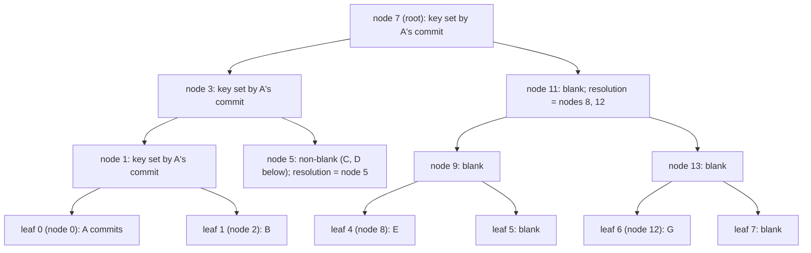

# PqChat TreeKEM mode (`groupMode = 1`), minimal scope: design

**Status:** SPECIFIED, nothing built. **UNAUDITED**: a new cryptographic protocol; every construction below is a design, not a
reviewed protocol. **Revision 2 (2026-11-23)**, after the reviews of revision 1 (`f42a75af2`) by Codex (22 findings) and Fable
(16 findings, 2 unsure); a finding is cited by its id (`codex-n`, `fable-n`) where its fix sits, and [§17](#17-what-revision-2-changed)
lists them. A second review follows, then the build. Branch `treekem-research`; the contract work branches from `pqchat-sigs`
once it has landed. Research [`2026-11-23-treekem-pqchat.md`](../../research/2026-11-23-treekem-pqchat.md) (cited "note §n"); plan
[`2026-11-23-pqchat-treekem.md`](../plans/2026-11-23-pqchat-treekem.md). Rule ids introduced here (SPECIFIED, defined once in
their component doc, recorded in [decisions.md](../../decisions.md)): CTR-CHAT-26 (owner), CTR-CHAT-27 (controller calls),
CLI-PQC-16 (owner). Ids of branch `pqchat-sigs` this builds on: CTR-CHAT-23 (signature storage per home), CTR-CHAT-24 (several
`keyId`s per member UA), CTR-CHAT-25 (`groupMode`), CLI-PQC-15 (`require_signed_records`). Tags: **[F]** fact, **[E]** estimate
(paper figures on the pinned PqChat rows, as in the note; the plan measures and pins them).

**Contents**

1. [Rulings this spec follows](#1-rulings-this-spec-follows)
2. [Controller calls](#2-controller-calls)
3. [Scope, non-goals, deviations from RFC 9420](#3-scope-non-goals-deviations-from-rfc-9420)
4. [The ratchet tree](#4-the-ratchet-tree)
5. [Secrets: path, epoch schedule, `K`](#5-secrets-path-epoch-schedule-k)
6. [Records and entries](#6-records-and-entries)
7. [Storage](#7-storage)
8. [What the contract checks, and what only clients check](#8-what-the-contract-checks-and-what-only-clients-check)
9. [Rights, leave, removal](#9-rights-leave-removal)
10. [Recovery from state: replay](#10-recovery-from-state-replay)
11. [Forks, refusals, named errors](#11-forks-refusals-named-errors)
12. [Signature storage and (M)](#12-signature-storage-and-m)
13. [Bounds and gas](#13-bounds-and-gas)
14. [Threats](#14-threats)
15. [Client layers](#15-client-layers)
16. [Open points for the owner](#16-open-points-for-the-owner)
17. [What revision 2 changed](#17-what-revision-2-changed)

## 1. Rulings this spec follows

**Owner, 2026-11-23 (owner: yes), as relayed by the controller:**

- R1. "Minimal mode 1 is built now, before the pre-freeze tag. It covers a commit with UpdatePath, Add and Remove, with Welcome
  by wraps. External commits, PSKs and ReInit are out."
- R2. "A new DELEGATECALL body module is accepted for it."
- R3. "`groupMode` is a protocol id: 0 = flat; 1 = RFC 9420 tree rules over KEM scheme 1 (ML-KEM-1024 + X25519,
  `clients/ua-rs/src/wallet/kem.rs`); 2–255 for later variants. It is appended at the end of `PqChatSession` and
  `PqVaultCreate`, and fixed at creation."
- R4. "The committer's own path secrets are seed-derived (HKDF over the session and the commit), so no self-wrap."
- R5. "PqVault accepts only 0 in this release; it stays open for a later PqVault release."
- R6. "Our own TreeKEM in `ua-rs`, following RFC 9420's algorithms, with typed records. No MLS library."
- R7 (on revision 1's open points, as relayed for this revision): the leaf is the registry KEM key and is not refreshed per
  commit (C5); a non-admin commits only for its own UA's leaves (C8); tree sessions are refused on `none` homes and on replicas
  (C1, C4); ML-KEM-1024 is the only node scheme (C2); no unmerged leaves (C6).
- R8. `TREE_LEAVES_MAX` = 256, **chosen on the premise that every piece fits a 60 M block.** Revision 1 did not meet that premise
  (codex-9, fable-3, fable-12); §13 gives the figures of this revision, and [O1](#16-open-points-for-the-owner) asks the owner
  to confirm the cap on them. This spec does not change the ruling.

**Earlier rulings:** signature storage per home, `none` | `sstore2`, default `sstore2` (CTR-CHAT-23); several `keyId`s per member
UA, members sorted by `(ua, keyId)` (CTR-CHAT-24, "(M)"); every record kept in full in state (CTR-CHAT-05); one child per parent
in the home instance (CTR-CHAT-08); rights (CTR-CHAT-09), `remove` (CTR-CHAT-20), `leave` (CTR-CHAT-10); recovery from state
alone (CTR-CHAT-14); every write relayable by anyone, fee 0 too (CTR-CHAT-19); the one-signer rule (CLI-UAL-01); the SDK's C1
and the A-3 ruling (no key byte to an app core, no rooted key leaves `ua-rs`); ARCH-POS-13 (no decryption oracle; the hybrid
KEM of scheme 1 is outside it by the owner's change of 2026-11-13, PqChat's own rule of no automatic reaction, CLI-PQC-07,
stays); ARCH-POS-15 (lists of nodes); ARCH-POS-18 (software fallback).

## 2. Controller calls

Each is the controller's (owner: no) unless marked; the owner may override any. Recorded as CTR-CHAT-27. C14–C27 are revision 2's.

| # | Call | Why |
|---|---|---|
| C1 | (owner, R7) A tree session is refused on a `none` home: `PqChatTreeSigStore()` | a committer encrypts path secrets to node keys vouched for only by commit signatures (note §6.1) |
| C2 | (owner, R7) Tree nodes use KEM scheme 1 (ML-KEM-1024 + X25519), the one scheme; a node key is a `kemPk` of 1,601 B (`0x01 ‖ ek ‖ pk_X`) | R3 names scheme 1; another node KEM is another `groupMode` |
| C3 | The contract enforces nothing about group size below the cap; "useful from about 7 keys, where several members commit" is a client hint | note §4.2 |
| C4 | (owner, R7) A tree session lives only in its home instance: `createSession` with `groupMode = 1` on another instance is `PqChatTreeHome()` | no replica, hence no fork to reconcile (§11) |
| C5 | (owner, R7) A leaf is a registry KEM key `(ua, keyId)` by reference; a commit never replaces a leaf key | the registry's versions are write-once; a new device key is a new `keyId`, added by a commit (§9) |
| C6 | (owner, R7) No unmerged leaves: an Add blanks the new leaf's direct path; no truncation of the tree; every commit carries a path | simpler resolution on chain (note §8.5); blank levels cost nothing because the path is filtered |
| C7 | The contract keeps the tree hash and compares the signed `treeHash` and the landed target list with what it computes, **when the commit completes** | a wrong value never becomes an epoch, so no client ever has to reject an accepted commit (§8) |
| C8 | (owner, R7) A non-admin author changes keys of its own UA only | a tree is stateful: dropping another member's leaf lasts until an Add (§9) |
| C9 | `leave` and `remove` of a tree session name its head epoch | the next commit is the only one that can honour them |
| C10 | (owner, R8) `TREE_LEAVES_MAX` = 256 (depth 8); (controller) `TREE_CHANGES_MAX` = 32 adds plus removes per commit | §13 |
| C11 | A tree session's control-plane records are always verified by the client, whatever `require_signed_records` says | C1's reason |
| C12 | The epoch secret is confirmed by opening the commit's `sealedInfo`, which a tree commit may not leave empty; no separate confirmation tag | the tag would sit outside the signed record; `sealedInfo` is already an AEAD under a key from `K` (fable-13) |
| C13 | The tree hash covers node keys and leaf keys; **there is no parent hash** (revision 1's `parentHash` is dropped) | the contract compares the whole `treeHash`, which binds everything the parent hash bound, and no client step read it (fable-16; with it codex-19 has no second hash to disagree) |
| C14 | The target list is not in the signed record: the record signs `ctCount` and `ctListHash`; the list (`ctTargets`, `ctHashes`) lands once as a piece of its own and stays in state | with the list inside, the worst record at 256 keys asks 60.7 M and does not fit a 60 M block; outside, no commit piece asks more than 34.5 M **[E]** (codex-9, fable-3) |
| C15 | The cold tree is written with the wraps: leaf `i` and the hashes above it are written when wrap `i` of epoch 0 lands | 767 new slots in the record's transaction are 75.1 M of state gas at 256 keys (codex-9, fable-12) |
| C16 | `treeId = hashStruct(PqChatSession)` names a tree session: it is a field of every commit and an input of every tree derivation; clients key their state and consent by it | `sessionId` is creator plus nonce and binds neither the home nor the genesis record (codex-7, fable-1) |
| C17 | `pathContext` also binds the parent's tree hash; a commit's nonce is never used twice once a piece or its signature has left the device | the tree hash commits to every target key; a retried or twin commit gets independent secrets (fable-1, codex-7, O9 of the review) |
| C18 | A leaf's hash and a `TreeAdd` carry `kemHash = keccak256(kemPk)`; the contract takes it from the registry; one live leaf per `kemHash`; a client authenticates a registry key before it encapsulates to it | a substituted key or an alias of a removed device would receive the epoch (codex-1, codex-2, fable-10) |
| C19 | Every node key and every leaf key passes the public-key admission check of scheme 1 in the contract; an Add needs `scheme == 1` | a key no honest member can encapsulate to would block every committer outside its subtree (codex-8, fable-4, fable-10) |
| C20 | A tree epoch's `wraps` counter is its piece count plus one; the last unit is added only by the successful completion | every inherited reader of `landed == wraps` then sees a tree epoch complete exactly when it took its slot (codex-10, fable-7) |
| C21 | In a tree session `remove` is refused when the leaves owed to removals at the head would exceed `TREE_CHANGES_MAX`: `PqChatTreeBacklog` | the commit that must honour them always fits one record (codex-6, fable-2, O10 of the review) |
| C22 | Replay reads are scheduled from public data only; no write of a tree session is automatic | nothing a device reads or sends shows whether a ciphertext opened (codex-3, fable-8, O7 of the review) |
| C23 | **Proposed, [O2](#16-open-points-for-the-owner):** `joiner_e` derives from the commit secret and the context, without the previous epoch's `init` | with the chain one member's bad commit ends the session for good; without it the next honest commit heals, as in mode 0 (fable-4, codex-18) |
| C24 | Shapes are bounded when a record is accepted: `ctCount` < `leaves`, at most `TREE_ADMINS_MAX` = 32 admins, `sealedInfo` at most `TREE_INFO_MAX` = 4,096 B; a commit that changes `admins`, and a `remove`, leave an admin with a live leaf | no staged record that cannot complete; no group left with a keyless admin only (codex-20, codex-21) |
| C25 | A device takes the roster of each epoch since its join from the live leaves by undoing the later commits' changes; which epoch won is the home's state, read under ARCH-POS-15 | the reads are the ones replay makes anyway; a signature cannot prove a commit won (codex-11) |
| C26 | A client builds only on a head at or after its local checkpoint; what a candidate seals is taken as disclosed to every key of the tree it was built on | a rejected commit cannot be recalled (codex-4) |
| C27 | A home's signature-storage setting is taken from pinned deployment data, or read under the majority rule; a session's mode is pinned with its `treeId` | first contact cannot be steered to an unsigned flat twin (codex-14) |

## 3. Scope, non-goals, deviations from RFC 9420

**In:** a tree session created cold from the signed member list; `commit` with an UpdatePath, Adds and Removes (by `(ua, keyId)`,
and by UA as every key of it); Welcome as one flat wrap per added key; messages, `sealedInfo`, stores, calls, `leave`, `remove`
as in mode 0; recovery by replay.

**Out (R1, R7):** external commits, pre-shared keys, ReInit, group-context extensions, proposals sent apart from their commit,
Update proposals without a commit, unmerged leaves, tree truncation, a creator-filled first path, leaf-key rotation, a tree in
PqVault (R5), any other family than EVM (the other families keep `groupMode` 0 only; one rule on every EVM chain).

**Deviations from RFC 9420, all deliberate:** typed EIP-712 records instead of TLS-encoded messages; keccak256 in the tree hash;
no parent hash (C13); HKDF-SHA-256 labels of this repo instead of `ExpandWithLabel`; scheme-1 KEM plus AES-256-GCM instead of
HPKE; no unmerged leaves, so **an added leaf is in the resolution of its commit** and receives a path ciphertext (RFC 9420 §7.5
excludes new members and puts a path secret in the Welcome; fable-5); `sealedInfo` instead of the confirmation tag; the group
context without a transcript hash (the chain orders and keeps the transcript); deterministic committer secrets (R4); a joiner
secret without the `init` chain (C23, proposed). None of RFC 9420's analyses covers the result.

## 4. The ratchet tree

**Array layout (RFC 9420 Appendix C) [F].** A perfect binary tree of `leaves = 2^d` leaves in an array of `2·leaves − 1` nodes:
leaf `i` is node `2i`, parents are the odd nodes, `level(x)` is the count of trailing one bits of `x`, the root is
`leaves − 1`, `left(x) = x − 2^(level−1)`, `right(x) = x + 2^(level−1)`, and `parent`, `sibling`, `direct_path` and `copath`
are Appendix C's, unchanged. Node indices do not move when the tree grows: `leaves` doubles and
the new root sits above the old one.

**Size.** A session keeps `used` (leaf positions ever assigned; `members.length` at creation) and `leaves`, the smallest power
of two `≥ used` (1 when `used = 1`). An Add takes a blank leaf below `used`, or leaf `used` (then `used` grows, and `leaves`
doubles when needed). Clients take the leftmost blank leaf (a hint; the contract checks only blank and in range). The tree
never shrinks (C6). `used ≤ TREE_LEAVES_MAX`.

**Nodes.** A leaf is blank or names one `(ua, keyId)`, a KEM key its UA holds in this chain's registry (C5), with that key's
`kemHash = keccak256(kemPk)` (C18). A parent is blank or holds one node key (`kemPk`, 1,601 B) set by a commit. A cold tree
(after creation) has every parent blank. No two live leaves have one `kemHash`, hence none share `(ua, keyId)`.

**Resolution** (RFC 9420 §4.1.2, without unmerged leaves): of a non-blank node, the node; of a blank leaf, nothing; of a blank
parent, the resolutions of its left then right child. It is always listed in ascending node index. A leaf added by a commit is
in that commit's resolutions.

**Direct path, copath, filtered path.** The direct path of leaf `l` is its ancestors up to the root; the copath child at each
is the child not on the path. The **filtered path** drops every ancestor whose copath child has an empty resolution. A commit
sets exactly the nodes of its author's filtered path, computed on the tree **after** the commit's Removes and Adds, and
blanks the other nodes of its direct path (RFC 9420 §7.5).

**Tree hash** (RFC 9420 §7.8, typed), always of **the tree after the commit's changes and its new path keys**:

```text
TreeLeaf(uint32 leaf,bytes32 ua,uint64 keyId,bytes32 kemHash)   th(leaf)   = 0 if blank, else hashStruct(TreeLeaf)
TreeParent(bytes32 keyHash,bytes32 left,bytes32 right)          th(parent) = 0 if blank and th(left) = th(right) = 0,
                                                                             else hashStruct(TreeParent), keyHash = 0 if blank
treeHash = th(root)
```

`keyHash = keccak256(kemPk)` of the node key. A subtree with no member hashes to 0, so padding and growth cost no slot. The
leaf's key bytes are bound through `kemHash`, which the contract computes from the registry (§8), so a signed `treeHash` vouches
for the key of every target, leaf or parent (codex-1).



In the picture A's commit carries 3 node keys and 4 ciphertexts, `ctTargets = [2, 5, 8, 12]`.

## 5. Secrets: path, epoch schedule, `K`

Notation as clientkeys' `pqchat.js`: `H(ikm, info) = HKDF-SHA-256(ikm, salt = empty, info, 32)`; labels are ASCII followed by
the listed fields (`u32`, `u64` big-endian). Every step below runs inside `ua-rs` (§15).

**The session's name (C16).** `treeId = hashStruct(PqChatSession)`, the EIP-712 struct hash of the signed session record. The
record names its home chain and instance, its creator and nonce, its members, admins and `groupMode`, and the contract accepts it
at that home only (C4); so `treeId` binds the home and the genesis record, which `sessionId` (creator and nonce) does not.

**Path secrets (RFC 9420 §7.4).**

```text
ps[k+1]      = H(ps[k], "scaas/pqchat/v1/tree/path")                         k = 0 .. m-1
nodeSeed[k]  = HKDF(ps[k], "scaas/pqchat/v1/tree/node", 96 B)                the 96-byte KEM seed form of kem.rs
nodeKey[k]   = kemPk of nodeSeed[k]                                          the key of filtered-path node p[k]
commitSecret = ps[m]
```

**The committer's `ps[0]` (R4, C17).** Deterministic from the KEM seed of the author's leaf key and everything that fixes the
recipients and their keys:

```text
pathContext = keccak256(abi.encode(TAG_TREE_PATH, treeId, parentEpochId, parentTreeHash, author, nonce, leaf, keyId,
                                   hash(removes), hash(adds), keccak256(abi.encodePacked(ctTargets))))
ps[0]       = HKDF(kemSeed(ua, keyId), "scaas/pqchat/v1/tree/commit" ‖ pathContext, 32)
```

`TAG_TREE_PATH = keccak256("scaas/pqchat/v1/tree/path-context")`; `hash(removes)`, `hash(adds)` are the EIP-712 array hashes of
§6 (an Add's hash covers its `kemHash`); `parentTreeHash` is the parent commit's signed `treeHash`, or the stored genesis tree
hash when the parent is epoch 0.

- **Every target key is bound** (fable-1, codex-7). A target is a node of the parent tree or a leaf this commit adds;
  `parentTreeHash` commits to the key of the first (the client checked every key it uses against it, §8) and `hash(adds)` to the
  key of the second. A commit built on another tree, in another session or at another home differs in `parentTreeHash` or
  `treeId`, so it has an independent `ps[0]`: a head served by a lying endpoint with other keys at the same indices (fable-1's
  scenario A), and a twin session with the same `sessionId` at another home (scenario B), no longer repeat a secret.
- **The nonce rule (C17).** `ua-rs` draws a commit's nonce at random (64 bits) and the client stores it before the first piece
  or the signature leaves the device; a rebuilt commit takes a new nonce, always. A device without that store (a fresh restore)
  draws at random too. The binding above already makes a repeated nonce harmless unless every bound input repeats, which is
  the same commit; the rule is the second guard.
- No byte on chain; the seed recovers every commit the key authored, from the commit's record, its list piece and the parent's
  tree hash (§10). A device key that is random recovers its commits on that device only (note §6.2).

**A path ciphertext** seals `ps[k]` to one target `t` of the resolution of `p[k]`'s copath child, with `kemPk_t` the target's key
(a node key, or a leaf's registry key):

```text
(mlkemCt, x25519Eph, ss) = scheme-1 encaps(kemPk_t)
kek          = H(ss, "scaas/pqchat/v1/tree/ct" ‖ treeId ‖ epochId ‖ u32(p[k]) ‖ u32(t) ‖ keccak256(kemPk_t))
sealedSecret = AES-256-GCM(kek, nonce = 0, ps[k], aad = treeId ‖ epochId ‖ u32(p[k]) ‖ u32(t))          48 B
```

**The epoch schedule (RFC 9420 §8, reduced; C23 proposed).**

```text
ctx_e    = keccak256(abi.encode(TAG_TREE_CONTEXT, treeId, epochId, epoch, parentEpochId, treeHash,
                                keccak256(abi.encodePacked(admins))))
joiner_e = H(commitSecret, "scaas/pqchat/v1/tree/joiner" ‖ treeId ‖ epochId)
           epoch 0: joiner_0 is 32 random bytes of the creator
S_e      = H(joiner_e, "scaas/pqchat/v1/tree/epoch" ‖ ctx_e)
K_e      = H(S_e, "scaas/pqchat/v1/tree/key")
```

`TAG_TREE_CONTEXT = keccak256("scaas/pqchat/v1/tree/context")`. For epoch 0 `epochId = sessionId`, `parentEpochId = 0` and
`treeHash = 0`: `treeId` already commits to the signed member list, so deriving `K_0` needs no tree and no registry read
(codex-16). `groupMode` is bound by the labels (`…/tree/…`) and by `treeId`.

- **No `init` chain (C23, proposed; [O2](#16-open-points-for-the-owner)).** RFC 9420 salts the joiner secret with the previous
  epoch's `init`. Here a member that misses one epoch would then miss every later one, and one member's commit of bad
  ciphertexts to everyone would leave nobody but itself able to continue: the session would be lost (fable-4, codex-18).
  Without the chain each commit stands alone: whoever opens one of its path ciphertexts follows it. What the chain would
  add is small in this design: a removed member holds no target key (its path is blanked, C18 excludes aliases), and a device
  whose tree state leaks leaks its `init` with it. What it costs is stated in §14 (no forward secrecy against a leaked node
  secret alone). **If the owner keeps RFC 9420's chain:** `joiner_e = HKDF(ikm = commitSecret, salt = init_(e-1), …)` and
  `init_e = H(S_e, "…/tree/init")`; no record or entry changes, only this block, the cut-off rule of §10 and the rows of §14.
- **Every wrap of a tree session seals a joiner secret** under the tree's own label: epoch 0's wraps seal `joiner_0`; a Welcome
  wrap seals `joiner_e` to an added key. The `Wrap` struct is mode 0's; `kek` and `aad` are mode 0's `wrapKek` and `wrapAad`
  with the label `scaas/pqchat/v1/tree/wrap` and `treeId` in place of `sessionId`, so a tree wrap opens under no flat
  processing (fable-13).
- **A joiner also takes its path secret** (codex-5, fable-5): the added leaf is a target of its join commit (§4), and the
  joiner opens that ciphertext, derives upward, compares the node keys and so holds every node above its leaf that the commit
  set. The Welcome wrap and the path ciphertext must give the same `joiner_e`; a difference is "not followed" (§10).
- **`K_e` is the epoch key.** Sender chains (`…/v1/chain`), `infoKey`, `envKey`, `hint` and call keys derive from `K_e` exactly
  as in mode 0; messages, `sealedInfo` and the stores do not change.
- **Confirmation (C12).** A member that derived `K_e` opens the commit's `sealedInfo`; the handle of epoch `e` is usable only
  after that. A failure means the device did not follow that epoch (§10).

## 6. Records and entries

Typed EIP-712 in `DS_C` under `PURPOSE_PQCHAT`, as every PqChat record (CTR-CHAT-03). Only a key, a ciphertext or a signature is
`bytes`.

| Typehash constant | Type string |
|---|---|
| `COMMIT_TYPEHASH` | `PqChatCommit(bytes32 sessionId,bytes32 author,uint64 nonce,uint64 epoch,bytes32 parentEpochId,bytes32 treeId,uint32 leaf,uint64 keyId,uint32 leaves,bytes32[] admins,TreeRemove[] removes,TreeAdd[] adds,bytes32[] wrapHashes,bytes32[] nodeKeyHashes,uint32 ctCount,bytes32 ctListHash,bytes32 treeHash,bytes sealedInfo)TreeAdd(uint32 leaf,bytes32 ua,uint64 keyId,bytes32 via,bytes32 kemHash)TreeRemove(uint32 leaf,bytes32 ua,uint64 keyId)` |
| `TREE_ADD_TYPEHASH` | `TreeAdd(uint32 leaf,bytes32 ua,uint64 keyId,bytes32 via,bytes32 kemHash)` |
| `TREE_REMOVE_TYPEHASH` | `TreeRemove(uint32 leaf,bytes32 ua,uint64 keyId)` |
| `PATH_LIST_TYPEHASH` | `PathList(uint32[] ctTargets,bytes32[] ctHashes)` |
| `PATH_CT_TYPEHASH` | `PathCt(bytes mlkemCt,bytes32 x25519Eph,bytes sealedSecret)` |
| `TREE_LEAF_TYPEHASH`, `TREE_PARENT_TYPEHASH` | §4 (hashed, never signed alone) |

`PqChatCommit` by field: `author` (the record's second field, as in every epoch record: the stored author is read at that
position, fable-U2) commits from leaf `leaf`, its key `keyId`; `treeId` of §5 (C16: the signature holds at one home and under
one genesis record only); `leaves` is the tree's size after the commit; `admins` the full sorted admin list of the new epoch;
`removes` and `adds` the membership change (`via` as in `MemberKey`, not read by the contract; `kemHash` of the added key);
`wrapHashes[i]` the Welcome wrap of `adds[i]`; `nodeKeyHashes[k] = keccak256(nodeKey[k])`; `ctCount` the number of path
ciphertexts and `ctListHash = hashStruct(PathList)` of their list (C14); `treeHash` of §4; `sealedInfo` as in `PqChatEpoch`, not
empty (C12). In the list `ctTargets[j]` is the node the `j`-th ciphertext is sealed to and `ctHashes[j]` its `PathCt` hash,
ordered by path level upward, then by ascending target. The epoch id and the nonce scope are `PqChatEpoch`'s
(`epochId(sessionId, author, nonce)`, `scopeEpoch`): one id space for both modes.

**Entries** (one per operation; each signed write takes its record and a `UASig`, anyone sends it, CTR-CHAT-19):

| Entry | Signed | Purpose |
|---|---|---|
| `createSession(PqChatSession s, Wrap[] wraps, UASig sig)` | creator | unchanged entry and record; `groupMode = 1` opens a tree session; leaf `i` = `members[i]`, written when wrap `i` lands (C15) |
| `commit(PqChatCommit c, uint32[] ctTargets, bytes32[] ctHashes, bytes[] nodeKeys, PathCt[] cts, Wrap[] wraps, UASig sig) returns (bytes32 epochId)` | author | a tree epoch; the list and `nodeKeys` each whole or absent (empty), `cts` and `wraps` a first chunk or none; `cts` only with the list |
| `addPathList(bytes32 epochId, uint32[] ctTargets, bytes32[] ctHashes)` | none | the list, whole, once, against `ctListHash` |
| `addPathKeys(bytes32 epochId, bytes[] nodeKeys)` | none | the node keys, whole, once, each against its signed hash |
| `addPath(bytes32 epochId, uint32 firstCt, PathCt[] cts)` | none | ciphertexts `firstCt..`, each against its hash in the landed list (`PqChatPathList` before the list) |
| `addWraps(bytes32 epochId, uint32 first, Wrap[] wraps)` | none | unchanged entry: epoch 0's wraps, and a commit's Welcome wraps (`wraps[i]` names `adds[i]`) |
| `leave`, `remove`, `postMessage`, `storeMessage` | as today | unchanged records; for a tree session `leave` and `remove` name the head (C9), `remove` is bounded (C21) |
| `rekey(PqChatEpoch …)` on a tree session; `commit` on a flat one | | refused: `PqChatModeEntry(groupMode)` |

**Views** (all state; a page view caps its count at `TREE_RANGE_MAX`): `treeOf(sessionId) → (bytes32 treeId, uint32 leaves, uint32
used, bytes32 treeHash, bytes32 genesisTreeHash, bytes32 headEpochId, uint32 owed)` (`owed`: leaves owed to removals at the
head, C21); `treeLeaves(sessionId, first, count) → TreeLeafView[] {bytes32 ua, uint64 keyId, uint64 joinEpoch, uint32 wrapIndex,
bytes32 kemHash}` (a blank leaf is all zero; `kemHash` is computed from the registry at read); `treeNodes(sessionId, first,
count) → TreeNodeView[] {bytes32 hash, bytes32 keyHash, uint64 epoch}` (fable-16: a client recomputes the root without fetching
a key it does not use) and `treeNodeKey(sessionId, node) → bytes` (the live key of a parent; `epoch` is the number of the commit
that set it); `commitOf(epochId) → (PqChatCommit c, bytes32 sigHash)`; `pathListOf(epochId) → (uint32[] ctTargets, bytes32[]
ctHashes)`; `pathKeys(epochId) → bytes[]`; `pathCtAt(epochId, i) → PathCt`. `epochSig(epochId)`, `wrapAt`, `epochsOf`,
`latestEpoch`, `epochComplete`, `childOf`, `leftIn`, `removedIn`, `removal*`, `leave*` serve both modes, and `epochComplete`
of a tree epoch is true exactly when it took its slot (C20); `epochOf` of a tree epoch above 0 is `PqChatModeEntry(1)`.

**Events** (never the only copy): `PqChatEpochAdded` and `PqChatEpochComplete` as today, `PqChatWraps` for Welcome wraps,
`PqChatPath(bytes32 indexed epochId, uint8 piece, uint32 first, uint32 count)` per landed piece (`piece`: 1 list, 2 keys,
3 ciphertexts).

**The module (R2).** `PqChatTree`, a DELEGATECALL body module beside `PqChatTopics`: `PqChat` gains an immutable `TREE`, lists
it in `modules()`, forwards `commit`, `addPathList`, `addPathKeys`, `addPath` and the tree views by `msg.data`, forwards
`addWraps`, `leave`, `remove` and `postMessage` when their session is a tree session, and calls the module's creation step from
`createSession`. The module inherits `PqGroupBase` and uses `PqChat`'s namespace through the same hooks; its own state is a
namespace of its own (§7). **The author offset (fable-U2, settled):** on `pqchat-sigs` (`bc3b1f537`) `PqGroupBase._authorOf`
reads byte 96 of a two-part blob and `PqChat` overrides it with `_word(record, _word(record, 0) + 32)`, which is right for the
three-part blob too; the module does not inherit `PqChat`, so the override moves to a base both inherit, with a test on a tree
commit's blob and a mutant that restores the constant 96.

## 7. Storage

Never only a hash plus calldata or an event (CTR-CHAT-05, "never lose ciphertext"):

| What | Where |
|---|---|
| The commit record with its signature | `abi.encode(record, sigHash, UASig)` in the epoch's record blob (chained by `_put`), as an `sstore2` home keeps every record |
| The target list of a commit | one SSTORE2 blob per commit, `ctCount × 36` B packed (each `ctTargets` entry in 4 B, then `ctHashes`; at most 9,180 B) |
| Node keys of a commit | one SSTORE2 blob per commit, `m × 1,601` B (at most 12,808 B: one blob on a 24,576-B chain too) |
| Path ciphertexts | packed 1,648 B each (`mlkemCt ‖ x25519Eph ‖ sealedSecret`), as many per blob as the chain's limit holds, one slot per index (`pointer \| offset << 160`), as wraps |
| Welcome wraps | the epoch's `wrapAt`, as mode 0 |
| The live tree, per session (namespace `scaas.pqchat.tree`) | `treeId`, `genesisTreeHash`, `used`, `leaves`, the head, `owed`; per leaf two slots (`ua`; `keyId`, `joinEpoch`, `wrapIndex`, live bit); per parent `hash` (its `th`) and `keyAt` (`pointer \| offset << 160 \| epoch << 176`, 0 = blank); `keysOf[ua]` (the count of its live leaves and an "indexed" bit that stays); `liveKey[kemHash]` (leaf + 1); the live admin list; per staged commit its landed-piece bits |

The Epoch struct of `PqGroupBase` and `PqVault`'s layout do not change; `PqChat`'s own namespace does not change. A leaf's
`kemHash` is not stored: it is read from the registry (write-once) where a hash needs it. The live tree changes when a wrap of
epoch 0 lands (C15) and when a commit completes, at no other time. Old node keys, every old list and every old ciphertext stay
readable through their commit's blobs.

## 8. What the contract checks, and what only clients check

**The key admission check (C19)**, public and the same in the contract, `ua-rs` and clientkeys, for a 1,601-B `kemPk`: the scheme
byte is 1; every 12-bit coefficient of the first 1,536 B of `ek` is below 3,329 (FIPS 203 §7.2, `ek_modulus_ok` in `kem.rs`);
`pk_X` with bit 255 cleared is none of the seven small-order encodings (0, 1, the two points of order 8, `p − 1`, `p`,
`p + 1`), which is when `kem.rs` sees an all-zero X25519 output. The registry checks only scheme and length, so the module runs
the check on every leaf key it admits and every node key that lands (`PqChatKemKey`). A vector row holds a key for each refused
case and the two implementations must agree on all of them.

**At `createSession` (`groupMode = 1`):** everything of mode 0 (lists, KEM keys, creator, signature, nonce), then `sigStore() ==
sstore2` (C1), this instance is the home (C4), `members.length ≤ TREE_LEAVES_MAX`, `admins.length ≤ TREE_ADMINS_MAX`; `treeId`,
`used`, `leaves` and the admin list are written. No leaf is written yet.

**When wrap `i` of epoch 0 lands (C15):** as mode 0 against `members[i]`; then the key of `members[i]` is read from the
registry, passes the admission check, its `kemHash` is not live (`PqChatTreeKeyLive`); leaf `i`, `liveKey`, `keysOf` and the
`th` of each ancestor are written. When the last wrap lands epoch 0 completes as in mode 0 and the root is kept as
`genesisTreeHash` and `treeHash`. Two members with one key, or a member whose key fails the check, mean a session whose epoch 0
never completes: the creator's client runs the same checks before it signs.

**When a `commit` record is accepted:**

- the session is a tree session and `treeId` is its own; the parent is its head, stored and complete, `epoch == parent + 1`,
  the slot free (`_parentOf`); the author signed it and `(scopeEpoch, nonce)` is unused;
- leaf `leaf` is live and names `(author, keyId)`; the author did not leave and was not removed;
- `admins` strictly sorted and registered, at most `TREE_ADMINS_MAX`; if it differs from the head's list, at least one of its
  UAs holds a live leaf after the commit (`PqChatTreeAdmins`, C24);
- each remove names a live leaf by its `(ua, keyId)`, not the author's leaf; each add names a blank leaf in range (or one freed
  by a remove of this commit), a key its UA holds with `scheme == 1` (fable-10), `kemHash` equal to `keccak256` of that
  registry key (`PqChatKemKey`), a key that passes the admission check and is not live, nor added twice here
  (`PqChatTreeKeyLive`; a key freed by a remove of this commit counts as not live), and has one wrap hash;
- at most `TREE_CHANGES_MAX` changes, at most `KEYS_PER_UA_MAX` keys per UA; the rights of §9;
- shapes (C24, codex-20): `nodeKeyHashes.length ≤ depth(leaves)`, `ctCount < leaves`, `ctCount = 0` exactly when
  `nodeKeyHashes` is empty, `wrapHashes.length == adds.length`, `0 < sealedInfo.length ≤ TREE_INFO_MAX`.

`Epoch.wraps` of the new epoch is its piece count plus one (C20): one piece for the list when `ctCount > 0`, one for the node
keys when there are any, one per ciphertext, one per Welcome wrap.

**When a piece lands:** the list has `ctCount` entries in each array and hashes to `ctListHash`; each node key is 1,601 B, passes
the admission check and hashes to `nodeKeyHashes[k]`; each ciphertext is 1,568 + 32 + 48 B and hashes to `ctHashes[j]` of the
landed list; each wrap as mode 0 against `adds[i]`; each lands once; the slot still free. A wrong piece is refused when it is
sent, so nobody can spoil a staged commit.

**When every piece has landed (completion, C7),** in the transaction that lands the last one, or in `commit` itself when it
carries all or there is none; in this order, all or nothing:

1. no UA a `remove` took out of the parent keeps a leaf, sits in `admins` or is the author (`PqChatRemovedKept`);
2. the Removes blank their leaves and direct paths and free their `liveKey`; the Adds set their leaves and `liveKey` and blank
   their direct paths; `keysOf`, `used` and `leaves` follow and `leaves` equals the record's; a UA whose first leaf this is and
   that was never indexed joins `sessionsOf` (fable-11, codex-17);
3. the author's filtered path and the resolution of each copath child are walked on that tree: the path length equals
   `nodeKeyHashes.length`, the target count equals `ctCount`, and the targets equal the landed `ctTargets`, entry by entry
   (`PqChatTreeTargets`);
4. the path nodes take their keys, the other nodes of the author's direct path are blanked;
5. the `th` of every node on a changed path (each removed or added leaf's, and the author's) is recomputed bottom-up, a sibling
   leaf's `kemHash` read from the registry; so every hash is of the tree after steps 2 and 4, none of an earlier revision
   (fable-9, codex-19);
6. the root equals `treeHash` (`PqChatTreeHash`);
7. the epoch takes the parent's slot, `landed` reaches `wraps`, the epoch joins `epochsOf`, the head and the admin list move,
   `owed` is 0.

A commit that fails 1–6 can never complete: the landing reverts whole, the head does not move, and only its sender's gas is
spent. A commit that fits one transaction is checked whole in that transaction. Until step 7 `landed < wraps`, so
`epochComplete`, `_parentOf`, `postMessage`, `leave` and `remove` all see a staged or losing tree epoch as incomplete (C20).

**Membership in a tree session**, for the shared entries: `postMessage` and `leave` ask that the author UA holds a live leaf
(`keysOf > 0`) and that the epoch named is complete; `remove` asks a live admin of the head's list.

**Only clients can check** (RFC 9420 has the same limit; so has a flat wrap): that a node key derives from its path secret, and
that a ciphertext opens to the right secret. Each member checks its own: after opening its ciphertext it derives upward and
compares `keccak256` of every derived `kemPk` with the signed `nodeKeyHashes`, then opens `sealedInfo`.

**Before a client encrypts** (C11, C18, C26):

1. it reads the head under ARCH-POS-15 and refuses a head below its checkpoint (C26): the store keeps, per `treeId`, the highest
   epoch number and id the device verified, and never builds on a lower number or on another id at that number;
2. it reads `treeLeaves` and `treeNodes`, recomputes the root and compares it with the head commit's signed `treeHash`, whose
   signature and author's right it verified (for a head at epoch 0: with `genesisTreeHash`, and step 4 for every target);
3. for each target it fetches the key (`treeNodeKey`, or the registry's `kemKeyAt`) and compares its hash with the `keyHash` or
   `kemHash` that entered the root;
4. **a key that no signed tree hash covers yet** (a key this commit adds, a wrap of `createSession`, a leaf target on an epoch-0
   head) is authenticated against the registry record itself (codex-1): the UA's registration key data hashes to the UA
   (`UA = keccak256(keccak256(kind_tag) ‖ key_data)`); for a version above 0 the kept signature over `kemRecordDigest(ua,
   version, kemPk)` verifies under that key; for version 0 the registration's proof of possession covers the committed
   `kemPkHash` and the key hashes to it. `ua-rs` does this in one call and gives encapsulation no key that did not pass; the
   SDK's decoder keeps the signature it drops today. The contract's check of an Add's `kemHash` is the second line: a committer
   that was served another key signs a `kemHash` the registry does not hold, and that commit is never accepted.

## 9. Rights, leave, removal

Per UA, as `PqGroupBase` judges them (CTR-CHAT-09, CTR-CHAT-20, CTR-CHAT-10, CTR-CHAT-24):

- **A plain commit** keeps `admins` and the set of member UAs, less UAs that left or were removed, and changes keys of the
  author's own UA at most (C8): by any member with a live leaf that did not leave and was not removed (`PqChatNotMember`).
- **Any other commit** (an added or dropped UA, a changed admin list, another UA's key added or removed): by a live admin
  (`_liveAdmin`; `PqChatNotAdmin`). An admin needs a leaf to commit; an admin without a KEM key (an `msig`) acts through
  `remove` only.
- **An admin with a leaf always remains (C24, codex-21):** a commit that changes `admins` must leave one admin UA with a live
  leaf, and a `remove` whose UAs include every admin that holds a leaf is `PqChatTreeAdmins`. A group whose last such admin
  `leave`s keeps its plain commits and loses admin commits, as a flat group whose last admin left; clients show that state.
- **Add by UA** is one `TreeAdd` per key; **Remove by UA** is one `TreeRemove` per leaf of it, and it is gone when `keysOf` is 0.
- **Removing a device, and what it does not do (codex-2).** A `TreeRemove` of `(ua, keyId)` takes that key out; no other live
  leaf can hold the same key bytes (C18). The UA stays a member and may add a key of its own again by a plain commit (C8), the
  removed bytes under a new `keyId` included. To exclude a holder, an admin removes the **UA**; an admin's `TreeRemove` of
  another UA's one key is a clean-up, not an exclusion, and clients word it so. Two UAs that list one key cannot both be live.
- **`remove` (`PqChatRemove`)** is unchanged as a record and is RFC 9420's Remove proposal: the next commit completes only if
  every removed UA has no leaf left. Any member may author that commit: dropping removed or left UAs is plain. **Bounded per
  head (C21, codex-6, fable-2):** a `remove` adds the live leaves of the UAs it newly removes to the head's `owed`, and is
  `PqChatTreeBacklog(owed)` when that would exceed `TREE_CHANGES_MAX`; so the forced Removes always fit one commit, with any
  room left for other changes. A larger eviction is two rounds: `remove`, the commit, `remove` again.
- **`leave` (`PqChatLeave`)** is unchanged: a flag; the leaver authors no commit; the next committer blanks its leaves (a client
  rule, as mode 0, not forced, so a leaver's leaves are not `owed`).
- A member with no admin right that wants a new device in: registers the KEM version, then commits with a `TreeAdd` of its own
  UA (plain). A lost device: its owner's commit, or an admin's, removes that leaf.

## 10. Recovery from state: replay

A device with a KEM key `(ua, keyId)`, from contract state alone (CTR-CHAT-14). **The reads never depend on a secret (C22,
codex-3):** the list below is fixed by public data, is made whole before any ciphertext is opened, and is the same whether the
device follows every epoch or none; so are later polls.

**Public reads, all checked at the read boundary (codex-13):**

1. `sessionsOf(ua)` → `sessionOf` and `sessionSig`: the creator's signature verifies; `groupMode = 1`; `treeId` is computed; the
   home's setting is `sstore2` by C27. The store pins `treeId` and the mode for that home and `sessionId`.
2. `treeOf`, `treeLeaves` (all pages), `epochsOf` (all pages), under ARCH-POS-15: the live roster and the list of epochs that
   won. Which commit won is the home's state and nothing else: a signed candidate that lost has a valid signature too.
3. The device's periods in the session: from its live leaf's `joinEpoch`, or, for a key that is no longer live, from the
   commits that added and removed it, found by reading every commit record (its genesis membership is in the session record;
   codex-17). For each epoch from its first join to the head: `commitOf` and `epochSig`: the id is recomputed from `(sessionId,
   author, nonce)`, `treeId` is the pinned one, the signature verifies.
4. **The roster (C25, codex-11).** The leaves of each epoch back to the join are the live leaves with the later commits undone,
   newest first: an Add's leaf becomes blank, then a Remove's leaf takes back its `(ua, keyId)`. Each commit's author must hold
   leaf `leaf` in its parent's roster with the right of §9 against the parent's admin list (the parent record's `admins`); the
   join commit is checked the same way against the roster one step further back. A record that fails is not followed, and a
   message author is checked against the roster of its epoch.
5. For each of those commits in which the device's key is live and not the author: `pathListOf`, compared with `ctListHash`;
   then the index `j` of **the one target that is its leaf's node or an ancestor of it** (targets are disjoint subtrees, so tree
   math on the list alone finds it; no secret is consulted) and `pathCtAt(epochId, j)`, compared with `ctHashes[j]`. For a join
   commit also `wrapAt(epochId, wrapIndex)`, compared with `wrapHashes`. For its own commits: the list, and the parent's
   `treeHash` (the parent record, or `genesisTreeHash`).

**Secrets, in `ua-rs`, from those bytes only:**

- Epoch 0: the wrap → `joiner_0` → `S`, `K`.
- A join commit: the Welcome wrap → `joiner_e`; the path ciphertext → `ps` → upward, each derived key against
  `nodeKeyHashes`; both must agree (codex-5, fable-5).
- Another's commit: if the device holds the secret of target `ctTargets[j]` (its leaf key, or a node an earlier commit gave
  it), the ciphertext → `ps` of the path node above that target → upward with the key comparison → `commitSecret` → `joiner`,
  `S`, `K`.
- Its own commit: `ps[0]` from the KEM seed and `pathContext` (R4).
- In every case `sealedInfo` must open before the epoch's handle is usable (C12, codex-13).
- From the record alone the device updates what it holds: secrets of nodes on the direct path of a removed or added leaf are
  dropped; nodes the commit set are replaced by what it derived, or dropped when it derived nothing.

Replay needs no epoch before the device's join and one ciphertext per commit since; only building a commit needs the live
tree's keys.

**Not followed, and healing (C22, C23; fable-4, codex-18).** A target whose secret the device does not hold, a derived key that
differs, a Welcome that disagrees with the path, or a `sealedInfo` that does not open: the device marks that epoch "not
followed" and shows it. Nothing else changes: it reads and polls as before, and it sends nothing on its own: no complaint, no
commit, no rejoin, no receipt (CLI-PQC-07). With C23 it follows again at the first later commit whose target on its side is its
leaf or a node it still holds:

- **its own commit**, when the user asks for it ("refresh"): building needs the public tree and its seed, no epoch secret; it
  re-seals the session info it last read;
- **a commit from its sibling side**, or any commit after **an admin's Remove of the bad committer**, which blanks the nodes
  that commit set so that targets fall back to leaves and older nodes; one such commit restores every member at once.

Epochs it did not follow stay unreadable to it. Under RFC 9420's chain (the other answer to O2) "not followed" would be final
for the key: only a Remove plus Add of it by a member that followed would restore it, and none can when nobody followed.

## 11. Forks, refusals, named errors

**No fork.** A tree session exists in one instance (C4) and an epoch has one child (CTR-CHAT-08). Two commits staged on one head:
the first to complete takes the slot, the other is `PqChatEpochTaken` at its next piece; its author rebuilds on the new head
with a new nonce (C17), hence new secrets (§5). Clients read a tree session only from its home, under ARCH-POS-15: the reads feed
an encryption and a decryption, so a discovered node counts only under the majority option with at least three nodes.

**A candidate is published (C26, codex-4).** Whatever a commit seals, its path secrets and its `sealedInfo`, is disclosed to
every key of the tree it was built on once a piece leaves the device, whether or not it wins; a relayer and a reverted
transaction carry it too. So: a client builds only on a head at or after its checkpoint (§8); a device with no checkpoint (a
fresh restore) builds only after a full replay to a head read under the majority option, or, with one named endpoint, re-seals
the session info of that head unchanged in its first commit, so a stale head learns nothing new from it; and a change of private
session info is sent in a commit of its own, after the epoch that removed a member is complete at home.

New errors (existing ones keep their meaning: `PqChatShape`, `PqChatKemKey`, `PqChatUnknown`, `PqChatIncomplete`,
`PqChatEpochNumber`, `PqChatEpochTaken`, `PqChatNotAdmin`, `PqChatNotMember`, `PqChatRemovedKept`, `PqChatNonceUsed`,
`PqChatWrapHash`, `PqChatWrapStored`):

| Error | When |
|---|---|
| `PqChatModeEntry(uint8 groupMode)` | an entry or view of the other mode (`rekey` or `epochOf` on a tree epoch, `commit` or a tree view on a flat session) |
| `PqChatModeUnsupported(uint8 groupMode)` | as today, now for 2–255 |
| `PqChatTreeSigStore()` | a tree session on a `none` home (C1) |
| `PqChatTreeHome()` | a tree session created outside its home (C4), or a commit whose `treeId` is not the session's (C16) |
| `PqChatTreeLeaf(uint32 leaf)` | a leaf that is not live with the named key, not blank for an Add, the author's own in a Remove, or out of range |
| `PqChatTreeKeyLive(bytes32 kemHash)` | a key that a live leaf already holds, or added twice (C18) |
| `PqChatTreeAdmins()` | no admin with a live leaf would remain (C24) |
| `PqChatTreeBacklog(uint256 owed)` | a `remove` that would owe more than `TREE_CHANGES_MAX` leaves at the head (C21) |
| `PqChatPathList(bytes32 epochId)` | a list that does not hash to `ctListHash`, a second list, or a ciphertext before the list |
| `PqChatPathHash(bytes32 epochId, uint256 index)` | a node key or ciphertext that does not hash to its signed hash, or has the wrong size |
| `PqChatPathStored(bytes32 epochId, uint256 index)` | a piece landed twice |
| `PqChatTreeTargets(uint256 index)` | path length, target count or `ctTargets[index]` differs from the resolution |
| `PqChatTreeHash(bytes32 computed)` | `treeHash` differs |

`PqChatKemKey` is also the refusal of a node key or a leaf key that fails the admission check or an Add whose `kemHash` is not
the registry's.

## 12. Signature storage and (M)

- **Signature storage.** A tree session needs an `sstore2` home (C1); every tree record keeps its `UASig`, read by `sessionSig`,
  `epochSig`, `removalSig`, `leaveSig`, `messageSig`. `pqchat-core` verifies every control-plane record of a tree session before
  it uses it, with `require_signed_records` on or off (C11).
- **The setting is authenticated (C27, codex-14).** `sigStore()` is immutable per instance. The client takes it from the pinned
  deployment data where the home is listed; otherwise it reads it under the majority rule (at least three nodes), never from one
  discovered node, and pins it. On a home pinned `sstore2` an unsigned record of either mode is refused, so a flat twin of a tree
  session needs its creator's signature over another record, which has another `treeId` than the one a member was invited to or
  pinned. On a home authenticated as `none` there is no tree session at all (C1). The mode never changes for a pinned `treeId`.
- **Downgrade (fable-13).** A tree session read as flat opens nothing: its wraps use the tree label and `treeId` (§5), in epoch 0
  too.
- **(M).** A leaf is one `(ua, keyId)`. At creation a UA's keys are adjacent (the signed order); later Adds take any blank leaf.
  `KEYS_PER_UA_MAX` = 8 holds per UA over the live tree. Rights, `leave`, `remove`, `sessionsOf` stay per UA; removing a UA
  removes every leaf of it.

## 13. Bounds and gas

| Bound | Value |
|---|---|
| `TREE_LEAVES_MAX` | 256 keys (R8): depth 8, at most 8 node keys (12,808 B) and 255 ciphertexts per commit |
| `TREE_CHANGES_MAX` | 32 adds plus removes per commit; also the leaves one head may owe to removals (C21) |
| `TREE_ADMINS_MAX`, `TREE_INFO_MAX` | 32 admins; 4,096 B of `sealedInfo` (C24) |
| `KEYS_PER_UA_MAX` | 8 (CTR-CHAT-24) |
| `TREE_RANGE_MAX` | 256 entries per page view |
| A node key / a path ciphertext / a Welcome wrap | 1,601 B / 1,648 B / 1,688 B |

**State gas [E]** (EIP-8037 at 1,530 per byte, 97,920 per new slot, 183,600 per new blob; the note's fixed part of 2.33 M; add
5.39 M for a kept ML-DSA-65 signature): a path ciphertext is 2,619,360 as a piece (bytes and its slot) and 55,080 in the stored list
(36 B); a node key 2,596,410 (bytes, its `keyAt` slot, 32 B in the record); so a warm level is about 5.27 M.

| n keys | depth | Warm commit | After one removal (up to `2d` ciphertexts) | Cold commit (`n − 1` ciphertexts) | Flat rekey (note §4.2) |
|---:|---:|---:|---:|---:|---:|
| 2 | 1 | 8.0 M | 8.0 M | 8.0 M | 8.0 M |
| 8 | 3 | 18.5 M | 26.5 M | 29.2 M | 25.3 M |
| 64 | 6 | 34.3 M | 50.4 M | 186.8 M | 186.4 M |
| 256 | 8 | 44.9 M | 66.3 M | 705.5 M | 738.7 M |

Creation costs mode 0's record and wraps plus the tree's slots, now spread over the wraps (C15): per member key two leaf slots,
`liveKey`, its share of `keysOf` and of the parent hashes, about 0.49 M on a 2.68 M wrap, near +18 % (103 M to 125 M of slots
over 256 wraps). A tree session of 2 members costs what a flat one does per commit; the client hint stays "from about 7 keys,
where several members commit" (C3).

**Inclusion (EIP-8037, EIP-7825) [E].** A transaction fits when `(regular + state) × 1.05` (the "asked" figure) is within the
block limit and its regular gas is under 2^24. The record, the list, the node keys, the ciphertexts and the wraps are separate
pieces. Every row is for the cap of 256.

| Piece | Regular | State | Asked | At a 60 M block |
|---|---:|---:|---:|---|
| The session record, 256 member keys (128 B per key: its `MemberKey` and its wrap hash; one ML-DSA-65 signature) | 7 to 10 M | 57.9 M | 68 to 71 M | **does not fit**; mode 0's record, signed whole |
| The session record, 192 / 128 / 64 member keys | 7 to 10 M | 45.3 / 32.8 / 20.3 M | 55 to 58 / 42 to 45 / 29 to 32 M | fits; about 200 keys is the most a 60 M block holds |
| One wrap of epoch 0 with its leaf (typical; the first of a subtree writes up to 8 parent hashes) | about 0.15 M | 3.17 M (up to 3.86 M) | 3.5 M | 17 per transaction |
| A commit's record, plain, ML-DSA-65 checked in software | about 6.5 M | 8.1 M | 15.3 M | fits |
| A commit's record at its bounds (32 Adds, 32 admins, 4,096 B of `sealedInfo`) | about 7.5 M | 25.3 M | 34.5 M | fits; the largest commit piece |
| The list of a cold commit (255 targets, stored packed, 9,180 B) | about 0.5 M | 14.2 M | 15.5 M | fits |
| The node keys, depth 8 | about 1 M | 20.6 M | 22.6 M | fits |
| One ciphertext in `addPath` | about 0.11 M | 2.62 M | 2.9 M | 20 per transaction |
| Completion at its bounds (32 Adds: 176 new slots; the walk of 511 nodes; 33 paths rehashed) with the last ciphertext | about 5 M | 19.9 M | 26.1 M | fits |
| A whole warm commit, 64 keys | about 8.5 M | 39.7 M | 50.6 M | one transaction |
| A whole warm commit, 256 keys | about 9 M | 50.3 M | 62.2 M | two transactions |
| A whole cold commit, 256 keys | | 710.8 M | | at least 14 transactions (a flat rekey: 739 M) |

- **What revision 1 would have asked at 256 [E]:** `createSession` with the cold tree in the record's transaction, 133.0 M of
  state gas (767 slots are 75.1 M of it): no 60 M block holds it. A commit's record at its bounds with the target list inside
  (64 B per ciphertext), 50.3 M of state gas, 60.7 M asked: over the line. With C14 and C15 neither exists.
- **Result for R8's premise:** every piece of a commit, of any tree up to 256 keys, fits a 60 M block with at least 25 M to
  spare, and a 36 M block holds each of them. **One piece does not fit at 256: the session record.** It is mode 0's record,
  unchanged (a flat session of 256 keys sends the same bytes; mode 0 bounds it by the transaction, not by a constant), signed
  whole, 128 B per member key: a 60 M block holds a creation of about 200 keys **[E]**, fewer with an `msig` creator's quorum
  signatures. A tree of 256 keys is therefore reached by Adds, 32 per commit, on a 60 M chain, and created whole only where
  the block is 72 M or more. The cap bounds the tree, not the creation ([O1](#16-open-points-for-the-owner)).
- **Not done here:** splitting the session record (its member list as a piece). That changes `PqChatSession`, a record of both
  modes and of `pqchat-sigs`, for a limit mode 0 already has; it is named in O1 as the way to make 256 creatable at 60 M.
- **No reachable tree is stuck (fable-3):** under the cap a commit has at most 255 targets, 32 changes and 32 owed leaves, and
  the rows above are those bounds; so every tree a session can reach has a next commit whose pieces fit. A chain whose block is
  under 36 M is below what a tree session needs; the SDK's chunk planner reads the chain's limit and refuses there by name.
- **The ML-DSA-65 figure (fable-U1, settled) [F].** 5.80 M is the measured `verifyCached` (cap 5,950,000,
  `docs/contracts/accounts.md`, P6c). The 18.9 M to 19.0 M figure is the verify on the FIPS 204 key, which a registry without
  the precompile never runs for a registered UA: `register` needs the expanded-key cache complete first, and a missing cache
  is `UAKeyNotCached` (CTR-UA-23). So every author that can sign a commit has the 5.8 M path; the record piece is about 6.5 M
  regular and stays under 2^24. Forge and anvil do not enforce 2^24 by default: the plan asserts each regular figure against it
  and runs the largest pieces on the local Nethermind copy (fable-15).

Acceptance (the signature) and completion (the walk and the tree update) fall in different transactions whenever a commit is
chunked; in one transaction they are about 12 M regular at the bounds, under 2^24 (ARCH-POS-18). An `msig` author adds each
quorum signature to the record piece. The plan measures every row and pins it; a row that does not fit goes to the owner with
numbers.

**Size.** `PqChat` is 31,897 B on `pqchat-sigs` against its 35,286-B line: it takes only the dispatch (some hundreds of bytes
**[E]**); the tree code (11 to 16 KB **[E]**, the admission check and the list piece included) is `PqChatTree`, under its own
line in `size-baseline.json`.

## 14. Threats

| Threat | Outcome |
|---|---|
| A lying endpoint substitutes a node key or a live leaf's key | the client recomputes `treeHash` over `keyHash` and `kemHash`, verifies the head commit's kept signature and compares each fetched key with its hash before it encrypts (§8, C11, C18) |
| A lying endpoint substitutes the key of an added member, or of a member at creation (codex-1) | the registry record is verified against the UA before encapsulation (§8 step 4); an Add with a `kemHash` the registry does not hold is never accepted |
| A removed device keeps a second leaf with the same key (codex-2, fable-10) | one live leaf per `kemHash`, enforced at every wrap of epoch 0 and every Add |
| A stale endpoint hides the newest commits (codex-4) | the client refuses a head below its checkpoint; a commit on an old head is `PqChatEpochTaken`, but what it sealed is disclosed to the keys of that old tree (§11): path secrets of a commit that never wins, and session info, which a client therefore changes only in a commit of its own on a verified head |
| A removed member colluding with an endpoint serves a forged continuation | its record fails the roster check (§10 step 4) for members that follow from before; a fresh joiner depends on the home's state under ARCH-POS-15 (majority reads) |
| An insider commits garbage to some or all members (bad ciphertexts, or a node key that does not match its secret) | they do not follow that epoch; with C23 the next commit that reaches their leaves heals them, and an admin's Remove of the committer restores everyone in one commit (§10). Neither contract nor others see it (RFC 9420's limit) |
| An insider lands a node key nobody can encapsulate to (codex-8) | refused when it lands: the admission check (C19) |
| An insider signs a wrong list, count or `treeHash` | the commit never completes (C7); no epoch, no client-side rejection |
| A committer watches for reactions to a ciphertext it chose (codex-3, fable-8) | reads are the same in both cases and no write is automatic (C22); a member's later message or commit, made by its user, shows it followed, as in mode 0 (CLI-PQC-07; scheme 1 is IND-CCA and outside ARCH-POS-13 by the owner's change of 2026-11-13) |
| A rebuilt commit, a commit on a served tree, or a twin session repeats a path secret (fable-1, codex-7) | `pathContext` binds `treeId`, the parent's tree hash, the changes and the targets; a fresh nonce per build (C17) |
| A commit signed for one home is sent to another (codex-7) | `treeId` is signed and compared (`PqChatTreeHome`) |
| The wallet seed or `kemSeed(ua, keyId)` leaks | every epoch of the session from that key's join until the key is removed opens, tree or flat, its own commits' secrets included: accepted with R4 (recovery from the seed) |
| A tree state leaks from a device (node secrets, epoch keys), its `kemSeed` does not (codex-15, fable-6) | the holder follows every commit whose target on the device's side is a node it knows. It is locked out by the device's own commit, by a commit from the sibling under the lowest leaked node, or by the device's removal; a commit from any other member does **not** heal it. The stored state and the seed sit in one `ua-rs` store, so this row helps only where the seed is kept apart. With C23 the leaked node secrets also open the earlier commits that targeted those nodes |
| Two commits race | one child per parent; the loser rebuilds with a new nonce |
| `remove` records pile up beyond one commit (codex-6, fable-2) | refused at the `remove`: `PqChatTreeBacklog` (C21) |
| A staged record that can never complete, to spend sponsors' gas (codex-20) | shapes bounded at acceptance (C24), every piece checked when it lands; a relayer's exposure is the pieces it chose to send |
| A huge tree to exhaust gas | `TREE_LEAVES_MAX`, `TREE_CHANGES_MAX`; each piece paid by its sender |
| A decode bomb at the node | `typed.rs` bounds every array by length and depth before it builds bytes, with the contract's bounds |
| Downgrade of the mode (codex-14, fable-13) | the creator's signature covers `groupMode`; the home's setting is authenticated and the mode pinned with `treeId` (C27); a tree wrap opens under no flat processing |

## 15. Client layers

- **clientkeys** (the JS reference): tree math, resolution, filtered path, the tree hash, the admission check, the records, the
  schedule, building and processing a commit, replay; the generator of `smartcontracts/vectors/pqchat/tree.json`, with RFC
  9420's tree-math vectors as a control. Every language reads the same rows.
- **`ua-rs`** (R6, CLI-UAL-01): every KEM, AEAD and HKDF step and every tree secret behind handles. A tree epoch is a handle
  holding `K` and the node secrets it knows; opening a ciphertext, Welcome wraps and `sealedInfo` take and return handles and
  public bytes only. The public tree math, hashes and record digests are plain functions there too, one implementation for
  the SDK and the cores.
- **The typed commit-signing operation (codex-12, CLI-PQC-04).** One named `ua-rs` operation signs a tree commit. It takes the
  verified public tree, the parent head, the author's leaf, the changes, the new admin list and the session info; **inside the
  boundary** it authenticates the target keys (§8), draws the nonce, derives the path, builds the node keys, the list, the
  ciphertexts, the Welcome wraps and `sealedInfo`, fills `PqChatCommit` from those exact pieces, shows the review (added and
  removed UAs and keys, the admin change, the session) and returns the record, the pieces, the `UASig` and the epoch handle.
  No call signs a `PqChatCommit` digest supplied from outside, and none pairs a signature with other pieces than it built.
- **`scaas-sdk`**: thin calls: named ABI rows for `commit`, `addPathList`, `addPathKeys`, `addPath` and the views, the
  `app_core` surface for the handles and the signing operation, the registry read that keeps the KEM record's signature, chunk
  planning from the chain's limits.
- **`pqchat-core`**: the mode branch at "obtain `K` of this epoch": the public tree from views, validation (§8), the checkpoint
  and the pins per `treeId` (C16, C26, C27), asking for a commit and sending its pieces, the fixed read schedule and replay
  (§10), the roster, the "not followed" state, the size hint (C3). It holds no key byte.
- **`pqvault-core`**: refuses `groupMode ≠ 0`, as today (R5).
- **Node**: `typed.rs` `TYPED` and `PLAIN` rows and `guard.rs` for `commit` (signed) and `addPathList`, `addPathKeys`, `addPath`
  (unsigned, relayed under `relay_unsigned_pqchat` as `addWraps`), with the contract's bounds (C24), `selector_audit.json`,
  equal to the contract's in both directions.

## 16. Open points for the owner

Revision 1's O2 to O5 are answered (R7). Two remain.

- **O1. Confirm `TREE_LEAVES_MAX` = 256 on this revision's figures (R8).** Its premise, every piece within a 60 M block, did not
  hold in revision 1 (creation 133.0 M of state gas; the worst record 60.7 M asked). With the list out of the record (C14) and
  the cold tree written with the wraps (C15) every piece of a commit fits, the largest asking 34.5 M **[E]**. One piece still
  does not fit at 256: the session record (mode 0's own record, 128 B per member key), 68 to 71 M asked; a 60 M block holds a
  creation of about 200 keys. The plan's gas task measures all of it with the 2^24 cap enforced.
  - (a) **Keep 256 as the tree's cap (recommended).** Every tree up to 256 keys can be reached and always has a next commit
    that fits; creation is bounded by the transaction, as in mode 0: up to about 200 keys in one record at 60 M, the rest by
    Adds (two commits). The premise then reads "every piece of every operation that can be included fits".
  - (b) 192: the cap equals what one record can create at 60 M (55 to 58 M asked, 2 to 5 M to spare, none with an `msig`
    creator); depth 8 either way, so no commit gets cheaper.
  - (c) 128: depth 7; the record asks 42 to 45 M, a warm commit about 5 M less state gas.
  - Not recommended now: the member list of `PqChatSession` as a piece of its own, which makes 256 creatable at 60 M and
    changes a record of both modes.
- **O2. The joiner secret without the `init` chain (C23).**
  - (a) **Without the chain (recommended, written above).** A member that misses an epoch follows again at the next commit that
    reaches its leaf; one bad commit cannot end a session; a cut-off member heals itself by its own commit. Cost: a deviation
    from RFC 9420's schedule, and no forward secrecy against a leaked node secret without the seed (§14). Under it the Welcome
    wrap repeats what the joiner's path ciphertext gives; it stays, by R1.
  - (b) RFC 9420's chain. "Not followed" is final for a key until a member that followed removes and adds it; a commit of bad
    ciphertexts to everyone, by any one member, ends the session, and the only remedy is a new session.
  - (c) The chain plus a reset commit that seals a fresh joiner to every key by wraps: ReInit in all but name, outside R1.

## 17. What revision 2 changed

The full table, one row per finding, is the round's resolution file (kept with the review reports, not in the repo); by section:

| Section | Change | Findings |
|---|---|---|
| §4, §6, §8 | `kemHash` in the leaf hash and in `TreeAdd`; one live leaf per key; the admission check; `scheme == 1` | codex-1, codex-2, codex-8, fable-10 |
| §4, §8 | no parent hash; hashes recomputed before the root is compared | codex-19, fable-9, fable-16 |
| §5 | `treeId`; `pathContext` with the parent's tree hash; the nonce rule; `ctx_0` without a tree hash; the tree wrap label; the joiner's path secret; the joiner without `init` (proposed) | codex-5, codex-7, codex-16, codex-18, fable-1, fable-4, fable-5, fable-13 |
| §6, §7, §13 | the list as a piece (`ctCount`, `ctListHash`); the cold tree with the wraps; the figures at 256 | codex-9, fable-3, fable-12 |
| §8, §9 | the completion counter; membership tests; bounds at acceptance; an admin with a leaf; `remove` bounded per head; the sessions index | codex-6, codex-10, codex-17, codex-20, codex-21, fable-2, fable-7, fable-11 |
| §8, §11, §12 | registry keys authenticated; the checkpoint; a candidate is published; the home's setting authenticated | codex-1, codex-4, codex-14 |
| §10 | fixed public reads; checks at the read boundary; the roster; periods of a key no longer live; healing | codex-3, codex-11, codex-13, codex-17, fable-8 |
| §14 | the rows on leaked state, garbage commits, stale heads, downgrade | codex-15, fable-4, fable-6, fable-13 |
| §15 | the typed commit-signing operation | codex-12 |
| §6, §13 | the author offset and the ML-DSA-65 figure, settled | fable-U1, fable-U2 |
| plan | edges, tests that can fail, review before the matrix | codex-22, fable-14, fable-15 |
