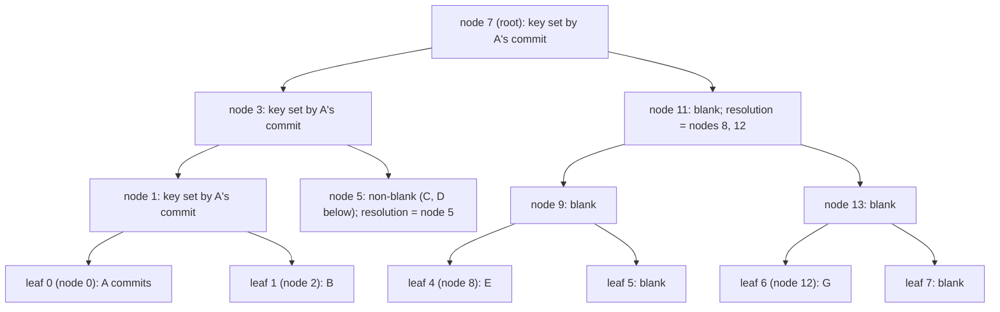

# PqChat TreeKEM mode (`groupMode = 1`), minimal scope: design

**Status:** SPECIFIED; BUILT (UNAUDITED): the contract (plan T1a-T3d with the code review's fixes of 2026-11-24 on branch `review-fix-contract`), clientkeys and `ua-rs` (T1a, T1b, the forward walk of C25 / C26), the node's rows and bounds (T4's allow-list part, D-4, D-7); PLANNED: T4's whole-set guard and C37's order at the node, T5-T10. **UNAUDITED**: a new cryptographic protocol; every construction below is a design, not a
reviewed protocol. **Revision 3 (2026-11-23)**, after two review rounds by Codex and Fable: of revision 1 (`f42a75af2`; 22 and
16 findings, 2 unsure) and of revision 2 (`29ba84732`; Codex 16, Fable 9 and 1 unsure). A finding is cited by its id where its
fix sits (`codex-n`, `fable-n`; round 2: `codex-r2-n`, `fable-r2-n`; round 3: `fable-r3-n`, `codex-r3-n`); [§17](#17-what-revisions-2-and-3-changed) lists them. **A
third, focused round by Fable on revision 3 (`fable-r3-n`: 0 P0, 2 P1, 4 P2, 3 P3; approve with fixes) is fixed in place:**
wording, client rules, one node rule and one ordering rule of the contract. No record, typehash or derivation moved. **After
that round the owner made the key no-return set two-level (R16, on the controller's finding of a front-running burn):** a
contract rule, one storage set, one named error and one client warning; again no record, typehash or derivation moved.
**A third round by Codex on that tree (`codex-r3-n`: 0 P0, 6 P1, 6 P2, 1 P3; rework before the recovery vectors and the gas
bounds freeze; R16 and both readings of C28 judged sound) is fixed in place:** client rules of recovery, of the checkpoint
and of the warning, one contract check (the signed admin list against the UAs a commit evicts), the order of a commit's
pieces, and the completion's gas recomputed. No record, typehash or derivation moved, and no view. **After the code
review of 2026-11-24 (Fable, on the built tree), fixed in the spec before the code:** a leave or removal names the head or
an ancestor of it and applies at the head (E-3, on the owner's ruling that chain-level front-running is in the threat
model); a client verifies the chain **forward** from the signed member list and builds only on a tree it reached so (E-1,
C-1, B-1, F-1); four smaller rules ([§17](#17-what-revisions-2-and-3-changed)). No record, typehash, derivation or byte
format moved; two views read differently (the exit's epoch). The build follows. Branch `treekem-research`; the contract work branches from `pqchat-sigs`
once it has landed. Research [`2026-11-23-treekem-pqchat.md`](../../research/2026-11-23-treekem-pqchat.md) (cited "note §n"); plan
[`2026-11-23-pqchat-treekem.md`](../plans/2026-11-23-pqchat-treekem.md). Rule ids introduced here (SPECIFIED, defined once in
their component doc, recorded in [decisions.md](../../decisions.md)): CTR-CHAT-26 (owner), CTR-CHAT-27 (controller calls),
CLI-PQC-17 (owner). Ids of branch `pqchat-sigs` this builds on: CTR-CHAT-23 (signature storage per home), CTR-CHAT-24 (several
`keyId`s per member UA), CTR-CHAT-25 (`groupMode`), CLI-PQC-15 (`require_signed_records`). Tags: **[F]** fact, **[E]** estimate
(paper figures on the pinned PqChat rows, as in the note; the plan measures and pins them).

**Contents**

1. [Rulings this spec follows](#1-rulings-this-spec-follows)
2. [Controller calls](#2-controller-calls)
3. [Scope, non-goals, deviations from RFC 9420](#3-scope-non-goals-deviations-from-rfc-9420)
4. [The ratchet tree](#4-the-ratchet-tree)
5. [Secrets: path, epoch schedule, `K`](#5-secrets-path-epoch-schedule-k)
6. [Records and entries](#6-records-and-entries)
7. [Storage](#7-storage)
8. [What the contract checks, and what only clients check](#8-what-the-contract-checks-and-what-only-clients-check)
9. [Rights, leave, removal](#9-rights-leave-removal)
10. [Recovery from state: replay](#10-recovery-from-state-replay)
11. [Forks, refusals, named errors](#11-forks-refusals-named-errors)
12. [Signature storage and (M)](#12-signature-storage-and-m)
13. [Bounds and gas](#13-bounds-and-gas)
14. [Threats](#14-threats)
15. [Client layers](#15-client-layers)
16. [Open points for the owner](#16-open-points-for-the-owner)
17. [What revisions 2 and 3 changed](#17-what-revisions-2-and-3-changed)

## 1. Rulings this spec follows

**Owner, 2026-11-23 (owner: yes), as relayed by the controller:**

- R1. "Minimal mode 1 is built now, before the pre-freeze tag. It covers a commit with UpdatePath, Add and Remove, with Welcome
  by wraps. External commits, PSKs and ReInit are out."
- R2. "A new DELEGATECALL body module is accepted for it."
- R3. "`groupMode` is a protocol id: 0 = flat; 1 = RFC 9420 tree rules over KEM scheme 1 (ML-KEM-1024 + X25519,
  `clients/ua-rs/src/wallet/kem.rs`); 2–255 for later variants. It is appended at the end of `PqChatSession` and
  `PqVaultCreate`, and fixed at creation."
- R4. "The committer's own path secrets are seed-derived (HKDF over the session and the commit), so no self-wrap."
- R5. "PqVault accepts only 0 in this release; it stays open for a later PqVault release."
- R6. "Our own TreeKEM in `ua-rs`, following RFC 9420's algorithms, with typed records. No MLS library."
- R7 (on revision 1's open points, as relayed for this revision): the leaf is the registry KEM key and is not refreshed per
  commit (C5); a non-admin commits only for its own UA's leaves (C8); tree sessions are refused on `none` homes and on replicas
  (C1, C4); ML-KEM-1024 is the only node scheme (C2); no unmerged leaves (C6).
- R8. `TREE_LEAVES_MAX` = 256, **confirmed on revision 2's figures:** one session record creates up to about 200 keys at a 60 M
  block, the rest come by Adds (§13). **Change (owner 2026-11-25, "OK, then raise it to 512"): 512, depth 9** (option (d) of
  `docs/research/2026-11-25-treekem-beyond-256.md`; the measured rows in §13's "Measured at 512"). **`TREE_CHANGES_MAX` 32 -> 20 the same day (owner, "Choose
  20", in English)**, so the commit of the last live leaf at the bounds fits 2^24 with an ML-DSA-87 author (C10).
- R9. The joiner secret is derived **without RFC 9420's `init` chain** (C23). A member that misses an epoch follows again at
  the next commit that reaches its leaf, or by a commit of its own.
- R10. **The cost of R9 is accepted** (fable-r2-1): in mode 1, as in mode 0's `rekey`, one UA signature lets its holder build
  the next epoch. A commit from a device's own `(ua, keyId)` that its seed cannot reproduce is shown as a **compromise
  warning**, never merged into "not followed" (§5, §10, §14).
- R11. **Tree sessions send no automatic receipts.** Store reads by the epoch hint stay as they are; the ARCH-POS-13 claim is
  narrowed to what holds (C22, §10; fable-r2-2).
- R12. **Impossible commits are refused by the contract at acceptance:** `treeHash`, `ctCount`, the path length, removed UAs,
  and every other input that is public then (C7, C24, §8; fable-r2-3).
- R13. **Freshness before publishing newly private session information** (a changed `sealedInfo`: room and store lists): the
  client needs the head and the roster read at a final block under the strict majority over **at least 3 named endpoints**
  (ARCH-POS-15). With fewer it refuses (§11; codex-4).
- R14. **No return (mode 1 only).** "Members are not allowed back" (the owner's words, translated here and below): a UA that was removed from a tree session, or left it,
  is never added back to that session; the contract refuses the Add (C28). A UA's own key changes (a new `keyId`) are not a
  return. "To come back, the user creates a new UA and is added": the way back is a **new UA** (a new account index or a new
  seed, a KEM holder with its own registry record), added by a live admin like any new member. "Yes, block the `kemHash` too": the
  set also holds the `kemHash` of **every key ever taken out** of the session, and an Add of such a key is refused under any
  UA, with an error of its own; a new UA comes with a fresh KEM key. Mode 0 and PqVault are unchanged: re-adds stay allowed
  there. **The key half is two-level since R16:** a key a UA takes out of its own leaves is refused to that UA only; the
  keys of a UA that goes are refused under any UA.
- R15 (on the third round; fable-r3-2). **The `kemHash` half of R14 is kept as hygiene.** It stops the reuse of **the same
  key bytes** only. A deliberate equivalent key does not stop at it: an X25519 point shifted by a torsion point, or an
  ML-KEM `ek` shifted by a small vector, has another `kemHash` and is opened by the old secret (§8). That case falls under
  the accepted lending residual, because an admin must add the new UA. **Exclusion rests on the UA roster** (§9, §14).
- R16 (after the third round, on the controller's finding of a front-running burn). **The key no-return set of R14 is
  two-level.**

  | Event | What enters the set |
  |---|---|
  | A UA **changes its own keys** (a commit takes out one of its own `keyId`s under the own-UA rule) | the pair `(ua, kemHash)`: only that same UA may never re-add that key |
  | A UA **leaves or is removed** (by `treeRemove`, a forced leave, or an admin's commit that leaves it with no leaf) | the session-wide `kemHash` of **every** key that UA held, plus the UA itself in the UA set (R14 unchanged) |

  An Add is refused when its UA is in the UA set (`PqChatTreeReturn`), when `(ua, kemHash)` is in the pair set
  (`PqChatTreeOwnKeyReturn`), or when its `kemHash` is in the session-wide set (`PqChatTreeKeyReturn`). **Why:** under the
  single set a member B could register A's public KEM key as its own new KEM version, add that leaf under the own-UA rule,
  then take it out again, and A's key was burnt session-wide with no admin involved; B could repeat it each time A
  registered a new key, before A's Add landed (front-running), so A never got in. With two levels B's own-key churn harms
  only `(B, kemHash)`. B burns A's key only by leaving or being removed, which excludes B for good (one burn per UA), and
  any further UA needs an admin's Add. Honest reuse of a compromised key is still blocked: by the same UA through the
  pair, by a new UA after a removal through the session-wide entry. **Client rule (CLI-PQC-17):** before an Add, the
  admin's client checks whether the key's `kemHash` is registered to another UA in the registry and warns ("this key is
  also held by UA …"); client only.

**Earlier rulings:** signature storage per home, `none` | `sstore2`, default `sstore2` (CTR-CHAT-23); several `keyId`s per member
UA, members sorted by `(ua, keyId)` (CTR-CHAT-24, "(M)"); every record kept in full in state (CTR-CHAT-05); one child per parent
in the home instance (CTR-CHAT-08); rights (CTR-CHAT-09), `remove` (CTR-CHAT-20), `leave` (CTR-CHAT-10); recovery from state
alone (CTR-CHAT-14); every write relayable by anyone, fee 0 too (CTR-CHAT-19); the one-signer rule (CLI-UAL-01); the SDK's C1
and the A-3 ruling (no key byte to an app core, no rooted key leaves `ua-rs`); ARCH-POS-13 (no decryption oracle; the hybrid
KEM of scheme 1 is outside it by the owner's change of 2026-11-13, PqChat's own rule of no automatic reaction, CLI-PQC-07,
stays); ARCH-POS-15 (lists of nodes); ARCH-POS-18 (software fallback).

## 2. Controller calls

Each is the controller's (owner: no) unless marked; the owner may override any. Recorded as CTR-CHAT-27. C14–C27 are revision 2's, C28–C36 revision 3's, C37 and C38 follow Codex's third round, C39 and C40 the code review of 2026-11-24 (which also reworded C9, C21, C25 and C26).

| # | Call | Why |
|---|---|---|
| C1 | (owner, R7) A tree session is refused on a `none` home: `PqChatTreeSigStore()` | a committer encrypts path secrets to node keys vouched for only by commit signatures (note §6.1) |
| C2 | (owner, R7) Tree nodes use KEM scheme 1 (ML-KEM-1024 + X25519), the one scheme; a node key is a `kemPk` of 1,601 B (`0x01 ‖ ek ‖ pk_X`) | R3 names scheme 1; another node KEM is another `groupMode` |
| C3 | The contract enforces nothing about group size below the cap; "useful from about 7 keys, where several members commit" is a client hint | note §4.2 |
| C4 | (owner, R7) A tree session lives only in its home instance: `createSession` with `groupMode = 1` on another instance is `PqChatTreeHome()` | no replica, hence no fork to reconcile (§11) |
| C5 | (owner, R7) A leaf is a registry KEM key `(ua, keyId)` by reference; a commit never replaces a leaf key | the registry's versions are write-once; a new device key is a new `keyId`, added by a commit (§9) |
| C6 | (owner, R7) No unmerged leaves: an Add blanks the new leaf's direct path; no truncation of the tree; every commit carries a path | simpler resolution on chain (note §8.5); blank levels cost nothing because the path is filtered |
| C7 | (owner, R12) The contract keeps the tree hash and computes the commit's tree in memory **when the record is accepted**: the signed `treeHash`, `ctCount`, the path length and the removed UAs are compared then, the target list when it lands | a wrong value is never staged and never becomes an epoch, so no client ever has to reject an accepted commit (§8; fable-r2-3) |
| C8 | (owner, R7) A non-admin author changes keys of its own UA only | a tree is stateful: dropping another member's leaf lasts until an Add (§9) |
| C9 | Leaving and removing in a tree session name a **complete epoch of the session: the head or an ancestor of it**, and **take effect on the head when they land**: the UA is `gone` from the head's number, every leaf it holds at the head is owed, and the record is kept under the head's epoch; a staged, losing or unknown epoch is refused (`PqChatIncomplete`, `PqChatUnknown`). In a tree session every complete epoch is on the head's chain (C4, C20, CTR-CHAT-08), so "complete and of this session" is the whole ancestor check: three slots of the named epoch and two for the head's number, no walk (Change 2026-11-24, E-3). **An exit expires by a bounded lag (Change 2026-11-24, the spec check, sc-E-2, sc-F-5):** it is valid only while `head.epoch ≤ named.epoch + EXIT_LAG_MAX`, `EXIT_LAG_MAX` = 16, else `PqChatExitLag(named, head)`; no typehash moves. **A repeat is refused:** an exit whose UAs it would newly flag at the head number none is `PqChatNotMember` (A-4, sc-E-5). **The same rules hold in mode 0 and in PqVault** (owner 2026-11-24: "Yes, both modes"): at home their `remove` / `leave` and `removeVaultMembers` / `leaveVault` name the head or an ancestor within the lag and apply at the head; a replica applies a flag the home applied at a later epoch by the lag rule of CTR-CHAT-20 (CTR-CHAT-20, CTR-CHAT-10, CTR-PQV-06). **There, at home, the signer and every UA an exit names are in the lists of the epoch named as well as the head's** (Change 2026-11-25, E-2 of the re-review; controller call), since a replica checks them on the epoch named; and **a replica takes an exit that newly flags nobody** (A-16): the home may have applied a second record naming that epoch at a later head, and a flag only allows there. So a replica can copy every exit the home took. A tree session has no replica (C4) and keeps no list per epoch, so its exits keep the head's checks | the next commit is the only one that can honour them. **Chain-level front-running is in the threat model (owner 2026-11-24):** under "the head only" a member about to be removed lands a commit first, the exit names a parent that now has a child and is void, and that repeats for ever (E-3). **Why 16:** to void one exit a front-runner must complete 17 epochs in a row before it lands, each a commit or rekey of its own with a PQ signature check and its pieces, against which the admin re-signs one record at the new head; a held, delayed or reverted-and-copied exit dies after 16 epochs of the group's own activity, so a decision is never applied to a group much changed since (sc-E-2's scenarios); 32 would double the front-runner's cost for twice the window, and the ratio, not the window, is what stops it |
| C10 | (owner, R8) `TREE_LEAVES_MAX` = 512 (depth 9; 256, depth 8, until 2026-11-25); `TREE_CHANGES_MAX` = 20 adds plus removes per commit (owner 2026-11-25; 32, a controller call, until then) | §13 |
| C11 | A tree session's control-plane records are always verified by the client, whatever `require_signed_records` says | C1's reason |
| C12 | The epoch secret is confirmed by opening the commit's `sealedInfo`, which a tree commit may not leave empty; no separate confirmation tag | the tag would sit outside the signed record; `sealedInfo` is already an AEAD under a key from `K` (fable-13) |
| C13 | The tree hash covers node keys and leaf keys; **there is no parent hash** (revision 1's `parentHash` is dropped) | the contract compares the whole `treeHash`, which binds everything the parent hash bound, and no client step read it (fable-16; with it codex-19 has no second hash to disagree) |
| C14 | The target list is not in the signed record: the record signs `ctCount` and `ctListHash`; the list (`ctTargets`, `ctHashes`) lands once as a piece of its own and stays in state | with the list inside, the worst record at 256 keys asks 60.7 M and does not fit a 60 M block; outside, every piece of a commit fits (§13) **[E]** (codex-9, fable-3) |
| C15 | The cold tree is written with the wraps: leaf `i` and the hashes above it are written when wrap `i` of epoch 0 lands | 767 new slots in the record's transaction are 75.1 M of state gas at 256 keys (codex-9, fable-12) |
| C16 | `treeId = hashStruct(PqChatSession)` names a tree session: it is a field of every commit and an input of every tree derivation from epoch 1 (epoch 0 uses `genesisCtx`, C29); clients key their state and consent by it | `sessionId` is creator plus nonce and binds neither the home nor the genesis record (codex-7, fable-1) |
| C17 | `pathContext` also binds the parent's tree hash; a commit's nonce is never used twice once a piece or its signature has left the device | the tree hash commits to every target key; a retried or twin commit gets independent secrets (fable-1, codex-7, O9 of the review) |
| C18 | A leaf's hash and a `TreeAdd` carry `kemHash = keccak256(kemPk)`; the contract takes it from the registry; one live leaf per `kemHash`; a client authenticates a registry key before it encapsulates to it, and at an epoch-0 head rebuilds the tree from the signed member list | a substituted key, or a second leaf with the bytes of a removed device's key, would receive the epoch (codex-1, codex-2, fable-10, codex-r2-1) |
| C19 | Every node key and every leaf key passes the public-key admission check of scheme 1 in the contract; an Add needs `scheme == 1` | a key no honest member can encapsulate to would block every committer outside its subtree (codex-8, fable-4, fable-10) |
| C20 | A tree epoch's `wraps` counter is its piece count plus one; the last unit is added only by the successful completion | every inherited reader of `landed == wraps` then sees a tree epoch complete exactly when it took its slot (codex-10, fable-7) |
| C21 | In a tree session a leave is forced like a removal, and `treeRemove` and `treeLeave` are refused when the leaves owed at the head they land on would exceed `TREE_CHANGES_MAX`: `PqChatTreeBacklog`. The count is of the leaves each UA holds there, at most `KEYS_PER_UA_MAX`, so a front-running commit raises it by at most its author's own keys (C9) | the commit that must honour them always fits one record, and the honest builder has one rule (codex-6, fable-2, codex-r2-7) |
| C22 | (owner, R11) Replay reads are scheduled from public data only; no contract write of a tree session is automatic; a tree session sends no receipt | the replay reads and the writes show nothing about whether a ciphertext opened; the store read by the epoch hint is the one inherited signal left (§10; codex-3, fable-8, fable-r2-2) |
| C23 | (owner, R9, R10) `joiner_e` derives from the commit secret and the context, without the previous epoch's `init` | with the chain one member's bad commit ends the session for good; without it the next honest commit heals, as in mode 0. The cost: a commit proves a signature, not knowledge of the previous epoch (fable-4, codex-18, fable-r2-1) |
| C24 | Shapes are bounded when a record is accepted: `ctCount` < `leaves`, at most `TREE_ADMINS_MAX` = 32 admins, `sealedInfo` at most `TREE_INFO_MAX` = 4,124 B (the sealed form of the 4,096-B padding bucket), at creation too; a commit that changes `admins` otherwise than by dropping UAs that are gone, and a `treeRemove`, leave an admin with a live leaf; a UA that a commit leaves with no leaf counts as gone for that commit's `admins` (codex-r3-10) | with C7, no record is staged whose public inputs could not complete on the state it was accepted on (what is known only by a signed hash: §8, fable-r3-6); no group left with a keyless admin only (codex-20, codex-21, codex-r2-13, fable-r2-6) |
| C25 | **A device verifies the chain forward (Change 2026-11-24, E-1, C-1, B-1, F-1).** It starts from the cold tree rebuilt from the session record's signed `members` (§8 step 3), or from the public tree it verified itself at its pin, and applies every commit record in order up to the head. For each record it checks the id at its number, `treeId`, the signature for the signer's kind (every kind the contract accepts: F-3), `parentEpochId` and `parentTreeHash` against the previous record and the tree built so far, the author's live leaf `(author, keyId)` on that tree and not `gone`, the right of §9 against the previous record's `admins` and the exits applied up to it (§10 step 5), and that the tree after the commit hashes to the record's signed `treeHash`. The rosters are the walk's trees; a served snapshot is only compared with the walk's result. **A device with no verified tree, a commit joiner included, reads every record from the session record to the head**; it opens ciphertexts only in the epochs its key was in the tree; which epoch won is the home's state, read under ARCH-POS-15 | a signature cannot prove a commit won. A snapshot is bound only to the head record, which its own author signs: a roster undone from it lets that author vouch for the roster that judges it, so an endpoint with any registered key forged a followed head (E-1). Forward, every leaf and node of the tree a record is judged on was put there by a verified record before it (codex-11, codex-r2-6, codex-r3-1, E-1) |
| C26 | A client builds only on a head at or after its local checkpoint, which holds the `hashStruct` of the verified head record; it builds on the tree its forward walk reached (C25), and the checkpoint moves only to a head that walk verified, never to a record that failed it (C-3); it settles a conflict at a pinned number by a strict-majority read; before it extends its state above the pin it compares the record that won at the pinned number with the pin; what a candidate seals is taken as disclosed to every key of the tree it was built on; (owner, R13) a changed session info needs the strict majority over at least 3 named endpoints at a final block | a rejected commit cannot be recalled; an epoch id does not bind its record; a pin written from one endpoint can be a twin; a child binds its parent's id and tree, not its record (codex-4, fable-r2-4, fable-r3-3, codex-r3-2) |
| C27 | A home's signature-storage setting is taken from pinned deployment data, or read under the majority rule; a session's mode is pinned with its `treeId` | first contact cannot be steered to an unsigned flat twin (codex-14) |
| C28 | (owner, R14, R16) A UA that left or was removed is never added again: `gone[ua]`, one slot per such UA, `PqChatTreeReturn`. **The key set is two-level (R16):** a key taken out of a UA that stays a member enters the pair set, `goneOwnKey[ua][kemHash]`, and that UA never adds it again (`PqChatTreeOwnKeyReturn`); the keys of a UA that goes enter the session-wide set, `goneKey[kemHash]`, and are never added again under any UA (`PqChatTreeKeyReturn`); one slot per key taken out, in one of the two sets. (controller) The level is judged on the tree after the commit's Adds: the leaf's UA still holds a leaf → the pair set; it is `gone` → the session-wide set, for the keys its leaves hold when they are blanked (at most `KEYS_PER_UA_MAX`; keys it took out earlier stay pairs). So an admin's Remove of one key of a UA that keeps another leaf is a key change of that UA, at the pair level. The slot holds the key's period | the owner's rules; the same UA never returns, nor the same key bytes to the UA that took them out, nor under any UA once their holder went. Under a single set one member's own-key churn burnt another UA's key session-wide, with no admin and repeatably (R16). The key half is hygiene against reuse of the same bytes (R15): a related key with another `kemHash` is not stopped by it (§8). The pair level for a UA that stays lets an admin free a key a member squats on by removing that leaf alone, without burning it. Every `(ua, kemHash)` has one period in a session, and none follows a session-wide entry, so recovery needs no list of periods (codex-2, codex-r2-2, codex-r2-10, fable-r3-2) |
| C29 | Epoch 0 is sealed under `genesisCtx`, a typed hash of the session record's public fields; `treeId` is used from the first commit on | `treeId` hashes the wrap hashes and `sealedInfo`, which would need `treeId` to be built: no construction order (codex-r2-4) |
| C30 | Leaving and removing in a tree session are their own records and entries, `PqChatTreeLeave` and `PqChatTreeRemove`, which sign `treeId`; `leave` and `remove` are refused there | the flat records sign neither the home nor the genesis: one signature would hold in a twin session at another home (codex-r2-5) |
| C31 | `PqChatCommit` signs `parentTreeHash`; the contract compares it with the head's stored tree hash at acceptance; `ctx_e` binds it | the author's `ps[0]` depends on it, and a twin of the head that differs only where the path overwrites would pass the final hash (codex-r2-11, fable-r2-4) |
| C32 | The admission check also asks a canonical `pk_X`: bit 255 clear and the value below `p` | X25519 ignores bit 255 and reduces mod `p`, so one point would have up to four byte strings; the rule leaves one byte string per point. It is a rule on bytes: it does not make an admitted key the only one that its secret opens (§8; codex-r2-2, fable-r3-2) |
| C33 | A commit's `sealedInfo` is a full info or the marker "unchanged" (empty content, padded and sealed); a device seals the full info only if it holds the one in force at the parent, and a device that did not follow an epoch holds none from that epoch on; clients take a changed info only from an admin; after a gap an admin establishes the info anew as a changed info, reviewed, never automatically (codex-r3-7) | a device that fell behind, by a refresh or by a later commit after it follows again, would publish retired room and store lists to members that joined later, and a first-time joiner has no info to re-seal (codex-r2-3, fable-r2-5, fable-r3-1) |
| C34 | At creation a member UA joins `sessionsOf` when its first wrap lands; the creator with the record | two new slots per first-time UA in the record's transaction are 37.6 M of state gas at 192 UAs (codex-r2-8) |
| C35 | A send held while a child was not final goes back to the user when the child is final; it is never sent on its own | a flushed send shows the device followed the child (fable-r2-2) |
| C36 | `treeLeaves` returns at most `TREE_LEAF_PAGE_MAX` = 64 leaves per call | each `kemHash` is computed from the registry at read; a page of 256 is 6 to 10 M under the 2^24 cap of `eth_call` (fable-r2-U1) |
| C37 | A commit's pieces leave the device in a fixed order: the record, then the list and the node keys, each final before the next; then the ciphertexts and the Welcome wraps; **one ciphertext is held back** and sent alone when every other piece is final. The node keeps that order for a set it relays | whichever piece lands last pays the completion, up to 34.5 M of state gas at the bounds; with the node keys it would not fit a 60 M block, with a ciphertext it does. A piece that has not left the device cannot be landed by anyone else (§13; codex-r3-12) |
| C38 | A tree session in which no UA that is not `gone` holds a live leaf is **closed**: the contract does not refuse the `treeLeave` or `treeRemove` that closes it and accepts no message, commit or leave after it; a `treeRemove` after it can only name a UA that is not `gone` yet (a keyless admin), since one naming a `gone` UA is refused (C9, A-4); the head, `owed` and the leaves stay, and no `goneKey` entry is written for those leaves | nobody is left to author the commit that would honour it, and nothing can be added to it (R14), so the key sets have no reader there; finishing the accounting inside the last leave would add up to 32 slots to a `treeLeave` for no reader (§9; codex-r3-11) |
| C39 | An Add's key that a live leaf holds is free for this commit **exactly when a Remove of this commit takes out that leaf**, judged on the Removes, never on the order of the Adds: a leaf is live while this commit has not removed it, whether or not an Add of this commit fills it again; the levels of R16 then apply as stated (Change 2026-11-24, A-1, D-6, F-6, E-5) | under a leaf-position mark, a removed leaf refilled by an earlier Add of the same commit made the key look live again, so one order of two Adds was refused and the other accepted; the clients accept both, so the rule is the order-independent one and the clients keep it |
| C40 | `addPath` carries at least one ciphertext (`PqChatShape`), like `addPathList` and `addPathKeys`; the node refuses an empty one too (Change 2026-11-24, D-7). `addWraps` carries at least one wrap, in both modes (`PqChatShape`), and PqVault's `addVaultWraps` too (`PqVaultShape`) (Change 2026-11-25, A-15 of the re-review; CTR-CHAT-07) | an empty call wrote nothing, emitted a piece event of count 0 and cost a relaying lane its gas |

## 3. Scope, non-goals, deviations from RFC 9420

**In:** a tree session created cold from the signed member list; `commit` with an UpdatePath, Adds and Removes (by `(ua, keyId)`,
and by UA as every key of it); Welcome as one flat wrap per added key; messages, `sealedInfo`, stores and calls as in
mode 0; leaving and removing with records of their own (C30); recovery by replay.

**Out (R1, R7):** external commits, pre-shared keys, ReInit, group-context extensions, proposals sent apart from their commit,
Update proposals without a commit, unmerged leaves, tree truncation, a creator-filled first path, leaf-key rotation, the
return of a UA that left or was removed (R14), a tree in PqVault (R5), any other family than EVM (the other families keep `groupMode` 0 only; one rule on every EVM chain).

**Deviations from RFC 9420, all deliberate:** typed EIP-712 records instead of TLS-encoded messages; keccak256 in the tree hash;
no parent hash (C13); HKDF-SHA-256 labels of this repo instead of `ExpandWithLabel`; scheme-1 KEM plus AES-256-GCM instead of
HPKE; no unmerged leaves, so **an added leaf is in the resolution of its commit** and receives a path ciphertext (RFC 9420 §7.5
excludes new members and puts a path secret in the Welcome; fable-5); `sealedInfo` instead of the confirmation tag; the group
context without a transcript hash (the chain orders and keeps the transcript); deterministic committer secrets (R4); a joiner
secret without the `init` chain (C23, R9), so that **a commit proves its author's signature and not knowledge of the previous
epoch** (R10); no membership tag. None of RFC 9420's analyses covers the result.

## 4. The ratchet tree

**Array layout (RFC 9420 Appendix C) [F].** A perfect binary tree of `leaves = 2^d` leaves in an array of `2·leaves − 1` nodes:
leaf `i` is node `2i`, parents are the odd nodes, `level(x)` is the count of trailing one bits of `x`, the root is
`leaves − 1`, `left(x) = x − 2^(level−1)`, `right(x) = x + 2^(level−1)`, and `parent`, `sibling`, `direct_path` and `copath`
are Appendix C's, unchanged. Node indices do not move when the tree grows: `leaves` doubles and
the new root sits above the old one.

**Size.** A session keeps `used` (leaf positions ever assigned; `members.length` at creation) and `leaves`, the smallest power
of two `≥ used` (1 when `used = 1`: the root is then leaf 0 itself, and `treeHash` is that leaf's `th` wherever a root
is computed, a commit's walk at acceptance and completion included; Change 2026-11-24, F-5). An Add takes a blank leaf below `used`, or leaf `used` (then `used` grows, and `leaves`
doubles when needed). Clients take the leftmost blank leaf (a hint; the contract checks only blank and in range). The tree
never shrinks (C6). `used ≤ TREE_LEAVES_MAX`.

**Nodes.** A leaf is blank or names one `(ua, keyId)`, a KEM key its UA holds in this chain's registry (C5), with that key's
`kemHash = keccak256(kemPk)` (C18). A parent is blank or holds one node key (`kemPk`, 1,601 B) set by a commit. A cold tree
(after creation) has every parent blank. No two live leaves have one `kemHash`, hence none share `(ua, keyId)`; an admitted
X25519 point has one encoding (C32, §8), so two live leaves never hold the same key bytes, nor one point under two byte
strings. That is uniqueness of bytes: related keys that one secret opens exist (§8, R15).

**Resolution** (RFC 9420 §4.1.2, without unmerged leaves): of a non-blank node, the node; of a blank leaf, nothing; of a blank
parent, the resolutions of its left then right child. It is always listed in ascending node index. A leaf added by a commit is
in that commit's resolutions.

**Direct path, copath, filtered path.** The direct path of leaf `l` is its ancestors up to the root; the copath child at each
is the child not on the path. The **filtered path** drops every ancestor whose copath child has an empty resolution. A commit
sets exactly the nodes of its author's filtered path, computed on the tree **after** the commit's Removes and Adds, and
blanks the other nodes of its direct path (RFC 9420 §7.5).

**Tree hash** (RFC 9420 §7.8, typed), always of **the tree after the commit's changes and its new path keys**:

```text
TreeLeaf(uint32 leaf,bytes32 ua,uint64 keyId,bytes32 kemHash)   th(leaf)   = 0 if blank, else hashStruct(TreeLeaf)
TreeParent(bytes32 keyHash,bytes32 left,bytes32 right)          th(parent) = 0 if blank and th(left) = th(right) = 0,
                                                                             else hashStruct(TreeParent), keyHash = 0 if blank
treeHash = th(root)
```

`keyHash = keccak256(kemPk)` of the node key. A subtree with no member hashes to 0, so padding and growth cost no slot. The
leaf's key bytes are bound through `kemHash`, which the contract computes from the registry (§8), so a signed `treeHash` vouches
for the key of every target, leaf or parent (codex-1).



In the picture A's commit carries 3 node keys and 4 ciphertexts, `ctTargets = [2, 5, 8, 12]`.

## 5. Secrets: path, epoch schedule, `K`

Notation as clientkeys' `pqchat.js`: `H(ikm, info) = HKDF-SHA-256(ikm, salt = empty, info, 32)`; labels are ASCII followed by
the listed fields (`u32`, `u64` big-endian). Every step below runs inside `ua-rs` (§15).

**The session's name (C16).** `treeId = hashStruct(PqChatSession)`, the EIP-712 struct hash of the signed session record. The
record names its home chain and instance, its creator and nonce, its members, admins and `groupMode`, and the contract accepts it
at that home only (C4); so `treeId` binds the home and the genesis record, which `sessionId` (creator and nonce) does not.

**The genesis context (C29, codex-r2-4).** `treeId` also hashes `wrapHashes` and `sealedInfo`, so nothing that goes into a wrap
of epoch 0 or into the genesis `sealedInfo` can depend on it. Epoch 0 is sealed under

```text
genesisCtx = hashStruct(TreeGenesis)       the fields of PqChatSession in its order, without wrapHashes and sealedInfo:
                                           creator, nonce, homeChain, homeChatContract, admins, members, groupMode
```

The creator builds in this order: `genesisCtx` → `joiner_0`, `K_0` → the wraps and `sealedInfo` → the record with their hashes →
`treeId` → the signature. A device that recovers computes both from the stored record. `genesisCtx` is used by epoch 0's wraps
and schedule only; every commit, from epoch 1, uses `treeId`. Both bind the home, the creator, the nonce and the member list.

**Path secrets (RFC 9420 §7.4).**

```text
ps[k+1]      = H(ps[k], "scaas/pqchat/v1/tree/path")                         k = 0 .. m-1
nodeSeed[k]  = HKDF(ps[k], "scaas/pqchat/v1/tree/node", 96 B)                the 96-byte KEM seed form of kem.rs
nodeKey[k]   = kemPk of nodeSeed[k]                                          the key of filtered-path node p[k]
commitSecret = ps[m]
```

**The committer's `ps[0]` (R4, C17).** Deterministic from the KEM seed of the author's leaf key and everything that fixes the
recipients and their keys:

```text
pathContext = keccak256(abi.encode(TAG_TREE_PATH, treeId, parentEpochId, parentTreeHash, author, nonce, leaf, keyId,
                                   hash(removes), hash(adds), keccak256(abi.encodePacked(ctTargets))))
                                   with ctTargets each as 4 B big-endian, as the list is stored (§7)
ps[0]       = HKDF(kemSeed(ua, keyId), "scaas/pqchat/v1/tree/commit" ‖ pathContext, 32)
```

`TAG_TREE_PATH = keccak256("scaas/pqchat/v1/tree/path-context")`; `hash(removes)`, `hash(adds)` are the EIP-712 array hashes of
§6 (an Add's hash covers its `kemHash`); `parentTreeHash` is the parent commit's signed `treeHash`, or the genesis tree hash
when the parent is epoch 0 (the client computes that one from the signed member list, §8). **It is a signed field of the
commit, and the contract compares it with the head's stored tree hash at acceptance (C31, codex-r2-11):** the value the author
derived `ps[0]` from is the one a later recovery reads, or the commit is refused (`PqChatTreeParent`).

- **Every target key is bound** (fable-1, codex-7). A target is a node of the parent tree or a leaf this commit adds;
  `parentTreeHash` commits to the key of the first (the client checked every key it uses against it, §8) and `hash(adds)` to the
  key of the second. A commit built on another tree, in another session or at another home differs in `parentTreeHash` or
  `treeId`, so it has an independent `ps[0]`: a head served by a lying endpoint with other keys at the same indices (fable-1's
  scenario A), and a twin session with the same `sessionId` at another home (scenario B), no longer repeat a secret.
- **The nonce rule (C17).** `ua-rs` draws a commit's nonce at random (64 bits) and the client stores it before the first piece
  or the signature leaves the device; a rebuilt commit takes a new nonce, always. A device without that store (a fresh restore)
  draws at random too. The binding above already makes a repeated nonce harmless unless every bound input repeats, which is
  the same commit; the rule is the second guard.
- No byte on chain; the seed recovers every commit the key authored, from the commit's record (which holds `parentTreeHash`)
  and its list piece (§10). A device key that is random recovers its commits on that device only (note §6.2).

**A path ciphertext** seals `ps[k]` to one target `t` of the resolution of `p[k]`'s copath child, with `kemPk_t` the target's key
(a node key, or a leaf's registry key):

```text
(mlkemCt, x25519Eph, ss) = scheme-1 encaps(kemPk_t)
kek          = H(ss, "scaas/pqchat/v1/tree/ct" ‖ treeId ‖ epochId ‖ u32(p[k]) ‖ u32(t) ‖ keccak256(kemPk_t))
sealedSecret = AES-256-GCM(kek, nonce = 0, ps[k], aad = treeId ‖ epochId ‖ u32(p[k]) ‖ u32(t))          48 B
```

**The epoch schedule (RFC 9420 §8, reduced; C23).**

```text
ctx_e    = keccak256(abi.encode(TAG_TREE_CONTEXT, treeId, epochId, epoch, parentEpochId, parentTreeHash, treeHash,
                                keccak256(abi.encodePacked(admins))))
joiner_e = H(commitSecret, "scaas/pqchat/v1/tree/joiner" ‖ treeId ‖ epochId)
           epoch 0: joiner_0 is 32 random bytes of the creator
S_e      = H(joiner_e, "scaas/pqchat/v1/tree/epoch" ‖ ctx_e)
K_e      = H(S_e, "scaas/pqchat/v1/tree/key")
```

`TAG_TREE_CONTEXT = keccak256("scaas/pqchat/v1/tree/context")`. **For epoch 0** `genesisCtx` stands where `treeId` does (C29),
`epochId = sessionId`, and `parentEpochId`, `parentTreeHash` and `treeHash` are 0: `genesisCtx` already commits to the signed
member list, so deriving `K_0` needs no tree and no registry read (codex-16). `groupMode` is bound by the labels (`…/tree/…`)
and by `treeId` and `genesisCtx`. `parentTreeHash` beside `parentEpochId` binds the parent's **tree**, which its id (author
and nonce) does not (fable-r2-4). **It does not bind the rest of the parent's record (codex-r3-2):** two signed records with
one id and one tree can differ in `sealedInfo` or in `admins`. Which of them is the parent is the checkpoint's comparison
(§8, "before a client encrypts", step 1).

- **No `init` chain (C23; owner, R9).** RFC 9420 salts the joiner secret with the previous epoch's `init`. Here a member that
  misses one epoch would then miss every later one, and one member's commit of bad ciphertexts to everyone would leave nobody
  but itself able to continue: the session would be lost (fable-4, codex-18). Without the chain each commit stands alone:
  whoever opens one of its path ciphertexts follows it.
- **What that costs (owner, R10; fable-r2-1).** In RFC 9420 the chain does four things; this design keeps one. (1) A removed
  member cannot follow: kept, it rests on the blanked path. (2) Forward secrecy against a leaked node secret without the seed:
  lost (§14). (3) A node secret alone, without the epoch state, opens nothing: lost, one live node secret enters at the next
  commit that targets it. (4) **A commit is useful only to one who knew the previous epoch: lost.** The contract accepts a
  commit on its author's signature and public shape; the committer's secret alone fixes `K_e`. So **one UA signature lets its
  holder build the next epoch**: a stolen UA signing key, or one signature over a foreign `PqChatCommit` obtained from a signer
  outside `ua-rs`, opens the following epochs to the commit's maker until that leaf commits again or is removed **and every
  leaf the foreign commit added is out (§10; codex-r3-3)**; a holder of the stolen key
  commits again, so there only the removal of the UA ends it (§10). Mode 0's
  `rekey` has the same cost. The honest device notices: §10's compromise warning.
- **Every wrap of a tree session seals a joiner secret** under the tree's own label: epoch 0's wraps seal `joiner_0`; a Welcome
  wrap seals `joiner_e` to an added key. The `Wrap` struct is mode 0's; `kek` and `aad` are mode 0's `wrapKek` and `wrapAad`
  with the label `scaas/pqchat/v1/tree/wrap` and, in place of `sessionId`, `genesisCtx` for epoch 0 and `treeId` for a
  Welcome, so a tree wrap opens under no flat processing (fable-13).
- **A joiner also takes its path secret** (codex-5, fable-5): the added leaf is a target of its join commit (§4), and the
  joiner opens that ciphertext, derives upward, compares the node keys and so holds every node above its leaf that the commit
  set. The Welcome wrap and the path ciphertext must give the same `joiner_e`; a difference is "not followed" (§10).
- **`K_e` is the epoch key.** Sender chains (`…/v1/chain`), `infoKey`, `envKey`, `hint` and call keys derive from `K_e` exactly
  as in mode 0; messages, `sealedInfo` and the stores do not change.
- **Confirmation (C12).** A member that derived `K_e` opens the commit's `sealedInfo`; the handle of epoch `e` is usable only
  after that. A failure means the device did not follow that epoch (§10).
- **Session info and the marker (C33; codex-r2-3, fable-r2-5).** `sealedInfo` is mode 0's form: the content padded (`pad`: 256,
  1,024, 4,096 B buckets here), sealed under `infoKey`; 12 + 16 B longer than its bucket, so at most 4,124 B (`TREE_INFO_MAX`,
  at creation too; codex-r2-13). In a tree commit the content is **a full info** (the canonical JSON of mode 0, never empty)
  or **the marker "unchanged"**: empty content, 284 B sealed, which any device can build, a first-time joiner too. The **info
  in force** on a device at an epoch is the newest full info it accepted **in an unbroken run of followed epochs up to that
  one**. **A device that did not follow an epoch has no info in force from that epoch on (fable-r3-1):** the one it held may
  have been retired in the epoch it missed. It has one again from the first commit it follows that carries a full info,
  taken under the joiner rule below:
  - a device seals the full info only when it followed the parent epoch and holds an info in force there that is not
    flagged, byte for byte; otherwise it seals the marker. So a device that fell behind publishes nothing old, neither by
    a refresh nor by a later commit (a new device key, an Add) after it follows again through another member's commit;
  - a **changed** info (other content than the one in force at the parent) is an admin's action, reviewed in the signing
    operation, in a commit of its own and under R13's freshness (§11). Clients take a changed info only from a commit whose
    author is in the parent's admin list; a non-admin's differing info is ignored and shown, the epoch is still followed;
  - a joiner, and a device after a gap, has no info in force: it takes the full info of the first commit it follows that
    carries one (for a joiner its join commit), flagged until an admin's commit carries a full info, unless that author
    is an admin or its own UA; an Add's author seals the full info when it holds it;
  - **after a gap an admin may establish the info anew (codex-r3-7).** A device with no info in force seals the marker,
    always, by itself. If every admin device is in that state the markers go on and the session has no info in force for
    whoever joins or falls behind next. An admin ends that by **establishing a new info**: a full info that the user
    enters or confirms in the signing review. It is a changed info by definition (the device holds none in force to
    compare it with), so it goes in a commit of its own under R13's freshness (§11), and members take it as a changed
    info from an admin. The value the device cached before the gap may be offered as a draft marked "not in force"; it
    is never sealed without that review, never by a non-admin and never automatically (a refresh, a new device key and
    an Add seal the marker). Where no admin holds a leaf the info cannot be established again (§9).

## 6. Records and entries

Typed EIP-712 in `DS_C` under `PURPOSE_PQCHAT`, as every PqChat record (CTR-CHAT-03). Only a key, a ciphertext or a signature is
`bytes`.

| Typehash constant | Type string |
|---|---|
| `COMMIT_TYPEHASH` | `PqChatCommit(bytes32 sessionId,bytes32 author,uint64 nonce,uint64 epoch,bytes32 parentEpochId,bytes32 treeId,bytes32 parentTreeHash,uint32 leaf,uint64 keyId,uint32 leaves,bytes32[] admins,TreeRemove[] removes,TreeAdd[] adds,bytes32[] wrapHashes,bytes32[] nodeKeyHashes,uint32 ctCount,bytes32 ctListHash,bytes32 treeHash,bytes sealedInfo)TreeAdd(uint32 leaf,bytes32 ua,uint64 keyId,bytes32 via,bytes32 kemHash)TreeRemove(uint32 leaf,bytes32 ua,uint64 keyId)` |
| `TREE_ADD_TYPEHASH` | `TreeAdd(uint32 leaf,bytes32 ua,uint64 keyId,bytes32 via,bytes32 kemHash)` |
| `TREE_REMOVE_TYPEHASH` | `TreeRemove(uint32 leaf,bytes32 ua,uint64 keyId)` |
| `PATH_LIST_TYPEHASH` | `PathList(uint32[] ctTargets,bytes32[] ctHashes)` |
| `PATH_CT_TYPEHASH` | `PathCt(bytes mlkemCt,bytes32 x25519Eph,bytes sealedSecret)` |
| `TREE_LEAVE_RECORD_TYPEHASH` | `PqChatTreeLeave(bytes32 sessionId,bytes32 treeId,bytes32 epochId,bytes32 member,uint64 nonce)` |
| `TREE_REMOVE_RECORD_TYPEHASH` | `PqChatTreeRemove(bytes32 sessionId,bytes32 treeId,bytes32 epochId,uint64 nextEpoch,bytes32[] members,bytes32 admin,uint64 nonce)` |
| `TREE_GENESIS_TYPEHASH` | `TreeGenesis(bytes32 creator,uint64 nonce,…,uint8 groupMode)MemberKey(…)`: `PqChatSession`'s type string of `pqchat-sigs` without `wrapHashes` and `sealedInfo` (§5; hashed, never signed) |
| `TREE_LEAF_TYPEHASH`, `TREE_PARENT_TYPEHASH` | §4 (hashed, never signed alone) |

`PqChatCommit` by field: `author` (the record's second field, as in every epoch record: the stored author is read at that
position, fable-U2) commits from leaf `leaf`, its key `keyId`; `treeId` of §5 (C16: the signature holds at one home and under
one genesis record only); `parentTreeHash` the head's tree hash (C31); `leaves` is the tree's size after the commit; `admins` the full sorted admin list of the new epoch;
`removes` and `adds` the membership change (`via` as in `MemberKey`, not read by the contract; `kemHash` of the added key);
`wrapHashes[i]` the Welcome wrap of `adds[i]`; `nodeKeyHashes[k] = keccak256(nodeKey[k])`; `ctCount` the number of path
ciphertexts and `ctListHash = hashStruct(PathList)` of their list (C14), **of the empty list when `ctCount` is 0**
(codex-r2-14); `treeHash` of §4; `sealedInfo` as in `PqChatEpoch`, not empty (C12), a full info or the marker (C33).
`PqChatTreeLeave` and `PqChatTreeRemove` are `PqChatLeave` and `PqChatRemove` with `treeId` added (C30, codex-r2-5): the
signature holds for one home and one genesis record, and the signer's review names the session by `treeId`. Their nonce
scopes are the flat records'. In the list `ctTargets[j]` is the node the `j`-th ciphertext is sealed to and `ctHashes[j]` its `PathCt` hash,
ordered by path level upward, then by ascending target. The epoch id and the nonce scope are `PqChatEpoch`'s
(`epochId(sessionId, author, nonce)`, `scopeEpoch`): one id space for both modes.

**Entries** (one per operation; each signed write takes its record and a `UASig`, anyone sends it, CTR-CHAT-19):

| Entry | Signed | Purpose |
|---|---|---|
| `createSession(PqChatSession s, Wrap[] wraps, UASig sig)` | creator | unchanged entry and record; `groupMode = 1` opens a tree session; leaf `i` = `members[i]`, written when wrap `i` lands (C15) |
| `commit(PqChatCommit c, uint32[] ctTargets, bytes32[] ctHashes, bytes[] nodeKeys, PathCt[] cts, Wrap[] wraps, UASig sig) returns (bytes32 epochId)` | author | a tree epoch; the list and `nodeKeys` each whole or absent (empty), `cts` and `wraps` a first chunk or none; `cts` only with the list |
| `addPathList(bytes32 epochId, uint32[] ctTargets, bytes32[] ctHashes)` | none | the list, whole, once, against `ctListHash` |
| `addPathKeys(bytes32 epochId, bytes[] nodeKeys)` | none | the node keys, whole, once, each against its signed hash |
| `addPath(bytes32 epochId, uint32 firstCt, PathCt[] cts)` | none | ciphertexts `firstCt..`, at least one (`PqChatShape`, C40), each against its hash in the landed list (`PqChatPathList` before the list) |
| the three piece entries on epoch 0 of a tree session | | refused by name, `PqChatUnknown(epochId)`: epoch 0 has no commit and no pieces but its wraps (Change 2026-11-24, A-3) |
| `addWraps(bytes32 epochId, uint32 first, Wrap[] wraps)` | none | unchanged entry: epoch 0's wraps, and a commit's Welcome wraps (`wraps[i]` names `adds[i]`) |
| `treeLeave(PqChatTreeLeave l, UASig sig)` | the leaver | names the head or an ancestor of it within `EXIT_LAG_MAX` epochs and applies at the head (C9); the UA is `gone` from then on (C28) |
| `treeRemove(PqChatTreeRemove r, UASig sig)` | an admin of the head | names the head or an ancestor of it within `EXIT_LAG_MAX` epochs, `nextEpoch` the number of the epoch named plus one, and applies at the head (C9); bounded (C21); the UAs are `gone` from then on (C28) |
| `postMessage`, `storeMessage` | as today | unchanged records |
| `rekey`, `leave`, `remove` on a tree session; `commit`, `treeLeave`, `treeRemove` on a flat one | | refused: `PqChatModeEntry(groupMode)` |

**Views** (all state; a page view caps its count at `TREE_RANGE_MAX`, `treeLeaves` at `TREE_LEAF_PAGE_MAX`, C36): `treeOf(sessionId) → (bytes32 treeId, uint32 leaves, uint32
used, bytes32 treeHash, bytes32 genesisTreeHash, bytes32 headEpochId, uint32 owed)` (`owed`: leaves owed to removals at the
head, C21); `treeLeaves(sessionId, first, count) → TreeLeafView[] {bytes32 ua, uint64 keyId, uint64 joinEpoch, uint32 wrapIndex,
bytes32 kemHash}` (a blank leaf is all zero; `kemHash` is computed from the registry at read); `treeNodes(sessionId, first,
count) → TreeNodeView[] {bytes32 hash, bytes32 keyHash, uint64 epoch}` (fable-16: a client recomputes the root without fetching
a key it does not use) and `treeNodeKey(sessionId, node) → bytes` (the live key of a parent; `epoch` is the number of the commit
that set it); `commitOf(epochId) → (PqChatCommit c, bytes32 sigHash)`; `pathListOf(epochId) → (uint32[] ctTargets, bytes32[]
ctHashes)` (two empty arrays for a commit with `ctCount` 0); `pathKeys(epochId) → bytes[]`; `pathCtAt(epochId, i) → PathCt`;
`goneOf(sessionId, ua) → (uint8 kind, uint64 epoch)` (0 a member or never one, 1 left, 2 removed; `epoch` the number of the head the exit was applied at, which is the epoch
named or a later one, C9, C28); `goneKeyOf(sessionId, kemHash) → (bool gone, uint64 joinEpoch, uint64 endEpoch)` (the session-wide set: the period
of a key taken out of a UA that went, C28) and `goneOwnKeyOf(sessionId, ua, kemHash) → (bool gone, uint64 joinEpoch, uint64
endEpoch)` (the pair set: the period of a key taken out of a UA that stayed, R16). `epochSig(epochId)`, `wrapAt`, `epochsOf`,
`latestEpoch`, `epochComplete`, `childOf`, `leftIn`, `removedIn`, `removal*`, `leave*` serve both modes (in a tree session
`leftIn`, `removedIn`, `removal*` and `leave*` are keyed by the epoch an exit was **applied at**, the head when it landed;
the kept record names that epoch or an ancestor of it, and the events `PqChatLeft` and `PqChatRemoved` carry that epoch
too, C9), and `epochComplete`
of a tree epoch is true exactly when it took its slot (C20); `epochOf` of a tree epoch above 0 is `PqChatModeEntry(1)`.

**Events** (never the only copy): `PqChatEpochAdded` and `PqChatEpochComplete` as today, `PqChatWraps` for Welcome wraps,
`PqChatPath(bytes32 indexed epochId, uint8 piece, uint32 first, uint32 count)` per landed piece (`piece`: 1 list, 2 keys,
3 ciphertexts).

**Two layers (owner 2026-11-23).** The tree math, the tree hash, the admission check, the R16 sets, the acceptance and
completion checks and the tree storage (§7) are `src/pqgroup/PqGroupTree.sol`, an abstract base for any system that needs a
group tree, with no app name, domain, record typehash or error of its own (Change 2026-11-24, A-6: its two record structs
`TreeAdd` and `TreeRemove` live in a neutral file of `src/pqgroup/` that `IPqChat` uses, so no type string and no ABI
moves; the base serves at most 512 leaf positions, depth 9 (256, depth 8, until R8's change of 2026-11-25), and refuses an inheritor's bound above it): the inheritor fixes its namespace (ERC-7201 of its
namespace id followed by `.tree`; PqChat's is `scaas.pqchat.tree`), the leaf and parent typehashes of the tree hash (its type
strings are its label; PqChat's are §4's), its bounds and its errors by hooks. Everything below named for PqChat is
`PqChatTree`'s, on that base (CTR-CHAT-26, `docs/contracts/pqchat.md` §17).

**The module (R2).** `PqChatTree`, a DELEGATECALL body module beside `PqChatTopics`: `PqChat` gains an immutable `TREE`, lists
it in `modules()`, forwards `commit`, `addPathList`, `addPathKeys`, `addPath` and the tree views by `msg.data`, forwards
`addWraps` and `postMessage` when their session is a tree session, and calls the module's creation step from
`createSession`; `treeLeave` and `treeRemove` are the module's own. **A split, pre-approved (owner 2026-11-24), used only if the
contract fixes of the code review take `PqChatTree` over its size line:** `treeLeave` and `treeRemove`, with C9's ancestor
check and their helpers, move to a fourth body module `PqChatTreeMembers`, reached by `DELEGATECALL` like the others, in
the same storage and namespace (no layout change), listed by `modules()`, one more module per release. The module inherits `PqGroupBase` and uses `PqChat`'s namespace through the same hooks; its own state is a
namespace of its own (§7). **The author offset (fable-U2, settled):** on `pqchat-sigs` (`bc3b1f537`) `PqGroupBase._authorOf`
reads byte 96 of a two-part blob and `PqChat` overrides it with `_word(record, _word(record, 0) + 32)`, which is right for the
three-part blob too; the module does not inherit `PqChat`, so the override moves to a base both inherit, with a test on a tree
commit's blob and a mutant that restores the constant 96.

## 7. Storage

Never only a hash plus calldata or an event (CTR-CHAT-05, "never lose ciphertext"):

| What | Where |
|---|---|
| The commit record with its signature | `abi.encode(record, sigHash, UASig)` in the epoch's record blob (chained by `_put`), as an `sstore2` home keeps every record |
| The target list of a commit | one SSTORE2 blob per commit, `ctCount × 36` B packed (each `ctTargets` entry in 4 B, then `ctHashes`; at most 9,180 B) |
| Node keys of a commit | one SSTORE2 blob per commit, `m × 1,601` B (at most 12,808 B: one blob on a 24,576-B chain too) |
| Path ciphertexts | packed 1,648 B each (`mlkemCt ‖ x25519Eph ‖ sealedSecret`), as many per blob as the chain's limit holds, one slot per index (`pointer \| offset << 160`), as wraps |
| Welcome wraps | the epoch's `wrapAt`, as mode 0 |
| The live tree, per session (namespace `scaas.pqchat.tree`) | `treeId`, `genesisTreeHash`, `used`, `leaves`, the head, `owed`; per leaf two slots (`ua`; `keyId`, `joinEpoch`, `wrapIndex`, live bit); per parent `hash` (its `th`) and `keyAt` (`pointer \| offset << 160 \| epoch << 176`, 0 = blank); `keysOf[ua]` (the count of its live leaves and an "indexed" bit that stays); `liveKey[kemHash]` (leaf + 1); `gone[ua]` (kind and the head's epoch number; one slot per UA that left or was removed, never cleared, C28); the two-level key set (R16, C28), each slot `joinEpoch`, `endEpoch` and a set bit, written at the completion that blanks the key's leaf, never cleared, one slot per key taken out in one of the two: `goneOwnKey[ua][kemHash]` when the leaf's UA still holds a leaf after the commit's Adds, `goneKey[kemHash]` when it is `gone`; the live admin list; per staged commit its landed-piece bits and the hash of its expected targets |

The Epoch struct of `PqGroupBase` and `PqVault`'s layout do not change; `PqChat`'s own namespace does not change. A leaf's
`kemHash` is not stored: it is read from the registry (write-once) where a hash needs it. The live tree changes when a wrap of
epoch 0 lands (C15) and when a commit completes, at no other time. Old node keys, every old list and every old ciphertext stay
readable through their commit's blobs.

## 8. What the contract checks, and what only clients check

**The key admission check (C19, C32)**, public and the same in the contract, `ua-rs` and clientkeys, for a 1,601-B `kemPk`: the
scheme byte is 1; every 12-bit coefficient of the first 1,536 B of `ek` is below 3,329 (FIPS 203 §7.2, `ek_modulus_ok` in
`kem.rs`); `pk_X` is **canonical**: bit 255 is clear and the value is below `p = 2^255 − 19`; and it is none of the five
small-order values left (0, 1, the two points of order 8, `p − 1`), which is when `kem.rs` sees an all-zero X25519 output.
X25519 ignores bit 255 and reduces mod `p` (RFC 7748 §5), so without the canonical rule one key has up to four byte strings,
each with its own `kemHash`, and the holder of the secret opens what is sealed to any of them: the combiner of `kem.rs` hashes
`pk_X`, which is public (codex-r2-2). With it one X25519 point has one byte string, and that is all it gives.

**A rule on bytes, not on who can open (fable-r3-2; owner, R15).** One `kemHash` is not one decryption capability:

- `kem.rs` clamps the X25519 scalar (`mul_clamped`: a multiple of 8). For an admitted point `P` and each of the 7 non-zero
  torsion points `T`, `u(P + T)` is another canonical value, not of small order, and gives every sender the same X25519
  output as `u(P)`; the combiner's other input, `pk_X`, is public;
- `ek' = (t + δ, ρ)` with a small `δ` passes the modulus check; the holder of `s` decapsulates what is sealed to `ek'` (the
  noise grows by `δ·r`), and `H(ek')` is public.

So the holder of one secret can present many admitted keys, each with its own `kemHash`, and open what is sealed to any of
them; a rule that asked for a unique `ek` fails for the second reason. **No rule on key bytes gives one capability per
key.** `liveKey` and the two key sets, `goneOwnKey` and `goneKey` (§9, R16), therefore mean "the same bytes", never "the
same key": they stop reuse of the same bytes and keep one period per `(ua, kemHash)`; they exclude nobody who keeps a secret. Exclusion rests on the roster of UAs and on
whom an admin adds (§9, §14). The registry checks only scheme and length, so the module runs the check on every leaf key it
admits and every node key that lands (`PqChatKemKey`). A vector row holds a key for each refused case (the non-canonical
forms of an accepted key included) and the implementations must agree on all of them. `ua-rs` generates canonical keys only.

**At `createSession` (`groupMode = 1`):** everything of mode 0 (lists, KEM keys, creator, signature, nonce), then `sigStore() ==
sstore2` (C1), this instance is the home (C4), `members.length ≤ TREE_LEAVES_MAX`, `admins.length ≤ TREE_ADMINS_MAX`,
`sealedInfo.length ≤ TREE_INFO_MAX` (codex-r2-13); `treeId`, `used`, `leaves` and the admin list are written. No leaf is
written yet, and **only the creator joins `sessionsOf` here (C34, codex-r2-8)**: mode 0's `_indexAll` writes up to two new
slots per first-time UA in the record's transaction, 37.6 M of state gas at 192 UAs, on top of the 45.3 M of §13.

**When wrap `i` of epoch 0 lands (C15):** as mode 0 against `members[i]`; then the key of `members[i]` is read from the
registry, passes the admission check, its `kemHash` is not live (`PqChatTreeKeyLive`); leaf `i`, `liveKey`, `keysOf` and the
`th` of each ancestor are written, and the UA joins `sessionsOf` at its first key (C34). So a member finds a session being
created once one of its wraps is there; the creator finds it from the record (finishing it: below); epoch 0
is usable by nobody before it completes, as in mode 0. When the last wrap lands epoch 0 completes as in mode 0 and the root
is kept as `genesisTreeHash` and `treeHash`. Two members with one key, or a member whose key fails the check, mean a session
whose epoch 0 never completes: the creator's client runs the same checks before it signs.

**Finishing a creation needs the prepared pieces (codex-r3-5).** The wraps of epoch 0 cannot be built a second time: the
record signs `wrapHashes`, `joiner_0` is random and so is every encapsulation. So **the creating device keeps the prepared
creation**, the signed record and every wrap (public bytes, in `pqchat-core`'s store), from before the first send until
epoch 0 completes, and finishes from that store after a restart; a relayer that was handed the set can finish it too, since
anyone sends a wrap. A device restored from the seed **without** those pieces finds the session through `sessionsOf`, reads
it as incomplete and cannot finish it: opening a landed wrap of its own gives `joiner_0`, not the other ciphertexts the
record signed. It shows "creation incomplete, cannot be finished" and sends nothing; the user creates a new session under a
new nonce, and the incomplete one stays usable by nobody. Only a **completed** genesis is recovered from state alone: `K_0`
from the device's own wrap, read by `wrapAt` (§10).

**When a `commit` record is accepted** (owner, R12: everything that is public then is checked then):

- the session is a tree session and `treeId` is its own; the parent is its head, stored and complete, `epoch == parent + 1`,
  the slot free (`_parentOf`); `parentTreeHash` equals the head's stored tree hash (`PqChatTreeParent`, C31); the author
  signed it and `(scopeEpoch, nonce)` is unused;
- leaf `leaf` is live and names `(author, keyId)`; the author is not `gone`;
- `admins` strictly sorted and registered, at most `TREE_ADMINS_MAX`, none of them `gone`, **and none of them a UA this
  commit leaves with no leaf (codex-r3-10):** the list is judged against the **prospective** `gone` set, which is `gone`
  plus every UA that holds a leaf on the head and none on the commit's tree after its Adds (`PqChatRemovedKept`). Without
  it an admin could remove another admin's last leaf, keep that UA in `admins`, and the head would hold a `gone` admin. A
  UA whose last leaf is removed and that gets a key in the same commit holds a leaf after the Adds and may stay in
  `admins`. If the list differs from the head's
  **otherwise than by dropping `gone` UAs** (the prospective ones included), at least one of its UAs holds a live leaf after the commit (`PqChatTreeAdmins`,
  C24; the exemption is fable-r2-6's: the commit that honours a removal must never be trapped by it);
- each remove names a live leaf by its `(ua, keyId)`, not the author's leaf; each add names a blank leaf in range (or one freed
  by a remove of this commit), **a UA that is not `gone` (`PqChatTreeReturn`, C28)**, a key
  its UA holds with `scheme == 1` (fable-10), `kemHash` equal to `keccak256` of that registry key (`PqChatKemKey`), a key that
  passes the admission check, is not live nor added twice here (`PqChatTreeKeyLive`; a key held by a leaf that a Remove of
this commit takes out is not live, whatever the order of the Adds, C39), **whose `kemHash` is not in the
  session-wide set (`PqChatTreeKeyReturn`) and whose pair `(ua, kemHash)` is not in the pair set
  (`PqChatTreeOwnKeyReturn`; R16, C28), a Remove of this same commit included, with its level judged on the tree after the
  Adds** (a Remove of a UA's key and an Add of the same bytes under that UA is `PqChatTreeOwnKeyReturn`; under another UA it
  is `PqChatTreeKeyReturn` when the removed UA goes, and accepted when it stays), and has one wrap hash;
- at most `TREE_CHANGES_MAX` changes, at most `KEYS_PER_UA_MAX` keys per UA; the rights of §9;
- shapes (C24, codex-20): `nodeKeyHashes.length ≤ depth(leaves)`, `ctCount < leaves`, `ctCount = 0` exactly when
  `nodeKeyHashes` is empty, and then `ctListHash` is `hashStruct(PathList)` of two empty arrays (codex-r2-14),
  `wrapHashes.length == adds.length`, `0 < sealedInfo.length ≤ TREE_INFO_MAX`;
- **the tree of the commit, computed in memory on the head** (C7, fable-r2-3; nothing is written): no `gone` UA keeps a leaf
  (`PqChatRemovedKept`); the Removes and Adds are applied and `leaves` equals the record's; **a UA is judged to hold no leaf on
  that tree, after the Adds, never between the Removes and the Adds (fable-r3-4)**; the author's filtered path and the
  resolution of each copath child are walked: the path length equals `nodeKeyHashes.length` and the target count equals
  `ctCount` (`PqChatTreeTargets`); the root, with `nodeKeyHashes` as the path's `keyHash`es, the other nodes of the author's
  direct path blank and each changed leaf's `kemHash` from the registry, equals `treeHash` (`PqChatTreeHash`). The hash of the
  expected targets (packed, 4 B each) is kept in one slot for the list. Every input is public here: the node hashes are
  signed and a leaf's `kemHash` is the registry's. About 3 M of regular gas at the bounds **[E]** (§13).

`Epoch.wraps` of the new epoch is its piece count plus one (C20): one piece for the list when `ctCount > 0`, one for the node
keys when there are any, one per ciphertext, one per Welcome wrap.

**When a piece lands:** the list has `ctCount` entries in each array, hashes to `ctListHash`, and its `ctTargets` hash to the
expected targets kept at acceptance (`PqChatTreeTargets`); each node key is 1,601 B, passes the admission check and hashes to
`nodeKeyHashes[k]`; each ciphertext is 1,568 + 32 + 48 B and hashes to `ctHashes[j]` of the landed list; each wrap as mode 0
against `adds[i]`; each lands once; the slot still free. A wrong piece is refused when it is sent, so no third party can spoil a staged
commit; its author can sign one that no piece completes (below).

**When every piece has landed (completion),** in the transaction that lands the last one, or in `commit` itself when it
carries all or there is none; in this order, all or nothing:

1. no `gone` UA keeps a leaf, sits in `admins` or is the author (`PqChatRemovedKept`): checked again, because a `treeRemove`
   or a `treeLeave` may have landed on the head since acceptance. The UAs this commit itself leaves with no leaf were
   judged against `admins` at acceptance, on the same head and the same record, so for them step 2 asserts it
   (codex-r3-10);
2. the Removes blank their leaves and direct paths and free their `liveKey`; the Adds set their leaves and `liveKey` and
   blank their direct paths; `keysOf`, `used` and `leaves` follow; **then, on the tree after the Adds (fable-r3-4),** a UA
   left with no leaf becomes `gone` if it was not (it is not in `admins`: `PqChatRemovedKept`), so a UA whose only leaf
   this commit removes and to which it adds a key stays a member (§9); **each removed key is written to the key set of its level (R16, C28):** `goneKey[kemHash]` when its
   UA is `gone`, else `goneOwnKey[ua][kemHash]`; a UA whose first leaf this is and that was never indexed joins
   `sessionsOf` (fable-11, codex-17). The level cannot change between acceptance and completion: a UA judged to stay holds
   a leaf after the commit, so if it went in between, step 1 refuses;
3. the path nodes take their keys, the other nodes of the author's direct path are blanked;
4. the `th` of every node on a changed path (each removed or added leaf's, and the author's) is recomputed bottom-up, a sibling
   leaf's `kemHash` read from the registry; so every hash is of the tree after steps 2 and 3, none of an earlier revision
   (fable-9, codex-19), and the root equals `treeHash` (`PqChatTreeHash`; it was compared at acceptance on the same head, so
   this is an assertion);
5. the epoch takes the parent's slot, `landed` reaches `wraps`, the epoch joins `epochsOf`, the head and the admin list move,
   `owed` is 0.

**What can still fail after acceptance:** step 1 (a UA went after the record was accepted) and the slot (another commit
won). Both are races on the head, not properties of the record; the author rebuilds on what it reads then. **And what the
contract cannot see at acceptance (fable-r3-6):** node keys and ciphertexts are known then only by their signed hashes. An
author can sign a `nodeKeyHashes` entry of a key that fails the admission check, a hash that no piece matches, or hold one
piece back. That record is accepted, its commit never completes, and a new nonce repeats it. So R12 means that nothing
public at acceptance is staged wrong, **not that an accepted commit will complete**. The guard for a relayer's gas is
the node's (§15): it relays a commit's record or pieces only when it holds every piece the record signs that is not yet in
state, and each passes its signed hash and the admission check. A sender outside the node pays for what it fills (§14). A
commit that fits one transaction is checked whole in that transaction. Until step 5 `landed < wraps`, so `epochComplete`,
`_parentOf`, `postMessage`, `treeLeave` and `treeRemove` all see a staged or losing tree epoch as incomplete (C20).

**Membership in a tree session**, for the shared entries: `postMessage` and `treeLeave` ask that the author UA holds a live
leaf (`keysOf > 0`) and is not `gone`; `postMessage` names the head, `treeLeave` the head or an ancestor of it (a complete
epoch of the session within `EXIT_LAG_MAX`, C9); `treeRemove` asks a live admin of the head's list, names the head or an ancestor of it, and
its UAs are members at the head and not `gone` (A-4). An exit is applied at the head (§9, "Exits apply at the head").

**Only clients can check** (RFC 9420 has the same limit; so has a flat wrap): that a node key derives from its path secret, and
that a ciphertext opens to the right secret. Each member checks its own: after opening its ciphertext it derives upward and
compares `keccak256` of every derived `kemPk` with the signed `nodeKeyHashes`, then opens `sealedInfo`.

**Before a client encrypts** (C11, C18, C26):

1. it reads the head under ARCH-POS-15 and refuses a head below its checkpoint (C26, fable-r2-4): the store keeps, per `treeId`,
   the highest epoch number the device verified with **the `hashStruct` of that commit record** (of the session record at
   epoch 0), and never builds on a lower number or on another record at that number. An epoch id is author plus nonce and does
   not bind the record: its author can sign a twin under the same id. Every later read of a pinned epoch is compared with its
   pinned hash. **A conflict (fable-r3-3):** the pin is written from a read under the default failover, and verifying a head
   proves a signature and a matching root, not that the record is the home's; so the head's author, with an endpoint, can
   have its twin pinned first. On a mismatch at a pinned number the client reads that epoch under the strict-majority
   option (at least 3 nodes, ARCH-POS-15): the majority's record, verified like any head, replaces the pin, the epoch is
   replayed from it and the event is shown. Without 3 nodes, or without a majority that agrees, the session shows
   **"conflicting head"** and the client builds nothing on it until such a read succeeds. **A higher head does not settle
   it (codex-r3-2):** a child signs its parent's id and tree hash, and two signed records can share both and differ in
   `sealedInfo` or `admins`. A device that pinned one of them at number `n` and next sees the true epoch `n + 1` would see
   the number advance and every hash match, and a marker would carry the wrong record's info forward. So **before the
   client extends its state above a pin at `n`**, it reads the record that won at `n` (`epochsOf`, `commitOf`; the session
   record at 0) and compares its `hashStruct` with the pin, and it walks forward from `n + 1` to the head (step 2, C25).
   A mismatch at `n` is the conflict above: the majority's record replaces the pin, the
   epoch is replayed from it, **its metadata too** (the admin list that later rights are judged by, the info in force that
   a marker carries on), and the epochs above are processed on the replaced record only. C31's comparison keeps its own
   purpose: it fixes the tree the author derived `ps[0]` on;
2. **a head above epoch 0: the forward walk (C25; Change 2026-11-24, E-1, C-1, B-1, F-1).** The tree a commit is built on
   is the tree the device reached by applying every record in order, never a served snapshot. It starts from the cold tree
   of step 3 (a device with no verified tree: a fresh restore, a commit joiner) or from the public tree it verified itself
   at its pin (kept with the pin; without it, from the cold tree). **The pin keeps the exits too (the spec check, sc-F-3):** with
   the record's hash and the public tree, every exit the device verified up to and at the pinned epoch (each UA with its
   kind and the epoch it was applied at; at least those whose UA still holds a leaf or sits in `admins`); a walk from the
   pin starts with them, reads the exit lists of the pinned epoch again (they grow while it is the head), and a read that
   shows fewer is a lying read. For each record `m` from there to the head it verifies, before it applies the next:
   - `m`'s id is the one `epochsOf` holds at its number, `treeId` the pinned one, and the signature verifies for the
     signer's kind (§10 step 3: every kind the contract accepts);
   - `parentEpochId` is the previous record's id and `parentTreeHash` the hash of the tree built so far (the rebuilt
     genesis hash at epoch 1);
   - the author holds the live leaf `leaf` with `(author, keyId)` **on the tree built so far**, and is not `gone` there
     (the exits applied up to the previous epoch, §10 step 5);
   - the author has the right of §9 on that tree, against the previous record's `admins` and those exits;
   - **first, before it allocates anything, the bounds of C10 and C24 (the spec check, sc-F-7, sc-E-8):** `m`'s `sessionId` and
     `epoch` are the walk's; `leaves` a power of two, at most `TREE_LEAVES_MAX` and not below the walk's `used`;
     `removes` plus `adds` at most `TREE_CHANGES_MAX`; `admins` at most `TREE_ADMINS_MAX`; `nodeKeyHashes` at most
     `depth(leaves)`; one `wrapHashes` entry per add; `ctCount < leaves`; `sealedInfo` 1 to `TREE_INFO_MAX` bytes;
   - **then every acceptance check of §8 whose inputs are the record and the walk's state**, in §8's order: the author's
     leaf, the Removes (live leaves of that tree, not the author's), the Adds (blank leaves or leaves this commit frees, no
     `gone` UA, no `kemHash` live or added twice or in a no-return set of the walk, at most `KEYS_PER_UA_MAX` per UA),
     `admins` (sorted, no `gone` UA, none this commit leaves with no leaf), no `gone` UA keeps a leaf, the rights of §9,
     the path length and the target count of the walk. Only the registry reads are left to the contract, which made
     them: an Add's key enters by its signed `kemHash`. So the contract's negative vectors are the walk's;
   - applied with the path's `nodeKeyHashes` (§4), **the tree after `m` hashes to `m`'s signed `treeHash`**, and its size
     is `m`'s `leaves`.

   A record that fails any of these cannot be the home's state (the contract refuses such a commit, R12), so it is **a
   lying read, not "not followed"**: the device reads again from another node, shows "read corrupted" while none agrees,
   writes no pin and builds nothing on it or above it. At the head it reads `treeOf`, `treeLeaves` and `treeNodes`,
   **every page of the snapshot at one block** (a tree is up to 4 leaf pages and 2 node pages; a commit that lands
   between two pages gives a root mismatch that looks like a lying endpoint; fable-r3-9), and compares them with the
   walk's tree: a difference is a lying read as above. The checkpoint moves only to a head the walk verified (C26, C-3).
   `ua-rs`'s commit-signing operation (§15) takes the walk's verified tree as its parent tree and no served snapshot;
3. **a head at epoch 0 (codex-r2-1):** it takes no leaf from a view. It **rebuilds the cold tree from `members[i]` of the
   session record whose creator's signature it verified**: leaf `i` is `members[i]`, every parent blank, each `kemHash` from the
   registry key authenticated as in step 5. Its root is the genesis tree hash the client uses (as `parentTreeHash` too); the
   home's `genesisTreeHash` and `treeLeaves` (every position up to `leaves`, the blank ones included; C-1) are compared
   with it and a difference is a refusal. **The commit is built on
   that rebuilt tree, never on the served snapshot,** so no parent node is a target at an epoch-0 head and every target
   of a first commit is a key of a signed member (B-1);
4. for each target it fetches the key (`treeNodeKey`, or the registry's `kemKeyAt`) and compares its hash with the `keyHash` or
   `kemHash` that entered the root;
5. **a key that no signed tree hash covers yet** (a key this commit adds, a wrap of `createSession`, every leaf on an epoch-0
   head) is authenticated against the registry record itself (codex-1): the UA's registration key data hashes to the UA
   (`UA = keccak256(keccak256(kind_tag) ‖ key_data)`); for a version above 0 the kept signature over `kemRecordDigest(ua,
   version, kemPk)` verifies under that key; for version 0 the registration's proof of possession covers the committed
   `kemPkHash` and the key hashes to it. `ua-rs` does this in one call and gives encapsulation no key that did not pass; the
   SDK's decoder keeps the signature it drops today. The contract's check of an Add's `kemHash` is the second line: a committer
   that was served another key signs a `kemHash` the registry does not hold, and that commit is never accepted.

## 9. Rights, leave, removal

Per UA, as `PqGroupBase` judges them (CTR-CHAT-09, CTR-CHAT-20, CTR-CHAT-10, CTR-CHAT-24):

- **A plain commit** keeps `admins` and the set of member UAs, less `gone` UAs, and changes keys of the author's own UA at most
  (C8): by any member with a live leaf that is not `gone` (`PqChatNotMember`). **Dropping a `gone` admin is plain (Change
  2026-11-24, F-2, E-2):** a commit's `admins` that is the parent's list with UAs `gone` at the parent dropped keeps the
  admin list in this sense, so a non-admin authors it. A `gone` admin must be dropped (`PqChatRemovedKept`), so after an
  admin's leave or removal the next commit may come from any member, and **clients judge it exactly as the contract does:
  plain, never "rights"**. For a non-admin author the rule is exact: its `admins` equals the parent's list less every UA
  `gone` at the parent, each with its evidence (§10 step 5); a non-admin cannot make another UA go, so no other drop is open
  to it.
- **Any other commit** (an added or dropped UA, a changed admin list, another UA's key added or removed): by a live admin
  (`_liveAdmin`; `PqChatNotAdmin`). An admin needs a leaf to commit; an admin without a KEM key (an `msig`) acts through
  `treeRemove` only.
- **An admin with a leaf always remains (C24, codex-21):** a commit that changes `admins` otherwise than by dropping `gone` UAs
  must leave one admin UA with a live leaf, and a `treeRemove` whose UAs include every admin that holds a leaf is
  `PqChatTreeAdmins` **while a UA that is not `gone` keeps a live leaf after it**: the `treeRemove` that closes the session (C38)
  is never refused for it (CTR-CHAT-27 Change 2026-11-24). `treeLeave` is never refused for it: a group whose last such admin leaves keeps its plain commits and
  loses admin commits for good (nobody can add a member, R14), as a flat group whose last admin left; clients warn that admin
  before it signs and show the state after. The order "an admin removes the other admin, then leaves" completes: the commit
  that drops both from `admins` is exempt (fable-r2-6).
- **Add by UA** is one `TreeAdd` per key; **Remove by UA** is one `TreeRemove` per leaf of it, and it is `gone` when its `keysOf` is 0 after
  the commit's Adds.
- **No return (owner, R14; C28).** `treeLeave` and `treeRemove` write `gone[ua]` (kind, and the number of the head they are
  applied at, C9); it is never cleared. An Add that names a `gone` UA is `PqChatTreeReturn(ua)`, whoever signs it. `gone` is per UA and
  per session, in mode 1 only.
  - **The way back is a new UA:** the user derives one (a new account index or a new seed), a KEM holder with its own registry
    record, and a live admin adds it like any new member. `gone` is keyed by UA, so it is not refused, and **no contract or SDK
    entry is a "rejoin"**.
  - **The new UA is another identity.** Clients show it as a new member and **never link it to the old one on their own**;
    nothing on chain links them.
  - **It starts at the epoch it joins.** It has no history before it unless another member shares it out of band, as for any
    new member.
  - **Removed by a commit alone counts too (fable-r3-4):** when a completed commit leaves a UA with no leaf **on the tree
    after its Adds** (an admin's Remove by UA without a `treeRemove` before it, and no Add of that UA in the same commit),
    the contract sets `gone[ua]` (kind 2, that epoch). A UA cannot blank its own last leaf (the author's leaf stays), so
    this is always somebody else's removal. **That UA may not stay in the commit's `admins` (codex-r3-10):** the signed
    list is judged against the UAs the commit leaves with no leaf, at acceptance (§8).
  - **Replacing a UA's only key is one commit.** An admin's Remove of X's only leaf and an Add of X's new key **in the same
    commit** keep X a member: X is judged after the Adds (§8). It is the only way to replace a lost sole device key: X
    cannot author (its `ps[0]` needs the lost seed), and the Remove alone makes X `gone` for good.
- **No key bytes return either, at two levels (owner, R14, R15, R16; C28).** When a leaf is blanked the contract writes the
  key's period into one of two sets, judged on the tree after the commit's Adds:
  - **its UA stays a member** (it took out a key of its own under the own-UA rule, or an admin removed one key of a UA that
    keeps another leaf): `goneOwnKey[ua][kemHash]`; an Add of that key **under that UA**, any `keyId`, is
    `PqChatTreeOwnKeyReturn(ua, kemHash)`. Another UA may add the same bytes;
  - **its UA goes** (`treeLeave`, `treeRemove`, or an admin's commit that leaves it with no leaf): `goneKey[kemHash]` for
    every key its leaves hold when they are blanked; an Add of such a key is `PqChatTreeKeyReturn(kemHash)`, **under any UA
    and any `keyId`**. Keys that UA took out earlier stay at the pair level.

  **This is hygiene: it stops reuse of the same key bytes, no more** (fable-r3-2). The same UA never re-adds a key it took
  out (the pair), and a removed or leaving UA's key bytes never come back under a new UA or a friend's (the session-wide
  entry); every `(ua, kemHash)` has one period. It does not stop a holder of the secret: a deliberate equivalent key (an
  X25519 point shifted by a torsion point, an ML-KEM `ek` shifted by a small vector; §8) has another `kemHash` and passes;
  nor the bytes of a key a member took out of its own leaves, added again under a **friend's** UA. Both are the lending
  residual below, because a live member must lend a leaf or a live admin must add the new UA. **A new UA comes with a fresh
  KEM key:** `ua-rs` derives a device key per UA or draws it at random, so an honest user never meets the refusal.
- **Why two levels (owner, R16; the controller's finding).** Under one session-wide set a member B could register A's
  public KEM key as a KEM version of its own (the registry asks no proof of possession above version 0), add that leaf by
  a plain commit and take it out by the next: A's key was burnt for the session with no admin involved, and B could repeat
  it each time A registered a new key, before A's Add landed, so A never got in. Now B's own-key churn enters only
  `(B, kemHash)`, and A adds its key afterwards. B burns A's key session-wide only by leaving or being removed: once per UA
  (the keys B's leaves hold then, at most `KEYS_PER_UA_MAX`), B is out for good (R14), and a further UA needs an admin's
  Add. While B **holds** A's key live, A's Add is `PqChatTreeKeyLive`: at most `KEYS_PER_UA_MAX` keys per UA at a time,
  and an admin frees one by a Remove of that leaf alone while B keeps another, at the pair level, so the key is not burnt.
  The admin's client warns before an Add of a key registered to another UA (CLI-PQC-17). **What R16 guarantees, and what
  it does not (codex-r3-8):** once B has released a key while it stays a member, B's pair entry never makes A's Add of
  those bytes fail. It gives A no priority for a slot or a transaction: `KEYS_PER_UA_MAX` bounds how many keys B holds at
  once, B can take one key out and add another in one commit, and A's Add of a key that is live under B at that moment
  is still `PqChatTreeKeyLive`.
- **A UA's own keys.** A UA that stays a member changes its own keys by plain commits (C8): a new device is a new `keyId` with
  a new key. That is not a return. A key of its own that it took out stays out for that UA (the pair set); the device
  registers a new KEM version. So every `(ua, kemHash)`, and every `(ua, keyId)` (registry versions are write-once), has
  **one period** in a session, which is what replay recovers (§10; codex-r2-10). The same bytes may have had a period
  under another UA before (a squatter's), never one after a session-wide entry.
- **Removing a device, and what it does not do (codex-2, fable-r3-2, fable-r3-4).** A `TreeRemove` of `(ua, keyId)` takes
  that key out; no other live leaf holds the same key bytes (C18, C32), and the same bytes never come back under that UA,
  nor under any UA once it goes (C28, R16). **That
  excludes no holder of a secret:** the UA stays a member while it has another leaf and may add a **new** key of its own by
  a plain commit (C8). To exclude a holder, an admin removes the **UA** with `treeRemove`: it is then out for good (R14),
  and exclusion rests on that roster of UAs. An admin's `TreeRemove` of one key of a UA **that keeps another leaf** is a
  clean-up, and clients word it so. An admin's `TreeRemove` of a UA's **only** key is an exclusion for good under R14:
  clients word it as that, and offer the replacement in one commit (above) when the aim is a new key for that UA.
- **What uniqueness cannot do (codex-r2-2, fable-r2-8, fable-r3-2).** A live member can always let another party read: by passing on what
  it opens, or by registering that party's public key as a KEM version of its own (the registry asks no proof of possession
  for a version above 0) and adding it as its own leaf. Then a removed UA's device still opens that leaf's ciphertexts. No
  rule on key bytes prevents it; the leaf counts as the lending UA's, shows in the roster under it, and ends when an admin
  removes that UA. The same move lets a member **block** a key: while Eve's leaf holds V's public key, an Add of V with it is
  `PqChatTreeKeyLive`. **Since R16 the block is bounded:** once Eve takes that leaf out herself, or an admin removes it while
  she keeps another, only `(Eve, kemHash)` enters the pair set and V adds its key; only Eve's leaving or removal burns it
  for the session, once, and then V joins or stays with a fresh KEM version, which costs V one registry write. The client
  names the UA that holds or held the colliding key, and warns an admin before the Add (CLI-PQC-17). Eve's reach is her 8
  leaves at a time and ends with her removal; nothing is disclosed by it. **A related key is the same residual
  (owner, R15):** a removed party that keeps its secret can make a key with another `kemHash` that the old secret opens
  (§8). Neither key set sees it. It enters only as a live member's leaf, which is lending, or under a new UA that a live
  admin adds, which is the admin's choice of whom to add.
- **`treeRemove` (`PqChatTreeRemove`)** is RFC 9420's Remove proposal: the next commit completes only if no `gone` UA has a
  leaf left. Any member may author that commit: dropping `gone` UAs is plain.
- **`treeLeave` (`PqChatTreeLeave`)**: the leaver authors no commit. **In a tree session a leave is forced like a removal**
  (controller; codex-r2-7): the next commit must blank the leaver's leaves, so a leaver stops receiving path secrets at the
  next epoch, and the builder has one rule for both.
- **Exits apply at the head (C9; Change 2026-11-24, E-3; owner 2026-11-24: chain-level front-running is in the threat
  model).** A `treeLeave` or `treeRemove` names a complete epoch of the session, the head or an ancestor of it; it is
  checked and applied **at the head when it lands**, whatever commits completed after the epoch it names:
  - **the ancestor check** is "complete and of this session": in a tree session every complete epoch is on the head's chain
    (C4, one child per parent; C20, complete exactly when it took its slot). A staged or losing epoch is
    `PqChatIncomplete`, an unknown one `PqChatUnknown`; nothing else names an epoch off the head's chain. It reads three
    slots of the named epoch (`sessionId`; `epoch` with `wraps`; `landed`) and two for the head's number (`head`, its
    `epoch`): no walk and no depth bound;
  - **the lag bound (the spec check, sc-E-2, sc-F-5, sc-F-6):** the exit is valid only while `head.epoch ≤ named.epoch +
    EXIT_LAG_MAX`, `EXIT_LAG_MAX` = 16 (C9's reason), else `PqChatExitLag(named, head)`. So a delayed, held or reverted
    exit dies by itself after 16 epochs; a front-runner must complete 17 epochs before one exit lands to void it, and the
    admin then re-signs at the new head;
  - **checked at the head:** the leaver a live member there; the remover a live admin of the head's list, every UA it names
    a member there (a live leaf, or in the head's `admins`) and not `gone` (A-4). **A `treeRemove` may name its own signer**
    (the spec check, sc-F-2): that is how a keyless admin (an `msig`, which cannot `treeLeave`) goes; its evidence is that record; `nextEpoch` is the number of the epoch named plus one (a
    signed lower bound, not the head's); C21's bound and C24's admin rule (read with C38) on the head's leaves and admins;
  - **applied at the head:** each UA it newly makes `gone` is `gone` from the head's number, so its later commits,
    messages and leaves are refused (`PqChatNotMember`, and a staged one of its own fails completion's step 1); every leaf
    it holds **at the head** is owed, those a front-running commit just added included; the record is kept under the
    head's epoch (`leave*`, `removal*`, `leftIn`, `removedIn` of the head);
  - **the R16 sets** take the keys the UA's leaves hold when the next commit blanks them, which are the keys it held at the
    head when the exit landed: a `gone` UA adds no key (`PqChatTreeReturn`) and authors nothing after;
  - **the next commit owes it**, as before: it completes only if no `gone` UA keeps a leaf (`owed`, at most
    `TREE_CHANGES_MAX`, C21), so a front-runner gains only the epochs its own commits took before the exit landed;
  - **a closed session (C38)** is judged on the head too: an exit that leaves no UA that is not `gone` with a live leaf
    there closes it and is accepted;
  - **a staged commit** when an exit lands is void as before (fable-r3-9): completion's step 1 refuses it;
  - **replay of the record:** it lands once, its nonce spent in `scopeEpoch(sessionId, signer)` (`PqChatNonceUsed`), and
    only within the lag above. A UA goes once (R14): **a `treeRemove` naming a UA that is `gone` already is refused whole**
    (`PqChatNotMember(ua)`, Change 2026-11-24, A-4), so no record is stored for nobody; a named UA's front-running
    `treeLeave` thus voids a removal of several UAs once (that UA is out for good), and the admin resends it without that
    UA. There is no withdrawal (the code review's text "spend the nonce" is withdrawn, sc-E-3, sc-F-6): an exit that has left the
    device applies if it lands within the lag, and the signing review says so ("applies if it lands within 16 epochs of
    epoch n");
  - **what the exited UA still reads (sc-F-9):** it holds the head's `K` and node secrets until the commit that honours the
    exit, and no commit is automatic (C22): messages under the head reach it until a member's user commits. The client
    shows a head with `owed > 0` as "removal pending: … still reads", and every member's client offers its user the honouring
    commit next;
- **Bounded per head (C21; codex-6, fable-2, codex-r2-7):** a `treeRemove` and a `treeLeave` add the live leaves of the UAs
  they newly make `gone` to the head's `owed`, and are `PqChatTreeBacklog(owed)` when that would exceed `TREE_CHANGES_MAX`. So
  the forced Removes always fit one commit, with any room left for other changes, and the honest builder never needs more
  than the record holds. A larger eviction is two rounds; a member refused a leave commits (or waits for a commit) and leaves
  on the new head.
- **A closed session (C38; codex-r3-11).** A commit needs an author with a live leaf that is not `gone`. C21 bounds the
  Removes a head owes; it does not keep a signer. When a `treeLeave` or a `treeRemove` makes the last such UA `gone` (the
  only member left leaves; the last two leave on one head; an admin without a leaf removes the members that remain),
  nobody can author the commit that would honour it, and nothing can be added (R14): the session is **closed** for good.
  The contract does not refuse that record and writes nothing more for the session: the head and its epoch stay, `owed`
  stays above 0, `treeLeaves` keeps the leaves as they are with their `joinEpoch`, `goneOf` names each UA with the head its
  exit was applied at, and **`goneKeyOf` and `goneOwnKeyOf` stay unset for those leaves**. A key on such a leaf has its period from
  `joinEpoch` to the head, which is what its device read and what §10 step 3 takes for a live leaf. No message, commit
  or leave is accepted after it (each asks a member that is not `gone`), and a `treeRemove` may name only a UA that is not
  `gone` yet, a keyless admin (a UA already `gone` is `PqChatNotMember`, A-4). Clients show a
  session whose every live leaf belongs to a `gone` UA as closed, and the review of the leave that closes it says so.
- A member with no admin right that wants a new device in: registers the KEM version, then commits with a `TreeAdd` of its own
  UA (plain). A lost device: its owner's commit from another leaf, or an admin's, removes that leaf. A lost **sole** device: an
  admin's commit that removes the leaf and adds the UA's new key together (above).

## 10. Recovery from state: replay

A device with a KEM key `(ua, keyId)`, from contract state alone (CTR-CHAT-14). **The replay reads never depend on a secret
(C22, codex-3):** the list below is fixed by public data, is made whole before any ciphertext is opened, and is the same
whether the device follows every epoch or none; so are later polls of the contract.

**Public reads, all checked at the read boundary (codex-13):**

1. `sessionsOf(ua)` → `sessionOf` and `sessionSig`: the creator's signature verifies; `groupMode = 1`; `treeId` and
   `genesisCtx` are computed; the home's setting is `sstore2` by C27. The store pins `treeId`, the mode and the record's hash
   for that home and `sessionId`.
2. `treeOf`, `treeLeaves` and `treeNodes` (all pages), `epochsOf` (all pages), under ARCH-POS-15: the live tree and the list of
   epochs that won. Which commit won is the home's state and nothing else: a signed candidate that lost has a valid signature
   too. **The tree is verified forward (C25; Change 2026-11-24, E-1, C-1, B-1, F-1; replaces the anchor at the head of
   codex-r2-6):** the anchor is the session record's signed `members`, never the head. The device walks every record from
   the cold tree rebuilt from them (§8 step 3), or from the public tree it verified itself at its pin, to the head, as §8
   step 2 states; the served `treeOf`, leaves and node hashes are compared with the walk's tree at the head, and a
   difference is a lying read. A snapshot is bound only to the head record, which its own author signs, so it never
   judges anything.
3. **The key's one period (C28, R16, codex-r2-10).** A key is in a session once per UA: from its live leaf's `joinEpoch` to
   the head, or, for a key that was taken out, `goneOwnKeyOf(sessionId, ua, kemHash)` and, when that is not set,
   `goneKeyOf(sessionId, kemHash)` (a session-wide entry is the last period those bytes have, so when the device's UA held
   them and the pair is not set, it is that UA's); a genesis key joins at 0. There is no earlier period of the device's
   `(ua, kemHash)` to look for, because the contract never adds a pair twice; a period of the same bytes under another UA
   is not the device's and fails the join check below. **Two ranges follow from the period, and they differ for a key
   that was taken out (codex-r3-1, which closes codex-11 and codex-r2-6):**
   - **the public range: every epoch from the session record to the head (Change 2026-11-24, E-1),** the epochs before
     the join and after the key was taken out included; a device that holds a public tree it verified at its pin starts
     there instead. A commit joiner has no tree that a signature outside the head covers other than the cold tree, so it
     reads from epoch 0 like a fresh restore: a device that joined at 5, was removed at 7 and restores at a head of 9 reads
     the session record and the records of 1 to 9. For each of them `commitOf` and `epochSig`: the id is recomputed from
     `(sessionId, author, nonce)` and is the one `epochsOf` holds at that number, `treeId` is the pinned one, **the
     signature verifies for the signer's kind (F-3): every kind the contract's check accepts, a single key of each holder
     kind, an `msig` by its quorum over the kept `UASig`, WebAuthn, by the same check as mode 0's records**, and the
     forward walk's checks of §8 step 2 hold (`parentEpochId`, `parentTreeHash` against the walk's tree, the author's
     leaf and right, the tree after it against its `treeHash`). Records only: no list, ciphertext or wrap is read outside
     the secret range. They are the home's state, read under ARCH-POS-15 as the head is. The cost is one record and its exit lists per
     epoch since the device's verified tree; for a fresh restore or a joiner, every record since creation **and the cold
     tree's member keys, up to 256 authenticated registry key reads** (`kemKeyAt` with its kept signature, §8 step 5).
     It has no bound: any member lengthens it by a commit each (a plain commit with no change is one transaction). The
     device keeps its verified tree, exits and pin, so it pays this once (the spec check, sc-E-8, sc-F-11);
   - **the secret range: the epochs the key was in the tree.** `joinEpoch` to the head for a live key; `joinEpoch` to
     `endEpoch − 1` for a key that was taken out. **`endEpoch` is the number of the commit that blanks the leaf:** its
     record must hold the key in its `removes`, and the device opens nothing there, because it is not in that tree.

   The join is checked by its kind. **A commit join** holds the key in the `adds` of the commit at `joinEpoch` (that index
   is its wrap's). **A genesis join** (`joinEpoch` 0) has no join commit: the key is `members[i]` of the session record
   whose creator's signature was verified in step 1, `i` is its leaf and its wrap (`wrapAt(sessionId, i)`), and nothing
   is read before epoch 0. A wrong period from an endpoint fails at one of these.
4. **The roster (C25, codex-11, codex-r3-1; Change 2026-11-24, E-1).** The roster of each epoch is the forward walk's
   tree at that epoch; nothing is undone from a snapshot. **Every** record of the public range has its author at leaf
   `leaf` on the walk's tree at its parent, not `gone` there, with the right of §9 against the parent record's `admins`
   and the exits applied up to the parent (step 5), and its tree hashes to its signed `treeHash`. A record that fails is
   a lying read (§8 step 2), not "not followed", and the walk stops there: no pin, nothing built above it. A message
   author is checked against the roster of its epoch.
5. **Exits and rights evidence (codex-r2-6; Change 2026-11-24, E-3, F-2, F-3; the spec check, sc-E-1, sc-F-1, sc-F-2, sc-E-7,
   sc-F-8).** The walk takes the exits of every epoch `h` of the public range from fixed reads, whatever the records say
   (C22): `leaveCount` with `leaveAt` and `leaveSig`, and `removalCount` with `removalAt` and `removalSig`, of the id
   `epochsOf` holds at `h`; `goneOf` is only compared with what they give. **A kept record is an exit applied at `h`
   exactly when the contract could have accepted it there, judged order-free among the exits kept under the same `h`:**
   - its signature verifies for the signer's kind (step 3) and its `treeId` is the pinned one;
   - it names `h` or an ancestor within the lag: its `epochId` is the one `epochsOf` holds at its number `a`, with
     `h − EXIT_LAG_MAX ≤ a ≤ h`, and a removal's `nextEpoch` is `a + 1`. For an `a` below the device's verified tree
     the number comes from `commitOf(epochId).epoch` (0 for the `sessionId`), then `epochsOf` at it, read as the head is;
   - **a leave:** its signer is the UA, holding a live leaf on the walk's tree at `h`, and not `gone` before `h`;
   - **a removal:** its signer is in epoch `h`'s `admins` and not `gone` before `h` (its own exit, if any, applied at `h`
     or later); each UA it names holds a live leaf on the walk's tree at `h` **or is in `h`'s `admins`** (a keyless admin
     is removable), and is not `gone` before `h`. A removal may name its own signer (§9).

   Exits on one head have no order in state (two lists), and the contract took each kept record while its checks held,
   so **no chain the home accepted fails here**: a removal and its signer's own leave on one head, in either order, are
   both valid. The converse, a record shown as kept under `h` that the contract refused, needs an endpoint that lies
   about the lists: its effect is that the true next commit fails the walk (a lying read: read from another node), or a
   commit signed by a member that uses it (R10). From `h + 1` on the walk counts every UA these records name, and every
   leaver, as `gone`; a non-admin's commit may drop exactly their leaves and drop them from `admins` (plain, §9). The UA's
   own commits up to `h` are valid: the exit did not exist on chain before. A record that fails is not the home's state:
   a lying read (step 4). A reader that cannot verify a signer kind the contract accepts (an `msig` admin's removal, a
   WebAuthn admin's) is a defect of the reader, never "read corrupted".
6. For each commit of the secret range in which the device's key is live and not the author: `pathListOf`, compared with `ctListHash`;
   then the index `j` of **the one target that is its leaf's node or an ancestor of it** (targets are disjoint subtrees, so tree
   math on the list alone finds it; no secret is consulted) and `pathCtAt(epochId, j)`, compared with `ctHashes[j]`. For a join
   commit also `wrapAt(epochId, wrapIndex)`, compared with `wrapHashes`. For its own commits: the list.

**Secrets, in `ua-rs`, from those bytes only:**

- Epoch 0: the wrap → `joiner_0` → `S`, `K`, under `genesisCtx`.
- A join commit: the Welcome wrap → `joiner_e`; the path ciphertext → `ps` → upward, each derived key against
  `nodeKeyHashes`; both must agree (codex-5, fable-5).
- Another's commit: if the device holds the secret of target `ctTargets[j]` (its leaf key, or a node an earlier commit gave
  it), the ciphertext → `ps` of the path node above that target → upward with the key comparison → `commitSecret` → `joiner`,
  `S`, `K`.
- Its own commit: `ps[0]` from the KEM seed and `pathContext` (R4), then the same key comparison. With an empty path
  (the last live leaf: `nodeKeyHashes` is empty and `commitSecret = ps[0]`) there is no key to compare, and `sealedInfo`
  is the test (the compromise warning below; codex-r3-4).
- In every case `sealedInfo` must open before the epoch's handle is usable (C12, codex-13); a marker leaves the info in force
  as it was, and a device that did not follow an epoch has none until a commit it follows carries a full info (C33).
- From the record alone the device updates what it holds: secrets of nodes on the direct path of a removed or added leaf are
  dropped; nodes the commit set are replaced by what it derived, or dropped when it derived nothing.

Replay opens nothing before the device's join. It reads one record per commit from its verified tree (the session record
for a fresh restore or a joiner) to the head, and one ciphertext per commit of the secret range; for a key taken out long
ago that is one record per later epoch, no piece. Only building a commit needs the live tree's keys.

**Not followed, and healing (C22, C23; fable-4, codex-18).** A target whose secret the device does not hold, a derived key that
differs, a Welcome that disagrees with the path, or a `sealedInfo` that does not open: the device marks that epoch "not
followed" and shows it. Nothing else changes: it polls the contract as before, and it sends nothing on its own: no complaint,
no commit, no rejoin (CLI-PQC-07). It follows again at the first later commit whose target on its side is its leaf or a node it
still holds:

- **its own commit**, when the user asks for it ("refresh"; never a timer or a default): building needs the public tree and its
  seed, no epoch secret; it seals the marker "unchanged" (C33), so it publishes no info the device may hold from before;
- **any other member's commit whose target on the device's side is its leaf or a node it holds**: a commit from its sibling
  side, or a commit after **an admin's removal of the bad committer**, which blanks the nodes that commit set so that targets
  fall back to leaves and older nodes. One such commit restores every member **that holds the older nodes the targets fall
  back to**; a member that missed an earlier epoch as well needs its leaf as a target or its own commit (fable-r2-7).

Epochs it did not follow stay unreadable to it. **Following again does not bring the info back (fable-r3-1):** the device
has no info in force from the epoch it missed. It seals the marker in every commit of its own, a new device key or an Add
included, until a commit it follows carries a full info (C33).

**A compromise warning (owner, R10; fable-r2-1).** A completed commit whose author is the device's own `(ua, keyId)` and
which its seed does not reproduce was not built by this seed: someone else holds the UA's signing key or obtained one
signature. **To reproduce is both tests (codex-r3-4):** every node key derived from the seed's `ps[0]` equals its signed
`nodeKeyHashes` entry, **and** `sealedInfo` opens under the `K_e` derived from it. For the last live leaf the path is
empty, the first test passes with nothing compared, and the second decides: a `sealedInfo` of an own commit that does not
open is the warning, never "not followed". It cannot be bytes changed on the way: the record, `sealedInfo` included, was
verified against the author's signature at the read boundary, and bytes that fail there are "read corrupted", read again
from another node and shown as neither state. The device shows **a compromise warning** for the session and the UA, a state of its own, **never "not followed"**:
it names the epoch and tells the user that whoever built it reads the session from that epoch on. The device cannot tell
which of two cases it is, so **the warning names both, with the remedy of each (fable-r3-5):**

- **one foreign signature** (a signer outside `ua-rs` signed one commit it did not build). **The warning shows what that
  commit changed (codex-r3-3):** the leaves it added and removed, its `admins` against the parent's, a changed info,
  and the same for every later commit by a UA it admitted. A non-admin's signature can add leaves of its own UA only
  (C8); an admin's can add other UAs, remove UAs (they are `gone` for good, R14) and change the admin list. A refresh
  from this device locks the maker out of the path above this leaf, and **keeps every leaf the foreign commit added:
  each stays a recipient of every later epoch.** So the device says the exposure has ended only when **the roster is
  reconciled**: a commit of its own that removes the leaves of its own UA the user does not confirm, an admin's commit
  or `treeRemove` for other UAs and for the admin list, and no unconfirmed leaf left at the head. Until then the
  warning stays and names the leaves left. A UA the foreign commit removed does not come back (R14);
- **a stolen UA signing key:** its holder commits again from the victim's leaf, so the device's own commit does not end
  it, and a second warning after such a commit shows this case. No key is rotated inside a UA
  ([CTR-UA-13](../../contracts/accounts.md#CTR-UA-13): new key data is a new UA). The remedy is that an admin removes the
  UA (`treeRemove`) and the user returns as a new UA (R14). The warning says that the UA itself is lost, everywhere it is
  used, not only in this session.

It still sends nothing on its own. A device key that is random (not seed-derived) cannot tell its own earlier
commits from foreign ones after a restore; there the warning is given only for commits made since the store exists.

**What still depends on the opening (owner, R11; fable-r2-2).** The claim of C22 is for the replay reads and for every contract
write, no more. Three things outside them could tell a watcher that a device followed an epoch:

- **Store reads by the epoch hint** (`storedRange(hint_e, …)`, the Matrix filter): a device can form `hint_e =
  HMAC(K_e)[0:8]` only if it followed `e`. They stay as in mode 0: one bit per epoch to whoever watches the store or the
  endpoint, inherited and accepted (scheme 1 is IND-CCA and outside ARCH-POS-13 by the owner's change of 2026-11-13; no key
  recovery follows).
- **Receipts: a tree session sends none automatically** (R11), whatever the store list says; mode 0's default is unchanged.
- **Held sends (C35):** a message the user wrote while a child was seen but not final is not sent on its own when the child
  is final; it goes back to the user, who sends it or not.

## 11. Forks, refusals, named errors

**No fork.** A tree session exists in one instance (C4) and an epoch has one child (CTR-CHAT-08). Two commits staged on one head:
the first to complete takes the slot, the other is `PqChatEpochTaken` at its next piece; its author rebuilds on the new head
with a new nonce (C17), hence new secrets (§5). **A record that is already stored (fable-r2-9):** anyone may send the signed
record alone; the author's whole-commit transaction is then refused on the nonce (`PqChatNonceUsed`), and the client, which
reads `commitOf(epochId)` and finds its own record, sends the pieces through the piece entries. Clients read a tree session only from its home, under ARCH-POS-15: the reads feed
an encryption and a decryption, so a discovered node counts only under the majority option with at least three nodes.

**An exit and a commit race (C9; E-3).** A `treeLeave` or `treeRemove` is not a candidate for the head's slot: it names
the head or an ancestor within `EXIT_LAG_MAX` = 16 epochs and applies at whatever head it lands on, so a commit that
completes first does not void it, and the next commit owes it; past the lag it is `PqChatExitLag`. A commit staged when it lands is void (fable-r3-9). An exit naming a staged or losing epoch is
`PqChatIncomplete`.

**A candidate is published (C26, codex-4).** Whatever a commit seals, its path secrets and its `sealedInfo`, is disclosed to
every key of the tree it was built on once a piece leaves the device, whether or not it wins; a relayer and a reverted
transaction carry it too. So: a client builds only on a head at or after its checkpoint (§8); a device with no checkpoint (a
fresh restore) builds only after a full replay to a head read under ARCH-POS-15, and seals the marker or the info in force
there (C33), never anything else.

**A message on a stale head (fable-r3-9).** The residual is not for commits only: a message a user sends under the `K` of a
head that a removal has since replaced is read by the member removed, as in mode 0. The checkpoint bounds how stale a head
can be; it cannot show a removal the endpoint never served.

**Freshness for newly private information (owner, R13; codex-4, codex-r2-3).** A checkpoint is a lower bound: it cannot show a
removal that the device's endpoint never served. So a commit that seals **a changed session info** (a new `sealedInfo` content:
room and store lists, names) is built only when the client has read the head and the roster (`treeOf`, the head's record, the
leaves and node hashes, `goneOf` of every UA in the tree) **at one final block, under the strict majority over at least 3
named endpoints** (ARCH-POS-15). With fewer than 3 named endpoints, or without a majority that agrees, the client **refuses**
the change by name; discovered nodes do not count. The change goes in a commit of its own, built on that head. Every other
commit (a plain commit, a refresh, an Add or a Remove with the info in force or the marker) publishes no information that
the keys of the tree it was built on did not already hold, except the commit's own path secrets, which are useless when it
loses: for those the checkpoint rule is enough. An Add also gives the joiner the info in force: an admin's client makes the
same majority read before an Add when 3 named endpoints exist, and says so in the review when they do not.

New errors (existing ones keep their meaning: `PqChatShape`, `PqChatKemKey`, `PqChatUnknown`, `PqChatIncomplete`,
`PqChatEpochNumber`, `PqChatEpochTaken`, `PqChatNotAdmin`, `PqChatNotMember`, `PqChatRemovedKept`, `PqChatNonceUsed`,
`PqChatWrapHash`, `PqChatWrapStored`):

| Error | When |
|---|---|
| `PqChatModeEntry(uint8 groupMode)` | an entry or view of the other mode (`rekey`, `leave`, `remove` or `epochOf` on a tree session, `commit`, `treeLeave`, `treeRemove` or a tree view on a flat one) |
| `PqChatModeUnsupported(uint8 groupMode)` | as today, now for 2–255 |
| `PqChatTreeSigStore()` | a tree session on a `none` home (C1) |
| `PqChatTreeHome()` | a tree session created outside its home (C4), or a commit, `treeLeave` or `treeRemove` whose `treeId` is not the session's (C16, C30) |
| `PqChatTreeParent(bytes32 stored)` | a commit whose `parentTreeHash` is not the head's tree hash (C31) |
| `PqChatTreeReturn(bytes32 ua)` | an Add of a UA that left or was removed (R14, C28) |
| `PqChatTreeKeyReturn(bytes32 kemHash)` | an Add, under any UA, of a key that was taken out of this session from a UA that left or was removed (the session-wide set; R14, R16, C28) |
| `PqChatTreeOwnKeyReturn(bytes32 ua, bytes32 kemHash)` | an Add, under UA `ua`, of a key taken out of that UA's own leaves while it stayed a member (the pair set; R16, C28) |
| `PqChatTreeLeaf(uint32 leaf)` | a leaf that is not live with the named key, not blank for an Add, the author's own in a Remove, or out of range |
| `PqChatTreeKeyLive(bytes32 kemHash)` | a key that a live leaf already holds, or added twice (C18) |
| `PqChatTreeAdmins()` | no admin with a live leaf would remain while a UA that is not `gone` keeps one (C24, C38) |
| `PqChatExitLag(uint64 named, uint64 head)` | a `treeLeave` or `treeRemove` (and, in mode 0, a `leave` or `remove` at home) whose epoch is more than `EXIT_LAG_MAX` = 16 below the head (C9, the spec check) |
| `PqChatTreeBacklog(uint256 owed)` | a `treeRemove` or `treeLeave` that would owe more than `TREE_CHANGES_MAX` leaves at the head (C21) |
| `PqChatPathList(bytes32 epochId)` | a list that does not hash to `ctListHash`, a second list, or a ciphertext before the list |
| `PqChatPathHash(bytes32 epochId, uint256 index)` | a node key or ciphertext that does not hash to its signed hash, or has the wrong size |
| `PqChatPathStored(bytes32 epochId, uint256 index)` | a piece landed twice |
| `PqChatTreeTargets(uint256 count)` | at acceptance: the path length or the target count differs from the walk (`count` is the walk's); when the list lands: its targets differ from the expected ones (`count` is `ctCount`: the contract keeps only their hash, so it cannot name the entry; Change 2026-11-24, A-5) |
| `PqChatTreeHash(bytes32 computed)` | `treeHash` differs, at acceptance |

`PqChatKemKey` is also the refusal of a node key or a leaf key that fails the admission check or an Add whose `kemHash` is not
the registry's.

## 12. Signature storage and (M)

- **Signature storage.** A tree session needs an `sstore2` home (C1); every tree record keeps its `UASig`, read by `sessionSig`,
  `epochSig`, `removalSig`, `leaveSig`, `messageSig` (`removalSig` and `leaveSig` serve `PqChatTreeRemove` and `PqChatTreeLeave` in a
  tree session). `pqchat-core` verifies every control-plane record of a tree session before
  it uses it, with `require_signed_records` on or off (C11).
- **The setting is authenticated (C27, codex-14).** `sigStore()` is immutable per instance. The client takes it from the pinned
  deployment data where the home is listed; otherwise it reads it under the majority rule (at least three nodes), never from one
  discovered node, and pins it. On a home pinned `sstore2` an unsigned record of either mode is refused, so a flat twin of a tree
  session needs its creator's signature over another record, which has another `treeId` than the one a member was invited to or
  pinned. On a home authenticated as `none` there is no tree session at all (C1). The mode never changes for a pinned `treeId`.
- **Downgrade (fable-13).** A tree session read as flat opens nothing: its wraps use the tree label, with `genesisCtx` in
  epoch 0 and `treeId` in a Welcome (§5, C29).
- **(M).** A leaf is one `(ua, keyId)`. At creation a UA's keys are adjacent (the signed order); later Adds take any blank leaf.
  `KEYS_PER_UA_MAX` = 8 holds per UA over the live tree. Rights, leaving, removing, `sessionsOf` and no-return (R14) are per UA;
  removing a UA removes every leaf of it.

## 13. Bounds and gas

| Bound | Value |
|---|---|
| `TREE_LEAVES_MAX` | 512 keys (R8, owner 2026-11-25; was 256): depth 9, at most 9 node keys (14,409 B) and 511 ciphertexts per commit |
| `TREE_CHANGES_MAX` | 20 adds plus removes per commit (owner 2026-11-25; was 32); also the leaves one head may owe to removals (C21) |
| `TREE_ADMINS_MAX`, `TREE_INFO_MAX` | 32 admins; 4,124 B of `sealedInfo`: the 4,096-B bucket plus the 12-B nonce and the 16-B tag (C24, codex-r2-13) |
| `KEYS_PER_UA_MAX` | 8 (CTR-CHAT-24) |
| `TREE_RANGE_MAX`, `TREE_LEAF_PAGE_MAX` | 256 entries per page view; 64 leaves per `treeLeaves` call (C36) |
| A node key / a path ciphertext / a Welcome wrap | 1,601 B / 1,648 B / 1,688 B |

**State gas [E]** (EIP-8037 at 1,530 per byte, 97,920 per new slot, 183,600 per new blob; the note's fixed part of 2.33 M; add
5.39 M for a kept ML-DSA-65 signature): a path ciphertext is 2,619,360 as a piece (bytes and its slot) and 55,080 in the stored list
(36 B); a node key 2,596,410 (bytes, its `keyAt` slot, 32 B in the record); so a warm level is about 5.27 M. The `keyAt`
slot is written at completion, so the completion's transaction pays it, as it pays every other slot of the tree.

| n keys | depth | Warm commit | After one removal (up to `2d` ciphertexts) | Cold commit (`n − 1` ciphertexts) | Flat rekey (note §4.2) |
|---:|---:|---:|---:|---:|---:|
| 2 | 1 | 8.0 M | 8.0 M | 8.0 M | 8.0 M |
| 8 | 3 | 18.5 M | 26.5 M | 29.2 M | 25.3 M |
| 64 | 6 | 34.3 M | 50.4 M | 186.8 M | 186.4 M |
| 256 | 8 | 44.9 M | 66.3 M | 705.5 M | 738.7 M |

Creation costs mode 0's record and wraps plus the tree's slots, now spread over the wraps (C15): per member key two leaf slots,
`liveKey`, its share of `keysOf` and of the parent hashes, about 0.49 M on a 2.68 M wrap, near +18 % (103 M to 125 M of slots
over 256 wraps). The discovery index moves from the record to the wraps (C34): the same slots as mode 0 writes, up to two
(195,840) at the first key of a UA that has no session yet, one at a UA that has.

**The no-return sets (R14, R16, C28) [E].** `gone[ua]`: one slot per UA that left or was removed, 97,920 of state gas and
about 22,100 regular, paid in the `treeLeave` or `treeRemove` that names it (or at the completion that leaves it without a
leaf). **The key sets, `goneOwnKey[ua][kemHash]` (the pair slot) and `goneKey[kemHash]`:** one slot per key taken out, in
the one set of its level, the same figures, paid at the completion that blanks its leaf: at most 32 per commit whatever the
mix, 3.13 M of state gas, which is less than the 32 Adds the completion row below is sized for; the pair slot adds no slot
to any row, since a Remove writes one of the two. An Add reads three sets: three cold reads, 6,300 regular, 0.20 M at 32
Adds (67,200 more than the single key set, inside the rows' rounding). No set is ever cleared: a session's state grows by
one slot per UA and one per key that ever went. A tree session of 2 members costs what a flat one does per commit; the client hint stays "from about 7 keys,
where several members commit" (C3).

**Inclusion (EIP-8037, EIP-7825) [E].** A transaction fits when `(regular + state) × 1.05` (the "asked" figure) is within the
block limit and its regular gas is under 2^24. The record, the list, the node keys, the ciphertexts and the wraps are separate
pieces. Every row is for the cap of 256; the cap of 512 is measured below ("Measured at 512").

**Measured at 512 and 20 changes (R8's change and C10's of 2026-11-25) [F, forge 1.8.5, `test/pqchat/PqChatTreeGas.t.sol`,
`isolate`; 2^24 not enforced by forge, so each row is asserted against it; the verify's regular gas added as in T3d: ML-DSA-65
5.95 M, ML-DSA-87 8.86 M]. UNAUDITED.**

| Piece at 512, 20 changes | Regular | State | Asked × 1.05 | Under 2^24 / within 60 M |
|---|---:|---:|---:|---|
| The session record, 512 member keys (with the ML-DSA-65 verify) | 28.6 M | 108.0 M | 143.4 M | no (as at 256: created by Adds) |
| A commit's record, plain, the tree check on a cold tree of 512, ML-DSA-65 | 10.55 M | 7.97 M | 19.4 M | fits |
| The list of a cold commit, 511 targets | 2.12 M | 28.53 M | 32.2 M | fits |
| The node keys, depth 9 (9 keys) | 1.35 M | 22.33 M | 24.9 M | fits |
| The record of 20 forced Removes (fable-3's reachability, `owed` = 20) | 11.24 M | 10.71 M | 23.0 M | fits |
| The record at its bounds (20 Adds, 32 admins, 4,124 B, a tree of 512 with one live leaf), ML-DSA-65 / ML-DSA-87 | 10.69 M / 13.64 M | 21.39 M / 23.39 M | 33.7 M / 38.9 M | fits; ML-DSA-87 3.14 M under 2^24 |
| Completion at its bounds with the held ciphertext (264 new slots: 120 for the 20 Adds, 105 parent hashes, 6 `keyAt`, 31 admins, 2 epoch; the Adds spread over 20 subtrees of 16 and 16 of 32) | 7.96 M | 28.66 M | 38.4 M | fits, 21.6 M of block left |
| The node keys as the last piece at the bound (C37's counter-case) | 8.81 M | 40.83 M | 52.1 M | fits (68.3 M, over, at 32 changes); C37's order kept |
| Acceptance and completion in one transaction, ML-DSA-65 / -87 | 18.65 M / 21.60 M | | | over 2^24: the record goes alone |
| The commit of the last live leaf, five UAs of 4 keys evicted (tree of 512), ML-DSA-65 / ML-DSA-87 | 10.19 M / 13.14 M | 19.38 M / 21.39 M | 31.0 M / 36.3 M | fits |
| **A-8's last live leaf: 20 UAs of one key evicted by the commit alone, admins 1 → 32, 4,124 B (tree of 512, 21 live leaves), ML-DSA-65 / ML-DSA-87** | 12.83 M / **15.78 M** | 25.40 M / 27.41 M | 40.1 M / 45.4 M | fits; **ML-DSA-87 0.99 M under 2^24** |
| `treeLeaves`, eight pages of 64 | 1.62 M each | 0 | | under 4 M each |

- **Why 20 (owner 2026-11-25, on the A-8 finding).** A-8's first pin (15.59 M with ML-DSA-87, 1.19 M under 2^24) was
  measured on a tree of 64 leaves; the same layout at 32 changes is 17.32 M on a tree of 256, over 2^24 already, and 18.09 M
  at 512 (a scratch run: 16.48 M, 0.29 M under, at 24 changes). The walk and the rehash of the removed paths grow with the
  tree. At 20 changes the row is 15.78 M. No kind is disabled: ML-DSA-65 and ML-DSA-87 fit every row.
- **On Nethermind, with 2^24 enforced [F]** (a local copy, image `scaas/nethermind-pqz:2.2.0-pqz11`, the SCaaS testnet's Amsterdam
  transitions; each row sent as one `burnFill` transaction with the row's forge regular and state gas, not the row's own calls):
  at 20 changes the completion at its bounds and A-8 with ML-DSA-87 and -65 are included; at 32 changes A-8 with ML-DSA-87 was
  refused (out of gas at 2^24); the controls at 16.70 M regular included, 16.85 M refused. The figures:
  `smartcontracts/evm/runs/2026-11-24-review-fix-contract-summary.txt`.

| Piece | Regular | State | Asked | At a 60 M block |
|---|---:|---:|---:|---|
| The session record, 256 member keys (128 B per key: its `MemberKey` and its wrap hash; one ML-DSA-65 signature) | 7 to 10 M | 57.9 M | 68 to 71 M | **does not fit**; mode 0's record, signed whole |
| The session record, 192 / 128 / 64 member keys | 7 to 10 M | 45.3 / 32.8 / 20.3 M | 55 to 58 / 42 to 45 / 29 to 32 M | fits; about 200 keys is the most a 60 M block holds |
| One wrap of epoch 0 with its leaf and the UA's index entry (typical; the first of a subtree writes up to 8 parent hashes) | about 0.2 M | 3.37 M (up to 4.06 M) | 3.75 M (up to 4.5 M) | 15 per transaction: 16 typical ones ask 60.0 M, no margin; fewer where wraps open subtrees; the planner sums the wraps it sends (fable-r3-8) |
| A commit's record, plain, ML-DSA-65 checked in software, with the tree check of C7 on a warm tree | about 7 M | 8.1 M | 15.9 M | fits |
| A commit's record at its bounds (32 Adds, 32 admins, 4,124 B of `sealedInfo`; the tree check on a cold tree of 256, about 3 M) | about 10.5 M | 25.3 M | 37.6 M | fits |
| The same records signed with ML-DSA-87 (8.86 M cached verify, a 4,627-B signature kept: +3.06 M regular, +2.02 M state; codex-r2-12) | about 10 M / 13.6 M | 10.1 M / 27.3 M | 21.2 M / 42.9 M | fits; the largest record sent alone |
| The commit of the last live leaf at its bounds: no piece, so acceptance and completion are one transaction (32 Removes with their `goneKey` slots, 32 admins, 4,124 B of `sealedInfo`; ML-DSA-65 / ML-DSA-87; fable-r3-8). The figure is for **evictions by the commit alone** (an admin's Removes with no `treeRemove` before: 32 `gone` slots more, 64 slots, 6.27 M); for **forced** Removes the `gone` slot was paid by the `treeLeave` or `treeRemove`, 3.13 M less (codex-r3-6) | about 13 M / 16 M | about 27 M / 29 M | about 42 M / 47 M | fits the block; with ML-DSA-87 the regular gas is near 2^24 and the transaction **cannot be split** (below) |
| The list of a cold commit (255 targets, stored packed, 9,180 B) | about 0.5 M | 14.2 M | 15.5 M | fits |
| The node keys, depth 8 (12,808 B and one blob; their 8 `keyAt` slots, 0.78 M, are the completion's) | about 1 M | 19.8 M | 21.8 M | fits |
| One ciphertext in `addPath` | about 0.11 M | 2.62 M | 2.9 M | 20 per transaction |
| Completion with the last ciphertext, **the fixture of codex-r3-6:** a full tree of 32 keys grows to 64 by 32 Adds of UAs that have no session yet (227 new slots, below) | about 6.5 M | 25.0 M | 33.1 M | fits |
| Completion **at its bounds** with the last ciphertext: 32 Adds of such UAs, scattered over a tree of 256 that has one live leaf, the admin list grown from 1 to 32 (352 new slots, below; the walk of 511 nodes; 33 paths rehashed) | about 9.5 M | 37.3 M | 49.1 M | fits, 10.9 M to spare; the dearest transaction of a commit |
| A whole warm commit, 64 keys | about 8.5 M | 39.7 M | 50.6 M | one transaction |
| A whole warm commit, 256 keys | about 9 M | 50.3 M | 62.2 M | two transactions |
| A whole cold commit, 256 keys | | 710.8 M | | at least 14 transactions (a flat rekey: 739 M) |

- **The completion's slots, counted (codex-r3-6) [E].** Revision 3's row (176 new slots, 19.9 M) was short: 32 first-time
  UAs alone are 192. Per Add: two leaf slots and `liveKey` (3); `keysOf` at a UA's first key in the session (1);
  `sessionsOf` at a UA's first key, two for a UA that has no session yet, one for a UA that has (§8, C34): **6 per Add
  at most, 192 for 32.** Then one `hash` slot per parent whose subtree was empty and now holds an added leaf; one `keyAt`
  slot per node of the author's path that was blank; `childOf` and `epochsOf` (2, as every epoch); one slot per admin the
  list grows by. A Remove adds its key slot, and a `gone` slot when the commit alone evicts the UA.

  | Case | Leaves, index | Parent `hash` | `keyAt` | Admins | Epoch | New slots | State gas (97,920 each) |
  |---|---:|---:|---:|---:|---:|---:|---:|
  | The fixture: 32 → 64 keys, 32 UAs with no session, a warm path below the new root | 192 | 32 (31 of the new subtree and the new root) | 1 (the new root) | 0 | 2 | 227 | 22,227,840 |
  | The bound: a tree of 256 with one live leaf, 32 Adds in 32 different subtrees of 8, a blank path, admins 1 → 32 | 192 | 121 | 6 | 31 | 2 | 352 | 34,467,840 |

  **127 is the most for parent hashes and `keyAt` slots together.** The paths of 32 leaves cover 127 parents at most at
  depth 8 (31 in the five top levels, 32 in each of the three below). The author's ancestors among them are hashed
  already, and exactly those take a key, because their copath child holds an Add: 6 and 121 in the layout of the row,
  8 and 119 when the author's sibling is added. A client that takes the leftmost blank leaf (§4) stays near the
  fixture, about 40 new parents at most; the contract checks only "blank and in range", so the bound is the scattered
  case. The last ciphertext sent alone is 2,802,960 (its 1,648 B, its slot and a blob of its own; 2,619,360 is its share
  in a chunk): **25,030,800 and 37,270,800 of state gas.** Regular gas is about 22,100 per new slot (5.0 M and 7.8 M)
  plus the walk and the rehash: about 6.5 M and 9.5 M, under 2^24. **Asked: 33.1 M and 49.1 M; both fit a 60 M block.** No bound and no split of the record moves; what moves is the order of the pieces
  (the last piece, below) and the one-transaction figure (the end of this section). T3c measures both fixtures.
- **What revision 1 would have asked at 256 [E]:** `createSession` with the cold tree in the record's transaction, 133.0 M of
  state gas (767 slots are 75.1 M of it): no 60 M block holds it. A commit's record at its bounds with the target list inside
  (64 B per ciphertext), 50.3 M of state gas, 60.7 M asked: over the line. With C14 and C15 neither exists.
- **Result for R8's premise:** every piece of a commit, of any tree up to 256 keys, fits a 60 M block with at least about
  10 M to spare, sent in the order of C37 (the completion at its bounds with the last ciphertext asks 49.1 M; the
  one-transaction commit of the last live leaf about 47 M with ML-DSA-87; a record at its bounds 42.9 M; estimates). **One piece does not fit at 256: the session record.** It is mode 0's record,
  unchanged (a flat session of 256 keys sends the same bytes; mode 0 bounds it by the transaction, not by a constant), signed
  whole, 128 B per member key: a 60 M block holds a creation of about 200 keys **[E]**, some fewer with an ML-DSA-87
  creator (about 190) or an `msig` creator's quorum signatures. Revision 2's row left out mode 0's discovery index, up to
  195,840 more per first-time UA in the same transaction (192 such UAs: 82.9 M of state gas, codex-r2-8); with C34 the index
  is written with the wraps and the rows above stand. A tree of 256 keys is therefore reached by Adds, 32 per commit, on a 60 M chain, and created whole only where
  the block is 72 M or more. The cap bounds the tree, not the creation (owner, R8).
- **Not done here:** splitting the session record (its member list as a piece). That changes `PqChatSession`, a record of both
  modes and of `pqchat-sigs`, for a limit mode 0 already has; it is the way to make 256 creatable at 60 M, should the owner ask for it.
- **No reachable tree with a member left is stuck (fable-3, codex-r3-11):** under the cap a commit has at most 255 targets,
  32 changes and 32 owed leaves, and the rows above are those bounds; so every tree a session can reach **in which a UA
  that is not `gone` holds a live leaf** has a next commit whose pieces fit a 60 M block. A closed session has no author
  and no next commit, by definition (C38, §9).
- **A smaller chain: per operation, not per protocol (codex-r2-9).** The SDK's chunk planner quotes **the operation asked
  for**: its actual record, the completion it needs and the chunks it chose, against the chain's limits (block limit, 2^24,
  the code-size limit for blobs). It refuses, by name and with the figures, exactly the operation whose required piece does
  not fit; a plain commit (15.9 M) and a ciphertext (2.9 M) go through on a chain where a record at its bounds would not. No
  constant in the SDK names a smallest chain.
- **The last piece (C37; fable-r2-9, codex-r3-12).** Whichever piece lands last also pays the completion: up to 34.5 M of
  state gas at the bounds, beside its own. With a ciphertext that asks 49.1 M. With the node keys, which are one
  indivisible piece, it would ask about 63 M at the row's layout (6 keys, 14.9 M) and about 68 M with 8 keys (19.8 M):
  **that does not fit a 60 M block**, and it stops fitting from about 280 new slots. The list stays under the line as a
  last piece on these figures (about 53 M asked at the worst mix found: a long list needs many live leaves, which
  leaves fewer empty subtrees to fill), and the rule sends it first anyway. Anyone may land a piece, so the order is a rule and not a hope. The planner sends the record; then the
  list and the node keys, each final before anything else leaves the device; then the ciphertexts and the Welcome wraps;
  and it **holds one ciphertext back**, sent alone when every other piece is final, with the completion's limit. A piece
  that has not left the device cannot be landed by anybody else, and a commit that has any piece has a ciphertext
  (`ctCount > 0`), so the last piece is that ciphertext. The node keeps the same order for a set it relays and estimates
  each piece on the state at send time (§15). **The quote names two figures:** the completion with the held ciphertext,
  and the dearest piece that would be last if the order were broken, with whether that fits. **If the order is broken**
  (only a sender that was handed the whole set can do it: the author's relayer) and the piece left does not fit with the
  completion, the commit cannot complete. It is void like a lost race: the planner reports it by name with the figures,
  and the author rebuilds with a new nonce through another sender. The exposure is the gas of the pieces that landed,
  each paid by its sender, and what a candidate discloses anyway (§11). Where the completion is small (a plain warm
  commit) every piece fits as the last one, and the quote says so.
- **The `treeLeaves` page (fable-r2-U1, settled) [E].** Each leaf of a page costs two slot reads, the registry's key read
  (1,601 B, and for a version above 0 about 5 KB with its kept signature) and one hash: 6 to 10 M for 256 leaves, most of it
  memory growth, under the 2^24 cap that Nethermind applies to `eth_call` but with less than a factor 2 to spare. With
  `TREE_LEAF_PAGE_MAX` = 64 a page is 1.5 to 2.5 M and a full tree four calls. The plan measures a full page of
  version-above-0 keys with the cap enforced, and a full tree as **four such calls at one block** (T3c). The production
  view never returns 256 leaves in one call; a figure for one uncapped page of 256 can only come from a test harness
  and is named as that (codex-r3-13).
- **The ML-DSA-65 figure (fable-U1, settled) [F].** 5.80 M is the measured `verifyCached` (cap 5,950,000,
  `docs/contracts/accounts.md`, P6c). The 18.9 M to 19.0 M figure is the verify on the FIPS 204 key, which a registry without
  the precompile never runs for a registered UA: `register` needs the expanded-key cache complete first, and a missing cache
  is `UAKeyNotCached` (CTR-UA-23). So every ML-DSA-65 author has the 5.8 M path. **It is not the dearest eligible signer
  (codex-r2-12):** the registry also takes ML-DSA-87 as a KEM holder, 8.86 M on its cache (least working 8,772,934, a 4,627-B
  signature); the rows above carry it, and the gas gate runs both. The record piece is at most about 13.6 M regular and
  stays under 2^24. Forge and anvil do not enforce 2^24 by default: the plan asserts each regular figure against it
  and runs the largest pieces on the local Nethermind copy (fable-15).

Acceptance (the signature and the tree check, R12) and completion (the tree update) fall in different transactions whenever
a commit is chunked; in one transaction they are about 17 M regular at the fixture of codex-r3-6 with ML-DSA-65 (10.5 M
and 6.5 M) and about 20 M at the bounds (10.5 M and 9.5 M), 3.1 M more with ML-DSA-87: **over 2^24 with either signer**
(revision 3's 15.5 M rested on the short completion row). There the planner sends the record alone and the pieces after
(ARCH-POS-18: both paths in software, none disabled); a commit with fewer new slots goes in one transaction when the quote fits. **One commit cannot go "the record alone" (fable-r3-8):** the
author that is the last live leaf has no copath target, so its commit has no piece, and acceptance and completion are one
transaction by construction (§8). At its bounds (32 forced Removes, 32 admins, 4,124 B of `sealedInfo`) that is the
signature, the tree check and 32 blanked leaves with their `goneKey` and `gone` slots: about 13 M regular with ML-DSA-65
and about 16 M with ML-DSA-87 **[E]**, within about 1 M of 2^24 (16.78 M) either way on paper figures. The plan measures
it for both signers (T3c); over the cap it stops the task and goes to the owner with numbers. An `msig` author adds each
quorum signature to the record piece. The plan measures every row and pins it; a row that does not fit goes to the owner with
numbers.

**Size.** `PqChat` is 31,897 B on `pqchat-sigs` against its 35,286-B line: it takes only the dispatch (some hundreds of bytes
**[E]**); the tree code (11 to 16 KB **[E]**, the admission check and the list piece included) is `PqChatTree`, under its own
line in `size-baseline.json`.

## 14. Threats

| Threat | Outcome |
|---|---|
| A lying endpoint substitutes a node key or a live leaf's key | the client builds the tree by the forward walk, whose `keyHash` and `kemHash` entries come from verified records only (C25), and compares each fetched key with its hash in that tree before it encrypts (§8, C11, C18) |
| A lying endpoint substitutes the key of an added member, or of a member at creation (codex-1) | the registry record is verified against the UA before encapsulation (§8 step 5); an Add with a `kemHash` the registry does not hold is never accepted |
| A lying endpoint serves, at an epoch-0 head, a leaf of a UA outside the signed member list, with its genuine registry key and a matching root (codex-r2-1) | the client takes no leaf from a view there: it rebuilds the tree from the signed `members` (§8 step 3) |
| A removed device keeps a second leaf with the same key bytes, or with another encoding of the same X25519 point (codex-2, fable-10, codex-r2-2) | one live leaf per `kemHash`, enforced at every wrap of epoch 0 and every Add; one encoding per point (C32). A second leaf with a **related** key is the row on equivalent keys below |
| A removed UA comes back, or the same key bytes do: under a new UA or `keyId`, or under a friend's UA (codex-2, codex-r2-2) | `gone[ua]`, and the key sets of R16: the bytes of a UA that went are refused under any UA (`goneKey`), a key a UA took out of its own leaves is refused to that UA under any `keyId` (`goneOwnKey`) (R14, R16, C28). A new UA with a fresh key, added by an admin, is a new member by the owner's rule. **Left:** a key a member took out while it stayed, added again under a friend's UA, is the lending residual |
| A member burns another UA's key: registers that UA's public KEM key as its own version, adds it by a plain commit and takes it out, and repeats it before each of that UA's Adds (front-running; the controller's finding) | **closed by the two levels (owner, R16):** own-key churn enters only `(member, kemHash)`, and the victim adds its key. A session-wide burn needs the member's leaving or removal: once per UA (the keys its leaves hold then, at most `KEYS_PER_UA_MAX`), the member is out for good (R14), and a further UA needs an admin's Add. Holding the key live blocks the victim's Add (`PqChatTreeKeyLive`) for at most `KEYS_PER_UA_MAX` keys per UA at a time; an admin frees one by removing that leaf alone, at the pair level. The admin's client warns when a key is registered to another UA (CLI-PQC-17) |
| A removed party that keeps its secret presents an equivalent key with another `kemHash`: an X25519 point shifted by a torsion point, an ML-KEM `ek` shifted by a small vector (fable-r3-2) | **not stopped by any rule on key bytes; accepted (owner, R15) as part of the lending residual.** The key is admitted and the old secret opens that leaf. It needs a live member that lends a leaf, or a live admin that adds the new UA; the key sets are hygiene against reuse of the same bytes. Exclusion rests on the UA roster and on whom an admin adds (§8, §9) |
| A live member lends a leaf: it registers another party's fresh key as its own version, or passes on what it opens (fable-r2-8) | not preventable by any rule on keys; the leaf is that member's in the roster and ends with its removal (§9). The same move blocks another UA's key while the leaf is live, and burns it for the session only when the member goes, once per UA (R16; the front-running row): that UA registers a new KEM version |
| A stale endpoint hides the newest commits (codex-4) | the client refuses a head below its checkpoint; a commit on an old head is `PqChatEpochTaken`, but what it sealed is disclosed to the keys of that old tree (§11): path secrets of a commit that never wins, and the info in force or the marker, which those keys held. A **changed** info is sealed only after the majority read of R13; with fewer than 3 named endpoints it is refused. **Left, as in mode 0 (fable-r3-9):** a message a user sends on a stale head is read by a member removed since (§11) |
| An endpoint serves the head author's twin of the head: same epoch id, other tree (fable-r2-4, codex-r2-11) | the checkpoint and the pins hold the record's hash; `parentTreeHash` is signed and compared by the contract, and bound in `ctx_e` |
| The device pinned a twin of epoch `n` that differs outside the tree (`sealedInfo`, `admins`), then is served the true epoch `n + 1`: the number advances, the parent id and root match (codex-r3-2) | before the state is extended above a pin, the record that won at the pinned number is read and compared with the pin; a mismatch is settled by the majority rule and the epoch is replayed with its metadata (§8 step 1) |
| The head's author has its twin served first, so the device pins the twin and then refuses the true chain (fable-r3-3) | on a mismatch at a pinned number the epoch is read under the strict majority over at least 3 nodes; the majority's record replaces the pin and the event is shown; without such a read the session shows "conflicting head" and nothing is built on it (§8 step 1) |
| A stolen UA signing key, or one signature over a foreign commit, without the KEM seed (fable-r2-1) | **accepted (owner, R10):** the maker of that commit holds `K` of its epoch and the path above the victim's leaf, and follows until that leaf commits again or is removed; mode 0's `rekey` is the same. The victim's seed-restored device shows a compromise warning (§10). **One foreign signature** ends when the roster is reconciled: the warning shows what the foreign commit changed, and a refresh alone keeps every leaf it added as a recipient (codex-r3-3). **An own commit with an empty path** (the last live leaf) is judged by `sealedInfo` (codex-r3-4). **A stolen key** does not end so: its holder commits again; an admin removes the UA and the user returns as a new UA (R14). No key is rotated inside a UA (CTR-UA-13), and that UA is lost everywhere (fable-r3-5) |
| A leave or removal signed for one home is replayed in a twin session at another (codex-r2-5) | `PqChatTreeLeave` and `PqChatTreeRemove` sign `treeId` (C30) |
| A device that fell behind refreshes and republishes old room or store lists (codex-r2-3, fable-r2-5) | it seals the marker; a full info is sealed only by a device that holds the one in force; a changed one is taken only from an admin (C33) |
| A device misses the epoch that changed the info, follows again through another member's commit, and its next commit (a new device key, an Add) seals the retired info (fable-r3-1) | a device that did not follow an epoch has no info in force from that epoch on: it seals the marker until a commit it follows carries a full info, taken under the joiner rule and never sealed while flagged (C33) |
| An endpoint, alone or with any registered UA or a removed member, serves a forged continuation: a head signed by a UA that holds no leaf on the true tree, a leaf planted in a blank position, a roster that judges its own author (E-1, C-1, B-1, F-1, the code review of 2026-11-24) | the device walks forward (C25, §8 step 2): each record's author must hold its leaf, not `gone`, with its right, on the tree the walk built from the signed members or from the device's verified pin, and the tree after it must hash to its signed `treeHash`. A planted leaf is on no tree the walk builds, so the record is a lying read: never followed, never pinned, never built on. **Left, at its real scope (the spec check, sc-F-4, sc-E-6; accepted residual, controller call):** the walk proves a rightful chain, not the home's. (a) **A device with no verified tree** (a fresh restore, a commit joiner) can be forked from any epoch `k` by any UA that had the right at `k` (a member for a plain commit, an admin for any change, the creator for a twin genesis), with one endpoint that serves the true records to `k` and its own after: a removed ex-admin can even add the victim there with a Welcome. (b) **An endpoint alone**, with no new signature, can hide an exit (`goneOf` and the exit lists) and serve as the next epoch a commit the exit voided, staged when it landed, whose record and pieces are public. A device that holds a verified tree above `k` is safe from (a) below its pin and sees (b) only for exits it has not read yet. **What mitigates them:** the reads that feed a decryption are made under ARCH-POS-15, and a device with no verified tree writes its first pin only from a strict-majority read over at least 3 named endpoints at a final block, else it shows the head as "unconfirmed" until such a read agrees (R13's rule for a changed info stays); the walk limits who can fork to a UA that held the right at `k`, and the exit lag (C9) limits how long a hidden exit stays useful; on a later honest read the true chain conflicts with the fork at its number and C26's majority rule settles it |
| A member lengthens a fresh restore's walk by landing many plain commits (sc-E-8) | not bounded inside the trust model: a signed tree of a later epoch is what the forward walk replaced (E-1). The cost is stated (§10 step 3: one record and its exit lists per epoch, up to 256 registry key reads for the cold tree); each commit costs its author a transaction with a PQ signature check; the device keeps its verified tree, exits and pin, so it pays once; the SDK reads records in pages |
| An insider commits garbage to some or all members (bad ciphertexts, or a node key that does not match its secret) | they do not follow that epoch; with C23 the next commit that reaches their leaves heals them, and an admin's removal of the committer restores in one commit every member that holds the older nodes (§10). Neither contract nor others see it (RFC 9420's limit) |
| An insider lands a node key nobody can encapsulate to (codex-8) | refused when it lands: the admission check (C19) |
| An insider signs a wrong count, path length or `treeHash`, or keeps a removed UA | the record is refused at acceptance (C7, R12); nothing is staged |
| A committer watches for reactions to a ciphertext it chose (codex-3, fable-8, fable-r2-2) | the replay reads are the same in both cases, no contract write is automatic, no receipt is sent and held sends go back to the user (C22, C35). **Left: the store read by `hint_e`**, which only a device that followed `e` can make: one bit per epoch to a watcher of the store or the endpoint, inherited from mode 0 and accepted (scheme 1 is IND-CCA and outside ARCH-POS-13 by the owner's change of 2026-11-13). A member's later message or commit, made by its user, shows it followed too (CLI-PQC-07) |
| A rebuilt commit, a commit on a served tree, or a twin session repeats a path secret (fable-1, codex-7) | `pathContext` binds `treeId`, the parent's tree hash, the changes and the targets; a fresh nonce per build (C17) |
| A commit signed for one home is sent to another (codex-7) | `treeId` is signed and compared (`PqChatTreeHome`) |
| The wallet seed or `kemSeed(ua, keyId)` leaks | every epoch of the session from that key's join until the key is removed opens, tree or flat, its own commits' secrets included: accepted with R4 (recovery from the seed) |
| A tree state leaks from a device (node secrets, epoch keys), its `kemSeed` does not (codex-15, fable-6) | the holder follows every commit whose target on the device's side is a node it knows. It is locked out by the device's own commit, by **any other commit from under the lowest leaked node** (its target on the device's side is the device's leaf), or by the device's removal; a commit from outside that subtree does **not** heal it. The stored state and the seed sit in one `ua-rs` store, so this row helps only where the seed is kept apart. With C23 the leaked node secrets also open earlier commits: **back to the commit that set the oldest node still live on the device's path**, no further; epochs reached through the leaf key or the device's own commits stay closed without the seed. A device keeps its old epoch keys for replay anyway, so a state leak already gives those epochs: the loss against RFC 9420 is for a leak of node secrets without the epoch keys (fable-r2-7) |
| Two commits race | one child per parent; the loser rebuilds with a new nonce |
| Removals and leaves pile up beyond one commit (codex-6, fable-2, codex-r2-7) | refused at the `treeRemove` or `treeLeave`: `PqChatTreeBacklog` (C21) |
| A staged record that can never complete, to spend sponsors' gas and fill state (codex-20, fable-r2-3) | refused at acceptance: shapes, counts, the walk and the tree hash (C7, C24, R12); every piece checked when it lands. **Left (fable-r3-6):** a race on the head (a UA that went, another commit that won), and an author that signs the hash of a node key that fails the admission check, a hash no piece matches, or holds a piece back: the record is accepted and the commit never completes. The contract cannot see it at acceptance. The node guards a relayer's gas: it relays a commit only when it holds the whole set and every piece passes (§8, §15); a sender outside the node pays for what it fills |
| A member about to be removed, or any member, lands a commit before a `treeRemove` or `treeLeave` (chain-level front-running; owner 2026-11-24: in the threat model; E-3) | an exit names the head or an ancestor within `EXIT_LAG_MAX` = 16 epochs and applies at the head it lands on (C9): a commit that won first does not void it; to void it a front-runner must complete 17 epochs before it lands, and the admin then re-signs at the new head. The UA is `gone` at once and its later commits are refused; every leaf it holds at the head is owed, a front-running commit's Adds of its own included (at most `KEYS_PER_UA_MAX`), and the next commit must remove them. The front-runner gains only the epochs its own commits took before the exit landed. **Left:** an exit voids every commit staged when it lands (the next row); an admin can still front-run another admin's `treeRemove` by an admin commit that changes the admin list (equal power between admins) |
| A member leaves, or an admin removes a UA, while a commit is staged (fable-r3-9) | by design the staged commit fails step 1 and is void: a cold commit of 14 transactions is lost each time. Any member can do it once per UA (R14 bounds it: a UA goes once); an admin as often as it removes. The author rebuilds on the head it reads then |
| A removed admin and a leaving admin trap the honouring commit (fable-r2-6) | dropping `gone` UAs from `admins` is exempt from the admin-with-a-leaf rule |
| An admin removes another admin's last leaf by a commit and keeps that UA in the signed `admins`: a `gone` admin at the head (codex-r3-10) | refused at acceptance: `admins` is judged against the UAs the commit leaves with no leaf (`PqChatRemovedKept`); with a replacement key in the same commit the UA stays |
| The last member leaves, or a keyless admin removes the last members (codex-r3-11) | the session is closed for good (C38): no author, no Add; the head, the leaves and `goneOf` stay readable, a key's period ends at the head; nothing is lost and nobody returns |
| A sender that holds the whole set lands the pieces out of order, so that an indivisible piece is last and does not fit with the completion (codex-r3-12) | only the author's own relayer can (C37: nothing else has left the device); the commit is void like a lost race and is rebuilt through another sender; the gas of the landed pieces was their sender's |
| A creator loses its device after the session record landed and before the wraps did (codex-r3-5) | the wraps cannot be rebuilt; without the prepared pieces the creation is shown as incomplete and is abandoned for a new session; with them (the device's store, or a relayer) it is finished (§8) |
| A huge tree to exhaust gas | `TREE_LEAVES_MAX`, `TREE_CHANGES_MAX`; each piece paid by its sender |
| A decode bomb at the node | `typed.rs` bounds every array by length and depth before it builds bytes, with the contract's bounds |
| Downgrade of the mode (codex-14, fable-13) | the creator's signature covers `groupMode`; the home's setting is authenticated and the mode pinned with `treeId` (C27); a tree wrap opens under no flat processing |

## 15. Client layers

- **clientkeys** (the JS reference): tree math, resolution, filtered path, the tree hash, the admission check, the records, the
  schedule, building and processing a commit, replay; the generator of `smartcontracts/vectors/pqchat/tree.json`, with RFC
  9420's tree-math vectors as a control. Every language reads the same rows.
- **`ua-rs`** (R6, CLI-UAL-01): every KEM, AEAD and HKDF step and every tree secret behind handles. A tree epoch is a handle
  holding `K` and the node secrets it knows; opening a ciphertext, Welcome wraps and `sealedInfo` take and return handles and
  public bytes only. The public tree math, hashes and record digests are plain functions there too, one implementation for
  the SDK and the cores.
- **The typed commit-signing operation (codex-12, CLI-PQC-04).** One named `ua-rs` operation signs a tree commit. It takes the
  public tree of a verified forward walk (C25: a replay's result, never a served snapshot), the parent head, the author's leaf, the changes, the new admin list and the session info; **inside the
  boundary** it authenticates the target keys (§8), draws the nonce, derives the path, builds the node keys, the list, the
  ciphertexts, the Welcome wraps and `sealedInfo`, fills `PqChatCommit` from those exact pieces, shows the review (added and
  removed UAs and keys, the admin change, a changed session info, the session by its `treeId`) and returns the record, the
  pieces, the `UASig` and the epoch handle. No call signs a `PqChatCommit` digest supplied from outside, and none pairs a
  signature with other pieces than it built. `PqChatTreeLeave` and `PqChatTreeRemove` are signed by named operations too,
  whose review names the session by `treeId` and says that the UA cannot come back (C30, R14). A UA key used in another
  signer is outside this guard: that is R10's accepted cost.
- **`scaas-sdk`**: thin calls: named ABI rows for `commit`, `addPathList`, `addPathKeys`, `addPath`, `treeLeave`, `treeRemove`
  and the views, the `app_core` surface for the handles and the signing operations, the registry read that keeps the KEM
  record's signature, chunk planning per operation from the chain's limits (§13: the order of C37 with one ciphertext
  held back and sent alone, both figures in the quote, the named result when the order was broken, the fallback to the
  piece entries when the record is already stored). No "rejoin" call (R14).
- **`pqchat-core`**: the mode branch at "obtain `K` of this epoch": the public tree by the forward walk from the signed
  members or its verified pin (C25), the views only compared with it, validation (§8), the checkpoint
  and the pins per `treeId` (C16, C26, C27), asking for a commit and sending its pieces, the fixed read schedule and replay
  (§10), the roster, the "not followed" state and the compromise warning (R10), the info in force, lost at a gap, and the marker (C33), the
  conflict rule of the checkpoint (§8 step 1), every page of a snapshot at one block, the
  majority read before a changed info (R13), no receipts and no flushed sends in a tree session (R11, C35), the size hint
  (C3), **the warning before an Add (owner, R16):** the admin's client checks whether the added key's `kemHash` is
  registered to another UA in the registry and warns "this key is also held by UA …" (client only; the contract's sets do
  not depend on it). **The lookup (codex-r3-9):** the registry has no index by `kemHash`, and its versions are sparse and
  stored in any order, so the client checks **candidates** `(ua, version)`: every UA of the session (live, admin, and
  the `gone` ones replay showed it) and of the device's contacts, at each version from 0 to that UA's highest when the
  highest is at most `KEM_SCAN_MAX` = 64, else at version 0, the highest and the versions the session's leaves name;
  and any `(ua, version)` an index offers (the node's indexer or another), as a hint only. A positive is **verified**:
  `kemKeyAt(ua, version)`, read under the read rules, hashes to the `kemHash`; a hint that does not verify is dropped.
  The result is "also held by UA … (version …)" or "not found among the N UAs checked", with what was not covered (UAs
  outside the list, versions above the scan), never "held by nobody": an empty lookup proves nothing.
  **Also (Codex's third round):** the prepared creation kept until epoch 0 completes, and "creation incomplete" without
  it (§8); the comparison at the pin before the state is extended (§8 step 1); the two ranges of replay and the genesis
  join (§10); the own-commit test on node keys and `sealedInfo`, and the warning that stays until the roster is
  reconciled (§10); an admin's new info after a gap (§5); a closed session shown as closed (§9). It holds no key byte.
- **`pqvault-core`**: refuses `groupMode ≠ 0`, as today (R5).
- **Node**: `typed.rs` `TYPED` and `PLAIN` rows and `guard.rs` for `commit`, `treeLeave`, `treeRemove` (signed) and `addPathList`,
  `addPathKeys`, `addPath` (unsigned, relayed under `relay_unsigned_pqchat` as `addWraps`), with the contract's bounds (C24;
  `createSession` with `groupMode = 1` by the tree's bounds at creation: members, admins, `sealedInfo`, D-4; `addPath` with at
  least one ciphertext, C40), `selector_audit.json`,
  equal to the contract's in both directions. **The whole-set guard (fable-r3-6):** the node relays a tree commit's record
  or pieces only when it holds every piece the record signs that is not yet in state (the list, the node keys, every
  ciphertext, every Welcome wrap), each hashing to its signed hash and every node key passing the admission check;
  otherwise it refuses by name and sends nothing. **It sends the set in the order of C37** (the record, the list, the
  node keys, then ciphertexts and wraps, one ciphertext alone at the end), so no indivisible piece pays the completion
  (codex-r3-12). The guarantee is the node's, for every consumer.

## 16. Open points for the owner

**None open.** Every point of revisions 1 and 2 and of the three review rounds is ruled (2026-11-23, owner: yes):

| Point | Ruling |
|---|---|
| O1, the cap | `TREE_LEAVES_MAX` = 256 stays (R8); raised to 512 on 2026-11-25 (R8's change). One record creates up to about 200 keys at a 60 M block; the rest come by Adds. Splitting the session record is not done |
| O2, the joiner | without RFC 9420's `init` chain (R9); its cost is accepted, with the compromise warning (R10) |
| Receipts | none automatic in a tree session; store reads by the hint stay (R11) |
| Impossible commits | refused by the contract at acceptance (R12) |
| Freshness | the strict majority over at least 3 named endpoints at a final block before a changed session info; fewer: refused (R13) |
| Return | no UA and no key returns to a tree session; the way back is a new UA with a fresh key; mode 0 and PqVault unchanged (R14) |
| The key half of the return rule (round 3) | kept as hygiene: it stops reuse of the same key bytes only; an equivalent key falls under the lending residual; exclusion rests on the UA roster (R15) |
| The front-running burn (after round 3) | the key set is two-level: own-key churn enters the pair `(ua, kemHash)`, a UA that goes enters the `kemHash` of every key it held session-wide; the admin's client warns when a key is registered to another UA (R16) |
| Revision 1's O2 to O5 | R7 |

The controller's own calls of this revision (C29 to C36, the per-key period in C28 and, since R16, the level judged on the
tree after the Adds, a leave forced like a removal in C21; after Codex's third round C37, the order of the pieces, and
C38, the closed session) are listed in §2; the owner may override any.

## 17. What revisions 2 and 3 changed

The full tables, one row per finding and per round, are the round's resolution file (kept with the review reports, not in the
repo).

**The code review of 2026-11-24 (Fable, areas A to G, on the built tree `8cac68125`), fixed in the spec before the code.**
No record, typehash, derivation or byte format moved; `goneOf`'s epoch and the tree session's `leave*`, `removal*`,
`leftIn`, `removedIn` now name the epoch an exit was applied at. The code follows on branch `review-fix-contract`
(contracts) and in the clients' own rounds:

| Finding | Change | Sections |
|---|---|---|
| E-3 (P2), Fable code review 2026-11-24 | a leave or removal names the head or an ancestor of it and applies at the head when it lands; `gone` from the head's number, the leaves held there owed, the record kept under the head's epoch; the ancestor check is "complete and of this session" (three slots of the named epoch, two for the head's number); valid within `EXIT_LAG_MAX` = 16 epochs (the spec check). Owner 2026-11-24 (translated; verbatim in the register's CTR-CHAT-27 Source line): "Yes, front-running at the chain level is in the threat model." | §2 C9, C21; §6; §8; §9; §10 step 5; §11; §14 |
| E-1 (P0), C-1 (P1), B-1 (P1), F-1 (P1) | the client verifies the chain forward from the cold tree of the signed members (or its own verified tree at its pin): each record's author, leaf, right and resulting `treeHash` on the tree built so far; no roster undone from a served snapshot; every device without a verified tree, a commit joiner included, reads from the session record; the commit-signing operation builds on the walk's tree only; at an epoch-0 head it builds on the rebuilt cold tree and compares every leaf position | §2 C25, C26; §8 steps 1 to 3; §10 steps 2 to 4; §14; §15 |
| C-3 (P2) | a record that fails the walk is a lying read, not "not followed": no pin, nothing built on it | §2 C26; §8 step 2; §10 step 4 |
| F-2, E-2 (P2) | dropping a `gone` admin is plain; a non-admin's `admins` is the parent's less every UA `gone` at the parent, as the contract judges it | §9; §10 step 5 |
| F-3 (P2) | every tree record's signature is verified for the signer's kind (single key, `msig`, WebAuthn) | §2 C25; §10 steps 3, 5 |
| D-6, F-6, E-5 (P3) | C39: an Add's key held by a leaf this commit removes is free, whatever the order of the Adds | §2 C39; §8 |
| D-7 (P3) | C40: `addPath` carries at least one ciphertext | §2 C40; §6; §15 |
| F-5 (P3) | a one-leaf tree's root is that leaf's `th`, at a commit too | §4 |
| D-4 (P3) | the node bounds `createSession` with `groupMode = 1` by the tree's bounds (the contract's are §8's, unchanged) | §15 |
| E-3 in mode 0 and PqVault (owner 2026-11-24: "Yes, both modes") | mode 0's `remove` and `leave` and PqVault's `removeVaultMembers` and `leaveVault`, at home: the epoch named is the head or an ancestor, complete; checked and applied at the head (flags, kept record, event); the head's next rekey drops the UA and is wrapped without it; a replica keeps the epoch named. PqVault is exposed although only admins rekey: an admin's rekey voided another admin's removal or a member's leave | §2 C9; CTR-CHAT-09, CTR-CHAT-10, CTR-CHAT-20, CTR-PQV-06 |
| A-1 (P2), Fable area A | the same rule as D-6: a leaf is live while this commit has not removed it | §2 C39; §8 |
| A-2 (P2) | concurs with E-3; covered by C9 | §2 C9 |
| A-3 (P3) | the piece entries on a tree session's epoch 0 are refused by name | §6 |
| A-4 (P3) | a `treeRemove` naming a UA already `gone` is refused whole; C38 reworded | §2 C38; §8; §9 |
| A-5 (P3) | `PqChatTreeTargets`'s argument is a count: the walk's at acceptance, `ctCount` when the list lands | §11 |
| A-6 (P3) | the record structs move to a neutral `src/pqgroup/` file; the base's own limit of 256 leaf positions | §6 |
| G-1, G-3 (P2, P3) | the factory indexes an instance before its initializer runs; `configureChain` refuses a router that names another factory | CTR-GOV-33, not this spec |

The other findings of that review change no rule of this spec: their fixes are code, tests, gas rows, layout pins,
docs or client hardening (A-7 to A-11 among them, in the contract round).

**The spec check of 2026-11-24 (Fable, areas F and E, on `c05619c9a`; ids `sc-F-n`, `sc-E-n`), fixed in place.** No
record, typehash, derivation or byte format moved; two named errors added (`PqChatExitLag`, `PqVaultExitLag`):

| Finding | Change | Sections |
|---|---|---|
| sc-E-2 (P1), sc-F-5 (P2) | an exit expires by a bounded lag: valid only while `head.epoch ≤ named.epoch + EXIT_LAG_MAX`, 16, with the reason; in all three settings | §2 C9; §6; §8; §9; §11; §14; CTR-CHAT-20, CTR-CHAT-10, CTR-PQV-06 |
| sc-E-3, sc-F-6 (P2) | the withdrawal by spending the nonce is withdrawn; the lag ends an exit | §9; CTR-CHAT-20 |
| sc-E-1 (P1), sc-F-1, sc-F-2 (P2) | the replay's exit evidence is exactly what the contract could accept at `h`, order-free among the exits kept under `h`; a keyless admin is removable; a `treeRemove` may name its own signer | §9; §10 step 5; CLI-PQC-17 |
| sc-F-3 (P2) | the pin keeps the verified exits with the tree | §8 step 2; CLI-PQC-17 |
| sc-F-4, sc-E-6 (P2, P3) | the residual at its scope: a device with no verified tree forked from any epoch by a UA that had the right there; an endpoint alone serving a voided staged commit; mitigations (a first pin from a strict-majority read, the lag); accepted residual (controller call) | §14 |
| sc-E-4 (P2) | in a mode-0 or PqVault replica a flag only allows a plain drop, at the parent or an ancestor at most 16 above, and never refuses a child, so the home's chain is stored | CTR-CHAT-20, CTR-CHAT-10, CTR-PQV-06 |
| sc-E-5 (P3) | an exit that newly flags nobody is refused in mode 0 and PqVault too (A-4, one rule) | §2 C9; CTR-CHAT-20, CTR-CHAT-10, CTR-PQV-06 |
| sc-F-7, sc-E-7, sc-F-8 (P3) | the walk applies every acceptance check on its inputs after the bounds, before it allocates; the fixed reads of each epoch's exits; the read for an ancestor below the pin | §8 step 2; §10 step 5 |
| sc-E-8, sc-F-11 (P3) | a fresh restore's cost stated (every record, up to 256 authenticated registry key reads), not bounded; a §14 row | §10 step 3; §14 |
| sc-F-9 (P3) | an exited UA reads the head's epoch until the honouring commit; "removal pending" shown | §9 |
| sc-F-10 (P2), sc-E-9 (P3) | the plan amended: the forward walk in T1b and T6b, the withdrawn mutant, task T11 with the tests of every amended rule | plan |
| sc-F-11, sc-E-9 (P3) | stale sentences fixed; "one read" corrected to the slots read; the operators' note on exit jobs | §2 C9; §9; §14; `pqchat.md`; `job-api.md` |

**The re-review of 2026-11-25 (Fable, areas A to G, on `08f68484a`), fixed in place.** No record, typehash or view moved:

| Finding | Change | Sections |
|---|---|---|
| E-2 (P2) | in mode 0 and PqVault, at home, an exit's signer and every UA it names are in the named epoch's lists as well as the head's, so a replica (which checks there) copies every exit the home took; the tree has no replica (C4) | §2 C9; CTR-CHAT-20, CTR-CHAT-10, CTR-PQV-06 |
| A-16 (P3) | a mode-0 or PqVault replica takes an exit that newly flags nobody (a flag only allows there) | §2 C9; CTR-CHAT-20, CTR-CHAT-10, CTR-PQV-06 |
| A-15 (P3) | an empty `addWraps` (both modes) and `addVaultWraps` are refused, as C40's empty `addPath` | §2 C40; CTR-CHAT-07, CTR-PQV-06 |

**After round 3: the owner's R16 (the controller's finding of a front-running burn), in place.** A contract rule and storage
change only; no record, typehash or derivation moved:

| Section | Change | Findings |
|---|---|---|
| §1, §2, §16 | R16 recorded; C28 two-level, the level judged on the tree after the Adds | R16 (the controller's finding) |
| §6, §7, §8, §11 | the pair set `goneOwnKey` and its view; the Add's three checks; completion writes the level; `PqChatTreeOwnKeyReturn` | R16 (the controller's finding) |
| §9, §10, §13, §14 | the two levels and why; one period per `(ua, kemHash)`; the pair slot and the third read; the burn row bounded; the front-running row | R16 (the controller's finding) |
| §15 | the admin's warning before an Add of a key registered to another UA | R16 (the controller's finding) |

**Round 3 (Codex, on the tree with R16, `ddf3a92cb`), fixed in place.** No record, typehash, derivation or view moved; one
contract check is added at acceptance (codex-r3-10):

| Section | Change | Findings |
|---|---|---|
| §2 C25, §10, §15 | the public range (the join's parent to the anchored head) apart from the secret range; `endEpoch` is the removal commit, nothing opened there; the genesis join by the signed `members` | codex-r3-1 (closes codex-11, codex-r2-6) |
| §2 C26, §5, §8, §14 | the record that won at the pinned number is compared before the state is extended; `parentTreeHash` binds the parent's tree, not its record | codex-r3-2 |
| §5, §10, §14 | the warning shows what the foreign commit changed; the exposure ends when the roster is reconciled | codex-r3-3 |
| §10, §14 | to reproduce an own commit is node keys and `sealedInfo`; the empty path | codex-r3-4 |
| §8, §14, §15 | the prepared creation is kept until epoch 0 completes; without it the creation is abandoned | codex-r3-5 |
| §13 | the completion's slots counted: 227 at the fixture, 352 at the bounds (37.3 M of state gas, 49.1 M asked); the one-transaction figure; forced Removes apart from evictions by a commit | codex-r3-6 |
| §2 C33, §5 | an admin establishes the info anew after a gap, reviewed, never automatically | codex-r3-7 |
| §9 | what R16 guarantees: a key B released; no priority for A | codex-r3-8 |
| §15 | the lookup behind the warning before an Add: candidates, a verified positive, coverage stated | codex-r3-9 |
| §2 C24, §8, §9, §14 | `admins` judged against the UAs a commit leaves with no leaf | codex-r3-10 |
| §2 C38, §9, §13, §14 | the closed session | codex-r3-11 |
| §2 C37, §13, §14, §15 | the order of the pieces, one ciphertext held back; both figures in the quote | codex-r3-12 |
| §13 | a full tree is four `treeLeaves` calls at one block; an uncapped page is a harness figure | codex-r3-13 |

**Round 3 (Fable, focused, on revision 3), fixed in place.** No record, typehash or derivation moved:

| Section | Change | Findings |
|---|---|---|
| §5, §10, §14 | no info in force after a gap; a flagged info is never sealed | fable-r3-1 |
| §1, §2, §4, §8, §9, §14, §16 | `kemHash` rules worded as "the same bytes"; related keys stated; the owner's R15; the residual | fable-r3-2 |
| §8, §14 | the checkpoint's conflict rule | fable-r3-3 |
| §8, §9 | `gone` judged on the tree after the Adds; a UA's only key replaced in one commit; the removal of an only key worded as an exclusion | fable-r3-4 |
| §5, §10, §14 | the warning's two cases and their remedies; no key rotation inside a UA | fable-r3-5 |
| §8, §14, §15 | what acceptance cannot see; the node's whole-set guard | fable-r3-6 |
| §2, §12 | epoch 0 uses `genesisCtx` (two stale sentences) | fable-r3-7 |
| §13 | the one-transaction commit of the last live leaf; 15 genesis wraps per transaction | fable-r3-8 |
| §8, §11, §14 | pages at one block; a forced leave voids staged commits; a message on a stale head | fable-r3-9 |

**Revision 3, by section** (round 2: `codex-r2-n`, `fable-r2-n`):

| Section | Change | Findings |
|---|---|---|
| §1, §16 | the rulings R8 to R14 recorded; no open point | codex-r2-16 |
| §5, §6 | `genesisCtx` for epoch 0; `parentTreeHash` signed and in `ctx_e`; the cost of no `init` chain; the info marker; the empty-list hash | codex-r2-3, codex-r2-4, codex-r2-11, codex-r2-13, codex-r2-14, fable-r2-1, fable-r2-4, fable-r2-5 |
| §6, §9, §11 | `PqChatTreeLeave`, `PqChatTreeRemove` with `treeId`; a leave forced and counted in `owed`; the admin exemption; no return of a UA or a key | codex-r2-5, codex-r2-7, codex-r2-10, fable-r2-6, fable-r2-8 |
| §8 | canonical `pk_X`; the tree check at acceptance; the index with the wraps; the epoch-0 tree rebuilt from the signed members; the checkpoint by record hash | codex-r2-1, codex-r2-2, codex-r2-8, fable-r2-3, fable-r2-4 |
| §10, §11 | the anchored roster and rights evidence; one period per key; the compromise warning; receipts and held sends; freshness | codex-r2-6, codex-r2-10, codex-4, fable-r2-1, fable-r2-2, fable-r2-7 |
| §13, §14 | ML-DSA-87; per-operation refusal; the last piece; the `treeLeaves` page; the no-return slots; the threat rows | codex-r2-9, codex-r2-12, fable-r2-7, fable-r2-9, fable-r2-U1 |
| plan | the trace test split; tasks, edges and effort | codex-r2-15, codex-r2-16 |

**Revision 2, by section:**

| Section | Change | Findings |
|---|---|---|
| §4, §6, §8 | `kemHash` in the leaf hash and in `TreeAdd`; one live leaf per key; the admission check; `scheme == 1` | codex-1, codex-2, codex-8, fable-10 |
| §4, §8 | no parent hash; hashes recomputed before the root is compared | codex-19, fable-9, fable-16 |
| §5 | `treeId`; `pathContext` with the parent's tree hash; the nonce rule; `ctx_0` without a tree hash; the tree wrap label; the joiner's path secret; the joiner without `init` (proposed) | codex-5, codex-7, codex-16, codex-18, fable-1, fable-4, fable-5, fable-13 |
| §6, §7, §13 | the list as a piece (`ctCount`, `ctListHash`); the cold tree with the wraps; the figures at 256 | codex-9, fable-3, fable-12 |
| §8, §9 | the completion counter; membership tests; bounds at acceptance; an admin with a leaf; `remove` bounded per head; the sessions index | codex-6, codex-10, codex-17, codex-20, codex-21, fable-2, fable-7, fable-11 |
| §8, §11, §12 | registry keys authenticated; the checkpoint; a candidate is published; the home's setting authenticated | codex-1, codex-4, codex-14 |
| §10 | fixed public reads; checks at the read boundary; the roster; periods of a key no longer live; healing | codex-3, codex-11, codex-13, codex-17, fable-8 |
| §14 | the rows on leaked state, garbage commits, stale heads, downgrade | codex-15, fable-4, fable-6, fable-13 |
| §15 | the typed commit-signing operation | codex-12 |
| §6, §13 | the author offset and the ML-DSA-65 figure, settled | fable-U1, fable-U2 |
| plan | edges, tests that can fail, review before the matrix | codex-22, fable-14, fable-15 |
