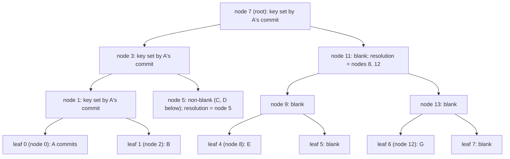

# PqChat TreeKEM mode (`groupMode = 1`), minimal scope: design

**Status:** SPECIFIED, nothing built. **UNAUDITED**: a new cryptographic protocol; every construction below is a design, not a
reviewed protocol. Review before code: Fable (design, security, crypto); Codex only on the owner's request. Branch
`treekem-research`; the contract work branches from `pqchat-sigs` once it has landed. Research
[`2026-11-23-treekem-pqchat.md`](../../research/2026-11-23-treekem-pqchat.md) (cited "note §n"); plan
[`2026-11-23-pqchat-treekem.md`](../plans/2026-11-23-pqchat-treekem.md). Rule ids introduced here (SPECIFIED, defined once in
their component doc, recorded in [decisions.md](../../decisions.md)): CTR-CHAT-26 (owner), CTR-CHAT-27 (controller calls),
CLI-PQC-16 (owner). Ids of branch `pqchat-sigs` this builds on: CTR-CHAT-23 (signature storage per home), CTR-CHAT-24 (several
`keyId`s per member UA), CTR-CHAT-25 (`groupMode`), CLI-PQC-15 (`require_signed_records`). Tags: **[F]** fact, **[E]** estimate
(paper figures on the pinned PqChat rows, as in the note; the plan measures and pins them).

**Contents**

1. [Rulings this spec follows](#1-rulings-this-spec-follows)
2. [Controller calls](#2-controller-calls)
3. [Scope, non-goals, deviations from RFC 9420](#3-scope-non-goals-deviations-from-rfc-9420)
4. [The ratchet tree](#4-the-ratchet-tree)
5. [Secrets: path, epoch schedule, `K`](#5-secrets-path-epoch-schedule-k)
6. [Records and entries](#6-records-and-entries)
7. [Storage](#7-storage)
8. [What the contract checks, and what only clients check](#8-what-the-contract-checks-and-what-only-clients-check)
9. [Rights, leave, removal](#9-rights-leave-removal)
10. [Recovery from state: replay](#10-recovery-from-state-replay)
11. [Forks, refusals, named errors](#11-forks-refusals-named-errors)
12. [Signature storage and (M)](#12-signature-storage-and-m)
13. [Bounds and gas](#13-bounds-and-gas)
14. [Threats](#14-threats)
15. [Client layers](#15-client-layers)
16. [Open points for the owner](#16-open-points-for-the-owner)

## 1. Rulings this spec follows

**Owner, 2026-11-23 (owner: yes), as relayed by the controller:**

- R1. "Minimal mode 1 is built now, before the pre-freeze tag. It covers a commit with UpdatePath, Add and Remove, with Welcome
  by wraps. External commits, PSKs and ReInit are out."
- R2. "A new DELEGATECALL body module is accepted for it."
- R3. "`groupMode` is a protocol id: 0 = flat; 1 = RFC 9420 tree rules over KEM scheme 1 (ML-KEM-1024 + X25519,
  `clients/ua-rs/src/wallet/kem.rs`); 2–255 for later variants. It is appended at the end of `PqChatSession` and
  `PqVaultCreate`, and fixed at creation."
- R4. "The committer's own path secrets are seed-derived (HKDF over the session and the commit), so no self-wrap."
- R5. "PqVault accepts only 0 in this release; it stays open for a later PqVault release."
- R6. "Our own TreeKEM in `ua-rs`, following RFC 9420's algorithms, with typed records. No MLS library."

**Earlier rulings:** signature storage per home, `none` | `sstore2`, default `sstore2` (CTR-CHAT-23); several `keyId`s per member
UA, members sorted by `(ua, keyId)` (CTR-CHAT-24, "(M)"); every record kept in full in state (CTR-CHAT-05); one child per parent
in the home instance (CTR-CHAT-08); rights (CTR-CHAT-09), `remove` (CTR-CHAT-20), `leave` (CTR-CHAT-10); recovery from state
alone (CTR-CHAT-14); every write relayable by anyone, fee 0 too (CTR-CHAT-19); the one-signer rule (CLI-UAL-01); the SDK's C1
and the A-3 ruling (no key byte to an app core, no rooted key leaves `ua-rs`); ARCH-POS-13 (no decryption oracle);
ARCH-POS-15 (lists of nodes); ARCH-POS-18 (software fallback).

## 2. Controller calls

Each is the controller's (owner: no); the owner may override any. Recorded as CTR-CHAT-27.

| # | Call | Why |
|---|---|---|
| C1 | A tree session is refused on a `none` home: `PqChatTreeSigStore()` | a committer encrypts path secrets to node keys vouched for only by commit signatures (note §6.1) |
| C2 | Tree nodes use KEM scheme 1 (ML-KEM-1024 + X25519), the one scheme; a node key is a `kemPk` of 1,601 B (`0x01 ‖ ek ‖ pk_X`) | R3 names scheme 1; another node KEM is another `groupMode` |
| C3 | The contract enforces nothing about group size below the cap; "useful from about 7 keys, where several members commit" is a client hint | note §4.2 |
| C4 | A tree session lives only in its home instance: `createSession` with `groupMode = 1` on another instance is `PqChatTreeHome()` | no replica, hence no fork to reconcile (§11) |
| C5 | A leaf is a registry KEM key `(ua, keyId)` by reference; a commit never replaces a leaf key | the registry's versions are write-once; a new device key is a new `keyId`, added by a commit (§9) |
| C6 | No unmerged leaves: an Add blanks the new leaf's direct path; no truncation of the tree; every commit carries a path | simpler resolution on chain (note §8.5); blank levels cost nothing because the path is filtered |
| C7 | The contract keeps the tree hash and compares the signed `treeHash`, `parentHash` and `ctTargets` with what it computes, **when the commit completes** | a wrong value never becomes an epoch, so no client ever has to reject an accepted commit (§8) |
| C8 | A non-admin author changes keys of its own UA only | a tree is stateful: dropping another member's leaf lasts until an Add (§9) |
| C9 | `leave` and `remove` of a tree session name its head epoch | the next commit is the only one that can honour them |
| C10 | `TREE_LEAVES_MAX` = 1,024 (depth 10), `TREE_CHANGES_MAX` = 32 adds plus removes per commit | EIP-7825 with a software signature check (§13); the plan's gas task confirms or reports to the owner |
| C11 | A tree session's control-plane records are always verified by the client, whatever `require_signed_records` says | C1's reason |
| C12 | The epoch secret is confirmed by opening the commit's `sealedInfo`; no separate confirmation tag | the tag would sit outside the signed record; `sealedInfo` is already an AEAD under a key from `K` |
| C13 | The tree hash covers node keys, not parent hashes; the commit's one `parentHash` is checked at completion and kept in the signed record | no third slot per node; RFC 9420's joiner check is replaced by C7 plus the kept signature |

## 3. Scope, non-goals, deviations from RFC 9420

**In:** a tree session created cold from the signed member list; `commit` with an UpdatePath, Adds and Removes (by `(ua, keyId)`,
and by UA as every key of it); Welcome as one flat wrap per added key; messages, `sealedInfo`, stores, calls, `leave`, `remove`
as in mode 0; recovery by replay.

**Out (R1, C6):** external commits, pre-shared keys, ReInit, group-context extensions, proposals sent apart from their commit,
Update proposals without a commit, unmerged leaves, tree truncation, a creator-filled first path, leaf-key rotation, a tree in
PqVault (R5), any other family than EVM (the other families keep `groupMode` 0 only; one rule on every EVM chain).

**Deviations from RFC 9420, all deliberate:** typed EIP-712 records instead of TLS-encoded messages; keccak256 in tree and
parent hashes; HKDF-SHA-256 labels of this repo instead of `ExpandWithLabel`; scheme-1 KEM plus AES-256-GCM instead of HPKE; no
unmerged leaves; `sealedInfo` instead of the confirmation tag; the group context without a transcript hash (the chain orders and
keeps the transcript); deterministic committer secrets (R4). None of RFC 9420's analyses covers the result.

## 4. The ratchet tree

**Array layout (RFC 9420 Appendix C) [F].** A perfect binary tree of `leaves = 2^d` leaves in an array of `2·leaves − 1` nodes:
leaf `i` is node `2i`, parents are the odd nodes, `level(x)` is the count of trailing one bits of `x`, the root is
`leaves − 1`, `left(x) = x − 2^(level−1)`, `right(x) = x + 2^(level−1)`, and `parent`, `sibling`, `direct_path` and `copath`
are Appendix C's, unchanged. Node indices do not move when the tree grows: `leaves` doubles and
the new root sits above the old one.

**Size.** A session keeps `used` (leaf positions ever assigned; `members.length` at creation) and `leaves`, the smallest power
of two `≥ used` (1 when `used = 1`). An Add takes a blank leaf below `used`, or leaf `used` (then `used` grows, and `leaves`
doubles when needed). Clients take the leftmost blank leaf (a hint; the contract checks only blank and in range). The tree
never shrinks (C6). `used ≤ TREE_LEAVES_MAX`.

**Nodes.** A leaf is blank or names one `(ua, keyId)`, a KEM key its UA holds in this chain's registry (C5). A parent is blank
or holds one node key (`kemPk`, 1,601 B) set by a commit. A cold tree (after creation) has every parent blank.

**Resolution** (RFC 9420 §4.1.2, without unmerged leaves): of a non-blank node, the node; of a blank leaf, nothing; of a blank
parent, the resolutions of its left then right child. It is always listed in ascending node index.

**Direct path, copath, filtered path.** The direct path of leaf `l` is its ancestors up to the root; the copath child at each
is the child not on the path. The **filtered path** drops every ancestor whose copath child has an empty resolution. A commit
sets exactly the nodes of its author's filtered path, computed on the tree **after** the commit's Removes and Adds, and
blanks the other nodes of its direct path (RFC 9420 §7.5).

**Tree hash** (RFC 9420 §7.8, typed):

```text
TreeLeaf(uint32 leaf,bytes32 ua,uint64 keyId)             th(leaf)   = 0 if blank, else hashStruct(TreeLeaf)
TreeParent(bytes32 keyHash,bytes32 left,bytes32 right)    th(parent) = 0 if blank and th(left) = th(right) = 0,
                                                                       else hashStruct(TreeParent), keyHash = 0 if blank
treeHash = th(root)
```

`keyHash = keccak256(kemPk)`. A subtree with no member hashes to 0, so padding and growth cost no slot. The leaf's own key is
not hashed: `(ua, keyId)` names a write-once registry record.

**Parent hash** (RFC 9420 §7.9, typed; C13). For the filtered path `p[0..m)` of a commit, top down:

```text
TreeParentHash(bytes32 keyHash,bytes32 parentHash,bytes32 sibling)
ph[m-1] = 0;   ph[k] = hashStruct(TreeParentHash(keyHash(p[k+1]), ph[k+1], th(copath child of p[k+1])))
parentHash   = hashStruct(TreeParentHash(keyHash(p[0]), ph[0], th(copath child of p[0])))        (0 when m = 0)
```

The author signs `parentHash`: its new node keys chained to the sibling subtrees it encrypted to.



In the picture A's commit carries 3 node keys and 4 ciphertexts, `ctTargets = [2, 5, 8, 12]`.

## 5. Secrets: path, epoch schedule, `K`

Notation as clientkeys' `pqchat.js`: `H(ikm, info) = HKDF-SHA-256(ikm, salt = empty, info, 32)`; labels are ASCII followed by
the listed fields (`u32`, `u64` big-endian). Every step below runs inside `ua-rs` (§15).

**Path secrets (RFC 9420 §7.4).**

```text
ps[k+1]      = H(ps[k], "scaas/pqchat/v1/tree/path")                         k = 0 .. m-1
nodeSeed[k]  = HKDF(ps[k], "scaas/pqchat/v1/tree/node", 96 B)                the 96-byte KEM seed form of kem.rs
nodeKey[k]   = kemPk of nodeSeed[k]                                          the key of filtered-path node p[k]
commitSecret = ps[m]
```

**The committer's `ps[0]` (R4).** Deterministic from the KEM seed of the author's leaf key and everything that fixes the
recipients:

```text
pathContext = keccak256(abi.encode(TAG_TREE_PATH, sessionId, parentEpochId, author, nonce, leaf, keyId,
                                   hash(removes), hash(adds), keccak256(abi.encodePacked(ctTargets))))
ps[0]       = HKDF(kemSeed(ua, keyId), "scaas/pqchat/v1/tree/commit" ‖ pathContext, 32)
```

`TAG_TREE_PATH = keccak256("scaas/pqchat/v1/tree/path-context")`; `hash(removes)`, `hash(adds)` are the EIP-712 array hashes of
§6. Two commits that differ in parent, membership change or recipient set have independent secrets, so a commit that lost its
slot and is rebuilt never sends an old secret to a new set. No byte on chain; the seed recovers every commit the key authored. A
device key that is random recovers its commits on that device only (note §6.2).

**A path ciphertext** seals `ps[k]` to one target `t` of the resolution of `p[k]`'s copath child, with `kemPk_t` the target's key
(a node key, or a leaf's registry key):

```text
(mlkemCt, x25519Eph, ss) = scheme-1 encaps(kemPk_t)
kek          = H(ss, "scaas/pqchat/v1/tree/ct" ‖ sessionId ‖ epochId ‖ u32(p[k]) ‖ u32(t) ‖ keccak256(kemPk_t))
sealedSecret = AES-256-GCM(kek, nonce = 0, ps[k], aad = sessionId ‖ epochId ‖ u32(p[k]) ‖ u32(t))          48 B
```

the form of a flat wrap (`wrapKek`, `wrapAad`) with the two node indices in place of the member.

**The epoch schedule (RFC 9420 §8, reduced).**

```text
ctx_e    = keccak256(abi.encode(TAG_TREE_CONTEXT, sessionId, epochId, epoch, parentEpochId, treeHash,
                                keccak256(abi.encodePacked(admins))))
joiner_e = HKDF(ikm = commitSecret, salt = init_(e-1), "scaas/pqchat/v1/tree/joiner" ‖ sessionId ‖ epochId, 32)
           epoch 0: joiner_0 is 32 random bytes of the creator
S_e      = H(joiner_e, "scaas/pqchat/v1/tree/epoch" ‖ ctx_e)
K_e      = H(S_e, "scaas/pqchat/v1/tree/key")          init_e = H(S_e, "scaas/pqchat/v1/tree/init")
```

`TAG_TREE_CONTEXT = keccak256("scaas/pqchat/v1/tree/context")`; for epoch 0 `epochId = sessionId`, `parentEpochId = 0` and
`treeHash` is the cold tree's. `groupMode` is bound by the labels (`…/tree/…`).

- **Every wrap of a tree session seals a joiner secret**: epoch 0's wraps seal `joiner_0`; a Welcome wrap seals `joiner_e` to an
  added key. The `Wrap` struct, `wrapKek` and `wrapAad` are mode 0's, unchanged.
- **`K_e` is the epoch key.** Sender chains (`…/v1/chain`), `infoKey`, `envKey`, `hint` and call keys derive from `K_e` exactly
  as in mode 0; messages, `sealedInfo` and the stores do not change.
- **Confirmation (C12).** A member that derived `K_e` opens the commit's `sealedInfo`; a failure means it is cut off (§10).
- `init_e` chains the epochs for members; a joiner needs only its wrap. Post-compromise security is RFC 9420's against a
  leaked tree state, and none against a leaked seed (R4, §14).

## 6. Records and entries

Typed EIP-712 in `DS_C` under `PURPOSE_PQCHAT`, as every PqChat record (CTR-CHAT-03). Only a key, a ciphertext or a signature is
`bytes`.

| Typehash constant | Type string |
|---|---|
| `COMMIT_TYPEHASH` | `PqChatCommit(bytes32 sessionId,bytes32 author,uint64 nonce,uint64 epoch,bytes32 parentEpochId,uint32 leaf,uint64 keyId,uint32 leaves,bytes32[] admins,TreeRemove[] removes,TreeAdd[] adds,bytes32[] wrapHashes,bytes32[] nodeKeyHashes,uint32[] ctTargets,bytes32[] ctHashes,bytes32 parentHash,bytes32 treeHash,bytes sealedInfo)TreeAdd(uint32 leaf,bytes32 ua,uint64 keyId,bytes32 via)TreeRemove(uint32 leaf,bytes32 ua,uint64 keyId)` |
| `TREE_ADD_TYPEHASH` | `TreeAdd(uint32 leaf,bytes32 ua,uint64 keyId,bytes32 via)` |
| `TREE_REMOVE_TYPEHASH` | `TreeRemove(uint32 leaf,bytes32 ua,uint64 keyId)` |
| `PATH_CT_TYPEHASH` | `PathCt(bytes mlkemCt,bytes32 x25519Eph,bytes sealedSecret)` |
| `TREE_LEAF_TYPEHASH`, `TREE_PARENT_TYPEHASH`, `TREE_PARENT_HASH_TYPEHASH` | §4 (hashed, never signed alone) |

`PqChatCommit` by field: `author` commits from leaf `leaf`, its key `keyId`; `leaves` is the tree's size after the commit;
`admins` the full sorted admin list of the new epoch; `removes` and `adds` the membership change (`via` as in `MemberKey`, not
read by the contract); `wrapHashes[i]` the Welcome wrap of `adds[i]`; `nodeKeyHashes[k] = keccak256(nodeKey[k])`;
`ctTargets[j]` the node the `j`-th ciphertext is sealed to and `ctHashes[j]` its `PathCt` hash, ordered by path level upward,
then by ascending target; `parentHash`, `treeHash` of §4; `sealedInfo` as in `PqChatEpoch`. The epoch id and the nonce scope
are `PqChatEpoch`'s (`epochId(sessionId, author, nonce)`, `scopeEpoch`): one id space for both modes.

**Entries** (one per operation; each signed write takes its record and a `UASig`, anyone sends it, CTR-CHAT-19):

| Entry | Signed | Purpose |
|---|---|---|
| `createSession(PqChatSession s, Wrap[] wraps, UASig sig)` | creator | unchanged entry and record; `groupMode = 1` creates the cold tree from `members` in their signed order (leaf `i` = `members[i]`) |
| `commit(PqChatCommit c, bytes[] nodeKeys, PathCt[] cts, Wrap[] wraps, UASig sig) returns (bytes32 epochId)` | author | a tree epoch; `nodeKeys` none or all, `cts` and `wraps` a first chunk or none |
| `addPath(bytes32 epochId, bytes[] nodeKeys, uint32 firstCt, PathCt[] cts)` | none | the remaining pieces, by anyone: `nodeKeys` none or all (once), `cts` as indices `firstCt..`, each against its signed hash |
| `addWraps(bytes32 epochId, uint32 first, Wrap[] wraps)` | none | unchanged entry: epoch 0's wraps, and a commit's Welcome wraps (`wraps[i]` names `adds[i]`) |
| `leave`, `remove`, `postMessage`, `storeMessage` | as today | unchanged records; for a tree session `leave` and `remove` name the head (C9) |
| `rekey(PqChatEpoch …)` on a tree session; `commit` on a flat one | | refused: `PqChatModeEntry(groupMode)` |

**Views** (all state; a page view caps its count at `TREE_RANGE_MAX`): `treeOf(sessionId) → (uint32 leaves, uint32 used, bytes32
treeHash, bytes32 headEpochId)`; `treeLeaves(sessionId, first, count) → TreeLeafView[] {bytes32 ua, uint64 keyId, uint64
joinEpoch, uint32 wrapIndex}` (a blank leaf is all zero); `treeNodes(sessionId, first, count) → TreeNodeView[] {bytes32 hash,
uint64 epoch}` and `treeNodeKey(sessionId, node) → bytes` (the live key of a parent; `epoch` is the number of the commit that
set it); `commitOf(epochId) → (PqChatCommit c, bytes32 sigHash)`; `pathKeys(epochId) → bytes[]`; `pathCtAt(epochId, i) →
PathCt`; `pathComplete(epochId) → bool`. `epochSig(epochId)`, `wrapAt`, `epochsOf`, `latestEpoch`, `epochComplete`, `childOf`,
`leftIn`, `removedIn`, `removal*`, `leave*` serve both modes; `epochOf` of a tree epoch above 0 is `PqChatModeEntry(1)`.

**Events** (never the only copy): `PqChatEpochAdded` and `PqChatEpochComplete` as today, `PqChatWraps` for Welcome wraps,
`PqChatPath(bytes32 indexed epochId, uint32 keys, uint32 firstCt, uint32 count)` per landed piece.

**The module (R2).** `PqChatTree`, a DELEGATECALL body module beside `PqChatTopics`: `PqChat` gains an immutable `TREE`, lists
it in `modules()`, forwards `commit`, `addPath` and the tree views by `msg.data`, forwards `addWraps`, `leave`, `remove` and
`postMessage` when their session is a tree session, and calls the module's creation step from `createSession`. The module
inherits `PqGroupBase` and uses `PqChat`'s namespace through the same hooks; its own state is a namespace of its own (§7).

## 7. Storage

Never only a hash plus calldata or an event (CTR-CHAT-05, "never lose ciphertext"):

| What | Where |
|---|---|
| The commit record with its signature | `abi.encode(record, sigHash, UASig)` in the epoch's record blob (chained by `_put`), as an `sstore2` home keeps every record |
| Node keys of a commit | one SSTORE2 blob per commit, `m × 1,601` B (at most 16,010 B: one blob on a 24,576-B chain too) |
| Path ciphertexts | packed 1,648 B each (`mlkemCt ‖ x25519Eph ‖ sealedSecret`), as many per blob as the chain's limit holds, one slot per index (`pointer \| offset << 160`), as wraps |
| Welcome wraps | the epoch's `wrapAt`, as mode 0 |
| The live tree, per session (namespace `scaas.pqchat.tree`) | `used`, `leaves`, the head; per leaf two slots (`ua`; `keyId`, `joinEpoch`, `wrapIndex`, live bit); per parent `hash` (its `th`) and `keyAt` (`pointer \| offset << 160 \| epoch << 176`, 0 = blank); `keysOf[ua]`; the live admin list |

The Epoch struct of `PqGroupBase` and `PqVault`'s layout do not change; `PqChat`'s own namespace does not change. The live tree
changes only when a commit completes. Old node keys and every old ciphertext stay readable through their commit's blobs.

## 8. What the contract checks, and what only clients check

**At `createSession` (`groupMode = 1`):** everything of mode 0 (lists, KEM keys, creator, signature, nonce), then `sigStore() ==
sstore2` (C1), this instance is the home (C4), `members.length ≤ TREE_LEAVES_MAX`; the leaves, `keysOf`, the blank parents'
hashes and the admin list are written.

**When a `commit` record is accepted:** the session is a tree session; the parent is its head, stored and complete, `epoch ==
parent + 1`, the slot free (`_parentOf`); the author signed it and `(scopeEpoch, nonce)` is unused; leaf `leaf` is live and
names `(author, keyId)`; the author did not leave and was not removed; `admins` strictly sorted and registered; each remove names
a live leaf by its `(ua, keyId)`, not the author's leaf; each add names a blank leaf in range (or one freed by a remove of this
commit), a KEM key its UA holds (`kemKeyAt(ua, keyId).scheme ≠ 0`) and has one wrap hash; at most `TREE_CHANGES_MAX` changes, at
most `KEYS_PER_UA_MAX` keys per UA; the rights of §9; array lengths (`ctTargets` and `ctHashes` equal, `nodeKeyHashes` at most
the depth).

**When a piece lands:** each node key is 1,601 B with scheme byte 1 and hashes to `nodeKeyHashes[k]`; each ciphertext is
1,568 + 32 + 48 B and hashes to `ctHashes[j]`; each wrap as mode 0 against `adds[i]`; each lands once; the slot still free.

**When the last piece lands (completion, C7),** in this order, all or nothing:

1. no UA a `remove` took out of the parent keeps a leaf, sits in `admins` or is the author (`PqChatRemovedKept`);
2. the Removes blank their leaves and direct paths, the Adds set their leaves and blank their direct paths, `used` and `leaves`
   follow and `leaves` equals the record's;
3. the author's filtered path and the resolution of each copath child are walked on that tree: the path length equals
   `nodeKeyHashes.length` and the targets equal `ctTargets`, entry by entry (`PqChatTreeTargets`);
4. the parent hash chain equals `parentHash` (`PqChatParentHash`);
5. the path nodes take their keys, the other nodes of the author's direct path are blanked, every changed `th` is
   recomputed, and the root equals `treeHash` (`PqChatTreeHash`);
6. the epoch takes the parent's slot and joins `epochsOf`.

A commit that fails 1–5 can never complete: the landing reverts whole, the head does not move, and only its sender's gas is
spent. A commit that fits one transaction is checked whole in that transaction.

**Only clients can check** (RFC 9420 has the same limit; so has a flat wrap): that a node key derives from its path secret, and
that a ciphertext opens to the right secret. Each member checks its own: after opening its ciphertext it derives upward and
compares every derived `kemPk` with the stored one, then opens `sealedInfo`. Before a client encrypts to the live tree it reads
the tree, recomputes `treeHash`, and verifies the signature of the head commit (or of the session for epoch 0) over a record
naming that hash (C11): one signature vouches for every node key.

## 9. Rights, leave, removal

Per UA, as `PqGroupBase` judges them (CTR-CHAT-09, CTR-CHAT-20, CTR-CHAT-10, CTR-CHAT-24):

- **A plain commit** keeps `admins` and the set of member UAs, less UAs that left or were removed, and changes keys of the
  author's own UA at most (C8): by any member with a live leaf that did not leave and was not removed (`PqChatNotMember`).
- **Any other commit** (an added or dropped UA, a changed admin list, another UA's key added or removed): by a live admin
  (`_liveAdmin`; `PqChatNotAdmin`). An admin needs a leaf to commit; an admin without a KEM key acts through `remove`.
- **Add by UA** is one `TreeAdd` per key; **Remove by UA** is one `TreeRemove` per leaf of it, and it is gone when `keysOf` is 0.
- **`remove` (`PqChatRemove`)** is unchanged and is RFC 9420's Remove proposal: the next commit completes only if every removed
  UA has no leaf left. Any member may author that commit: dropping removed or left UAs is plain.
- **`leave` (`PqChatLeave`)** is unchanged: a flag; the leaver authors no commit; the next committer blanks its leaves (a client
  rule, as mode 0).
- A member with no admin right that wants a new device in: registers the KEM version, then commits with a `TreeAdd` of its own
  UA (plain). A lost device: its owner's commit, or an admin's, removes that leaf.

## 10. Recovery from state: replay

A device with a KEM key `(ua, keyId)`, from contract state alone (CTR-CHAT-14):

1. `sessionsOf(ua)` → `sessionOf`: `groupMode = 1`; verify the creator's signature (`sessionSig`).
2. `treeLeaves` → its leaf, `joinEpoch`, `wrapIndex` (epoch 0 members: 0 and their index). `wrapAt(joinEpochId, wrapIndex)` →
   `joiner`, then `S`, `K`, `init` with `ctx` from that epoch's record.
3. For each later epoch in `epochsOf` order: `commitOf` and its signature, verified. Its own commit: `ps[0]` from the KEM seed
   and `pathContext` (R4). Another's: the one `j` whose `ctTargets[j]` is a node it holds (its leaf, or a parent whose secret an
   earlier commit gave it) → `pathCtAt(epochId, j)` → `ps` of the lowest path node above that target → upward, each derived
   `kemPk` against `pathKeys`; then `joiner`, `S`, `K`, `init`, and `sealedInfo` opens.
4. From the record alone it updates what it holds: secrets of nodes on the direct path of a removed or added leaf are dropped,
   those the commit set are replaced.

Replay needs no public tree and no epoch before the device's join; it is one read set and one decapsulation per commit since
then (flat recovery is random access; note §6.2). A key removed and added again resumes from its latest join; earlier periods
are found by scanning `commitOf` and are optional. Only building a commit needs the live tree.

**Cut off.** A missing target, a derived key that differs, or a `sealedInfo` that does not open: the device marks the session
cut off at that epoch and shows it. It sends nothing on its own: no complaint, no commit, no rejoin (ARCH-POS-13). The user may
ask to be added again; an admin's Remove of the committer blanks exactly the nodes that commit set.

## 11. Forks, refusals, named errors

**No fork.** A tree session exists in one instance (C4) and an epoch has one child (CTR-CHAT-08). Two commits staged on one head:
the first to complete takes the slot, the other is `PqChatEpochTaken` at its next piece; its author rebuilds on the new head
with a new nonce, hence new secrets (§5). Clients read a tree session only from its home, under ARCH-POS-15: the reads feed an
encryption and a decryption, so a discovered node counts only under the majority option with at least three nodes.

New errors (existing ones keep their meaning: `PqChatShape`, `PqChatKemKey`, `PqChatUnknown`, `PqChatIncomplete`,
`PqChatEpochNumber`, `PqChatEpochTaken`, `PqChatNotAdmin`, `PqChatNotMember`, `PqChatRemovedKept`, `PqChatNonceUsed`,
`PqChatWrapHash`, `PqChatWrapStored`):

| Error | When |
|---|---|
| `PqChatModeEntry(uint8 groupMode)` | an entry or view of the other mode (`rekey` or `epochOf` on a tree epoch, `commit` or a tree view on a flat session) |
| `PqChatModeUnsupported(uint8 groupMode)` | as today, now for 2–255 |
| `PqChatTreeSigStore()` | a tree session on a `none` home (C1) |
| `PqChatTreeHome()` | a tree session created outside its home (C4) |
| `PqChatTreeLeaf(uint32 leaf)` | a leaf that is not live with the named key, not blank for an Add, the author's own in a Remove, or out of range |
| `PqChatPathHash(bytes32 epochId, uint256 index)` | a node key or ciphertext that does not hash to its signed hash, or has the wrong size |
| `PqChatPathStored(bytes32 epochId, uint256 index)` | a piece landed twice |
| `PqChatTreeTargets(uint256 index)` | path length or `ctTargets[index]` differs from the resolution |
| `PqChatParentHash()` | `parentHash` differs |
| `PqChatTreeHash(bytes32 computed)` | `treeHash` differs |

## 12. Signature storage and (M)

- **Signature storage.** A tree session needs an `sstore2` home (C1); every tree record keeps its `UASig`, read by `sessionSig`,
  `epochSig`, `removalSig`, `leaveSig`, `messageSig`. `pqchat-core` verifies every control-plane record of a tree session before
  it uses it, with `require_signed_records` on or off (C11); a `none` home that claims a tree session is refused by name.
- **(M).** A leaf is one `(ua, keyId)`. At creation a UA's keys are adjacent (the signed order); later Adds take any blank leaf.
  `KEYS_PER_UA_MAX` = 8 holds per UA over the live tree. Rights, `leave`, `remove`, `sessionsOf` stay per UA; removing a UA
  removes every leaf of it.

## 13. Bounds and gas

| Bound | Value |
|---|---|
| `TREE_LEAVES_MAX` | 1,024 keys: depth 10, at most 10 node keys (16,010 B) and 1,023 ciphertexts per commit (C10) |
| `TREE_CHANGES_MAX` | 32 adds plus removes per commit |
| `KEYS_PER_UA_MAX` | 8 (CTR-CHAT-24) |
| `TREE_RANGE_MAX` | 256 entries per page view |
| A node key / a path ciphertext / a Welcome wrap | 1,601 B / 1,648 B / 1,688 B |

**State gas [E]** (EIP-8037 at 1,530 per byte, 97,920 per new slot, 183,600 per new blob; the note's fixed part of 2.33 M; add
5.39 M for a kept ML-DSA-65 signature): a path ciphertext is 2,717,280 (bytes, its slot, 64 B in the record), a node key
2,498,490, so a warm level is about 5.22 M.

| n keys | depth | Warm commit | After one removal (up to `2d` ciphertexts) | Cold commit (`n − 1` ciphertexts) | Flat rekey (note §4.2) |
|---:|---:|---:|---:|---:|---:|
| 2 | 1 | 7.9 M | 7.9 M | 7.9 M | 8.0 M |
| 8 | 3 | 18.3 M | 26.5 M | 29.2 M | 25.3 M |
| 64 | 6 | 34.0 M | 50.3 M | 188.9 M | 186.4 M |
| 256 | 8 | 44.4 M | 66.2 M | 715.6 M | 738.7 M |
| 1,024 | 10 | 54.9 M | 82.0 M | 2,807 M | 2,948 M |

Creation costs mode 0's wraps plus the tree's slots: about 0.3 M per member key (two leaf slots, a parent hash, its share of
`keysOf`), near +10 %. A tree session of 2 members costs what a flat one does per commit and about 0.8 M more to create; the
client hint stays "from about 7 keys, where several members commit" (C3).

**Inclusion (EIP-8037, EIP-7825) [E].** A transaction fits when `(regular + state) × 1.05` is within the block limit and its
regular gas is under 2^24. No block limit is assumed: the record, the node keys and the ciphertexts are separate pieces.

| Piece | Regular | State | Smallest block it needs |
|---|---:|---:|---|
| The record alone, warm, ML-DSA-65 checked in software (5.8 M, note §4.4) | about 6.5 M | about 8 M | about 16 M |
| The node keys alone, depth 10 | about 1 M | 24.7 M | about 27 M |
| One ciphertext in `addPath` | about 0.11 M | 2.72 M | 20 per transaction at 60 M, 67 at 200 M |
| A whole warm commit, 64 keys | about 7.3 M | 39.4 M | 49 M: one transaction at 60 M |
| A whole warm commit, 256 keys | about 7.8 M | 49.8 M | at the 60 M line: two pieces there, one at 200 M |
| A whole warm commit, 1,024 keys | about 8.2 M | 60.2 M | two pieces at 60 M, one at 200 M |
| The record of a cold commit at 1,024 keys (65 KB of targets and hashes) | about 11 M | about 108 M | 125 M; below that the cap must drop (§16 O1) |
| Completion of a cold commit at 1,024 keys (the walk: about 2,047 nodes, two cold reads each) | about 9 M | small | under 2^24 |

Acceptance (the signature) and completion (the walk and the tree update) fall in different transactions whenever a commit is
chunked, which keeps each under 2^24 with a software signature check (ARCH-POS-18). An `msig` author adds each quorum signature
to the record piece. The plan measures every row and pins it; a row that does not fit goes to the owner with numbers.

**Size.** `PqChat` is 31,897 B on `pqchat-sigs` against its 35,286-B line: it takes only the dispatch (some hundreds of bytes
**[E]**); the tree code (9 to 14 KB **[E]**) is `PqChatTree`, under its own line in `size-baseline.json`.

## 14. Threats

| Threat | Outcome |
|---|---|
| A lying endpoint substitutes a node key | the client recomputes `treeHash` and verifies the head commit's kept signature before it encrypts (C1, C11); trusted or majority reads (ARCH-POS-15) |
| A stale endpoint hides the newest commits | the client's commit names an old head and is refused (`PqChatEpochTaken`); nothing is encrypted to a wrong key |
| A removed member colluding with an endpoint serves a forged continuation | the same as any untrusted read: majority reads; the forged branch never lands at home |
| An insider commits garbage to one member (bad ciphertext, or a node key that does not match its secret) | that member is cut off until added again; neither contract nor others see it (RFC 9420's limit). Removing the committer blanks the nodes it set |
| An insider signs wrong `ctTargets`, `parentHash` or `treeHash` | the commit never completes (C7); no epoch, no client-side rejection |
| A committer watches for reactions to a ciphertext it chose | none exists: a cut-off device sends nothing by itself (ARCH-POS-13); ML-KEM keeps implicit rejection |
| A rebuilt commit reuses a secret for another recipient set | `pathContext` binds parent, changes and targets (§5) |
| The seed leaks | every epoch of every session of that key opens, tree or flat: accepted with R4 (recovery from the seed) |
| A tree state leaks from a device, the seed does not | healed by the next commit of any member above the leaked nodes, and fully once the device's own key commits; the leaf key itself is long-term (C5): replace it by a new `keyId` |
| Two commits race | one child per parent; the loser rebuilds |
| A huge tree to exhaust gas | `TREE_LEAVES_MAX`, `TREE_CHANGES_MAX`; each piece paid by its sender |
| A decode bomb at the node | `typed.rs` bounds every array by length and depth before it builds bytes |
| Downgrade of the mode | the creator's signature covers `groupMode`; a tree session read as flat finds no wrap and opens nothing (note §5) |

## 15. Client layers

- **clientkeys** (the JS reference): tree math, resolution, filtered path, both hashes, the records, the schedule, building and
  processing a commit, replay; the generator of `smartcontracts/vectors/pqchat/tree.json`, with RFC 9420's tree-math vectors as
  a control. Every language reads the same rows.
- **`ua-rs`** (R6, CLI-UAL-01): every KEM, AEAD and HKDF step and every tree secret behind handles. A tree epoch is a handle
  holding `init`, `K` and the node secrets it knows; path building, opening a ciphertext, the committer's derivation from the
  KEM seed, Welcome wraps and `sealedInfo` take and return handles and public bytes only. The public tree math, hashes and
  record digests are plain functions there too, one implementation for the SDK and the cores.
- **`scaas-sdk`**: thin calls: named ABI rows for `commit`, `addPath` and the views, the `app_core` surface for the handles.
- **`pqchat-core`**: the mode branch at "obtain `K` of this epoch": the public tree from views, validation (§8), building a
  commit and its chunks, replay (§10), the store's tree rows, the cut-off state, the size hint (C3). It holds no key byte.
- **`pqvault-core`**: refuses `groupMode ≠ 0`, as today (R5).
- **Node**: `typed.rs` `TYPED` and `PLAIN` rows and `guard.rs` for `commit` (signed) and `addPath` (unsigned, relayed under
  `relay_unsigned_pqchat` as `addWraps`), `selector_audit.json`, equal to the contract's in both directions.

## 16. Open points for the owner

- **O1. The cap.** `TREE_LEAVES_MAX` = 1,024 is fixed in an immutable contract. A cold first commit at 1,024 keys needs a
  125 M block for its record piece **[E]**; at 256 keys every piece fits a 60 M block. 1,024 (proposed, C10), or 256?
- **O2. Leaf keys are long-term (C5).** A leaf is the registry key; a compromised device heals only by a new `keyId`. The
  alternative is RFC 9420's fresh leaf key per commit: 1,601 B more per commit and a leaf-key slot. Keep C5?
- **O3. Rights for key changes (C8).** Mode 0 lets any member's plain rekey choose every member's keys; this spec lets a
  non-admin change its own UA's keys only. Confirm, or keep mode 0's rule.
- **O4. `none` homes and replicas (C1, C4).** Tree sessions are refused on a `none` home and outside the home. Confirm.
- **O5. ML-KEM-1024 for nodes (C2).** ML-KEM-768 would cut a warm commit by about a quarter and would be `groupMode` 2 later.
  Confirm 1,024 as the one scheme now.
