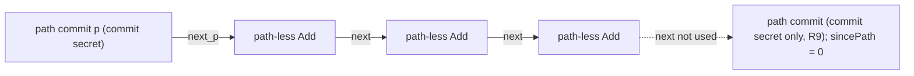

# PqChat TreeKEM mode 1: path-less Add commits (delta spec)

**Status:** SPECIFIED; nothing is built. **UNAUDITED**: a change to a new cryptographic protocol; every construction below
is a design, not a reviewed protocol ([ARCH-POS-14](../../decisions.md#ARCH-POS-14)). A **delta** to the mode-1 spec
[`2026-11-23-pqchat-treekem.md`](2026-11-23-pqchat-treekem.md) ("spec §n", its rulings R1–R16 and calls C1–C40, with R8 at
512 leaves and C10's `TREE_CHANGES_MAX` at 20 as on branch `review-fix-contract`); whatever this file does not change stays
as the spec says. Research: [`2026-11-25-treekem-pathless-add.md`](../../research/2026-11-25-treekem-pathless-add.md)
("research §n", its figures [E], its owner sections at the end). Rules: [`contracts/pqchat.md`](../../contracts/pqchat.md)
CTR-CHAT-25, CTR-CHAT-26, CTR-CHAT-27. Plan of mode 1: [`2026-11-23-pqchat-treekem.md`](../plans/2026-11-23-pqchat-treekem.md).
RFC 9420 §8 (key schedule), §12.4 (a commit without a path, "partial"), §6.1 (the confirmation tag).

**No decisions entry is written yet:** the rule entries come when the round starts; their planned Change texts are §12.
New rulings here are R17–R20 (owner), new calls C41–C46 (controller, owner: no; the owner may override any). Tags:
**[F]** a fact with its source, **[E]** an estimate (the research's paper figures; no gas was run for this spec).

**Contents**

1. [Rulings](#1-rulings)
2. [Scope](#2-scope)
3. [Records](#3-records)
4. [The key schedule](#4-the-key-schedule)
5. [Acceptance and completion on the contract](#5-acceptance-and-completion-on-the-contract)
6. [The client walk](#6-the-client-walk)
7. [What only clients can check](#7-what-only-clients-can-check)
8. [Node rows](#8-node-rows)
9. [Gas](#9-gas)
10. [Threats](#10-threats)
11. [Amended rulings and calls](#11-amended-rulings-and-calls)
12. [Planned Change texts](#12-planned-change-texts)
13. [Tests and mutants](#13-tests-and-mutants)
14. [Plan](#14-plan)
15. [Open points for the owner](#15-open-points-for-the-owner)

## 1. Rulings

**Owner, 2026-11-25 (owner: yes), relayed by the controller.** The owner's own words are in the research's last two
sections; quoted here verbatim, then the rulings as stated.

- "Có lẽ sẽ chọn Add không path, nhưng nới việc commit có path: chỉ là option khi tạo session, không bắt buộc. Có cảnh báo
  ở client (admin) cần commit có path." (Probably path-less Adds, but the path commit relaxed: only an option when the
  session is created, not mandatory; a client warning (admins) that a path commit is needed.)
- "Ok, theo §9, chỉ mode 1, làm sau PR #30" (OK, by §9, mode 1 only, after PR #30).
- The warning (owner, the same day, as recorded in the research): with `pathRefreshBound` = 0 the contract forces nothing
  and the client warns the admins after 24 path-less leaves since the last path commit; with N > 0 the contract refuses the
  (N + 1)-th path-less leaf and the client warns as N comes near.

| # | Ruling (owner 2026-11-25) |
|---|---|
| R17 | Path-less Adds are built in **mode 1 only**, with **§9's rights** (an admin adds anyone; a member adds keys of its own UA, at most `KEYS_PER_UA_MAX`), as **their own round after PR #30**, before the freeze. Mode 0 and PqVault: no. |
| R18 | The forced path commit is a **session option at creation**, a field `pathRefreshBound` in the signed session record: 0 = never forced by the contract; N > 0 = the contract refuses the (N + 1)-th path-less leaf since the last path commit. With 0, **the client warns the admins after 24 path-less leaves**; with N, it warns as N comes near. |
| R19 | Removals, leaves (exits), admin changes and periodic updates keep a path: they stay path commits on the commit secret alone, as today. |
| R20 | The key schedule: R9 / C23 are reopened **narrowly**: a chain only across path-less Adds, reset by every path commit; path commits keep using their own commit secret only, as R9 decided. The two-input trade-off and "who loses what" are the research's ("The two inputs of the key schedule", "Who loses what, by way"), followed here. |

**Still open, at this spec (§15):** `confirmTag` as a signed record field or `sealedInfo` alone; whether a member's own-key
path-less Add counts toward the bound; the measurement of the new rows (a gas run, on the owner's word).

## 2. Scope

**In.** A mode-1 commit of **Adds only** with **no update path**: no node key, no path ciphertext, no target list; one
Welcome wrap per added key, as today. Its epoch key derives from the parent epoch by a one-way step (§4). A per-session
bound, fixed at creation, on the leaves added so between two path commits (§5.3).

**Unchanged.** Every other commit is a path commit as today (R19): a Remove, an exit honoured, an admin change (dropping a
`gone` admin included), a refresh, a plain commit, a commit of Adds that its author chooses to send with a path. C6's
blanking stays (the research's variant A): an Add blanks the new leaf's direct path, there are no unmerged leaves, and the
tree hash and the resolution do not change.

**Out.** Mode 0 and PqVault (R17; `PqVaultCreate` does not change, `pqvault-core` still refuses `groupMode ≠ 0`); RFC 9420's
unmerged leaves (variant B); a time bound (no tree rule reads the clock; research §6.1); any family but EVM (mode 1 is EVM
only, spec §3).



## 3. Records

### 3.1 The session record: `pathRefreshBound`

`PqChatSession` gains **`uint32 pathRefreshBound`** after `groupMode`, its new last field (C41, controller):

```text
PqChatSession(bytes32 creator,uint64 nonce,bytes32 homeChain,address homeChatContract,bytes32[] admins,MemberKey[] members,
              bytes32[] wrapHashes,bytes sealedInfo,uint8 groupMode,uint32 pathRefreshBound)MemberKey(bytes32 ua,uint64 keyId,bytes32 via)
```

- **Meaning (R18).** 0: the contract never forces a path commit. N > 0: a path-less commit is refused when the leaves it adds
  would bring the count since the last path commit above N (§5.3).
- **Bounds (C41, controller).** In mode 0 the field must be 0; in mode 1 at most `TREE_LEAVES_MAX` (512). Either violation is
  `PqChatShape()` at `createSession`. Why: in mode 0 the field
  has no reader, so a non-zero value would be signed and mean nothing; in mode 1 a value above the leaf cap can never bind
  (a leaf is freed only by a Remove, which carries a path and resets the count) and would mean the same as 0. One meaning
  per value.
- **Fixed at creation,** with `groupMode`; nothing changes it later. It is signed by the creator, hashed into `treeId`
  (C16) and into `genesisCtx` (C29: `TreeGenesis` takes the field too, so epoch 0's keys bind it).
- **The type.** `uint32`, as `leaves` and `ctCount`: a count of leaves.

### 3.2 The commit shape of a path-less Add

`PqChatCommit` keeps its fields; a path-less Add is **a shape, not a flag** (C42, controller; research §8.1):

| Field | A path-less Add |
|---|---|
| `adds` | at least one `TreeAdd`, at most `TREE_CHANGES_MAX` (20) |
| `removes` | empty |
| `admins` | equal to the head's stored admin list |
| `nodeKeyHashes` | empty |
| `ctCount` | 0 |
| `ctListHash` | `hashStruct(PathList)` of two empty arrays (spec §6, codex-r2-14) |
| `wrapHashes` | one per Add, as today |
| `treeHash` | the head's tree after the Adds, each new leaf's direct path blank (C6), **the author's direct path as it is on the head** |
| `sealedInfo` | as today: a full info or the marker (C33), not empty |
| `confirmTag` | **only if the owner chooses T1 (§15, point 1):** `bytes32`, §4.2 |

**Why a shape.** Today a commit with at least one Add, an empty `nodeKeyHashes` and `ctCount` 0 is always refused: the added
leaf is a target of the walk (`PqChatTreeTargets`) [F, `_walkPath`]. So the shape is free and names the kind exactly; a flag
would say nothing the shape does not say and would have to be checked against it. The signer still sees the kind by name:
`ua-rs` builds it by its own named operation (§6.5). A commit with an empty path and **no** Add keeps today's meaning (the
last live leaf's commit, spec §10).

**Pieces.** None but the Welcome wraps. `Epoch.wraps` is `adds.length + 1` (C20 as built: no list piece, no key piece when
`ctCount` is 0 [F, research §8.2]); `addPathList`, `addPathKeys` and `addPath` on such an epoch are refused as today for
`ctCount` 0 (`PqChatPathList`, `PqChatShape`, `PqChatPathList`). C40 is unchanged.

### 3.3 Typehashes, selectors and vectors that move

| What | Moves | Why |
|---|---|---|
| `SESSION_TYPEHASH` (`PqChatSession`), its pin and CTR-CHAT-21's quoted value | **yes**, for mode 0 too | the new field; the struct is one for both modes |
| `TREE_GENESIS_TYPEHASH` (`TreeGenesis`, hashed, never signed) | **yes** | it lists `PqChatSession`'s fields without `wrapHashes` and `sealedInfo` |
| `COMMIT_TYPEHASH` (`PqChatCommit`) | **only under T1** | `bytes32 confirmTag` appended after `sealedInfo` |
| `createSession`'s selector, `IPqChat`'s `interfaceId`, `sessionOf`'s return | **yes** | the selector hashes the struct's tuple type |
| `commit`'s selector, `commitOf`'s return | only under T1 | the same |
| `treeOf`'s return | **yes** | `uint32 sincePath` appended (§5.3) |
| `TreeAdd`, `TreeRemove`, `PathList`, `PathCt`, `PqChatTreeLeave`, `PqChatTreeRemove`, `Wrap`, every mode-0 record but the session | no | |
| `smartcontracts/vectors/pqchat/records.json`: every session row (mode 0 and 1, `sessionTreeKem` included) | **yes** | the typehash |
| `smartcontracts/vectors/pqchat/tree.json` and `tree-secrets.json`: **every row** | **yes, under T1 or T2** | `treeId` and `genesisCtx` feed every tree derivation; under T1 every commit digest moves twice over |
| `keys.json`, `messages.json`, `topics.json`, `cards.json`, `ar-urls.json`, every `pqvault/` file | no: byte-identical, checked | |

So **T2 saves no vector churn**: the session field already moves every tree row (§15, point 1). Every reader regenerates
from the generator, never by hand: clientkeys (`scripts/pqchat-vectors.mjs`, `scripts/treekem-fixture.mjs`), `ua-rs`,
`scaas-sdk`, `pqchat-core`, `scaas-node`, the forge tests.

## 4. The key schedule

Notation of spec §5: `H(ikm, info) = HKDF-SHA-256(ikm, salt = empty, info, 32)`; labels are `<prefix>/<name>` (CTR-CHAT-28),
PqChat's prefix `scaas/pqchat/v1/tree`; fields follow the label, each 32 B. Every step runs inside `ua-rs` (spec §15).

### 4.1 The derivations

```text
every epoch e, 0 included (new; kept in the epoch handle beside K_e; RFC 9420's init_secret, §8):
  next_e     = H(S_e, "scaas/pqchat/v1/tree/next")

a path commit (unchanged, C23, R9, R20):
  joiner_e+1 = H(commitSecret, "scaas/pqchat/v1/tree/joiner" ‖ treeId ‖ epochId)

a path-less Add (new, R20):
  joiner_e+1 = H(next_e, "scaas/pqchat/v1/tree/add-joiner" ‖ treeId ‖ epochId ‖ hash(adds))

both (unchanged):
  ctx_e+1    = keccak256(abi.encode(TAG_TREE_CONTEXT, treeId, epochId, epoch, parentEpochId, parentTreeHash, treeHash,
                                    keccak256(abi.encodePacked(admins))))
  S_e+1      = H(joiner_e+1, "scaas/pqchat/v1/tree/epoch" ‖ ctx_e+1)
  K_e+1      = H(S_e+1, "scaas/pqchat/v1/tree/key")

the confirmation (new; a record field under T1, §4.2):
  confirmTag = H(S_e+1, "scaas/pqchat/v1/tree/confirm" ‖ ctx_e+1)
```

`epochId = epochId(sessionId, author, nonce)`; `hash(adds)` the EIP-712 array hash of spec §6 (the keccak of the packed
`hashStruct(TreeAdd)`, each with its leaf, UA, `keyId`, `via`, `kemHash`), as in `pathContext`. Epoch 0's `S_0` is under
`genesisCtx` (C29), so `next_0` exists and a path-less Add may follow creation directly.

**What each binds:**

| Input | Binds |
|---|---|
| `next_e` | the previous epoch, by a branch of `S_e` apart from `K_e`: a leak of `K_e` or of anything below it (sender chains, `infoKey`, the hint, call keys) does not give the next epoch; only `S_e` or `next_e` does |
| `treeId` | the home and the genesis record, `pathRefreshBound` included (C16) |
| `epochId` | the author and the nonce: two path-less children of one parent never share a key |
| `hash(adds)` | the joiners and their keys: a twin under one id with other Adds has another joiner secret |
| `ctx_e+1` | the parent's id and tree hash, the tree after the Adds (hence `leaves`), the admin list |
| the labels | the kind: `…/joiner` and `…/add-joiner` never yield the same secret from one input; a device picks the derivation from the signed record's shape (§3.2), never from a served hint |

**Not bound: the whole record.** `sealedInfo` and the Welcome wraps are sealed under keys from `S_e+1`, so the record's hash
cannot be an input (the circle of C29). Two records under one id that differ only in `sealedInfo` or `wrapHashes` share a
key, as two path commits do today (codex-r3-2); C26's comparison of the record that won at a pinned number covers it.

**One-way.** A joiner holds `joiner_e+1` and what follows, never `next_e`: it reads nothing before its join.

**Construction order of a path-less Add** (the author): the head `e` followed, so `next_e` is held (§6.5); the Adds, their
keys authenticated (spec §8 step 5), the nonce (C17), `epochId`; the tree after the Adds, `treeHash`, `leaves`; `admins` the
head's → `joiner_e+1`, `ctx_e+1`, `S_e+1`, `K_e+1`, `confirmTag`, `next_e+1` → the Welcome wraps (each sealing `joiner_e+1`
under the tree's wrap label, spec §5) and `sealedInfo` → the record with their hashes → the signature. Nothing earlier
needs anything later.

### 4.2 The confirmation

- **T1 (advised, open point 1):** `bytes32 confirmTag` in `PqChatCommit`, appended after `sealedInfo`, in **every** commit
  (C43, controller: one derivation and one check for both kinds; a path commit's joiner and its own-commit test gain a
  check that rests on no AEAD property). A device derives `S_e`, compares `confirmTag`, then opens `sealedInfo`. The tag is
  a PRF output under `S_e`: it reveals nothing about `K_e` (RFC 9420's tag is the same kind of value, §6.1). The contract
  cannot check it and does not (no secret).
- **T2:** no field; `sealedInfo` confirms alone, as C12 today. The residual [U, research §4.2]: AES-256-GCM-SIV does not
  commit to its key, so an author that knows two keys may build one `sealedInfo` that opens under both and hand a joiner a
  wrong `joiner` that passes the joiner's only check. Today's joiner has a second source (its path ciphertext against the
  signed `nodeKeyHashes`); a path-less joiner has none.

### 4.3 Who loses what (R20, the research's trade-off, followed)

| Kind | Inputs | A faulty piece costs |
|---|---|---|
| Path commit (today, kept) | the commit secret only | the members under the node a bad ciphertext went to lose that epoch and maybe a few more, until a commit reaches a node they hold or they commit; nobody else loses anything |
| Path-less Add (new) | the parent's `next` only, reset at every path commit | no existing member is sent a ciphertext, so none loses an epoch; only a joiner can be hurt, by a wrong Welcome, which the tag shows and a new Welcome or the next path commit fixes |
| Full RFC 9420 (not taken) | both on every commit | the members under the faulty node are out for good until a new Welcome (the "session lost" case R9 avoids) |

What is given up (research §6.1): post-compromise security inside a run. Whoever holds `S_e` or `next_e` derives every
path-less epoch after `e` up to the next path commit, joiners' messages included. The bound (R18) limits the run by leaves,
not by time; with 0 the client's warning is the only guard (§6.4).

## 5. Acceptance and completion on the contract

### 5.1 C7 for a path-less commit

At acceptance (owner, R12: everything public is checked then), in `PqGroupTree._treeCheck`:

1. Every check of spec §8 that is not the path walk, unchanged: the session and `treeId`, the head and `parentTreeHash`
   (C31), the signature and the nonce, the author's live leaf and not `gone`, each Add (blank leaf in range, a UA not
   `gone`, `scheme == 1`, `kemHash` against the registry, the admission check, not live, not added twice, the three
   no-return sets of R16), `TREE_CHANGES_MAX`, `KEYS_PER_UA_MAX`, the rights of §9, the shapes of C24, `leaves`.
2. **The path-less conditions (C42, controller; R19):** a commit with at least one Add, an empty `nodeKeyHashes` and
   `ctCount` 0 is path-less; it must have **no Remove** and **`admins` equal to the head's list**, else
   `PqChatTreePathRequired()`. With the existing checks this also refuses it while anything is owed (`owed > 0`: the
   commit removes nothing, so `PqChatRemovedKept` as built [F, `_walkJudge`]) and while a head admin is `gone` (an `msig`
   admin with no leaf leaves `owed` at 0 but must be dropped: `PqChatRemovedKept` on `admins`).
3. **The bound (R18):** when `pathRefreshBound` > 0 and `sincePath + adds.length > pathRefreshBound`,
   `PqChatTreePathBound(sincePath, pathRefreshBound)`.
4. **No path walk:** `_walkPath` is skipped. The author's direct path is **not** blanked; each Add blanks its own leaf's
   direct path (C6, as built in `_walkAdds`); no target is expected, and the expected-targets hash is the empty list's.
5. The root of that tree, each changed leaf's `kemHash` from the registry, equals `treeHash` (`PqChatTreeHash`). R12 holds
   as worded: nothing public is staged wrong.

Two base codes are added (`T_PATH_REQUIRED`, `T_PATH_BOUND`), mapped by `PqChatCore._treeFail` to the two errors; the base
keeps no app name (CTR-CHAT-26's two layers).

### 5.2 Completion

The steps of spec §8, with step 3 empty (no path node takes a key and the author's path is not blanked). Then **`sincePath`
grows by `adds.length`**. A commit that completes in `commit` itself when it carries every wrap (10 Adds or fewer fit one
transaction [E], §9), else at the last wrap landed by `addWraps`.

### 5.3 The counter and the bound

- **Storage (C44, controller).** `Tree` gains `uint32 sincePath` and `uint32 pathBound` after `owed`, in the slot of `used`,
  `leaves` and `owed` (96 of 256 bits used today [F, research §8.2]): no slot moves; the layout pin
  (`test/v2/layout/namespaces.json`, `pqchatTree`) gains the two fields. `_treeOpen` takes the bound from the session record
  at creation; the base stores it per group, so it is a value of the group, not a hook (`_treeBounds` does not change).
- **What counts.** `sincePath` is the number of leaves added by path-less commits **since the last path commit** (since
  creation before the first). Every completed commit that is not path-less sets it to 0, the commit of the last live leaf
  (an empty path with no Add, whose `commitSecret` is the author's `ps[0]`) included: a path commit is defined as every
  commit that is not path-less.
- **When it moves.** Only at completion. A staged commit does not count; the head's counter moves only when a commit takes
  the slot, and a commit staged on that head then fails on the slot (`PqChatEpochTaken`), so the check at acceptance holds
  at completion (asserted there).
- **Who counts.** Every path-less leaf, a member's own key included: the controller's proposal, **open point 2**.
- **The view.** `treeOf` appends `uint32 sincePath`; the bound is read from the session record (`sessionOf`).

### 5.4 Rights

§9 unchanged (R17). A path-less commit keeps the admin list, so it is plain exactly when every Add names the author's UA:
a member adds keys of its own UA, at most `KEYS_PER_UA_MAX` live (`PqChatShape` above), by a plain commit; any other Add
needs a live admin (`PqChatNotAdmin`). An admin change, a removal and dropping a `gone` admin are path commits (R19).

### 5.5 Exits landing between path-less Adds (E-3)

An exit names the head or an ancestor within `EXIT_LAG_MAX` and applies at the head (C9), which may be a path-less epoch.
The UA is `gone`, its leaves are owed (at most `TREE_CHANGES_MAX` = 20, C21), and from then:

- a path-less commit on that head is refused (`owed > 0`, §5.1 item 2): the next commit is the honouring path commit, which
  resets `sincePath`;
- a path-less commit staged when the exit lands fails completion's step 1 (`PqChatRemovedKept`), as any staged commit;
- the exited UA holds `S_h` of the head, so `next_h`, and reads the head's messages until the honouring commit, as today
  (sc-F-9); it derives nothing after it, since no path-less child of `h` is accepted while it is owed and the path commit
  needs the commit secret.

### 5.6 Replicas, losing children, owed leaves

- **No replica.** A tree session lives in its home only (C4); no replica stores children, so nothing here binds a replica.
- **A staged path-less child that loses the slot.** Its record and Welcome wraps stay in state (never lose ciphertext); its
  joiners hold `joiner_L`, independent of the winner's under the PRF assumption on HKDF with distinct `info` [I, research
  §4.4], and read neither the winner nor the parent. The author rebuilds on the new head with a new nonce (C17); if it did
  not follow the new head it builds a path commit (§6.5).
- **Owed leaves (C21).** A path-less commit honours nothing, so it is refused while `owed > 0`; the honouring commit is a
  path commit within `TREE_CHANGES_MAX` = 20 changes, as today.
- **The next path commit after a run.** It carries one ciphertext per path-less leaf that has not committed, and up to
  `d − 2` more where the Adds blanked warm nodes (research §3.4): at most `sincePath + d − 2` targets more than before the
  run, about 20 ciphertexts per transaction, so every reachable tree still has a next commit that fits (spec §13).

## 6. The client walk

Spec §10 and §8 step 2 with these additions. The replay reads stay fixed by public data (C22): for a path-less epoch the
record says `ctCount` 0, so every device reads the record and, at its own join, its wrap; nothing else, followed or not.

### 6.1 The forward walk (C25)

For a path-less record the walk applies §5.1's conditions with its own state: no Remove, `admins` the previous record's,
nothing owed by the exits it applied, no `gone` admin, the bound against `pathRefreshBound` of the signed session record and
the walk's `sincePath`, and the tree after the Adds (the author's path not blanked) hashing to `treeHash`. A record that
fails is a lying read (C25, C-3), never "not followed". The walk keeps `sincePath` with its tree; the pin keeps it too
(C26), and `treeOf`'s `sincePath` is only compared with it.

### 6.2 A member through a run

A device that followed epoch `e` holds `next_e`. For each path-less epoch after it, from the record alone: `joiner`, `S`,
`K`, `next`; then the tag (T1) and `sealedInfo` (C12 as amended, §11). It drops the secrets of the nodes on each new leaf's
direct path (spec §10) and keeps the rest. A device that did not follow `e` cannot derive the path-less epochs above it:
they are "not followed" for it, and it follows again at the next **path** commit whose target on its side is its leaf or a
node it holds, or by a path commit of its own (R9 as amended).

**A tag or `sealedInfo` that fails in a path-less epoch, at a device that followed the parent (C45, controller):** the device
holds the key by construction, so the failure means **the author did not hold the epoch** (or sealed it wrong). That is a
state of its own, shown to every member, naming the epoch, its author and the leaves it added:

- the device **keeps the chain's key** for that epoch and the run after it: one author cannot stop the group with a record;
- it has **no info in force** from that epoch on (C33's gap rule): the info that failed was not taken;
- it offers its user the remedy and sends nothing by itself (C22, CLI-PQC-07): an admin reviews the added leaves, **removes
  those it does not confirm** (a path commit) or keeps them and refreshes. A plain refresh alone would send the next secret
  to every added leaf, an attacker's included, so the review comes first;
- for a commit of the device's own `(ua, keyId)` the same failure is the **compromise warning** of R10 instead (§6.5).

### 6.3 A joiner of a path-less epoch

It verifies the chain forward from the session record to the head (C25), as every commit joiner. At its join epoch `j`:
`wrapAt(epochId_j, wrapIndex)`, compared with `wrapHashes` → `joiner_j` → `S_j` → the tag (T1) → `sealedInfo` → `K_j`,
`next_j`; then forward by `next` through the path-less epochs after `j`. It holds no node secret: every node above its leaf
is blank (its Add blanked them and no path commit set any since), so at the next path commit its leaf itself is the target
and it opens that ciphertext as a member does. A tag or `sealedInfo` that fails at the join: "not followed" for that device
(a denial of service, no disclosure); it follows at the next path commit that reaches its leaf, or by a new Welcome. Its
secret range starts at `j` (spec §10 step 3).

### 6.4 The warning (R18)

The client computes `sincePath` by the walk and warns **the admins** (the devices of UAs in the head's `admins`):

- **`pathRefreshBound` = 0:** from `sincePath ≥ 24` (`PATHLESS_WARN_LEAVES` = 24, a client constant, owner's figure): "a
  path commit is due: n leaves added without a key refresh since epoch p"; shown at the session and before every further
  path-less Add.
- **`pathRefreshBound` = N > 0:** from `sincePath ≥ N − ⌈N/4⌉` (the last quarter of the room; 18 for N = 24; controller's
  reading of "as N comes near", C46): "n of N; at N the next Add carries a key refresh".
- **Every path-less Add's review** (any author) shows "adds without refreshing the group's keys; n of N since the last
  refresh" (or "n since the last refresh" with 0).

The warning is shown, never acted on: no commit is sent by itself (C22). Other members' clients may show the count in the
session's details; the warning is the admins'.

### 6.5 The author's choice, `ua-rs` and the own-commit test (C46, controller)

- **The form.** For an Adds-only change the planner offers the path-less form by default when every condition holds: the
  device followed the head (it holds `next` of the head's handle), nothing is owed, no head admin is `gone`, the admin list
  is unchanged, no Remove, and the bound leaves room. Otherwise, or when the user picks "add and refresh", it builds a path
  commit with the Adds. The quote names both prices (§9). At the bound the client builds the path form; the contract would
  refuse the other (`PqChatTreePathBound`).
- **`ua-rs`.** The epoch handle keeps `next_e` beside `K_e` (never leaves `ua-rs`); a named operation signs a path-less Add
  (one operation per kind; spec §15's commit-signing operation keeps the path form). It takes the head's epoch handle, the
  walk's verified tree and the Adds, authenticates the keys, draws the nonce, builds the wraps, `sealedInfo` and the tag,
  fills `PqChatCommit` from those exact pieces, shows the review of §6.4 and returns the record, the wraps, the `UASig` and
  the new handle. No call signs a digest supplied from outside.
- **The own-commit test of R10.** A path-less commit of the device's own `(ua, keyId)` has no path to compare: the test is
  the tag (T1) and `sealedInfo`, as for the last live leaf today (codex-r3-4). A failure is the compromise warning, never
  "not followed" and never §6.2's state.

### 6.6 Restore and catch-up

From state alone (CTR-CHAT-14): the seed gives the device's own path commits, its Welcome (genesis or join) gives its first
epoch, and the chain gives each run between path commits. A device that restores replays the walk from the session record
(C25), derives forward, and opens one ciphertext per path commit of its secret range and none for a path-less epoch.

## 7. What only clients can check

That the Welcome opens to the chain's joiner secret; that the tag (T1) and `sealedInfo` match the derived key; that the
author held the parent epoch; the derivation itself. The contract checks every public part at acceptance (§5.1). The split
is today's, with one client check fewer: a path-less commit has no node key to compare with a path secret. Under T2 the
joiner's one check is `sealedInfo`, with §4.2's residual.

## 8. Node rows

Both directions equal to the contract's (AGENTS.md: `typed.rs` `TYPED` / `PLAIN` rows, `guard.rs`, `mtxSelectors`,
`selector_audit.json`):

| Where | Change |
|---|---|
| `typed.rs`, `PqChatSession` type string | `uint32 pathRefreshBound` appended |
| `typed.rs`, `createSession` bounds | mode 0: `pathRefreshBound` 0; mode 1: at most `TREE_LEAVES_MAX`, beside D-4's |
| `typed.rs`, `commit` bounds | the stateless part of §5.1: an empty path with Adds has no Remove (node's refusal by name); the rest (the head's admins, `owed`, the bound) needs state and is the contract's |
| `typed.rs`, `PqChatCommit` type string | under T1, `bytes32 confirmTag` appended |
| `selector_audit.json`, the rows by selector | `createSession`'s new selector (under T1 `commit`'s), in the audit file, the contract and the rows, both ways; the old selectors gone from all three |
| `guard.rs`, the whole-set guard (spec §15) | a path-less set is the record and its wraps; the node relays it only when it holds every wrap the record signs that is not in state, each hashing to its signed hash |
| C37's order at the node | the record, then the wraps, **one Welcome wrap held back** and sent alone when the others are final (§11, C37) |

**Job shape (an operators' note, AGENTS.md traps).** `createSession`'s `s` gains a named field `pathRefreshBound`; a consumer
on the old shape is refused. `node/job-api.md` gains the note in the round.

## 9. Gas

All [E], the research's paper figures (§3), asked = (regular + state) × 1.05, a warm tree, an ML-DSA-65 author; no row was
measured. The 20-row is this spec's linear step on the research's rows (about 4.27 M per marginal path-less Add, 7.19 M per
marginal Add of a path commit), since C10 is now 20.

| Adds per commit | Path commit at 256 keys | Path commit at 512 keys | Path-less, any depth |
|---:|---:|---:|---:|
| 1: total = per member | 69.3 M | 75.1 M | **20.1 M** |
| 10: total / per member | 134.0 / 13.4 M | 139.7 / 14.0 M | 58.5 / **5.9 M** |
| 20: total / per member | about 205.9 / 10.3 M | about 211.5 / 10.6 M | about 101.2 / **5.1 M** |

- **ML-DSA-87** adds about 5.3 M per commit to every total (research §3.2).
- **The deferred ciphertext:** each path-less joiner costs the next path commit one ciphertext, about 2.9 M asked
  (2,674,440 of state gas), plus up to `d − 2` where Adds blanked warm nodes (research §3.4). With it a path-less Add is
  about 23.0 M alone. A forced path commit at 256 keys after 24 path-less leaves: about 115 to 140 M asked over three
  transactions (the research's owner section).
- **Per transaction:** 10 path-less Adds with their wraps on a 60 M block (58.5 M asked, 11.0 M regular), 9 with an ML-DSA-87
  author, at any depth; today's path commit holds none from 256 keys up. 20 Adds go as the record with the first wraps,
  then `addWraps`, the last wrap held back (C37): two or three transactions.
- **What this change adds:** `pathRefreshBound` is 32 B more in the session record's stored blob, 48,960 of state gas once;
  under T1 `confirmTag` is 32 B more per commit record, 48,960 (about 0.05 M asked); `sincePath` lives in a slot the
  completion writes anyway; the path-less check skips the path walk, under 0.3 M regular less.
- **What it saves:** the node keys and path ciphertexts of the commit, 42.2 M of state gas at 256 keys, 47.4 M at 512; in a
  group one admin grows with passive joiners, also the repeated ciphertexts to every joiner not yet committed (research
  §3.2: 32 such one-member path commits are about 1.4 G of state gas).
- **Measuring** the rows (a path-less Add of 1, 10 and 20; the next path commit after 20 and after 24; the depth-9 rows) is a
  gas run: on the owner's word, on a quiet machine (open point 3).

## 10. Threats

The spec's §14 rows stand; these are added or change (research §6):

| Threat | Outcome |
|---|---|
| A leak of `S_e` or `next_e` | every path-less epoch after `e` opens, up to the next path commit; bounded by `pathRefreshBound` leaves when N > 0, by the admins' warning when 0 (R18). `K_e` alone gives nothing later. A seed leak is as today (R4) |
| A removed or leaving member derives the next epoch | it would, by `next`: so removals and exits keep a path (R19), a path-less commit is refused while anything is owed and while a head admin is `gone` (§5.1) |
| A stolen UA signing key without the epoch state signs a path-less Add | the record is accepted; its maker cannot read the epoch it made (no `next_e`), so it is weaker than today's path commit (R10 as amended); its tag fails at every member (§6.2), and its added leaves are a target of the next path commit, so the admin's review before a refresh is what ends it |
| A malicious author gives a joiner a wrong Welcome | the joiner's tag fails (T1): "not followed", a denial of service on that joiner, no disclosure; one tag and one `sealedInfo` in the signed record, so no consistent false view for the joiner beside a true one for the members. Under T2 the residual of §4.2 |
| An author signs a wrong tag on purpose | members keep the chain's key and see "the author did not hold the epoch" (§6.2); it costs the author a record and stops nobody |
| Cheap epochs void an exit (C9) | a front-runner must still complete 17 epochs before the exit lands; a path-less epoch costs about 20 M asked instead of 62 M at 256 keys. An admin can already front-run another admin (equal power); a non-admin adds only keys of its own UA, at most 7 more before `KEYS_PER_UA_MAX`, each a fresh registry KEM version (R16's pair set refuses a key it took out). C9's ratio of 17 signed records to one re-signed exit stands; **no cap on path-less commits per run** (C42, controller; research §6.4) |
| Cheap Adds loop the tree | they cannot: a path-less commit needs an Add, a leaf is freed only by a Remove, which carries a path; `TREE_LEAVES_MAX`, `TREE_CHANGES_MAX`, `KEYS_PER_UA_MAX` hold |
| A fresh restore's walk grows | one record per epoch, as today (sc-E-8); a path-less epoch is cheaper to make than a plain commit at 256 keys |
| A decryption oracle (ARCH-POS-13) | none added: an old member decrypts nothing for a path-less epoch (a KDF over its own secret and public data); a joiner opens one Welcome wrap; a failed tag is shown and nothing is sent (C22) |

**The rules that do not bend** (research §7): no ciphertext leaves state (the Welcome wraps under `wrapAt`, the record with
its signature); typed, named fields (one more under T1); every write relayable by anyone at fee 0 (the same `commit` and
`addWraps`); one rule on every chain (a count of leaves, no clock); authorization in the contract, fail closed (the
conditions, the counter, `owed`, the admin list, the sets; named errors); the node's guard for every consumer.

## 11. Amended rulings and calls

Each with its old → new text. The owner's R17–R20 decide the first four; the others are the controller's consequential
wording (owner: no), for the Fable spec review and the owner to confirm.

| Item | Old | New |
|---|---|---|
| **R1** (owner) | "Minimal mode 1 is built now, before the pre-freeze tag. It covers a commit with UpdatePath, Add and Remove, with Welcome by wraps. External commits, PSKs and ReInit are out." | unchanged, plus (owner 2026-11-25, R17): "**It also covers a commit of Adds only without an UpdatePath (a path-less Add), in mode 1 only**, as its own round after PR #30, before the freeze." Spec §3's "In" gains it |
| **R9** (owner) | "The joiner secret is derived without RFC 9420's `init` chain (C23). A member that misses an epoch follows again at the next commit that reaches its leaf, or by a commit of its own." | "The joiner secret **of a path commit** is derived without RFC 9420's `init` chain (C23). **A path-less Add's derives from the parent epoch's `next` secret and the commit's context; that chain exists only across path-less Adds and ends at the next path commit (R20).** A member that misses an epoch follows again at the next **path** commit that reaches its leaf, or by a **path** commit of its own." |
| **C23** (owner, R9, R10) | "`joiner_e` derives from the commit secret and the context, without the previous epoch's `init`" | "**A path commit's** `joiner_e` derives from its commit secret and the context, without the previous epoch's `init`; **a path-less Add's** from `next_e-1 = H(S_e-1, …/next)`, `hash(adds)` and the context (§4.1). Every path commit restarts; the chain never crosses one" |
| **C6** (owner, R7) | "No unmerged leaves: an Add blanks the new leaf's direct path; no truncation of the tree; every commit carries a path" | "No unmerged leaves: an Add blanks the new leaf's direct path; no truncation of the tree; every commit carries a path **except a path-less Add (Adds only, the head's admin list, mode 1): it sets no node, sends no path ciphertext and leaves the author's direct path as it is**" |
| **C12** (controller) | "The epoch secret is confirmed by opening the commit's `sealedInfo`, which a tree commit may not leave empty; no separate confirmation tag" | **T1:** "The epoch secret is confirmed by the commit's signed `confirmTag = H(S_e, …/confirm ‖ ctx_e)`, then by opening its `sealedInfo`, which may not be empty. In a path-less epoch a device that followed the parent holds the key by construction: a failure there is 'the author did not hold the epoch' (§6.2), the device keeps the chain's key; for a joiner it is 'not followed'; for an own commit the compromise warning." **T2:** the same with `sealedInfo` alone and no field |
| **R10** (owner; wording) | "… one UA signature lets its holder build the next epoch. A commit from a device's own `(ua, keyId)` that its seed cannot reproduce is shown as a compromise warning …" | the same, plus: "**A path-less Add is useful only to one who held the parent epoch: a signature alone gets its record accepted, not its key.** For a path-less commit of the device's own `(ua, keyId)` the test is the tag and `sealedInfo`." |
| **C24** (controller) | the shapes as listed | plus: "a commit with Adds, an empty `nodeKeyHashes` and `ctCount` 0 is path-less: no Remove and the head's `admins` (`PqChatTreePathRequired`); at creation `pathRefreshBound` is 0 in mode 0 and at most `TREE_LEAVES_MAX` in mode 1 (`PqChatShape`)" |
| **C25** (controller) | the walk's checks per record | plus: "for a path-less record, §5.1's conditions and the bound on the walk's `sincePath`, the author's path not blanked in the tree it hashes" |
| **C29** (controller) | `genesisCtx` over "creator, nonce, homeChain, homeChatContract, admins, members, groupMode" | "… `groupMode`, `pathRefreshBound`" |
| **C37** (controller) | "… **one ciphertext is held back** and sent alone when every other piece is final" | "… one ciphertext is held back …; **a path-less commit, which has no ciphertext, holds one Welcome wrap back**" |
| **C9** (controller; its reason) | "to void one exit a front-runner must complete 17 epochs in a row …, each a commit or rekey of its own with a PQ signature check and its pieces" | the same, plus: "a path-less epoch makes that cheaper (about 20 M asked against 62 M at 256 keys, [E]); the ratio of 17 records to one re-signed exit stands, and no cap on path-less commits per run is set" |
| **CTR-CHAT-25** (doc text) | "`PqChatSession` carries `uint8 groupMode`, its last field" | "… `uint8 groupMode`, followed by `uint32 pathRefreshBound` (mode 1's option, 0 in mode 0)" |
| **CTR-CHAT-28** (labels) | `path`, `node`, `commit`, `ct`, `joiner`, `epoch`, `key`, `wrap`, the tags `path-context`, `context` | plus `next`, `add-joiner`, `confirm` (the last under T1) |

**New calls (controller, owner: no):** C41 `pathRefreshBound`'s type, place and bounds (§3.1); C42 the shape as the signal,
its conditions and error, and no cap per run (§3.2, §5.1, §10); C43 `confirmTag` in every commit if T1 (§4.2); C44 the
counter's storage, reset and timing, the `treeOf` field (§5.3); C45 the state "author did not hold the epoch", the chain's
key kept, the review before a refresh (§6.2); C46 the client's default form, the warning's threshold at N, the review line,
`ua-rs`'s operation and handle (§6.4, §6.5). New errors: `PqChatTreePathRequired()`, `PqChatTreePathBound(uint32
sincePath, uint32 bound)`.

## 12. Planned Change texts

For the round's first commit (decisions.md and the component docs); not written now.

- **CTR-CHAT-26** (owner: yes): "Change (owner 2026-11-25, relayed by the controller; status: SPECIFIED): path-less Adds in
  mode 1 only (R17): a commit of Adds only may carry no path, with §9's rights; a session option `pathRefreshBound` at
  creation, 0 never forced, N > 0 the (N + 1)-th path-less leaf since the last path commit refused, the admins warned
  after 24 with 0 and as N comes near otherwise (R18); removals, exits, admin changes and refreshes keep a path (R19); the
  joiner of a path-less Add derives from the parent's `next` secret, a chain reset by every path commit; path commits as
  R9 (R20). Mode 0 and PqVault unchanged. Source: owner 2026-11-25, verbatim: 'Có lẽ sẽ chọn Add không path, …' and 'Ok,
  theo §9, chỉ mode 1, làm sau PR #30'."
- **CTR-CHAT-27** (controller): "Change (2026-11-25, the path-less delta spec; controller calls; owner: no, except C6 and
  C23 by R17–R20): C6 and C23 as R17–R20; C12, C24, C25, C29, C37 and C9's reason reworded; C41–C46 added; errors
  `PqChatTreePathRequired`, `PqChatTreePathBound`; `Tree` gains `sincePath` and `pathBound` in its slot 3, `treeOf` appends
  `sincePath`. Old and new texts: the delta spec's §11."
- **CTR-CHAT-25**: "Change (2026-11-25): `uint32 pathRefreshBound` follows `groupMode`; 0 in mode 0 (`PqChatShape`)."
- **CTR-CHAT-21**: "Change (2026-11-25): `PqChatSession`'s typehash moved with `pathRefreshBound`: old `0xe2c3b4c1…ad1e4d`,
  new (the round's pin)."
- **CTR-CHAT-28**: "Change (2026-11-25): the labels `next`, `add-joiner` and (T1) `confirm`."
- **CLI-PQC-17** (client rules): "Change (2026-11-25): the admins' warning of R18; the review line of a path-less Add; the
  default form and its fallback; the state 'the author did not hold the epoch' with the review before a refresh; the
  own-commit test by the tag and `sealedInfo`."
- **`node/job-api.md`**: the operators' note on `createSession`'s new field (§8).

## 13. Tests and mutants

Each negative with its positive control, one change at a time; each mutant must turn a test red.

**Contract (`test/pqchat/PqChatTree*.t.sol`, `PqGroupTreeBase.t.sol`):**

| # | Test | Control |
|---|---|---|
| 1 | an admin's path-less Add of a new UA completes; `sincePath` 1; the author's path keys and `keyAt` unchanged; the new leaf's path blank; the root equals `treeHash` | — |
| 2 | path-less with one Remove → `PqChatTreePathRequired` | the same Remove with a path completes |
| 3 | path-less with an admin added, and with one dropped → `PqChatTreePathRequired` | the same list unchanged |
| 4 | path-less on a head with `owed > 0` (after `treeLeave`, after `treeRemove`) → `PqChatRemovedKept` | the honouring path commit completes, then path-less is accepted |
| 5 | path-less while a keyless head admin is `gone` (`owed` 0) → `PqChatRemovedKept` | a path commit drops it, then path-less is accepted |
| 6 | bound N = 24: `sincePath` 22, an Add of 2 completes; then an Add of 1 → `PqChatTreePathBound(24, 24)` | a path commit resets to 0; path-less accepted again |
| 7 | bound 0: 30 path-less leaves in a row accepted | — |
| 8 | `createSession` mode 0 with `pathRefreshBound` 1 → `PqChatShape`; mode 1 with 513 → `PqChatShape` | mode 0 with 0; mode 1 with 0 and with 512 |
| 9 | a non-admin's path-less Add of its own key; of another UA's → `PqChatNotAdmin`; the 9th live key → `PqChatShape` | its own key, `KEYS_PER_UA_MAX` reached exactly |
| 10 | `treeHash` with the author's path blanked (a path commit's tree) → `PqChatTreeHash` | the path-less tree |
| 11 | `addPathList`, `addPathKeys`, `addPath` on a path-less epoch → `PqChatPathList`, `PqChatShape`, `PqChatPathList` | `addWraps` lands its wraps |
| 12 | 12 Adds staged (record and some wraps), a `treeLeave` lands → the last wrap fails step 1; another commit wins → `PqChatEpochTaken` | without the exit the last wrap completes |
| 13 | `sincePath` not moved by a staged or losing commit | the winner moves it |
| 14 | the last live leaf's commit (empty path, no Add) resets `sincePath` | — |
| 15 | an Add at `used` that doubles `leaves`, path-less | — |
| 16 | R16's sets on a path-less Add: a `goneKey` → `PqChatTreeKeyReturn`, a pair → `PqChatTreeOwnKeyReturn`, a `gone` UA → `PqChatTreeReturn` | a fresh key |
| 17 | layout: `sincePath`, `pathBound` in slot 3, no slot moved; typehash pins (session, genesis; commit under T1) | — |

**Contract mutants:** the Remove condition dropped; the admin-equality dropped; `>` → `>=` in the bound; the bound ignored
when N > 0; `sincePath += 1` per commit instead of per leaf; no reset by a path commit; a reset by a path-less commit; the
counter moved at acceptance; `_walkPath` run on the path-less shape (the author's path blanked); mode 0 accepting a
non-zero bound; the bound above `TREE_LEAVES_MAX` accepted.

**Clients (clientkeys, `ua-rs`, `pqchat-core`) and vectors:** `tree.json` regenerated with rows for a path-less Add built by
its author, processed by a member and by its joiner; two path-less children of one parent with different keys; a bad
Welcome (the joiner's tag fails: not followed); a bad tag at a member ("author did not hold the epoch", key kept); an own
path-less commit with a failing tag (compromise warning); a run followed by a path commit (the joiner's leaf a target, the
counter reset); a device that missed the path commit before a run (not followed through the run, follows at the next path
commit); the walk's negatives for §5.1 (each a lying read); the bound at N and at N + 1; session rows with
`pathRefreshBound` 0 and 24 (mode 1) and 0 (mode 0). Client mutants: `next` from `K` instead of `S`; the add-joiner without
`hash(adds)`; a path commit derived by the chain (R9 broken); the label `joiner` for a path-less epoch; the walk not
resetting `sincePath`; the joiner skipping the tag; the warning at 25 or never; the default form offered when the device
did not follow the head. A digest reproducer tests with a non-zero unbound value where `MetaTxLib.canon` zeroes one
(AGENTS.md).

## 14. Plan

Its own round after PR #30, on a branch from `dev` (proposal: `treekem-pathless`), before the freeze (R17). Each task runs
its own suites at the default set, its mutants and every pin it moves (old → new); the full matrix runs once at the end
(owner 2026-11-18). Heavy commands through `scripts/capped`, in the foreground.

| Task | What | Gates of the task |
|---|---|---|
| P0 | Fable spec review of this delta (design, security, cryptography; spec §5 and §4 of this file first); the owner's answers to §15; this spec revised | `docs_check.py check`, `paths` |
| P1 | Docs: the decisions entries and component texts of §12; `node/job-api.md`'s note | `docs_check.py check`, `paths`, `test_docs_check.py` |
| P2 | clientkeys: the session field, the commit tag (T1), §4's schedule, building and processing a path-less Add (author, member, joiner), the walk with `sincePath` and the bound; the generator; `records.json`, `tree.json`, `tree-secrets.json` regenerated, the other files byte-identical | clientkeys tests; the vectors' `--check`; client mutants |
| P3 | `ua-rs`: `next` in the handle, the named operation, processing, replay, the own-commit test; reads the regenerated rows | `ua-rs` tests and clippy; mutants |
| P4 | Contract: `PqChatTypes` (session, genesis, commit under T1), `createSession`'s bounds, `PqGroupTree` (the branch of §5.1, the counter, two codes), `PqChatTree`, `treeOf`; §13's tests and mutants; layout and typehash pins; gas pins moved by the record bytes, old → new | every forge directory at the default set; `script/pqz/at-set.sh others sensitive` and `others modules` (a shared PqChat change, not PQZ); the size gate |
| P5 | Node: §8's rows, bounds, selector audit both ways; the whole-set guard and C37's order for a path-less set if T4's guard is built by then | `cargo test`, `cargo clippy --all-targets -- -D warnings`; e2e |
| P6 | `scaas-sdk`: ABI rows, the planner's path-less form with the held wrap and both prices | sdk tests |
| P7 | `pqchat-core`: the walk, the states, the warning, the default form and its fallback | `pqchat-core` tests, hostile tests |
| P8 | Gas rows of §9, on the owner's word, on a quiet machine | the gas suite; rows pinned |
| P9 | Fable code review of the contract and `ua-rs`'s schedule; fixes | the suites they touch |
| P10 | The round's matrix, once, on the reviewed tree: every forge directory at the default set, the set-sensitive tests and `modules` at the other three sets, the size gate, node tests, clippy and e2e, clientkeys, `ua-rs`, the SDK, `pqchat-core`, `pqvault-core` (still refusing 1), the vectors' `--check`, `format.sh --check` over every language, docs | the summary names the SHA |

Order: P0 → P1; P0 → P2 → P3; P2 → P4 (the vectors) → P5, P6 → P7; P8 after P4; P9 after P3 to P7; P10 last. No `pqz-core`
path changes: no gate there. The code stays UNAUDITED until an AI audit round covers it at its commit. Merge and push on
the owner's word.

## 15. Open points for the owner

1. **`confirmTag` as a signed record field (T1) or `sealedInfo` alone (T2).** **Recommendation: T1, in every commit.**
   AES-256-GCM-SIV does not commit to its key, so under T2 a path-less joiner's only check rests on a property the AEAD does
   not have (§4.2), and a failed check at an old member would not tell "the author sealed wrong" from an AEAD artefact. T1
   costs 32 B per record (48,960 of state gas) and one typehash; it adds **no vector churn**, since `pathRefreshBound`
   already moves every tree row (§3.3).
2. **Does a member's own-key path-less Add count toward the bound?** **Recommendation: yes, every path-less leaf counts.**
   The window the bound limits is the epochs a leaked `next` opens, whoever added the leaf; uncounted, each member could
   extend a run by up to 7 keys of its own, so the run would grow with the group, not with N. One counter, no branch in the
   contract or the walk.
3. **The measurement** of §9's rows (P8): a gas run, so it waits for the owner's word and a quiet machine.
   **Recommendation: yes, in P8**, before the pins are written; until then every row here is [E].
