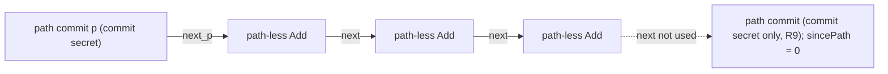

# PqChat TreeKEM mode 1: path-less Add commits (delta spec)

**Status:** SPECIFIED; nothing is built. **UNAUDITED**: a change to a new cryptographic protocol; every construction below
is a design, not a reviewed protocol ([ARCH-POS-14](../../decisions.md#ARCH-POS-14)). A **delta** to the mode-1 spec
[`2026-11-23-pqchat-treekem.md`](2026-11-23-pqchat-treekem.md) ("spec §n", its rulings R1–R16 and calls C1–C40, with R8 at
512 leaves and C10's `TREE_CHANGES_MAX` at 20 as on branch `review-fix-contract`); whatever this file does not change stays
as the spec says. Research: [`2026-11-25-treekem-pathless-add.md`](../../research/2026-11-25-treekem-pathless-add.md)
("research §n", its figures [E], its owner sections at the end). Rules: [`contracts/pqchat.md`](../../contracts/pqchat.md)
CTR-CHAT-25, CTR-CHAT-26, CTR-CHAT-27. Plan of mode 1: [`2026-11-23-pqchat-treekem.md`](../plans/2026-11-23-pqchat-treekem.md).
RFC 9420 §8 (key schedule), §12.4 (a commit without a path, "partial"), §6.1 (the confirmation tag).

**Revision 2 (2026-11-25), after the spec review** (Fable areas F and D, a Claude Opus workflow; reports kept outside the
repo). Its open points are decided as **controller calls under the owner's 2026-11-25 auto-run grant; the owner may veto
each** (§15). **Owner's accepted risk (2026-11-25):** a malicious or compromised group **admin** is informational only; such
scenarios are recorded as known limits (§15.2), not as rules or fixes. A member-level attacker counts in full.

**Decisions entries:** none is written yet. They land with P1 (§14) when this delta merges, status SPECIFIED; their planned
Change texts are §12. New rulings here are R17–R20 (owner), new calls C41–C47 (controller, owner: no; the owner may override
any). Tags: **[F]** a fact with its source, **[E]** an estimate (the research's paper figures; no gas was run for this spec).

**Contents**

1. [Rulings](#1-rulings)
2. [Scope](#2-scope)
3. [Records](#3-records)
4. [The key schedule](#4-the-key-schedule)
5. [Acceptance and completion on the contract](#5-acceptance-and-completion-on-the-contract)
6. [The client walk](#6-the-client-walk)
7. [What only clients can check](#7-what-only-clients-can-check)
8. [Node rows](#8-node-rows)
9. [Gas and size](#9-gas-and-size)
10. [Threats](#10-threats)
11. [Amended rulings and calls](#11-amended-rulings-and-calls)
12. [Planned Change texts](#12-planned-change-texts)
13. [Tests and mutants](#13-tests-and-mutants)
14. [Plan](#14-plan)
15. [Controller calls and known limits](#15-controller-calls-and-known-limits)

## 1. Rulings

**Owner, 2026-11-25 (owner: yes), relayed by the controller.** The owner's own words are in the research's last two
sections; quoted here verbatim, then the rulings as stated.

- "Có lẽ sẽ chọn Add không path, nhưng nới việc commit có path: chỉ là option khi tạo session, không bắt buộc. Có cảnh báo
  ở client (admin) cần commit có path." (Probably path-less Adds, but the path commit relaxed: only an option when the
  session is created, not mandatory; a client warning (admins) that a path commit is needed.)
- "Ok, theo §9, chỉ mode 1, làm sau PR #30" (OK, by §9, mode 1 only, after PR #30).
- The warning (owner, the same day, as recorded in the research): with `pathRefreshBound` = 0 the contract forces nothing
  and the client warns the admins after 24 path-less leaves since the last path commit; with N > 0 the contract refuses the
  (N + 1)-th path-less leaf and the client warns as N comes near.

| # | Ruling (owner 2026-11-25) |
|---|---|
| R17 | Path-less Adds are built in **mode 1 only**, with **§9's rights** (an admin adds anyone; a member adds keys of its own UA, at most `KEYS_PER_UA_MAX`), as **their own round after PR #30**, before the freeze. Mode 0 and PqVault: no. |
| R18 | The forced path commit is a **session option at creation**, a field `pathRefreshBound` in the signed session record: 0 = never forced by the contract; N > 0 = the contract refuses the (N + 1)-th path-less leaf since the last path commit. With 0, **the client warns the admins after 24 path-less leaves**; with N, it warns as N comes near. |
| R18′ | **Change (owner 2026-11-25, after R18):** "bound mặc định 24 => 20 chứ?" and "Cũng 20": the client default `pathRefreshBound` is 20 and, with 0, the client warns the admins after **20** path-less leaves (was 24). | matches `TREE_CHANGES_MAX` = 20 |
| R19 | Removals, leaves (exits), admin changes and periodic updates keep a path: they stay path commits on the commit secret alone, as today. |
| R20 | The key schedule: R9 / C23 are reopened **narrowly**: a chain only across path-less Adds, reset by every path commit; path commits keep using their own commit secret only, as R9 decided. The two-input trade-off and "who loses what" are the research's ("The two inputs of the key schedule", "Who loses what, by way"), followed here. |

**R18 as stated:** every path-less leaf counts toward the bound, a member's own key included; it is not an open point
(§5.3). The other points the first draft left open are decided in §15.1.

## 2. Scope

**In.** A mode-1 commit of **Adds only** with **no update path**, signed as such (`pathless` true, §3.2): no node key, no
path ciphertext, no target list; one Welcome wrap per added key, as today. Its epoch key derives from the parent epoch by a
one-way step (§4). A per-session bound, fixed at creation, on the leaves added so between two path commits (§5.3). A
confirmation tag in every commit and in the session record (T1, §4.2).

**Unchanged.** Every other commit is a path commit as today (R19): a Remove, an exit honoured, an admin change (dropping a
`gone` admin included), a refresh, a plain commit, a commit of Adds that its author chooses to send with a path. C6's
blanking stays (the research's variant A): each Add blanks the new leaf's whole direct path up to the root, there are no
unmerged leaves, and the tree hash and the resolution do not change. Mode 0's behaviour and PqVault do not change; mode 0's
session record gains the two new fields, fixed at 0 (§3.1).

**Out.** Mode 0 and PqVault path-less commits (R17; `PqVaultCreate` does not change, `pqvault-core` still refuses
`groupMode ≠ 0`); RFC 9420's unmerged leaves (variant B); a time bound (no tree rule reads the clock; research §6.1); any
family but EVM (mode 1 is EVM only, spec §3).



## 3. Records

### 3.1 The session record: `pathRefreshBound` and `confirmTag`

`PqChatSession` gains **`uint32 pathRefreshBound`** and **`bytes32 confirmTag`** after `groupMode`, in that order, the
record's last two fields (C41, C43, controller):

```text
PqChatSession(bytes32 creator,uint64 nonce,bytes32 homeChain,address homeChatContract,bytes32[] admins,MemberKey[] members,
              bytes32[] wrapHashes,bytes sealedInfo,uint8 groupMode,uint32 pathRefreshBound,bytes32 confirmTag)
              MemberKey(bytes32 ua,uint64 keyId,bytes32 via)
```

- **`pathRefreshBound`, meaning (R18).** 0: the contract never forces a path commit. N > 0: a path-less commit is refused
  when the leaves it adds would bring the count since the last path commit above N (§5.3).
- **Its bounds (C41, controller; cap decided in §15.1).** In mode 0 it must be 0; in mode 1 at most
  `PATH_REFRESH_BOUND_MAX` = `TREE_LEAVES_MAX − 2` = **510**. Either violation is `PqChatShape()` at `createSession`. Why:
  in mode 0 the field has no reader, so a non-zero value would be signed and mean nothing. In mode 1 between two path
  commits no leaf is freed (a Remove carries a path, anything owed refuses a path-less commit), and at least one live leaf is
  never counted (the creator, or the author of the resetting commit), so `sincePath + adds.length` is at most 511 and a bound
  of 511 or 512 could never refuse: it would mean the same as 0. 510 is the largest value that can bind. One meaning per
  value.
- **The client default (C46; decided in §15.1).** `scaas-sdk` and `pqchat-core` put **20** there when the caller names no
  value; 0 is allowed only when named, and then the client warns after 20 (§6.4). The `createSession` review shows it: "key
  refresh forced after N added keys" or, for 0, "key refresh never forced; the admins are warned after 20 added keys"; the
  session's details show the same line to every member.
- **`confirmTag` (T1 at epoch 0, C43; F-7).** In mode 1, `H(S_0, …/confirm ‖ genesisCtx)` (§4.1); in mode 0 it must be
  `bytes32(0)`, else `PqChatShape()`. The contract cannot check a mode-1 value (no secret) and does not.
- **Fixed at creation,** with `groupMode`; nothing changes either later. Both are signed by the creator and hashed into
  `treeId` (C16, `hashStruct(PqChatSession)`). `pathRefreshBound` is also hashed into `genesisCtx` (C29: `TreeGenesis` takes
  it, so epoch 0's keys bind it); `confirmTag` is **not**, like `wrapHashes` and `sealedInfo`, so C29's order holds:
  `genesisCtx` → `joiner_0` → `S_0` → the tag.
- **The type.** `uint32`, as `leaves` and `ctCount`: a count of leaves.

### 3.2 The commit record of a path-less Add

`PqChatCommit` gains **`bool pathless`** and **`bytes32 confirmTag`**, appended after `sealedInfo` in that order (C42, C43;
the explicit field decided in §15.1, "explicit parameters"). **The contract requires the path-less shape exactly when
`pathless` is true** (§5.1):

| Field | `pathless` true |
|---|---|
| `adds` | at least one `TreeAdd`, at most `TREE_CHANGES_MAX` (20) |
| `removes` | empty |
| `admins` | equal to the head's stored admin list, element for element |
| `nodeKeyHashes` | empty |
| `ctCount` | 0 |
| `ctListHash` | `hashStruct(PathList)` of two empty arrays (spec §6, codex-r2-14) |
| `wrapHashes` | one per Add, as today |
| `treeHash` | the head's tree after the Adds: **the commit sets no node and does not blank the author's direct path by itself; each Add blanks its own leaf's whole direct path up to the root (C6), the nodes it shares with the author's direct path included**, so the root is always blank and the author's path keeps its keys only on nodes off every new leaf's direct path |
| `sealedInfo` | as today: a full info or the marker (C33), not empty |
| `nonce` | seed-derived (§4.1, C47): the own-commit test of R10 (§6.5) |
| `confirmTag` | `H(S_e+1, …/confirm ‖ ctx_e+1)` (§4.1); in a path commit too |

With `pathless` false the commit is a path commit and every rule of the spec applies as today: a commit with an Add, an
empty `nodeKeyHashes` and `ctCount` 0 is still refused, since the added leaf is a target of the walk
(`PqChatTreeTargets`) [F, `_walkPath`]; a commit with an empty path and **no** Add keeps today's meaning (the last live
leaf's commit, spec §10).

**Why a field.** The kind picks the key derivation (§4.1); a signer, `ua-rs` or another, sees it by name in the typed data
instead of reading it from three empty fields. The typehash moves anyway under T1, so the field costs 32 B in the record
(48,960 of state gas) and one check. `ua-rs` builds it by its own named operation (§6.5).

**Pieces.** None but the Welcome wraps. `Epoch.wraps` is `adds.length + 1` (C20 as built: no list piece, no key piece when
`ctCount` is 0 [F, research §8.2]); `addPathList`, `addPathKeys` and `addPath` on such an epoch are refused as today for
`ctCount` 0 (`PqChatPathList`, `PqChatShape`, `PqChatPathList`). C40 is unchanged.

### 3.3 Typehashes, selectors, ids and vectors that move

Old values on `review-fix-contract` [F]; the new ones are the round's pins, written old → new in P4's commit.

| What | Old | Moves | Why |
|---|---|---|---|
| `SESSION_TYPEHASH` (`PqChatSession`), its pin (`test/pqchat/PqChatTypes.t.sol`) | `0x7e832d4c…62d911` | **yes**, for mode 0 too | two fields; the struct is one for both modes |
| `TREE_GENESIS_TYPEHASH` (`TreeGenesis`, hashed, never signed) | `0xb3b1ba63…e7337d` | **yes** | `uint32 pathRefreshBound` after `groupMode` (not `confirmTag`) |
| `COMMIT_TYPEHASH` (`PqChatCommit`), pinned by `tree.json` | `0xce1e681e…23fd4d` | **yes** | `bool pathless`, `bytes32 confirmTag` after `sealedInfo` |
| `createSession`'s and `commit`'s selectors; `sessionOf`'s, `commitOf`'s returns | | **yes** | the selectors hash the structs' tuple types |
| `PqChatTree.treeCreate`'s selector (`PqChatTree.sol:29`) and the node's `TREE_CREATE` string (`guard.rs`) | | **yes** | it takes `PqChatSession`; the node pin must move too, with a positive control (§13), or its "no row" test checks a selector nobody calls |
| `type(IPqChat).interfaceId` (`PqChatTreeViews.t.sol`) | `0x7b7acc12` | **yes** | `createSession` and `commit` are in `IPqChat` |
| `type(IPqChatTreeViews).interfaceId` | `0xec42e734` | no | only `treeOf`'s return changes; a selector does not hash returns |
| `deploy_pqchatstore.py`'s `ipqchat_id` | `"869305e0"`, already stale against `0x7b7acc12` | **yes** | fixed in P4 to the new id, with the deploy e2e (its negative cannot fail on a stale value) |
| `treeOf`'s return | | **yes** | `uint32 sincePath` appended (§5.3) |
| `TreeAdd`, `TreeRemove`, `PathList`, `PathCt`, `PqChatTreeLeave`, `PqChatTreeRemove`, `Wrap`, every mode-0 record but the session | | no | |
| `smartcontracts/vectors/pqchat/records.json`: every session row (mode 0 and 1, `sessionTreeKem` included) | | **yes** | the typehash |
| `smartcontracts/vectors/pqchat/tree.json` and `tree-secrets.json`: **every row** | | **yes** | `treeId` and `genesisCtx` feed every tree derivation; every commit digest moves |
| `keys.json`, `messages.json`, `topics.json`, `cards.json`, `ar-urls.json`, every `pqvault/` file | | no: byte-identical, checked | |

Every reader regenerates from the generator, never by hand: clientkeys (`scripts/pqchat-vectors.mjs`,
`scripts/treekem-fixture.mjs`), `ua-rs`, `scaas-sdk`, `pqchat-core`, `scaas-node`, the forge tests. The mode-0 session
writers carry `pathRefreshBound: 0` and `confirmTag: 0`: `clients/ua-rs/src/wallet/pqchat.rs`,
`clients/scaas-sdk/src/pqchat_records.rs`, `clients/pqchat-core/src/session.rs`, `clients/pqchat-core/src/abi.json`.

## 4. The key schedule

Notation of spec §5: `H(ikm, info) = HKDF-SHA-256(ikm, salt = empty, info, 32)`; labels are `<prefix>/<name>` (CTR-CHAT-28),
PqChat's prefix `scaas/pqchat/v1/tree`; fields follow the label, each 32 B unless stated. Every step runs inside `ua-rs`
(spec §15).

### 4.1 The derivations

```text
every epoch e, 0 included (new; RFC 9420's init_secret, §8; lifetime below):
  next_e     = H(S_e, "scaas/pqchat/v1/tree/next")

a path commit (unchanged, C23, R9, R20):
  joiner_e+1 = H(commitSecret, "scaas/pqchat/v1/tree/joiner" ‖ treeId ‖ epochId)

a path-less Add (new, R20):
  joiner_e+1 = H(next_e, "scaas/pqchat/v1/tree/add-joiner" ‖ treeId ‖ epochId ‖ hash(adds))

both (unchanged):
  ctx_e+1    = keccak256(abi.encode(TAG_TREE_CONTEXT, treeId, epochId, epoch, parentEpochId, parentTreeHash, treeHash,
                                    keccak256(abi.encodePacked(admins))))
  S_e+1      = H(joiner_e+1, "scaas/pqchat/v1/tree/epoch" ‖ ctx_e+1)
  K_e+1      = H(S_e+1, "scaas/pqchat/v1/tree/key")

the confirmation (new, T1, C43; every commit, and epoch 0 in the session record):
  confirmTag = H(S_e+1, "scaas/pqchat/v1/tree/confirm" ‖ ctx_e+1)
  epoch 0:     H(S_0,   "scaas/pqchat/v1/tree/confirm" ‖ genesisCtx)

a path-less Add's nonce (new, C47; R4's kind of value: seed-derived):
  addNonce   = first 8 B, big-endian, of
               H(kemSeed(ua, keyId), "scaas/pqchat/v1/tree/add-nonce" ‖ treeId ‖ parentEpochId ‖ parentTreeHash ‖ hash(adds)
                 ‖ u32be(try)),   try = 0, 1, … < ADD_NONCE_TRIES = 8
```

`epochId = epochId(sessionId, author, nonce)`; `hash(adds)` the EIP-712 array hash of spec §6 (the keccak of the packed
`hashStruct(TreeAdd)`, each with its leaf, UA, `keyId`, `via`, `kemHash`), as in `pathContext`. Epoch 0's `S_0` is under
`genesisCtx` (C29), so `next_0` exists and a path-less Add may follow creation directly.

**Four branches of `S_e`, kept apart (a known-answer row, §13).** `key`, `next` and `confirm` are distinct labels over one
`S_e`; the `confirm` branch is the only one published. A tag derived under the `key` label would publish `K_e`, under
`next` it would publish the chain: the vectors carry `K_e`, `next_e` and `confirmTag` of one `S_e` and a row that fails
if two labels are made equal.

**`try` (C47).** The device's counter per head (as built; the path-less review's E-6 = G-6, a controller call of
2026-11-27): every path-less Add the device signs on a head takes the next `try`, a new head starts at 0 (a rebuild after
losing the slot has a new parent). A `try` reused after a restore, its record in state, is refused `PqChatNonceUsed` at the
send; the client reports it as `TreeStale` and the rebuild takes the next `try`. One id holds one record in state, and both
candidates carry the same joiner secret by construction, so a reuse costs a refused send only. With every `try` below
`ADD_NONCE_TRIES` used on a head the author builds a path commit instead.

**What each binds:**

| Input | Binds |
|---|---|
| `next_e` | the previous epoch, by a branch of `S_e` apart from `K_e`: a leak of `K_e` or of anything below it (sender chains, `infoKey`, the hint, call keys) does not give the next epoch; only `S_e` or `next_e` does, and neither outlives its use (lifetime below) |
| `treeId` | the home and the genesis record, `pathRefreshBound` and epoch 0's tag included (C16) |
| `epochId` | the author and the nonce: two path-less children of one parent never share a key |
| `hash(adds)` | the joiners and their keys: a twin under one id with other Adds has another joiner secret |
| `ctx_e+1` | the parent's id and tree hash, the tree after the Adds (hence `leaves`), the admin list |
| the labels | the kind: `…/joiner` and `…/add-joiner` never yield the same secret from one input; a device picks the derivation from the signed `pathless` field (§3.2), never from a served hint |
| `addNonce`'s seed | the author's own `(ua, keyId)`: only its seed reproduces the nonce, with or without the epoch state (§6.5) |

**Not bound: the whole record.** `sealedInfo` and the Welcome wraps are sealed under keys from `S_e+1`, so the record's hash
cannot be an input (the circle of C29). Two records under one id that differ only in `sealedInfo` or `wrapHashes` share a
key, as two path commits do today (codex-r3-2); C26's comparison of the record that won at a pinned number covers it.

**One-way.** A joiner holds `joiner_e+1` and what follows, never `next_e`: it reads nothing before its join.

**Lifetime (F-6; `ua-rs`).** `S_e` and `joiner_e` are dropped once `K_e`, `next_e` and the tag are derived (the author:
once the wraps and `sealedInfo` are built). `next_e` is kept **only in the handle of the device's head**: when the device
follows a child of `e`, `next_e` is dropped and the child's `next` replaces it, so after a path commit no `next` of the run
before it remains. Old handles keep `K_e` for reading, never `next`. Replay re-derives from the anchor (a path ciphertext,
the seed or a wrap), as §6.6 says.

**Construction order of a path-less Add** (the author): the head `e` followed, so `next_e` is held (§6.5); the Adds, their
keys authenticated (spec §8 step 5), `addNonce` (C47), `epochId`; the tree after the Adds, `treeHash`, `leaves`; `admins`
the head's → `joiner_e+1`, `ctx_e+1`, `S_e+1`, `K_e+1`, `confirmTag`, `next_e+1` → the Welcome wraps (each sealing
`joiner_e+1` under the tree's wrap label, spec §5) and `sealedInfo` → the record with their hashes, `pathless` true → the
signature. Nothing earlier needs anything later.

### 4.2 The confirmation (T1, decided)

`bytes32 confirmTag` in **every** commit and in the session record (C43, controller; §15.1): one derivation and one check for
every kind. A device derives `S`, compares `confirmTag`, then opens `sealedInfo`. The tag is a PRF output under `S`: it
reveals nothing about `K` (RFC 9420's tag is the same kind of value, §6.1). The contract cannot check it and does not.
**The tag alone decides the key state; `sealedInfo` decides only the info (F-8).** A good tag with a `sealedInfo` that does
not open is "followed, info not taken" (C33's gap rule for the info) for every role.

Why not `sealedInfo` alone (T2): AES-256-GCM-SIV does not commit to its key, so an author that knows two keys might build one
`sealedInfo` that opens under both [U, research §4.2]; a path-less joiner has no second source (no path ciphertext against
`nodeKeyHashes`), and a genesis member had none either (F-7).

### 4.3 Who loses what (R20, the research's trade-off, followed)

| Kind | Inputs | A faulty piece costs |
|---|---|---|
| Path commit (today, kept) | the commit secret only | the members under the node a bad ciphertext went to lose that epoch and maybe a few more, until a commit reaches a node they hold or they commit; nobody else loses anything |
| Path-less Add (new) | the parent's `next` only, reset at every path commit | no existing member is sent a ciphertext, so none loses an epoch; only a joiner can be hurt, by a wrong Welcome, which its tag shows when it fails at the join; the joiner's own path commit or the next path commit reaching its leaf fixes it (§6.3) |
| Full RFC 9420 (not taken) | both on every commit | the members under the faulty node are out for good until a new Welcome (the "session lost" case R9 avoids) |

What is given up (research §6.1): post-compromise security inside a run. Whoever holds `S_e` or `next_e` derives every
path-less epoch after `e` up to the next path commit, joiners' messages included. The bound (R18) limits the run by leaves,
not by time; with 0 the client's warning is the only guard (§6.4).

## 5. Acceptance and completion on the contract

### 5.1 C7 for a path-less commit

At acceptance (owner, R12: everything public is checked then), in `PqGroupTree._treeCheck`:

1. Every check of spec §8 that is not the path walk, unchanged: the session and `treeId`, the head and `parentTreeHash`
   (C31), the signature and the nonce, the author's live leaf and not `gone`, each Add (blank leaf in range, a UA not
   `gone`, `scheme == 1`, `kemHash` against the registry, the admission check, not live, not added twice, the three
   no-return sets of R16), `TREE_CHANGES_MAX`, `KEYS_PER_UA_MAX`, the rights of §9, the shapes of C24, `leaves`.
2. **The shape (C42, controller).** `pathless` true requires at least one Add, an empty `nodeKeyHashes`, `ctCount` 0 and
   the empty list's `ctListHash`, else `PqChatShape()`. `pathless` false is a path commit: every rule as today (an Add with
   an empty path still fails `PqChatTreeTargets`).
3. **The path-less conditions (C42; R19).** With `pathless` true the commit must have **no Remove** and **`admins` equal
   element for element to the head's stored list**, else `PqChatTreePathRequired()`. Equality, not `_keepsAdmins` (which
   accepts the head's list less its `gone` UAs): dropping a `gone` admin is an admin change and keeps a path (R19). With the
   existing checks this also refuses the commit while anything is owed (`owed > 0`: the commit removes nothing, so
   `PqChatRemovedKept` as built [F, `_walkJudge`]) and while a head admin is `gone` and kept (an `msig` admin with no leaf
   leaves `owed` at 0 but must be dropped: `PqChatRemovedKept` on `admins`).
4. **The bound (R18):** when `pathRefreshBound` > 0 and `sincePath + adds.length > pathRefreshBound`,
   `PqChatTreePathBound(sincePath, pathRefreshBound)`; a commit that would cross the bound is refused whole.
5. **No path walk:** `_walkPath` is skipped. The commit sets no node and does not blank the author's path by itself; each
   Add blanks its own leaf's whole direct path up to the root (C6, `_blankPath` as built in `_walkAdds` [F,
   `PqGroupTree.sol`]), so the root and every ancestor the author shares with a new leaf are blank in the result. No target
   is expected, and **no targets hash is written** when `ctCount` is 0 (nothing reads it: `_landList` refuses an empty list;
   this also drops the write for the last live leaf's commit; 97,920 of state gas less).
6. The root of that tree, each changed leaf's `kemHash` from the registry, equals `treeHash` (`PqChatTreeHash`). R12 holds
   as worded: nothing public is staged wrong.

Two base codes are added (`T_PATH_REQUIRED`, `T_PATH_BOUND`), mapped by `PqChatCore._treeFail` to the two errors; the base
keeps no app name (CTR-CHAT-26's two layers).

What is pinned across the contract and the client libraries is the set of records accepted and refused. A record with
several faults may be refused by another of its names in a client library than on the contract (the clients check the
Removes and Adds before items 3 and 4); the rows with one fault pin its name (the path-less review's E-5, a controller
call of 2026-11-27).

### 5.2 Completion

The steps of spec §8, with step 3 reduced to C6's blanking (no node takes a key; the nodes on each new leaf's direct path,
the root included, are blanked). Then **`sincePath` grows by `adds.length`**. A commit completes in `commit` itself when it
carries every wrap and the transaction fits, else at the last wrap landed by `addWraps`. How many Adds fit one transaction
is computed by the planner per operation (spec §13), never taken from §9's rows.

### 5.3 The counter and the bound

- **Storage (C44, controller).** `Tree` gains `uint32 sincePath` and `uint32 pathBound` after `owed`, in the slot of `used`,
  `leaves` and `owed` (96 of 256 bits used today [F, `PqGroupTree.sol`, `namespaces.json`]): no slot moves; the layout pin
  (`test/v2/layout/namespaces.json`, `pqchatTree`) gains the two fields. `_treeOpen` takes the bound from the session record
  at creation; the base stores it per group, so it is a value of the group, not a hook (`_treeBounds` does not change).
- **What counts (R18 as stated).** `sincePath` is the number of leaves added by path-less commits **since the last path
  commit** (since creation before the first). **Every path-less leaf counts, a member's own key included.** The window the
  bound limits is the epochs a leaked `next` opens and the cold leaves the next path commit owes, whoever added them;
  uncounted, a run would grow with the group (7 more keys per UA), not with N. Every completed commit with `pathless` false
  sets it to 0, the commit of the last live leaf (an empty path with no Add, whose `commitSecret` is the author's `ps[0]`)
  included; a path commit's own Adds are not counted.
- **When it moves.** Only at completion. A staged commit does not count; the head's counter moves only when a commit takes
  the slot, and a commit staged on that head then fails on the slot (`PqChatEpochTaken`), so the check at acceptance holds
  at completion (asserted there).
- **The view.** `treeOf` appends `uint32 sincePath`; the bound is read from the session record (`sessionOf`).

### 5.4 Rights

§9 unchanged (R17). A path-less commit keeps the admin list, so it is plain exactly when every Add names the author's UA:
a member adds keys of its own UA, at most `KEYS_PER_UA_MAX` live (`PqChatShape` above), by a plain commit; any other Add
needs a live admin (`PqChatNotAdmin`). An admin change, a removal and dropping a `gone` admin are path commits (R19).

### 5.5 Exits landing between path-less Adds (E-3)

An exit names the head or an ancestor within `EXIT_LAG_MAX` and applies at the head (C9), which may be a path-less epoch.
The UA is `gone`, its leaves are owed (at most `TREE_CHANGES_MAX` = 20, C21), and from then:

- a path-less commit on that head is refused (`owed > 0`, §5.1 item 3): the next commit is the honouring path commit, which
  resets `sincePath`;
- a path-less commit staged when the exit lands fails completion's step 1 (`PqChatRemovedKept`), as any staged commit;
- the exited UA holds `S_h` of the head, so `next_h`, and reads the head's messages until the honouring commit, as today
  (sc-F-9); it derives nothing after it, since no path-less child of `h` is accepted while it is owed and the path commit
  needs the commit secret.

### 5.6 Replicas, losing children, owed leaves

- **No replica.** A tree session lives in its home only (C4); no replica stores children, so nothing here binds a replica.
- **A staged path-less child that loses the slot.** Its record and Welcome wraps stay in state (never lose ciphertext); its
  joiners hold `joiner_L`, independent of the winner's under the PRF assumption on HKDF with distinct `info` [I, research
  §4.4], and read neither the winner nor the parent. The author rebuilds on the new head (a new parent, `try` 0, C47); if it
  did not follow the new head it builds a path commit (§6.5).
- **Owed leaves (C21).** A path-less commit honours nothing, so it is refused while `owed > 0`; the honouring commit is a
  path commit within `TREE_CHANGES_MAX` = 20 changes, as today.
- **The next path commit after a run.** It carries one ciphertext per path-less leaf that has not committed, and up to
  `d − 2` more where the Adds blanked warm nodes (research §3.4): at most `sincePath + d − 2` targets more than before the
  run, about 20 ciphertexts per transaction, so every reachable tree still has a next commit that fits (spec §13). Its
  price grows with `sincePath`, and the warning shows it (§6.4).

## 6. The client walk

Spec §10 and §8 step 2 with these additions. The replay reads stay fixed by public data (C22): for a path-less epoch the
record says `ctCount` 0, so every device reads the record and, at its own join, its wrap; nothing else, followed or not, and
no read or write depends on whether a tag or `sealedInfo` matched (ARCH-POS-13; the trace tests of §13).

### 6.1 The forward walk (C25)

For a record with `pathless` true the walk applies §5.1's conditions with its own state: the shape, no Remove, `admins`
equal to the previous record's, nothing owed by the exits it applied, no `gone` admin, the bound against `pathRefreshBound`
of the signed session record and the walk's `sincePath`, and the tree after the Adds (C6's blanking on each new leaf's
direct path, nothing else) hashing to `treeHash`. A record that fails is a lying read (C25, C-3), never "not followed". The
walk keeps `sincePath` with its tree; the pin keeps it too (C26), and `treeOf`'s `sincePath` is only compared with it.

### 6.2 A member through a run

**Anchored (C45, controller; F-1).** A device is **anchored** in a run when its entry into the run is a path commit it
followed (by a path ciphertext checked against `nodeKeyHashes`, or by its own seed) or the genesis it opened with the
session record's tag passing. A device that entered the run by a **path-less Welcome** is **unanchored** until it follows a
path commit (§6.3).

A device that followed epoch `e` holds `next_e`. For each path-less epoch after it, from the record alone: `joiner`, `S`,
the tag, then `K`, `next` and `sealedInfo` (C12 as amended, §11). It drops the secrets of the nodes on each new leaf's
direct path, the root included (spec §10, C6), and keeps the rest, the nodes of the author's path off those direct paths
included. A device that did not follow `e` cannot derive the path-less epochs above it: they are "not followed" for it, and
it follows again at the next **path** commit whose target on its side is its leaf or a node it holds, or by a path commit of
its own (R9 as amended).

The states of a path-less epoch at an **anchored** device that followed the parent:

- **tag good, `sealedInfo` opens:** followed.
- **tag good, `sealedInfo` fails: "followed, info not taken"** (F-8): the key is held and equal to the author's; no info in
  force from that epoch on (C33's gap rule) until an admin establishes it anew.
- **tag fails: "the author did not hold the epoch"** (C45): the device holds the chain's key by construction, so the author
  did not hold the epoch (or sealed it wrong). A state of its own, shown to every member, naming the epoch, its author and
  the leaves it added:
  - the device **keeps the chain's key** for that epoch and the run after it: one author cannot stop the group with a
    record;
  - it has **no info in force** from that epoch on (C33's gap rule): the info that failed was not taken;
  - **the added leaves may hold another key**: messages they send may not open, and they may read nothing the group sends;
  - it offers its user the remedy and sends nothing by itself (C22, CLI-PQC-07): an admin reviews the added leaves and
    chooses, in spec §9's wording, **"remove: this UA can never return"** (a path commit; R14 makes a UA whose only leaf is
    removed `gone` for good, so an honest joiner hit by a faulty Welcome is not removed as the first remedy) or **"keep and
    refresh"** (a path commit that sends the next secret to every added leaf);
- for a commit of the device's own `(ua, keyId)` the own-commit test of §6.5 runs first.

**Leaves under review (F-3, member-level).** While a C45 state or a compromise warning (§6.5) names leaves still in the
tree, **every** client's review of **any** path commit (an admin's refresh, a non-admin's refresh or key change, a Remove)
lists them as "receives the new key; not confirmed", and the planner never builds the path form by itself (at the bound it
stops and asks, §6.5). The honouring commit of an exit must go and is the one exception, with the same review line.

### 6.3 A joiner of a path-less epoch

It verifies the chain forward from the session record to the head (C25), as every commit joiner. At its join epoch `j`:
`wrapAt(epochId_j, wrapIndex)`, compared with `wrapHashes` → `joiner_j` → `S_j` → the tag → `K_j`, `next_j` → `sealedInfo`;
then forward by `next` through the path-less epochs after `j`. It holds no node secret: every node above its leaf is blank
(its Add blanked them and no path commit set any since), so at the next path commit its leaf itself is the target and it
opens that ciphertext as a member does. Its secret range starts at `j` (spec §10 step 3).

The joiner is **unanchored** (§6.2) until it follows a path commit: its tag only shows that its Welcome agrees with the
author. Its states:

- **at the join, tag fails:** "not followed" for that device (a denial of service on it, no disclosure); it keeps no key.
- **at the join, tag good, `sealedInfo` fails:** "followed, info not taken" (F-8).
- **at a later path-less epoch of the same run, tag fails: "not followed since its join; this device's Welcome may not match
  the group"** (F-1), naming the join epoch and blaming no author; never C45. It keeps no key for it and holds its sends
  (C35) until a path commit reaches its leaf.
- **Remedies (F-4):** the joiner's **own path commit** (it needs no epoch secret: its commit secret is its seed's `ps[0]`)
  or **the next path commit by anyone**, whose target its leaf is. Mode 1 has no second Welcome for a live leaf (R14, R16:
  the same key is live, the same bytes cannot return).

### 6.4 The warning (R18)

The client computes `sincePath` by the walk and warns **the admins** (the devices of UAs in the head's `admins`). The
threshold `W(N)` is defined for every N (C46, controller; §15.1):

- **`pathRefreshBound` = 0:** `W(0)` = 20 (`PATHLESS_WARN_LEAVES`, a client constant, the owner's figure: 24, then 20 on
  2026-11-25, "Cũng 20"): from `sincePath ≥ 20`, "a path commit is due: n leaves added without a key refresh since epoch p".
- **`pathRefreshBound` = N > 0:** `W(N) = max(1, N − ⌈N/4⌉)`, the last quarter of the room (the controller's reading of "as
  N comes near"): N = 1 → 1, 2 → 1, 4 → 3, 24 → 18, 100 → 75, 510 → 382. From `sincePath ≥ W(N)`: "n of N; at N the next Add
  carries a key refresh". A creator who picks N above 20 is shown, in the `createSession` review, that the warning comes at
  `W(N)`, later than a session with 0.
- **The deferred cost (D-10):** every warning and every path-less Add's quote also shows "the next refresh carries at least m
  ciphertexts, at least m × 2.9 M asked", a lower bound (m = the leaves owed a ciphertext, `sincePath` plus the
  blanked warm nodes, [E] until P8).
- **Every path-less Add's review** (any author) shows "adds without refreshing the group's keys; n of N since the last
  refresh" (or "n since the last refresh" with 0).

The warning is shown, never acted on: no commit is sent by itself (C22). Other members' clients may show the count in the
session's details; the warning is the admins'.

### 6.5 The author's choice, `ua-rs` and the own-commit test (C46, C47, controller)

- **The form.** For an Adds-only change the planner offers the path-less form by default when every condition holds: the
  device followed the head (it holds `next` of the head's handle), nothing is owed, no head admin is `gone`, the admin list
  is unchanged, no Remove, the bound leaves room, **no path commit of its own is staged on the head** (F-5, owner ruling 2026-11-27: a one-transaction
  path-less Add would take the slot from it, shown as "a key refresh is in progress"; another author's staged commit is not
  visible to the client and no contract view lists it: the contract's order decides, the loser is refused by name and rebuilt), and no
  `try` is left (C47). Otherwise, or when the user picks "add and refresh", it builds a path commit with the Adds, listing
  any leaves under review (§6.2). The quote names both prices (§9). At the bound the client offers the path form (the
  contract would refuse the other, `PqChatTreePathBound`); while leaves are under review it lists them and asks first,
  never building the path form by itself (§6.2).
- **`ua-rs`.** The epoch handle keeps `next_e` beside `K_e` only while it is the head (§4.1, lifetime), and carries its
  `epochId` and `treeHash`; neither secret leaves `ua-rs`. A named operation signs a path-less Add (one operation per kind;
  spec §15's commit-signing operation keeps the path form). It takes the head's epoch handle, the walk's verified tree and
  the Adds, **refuses by a named error unless the handle's `epochId` and `treeHash` equal the record's `parentEpochId` and
  `parentTreeHash` and the walk's head** (claude-19), authenticates the keys, derives `addNonce` (C47), builds the wraps,
  `sealedInfo` and the tag, fills `PqChatCommit` from those exact pieces with `pathless` true, shows the review of §6.4 and
  returns the record, the wraps, the `UASig` and the new handle. No call signs a digest supplied from outside. The author
  drops from its own state the node secrets of its path that the Adds blanked, the root included (D-1).
- **The own-commit test of R10 (C47; F-2).** A path-less record whose author is the device's own `(ua, keyId)` is
  reproduced when its `nonce` equals `addNonce` for some `try` < `ADD_NONCE_TRIES`, from the device's `kemSeed(ua, keyId)`
  and the record's public fields: it needs no epoch state, so a device that did not follow the parent runs it too, and a
  restored device too. **No `try` reproduces it: the compromise warning of R10** (someone holds the UA's signing key or
  obtained a signature; with the epoch state, a member insider), never "not followed" and never §6.2's state, naming the
  epoch and the leaves it added (they are under review, §6.2). Reproduced: the record is the device's own, and the tag then
  decides the key state as at any member. The tag alone is not the test: anyone who held the parent epoch computes it.
- **A path commit under T1 (claude-21).** A member whose path ciphertext opened but whose derived tag does not match:
  **"not followed (tag)"**: the key it derived is not the author's; it takes none and follows at the next commit that
  reaches it. Tag good, `sealedInfo` fails: "followed, info not taken". For an own path commit the reproduce test is the
  node keys from `ps[0]` and the tag (for the last live leaf, the tag alone); a failure is the compromise warning.

### 6.6 Restore and catch-up

From state alone (CTR-CHAT-14): the seed gives the device's own path commits and recognises its own path-less commits (C47),
its Welcome (genesis or join) gives its first epoch, and the chain gives each run between path commits. A device that
restores replays the walk from the session record (C25), derives forward, and opens one ciphertext per path commit of its
secret range and none for a path-less epoch.

## 7. What only clients can check

That the Welcome opens to the chain's joiner secret; that the tag and `sealedInfo` match the derived key; that the author
held the parent epoch; that an own-`(ua, keyId)` record's nonce is the seed's; the derivation itself. The contract checks
every public part at acceptance (§5.1). The split is today's, with one client check fewer: a path-less commit has no node
key to compare with a path secret; the tag takes its place for the key state.

## 8. Node rows

Both directions equal to the contract's (AGENTS.md: `typed.rs` `TYPED` / `PLAIN` rows, `guard.rs`, `mtxSelectors`,
`selector_audit.json`):

| Where | Change |
|---|---|
| `typed.rs`, `PqChatSession` type string | `uint32 pathRefreshBound`, `bytes32 confirmTag` appended |
| `typed.rs`, `createSession` bounds | mode 0: `pathRefreshBound` 0 and `confirmTag` zero; mode 1: `pathRefreshBound` at most 510, beside D-4's |
| `typed.rs`, `PqChatCommit` type string | `bool pathless`, `bytes32 confirmTag` appended |
| `typed.rs`, `commit` bounds | the stateless part of §5.1 items 2 and 3: `pathless` true with no Add, a non-empty `nodeKeyHashes`, `ctCount` > 0 or a Remove is refused by name (`BAD_PAYLOAD`, as `tree_shape` does); the rest (the head's admins, `owed`, the bound) needs state and is the contract's |
| `selector_audit.json`, the rows by selector | `createSession`'s and `commit`'s new selectors, in the audit file, the contract and the rows, both ways; the old selectors gone from all three |
| `guard.rs`, `TREE_CREATE` | the old tuple string → the new one (two fields more in the session tuple), with a positive control that it equals `PqChatTree.treeCreate`'s selector |
| `guard.rs`, the whole-set guard (spec §15) | a path-less set is the record and its wraps; the node relays it only when it holds every wrap the record signs that is not in state, each hashing to its signed hash |
| C37's order at the node | the record, then the wraps; for a path-less set **sent in several transactions**, one Welcome wrap held back and sent alone when the others are final (§11, C37) |

**Job shape (an operators' note, AGENTS.md traps).** `createSession`'s `s` gains the named fields `pathRefreshBound` and
`confirmTag`; `commit`'s `c` gains `pathless` and `confirmTag`. A consumer on the old shape of either is refused by name.
`node/job-api.md` gains the note in P1.

## 9. Gas and size

All [E], the research's paper figures (§3), asked = (regular + state) × 1.05, a warm tree, an ML-DSA-65 author, a plain
record (the marker `sealedInfo`, 284 B; one admin; Adds into warm subtrees); no row was measured. The 20-row is this spec's
linear step on the research's rows (about 4.27 M per marginal path-less Add, 7.19 M per marginal Add of a path commit),
since C10 is now 20.

| Adds per commit | Path commit at 256 keys | Path commit at 512 keys | Path-less, any depth |
|---:|---:|---:|---:|
| 1: total = per member | 69.3 M | 75.1 M | **20.1 M** |
| 10: total / per member | 134.0 / 13.4 M | 139.7 / 14.0 M | 58.5 / **5.9 M** |
| 20: total / per member | about 205.9 / 10.3 M | about 211.5 / 10.6 M | about 101.2 / **5.1 M** |

- **ML-DSA-87** adds about 5.3 M per commit to every total (research §3.2).
- **The deferred ciphertext:** each path-less joiner costs the next path commit one ciphertext, about 2.9 M asked
  (2,674,440 of state gas), plus up to `d − 2` where Adds blanked warm nodes (research §3.4). With it a path-less Add is
  about 23.0 M alone. **A forced path commit at 256 keys after 24 path-less leaves: about 132 to 150 M asked** (62.2 M for a
  plain warm commit, research §3.1's corrected base, plus 24 × 2.9 M, plus up to 6 blanked warm nodes); the owner's
  "115 to 140 M" came from the older 45 M base. The number of transactions is the gas run's (P8).
- **Per transaction: computed, never a constant (D-3).** 10 path-less Adds of a plain record fit a 60 M block with 1.44 M to
  spare (58.5 M asked, 11.0 M regular). The margin goes with any of: a full info (the normal case for an Add's author, C33:
  the 1,024-B bucket adds about 1.18 M of state gas, 59.7 M asked; the 4,124-B one about 6.2 M asked, so 8 Adds, not 10);
  32 admins (about 1.6 M); Adds into empty subtrees (up to `d` parent hashes each; spec §13 counts 105 for 20 scattered Adds
  at 512); the 256 → 512 growth (the new spine); ML-DSA-87 (9 Adds, 0.4 M to spare). The planner computes each commit's
  chunks per operation (spec §13); no layer pins "10 per transaction". 20 Adds go as the record with the first wraps, then
  `addWraps`, the last wrap held back: **three transactions**.
- **What this change adds:** in the session record `pathRefreshBound` and `confirmTag`, 64 B more in its stored blob, 97,920
  of state gas once; in every commit record `pathless` and `confirmTag`, 64 B more, 97,920 (about 0.1 M asked); `sincePath`
  lives in a slot the completion writes anyway; the path-less check skips the path walk, under 0.3 M regular less; no
  targets hash for `ctCount` 0 (§5.1 item 5), 97,920 less.
- **What it saves:** the node keys and path ciphertexts of the commit, 42.2 M of state gas at 256 keys, 47.4 M at 512; in a
  group one admin grows with passive joiners, also the repeated ciphertexts to every joiner not yet committed (research
  §3.2: 32 such one-member path commits are about 1.4 G of state gas).
- **Size (D-8).** `size-baseline.json` pins `PqChat` at 32,891 B and `PqChatTree` at 32,812 B (form `plain`: error at
  35,286 B), so P4's size gate is red until both rows move. They move old → new in P4's commit with this change as the
  reason (`_checkSession`'s bounds in `PqChat`; the branch, the counter, two codes and their mapping in `PqChatCore._treeFail`,
  inherited by every module); the room is 2,395 B and 2,474 B to the error line. The deploy-gas pins of the modules move with
  them, checked against 60 M and the deploy script's 59 M. Over either line the task stops and asks (no split by the
  controller, owner 2026-11-11).
- **Measuring (P8, decided §15.1)** before any new path-less gas row or fit is pinned: a path-less Add of 1, 10 and 20; the
  rows of D-3 (10 Adds with a 4,124-B info and 32 admins, scattered Adds at 512, the 256 → 512 growth, ML-DSA-87); the next
  path commit after 20 and after 24 path-less leaves; the depth-9 rows; each also on the local Nethermind copy with 2^24
  enforced (acceptance and completion both run `_treeCheck`; forge does not enforce the cap). P4 moves only the existing pins
  the record bytes move (deterministic forge figures, old → new).

## 10. Threats

The spec's §14 rows stand; these are added or change (research §6). Rows whose attacker is a malicious or compromised
admin are known limits (§15.2), recorded, not fixed.

| Threat | Outcome |
|---|---|
| A leak of `S_e` or `next_e` | every path-less epoch after `e` opens, up to the next path commit; bounded by `pathRefreshBound` leaves when N > 0, by the admins' warning when 0 (R18). `K_e` alone gives nothing later; old handles hold no `next` (§4.1, lifetime). A seed leak is as today (R4) |
| A removed or leaving member derives the next epoch | it would, by `next`: so removals and exits keep a path (R19), a path-less commit is refused while anything is owed and while a head admin is `gone` (§5.1) |
| A stolen non-admin UA signing key, **without** the epoch state, signs a path-less Add | it can add only keys of the victim's UA. The record is accepted; its maker cannot read the chain's epoch (no `next_e`); its tag fails at every member (C45, §6.2), the victim's device shows the compromise warning by the nonce (C47), and the added leaf is under review before any path commit gives it a key (§6.2). Weaker than today's stolen-key path commit (R10 as amended) |
| A stolen non-admin UA signing key **with** the epoch state (a member insider) | the record, its tag and its Welcome are right, so members see nothing; **the victim's device shows the compromise warning** because no `try` of its seed reproduces the nonce (C47, F-2), naming the leaf, which is then under review (§6.2). Without C47 this would go unseen |
| An author gives a joiner a wrong Welcome | the joiner's tag at the join fails if the tag is the chain's: "not followed", a denial of service on that joiner, no disclosure. A member that adds its own key forks only its own device. An author who also signs a tag matching its own Welcome forks the joiner (members see C45; the joiner sees "Welcome may not match" at the next honest path-less epoch, §6.3) and reads what the joiner sends until the next path commit reaching it: for an admin author a known limit (§15.2) |
| An author signs a wrong tag on purpose | anchored members keep the chain's key and see "the author did not hold the epoch" (§6.2); a device that entered the run by a path-less Welcome (unanchored) is "not followed (welcome may not match)" from that epoch to the next path commit that reaches it (§6.3). So the record stops every unanchored joiner of the run until a path commit, at the cost of one record; the admins see the C45 state and its author, and the next path commit (forced at the bound, or "add and refresh") restores them (the path-less review's G-3, 2026-11-27) |
| **Info wipe by a cheap record (F-10 a)** | a path-less record with a wrong tag (or a `sealedInfo` that does not open) leaves every member with no info in force (C33's gap rule, which keeps the lists from suspect leaves); a member can do it with an own-key Add for about 20 M asked (today a garbage path commit to everyone, 62 M and more), and an admin must then establish the info anew under R13. The gap rule stands; the cost is this row |
| **Bound burn (F-10 b)** | own-key leaves count (R18), so three or four members can use up N = 24 and the admin's next Add pays the path form; mild, and the forced commit is the healthy one |
| **A path commit starved by one-transaction path-less Adds (F-5)** | after a run the tree is cold and the next path commit takes several transactions; any path-less Add of a plain record that fits one transaction takes the slot and the staged path commit is `PqChatEpochTaken` (its pieces stay in state). Honest clients build no path-less Add while a path commit is staged on the head (§6.5); with N > 0 the contract ends a hostile run at N; with 0 a member's own-key Adds are bounded by `KEYS_PER_UA_MAX` and the default of 20 (§3.1) closes most sessions; an admin doing it is a known limit |
| **The first path commit after a long run (D-10)** | with 0 and a group grown to 400 keys by path-less Adds, an exit forces a commit of about 400 ciphertexts (about 1.1 G of state gas, 20 transactions or more), no path-less Add is accepted until it lands, and the leaver reads meanwhile (sc-F-9); not new in kind (a cold tree costs the same today, spec §13), shown by the warning and the quote (§6.4) |
| Cheap epochs void an exit (C9) | a front-runner must still complete 17 epochs before the exit lands; a path-less epoch costs about 20 M asked instead of 62 M at 256 keys. A non-admin holds at most `KEYS_PER_UA_MAX` keys at once, but one path commit removing its 7 own keys frees the room and 7 fresh registry versions follow: about 14 or 15 of the 17 epochs at the path-less price, roughly 0.45 G asked against 1.05 G at 256 keys [E] (F-9). C9's ratio of 17 signed records to one re-signed exit stands; **no cap on path-less commits per run** (C42, controller; research §6.4). An admin front-running another admin is equal power, as today |
| Cheap Adds loop the tree | they cannot: a path-less commit needs an Add, a leaf is freed only by a Remove, which carries a path; `TREE_LEAVES_MAX`, `TREE_CHANGES_MAX`, `KEYS_PER_UA_MAX` hold |
| A fresh restore's walk grows | one record per epoch, as today (sc-E-8); a path-less epoch is cheaper to make than a plain commit at 256 keys |
| A decryption oracle (ARCH-POS-13) | none added: an old member decrypts nothing for a path-less epoch (a KDF over its own secret and public data); a joiner opens one Welcome wrap; a tag compare is a KDF over held secrets; a failed tag or `sealedInfo` is shown and nothing is read or sent because of it (C22; the trace tests of §13) |

**The rules that do not bend** (research §7): no ciphertext leaves state (the Welcome wraps under `wrapAt`, the record with
its signature); typed, named fields (`pathless`, `confirmTag`, `pathRefreshBound`); every write relayable by anyone at fee 0
(the same `commit` and `addWraps`); one rule on every chain (a count of leaves, no clock); authorization in the contract,
fail closed (the field and the shape, the conditions, the counter, `owed`, the admin list, the sets; named errors); the
node's guard for every consumer.

## 11. Amended rulings and calls

Each with its old → new text. The owner's R17–R20 decide R1, R3, R9, C23 and C6; R10's wording is a controller call under
the 2026-11-25 auto-run grant (owner may veto); the others are the controller's consequential wording (owner: no), for the
owner to confirm.

| Item | Old | New |
|---|---|---|
| **R1** (owner) | "Minimal mode 1 is built now, before the pre-freeze tag. It covers a commit with UpdatePath, Add and Remove, with Welcome by wraps. External commits, PSKs and ReInit are out." | unchanged, plus (owner 2026-11-25, R17): "**It also covers a commit of Adds only without an UpdatePath (a path-less Add), in mode 1 only**, as its own round after PR #30, before the freeze." Spec §3's "In" gains it |
| **R3** (owner; by R18) | "… It is appended at the end of `PqChatSession` and `PqVaultCreate`, and fixed at creation." | "… It is appended to `PqChatSession`, **followed there by `uint32 pathRefreshBound` and `bytes32 confirmTag` (R18, C41, C43)**, and at the end of `PqVaultCreate`, and fixed at creation." |
| **R9** (owner) | "The joiner secret is derived without RFC 9420's `init` chain (C23). A member that misses an epoch follows again at the next commit that reaches its leaf, or by a commit of its own." | "The joiner secret **of a path commit** is derived without RFC 9420's `init` chain (C23). **A path-less Add's derives from the parent epoch's `next` secret and the commit's context; that chain exists only across path-less Adds and ends at the next path commit (R20).** A member that misses an epoch follows again at the next **path** commit that reaches its leaf, or by a **path** commit of its own." |
| **C23** (owner, R9, R10) | "`joiner_e` derives from the commit secret and the context, without the previous epoch's `init`" | "**A path commit's** `joiner_e` derives from its commit secret and the context, without the previous epoch's `init`; **a path-less Add's** from `next_e-1 = H(S_e-1, …/next)`, `hash(adds)` and the context (§4.1). Every path commit restarts; the chain never crosses one" |
| **C6** (owner, R7) | "No unmerged leaves: an Add blanks the new leaf's direct path; no truncation of the tree; every commit carries a path" | "No unmerged leaves: an Add blanks the new leaf's whole direct path up to the root; no truncation of the tree; every commit carries a path **except a path-less Add (`pathless` true: Adds only, the head's admin list, mode 1): it sets no node, sends no path ciphertext and does not blank the author's direct path by itself; the nodes that path shares with an added leaf's direct path, the root included, are blanked by the Add**" |
| **R10** (owner; **wording: controller call under the 2026-11-25 auto-run grant, owner may veto**) | "… one UA signature lets its holder build the next epoch. A commit from a device's own `(ua, keyId)` that its seed cannot reproduce is shown as a compromise warning …" | the same, plus: "**A path-less Add is useful only to one who held the parent epoch: a signature alone gets its record accepted, not its key. Its nonce is seed-derived, so a path-less commit of the device's own `(ua, keyId)` that its seed cannot reproduce is the compromise warning too, with or without the epoch state.**" |
| **C12** (controller) | "The epoch secret is confirmed by opening the commit's `sealedInfo`, which a tree commit may not leave empty; no separate confirmation tag" | "The epoch secret is confirmed by the signed `confirmTag = H(S_e, …/confirm ‖ ctx_e)` of every commit, and of the session record for epoch 0 under `genesisCtx`; then `sealedInfo` is opened, which may not be empty. The tag decides the key state, `sealedInfo` only the info: a good tag with a `sealedInfo` that fails is 'followed, info not taken'. A tag that fails is: at an anchored device in a path-less epoch, 'the author did not hold the epoch' (C45), the chain's key kept; at a path-less joiner, 'not followed' at its join, 'not followed since its join; this device's Welcome may not match the group' later in its first run; at a path commit's member, 'not followed (tag)'; for an own commit, the compromise warning by C47 or the seed's node keys and tag." |
| **C24** (controller) | the shapes as listed | plus: "`pathless` true requires Adds, an empty `nodeKeyHashes`, `ctCount` 0 and the empty list's hash (`PqChatShape`), no Remove and the head's `admins` element for element (`PqChatTreePathRequired`); at creation `pathRefreshBound` and `confirmTag` are 0 in mode 0, and `pathRefreshBound` is at most 510 in mode 1 (`PqChatShape`)" |
| **C25** (controller) | the walk's checks per record | plus: "for a record with `pathless` true, §5.1's conditions and the bound on the walk's `sincePath`, C6's blanking on each new leaf's direct path and nothing else in the tree it hashes" |
| **C29** (controller) | `genesisCtx` over "creator, nonce, homeChain, homeChatContract, admins, members, groupMode" | "… `groupMode`, `pathRefreshBound`; the session's `confirmTag`, like `wrapHashes` and `sealedInfo`, is outside it" |
| **C37** (controller) | "… **one ciphertext is held back** and sent alone when every other piece is final" | "… one ciphertext is held back …; **a path-less commit, which has no ciphertext, holds one Welcome wrap back when it is sent in several transactions**" |
| **C9** (controller; its reason) | "to void one exit a front-runner must complete 17 epochs in a row …, each a commit or rekey of its own with a PQ signature check and its pieces" | the same, plus: "a path-less epoch makes that cheaper (about 20 M asked against 62 M at 256 keys; a non-admin reaches about 14 or 15 of the 17 at that price, roughly 0.45 G against 1.05 G, [E]); the ratio of 17 records to one re-signed exit stands, and no cap on path-less commits per run is set" |
| **CTR-CHAT-25** (rule and doc text; by R18) | "`PqChatSession` carries `uint8 groupMode`, its last field …"; "Mode 1 comes with a later catalogued release …, with the same struct and typehash, so clients and vectors stay stable across releases" | "… `uint8 groupMode`, followed by `uint32 pathRefreshBound` and `bytes32 confirmTag` (mode 1's option and epoch 0's tag, both 0 in mode 0)"; the stability sentence is superseded (the struct and its typehash move once more, on test-only chains) |
| **CTR-CHAT-28** (labels) | `path`, `node`, `commit`, `ct`, `joiner`, `epoch`, `key`, `wrap`, the tags `path-context`, `context` | plus `next`, `add-joiner`, `confirm`, `add-nonce` |
| **Spec §3, deviations** (controller) | "an added leaf is in the resolution of its commit and receives a path ciphertext"; "`sealedInfo` instead of the confirmation tag"; "a commit proves its author's signature and not knowledge of the previous epoch" | "… of its commit **when that is a path commit**; a path-less Add's leaf receives a Welcome only"; "a confirmation tag in every commit (C12, C43)"; "… **a path commit** proves its author's signature …; a path-less Add is usable only by one who held the parent epoch" |
| **Spec §5, bullets** (controller) | "A joiner also takes its path secret …"; "Confirmation (C12). … A failure means the device did not follow that epoch" | "**A joiner of a path commit** also takes its path secret …; a joiner of a path-less Add holds no node secret (this delta §6.3)"; "Confirmation (C12 as amended): the tag, then `sealedInfo`; the states of C12" |

**New calls (controller, owner: no):** C41 `pathRefreshBound`'s type, place, bounds (cap 510) and client default (§3.1);
C42 the `pathless` field and the shape it requires, the conditions and errors, and no cap per run (§3.2, §5.1, §10); C43
`confirmTag` in every commit and in the session record (§3.1, §4.2); C44 the counter's storage, reset and timing, the
`treeOf` field, no targets hash for `ctCount` 0 (§5.1, §5.3); C45 anchored devices, the state "author did not hold the
epoch", the chain's key kept, the leaves under review before any path commit (§6.2); C46 the client's default form, the
staged-path-commit rule, the warning's threshold `W(N)`, the deferred cost, the review lines, `ua-rs`'s operation, its
parent check and the handle's lifetime (§4.1, §6.4, §6.5); C47 the seed-derived nonce of a path-less Add and the own-commit
test by it (§4.1, §6.5). New errors: `PqChatTreePathRequired()`, `PqChatTreePathBound(uint32 sincePath, uint32 bound)`.

## 12. Planned Change texts

For P1, when this delta merges (decisions.md, the component docs and a pointer in the base spec); not written now. Each
part is tagged owner or controller.

- **CTR-CHAT-26** (owner: yes): "Change (owner 2026-11-25, relayed by the controller; status: SPECIFIED): path-less Adds in
  mode 1 only (R17): a commit of Adds only may carry no path, with §9's rights; a session option `pathRefreshBound` at
  creation, 0 never forced, N > 0 the (N + 1)-th path-less leaf since the last path commit refused, every path-less leaf
  counted, the admins warned after 20 with 0 and as N comes near otherwise (R18, as amended 2026-11-25); removals, exits, admin changes and
  refreshes keep a path (R19); the joiner of a path-less Add derives from the parent's `next` secret, a chain reset by every
  path commit; path commits as R9 (R20). Mode 0's behaviour and PqVault unchanged; mode 0's session record gains the two
  fields at 0. Source: owner 2026-11-25, verbatim: 'Có lẽ sẽ chọn Add không path, …' and 'Ok, theo §9, chỉ mode 1, làm sau
  PR #30'." Then, tagged **controller call under the 2026-11-25 auto-run grant, owner may veto**: "R10's wording (the
  delta's §11 row)."
- **CTR-CHAT-27** (controller): "Change (2026-11-25, the path-less delta spec; controller calls under the owner's auto-run
  grant, owner may veto; C6 and C23 by R17–R20): C6 and C23 as R17–R20; C12, C24, C25, C29, C37 and C9's reason reworded;
  C41–C47 added; errors `PqChatTreePathRequired`, `PqChatTreePathBound`; `PqChatCommit` gains `pathless` and `confirmTag`;
  `Tree` gains `sincePath` and `pathBound` in its slot 3, `treeOf` appends `sincePath`. Old and new texts: the delta spec's
  §11."
- **CTR-CHAT-25** (owner R18 for the field; controller C41, C43 for place, type, bounds and the tag): "Change (2026-11-25):
  `uint32 pathRefreshBound` and `bytes32 confirmTag` follow `groupMode`; both 0 in mode 0 (`PqChatShape`); R3's 'appended at
  the end' and the stability sentence amended. **Pins moved:** the `PqChatSession` typehash `0x7e832d4c…62d911` → new; the
  selectors of `createSession`, `commit`, `sessionOf`'s and `commitOf`'s returns, `PqChatTree.treeCreate`; `IPqChat`'s
  `interfaceId` `0x7b7acc12` → new (`IPqChatTreeViews` `0xec42e734` unchanged); `selector_audit.json`, the node's type rows
  and `TREE_CREATE`." The same commit refreshes CTR-CHAT-21's quoted typehash (`0xe2c3b4c1…ad1e4d`, two moves old) and
  `contracts/pqchat.md`'s stale `0x869305e0`.
- **CTR-CHAT-28** (controller): "Change (2026-11-25): the labels `next`, `add-joiner`, `confirm`, `add-nonce`."
- **CLI-PQC-17** (client rules): "Change (2026-11-25): **owner (R18):** the admins' warning. **Controller (C45–C47, under
  the grant, owner may veto):** the threshold `W(N)` and the deferred cost; the review line of a path-less Add; the default
  form, its fallback and no path-less Add while a path commit is staged; the default bound 20 in the creation review;
  anchored devices, the state 'the author did not hold the epoch', 'followed, info not taken', the joiner's 'Welcome may not
  match'; the leaves under review in every path commit's review; the own-commit test by the seed-derived nonce."
- **The base spec** `2026-11-23-pqchat-treekem.md`: a Change line under its status pointing at this delta, and its §3 and §5
  sentences of §11 amended.
- **`node/job-api.md`**: the operators' note on `createSession`'s and `commit`'s new fields (§8).
- **`docs/audit/INDEX.md`**: the PqChat units (`createSession` with `groupMode`, the TreeKEM mode) are UNAUDITED again at the
  round's commit.

## 13. Tests and mutants

Each negative with its positive control, one change at a time; each mutant must turn a test red.

**Contract (`test/pqchat/PqChatTree*.t.sol`, `PqGroupTreeBase.t.sol`):**

| # | Test | Control |
|---|---|---|
| 1 | an admin's path-less Add of a new UA completes; `sincePath` 1; on a warm tree with the Add in the far half, the author's path nodes off the new leaf's direct path keep `keyAt`, the shared ones and the root are blank; the new leaf's path blank; the root equals `treeHash`; no targets hash written | the same with the Add at the author's sibling: every node of the author's path blank |
| 2 | path-less with one Remove → `PqChatTreePathRequired` | the same Remove with a path completes |
| 3 | path-less with an admin added, and with a live one dropped → `PqChatTreePathRequired` | the same list unchanged |
| 4 | path-less on a head with `owed > 0` (after `treeLeave`, after `treeRemove`) → `PqChatRemovedKept` | the honouring path commit completes, then path-less is accepted |
| 5 | path-less while a keyless head admin is `gone` and kept (`owed` 0) → `PqChatRemovedKept` | a path commit drops it, then path-less is accepted |
| 5b | path-less whose `admins` is the head's list less that `gone` keyless admin → `PqChatTreePathRequired` | the same list with a path completes |
| 6 | bound N = 24: from `sincePath` 22, an Add of 3 → `PqChatTreePathBound(22, 24)` (refused whole); an Add of 2 completes; then an Add of 1 → `PqChatTreePathBound(24, 24)` | a path commit resets to 0; path-less accepted again |
| 7 | bound 0: 30 path-less leaves in a row accepted | — |
| 8 | `createSession` mode 0 with `pathRefreshBound` 1 → `PqChatShape`; mode 0 with a non-zero `confirmTag` → `PqChatShape`; mode 1 with 511 → `PqChatShape` | mode 0 with 0 and 0; mode 1 with 0 and with 510 |
| 9 | a non-admin's path-less Add of its own key; of another UA's → `PqChatNotAdmin`; the 9th live key → `PqChatShape` | its own key, `KEYS_PER_UA_MAX` reached exactly |
| 10 | on a fixed layout (a warm tree, the Add in the far half, the author's lower path nodes keyed): `treeHash` with the author's path blanked → `PqChatTreeHash`; `treeHash` keeping the root's key → `PqChatTreeHash` | the path-less tree |
| 11 | `addPathList`, `addPathKeys`, `addPath` on a path-less epoch → `PqChatPathList`, `PqChatShape`, `PqChatPathList`; `commit` with `pathless` true and a non-empty `nodeKeyHashes`, with `ctCount` > 0, with a non-empty list hash, with no Add → `PqChatShape`; `pathless` false with Adds and an empty path → `PqChatTreeTargets` | `addWraps` lands its wraps; the same Adds with `pathless` true complete |
| 12 | 12 Adds staged (record and some wraps), a `treeLeave` lands → the last wrap fails step 1; another commit wins → `PqChatEpochTaken` | without the exit the last wrap completes |
| 13 | `sincePath` not moved by a staged or losing commit | the winner moves it |
| 14 | from `sincePath` > 0, the last live leaf's commit (empty path, no Add) resets `sincePath` | — |
| 15 | an Add at `used` that doubles `leaves`, path-less | — |
| 16 | R16's sets on a path-less Add: a `goneKey` → `PqChatTreeKeyReturn`, a pair → `PqChatTreeOwnKeyReturn`, a `gone` UA → `PqChatTreeReturn` | a fresh key |
| 17 | layout: `sincePath`, `pathBound` in slot 3, no slot moved; typehash pins (session, genesis, commit), old → new; `IPqChat`'s id old → new, `IPqChatTreeViews`' unchanged | — |
| 18 | a path commit with Adds resets `sincePath` to 0 and does not count its own Adds | — |
| 19 | a staged path commit loses to a one-transaction path-less Add → `PqChatEpochTaken`, its pieces in state (F-5) | the path commit alone completes |
| 20 | the first commit after creation is path-less (parent epoch 0) | — |
| 21 | a one-leaf tree: its sole member adds its own second key path-less (`leaves` 1 → 2); an admin's Add of a new UA likewise | — |
| 22 | views: `treeOf` returns `sincePath`; `sessionOf` returns `pathRefreshBound` and `confirmTag` | — |
| 23 | the deploy e2e: `deploy_pqchatstore.py`'s interface check with the new `IPqChat` id | the stale id fails the check |

**Contract mutants:** the Remove condition dropped; the admin-equality dropped; equality replaced by `_keepsAdmins`; the
shape checked without `pathless` (the field ignored); `pathless` true accepted with a path piece; `>` → `>=` in the bound;
the bound ignored when N > 0; the error's two arguments swapped; `sincePath += 1` per commit instead of per leaf; no reset by
a path commit; a reset only when `nodeKeyHashes` is not empty; a reset by a path-less commit; a path commit's Adds counted;
the counter moved at acceptance; `_walkPath` run on the path-less shape (the author's path blanked); the Add's blanking
stopped below the root; mode 0 accepting a non-zero bound or tag; the cap at 511.

**Node (`scaas-node`):** `createSession` mode 0 with bound 1, mode 0 with a non-zero tag, mode 1 with 511, each refused
`BAD_PAYLOAD` (controls 0 and 510); `commit` with `pathless` true and a Remove, and with a node key or `ctCount` > 0, refused
(control: the same without); an old-shape `createSession` job and an old-shape `commit` job refused by name; the selector
audit both ways with the new selectors; `TREE_CREATE` equal to the contract's new selector (positive control) and refused as
a row. One mutant per bound.

**Clients (clientkeys, `ua-rs`, `pqchat-core`) and vectors:** `tree.json` regenerated with rows for:

- a path-less Add built by its author, processed by a member and by its joiner; the first commit after creation path-less
  (parent epoch 0, `next_0` under `genesisCtx`); two path-less children of one parent with different keys; a twin under one
  id with other Adds has another key;
- **known answers:** `K_e`, `next_e`, `confirmTag` of one `S_e`, all three different, and a row that fails if two labels are
  made equal; `addNonce` for `try` 0 and 1; epoch 0's tag in the session row;
- a bad Welcome (the joiner's tag fails at the join: not followed); a bad tag at an anchored member ("author did not hold
  the epoch", key kept, no info in force, then an admin's info: C45 then C33); tag good and `sealedInfo` bad for a member, a
  joiner and the author ("followed, info not taken"); a joiner in its first run whose later epoch's tag fails ("Welcome may
  not match", no C45); a path commit whose tag fails at a member ("not followed (tag)") and at an own commit (warning);
- own-commit tests: a foreign path-less commit under the device's own `(ua, keyId)` with a **correct** tag (warning by the
  nonce); the same seen by a device that did not follow the parent (warning); an own commit at `try` 1 (reproduced);
- a run followed by a path commit (the joiner's leaf a target, the counter reset); a member holding a node on the author's
  path off the new leaves' direct paths keeps it through a run, and a later path commit targeting that node reaches it; a
  device that missed the path commit before a run (not followed through the run, follows at the next path commit); a holder
  of `next_h` (an exited UA) cannot derive the honouring path commit's epoch;
- the walk's negatives for §5.1 (each a lying read); the bound at N and at N + 1; session rows with `pathRefreshBound` 0, 24
  and 510 (mode 1) and 0 (mode 0); the warning at `W(N)` − 1 and `W(N)` for N = 0, 1, 24, 510, shown to an admin's device
  and not to a non-admin's.

**`ua-rs` handle tests:** no `next` in a non-head handle; `S` and `joiner` absent after the derivation; the path-less
operation refused with a handle of another epoch or tree hash.

**Read/write trace tests (ARCH-POS-13; `pqchat-core`, beside the base plan's T6b trace test):** the C45 bad-tag row, the
joiner's bad-tag row, the "followed, info not taken" row and not-followed-through-a-run, each with contract reads equal to the
good case and zero sends; store reads by the epoch hint reported apart (R11 accepts them). Mutant: an extra read or refetch on
a tag failure turns the test red.

**Client mutants:** `next` from `K` instead of `S`; the tag derived from `K`, or with the `key` or `next` label; the
add-joiner without `hash(adds)`, without `epochId`, without `treeId`; `S` without `ctx`; `next_0` taken before `genesisCtx`
is applied; a path commit derived by the chain (R9 broken); the label `joiner` for a path-less epoch; the derivation picked
by the shape instead of `pathless`; the walk not resetting `sincePath`; the joiner skipping the tag; a member skipping the
tag; a path commit's tag skipped; C45 applied by a first-run joiner; the own-commit test reduced to the tag; a random nonce
instead of `addNonce`; the author's path dropped on a path-less epoch; `next` kept in a non-head handle; the warning at
`W(N)` ± 1, never, or shown to a non-admin; the default form offered when the device did not follow the head, or while a
path commit is staged; a handle of another parent accepted. A digest reproducer tests with a non-zero unbound value where
`MetaTxLib.canon` zeroes one (AGENTS.md).

## 14. Plan

Its own round after PR #30 **and after the base plan's T5 (SDK), T6a and T6b (`pqchat-core`)**: P6 and P7 amend the SDK
and `pqchat-core` tree code those tasks build, which does not exist yet (D-6). On a branch from `dev` (proposal:
`treekem-pathless`), before the freeze (R17). Each task runs its own suites at the default set, its mutants and every pin it
moves (old → new); the full matrix runs once at the end (owner 2026-11-18). Between P2 and P7 the other layers' suites are
red by design (the byte formats move everywhere at once); no task merges alone. Heavy commands through `scripts/capped`, in
the foreground.

| Task | What | Gates of the task |
|---|---|---|
| P0 | Fable spec review of this delta and its revision (done: revision 2 applies it; the owner may veto §15.1) | `docs_check.py check`, `paths` |
| P1 | Docs, when this delta merges: the decisions entries and component texts of §12, status SPECIFIED; the base spec's Change line and its §3 / §5 sentences; `node/job-api.md`'s note | `docs_check.py check`, `paths`, `test_docs_check.py` |
| P2 | clientkeys: the session fields, the commit fields, §4's schedule (`next`, `add-joiner`, `confirm`, `add-nonce`), building and processing a path-less Add (author, member, joiner), the walk with `sincePath` and the bound; the generator; `records.json`, `tree.json`, `tree-secrets.json` regenerated, the other files byte-identical | clientkeys tests; the vectors' `--check`; client mutants |
| P3 | `ua-rs`: `next` in the head handle and its lifetime, the handle's parent check, the named operation, `addNonce` and the own-commit test, processing, replay, the states of §6; the mode-0 session writer (`wallet/pqchat.rs`) with the two fields at 0; reads the regenerated rows | `ua-rs` tests and clippy; mutants |
| P4 | Contract: `PqChatTypes` (session, genesis, commit), `createSession`'s bounds, `PqGroupTree` (the field and the branch of §5.1, the counter, two codes, no targets hash for `ctCount` 0), `PqChatTree`, `treeOf`; §13's tests and mutants; layout, typehash and interfaceId pins; gas pins moved by the record bytes, old → new; the size rows of §9 moved old → new with the reason (over the error line: stop and ask); `deploy_pqchatstore.py`'s `ipqchat_id` and the deploy e2e | every forge directory at the default set; `script/pqz/at-set.sh others sensitive` and `others modules` (a shared PqChat change, not PQZ); the size gate; the deploy e2e |
| P5 | Node: §8's rows, bounds, `TREE_CREATE`, selector audit both ways; §13's node tests and mutants; the whole-set guard and C37's order for a path-less set (T4's guard is built by then) | `cargo test`, `cargo clippy --all-targets -- -D warnings`; e2e |
| P6 | `scaas-sdk`: ABI rows, the default bound 20 and its review line, the planner's path-less form with its conditions (no staged path commit), the held wrap when sent in several transactions, both prices and the deferred cost, chunks computed per operation; the mode-0 writer (`pqchat_records.rs`) with the two fields at 0 | sdk tests |
| P7 | `pqchat-core`: the walk, the states of §6.2 / §6.3, the leaves under review, the warning `W(N)`, the default form and its fallback; the mode-0 writer (`session.rs`) and `abi.json`; §13's trace tests | `pqchat-core` tests, hostile tests, trace tests |
| P7b | Bindings: regenerate `pqchat-core`'s bindings with the changed `createSession`, `commit`, `treeOf` and the new errors; the per-language smoke tests; after `capped dotnet`, `dotnet build-server shutdown` | the bindings' smoke tests |
| P8 | Gas rows of §9 with D-3's rows, before any new gas row or fit is pinned; on the local Nethermind copy with 2^24 enforced; a quiet machine, the owner asked first (AGENTS.md) | the gas suite; rows pinned |
| P8b | e2e, local only: on anvil through the deploy script, a tree session with path-less Adds relayed through the node at fee 0 (an admin's, a member's own key), the bound refused at N + 1, the reset path commit, a joiner reading, a fresh device replaying; the same on the local Nethermind copy (`pqz-core/nethermind/chain/copy.sh`), Docker under `--memory` | `cargo test --test e2e -- --ignored` in `scaas-node`; the deploy e2e; progress lines, the full output in a git-ignored log |
| P9 | Fable code review with the 13 dimensions of `docs/review.md` (ARCH-POS-22): the contract, `ua-rs`'s schedule and states, clientkeys (it generates the vectors), the node rows and `pqchat-core`'s states; fixes | the suites they touch |
| P9b | Docs to BUILT: CTR-CHAT-26 / 27's sections, CLI-PQC-17, `docs/clients/pqchat-core.md`, with test names and the measured rows; decisions status lines; `docs/audit/INDEX.md` (the PqChat units UNAUDITED at the round's commit); the `step \| commit \| rc \| counts` summary under `runs/` | `docs_check.py check`, `paths`, `test_docs_check.py` |
| P10 | The round's matrix, once, on the reviewed tree: every forge directory at the default set, the set-sensitive tests and `modules` at the other three sets, the size gate, node tests, clippy and e2e, clientkeys, `ua-rs`, the SDK, `pqchat-core`, the bindings, `pqvault-core` (still refusing 1), the vectors' `--check`, `format.sh --check` over every language, docs | the summary names the SHA |
| P11 | Deploy, on the owner's word: a new `PqChat` release in the factory's catalogue on the test-only chains; the node's rows drop the old selectors, so sessions of the release deployed today are no longer relayable (test-only chains: no migration); Blockscout verification of every new module | the deploy e2e; the verification completeness check |

Order: P0 → P1; P0 → P2 → P3; P2 → P4 (the vectors) → P5; P3 → P6 → P7 → P7b; P8 after P4; P8b after P5 and P7; P9 after
P3 to P8b; P9b after P9; P10 last before merge; P11 after the merge. No `pqz-core` path changes: no gate there. The code
stays UNAUDITED until an AI audit round covers it at its commit. Merge and push on the owner's word.

## 15. Controller calls and known limits

### 15.1 Decided (controller calls under the owner's 2026-11-25 auto-run grant; owner may veto each)

1. **The confirmation: T1, in every commit and in epoch 0 (C43; F-7, both reviewers).** `bytes32 confirmTag` in
   `PqChatCommit` and in `PqChatSession`; its label `confirm` distinct from `key` and `next`, with a known-answer row (§13).
   The commit typehash moves. T2 was set aside: a path-less joiner and a genesis member would rest on a property the AEAD
   does not have (§4.2).
2. **Own-key Adds count toward the bound: yes, R18 as ruled** (not a call; §5.3).
3. **The signal: an explicit `bool pathless` field (C42; D-11, "explicit parameters")**; the contract requires the
   path-less shape exactly when it is true (§3.2, §5.1).
4. **The client default `pathRefreshBound` = 20 (C41, C46; D-2; owner 2026-11-25: "bound mặc định 24 => 20 chứ?", to match `TREE_CHANGES_MAX` = 20)**, shown in the `createSession` review; 0 allowed when named,
   with the client warning after 20.
5. **The contract cap 510 (C41; claude-6, superseding 511):** the largest value that can bind (§3.1).
6. **The warning threshold for every N (C46; D-12):** `W(0)` = 20 (owner 2026-11-25, "Cũng 20"), `W(N) = max(1, N − ⌈N/4⌉)` (§6.4).
7. **Own-commit detection by a seed-derived nonce (C47; F-2, claude-1)** for path-less commits, like R4's seed-derived
   secrets, checked by the victim's device with or without the epoch state (§4.1, §6.5). No new field.
8. **R10's rewording (D-5)** as in §11, a controller call under the grant.
9. **Measurement at P8 (§9)** with D-3's rows (a large `sealedInfo`, scattered Adds, 32 admins, ML-DSA-87, growth) and the
   path commit after a run, on the Nethermind copy with 2^24, before any new pin; until then every row here is [E].

### 15.2 Known limits (owner's accepted risk, 2026-11-25: a malicious or compromised admin is informational only)

Recorded so the owner sees them; no rule or fix follows. An admin can already add its own UA, add bad UAs, remove people
or end the session.

- **A forked joiner (F-1, claude-2).** An admin author, or a thief of an admin's signing key, may wrap a joiner a joiner
  secret of its own choice with a matching tag: the joiner follows the author's chain and the author reads what the joiner
  sends until the next path commit reaching the joiner's leaf. Members see C45 naming the leaf; the joiner sees "Welcome may
  not match" at the next honest path-less epoch (§6.3).
- **A creator's genesis.** The creator, always an admin, chooses epoch 0's wraps and tag; a member whose genesis wrap does
  not match the tag is "not followed" from creation.
- **Suspect leaves keyed by an admin's own path commit (F-3, admin case).** An admin who ignores the review of §6.2 gives the
  leaves under review the next key.
- **A refresh starved by an admin (F-5, admin case).** With bound 0 an admin may keep landing one-transaction path-less Adds
  ahead of a staged path commit; honest clients do not (§6.5).
- **Admin-level levers (F-10).** An admin may wipe the info or burn the bound at will, as a member can at a cost (§10).
