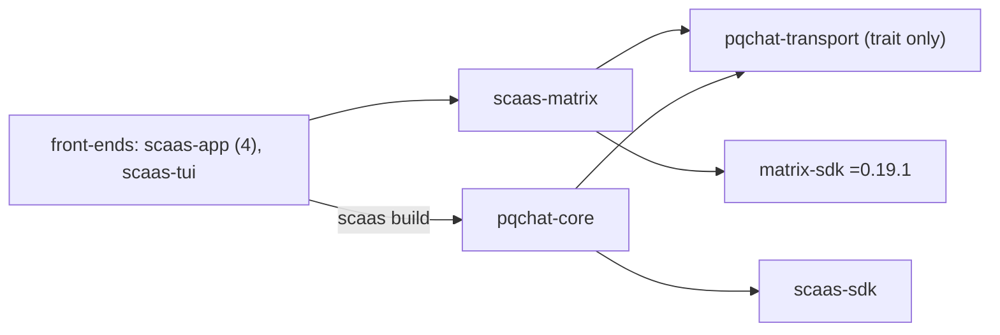

# `scaas-matrix`: the Matrix client crate, one client per open user profile — design

**Status:** SPECIFIED (2026-11-27); BUILT the same day on branch `scaas-matrix` (plan T0 to T9), except §11 (wasm32, PLANNED)
and §10's answer-size bound (O3, open). UNAUDITED. Rules:
[`docs/clients/scaas-matrix.md`](../../clients/scaas-matrix.md) (CLI-MTX-01 to CLI-MTX-12), register entries of the same ids in
[decisions.md](../../decisions.md) (controller calls, `owner: no`, the owner may override any) under the owner rulings
[CLI-PQC-19](../../decisions.md#CLI-PQC-19), [CLI-PQC-20](../../decisions.md#CLI-PQC-20) and
[CLI-UPR-29](../../decisions.md#CLI-UPR-29). Plan: [`2026-11-27-scaas-matrix.md`](../plans/2026-11-27-scaas-matrix.md). Branch
`scaas-matrix`, made from `dev` at `d0b3f7f34`.

**Read with:** scaas-app's app-core contract §7 (error names) and §11 (chat) and its view-model contract §11 (chat screens), branch
`four-frontends` of the scaas-app repository; the research notes
[`2026-11-27-matrix-chat-ui.md`](../../research/2026-11-27-matrix-chat-ui.md) (screens, privacy defaults, gaps) and
[`2026-11-27-matrix-homeservers.md`](../../research/2026-11-27-matrix-homeservers.md) (Synapse in Docker as the test server);
[`clients/pqchat-core.md`](../../clients/pqchat-core.md) CLI-PQC-05 (the transport trait and its conformance).

**Contents**

1. [Rulings it follows](#1-rulings-it-follows)
2. [Goal and non-goals](#2-goal-and-non-goals)
3. [Layout and dependencies](#3-layout-and-dependencies)
4. [Profiles, the store key and the session](#4-profiles-the-store-key-and-the-session)
5. [API surface](#5-api-surface)
6. [Privacy defaults and room kinds](#6-privacy-defaults-and-room-kinds)
7. [Encryption, verification, recovery, push](#7-encryption-verification-recovery-push)
8. [The `MatrixTransport` implementation](#8-the-matrixtransport-implementation)
9. [Errors](#9-errors)
10. [Bounds](#10-bounds)
11. [wasm32](#11-wasm32)
12. [Threat model](#12-threat-model)
13. [Test strategy](#13-test-strategy)
14. [Open points](#14-open-points)

## 1. Rulings it follows

| Ruling | What it fixes here |
|---|---|
| CLI-PQC-20 (owner) | the crate exists in this repository, runs matrix-rust-sdk, implements `pqchat-core`'s `MatrixTransport` and passes its conformance; not part of `scaas-sdk`; one client per open user profile, closed before another opens; cargo-deny, cargo audit and the licence allow-list cover its tree; CI builds it only where needed |
| CLI-PQC-19 (owner) | two row kinds that never mix (G1); Matrix receipts private, typing off, presence off (G2); PqChat pushes only on opt-in, `event_id_only`, none for a hidden profile (G3); nothing ephemeral in a bound room (G4) |
| CLI-UPR-29 (owner) | the store key is a sealed item of the user profile; the crate takes it from its caller and never puts it in the OS secret storage |
| scaas-app D32 / D34 (owner, relayed by the coordinator 2026-11-27) | scaas-app's default build links `scaas-matrix` and `scaas-profile` and no SDK: the crate depends on neither `scaas-sdk` nor `pqchat-core` |
| CLI-PQC-01 | `pqchat-core` pulls no Matrix crate (`tests/deps.rs` stands) |

## 2. Goal and non-goals

**Goal.** One toolkit-free Rust crate that every chat front-end links (scaas-app's four, `scaas-tui`) and that `pqchat-core`'s e2e
uses: password login, session restore from the profile's store key, a sync loop, the room list with a room-kind filter, a paged
timeline, text sends, the privacy settings with CLI-PQC-19's defaults, SAS device verification, cross-signing, recovery and key
backup (off until the user turns it on), pusher registration (off by default), and the `MatrixTransport` implementation over the
same client.

**Non-goals in this version.** No SCaaS signing, no key of a seed, no SCaaS kind (Olm and Megolm keys belong to `matrix-sdk`,
contract §11.1). Not part of `scaas-sdk`, which names no chat (CLI-SDK-14). No single sign-on yet (PLANNED: `login_sso` over
matrix-sdk's `sso-login` local server, with its own dependency review). No QR verification yet (PLANNED: feature `qrcode`). No
replies, edits, reactions, redactions, media, calls, threads or sliding sync (the research note's §10 list; each a later task). No
UI view models: the crate gives data types and events in the view-model contract's terms; the front-ends map them.

## 3. Layout and dependencies

**The trait moves to a trait-only crate `clients/pqchat-transport`** (CLI-MTX-01). The coordinator's constraint (§1) rules out
both layouts that keep the trait in `pqchat-core`: a dependency of `scaas-matrix` on `pqchat-core` (even behind a feature) would
put `pqchat-core` and the SDK into the default app build's lockfile and feature graph, and moving the implementation into
`pqchat-core` would pull a Matrix crate into it. The new crate holds exactly what both sides share and nothing else: the trait
`MatrixTransport`, its error `TransportError`, `RoomEvent`, `HistoryPage`, `EVENT_TYPE`, and the conformance test's `Seen`,
`Witness` and `conformance`. Its dependencies are `serde` (the two value types are kept in `pqchat-core`'s store), `serde_json`
(`Value` is in the trait's signature) and `async-trait` (the trait is used as `dyn MatrixTransport`; a proc macro with no runtime
code). `pqchat-core` re-exports every item at its old path `pqchat_core::matrix::*`, so its callers do not change; the event's
codec (`event`, `parse`, base64) stays in `pqchat-core`. The trait's methods return `TransportError` (no room id or Matrix id in
it, as before) instead of `PqChatError`; `pqchat-core` maps it to `MatrixRoom`, the only code a transport failure ever had there.
The conformance check "history holds the event sent" compares the content as sent instead of calling `parse` (the codec stays
behind).

**`scaas-matrix`'s direct dependencies:** `matrix-sdk = "=0.19.1"` (2026-09-18, the newest release at least 14 days old; 0.20.0 is
of 2026-11-25) with `default-features = false` and the features `e2e-encryption`, `sqlite`, `bundled-sqlite` (SQLite compiled in:
the same store on every desktop and mobile target, no system library); `rustls` with `ring` only (matrix-sdk 0.19.1's reqwest 0.13
is built with `rustls-no-provider`; the crate installs ring as the process's default provider when none is installed, so no
`aws-lc-rs` and no OpenSSL-licensed code); `pqchat-transport`; `tokio`, `serde`, `serde_json`, `zeroize`, `tracing`. Every other
crate comes through these. `tests/deps.rs` proves from `cargo tree` that the normal graph holds no `scaas-sdk`, `pqchat-core`,
`scaas-ua` or `scaas-rpc` (with a positive control), and the crate has its own `deny.toml` and `.cargo/audit.toml`.

**Exceptions in `deny.toml`, each named** (controller calls, owner may override): MPL-2.0 for seven crates only, each a hard
dependency of matrix-sdk 0.19.1 with no feature that drops it (`as_variant`, `eyeball`, `eyeball-im`, `imbl`, `imbl-sized-chunks`,
`readlock`, `readlock-tokio`): file-level copyleft, used unmodified, the source available as published (the terms of the Status QML
files in scaas-app); MPL-2.0 is not on the allow list, so a new MPL crate fails until named. Advisories: RUSTSEC-2026-0459 (the
bundled SQLite 3.53.2 of libsqlite3-sys 0.38.2: stale page-cache bytes when a crafted `-wal` file of another page size sits beside the
database; local only, and the files are the profile's own store in its private directory; the fix needs matrix-sdk 0.20, O5);
RUSTSEC-2026-0319 (`anymap2`) and RUSTSEC-2026-0543 (`chrono` through `oauth2`), unmaintained, no vulnerability. Banned outright:
`aws-lc-sys`, `aws-lc-rs`, `openssl-sys`, `native-tls`.

## 4. Profiles, the store key and the session

**One client per profile directory** (CLI-MTX-02). `MatrixClient::open(dir, key, opts)` takes the profile's Matrix directory (the
profile layer's choice, inside the profile's data directory) and takes an exclusive OS file lock on `<dir>/lock` (`File::try_lock`,
std); a second open of the same directory, in this process or another, is refused with `MatrixProfileBusy` while the first is open.
`close().await` stops the sync loop, aborts the event handlers' channel, drops the client and its stores and releases the lock; when
it returns the directory may be opened again. A profile switch is the profile layer's order (CLI-UPR-07): it closes the current
profile's client, then opens the next; two profiles' clients in one process (the e2e's two users) are allowed by the crate.

**The store key** (CLI-MTX-03, CLI-UPR-29). The caller passes `StoreKey`, 32 bytes from the profile's sealed item. The crate gives
it to matrix-sdk's SQLite stores as their raw key (`SqliteStoreConfig::key`, no KDF: the key is random) for every store matrix-sdk
opens (state, crypto, event cache, media) and drops its own copy (`Zeroizing`) once they are open; the stores hold their cipher
until `close`. It never writes the key anywhere: no file, no OS
secret storage, no log, no error, no `Debug` output (`StoreKey`'s `Debug` prints `StoreKey(..)`). The crate makes no key. A wrong key
opens nothing (`MatrixStore`). `StoreKey` absent (`None`): the client runs on matrix-sdk's memory stores and persists nothing; the
session cannot be restored and the user logs in again at each start (contract §11.4).

**The session** (CLI-MTX-04). After a password login the crate writes one record into the encrypted state store (a custom value
`scaas-matrix/session/v1`: homeserver URL, user id, device id, access token), so nothing of it is in the clear on disk, the
homeserver's name included (a hidden profile, CLI-UPR-08, shows nothing). `restore(dir, key)` opens the state store with the key,
reads the record, drops that store, then builds the client on the same directory and restores the session; no record:
`MatrixSession`. No refresh token is asked for in this version (Synapse's access tokens do not expire unless configured to); a
server answer `M_UNKNOWN_TOKEN` ends the sync loop with the event `SessionInvalid` (`MatrixSession`). `logout()` invalidates the
token on the server, closes the client and deletes the directory's stores. The Matrix password is never stored.

**The homeserver URL** is `https` (`EndpointScheme` otherwise), with `.well-known` discovery when the caller gives a server name. Plain
`http` is accepted only for a loopback IP literal (`127.0.0.0/8`, `[::1]`): the local test homeserver (controller call; a hostname such
as `localhost` is not accepted, it may resolve elsewhere).

## 5. API surface

Toolkit-free Rust types; names in the view-model contract's terms (§11.1 to §11.4). Async methods run on the caller's tokio runtime.

| Area | Calls | Notes |
|---|---|---|
| open | `MatrixClient::login_password(dir, key, opts, homeserver, user, password, device_name)`, `restore(dir, key, opts)`, `close()`, `logout()` | `opts`: `hidden` (a hidden profile, CLI-UPR-08); `user_id()`, `device_id()` |
| sync | `sync_once(timeout)`, `start_sync()`, `next_update()` | every sync with `set_presence=offline`; `start_sync` spawns the loop, `close` stops it |
| rooms | `rooms(filter)` with `RoomFilter::{Matrix, PqChat}`, `create_direct(user)`, `accept_invite(room)`, `decline_invite(room)`, `leave(room)` | `RoomRow`: `room_id`, `name`, `membership` (`joined`, `invited`), `encrypted`, `direct`, `unread`, `kind` |
| timeline | `messages(room, before, limit)` | a page newest last, `TimelineItem`: `event_id`, `sender`, `sender_device`, `ts`, `kind` (`Text{body}`, `Notice{body}`, `Undecryptable`, `PqChatNeedsScaasBuild`, `Other`), `verification` (`verified`, `unverified`, `changed`, `unknown`) |
| send | `send_text(room, text)` | refused in a PqChat room (`MatrixRoomKind`) |
| privacy | `settings()`, `set_public_receipts(on)`, `set_typing(on)`, `mark_read(room, event)`, `typing(room, on)` | §6 |
| verification | `request_verification(user, device)`, `verifications()`, `accept(flow)`, `start_sas(flow)`, `sas_emoji(flow)`, `confirm(flow)`, `mismatch(flow)`, `cancel(flow)`, `step(flow)`, `device_trust(user, device)` | §7 |
| recovery | `setup_recovery()` (the key returned once), `recover(key)`, `recovery_state()`, `set_key_backup(on)`, `key_backup()` | §7 |
| push | `set_pusher(Option<HttpPusher>)`, `set_pqchat_push(on)` | §7 |
| transport | `transport()` → an `Arc<dyn MatrixTransport>` over the same client | §8 |

**Updates** (`next_update()`, a bounded queue of 1,024): `RoomsChanged`, `Timeline{room, item}`, `PqChatEvent{room, event}` (a
`net.scaas.pqchat.v1` event of a PqChat room, for `pqchat-core`'s `matrix_event`), `VerificationRequest{flow, user, device}`,
`SessionInvalid`, and `Lagged` once when the queue was full and updates were dropped (the caller reads the room again).

## 6. Privacy defaults and room kinds

**Defaults** (CLI-MTX-05, CLI-PQC-19 G2, G4), persisted in the encrypted store per profile:

| Setting | Default | Opt-in | In a PqChat room |
|---|---|---|---|
| read receipt (`mark_read`) | `m.read.private` | `set_public_receipts(true)`: `m.read` | refused (`MatrixRoomKind`), nothing sent |
| typing (`typing`) | not sent (returns `false`) | `set_typing(true)` | refused, nothing sent |
| presence | `offline` on every sync, no presence call | none in this version | — |
| read marker `m.fully_read` | never sent by the crate | — | — |
| invites | never answered by the crate itself | — | held invites never answered |

**Room kinds** (CLI-MTX-06, G1). A room is of kind PqChat when the transport created it, joined it or holds its invite (a mark in
the encrypted store, kept when the account leaves); every other room is of kind Matrix. `rooms(RoomFilter::Matrix)` never lists a
PqChat room, joined or invited; `rooms(RoomFilter::PqChat)` lists only those. In a PqChat room the crate refuses every Matrix action
of the front-end (`send_text`, `mark_read`, `typing`, `accept_invite`), so the room carries only `pqchat-core`'s events. A
`net.scaas.pqchat.v1` event in a Matrix room's timeline is the item `PqChatNeedsScaasBuild`, never a message (contract §11.2). The
crate never joins a room by itself.

## 7. Encryption, verification, recovery, push

- **Encryption** (CLI-MTX-07): `create_direct` makes a room encrypted from its first event (matrix-sdk's `create_dm` puts
  `m.room.encryption` in the initial state); the crate never turns encryption off; a room's `encrypted` flag is in its row. Room keys
  go only to devices their owner cross-signed (`CollectStrategy::IdentityBasedStrategy`, MSC4153's recommendation). An event that
  cannot be decrypted is the item `Undecryptable`, never dropped.
- **Cross-signing** is bootstrapped at the first login of an account that has none (`auto_enable_cross_signing`, with the login's
  password for the server's interactive auth where it asks).
- **Verification by SAS** (emoji): `request_verification(user, device)` to a device of another user or of the account's own; an
  incoming request is an update; `accept`, `start_sas`, `sas_emoji` (seven `(symbol, description)` pairs), `confirm` or `mismatch`,
  `cancel`; `step(flow)`: `requested`, `ready`, `sas_emoji`, `confirm`, `verified`, `mismatch`, `cancelled`, `timed_out`.
  `device_trust(user, device)`: `verified`, `unverified` or `changed` (the user's identity changed since it was verified, matrix-sdk's
  verification violation), the last shown as a warning by the front-end.
- **Recovery and key backup**: `auto_enable_backups = false`, no backup download; `setup_recovery()` makes the secret storage and
  returns the recovery key once (the crate keeps no copy); `set_key_backup(true)` creates the server-side backup, `false` deletes it;
  `recover(key)` opens the secret storage on a new device. Off until the user turns it on (contract §11.5).
- **Push** (CLI-MTX-08, G3): no pusher by default. `set_pusher(Some(HttpPusher{app_id, pushkey, url, ..}))` registers an HTTP pusher
  whose format is always `event_id_only`; refused for a hidden profile (`MatrixPushHidden`); `None` removes it. The default push
  rules do not match `net.scaas.pqchat.v1`; `set_pqchat_push(true)` adds one override rule for that event type (notify, no sound) and
  `false` removes it; the generic text is the push gateway's and the app's.

## 8. The `MatrixTransport` implementation

(CLI-MTX-10.) `transport()` returns an implementation over the same `matrix_sdk::Client`: the same login, access token and HTTP client,
no second sync loop. Each call is one client-server request through the client (`joined_rooms`, `createRoom` with `private_chat` and
no `m.room.encryption`, `members`, `join`, `invite`, `kick`, the power levels, `send` of one `net.scaas.pqchat.v1` event, `messages`
filtered by that type); it does not depend on the sync loop's view, so a room `pqchat-core` names is known even before a sync.
`create_room`, `join` and `hold_invite(room, true)` mark the room PqChat (§6). `hold_invite` only records: the crate never answers an
invite by itself. No receipt, read marker, typing notice or presence is ever sent for such a room (§6). Errors are
`TransportError`, with no room id or Matrix id.

## 9. Errors

(CLI-MTX-12.) `MatrixError`, each with a stable name; its `Display` is the name only, and no variant carries a token, key, password,
message text, room id or Matrix id. The first six are the app-core contract's §7 names (numbers 17, 24 to 28 there);
the rest are new, appended to that contract by scaas-app (its item).

| Name | When |
|---|---|
| `EndpointScheme` | a homeserver URL that is not `https`, or `http` to anything but a loopback IP literal |
| `MatrixLogin` | the homeserver refused the login, or discovery failed |
| `MatrixSession` | no stored session, or the server no longer accepts it |
| `MatrixStore` | the store cannot be opened (wrong key, damaged), or cannot be written |
| `MatrixVerification` | a verification unknown, cancelled, timed out or not matching |
| `MatrixSend` | an event was not accepted by the homeserver |
| `MatrixRoom` | a room unknown to the account, or a room call the server refused |
| `MatrixRoomKind` | a Matrix action asked in a PqChat room (§6) |
| `MatrixProfileBusy` | the profile's Matrix directory is open in another client |
| `MatrixPushHidden` | a pusher asked for a hidden profile |
| `Argument` | a bound of §10 passed, or a malformed id |
| `Internal` | any other failure, with no secret |

## 10. Bounds

(CLI-MTX-09.) The crate's own decodes are bounded by length before parsing: the session record at most 8 KiB, the settings record
4 KiB, the PqChat room marks at most 4,096 rooms (a mark past it refused with `Argument`). A text to send at most 60,000 bytes (a
Matrix event is at most 65,536 bytes). A timeline or history page at most 100 events. A `net.scaas.pqchat.v1` event handed to
`pqchat-core` whose content is above `EVENT_MAX` (65,536 B) is dropped at the transport (`pqchat-core` would drop it as `decode`).
The update queue holds 1,024 entries. Server JSON is decoded by `ruma` over `serde_json`, whose recursion limit (128) bounds depth.
Every request has a 90 s timeout (`RequestConfig`), and each sync asks the server for a short answer: at most 20 timeline events per
room and lazy-loaded members (`FilterDefinition`), presence off.

**Known gap (O3, kept open after the controller's request to close it, 2026-11-27):** the size of a homeserver's HTTP answer is not
bounded. matrix-sdk 0.19.1 reads every answer whole (`http_client/mod.rs`: `response.bytes().await`) before ruma decodes it, and
has no body limit of its own. A caller-supplied `reqwest::Client` (`ClientBuilder::http_client`) does not help: reqwest 0.13 has no
body-size option, and its only lower hook, `ClientBuilder::connector_layer`, must return reqwest's sealed `Conn` type
(`reqwest::connect::sealed`), so no byte-counting stream can be put under the TLS layer. The residual: the homeserver the user
chose (or a party in its TLS path, with a certificate the platform trusts) can make the client allocate an answer of any size, up to
memory exhaustion of the app; the timeouts bound how long it takes, not how large it is. Closing it needs an upstream hook (a body
limit in matrix-sdk's `HttpClient`, or an unsealed connector type in reqwest).

## 11. wasm32

Native first. The web build (CLI-PQC-19 G5, later) runs `matrix-sdk` on wasm32 with features `js` and `indexeddb` and its
IndexedDB store, opened with the profile's store key; the file lock, `bundled-sqlite` and the process-wide rustls provider are
native only. The trait crate `pqchat-transport` already builds for wasm32 (`async_trait(?Send)` there), as `pqchat-core`'s wasm32
check needs. PLANNED: a `cargo check --target wasm32-unknown-unknown --no-default-features --features wasm` job once the wasm feature
exists.

## 12. Threat model

| Adversary | What they get | What the crate does |
|---|---|---|
| the homeserver | every Matrix room's metadata; never Megolm plaintext; PqChat rooms' event types, sizes and timing (CLI-PQC-05) | presence off, receipts private, typing off by default; no pusher by default; room keys only to cross-signed devices |
| another user profile on the same device | nothing of this profile's Matrix: no shared login, store, key or device | one directory and one sealed store key per profile; the lock refuses a second client |
| someone with the disk while the profile is locked | encrypted stores; the homeserver's name hidden too | the store key only in memory while open, never on disk |
| a hostile homeserver answer | malformed JSON; **an answer of any size: memory exhaustion of the app (§10, O3, open)** | ruma's typed decode, depth limit 128; 90 s request timeout; short sync answers (20 events per room, lazy members); no own parser of server bytes beyond §10's bounds |
| a log reader | nothing secret | no token, key, password, body, room id or Matrix id in an error; matrix-sdk's own `tracing` output is the app's to filter (it may log room ids at debug level) |

## 13. Test strategy

- **Offline unit and integration tests** (`cargo test`): `tests/deps.rs` (no SDK, `pqchat-core`, `scaas-ua`, `scaas-rpc` in the
  normal graph, with a positive control); the policy module (defaults, the kind filter, refusals in a PqChat room, the URL rule);
  the store key never on disk (after a session record is written and the client closed, no file under the directory holds the
  key's bytes, hex or base64, beside a positive control that finds a planted copy); a wrong key refused; the lock refusing a
  second open and released by `close`.
- **E2E against Synapse in Docker** (`cargo test --test e2e -- --ignored`; `pqchat-core`'s Synapse helper reused through
  `#[path]`; `--memory 1g --cpus 1`; the image pinned by digest): two users log in; one session restored from the sealed key on a
  fresh client; an E2EE direct message sent and read decrypted; the two devices verified by SAS (both sides `verified`); the server
  holds no read receipt, read marker, typing notice, presence update, pusher or backup of either user by default, beside a
  positive control (a raw client that sends each, counted); `pqchat-transport`'s `conformance` passes on `transport()`.
- **Mutants** through `scripts/mutant_guard.py` for the policy code (defaults, the room-kind filter and refusals, per-profile
  isolation, the key never persisted, the URL rule), each killed by a named test.

## 14. Open points

- **O1** (scaas-app's item): append `MatrixRoom`, `MatrixRoomKind`, `MatrixProfileBusy`, `MatrixPushHidden` and `Argument` to its
  contract §7 with numbers, and replace its §11.6 room-list fields with this crate's `RoomRow`.
- **O2**: `pqchat-core`'s own e2e moves from its test-only HTTP transport to `scaas-matrix` (CLI-PQC-20: it uses `scaas-matrix` in
  its e2e only) — a dev-dependency of `pqchat-core` on `scaas-matrix`, outside its normal graph; next task after this crate.
- **O3** (open, reason in §10): a body-size bound on homeserver answers needs a hook matrix-sdk 0.19.1 and reqwest 0.13 do not
  offer; asked upstream when the crate next moves its matrix-sdk pin.
- **O5**: matrix-sdk 0.20.0 (2026-11-25) fixes RUSTSEC-2026-0459 (bundled SQLite) through rusqlite 0.41; it reaches 14 days on
  2026-12-09: move the pin then and drop the advisory exception (§3).
- **O4**: single sign-on, QR verification, refresh tokens, sliding sync and the research note's §10 list, each its own task.
