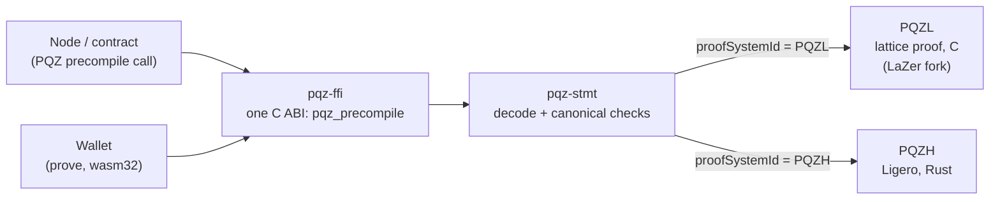

# pqz-core

The proof engine of **PQ Zether (PQZ)** — a confidential token whose amounts and balances stay secret even against a
quantum computer. This directory holds everything needed to **prove and verify** PQZ statements: two independent proof
systems behind **one precompile**.

> **Status:** built and measured, **unaudited, not for production funds**. Numbers are provisional until the freeze after
> gates A / B. The dated log of every change and run is [STATUS.md](STATUS.md); the spec is
> [pq-zether.md, "Proof engine"](../docs/contracts/pq-zether.md#proof-engine).

**Contents:** [At a glance](#at-a-glance) · [What PQZ is](#what-pqz-is) ·
[Two proof systems, one precompile](#two-proof-systems-one-precompile) ·
[Statement forms, ids, limits](#statement-forms-ids-limits) · [Measurements](#measurements-provisional) ·
[Build, test, run](#build-test-run) · [Directory map](#directory-map) · [Licences](#licences) ·
[Status and what's next](#status-and-whats-next) · [Further reading](#further-reading)

## At a glance



| `R_TX` (a transfer), proven 128 bits | PQZL (lattice) | PQZH (Ligero) |
|---|---|---|
| Proof size | ≈ 42.8 KB | ≈ 232 KB |
| Prove, native / wasm32 | ≈ 1.0 s / 1.3 s | ≈ 0.65 s / 1.3 s |
| Verify p99, native / wasm32 | 8.7 ms / 14.8 ms | 10.5 ms / 19.4 ms |
| Security rests on | MSIS / MLWE (lattices) | hash functions only |

Both stay far under the 60 ms verify limit. One precompile verifies both, chosen by the `proofSystemId` in the
statement.

## What PQZ is

PQZ keeps the classical Zether shape — identities visible, **amounts and balances encrypted**, the fee a public number,
sender / receiver / auditor disclosure — but rebuilt on module-lattice assumptions, so a quantum adversary can neither
read balances later nor forge proofs and mint ([overview](../docs/contracts/pq-zether.md#overview)).

- **Encryption** ([spec](../docs/contracts/pq-zether.md#encryption)): additive module-LWE with BFV-style scaling Δ and digit-packed plaintext, over
  `R_q = Z_q[X]/(X^64 + 1)` with q = 2^42 − 215 and vectors of 32 ring elements. Public key 16,384 B, ciphertext
  16,512 B. KeyGen / Enc / Dec are deterministic from seeds (SHAKE256, [algorithms](../docs/contracts/pq-zether.md#42-algorithms)): in C (`src/pqz_keys.c`) and in Rust
  (`pqz-ffi` feature `prove`), checked against the independent Python `smartcontracts/vectors/pqz/pqz_kat.py`.
- **Accounts** ([protocol](../docs/contracts/pq-zether.md#protocol)): one registered public key per `(UA, token)`; balances as ciphertext hashes in storage,
  ciphertext bytes in calldata and events.
- **Relations** ([protocol](../docs/contracts/pq-zether.md#protocol)): each operation proves knowledge of the secrets behind a statement, with exact ℓ2 norms and
  bit ranges:
  - key well-formedness — `R_REG`;
  - a transfer's encryption, norms, digit carries and balance — `R_TX`, `R_TX0`;
  - burn / refresh — `R_BURN`;
  - decryption for disclosure — `R_DS`, `R_DR`.

## Two proof systems, one precompile

| | **PQZL** (lattice) | **PQZH** (hash-based) |
|---|---|---|
| Proof | LNP22 (ABDLOP + tbox) through a fork of [LaZer](https://github.com/lazer-crypto/lazer) `3330e48` (MIT, IBM), six layers rewritten | Ligero over F_q (radix-431 domains, Keccak-256 Merkle + transcript, zero knowledge) |
| Parameters | MSIS / MLWE, β ≥ 452 (`params/estimator-e-s1*.txt`) | proven (unique-decoding) preset n = 32,756, k = 817, t = 121; 127.2 bits total ([pqzh-ligero.md](../docs/research/pqzh-ligero.md), "soundness") |
| Code | C — `src/`, `lazer/`, `params/`; native and freestanding wasm32 | Rust crate `pqzh-ligero` — `pqzh/ligero/`; native and wasm32 |
| On-chain verifier | `pqz_verify_fast`, the specialised verifier (`src/pqz_sv.c`); `pqz_verify` is the reference | `pqzh_ligero::verify` |
| Backup | — | the Plonky3 STARK crate at the top of `pqzh/`, kept as a record, never linked |

**PQZL without heavy dependencies.** Prover and verifier use **no GMP, MPFR, HEXL, floating point, `malloc`, `abort`
or stdio**. The six rewritten layers:

- integers without GMP — `src/pqz_mpn.h`;
- an incomplete NTT mod q with l = 4 — `src/pqz_ntt.c`;
- fixed-point exp for the sampler and rejection — `src/pqz_fixexp.h`;
- an arena instead of `malloc` — `src/pqz_arena.c`;
- sticky error returns instead of `abort` — `src/pqz_rt.h`;
- bitsliced software AES-256-CTR — `src/pqz_aes_gen.h`, generated by `gen_aes.py`.

The relations are in `src/pqz_rel.c` (the prover mixes the secret witness into its random masks, so a weak random number generator cannot leak keys).

**Three soundness findings in upstream LaZer** were fixed here and reported:
[lazer#24](https://github.com/lazer-crypto/lazer/issues/24) and [#25](https://github.com/lazer-crypto/lazer/issues/25)
(the reason for `proofSystemId` v2) and [#26](https://github.com/lazer-crypto/lazer/issues/26) (z21 norm, verifier
only).

**Shared by both systems:**

- **`pqz-stmt`** (`stmt/`) — the one statement codec. Rust, `no_std` + `alloc`, no dependencies, builds for
  `wasm32-unknown-unknown`. Parses and builds every statement form of both systems with the canonical rules (exactly one accepted encoding per statement),
  plus `pk` / ciphertext, bundle, opening, and the precompile input (`MAX_PROOF(id)`, `MAX_INPUT`).
- **`pqz-ffi`** (`ffi/`) — **one `PQZ` precompile for both systems**, details in [ffi/README.md](ffi/README.md):
  - C ABI `pqz_precompile(input, len, out, out_len) -> status` (`ffi/pqz_ffi.h`, for the node's P/Invoke);
  - input `u8(op) ‖ be32(len(stmt)) ‖ stmt ‖ proof` → `pqz_stmt::decode_input` → dispatch on the statement's
    `proofSystemId` to PQZL's `pqz_verify_fast` or to the Ligero crate; op 6 returns the cached self-test hash;
  - libpqz is built by `build.rs` with `build.sh`'s flags; one process-wide lock; one worker thread with a fixed
    16 MiB stack; fixed arenas: verify-only 144 MiB, prove / generic verify 448 MiB;
  - status 0 ok (`…01` / `…00`), 1 revert (input over `MAX_INPUT`), 2 bad arguments, 3 input-caused panic ⇒ `…00`,
    4 node fault ⇒ no result;
  - feature `prove` adds keygen / enc / dec / prove of both systems (wasm32 byte-equal with native);
  - `src/bin/pqz-vectors.rs` generates the frozen vectors `smartcontracts/vectors/pqz/`.

On chain 7622 (the testnet) the node runs this precompile from a Nethermind plugin (see the
[precompile plan](../docs/superpowers/plans/2026-10-14-p6f-precompiles.md)): address `0x5caa5…0f01`; status 4 → process exit 120.

## Statement forms, ids, limits

Every statement starts with `opTag ‖ proofSystemId` (64 bytes) and a 640-byte header ([statement layout](../docs/contracts/pq-zether.md#77-statement-layout)). Every byte
layout — statements, objects, both proof formats, the precompile input and `OP_SELFTEST` — is in
[pq-zether.md, "Serialization v1"](../docs/contracts/pq-zether.md#serialization).

| op | Form | Relation | Statement B | What it proves |
|---|---|---|---|---|
| 1 | TRANSFER (`auditorOn` = 1) | `R_TX` | 83,072 | sender debit, receiver and auditor credits, fee, balance digits |
| 1 | TRANSFER0 (auditor off; chosen by statement length) | `R_TX0` | 66,560 | `R_TX` without `pk_a`, `v_a`, `e2_a` |
| 2 | BURN, REFRESH | `R_BURN` | 50,048 | debit with a public amount |
| 3 | REGISTER | `R_REG` | 16,480 | key well-formedness |
| 4 | DISCLOSE-SENDER | `R_DS` | 33,184 | the sender's encryption of an amount |
| 5 | DISCLOSE-RECEIVER, DISCLOSE-AUDITOR | `R_DR` | 33,184 | decryption of a ciphertext |
| 6 | SELFTEST | — | 0 | input exactly `06 00000000`; returns the self-test hash `ed910a2c…1333d205` |
| 7 | multi-recipient transfer | `R_TXM` | — | **in progress** — see below |

**op 7 `R_TXM`** ([multi-recipient plan](../docs/superpowers/plans/2026-10-14-p6-anon.md)): one proof, M recipients, decoys
receive Enc(0); PQZL M ≤ 8, PQZH M ≤ 4; joins the frozen set before gates A / B.

| `proofSystemId` | keccak256 of | Value | Frozen at |
|---|---|---|---|
| PQZL v2 | `scaas/pqz/lnp22/mlwe-d64k32-q42l4/v2` | `0x2e07e6ed1fd303a08c89b3eab6e8423fdfb8f31202958dd682a0619313798c2f` | gate A |
| PQZH | `scaas/pqz/pqzh/ligero-fq-r431-keccak256-zk-proven/v1` | `0x0a47a7689250ba178a52ad5972cdd9153358c022cb694c08d2389e82de2fead4` | gate B |

| Limit (enforced by `pqz-stmt`) | Value |
|---|---|
| `MAX_INPUT` (larger input = revert) | 393,216 B |
| `MAX_PROOF`, PQZL | 98,304 B |
| `MAX_PROOF`, PQZH | 262,144 B (exact maximum at the proven preset: 235,470 B for `R_TX`; largest PQZH input 5 + 83,072 + 235,470 = 318,547 B) |
| Proof length | `1 ≤ len(proof) ≤ MAX_PROOF(id)` |
| Verify time | **≤ 60 ms p99** on the chain host, also bounding wasm32 (owner decision 2026-10-14) |

## Measurements (provisional)

**Reference machine:** AMD Ryzen 5 7235HS (Zen 3+, AVX2, AES-NI, no AVX-512), 8 threads, 23 GB, Linux 7.0. Single
thread, every run under `scripts/capped`, other services running (± 20 % noise). Native: clang 18 `-O2` portable unless
marked x86-64-v3; wasm32: node v26.8.1. **Provisional:** the freeze after gates A / B (with op 7) replaces these
numbers; `artifact/expected-results.json` is regenerated from the same runs. Times in ms unless noted.

### PQZL (runs `tx0c`, 2026-10-14)

"SV" = the specialised verifier `pqz_verify_fast`; "generic" = `pqz_verify`.

| Relation | Proof B (max) | Prove native / wasm | SV verify p99: portable / x86-64-v3 / wasm |
|---|---|---|---|
| `R_REG` | 28,113 | 295 / 484 | 4.48 / 3.10 / 6.91 |
| `R_TX` | 42,785 | 965 / 1,304 | 8.73 / 5.40 / 14.76 |
| `R_TX0` | 42,441 | 827 / 1,398 | 8.49 / 5.53 / 14.73 |
| `R_BURN` | 41,938 | 874 / 1,158 | 8.35 / 4.74 / 14.21 |
| `R_DS` | 28,995 | 331 / 646 | 4.94 / 3.91 / 8.70 |
| `R_DR` | 28,996 | 395 / 504 | 4.89 / 2.82 / 7.92 |

<details>
<summary>All PQZL columns (generic verify, SV p50, arena) and sources</summary>

Sources: `rel3/runs/tx0c-native.jsonl` (10 proves, 30 honest verifies per relation), `rel3/runs/tx0c-wasm.jsonl`
(5 / 10), `rel3/runs/tx0c-alone.jsonl` (one relation per process, arena peak), `sv/runs/tx0c-native-fast.jsonl`,
`sv/runs/tx0c-x86v3-fast.jsonl` (200 honest verifies), `sv/runs/tx0c-wasm-fast.jsonl` (100).

| Relation | Proof B (max, 10 seeds) | Prove p50 native / wasm | Generic verify p50 / p99 native; p50 wasm | SV p50 / p99 portable | SV p50 / p99 x86-64-v3 | SV p50 / p99 wasm | Arena peak, one op, native / wasm |
|---|---|---|---|---|---|---|---|
| `R_REG` | 28,113 | 295 / 484 | 161 / 169; 223 | 3.85 / 4.48 | 2.37 / 3.10 | 6.61 / 6.91 | 95.5 / 73.7 MB |
| `R_TX` | 42,785 | 965 / 1,304 | 648 / 760; 762 | 7.98 / 8.73 | 4.76 / 5.40 | 13.36 / 14.76 | 304.2 / 231.9 MB |
| `R_TX0` | 42,441 | 827 / 1,398 | 577 / 627; 760 | 8.03 / 8.49 | 4.68 / 5.53 | 13.36 / 14.73 | 298.0 / 227.3 MB |
| `R_BURN` | 41,938 | 874 / 1,158 | 556 / 584; 693 | 7.75 / 8.35 | 4.63 / 4.74 | 12.88 / 14.21 | 288.9 / 220.4 MB |
| `R_DS` | 28,995 | 331 / 646 | 200 / 214; 270 | 4.42 / 4.94 | 2.86 / 3.91 | 7.27 / 8.70 | 99.8 / 76.9 MB |
| `R_DR` | 28,996 | 395 / 504 | 206 / 218; 254 | 4.50 / 4.89 | 2.69 / 2.82 | 7.52 / 7.92 | 107.7 / 83.0 MB |

- Adversarial SV p99 (246 native / 600 wasm mutated inputs per relation): ≤ 8.9 ms portable, ≤ 5.7 ms x86-64-v3,
  ≤ 14.4 ms wasm.
- The largest wasm prove peak (`R_TX`, 231,858,048 B = 221.1 MiB) is 13.6 % under the 256 MiB hard limit.
- Native and wasm proofs are equal byte for byte.
- `pqz.wasm` 411,419 B (356,523 B without the specialised verifier, STATUS.md "Auditor-off transfer").
- Every SV p99 ≥ 4× under the 60 ms limit on every build.

</details>

### PQZH Ligero, proven preset (runs `l15-tx0`, 2026-10-14, gate-B method: 1,000 verifies)

| Relation | Proof B (5 seeds) | Exact max B | Prove native / wasm32 | Verify p99 native / wasm32 |
|---|---|---|---|---|
| `R_REG` | 186,232–187,674 | 190,458 | 366 / 769 | 7.83 / 14.89 |
| `R_TX` | 230,584–232,302 | 235,470 | 652 / 1,309 | 10.49 / 19.44 |
| `R_TX0` | 229,672–231,800 | 234,744 | 637 / 1,333 | 11.36 / 20.88 |
| `R_BURN` | 231,256–232,632 | 234,744 | 629 / 1,286 | 10.63 / 20.76 |
| `R_DS` | 187,354–187,802 | 190,458 | 376 / 748 | 8.16 / 13.71 |
| `R_DR` | 185,462–187,226 | 190,458 | 358 / 758 | 8.33 / 14.31 |

<details>
<summary>All PQZH columns (m, memory, p50, adversarial) and sources</summary>

Sources: `pqzh/ligero/runs/l15-tx0-proven.jsonl` (+ `-time.txt`; native, 5 proofs, **1,000** honest verifies,
12 × 80 mutations per form) and `pqzh/ligero/runs/l15-tx0-proven-wasm.jsonl` (+ `-time.txt`; wasm32, 2 proofs made in
wasm32, **1,000** honest verifies, 12 × 4 mutations, `fails` 0). The gate-B round that introduced the wasm32 21-bit
multiply is `l9` (five relations, `pqzh/ligero/runs/l9-proven-wasm.jsonl`, `R_TX` p99 18.7 ms); the exact-length limits
are `l11` / `l12` ([pqzh-ligero.md](../docs/research/pqzh-ligero.md), "exact length bounds"). Prove: p50 native / mean wasm32.

| Relation | m | Proof B (5 seeds) | Exact max B | Prove p50 native / mean wasm32 | Peak heap prove / verify native | Verify p50 / p99 native | Verify p50 / p99 wasm32 | Adversarial p99 native / wasm32 |
|---|---|---|---|---|---|---|---|---|
| `R_REG` | 63 | 186,232–187,674 | 190,458 | 366 / 769 | 25.9 / 0.8 MB | 7.00 / 7.83 | 11.32 / 14.89 | 0.91 / 1.04 |
| `R_TX` | 125 | 230,584–232,302 | 235,470 | 652 / 1,309 | 43.2 / 1.2 MB | 9.75 / 10.49 | 17.14 / 19.44 | 1.53 / 1.50 |
| `R_TX0` | 124 | 229,672–231,800 | 234,744 | 637 / 1,333 | 42.9 / 1.2 MB | 9.38 / 11.36 | 16.60 / 20.88 | 1.25 / 1.56 |
| `R_BURN` | 124 | 231,256–232,632 | 234,744 | 629 / 1,286 | 42.9 / 1.1 MB | 9.23 / 10.63 | 16.25 / 20.76 | 1.23 / 1.42 |
| `R_DS` | 63 | 187,354–187,802 | 190,458 | 376 / 748 | 25.9 / 0.8 MB | 7.34 / 8.16 | 12.04 / 13.71 | 0.96 / 1.09 |
| `R_DR` | 63 | 185,462–187,226 | 190,458 | 358 / 758 | 25.9 / 0.8 MB | 7.18 / 8.33 | 11.53 / 14.31 | 0.98 / 1.14 |

- Process max RSS 47 MB native (six forms); wasm32 linear memory 48.1 MiB (all six forms in one module, module
  276,406 B).
- 6 × 960 mutated inputs native, 0 accepted, 0 panics.
- Every proof ≤ 262,144 B and every p99 ≤ 20.9 ms against the 60 ms limit.
- Without the precompile an EVM verifier is not viable: proven `R_TX` costs ≈ 530 M gas
  (`pqzh/ligero/runs/l11-forge.txt`, [pqzh-ligero.md](../docs/research/pqzh-ligero.md), "EVM verifier").

</details>

### The `PQZ` precompile path (`pqz-ffi`, run `ffi1f2`)

Through the C ABI `pqz_precompile`, as the node calls it (verify-only arena 144 MiB):

| Form (op) | PQZL p50 / p99 | PQZH p50 / p99 |
|---|---|---|
| TRANSFER (1) | 8.21 / 10.42 | 9.78 / 10.76 |
| TRANSFER0 (1) | 7.93 / 9.40 | 9.42 / 10.20 |
| BURN (2) | 7.81 / 10.13 | 9.25 / 9.87 |
| REFRESH (2) | 7.68 / 8.64 | 9.27 / 9.53 |
| REGISTER (3) | 4.05 / 5.01 | 7.01 / 9.22 |
| DISCLOSE-SENDER (4) | 4.28 / 5.23 | 7.23 / 9.67 |
| DISCLOSE-RECEIVER (5) | 4.50 / 5.14 | 7.12 / 7.81 |
| DISCLOSE-AUDITOR (5) | 4.58 / 5.29 | 7.11 / 7.96 |

<details>
<summary>Proof sizes, the Rust entry point, adversarial inputs and source</summary>

Source: `ffi/runs/ffi1f2-bench.jsonl` (native, n = 200 per cell, one proof per form, verify-only arena 144 MiB).
`precompile` = the Rust entry point, C ABI = `pqz_precompile` as the node calls it; ms.

| Form (op) | PQZL proof B | PQZL `precompile` p50 / p99 | PQZL C ABI p50 / p99 | PQZH proof B | PQZH `precompile` p50 / p99 | PQZH C ABI p50 / p99 |
|---|---|---|---|---|---|---|
| TRANSFER (1) | 42,759 | 7.97 / 9.26 | 8.21 / 10.42 | 231,022 | 9.74 / 11.19 | 9.78 / 10.76 |
| TRANSFER0 (1) | 42,387 | 7.94 / 9.08 | 7.93 / 9.40 | 231,064 | 9.39 / 10.22 | 9.42 / 10.20 |
| BURN (2) | 41,914 | 7.78 / 10.16 | 7.81 / 10.13 | 231,320 | 9.29 / 11.39 | 9.25 / 9.87 |
| REFRESH (2) | 41,902 | 7.85 / 11.83 | 7.68 / 8.64 | 231,928 | 9.26 / 10.42 | 9.27 / 9.53 |
| REGISTER (3) | 28,068 | 4.03 / 4.74 | 4.05 / 5.01 | 187,738 | 7.04 / 9.62 | 7.01 / 9.22 |
| DISCLOSE-SENDER (4) | 28,964 | 4.24 / 4.85 | 4.28 / 5.23 | 186,842 | 7.23 / 8.53 | 7.23 / 9.67 |
| DISCLOSE-RECEIVER (5) | 28,990 | 4.49 / 7.31 | 4.50 / 5.14 | 187,098 | 7.11 / 8.07 | 7.12 / 7.81 |
| DISCLOSE-AUDITOR (5) | 28,995 | 4.58 / 5.74 | 4.58 / 5.29 | 186,778 | 7.10 / 8.02 | 7.11 / 7.96 |

- Adversarial (C ABI, one flipped proof bit): PQZL p99 ≤ 11.1 ms (full verify), PQZH p99 ≤ 1.6 ms (rejected early).
- Decode ≤ 0.012 ms p99; the boundary adds ≤ 0.1 ms at p50.
- Self-test cold 82.6 ms; verify-only arena peak 94,615,600 B.
- Every op ≤ 11.9 ms p99 against the 60 ms limit; the node plugin calibrates gas on these p99s.

</details>

### Comparisons

**vs upstream LaZer.** Same statement, witness and relation source; upstream built from source by
`artifact/reproduce.sh --upstream` (`artifact/runs/docker-upstream/upstream-bench.txt`, N = 3 medians).

| | upstream LaZer `3330e48` (x86-64-v3 = AVX2 build) | this fork, portable (no AVX2 / AVX-512 needed) | fork faster by |
|---|---|---|---|
| `R_TX` prove / verify | 6,581 / 6,403 ms | 1,012 / 613 ms | 6.5× / 10.4× |
| `R_REG` prove / verify | 548 / 513 ms | 247 / 178 ms | 2.2× / 2.9× |
| `R_TX` verify, specialised verifier | — | ≈ 8 ms | ≈ 800× |

- **The fork needs no AVX-512** (and no AVX2): every number in this README comes from the portable build on a CPU
  without AVX-512; x86-64-v3 (AVX2 + AES-NI) is an optional, faster build of the specialised verifier only.
- Upstream LaZer's fastest path needs AVX-512 IFMA (its HEXL backend). That variant builds here but cannot run on the
  reference CPU, so the comparison uses upstream's AVX2 build; running the AVX-512 variant on an AVX-512 machine is an
  owner step. Method and the earlier cross-check: [xcheck/RESULTS.md](xcheck/RESULTS.md).

**vs the PQZH backends that were tried and rejected.** Same statement (`R_TX`), zero knowledge, 128 bits, proven
security, measured on the reference machine (details: [pqzh-backend-comparison.md](../docs/research/pqzh-backend-comparison.md)).

| Backend | Proof | Prove | Prover memory | Verify p99 native | Outcome |
|---|---|---|---|---|---|
| **Ligero over F_q** (this directory) | **≈ 231 KB** | **0.65 s** | **43 MB** | 10.5 ms | **chosen** |
| STARK (Plonky3, FRI + ZK, Goldilocks⁵) | 622 KB | 20.4 s | 2.8 GB | 19.1 ms | rejected: 2.7× larger, 30× slower to prove, 65× more memory |
| ZK WHIR (Plonky3 WHIR with hiding) | 1.95 MB | 43 s | 2.4 GB | 46.5 ms | rejected: 8× larger, reaches only ≈ 124 bits |

The rejected backends' code and runs are kept in `pqzh/` (top) as the record.

## Build, test, run

**Requirements:** clang / lld 18 (`wasm-ld-18`), node ≥ 26 for wasm32, Rust 1.97.1 (pinned per crate by
`rust-toolchain.toml`), Python 3 (stdlib only, run with `-I`).

> **Run every heavy step under `scripts/capped`** — the machine-wide lock, one heavy job at a time. Paths are relative to
> `pqz-core/` unless they start with `pqz-core/` (repository root).

**The usual checks in one place:**

| Want to… | Run |
|---|---|
| build PQZL (native + wasm) | `./build.sh all` |
| check the PQZL arithmetic against upstream | `build/native/kat_dump > build/native/kat-pqz.json` then `python3 -I kat/check.py kat/lazer-3330e48.json build/native/kat-pqz.json` (19/19) |
| test PQZH | `(cd pqzh/ligero && cargo test --release --offline)` |
| test the precompile boundary | `scripts/capped pqz-core/ffi/run.sh <label>` |
| check every vector file | `scripts/capped pqz-core/ffi/vectors/run.sh <label>` |
| reproduce the published numbers | `OUT=<dir> scripts/capped pqz-core/artifact/reproduce.sh [--full]` |

<details>
<summary><b>PQZL core (C)</b> — builds, bench, KAT, fix checks, keys</summary>

```sh
./build.sh native            # build/native: libpqz.a, libpqz.so, pqz_bench, kat_dump
./build.sh native-x86v3      # optional: pqz_sv.c (pqz_verify_fast) for x86-64-v3 + AES-NI, build/native-x86v3
./build.sh wasm              # build/wasm/pqz.wasm (clang 18, wasm-ld-18, freestanding)
SV=0 B=build/wasm-nosv ./build.sh wasm   # without the specialised verifier (no pqz_sv.c, no pqz_verify_fast): a
                                         #   wallet's prover build; SV=0 works for native too
./build.sh all
```

Every build runs `./check_symbols.sh` on the library objects: outside themselves they may reference only `memcpy`,
`memset`, `__stack_chk_fail` (and wasm's `__stack_pointer`). The build fails on anything else (`malloc`, stdio, libm,
GMP, MPFR, `getentropy`).

```sh
build/native/pqz_bench 7 7                                  # 7 proves, 7 + 7 honest verifies per relation (JSON lines)
build/native/pqz_bench 1 0 2                                # R_TX only (3rd argument, bit mask: 1 R_REG, 2 R_TX,
                                                            #   4 R_BURN, 8 R_DS, 16 R_DR, 32 R_TX0; default 63 = all)
opt/bench.sh <label>                                        # pqz_bench 5 5 + run_wasm.mjs 3 1 -> opt/runs/<label>-*.jsonl
node test/run_wasm.mjs 3 1                                  # the same under node
PQZ_VERIFY=fast build/native/pqz_bench 2 200                # time pqz_verify_fast (wasm: PQZ_VERIFY=fast|both node ...)
build/native/pqz_sv_diff 10 5 2 1 10                        # both verifiers on honest + mutated proofs, must agree
build/native/kat_dump > build/native/kat-pqz.json
python3 -I kat/check.py kat/lazer-3330e48.json build/native/kat-pqz.json   # must print 19/19
./check_tbox_fixes.sh                                       # after ./build.sh native: the tbox fixes and the z21 check are in place
sv/review/review.sh zdiff 1                                 # z21-inflated proofs, all five relations: both verifiers agree
sv/check_sv_fixes.sh                                        # after ./build.sh native: pqz_verify_fast follows both fixes
build/native/pqz_keys_kat 1000 > k.jsonl                    # keys KAT + 1,000-seed Dec(Enc(m)) = m round trip
python3 -I ../smartcontracts/vectors/pqz/pqz_kat.py --c-keys k.jsonl   # the independent Python check: pqz_kat: ok
python3 -I ../smartcontracts/vectors/pqz/pqz_kat.py --check            # its self-test + every PQZ vector file
```

- `R_TX` needs about 0.30 GB of arena alone (0.31 GB after an `R_REG` in the same process: a relation's keys are built
  at its first use and kept; the bench allocates 768 MiB).
- Same seeds must give the same `proofs_fnv` (native and wasm) across pure implementation changes.
- Run the bench under `scripts/capped`.
- Debug build with the libc heap instead of the arena (for ASan/LSan only): `-DPQZ_DEBUG_MALLOC`.

Full measurement rounds (each one capped job; outputs `<dir>/runs/<label>-*`; the tables above):

```sh
NP=10 NV=30 NPW=5 NVW=10 scripts/capped pqz-core/rel3/relfix.sh <label>   # build, KAT, tbox fixes, proofs_fnv, arena per
                                                                          #   op, ASan + UBSan, generic timings, six relations
scripts/capped pqz-core/sv/rel3.sh <label>     # SV: differential (portable, x86-64-v3, wasm), bench, fuzz, KAT, fix checks
scripts/capped pqz-core/sv/diff.sh <label>     # differential test only; sv/bench.sh, sv/fuzz.sh (ASan + libFuzzer) likewise
```

</details>

<details>
<summary><b>Regenerate</b> — PQZL parameters and the golden KAT</summary>

```sh
params/codegen/run.sh <LaZer 3330e48 checkout> params/tx_params.sage > params/pqz_tx_params.h   # also reg
params/regen.sh <LaZer 3330e48 checkout> <out dir> > params/codegen-<label>.txt   # every spec, diffed against git
params/run_e_s1.sh <LaZer 3330e48 checkout> <lattice-estimator 53da598 checkout> > params/estimator-e-s1.txt
kat/build-lazer-dump.sh <work dir> v4      # upstream golden dump (v3 = AVX2 build); needs docker and network
```

All three refuse other LaZer / estimator commits and run pinned images. The codegen takes minutes; headers are checked
in and regenerated only on purpose. The v4 golden dump needs an AVX-512 CPU or Intel SDE
(`sde64 -spr -- ./lazer_dump-v4 > kat/lazer-3330e48.json`). Sizing details: [params/README.md](params/README.md).

</details>

<details>
<summary><b>PQZH Ligero (Rust)</b> — tests, gate-B round, cross-checks</summary>

```sh
(cd pqzh/ligero && cargo test --release --offline)                        # unit + integration tests (mutations, negative witnesses)
(cd pqzh/ligero && cargo test --release --offline --no-default-features)  # the production build (no `bench`, no floats)
scripts/capped pqz-core/pqzh/ligero/runs/tx0.sh <tag>      # fixtures, tests, native + wasm32 bench (1,000 verifies), xcheck, forge
scripts/capped pqz-core/pqzh/ligero/runs/gateb.sh <tag>    # gate-B round: tests, production build, native FNV, wasm32 1,000 verifies
scripts/capped pqz-core/pqzh/ligero/runs/stmt.sh <tag>     # tests, clippy float lint, dependency / float-instruction scan
scripts/capped pqz-core/pqzh/ligero/runs/limits.sh <tag>   # exact length bounds, xcheck, forge
scripts/capped pqz-core/pqzh/xcheck/ligero.sh              # statement / witness bytes = pqz_bench.c's, all six forms
```

</details>

<details>
<summary><b>Shared</b> — <code>pqz-stmt</code>, <code>pqz-ffi</code>, vectors, package, licences</summary>

```sh
scripts/capped pqz-core/stmt/xcheck.sh <label>       # unit tests, C statements + pqz_kat.py cross-check, wasm32 build
scripts/capped pqz-core/ffi/run.sh <label>           # tests, symbol scans, C smoke test, wasm32 digest diff, bench
scripts/capped pqz-core/ffi/vectors/run.sh <label>   # pqz-vectors --check (byte for byte), pqz_kat.py --check,
                                                     #   tamper.py, wasm32 replay; add `write` to regenerate the vectors
OUT=<dir> scripts/capped pqz-core/artifact/reproduce.sh [--full | --serve | --upstream]   # the reproducibility package
scripts/capped pqz-core/glic/absence.sh > pqz-core/glic/runs/absence-<date>.txt 2>&1     # GMP / MPFR / HEXL absence
```

The package (`artifact/`, [artifact/README.md](artifact/README.md)) is source only: a pinned `Dockerfile`, quick and
`--full` modes, `--serve` (local browser demo), `--upstream` (upstream LaZer built from source); `results.py` compares a
run with `expected-results.json` (provisional).

</details>

## Directory map

**Kind:** **core** = shipped code · **tool** = build / test / check scripts the core relies on · **measurement** = spike
or benchmark harness kept with its runs (experiment code stays in the repository) · **backup** = superseded, kept, never
built by the core. An approved reorganisation (`pqzl/`, `pqzh/`, `research/`, …) is in
[docs/superpowers/plans/2026-10-15-pqz-core-layout.md](../docs/superpowers/plans/2026-10-15-pqz-core-layout.md) — not
applied yet.

| Path | System | Kind | In one line |
|---|---|---|---|
| `build.sh`, `check_symbols.sh` | PQZL | tool | builds (native / x86-64-v3 / wasm); symbol scan of every library build |
| `check_tbox_fixes.sh` | PQZL | tool | fails if a LaZer fix (lazer#24, #25) or the z21 check (#26) is gone |
| `lazer/` | PQZL | core | the LaZer `3330e48` subset, changes marked `PQZ:` |
| `src/` | PQZL | core | the rewritten layers, relations, keys, specialised verifier, C ABI `pqz.h` |
| `params/` | PQZL | core + tool | relation specs, generated headers, codegen and sizing |
| `kat/` | PQZL | tool | arithmetic-layer KAT against upstream |
| `test/` | PQZL | tool | bench, wasm runner, keys KAT, SV differential and fuzz targets |
| `sv/` | PQZL | tool + measurement | specialised-verifier checks, bench, review reproducers |
| `sz/`, `l2dom/` | PQZL | tool (spike origin) | the two LaZer tbox findings' reproducers |
| `rel3/` | PQZL | measurement | the PQZL measurement round (`relfix.sh`) and its runs — to be renamed `research/pqzl-measure/` |
| `opt/` | PQZL | measurement | optimisation round: bench, profiling, microbenches |
| `floor/` | PQZL | measurement | verifier-floor microbenchmarks and cost model |
| `xcheck/` | PQZL | measurement | upstream LaZer vs the fork on the same statements |
| `pqzh/ligero/` | PQZH | core | crate `pqzh-ligero`, THE PQZH backend |
| `pqzh/xcheck/` | PQZH | tool | C ↔ Rust statement / witness cross-check |
| `pqzh/` (top) | PQZH | backup | the Plonky3 STARK crate and the rejected backends' records |
| `stmt/` | both | core | `pqz-stmt`, the statement codec |
| `ffi/` | both | core | `pqz-ffi`, the precompile boundary; vector generator |
| `artifact/` | both | tool | reproducibility package, source only |
| `glic/` | both | tool | licence step 1: GMP / MPFR / HEXL absence scans |
| `fuzz/` | both | tool | continuous fuzzing (not on main yet, branch `p6e-a5`) |
| `NOTICE`, `STATUS.md` | — | — | third-party notices; the detailed status log |

<details>
<summary>What each directory contains in detail</summary>

| Path | Content |
|---|---|
| `build.sh`, `check_symbols.sh` | native / x86-64-v3 / wasm builds; symbol scan of every library build |
| `check_tbox_fixes.sh` | fails if either LaZer tbox fix (lazer#24, #25) or the z21 norm check (lazer#26, `docs/research/pqz-z21-norm.md`, verifier only) is gone; runs `sz/`, `l2dom/`, `sv/review/review.sh norm` |
| `lazer/` | LaZer `3330e48` subset. The pristine copy is commit `c91b3ab`; changes are in place, marked `PQZ:`; SHAKE256 added to `shake128.c`. Licence `lazer/LICENSE` |
| `src/` | the rewritten layers and the C ABI (`pqz.h`): `pqz_mpn.h`, `pqz_ntt.c`, `pqz_fixexp.h`, `pqz_arena.c`, `pqz_rt.h`, `pqz_aes_gen.h` (from `gen_aes.py`); relations `R_REG`, `R_TX`, `R_TX0` (op 1 by statement length), `R_BURN`, `R_DS`, `R_DR` (`pqz_rel.c`); KeyGen / Enc / Dec from seeds (`pqz_keys.c`, deterministic); the specialised verifier (`pqz_sv.c`); wasm runtime (`pqz_wasm_rt.c`), `freestanding/` headers |
| `params/` | LaZer codegen (`codegen/`), relation specs `{reg,tx,tx0,burn,ds,dr}_params.sage`, generated headers `pqz_*_params.h`, `regen.sh`, parameter sizing (`e_s0.py`, `e_s1_proof.sage`, `estimator*.txt`), `anon/` (multi-recipient transfer sizing); [params/README.md](params/README.md) |
| `kat/` | arithmetic-layer KAT: `lazer_dump.c` (one source, upstream or pqz-core backend), golden `lazer-3330e48.json`, `check.py`, `build-lazer-dump.sh` |
| `test/` | `pqz_bench.c` (prove, verify, tamper checks, the hedging check, timings, a hash of the proofs), `run_wasm.mjs` (the same under node), `pqz_keys_kat.c` (SHAKE256 / KeyGen / Enc / Dec KAT and round trip, checked by `pqz_kat.py --c-keys`), `pqz_sv_diff.c`, `pqz_sv_fuzz.c`, runs `runs/` |
| `sv/` | specialised verifier checks (`docs/research/pqz-specialised-verifier.md`): `diff.sh` (differential test against `pqz_verify`), `bench.sh` (portable, x86-64-v3, wasm), `fuzz.sh` (ASan + UBSan, libFuzzer), `rel3.sh` (all relations in one capped job: diff, bench, wasm both, ASan, KAT, both fix checks, memory per op), `check_sv_fixes.sh` (fails unless the differential test catches either tbox fix reverted in `pqz_sv.c`), runs `runs/`; `review/` the independent review's reproducers (`review.sh dom | norm | zdiff | fuzz`: cheating provers past the final hash, the z21 differential `z21diff.c`; never compiled by `build.sh`) |
| `rel3/` | the PQZL measurement round: `bench.sh` (build, KAT, `R_REG` / `R_TX` proof hashes, timings), `relfix.sh` (after the owner's fix-ups of 2026-10-13: build, KAT, tbox fixes, proof hashes, arena peak per relation, ASan + UBSan, timings of all six), raw runs `runs/` (latest `tx0c-*`) |
| `opt/` | optimisation round: `bench.sh` (native + wasm bench), `prof.sh` (gprof), `asan.sh` (ASan + UBSan, malloc path), microbenches `micro_basemul.c` / `micro_aes.c`, raw results `runs/` (STATUS.md, optimisation section) |
| `sz/`, `l2dom/` | the two LaZer tbox soundness findings behind `proofSystemId` v2 ([lazer#24](https://github.com/lazer-crypto/lazer/issues/24), [#25](https://github.com/lazer-crypto/lazer/issues/25)): challenge-row trace and the pooled-slack cheating prover; run by `check_tbox_fixes.sh` ([sz/README.md](sz/README.md)) |
| `floor/` | verifier-floor microbenchmarks and cost model (`docs/research/pqz-verifier-floor.md`): unit costs, prototypes, operation counts of the generic verifier; `floor/build.sh run` under `scripts/capped` |
| `xcheck/` | upstream LaZer vs the fork on the same statements ([xcheck/README.md](xcheck/README.md), [RESULTS.md](xcheck/RESULTS.md)); `shim/` is also used by `artifact/reproduce.sh --upstream`; `static/` a local benchmark bundle (never published) |
| `pqzh/ligero/` | crate `pqzh-ligero` (`docs/research/pqzh-ligero.md`): field, FFT, constraint systems of the six forms, protocol, Merkle, transcript; `wasm/` module; `ligero_params.py` and `evm_model.py` models; run scripts and raw runs `runs/` |
| `pqzh/xcheck/` | C ↔ Rust statement / witness cross-check: `ligero.sh` (Ligero, six forms, plus `kat_stmt.py`), `run.sh` (the STARK crate), `dump_setup.c` |
| `pqzh/` (top: `Cargo.toml`, `src/`, `tests/`, `examples/`, `wasm/`, `runs/`, `sol/`, `pqzh_count.py`, `counts.txt`) | the Plonky3 STARK crate `pqzh` (FRI + ZK, Goldilocks⁵, the ZK WHIR adapter `src/whirpcs.rs`), its runs, the Solidity / StarkEx cost models (`sol/`), the design-study counts; kept as the record of the rejected backends, never linked by `pqz-ffi` |
| `stmt/` | `pqz-stmt`, the statement codec; `xcheck.sh` (unit tests, the six C statements and `pqz_kat.py`'s statements and rejections, the wasm build), runs `runs/` |
| `ffi/` | `pqz-ffi`, the precompile boundary ([ffi/README.md](ffi/README.md)); `src/bin/pqz-vectors.rs` (feature `prove`) with `vectors/` (`run.sh`, `tamper.py`, `replay_wasm.mjs`, runs); `wasm/` prove harness; `run.sh`, runs `runs/` |
| `artifact/` | reproducibility package, source only ([artifact/README.md](artifact/README.md)); Docker test logs `runs/`; PQZL runs today (PQZH stages on branch `pqz-artifact2`) |
| `glic/` | licence check, step 1 (`docs/research/pqz-licence-inventory.md`): `absence.sh` (builds every artifact into `build/glic` and scans symbols, `DT_NEEDED`, wasm imports and strings for GMP / MPFR / HEXL), raw outputs and licence tables `runs/` |
| `fuzz/` | not on main yet: continuous fuzzing (branch `p6e-a5`) |

</details>

## Licences

- **Notices:** third-party notices for a source or binary distribution are in [`NOTICE`](NOTICE); inventory and gaps:
  `docs/research/pqz-licence-inventory.md`.
- **LaZer:** MIT, (c) 2022-2026 IBM, `lazer/LICENSE`; no patent grant — a licence / patent review is
  required before production use (not before publication).
- **No GMP, MPFR, HEXL or libstdc++** in the library objects (`glic/runs/absence-2026-10-14.txt`).
- **Rust dependencies:** `pqz-ffi` depends on the in-tree crates and `sha3` (`cc` at build time), the Ligero crate on
  `sha3` and `pqz-stmt`, `pqz-stmt` on nothing; the backup STARK crate's licence table is
  `glic/runs/pqzh-cargo-licences.tsv`.
- **Local-only builds:** `kat/build-lazer-dump.sh` links upstream LaZer statically with GMP / MPFR (LGPL), HEXL and
  libstdc++. That binary is a local build output, never committed or distributed (distributing it would carry LGPL
  relinking duties). Intel SDE 9.48.0 was used once, locally, to run the AVX-512 golden dump on a CPU without AVX-512;
  it is not vendored and not needed to build or test pqz-core.
- **Nothing built is published** (no release assets, hosted wasm or pushed images); `artifact/` rebuilds from source.

## Status and what's next

**Done so far:** the first spike (`R_REG`, a first `R_TX`, native and freestanding wasm32), an optimisation round, then
`R_BURN` (also REFRESH), `R_DS` and `R_DR` (also the auditor) (`docs/research/pqz-relations-burn-disclose.md`), the
tbox fixes (v2) and z21, the specialised verifier, then the relations round: hedged provers, keys from seeds, `R_TX0`, `pqz-stmt`,
PQZH on Ligero with all six forms, `pqz-ffi`, the frozen vectors (`smartcontracts/vectors/pqz/`) and serialization v1.

**Next, in order:**

1. **op 7 `R_TXM`** (the [multi-recipient plan](../docs/superpowers/plans/2026-10-14-p6-anon.md), PQZL and PQZH tracks) into both systems, `pqz-stmt`, `pqz-ffi` and the vectors.
2. **Gate A (PQZL)** and **gate B (PQZH)** ([relations plan](../docs/superpowers/plans/2026-10-14-p6e-relations.md)): KAT 19/19, fix checks, differential 0 disagreements,
   `pqz-vectors --check` and `pqz_kat.py --check`, wasm32 replay byte-equal, `pqz-ffi` tests, fuzz first runs clean;
   gate B also every PQZH op ≤ 262,144 B and ≤ 60 ms p99 native and wasm32 and the review of the modified Ligero ZK
   construction. Both ids freeze there.
3. **The freeze:** `artifact/reproduce.sh --full` → `expected-results.json` (replaces every provisional number here).
4. **Precompile live:** the `PQZ` precompile on chain 7622 (the testnet) after the throwaway-copy gate ([precompile plan](../docs/superpowers/plans/2026-10-14-p6f-precompiles.md)).

Open items (arena exhaustion, global state, secret zeroing, `check_symbols.sh` on missing files, …):
[STATUS.md "Open"](STATUS.md#open).

## Further reading

| Topic | Read |
|---|---|
| Spec | [pq-zether.md](../docs/contracts/pq-zether.md) — [encryption](../docs/contracts/pq-zether.md#encryption), [protocol](../docs/contracts/pq-zether.md#protocol), [proof engine](../docs/contracts/pq-zether.md#proof-engine), [serialization](../docs/contracts/pq-zether.md#serialization) |
| PQZL | `docs/research/pqz-core-e-s1.md` (the spike write-up), `pqz-specialised-verifier.md`, `pqz-verifier-floor.md`, `pqz-relations-burn-disclose.md`, `pqz-tbox-soundness.md`, `pqz-l2-domain.md`, `pqz-z21-norm.md`, `pqz-parameters-e-s0.md` |
| PQZH | `docs/research/pqzh-ligero.md`, `pqzh-backend-comparison.md`, `pqzh-design.md`, `pqzh-prototype.md`, `pqzh-zk-ext5.md`, `pqzh-zk-whir.md`, `pqzh-solidity-verifier.md`, `pqzh-starkex-verifier.md` |
| Plans | [relations and serialization](../docs/superpowers/plans/2026-10-14-p6e-relations.md), [multi-recipient transfer](../docs/superpowers/plans/2026-10-14-p6-anon.md), [precompiles on chain 7622](../docs/superpowers/plans/2026-10-14-p6f-precompiles.md), [pqz-core layout](../docs/superpowers/plans/2026-10-15-pqz-core-layout.md) |
| Other | anonymity research `docs/research/pqz-anonymity.md`; licences `docs/research/pqz-licence-inventory.md` |
