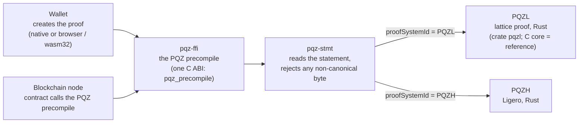
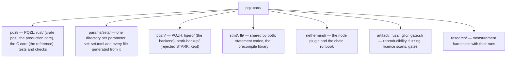

# pqz-core

**PQZ (Post-Quantum Zero-knowledge)** is a post-quantum zero-knowledge proof engine — first application: Zether-style
confidential tokens. A confidential token keeps the amounts and balances of every account encrypted on chain, while
anyone can still check that each transfer is valid. PQZ does this in a way that stays secure even against a future
quantum computer.

This directory holds everything needed to **create proofs** (in a wallet) and **check them** (on chain): two
independent proof systems, the code that reads and checks statements, and the one precompile that a blockchain node
calls to verify a proof. Each operation (transfer, burn, register, …) has its own fixed relation; PQZ is not a
general-purpose zero-knowledge system.

> **Status:** built, **unaudited — not for production funds**. Current ids: PQZL `…/v5` and PQZH `…/v3`, one pair per
> parameter set (R0 review fix, 2026-10-25). Four parameter sets: `n2048-kmax1024`, `n2304-kmax4096` (the default),
> `n2560-kmax16384` and `n2816-kmax65536` (no PQZH) ([params/sets/README.md](params/sets/README.md)). The SCaaS testnet
> runs `n2304-kmax4096` (image `scaas/nethermind-pqz:2.2.0-pqz5`, since 2026-10-26). Sizes and gas at every set are
> measured ([params/sets/README.md](params/sets/README.md#pqzl-per-set-proof-sizes-and-size-limits-bytes)); the
> testnet's precompile prices are provisional, and new prove / verify times wait for the calibration of plan 5h Task 9
> (§5). The times in §5's history are PQZL `proofSystemId` **v2** (frozen run of 2026-10-17), retired on 2026-10-19
> as forgeable ([lazer#28](https://github.com/lazer-crypto/lazer/issues/28)).
> [STATUS.md](STATUS.md) is the dated log up to plan 5h Task 8a (2026-10-21); later steps are recorded in the sets
> README, [decisions.md](../docs/decisions.md) (CTR-PQZ-*) and the run logs. The specification is
> [pq-zero-knowledge.md, "Proof engine"](../docs/contracts/pq-zero-knowledge.md#proof-engine).

## Contents

1. [At a glance](#1-at-a-glance) — the picture and the key numbers
2. [What PQZ is](#2-what-pqz-is) — encryption, accounts, what each proof shows
3. [Two proof systems, one precompile](#3-two-proof-systems-one-precompile) — PQZL, PQZH and the shared parts
4. [Statement forms, ids, limits](#4-statement-forms-ids-limits) — the operations and their sizes
5. [Measurements](#5-measurements) — where the current sizes and gas are; the v2-era times (history)
6. [Build, test, run](#6-build-test-run) — commands
7. [Directory map](#7-directory-map) — what each folder holds
8. [Licences](#8-licences)
9. [Status and what's next](#9-status-and-whats-next)
10. [Further reading](#10-further-reading)

**Words used in this document**

| Term | Meaning |
|---|---|
| PQZL | the lattice-based proof system, derived from IBM's LaZer: the Rust crate `pqzl` (the production core of the precompile since its merge on 2026-10-19) and the C core it is byte-equal to (kept as the reference) |
| PQZH | the hash-based proof system (Ligero, in Rust); the backup system, built at three of the four parameter sets |
| parameter set | one directory under [`params/sets/`](params/sets/README.md) (`n2048-kmax1024`, `n2304-kmax4096`, `n2560-kmax16384`, `n2816-kmax65536`): the lattice instance (n, q, `K_MAX`, proof parameters), chosen at compile time, one set per build |
| statement | the public data a proof is about (keys, ciphertexts, amounts, header fields) |
| relation | what the proof shows about the statement, for example `R_TX` for a transfer |
| op | the operation number in the precompile input: 1 transfer, 2 burn, 3 register, 4–5 disclosure, 6 self-test, 7 multi-recipient transfer |
| form | one statement layout; one op can have several (a transfer with or without the auditor) |
| multi-recipient transfer | `R_TXM`, op 7: one proof for a transfer to M recipients; some of them can be decoys that receive an encryption of 0 |
| leg | one recipient of a multi-recipient transfer (a real recipient or a decoy) |
| `proofSystemId` | the 32-byte id in every statement that says which proof system (PQZL or PQZH) made the proof, and at which parameter set |
| SV | the specialised verifier `verify_fast` (Rust `pqzl`; C `pqz_verify_fast`), the fast PQZL verifier used on chain; the generic verifier is its reference |
| `pqz-stmt`, `pqz-ffi` | the shared statement codec, and the library the node loads (the `PQZ` precompile) |
| SCaaS testnet / 22776 | the SCaaS testnet (chain id 7622, may be reset) / the future mainnet |
| `scripts/capped` | the repository's machine lock: heavy jobs run under it, two at a time by default (`CAPPED_SLOTS`) |

## 1. At a glance

How a proof travels: a wallet creates it, the node's precompile checks it.



The key numbers for one transfer (`R_TX`, with the auditor) at the default set `n2304-kmax4096`, all measured
(sources: [params/sets/README.md](params/sets/README.md), tables "PQZL per set", "PQZH per set" and "One transaction's
gas per relation"; [ffi/README.md](ffi/README.md), "Arenas"):

| | PQZL (lattice) | PQZH (hash-based) |
|---|---|---|
| Proof size | 46,670 B (gate bench, 2026-10-26) | 248,312–248,952 B (honest proofs); bound 251,608 B |
| Largest proof of any form / limit | 80,289 B (`R_TXM` M = 8, auditor) / 98,304 B | bound 296,248 B (`R_TXM` M = 4, auditor) / 327,680 B |
| One relayed transfer on chain (calldata; regular / state gas) | 70,020 B; 9.17 M / 21.44 M | 274,948 B; 17.61 M regular, **over** the 2^24 per-transaction cap |
| C prover memory (arena peak, native) | 380 MB | — |
| Memory inside the node's precompile | Rust backend (the default): no arena; C backend: one 512 MiB area, peak 296.0 MB with every form loaded | — |
| Time to create / verify a proof | not yet measured at the current ids; plan 5h Task 9 | the same |
| Security rests on | lattice problems (MSIS / MLWE) | hash functions only |

The gas row uses the testnet's provisional precompile price (§3). The verify limit is 60 ms at p99 (§4); the v2-era
times in [§5](#5-measurements) met it, and Task 9 re-measures them. One precompile verifies both systems:
the `proofSystemId` inside the statement selects the system and the parameter set.

**Live on the SCaaS testnet** (chain 7622): image `2.2.0-pqz5` at `n2304-kmax4096` since 2026-10-26, probe 420 ok and
e2e 84 ok ([nethermind/runs/2026-10-26-pqz5-live.txt](nethermind/runs/2026-10-26-pqz5-live.txt)). The PQZ contracts
(a fresh factory, real proofs from `pqz_prove`) passed their testnet e2e on 2026-10-26: 217 ok / 0 FAIL (plan 5h Task
8d part 2b, [smartcontracts/evm/runs/2026-10-26-t8d2b-e2e-7622.txt](../smartcontracts/evm/runs/2026-10-26-t8d2b-e2e-7622.txt)). See [§3](#3-two-proof-systems-one-precompile) for the precompile and its gas prices.

## 2. What PQZ is

PQZ keeps the shape of classical Zether — who sends to whom is visible, **amounts and balances are encrypted**, the fee
is a public number, and the sender, the receiver or an auditor can disclose an amount — but rebuilds it on lattice
problems. A quantum computer can then neither read balances later nor forge proofs to create tokens
([overview](../docs/contracts/pq-zero-knowledge.md#overview)).

- **Encryption** ([spec](../docs/contracts/pq-zero-knowledge.md#encryption)): an additive lattice encryption (module-LWE)
  over `R_q = Z_q[X]/(X^64 + 1)` with vectors of k ring elements; q, k and `K_MAX` (how many credits an account can
  receive between refreshes) come from the parameter set. At the default `n2304-kmax4096`: k = 36,
  q = 61,275,424,977,257 (≈ 2^45.80), `K_MAX` 4,096; a public key is 18,432 bytes, a ciphertext 18,560 bytes (every
  set: [params/sets/README.md](params/sets/README.md#what-a-set-fixes-cryptography-first-cost-follows-owner-question-2026-10-23)).
  Ciphertexts can be added on chain, so incoming payments simply add up. Key generation,
  encryption and decryption are deterministic from seeds (SHAKE256, [algorithms](../docs/contracts/pq-zero-knowledge.md#42-algorithms)),
  implemented in C (`pqzl/src/pqz_keys.c`) and in Rust (crate `pqzl`, `src/keys.rs`; `pqz-ffi` feature `prove`), and
  checked against an independent Python implementation (`smartcontracts/vectors/pqz/pqz_kat.py`).
- **Accounts** ([protocol](../docs/contracts/pq-zero-knowledge.md#protocol)): one registered public key per account and
  token. The ciphertexts themselves are kept in contract state (SSTORE2 op blobs and the account's `acc`, packed
  `⌈log2 q⌉` bits per coefficient), never only their hashes (owner rulings, decisions.md CTR-PQZ-07, Changes 2026-10-19
  and 2026-10-25).
- **What each proof shows** ([protocol](../docs/contracts/pq-zero-knowledge.md#protocol)): that the prover knows the
  secrets behind the statement and that every hidden value is in range:
  - `R_REG` — a newly registered key is well formed;
  - `R_TX`, `R_TX0` — a transfer (with or without an auditor copy) encrypts the right amounts and the sender's new
    balance is not negative;
  - `R_BURN` — a burn (or a refresh) with a public amount;
  - `R_DS`, `R_DR` — a disclosure: the sender, receiver or auditor reveals one amount;
  - `R_TXM` — the multi-recipient transfer: one proof for M recipients, where decoys receive an encryption of 0.

  Each relation is proven separately at each parameter set: a proof made at one set does not verify at another.

## 3. Two proof systems, one precompile

| | **PQZL** (lattice) | **PQZH** (hash-based) |
|---|---|---|
| Proof | LNP22 (ABDLOP + tbox) through a fork of [LaZer](https://github.com/lazer-crypto/lazer) `3330e48` (MIT, IBM), six layers rewritten | Ligero over F_q (radix-431 domains, Keccak-256 Merkle + transcript, zero knowledge) |
| Parameters | per set: MSIS / MLWE β ≥ 450 for every spec (`params/sets/<set>/e-s1.txt`); one recorded exception, `n2048-kmax1024`'s encryption with op 7's hints (dual_hybrid ≈ 444 [estimate]), so that set is not recommended (owner 2026-10-25, decisions.md CTR-PQZ-03) | per set, a proven (unique-decoding) Ligero preset: `n2048-kmax1024` n = 32,756, k = 817, t = 121 (127.23 bits); `n2304-kmax4096` n = 45,752, k = 952, t = 120 (127.40 bits); `n2560-kmax16384` n = 32,756, k = 817, t = 122 (127.55 bits); none at `n2816-kmax65536` ([params/sets/README.md](params/sets/README.md#pqzh-per-set-preset-proof-sizes-and-size-limits-bytes-plan-5h-task-8c-part-2)) |
| Code | Rust crate `pqzl` — `pqzl/rust/`, the production core of the precompile (owner 2026-10-18; port merged 2026-10-19, `pqz-ffi`'s default backend). C — `pqzl/src/`, `pqzl/lazer/`: the original core, kept as the reference the Rust crate is checked against (`pqz-ffi` feature `pqzl-c`); native and freestanding wasm32. Parameter headers of both: `params/sets/<set>/` | Rust crate `pqzh-ligero` — `pqzh/ligero/`; native and wasm32 |
| On-chain verifier | the specialised verifier (SV): `Ctx::verify_fast` in the Rust crate `pqzl` (`pqzl/rust/src/sv.rs`, feature `sv`); the C `pqz_verify_fast` (`pqzl/src/pqz_sv.c`) with feature `pqzl-c`. The generic verifier is the reference | `pqzh_ligero::verify` |
| Backup | — | the Plonky3 STARK crate `pqzh/stark-backup/`, kept as a record, never linked |

**PQZL without heavy dependencies.** Prover and verifier use **no GMP, MPFR, HEXL, floating point, `malloc`, `abort`
or stdio**. The six rewritten layers:

- integers without GMP — `pqzl/src/pqz_mpn.h`;
- an incomplete NTT mod q with l = 4 — `pqzl/src/pqz_ntt.c`;
- fixed-point exp for the sampler and rejection — `pqzl/src/pqz_fixexp.h`;
- an arena instead of `malloc` — `pqzl/src/pqz_arena.c`;
- sticky error returns instead of `abort` — `pqzl/src/pqz_rt.h`;
- bitsliced software AES-256-CTR — `pqzl/src/pqz_aes_gen.h`, generated by `gen_aes.py`.

The relations are in `pqzl/src/pqz_rel.c` (the prover mixes the secret witness into its random masks, so a weak random number generator cannot leak keys).

**Four soundness findings in upstream LaZer** were fixed here and reported:
[lazer#24](https://github.com/lazer-crypto/lazer/issues/24) and [#25](https://github.com/lazer-crypto/lazer/issues/25)
(the reason for `proofSystemId` v2), [#26](https://github.com/lazer-crypto/lazer/issues/26) (z21 norm, verifier
only) and [#28](https://github.com/lazer-crypto/lazer/issues/28) (Fiat–Shamir: `z3`, `z4` and `h` were absorbed after
the challenges that check them, so v2 proofs are forgeable; the reason for `proofSystemId` v3, which also carries two
prover-side zero-knowledge fixes, D-2 and D-3). Two later bumps came from this project's own reviews: PQZL v4 / PQZH v2
(plan 5h Task 8: the transcript fixes B-1 and A-2, the `R_REG` message, the new parameters, one id pair per set) and
PQZL v5 / PQZH v3 (the R0 review fix of 2026-10-25: R0-1 the auditor copies' randomness groups, R0-C2 `Bprime`, R0-C3
the η-filtered final challenge; [params/sets/README.md](params/sets/README.md#proofsystemids-per-set-plan-5h-task-8d-part-1-bumped-by-the-r0-review-fix-2026-10-25)).

**Shared by both systems:**

- **`pqz-stmt`** (`stmt/`) — the one statement codec, in Rust (no dependencies, `no_std`, builds for wasm32). It reads
  and writes every statement form of both systems and enforces the canonical rules: each statement has exactly one
  accepted encoding, so the same transfer can never be submitted in two byte forms. It also handles keys, ciphertexts,
  disclosure bundles and the precompile input with its size limits.
- **`pqz-ffi`** (`ffi/`) — the library the node loads: **one `PQZ` precompile for both systems**
  ([ffi/README.md](ffi/README.md)).
  - The node calls one C function, `pqz_precompile(input, len, out, out_len) -> status` (`ffi/pqz_ffi.h`).
  - The input is `u8(op) ‖ be32(len(stmt)) ‖ stmt ‖ proof`. `pqz-stmt` decodes it, then the statement's
    `proofSystemId` sends it to PQZL (the specialised verifier) or to PQZH (the Ligero crate). Only the two ids of the
    set the library was built for are accepted; retired ids and other sets' ids are refused. Ops 1–5 and op 7 verify a
    proof; op 6 returns the self-test hash. A shape that is not built returns `…00` (invalid). `pqz_max_input()`
    returns the set's `MAX_INPUT` (524,288 B at every set), and the node takes its input limit from it.
  - The answer is a 32-byte word, `…01` (valid) or `…00` (invalid). The status code says what happened: 0 ok, 1 input
    over `MAX_INPUT` (the call reverts), 2 bad arguments, 3 the input caused a panic (treated as invalid), 4 a fault in
    the node (no answer; the node stops instead of guessing).
  - One parameter set per build: feature `set-<set>`, default `set-n2304-kmax4096` (`ffi/Cargo.toml`). PQZH is
    compiled in only at the sets that have it.
  - Inside: the PQZL backend is the Rust crate `pqzl` by default (feature `pqzl-rust`); with feature `pqzl-c` it is
    libpqz, built by `build.rs` with `pqzl/build.sh`'s flags. One process-wide lock and one worker thread with a
    16 MiB stack serve either backend. The Rust backend has no arena. The C backend uses fixed memory areas: 512 MiB
    for verifying, a per-set area for proving and the generic verifier (`set.toml` `[pqzl_c] prove_arena_mib`:
    2,304 / 2,304 / 1,792 / 2,048 MiB at `n2048-kmax1024` / `n2304-kmax4096` / `n2560-kmax16384` / `n2816-kmax65536`),
    and one 512 MiB area on wasm32 ([ffi/README.md](ffi/README.md), "Arenas").
  - Feature `prove` adds key generation, encryption, decryption and proving for both systems, including the
    multi-recipient transfer and its sender memo (HKDF-SHA256). Browser (wasm32) proofs are byte-identical to native
    ones. In the browser the Rust backend allows every built shape up to M = 8; the C backend proves multi-recipient
    transfers only up to `[pqzl_c] wasm_max_legs` (M = 2; M = 1 at `n2816-kmax65536`; both measured, ffi/README.md
    "Arenas"). The Rust backend's wasm32 memory at M = 8 was measured only at the v2 parameters (117.4 MiB, run `d6`).
  - `src/bin/pqz-vectors.rs` generates the test vectors: `smartcontracts/vectors/pqz/` for `n2048-kmax1024`,
    `smartcontracts/vectors/pqz/<set>/` for the other sets.

**Live on the SCaaS testnet** (chain 7622, reset on path B on 2026-10-26; genesis hash `0xa17faef4…2ac2`): the
Nethermind plugin `Nethermind.Pqz` ([nethermind/README.md](nethermind/README.md), image
`scaas/nethermind-pqz:2.2.0-pqz5`, built locally, never pushed) loads `libpqz_ffi.so` (the Rust PQZL backend, set
`n2304-kmax4096`, reviewed library `dd0e7668…`) and adds three precompiles at 32-bit addresses (live since image
`2.2.0-pqz4`, 2026-10-25; the earlier images served `0x5caa5000…0f01` / `…0012` / `…0013`):

| Precompile | Address | Gas (provisional until plan 5h Task 9) |
|---|---|---|
| `PQZ` (ops 1–7, both systems) | `0x000000000000000000000000000000005caa0f01` | per (op, `proofSystemId`, statement length) row: 3,337,000–7,032,000 + 3 per input word; the multi-recipient transfer (op 7) per (`proofSystemId`, M, auditorOn): 4,712,000–8,030,000; `OP_SELFTEST` 3,337,000; an input without a row pays the smallest row and gets `…00` without calling `pqz-ffi` |
| `MLDSA44` (EIP-8355 layout) | `0x000000000000000000000000000000005caa0012` | 49,000 + 6 per message word |
| `MLDSA65` (EIP-8355 layout) | `0x000000000000000000000000000000005caa0013` | 68,000 + 6 per message word |

The `PQZ` rows are provisional: the retired calibration's row of the same rank × 1.3, because the new sets' larger n
and q verify more slowly (`nethermind/chain/engine-pqz-provisional-n2304.json`, log
`nethermind/runs/2026-10-26-r01b-provisional-n2304-kmax4096.txt`; one file per set). Final prices come from the
calibration of plan 5h Task 9. The ML-DSA prices are the calibrated ones of [nethermind/README.md](nethermind/README.md).
The prices live in the chainspec section `engine.Pqz` (a new price, or a new op as op 7 was, takes effect as a new
schedule at a future timestamp). At start-up the plugin refuses a schedule whose ids differ from the library's set,
and a library other than the reviewed one. Status 4 (a node fault) makes the node log `PQZ-NODE-FAULT` and exit with
code 120; it never turns into a verdict. Live run: probe 420 ok / 0 FAIL, e2e 84 ok / 0 FAIL
(`nethermind/runs/2026-10-26-pqz5-live.txt`); roll-out and rollback: [nethermind/chain/RUNBOOK.md](nethermind/chain/RUNBOOK.md).
Chain 22776 (the future mainnet) gets the precompiles only after the production gates: the external audit and the
licence clearance ([RUNBOOK.md](nethermind/chain/RUNBOOK.md), chain roles).

## 4. Statement forms, ids, limits

Every statement starts with `opTag ‖ proofSystemId` (64 bytes) and a 640-byte header ([statement layout](../docs/contracts/pq-zero-knowledge.md#77-statement-layout)). Every byte
layout — statements, objects, both proof formats, the precompile input and `OP_SELFTEST` — is in
[pq-zero-knowledge.md, "Serialization v1"](../docs/contracts/pq-zero-knowledge.md#serialization).

Statement sizes depend on the parameter set. The table gives the default `n2304-kmax4096`; every set's lengths are in
`params/sets/<set>/set.json` (`lengths.stmt`), generated by `gen_set.py`.

| op | Form | Relation | Statement B (`n2304-kmax4096`) | What it proves |
|---|---|---|---|---|
| 1 | TRANSFER (`auditorOn` = 1) | `R_TX` | 93,312 | sender debit, receiver and auditor credits, fee, balance digits |
| 1 | TRANSFER0 (auditor off; chosen by statement length) | `R_TX0` | 74,752 | `R_TX` without `pk_a`, `v_a`, `e2_a` |
| 2 | BURN, REFRESH | `R_BURN` | 56,192 | debit with a public amount |
| 3 | REGISTER | `R_REG` | 18,528 | key well-formedness |
| 4 | DISCLOSE-SENDER | `R_DS` | 37,280 | the sender's encryption of an amount |
| 5 | DISCLOSE-RECEIVER, DISCLOSE-AUDITOR | `R_DR` | 37,280 | decryption of a ciphertext |
| 6 | SELFTEST | — | 0 | input exactly `06 00000000`; returns the set's self-test hash (`n2304-kmax4096`: `d6c01fbc…d6c4f68d`, `smartcontracts/vectors/pqz/<set>/selftest.json`) |
| 7 | TRANSFER-MULTI (M legs, auditor on / off) | `R_TXM` | 74,752–260,992 | sender debit, M leg credits (decoys receive Enc(0)), per-leg auditor copies, fee, balance digits |

**The multi-recipient transfer (`R_TXM`, op 7)** (spec CTR-PQZ-23, [plan](../docs/superpowers/plans/2026-10-14-p6-anon.md)):

- **What it is:** one transfer with **one proof** and M legs. The sender is visible and debited once. The real
  recipients are hidden among the M legs; a decoy leg receives an encryption of 0, so an observer cannot tell it from a
  real one. M counts all legs: 7 real recipients means M = 8 with one decoy.
- **Header:** the same header as a single transfer (op 1), plus word 320 = M, word 192 = `recipientsHash` (binds the
  list of recipient accounts) and word 448 = `auditorOn`. Legs share one random value per group. With the auditor a
  group holds `s_aud` legs — 2 / 3 / 4 / 4 at `n2048-kmax1024` / `n2304-kmax4096` / `n2560-kmax16384` /
  `n2816-kmax65536` (`set.toml` `s_aud`; the R0-1 fix, owner 2026-10-25); without the auditor, groups of 4. The
  sender keeps a private memo of the transfer, sealed with HKDF-SHA256.
- **Built shapes** (statement size in bytes at `n2304-kmax4096`, from the provisional price rows'
  `stmtLen`, `nethermind/runs/2026-10-26-r01b-provisional-<set>.txt`, which list every set; `pqz-stmt` refuses every
  other shape):

  | M | auditor on | auditor off | PQZL | PQZH |
  |---|---|---|---|---|
  | 1 | 93,312 | 74,752 | built | built |
  | 2 | 112,000 | 93,312 | built | built |
  | 4 | 167,808 | 130,432 | built | built |
  | 8 | 260,992 | 223,104 | built | not built: the proof bound (340,168 B with the auditor) is over `MAX_PROOF_PQZH` (327,680 B) |
  | 16 | — | — | benchmark builds only (too large for `MAX_INPUT`) | benchmark builds only |

  The length alone does not identify the shape — (M = 1, auditor on) and (M = 2, auditor off) are both 93,312 B — so
  the node prices op 7 by the header words `(proofSystemId, M, auditorOn)`.
- **Wallet rules:**
  - the user picks how the transfer is stored on chain (BUNDLE or COMPACT); the contract never switches it;
  - an auditor-on BUNDLE transfer that would exceed the gas cap is offered as one M = 8 COMPACT transfer (the
    default) or split into smaller BUNDLE transfers;
  - a PQZH multi-recipient transfer credits at most 10 recipients inline;
  - in the browser (wasm32), PQZL proves up to M = 8 with the Rust core (`pqz-ffi`'s default backend; 117 MiB at
    M = 8 at the v2 parameters, run `d6`); the C core proves only up to `[pqzl_c] wasm_max_legs` there (M = 2; M = 1
    at `n2816-kmax65536`; §3).

The proof system ids (a change to either proof system needs a new id): since plan 5h Task 8d one PQZL and one PQZH id
per parameter set, from the set's `set.toml` labels. The table gives the default set and the retired ids (all sets:
[params/sets/README.md](params/sets/README.md#proofsystemids-per-set-plan-5h-task-8d-part-1-bumped-by-the-r0-review-fix-2026-10-25)):

| `proofSystemId` | keccak256 of | Value | Status |
|---|---|---|---|
| PQZL, `n2304-kmax4096` (default) | `scaas/pqz/lnp22/mlwe-d64k36-q46l4/v5` | `0xef1ffbcbd05394f8276e50a6c254022edf53bbd08a56e22aadddac2b9b90336e` | current (R0 review fix, 2026-10-25) |
| PQZH, `n2304-kmax4096` | `scaas/pqz/pqzh/ligero-fq46-n45752k952t120-keccak256-zk-proven/v3` | `0x046859a8592a38d374195f4cddc102ff54656c6e14c6dcfa2eeafd2724944ead` | current (R0 review fix, 2026-10-25) |
| PQZL v4 (retired by the R0 fix) | `scaas/pqz/lnp22/mlwe-d64k36-q46l4/v4` | `0x15d16d775baed2374e6e41fd153eb6d0cfc75b3b59a7057943be2338e0cb608a` | was current from plan 5h Task 8d part 1 |
| PQZH v2 (retired by the R0 fix) | `scaas/pqz/pqzh/ligero-fq46-n45752k952t120-keccak256-zk-proven/v2` | `0xe4bc6d17ac1395670158d149b01898476ea32ffa482ce3f4c3f495d6b9885730` | was current from plan 5h Task 8d part 1 |
| PQZL v3 (retired by 8d) | `scaas/pqz/lnp22/mlwe-d64k32-q42l4/v3` | `0x8079d65b5e5c15e330f7e65c875776dfc1b0f6c93ced90c045e83865d116baef` | was frozen at vectors `8af584b` (branch `pqzl-fs3`) |
| PQZH v1 (retired by 8d) | `scaas/pqz/pqzh/ligero-fq-r431-keccak256-zk-proven/v1` | `0x0a47a7689250ba178a52ad5972cdd9153358c022cb694c08d2389e82de2fead4` | was frozen at gate B |

Retired: PQZL v2 (`…/v2`, `0x2e07e6ed…798c2f`, frozen at gate A), **forgeable** (lazer#28), removed from the accepted
set and from `pqz-stmt` on 2026-10-19. Every retired id is refused (`gen_set.py` `RETIRED`, `pqz-stmt`
`RETIRED_IDS`). The SCaaS testnet runs the current `n2304-kmax4096` ids since image `2.2.0-pqz5` (2026-10-26). At
the production freeze every set switches to the labels `scaas/pqz/<set>/pqzl/v1` / `…/pqzh/v1` (owner 2026-10-25).

Size and time limits:

| Limit (enforced by `pqz-stmt`) | Value |
|---|---|
| `MAX_INPUT` (a larger input makes the call revert) | the set's, `pqz_max_input()`: 524,288 B at all four sets (`n2048-kmax1024` since the R0 review fix of 2026-10-25; it was 393,216 B) |
| `MAX_PROOF`, PQZL | 98,304 B at every set |
| `MAX_PROOF`, PQZH | the set's `MAX_PROOF_PQZH`: 327,680 B at the three PQZH sets (owner 2026-10-23 for `n2560-kmax16384`, 2026-10-25 for the other two, decisions.md CTR-PQZ-10; it was 262,144 B); none at `n2816-kmax65536`, which has no PQZH. Largest proof bound: 279,756 / 296,248 / 305,120 B at `n2048-kmax1024` / `n2304-kmax4096` / `n2560-kmax16384` |
| Largest possible input | PQZH, proof at `MAX_PROOF_PQZH`: 477,061 / 495,493 / 493,445 B at `n2048-kmax1024` / `n2304-kmax4096` / `n2560-kmax16384`. `n2816-kmax65536` (PQZL only): 394,117 B (R_TXM M = 8 with the auditor: 5 + 295,808 + 98,304). Per relation: [params/sets/README.md](params/sets/README.md#pqzh-per-set-preset-proof-sizes-and-size-limits-bytes-plan-5h-task-8c-part-2) |
| Proof length | `1 ≤ len(proof) ≤ MAX_PROOF(id)` |
| Verify time | **≤ 60 ms at p99** on the chain host, and also in wasm32 (owner decision 2026-10-14); checked again at the current ids in plan 5h Task 9 |
| Calldata | not a `pqz-stmt` limit: a PQZH proof above ≈ 261,909 B does not fit one transaction's calldata under the 2^24 regular-gas cap (EIP-7825 / EIP-7976), so PQZH stays the backup system; options in the research note [pqzh-calldata-cap.md](../docs/research/pqzh-calldata-cap.md) (owner decides) |

## 5. Measurements

<a id="5-measurements-frozen-2026-10-17"></a>

### Current state (PQZL v5 / PQZH v3, four parameter sets)

What is measured at the current ids, and where the numbers are. This README does not copy the tables; the sources
below are kept up to date.

| What | Status | Source |
|---|---|---|
| Proof sizes per relation and set: PQZL, PQZH bounds and honest proofs | measured after the R0 review fix (gate benches, logs of 2026-10-26; the Ligero crate's exact bounds) | [params/sets/README.md](params/sets/README.md), "PQZL per set" and "PQZH per set"; each set's `SET.md` |
| Gas of one transaction per relation and set (calldata, regular and EIP-8037 state gas) | measured (forge 1.8.5, Amsterdam; plan 5h Task 8d part 2b), with the provisional precompile rows | [params/sets/README.md](params/sets/README.md), "One transaction's gas per relation"; [pq-zero-knowledge.md](../docs/contracts/pq-zero-knowledge.md) §9.3; `smartcontracts/evm/runs/2026-10-26-t8d2b-gas-<set>.txt` |
| `ROLL_MAX` per set | measured on both relay paths (`mtxExecute`, `uaExecute`): 96 / 80 / 64 / 32 at `n2048-kmax1024` / `n2304-kmax4096` / `n2560-kmax16384` / `n2816-kmax65536` (controller proposal, owner may override) | `set.toml` `roll_max`; decisions.md CTR-PQZ-07, Change 2026-10-26 |
| Memory: C prover arena, C verify arena, C wasm32 leg limit | measured | [params/sets/README.md](params/sets/README.md) (C prover arena peak); [ffi/README.md](ffi/README.md), "Arenas" |
| Prove and verify times, both cores, native and wasm32 | **not measured at the current ids** | plan 5h Task 9, the calibration, which also replaces the provisional precompile prices (it needs the owner's go for timing runs) |

The reproducibility package (`artifact/`) still compares against the 2026-10-17 freeze and is stale since plan 5h
Task 8a ([artifact/README.md](artifact/README.md)).

### History: PQZL v2 (retired 2026-10-19)

Everything below this heading was measured at PQZL `proofSystemId` v2 and PQZH v1, at the parameters that are now
`n2048-kmax1024`. v2 is retired as forgeable (lazer#28); v3, v4 and v5 changed every proof byte, the PQZL proof sizes
and the prover's times, and the default set is now `n2304-kmax4096`. Read these numbers as the record of their day,
not as current values.

- **The frozen run of 2026-10-17** (`artifact/reproduce.sh --full` after gates A and B, 233 checks ok): its tables
  (PQZL C core, PQZH, `pqz-ffi`) are in `artifact/runs/freeze-2026-10-17/results.md` and `summary.txt`;
  `artifact/expected-results.json` is built from it. The Rust core's rows of the same forms are run `d6`
  (2026-10-18, C and Rust in one session): `pqzl/rust/runs/d6/results-d6.md` and
  [pqzl/rust/README.md](pqzl/rust/README.md#d6-rust-against-c-plan-d6-task-12-history).
- **First PQZL v3 times** (C core, `research/pqzl-measure/runs/fs4-native.jsonl`, 10 proofs, a loaded host): prove p50
  native `R_REG` 287 ms, `R_TX` 1,125 ms, `R_TX0` 1,140 ms, generic verify p50 `R_TX` 677 ms. The z2 rejection fix
  (D-2) about doubled the z1 / z2 rejection attempts (`R_TX` 18.5–19.6 per proof). v3 is retired too.
- §5.1–§5.5 are the measurement rounds before the freeze, which the freeze confirmed. They keep the method, the extra
  columns (memory, adversarial inputs) and the source files. Their times differ from the freeze by machine noise
  (about ± 20 %). A "Rust" row or column is run `d6`; the Rust proofs are the C proofs byte for byte (same
  `proofs_fnv`), so proof sizes are shared, and a C row and its Rust row come from different runs (compare the two
  cores within run `d6`).

**How to read the tables**

- Units are in each column header: bytes, ms (milliseconds), MB / MiB.
- p50 = the median; p99 = the 99th percentile (1 run in 100 is slower). The 60 ms limit applies to p99.
- "native / wasm" in one cell = the native value, then the wasm32 (browser) value.
- "SV" = the specialised verifier `pqz_verify_fast` (used on chain); "generic" = the reference verifier `pqz_verify`.
- An expandable block under a table has every column and its source files.

**How the numbers were measured**

| | |
|---|---|
| Machine | AMD Ryzen 5 7235HS (Zen 3+, AVX2, AES-NI, no AVX-512), 8 threads, 23 GB RAM, Linux 7.0 |
| Threads | one (every operation is single-threaded) |
| Native build | clang 18 `-O2`, portable (no CPU-specific instructions) unless a column says x86-64-v3 (AVX2 + AES-NI) |
| wasm32 | node v26.8.1 (as a browser would run it) |
| Conditions | every run under `scripts/capped`, with other services running on the machine: expect about ± 20 % noise |

#### 5.1 PQZL (runs `tx0c`, 2026-10-14)

| Relation | Proof size, max (bytes) | Prove, native / wasm (ms) | SV verify p99, portable / x86-64-v3 / wasm (ms) |
|---|---|---|---|
| `R_REG` | 28,113 | 295 / 484 | 4.48 / 3.10 / 6.91 |
| `R_REG` Rust | same proofs as C | 203 / 507 | 4.70 / – / 16.39 |
| `R_TX` | 42,785 | 965 / 1,304 | 8.73 / 5.40 / 14.76 |
| `R_TX` Rust | same proofs as C | 529 / 1,344 | 8.91 / – / 31.96 |
| `R_TX0` | 42,441 | 827 / 1,398 | 8.49 / 5.53 / 14.73 |
| `R_TX0` Rust | same proofs as C | 472 / 1,822 | 8.61 / – / 37.09 |
| `R_BURN` | 41,938 | 874 / 1,158 | 8.35 / 4.74 / 14.21 |
| `R_BURN` Rust | same proofs as C | 516 / 1,316 | 8.45 / – / 31.93 |
| `R_DS` | 28,995 | 331 / 646 | 4.94 / 3.91 / 8.70 |
| `R_DS` Rust | same proofs as C | 230 / 904 | 5.12 / – / 16.52 |
| `R_DR` | 28,996 | 395 / 504 | 4.89 / 2.82 / 7.92 |
| `R_DR` Rust | same proofs as C | 262 / 631 | 5.54 / – / 18.57 |

<details>
<summary>All PQZL columns (generic verify, SV p50, arena) and sources</summary>

Sources: `research/pqzl-measure/runs/tx0c-native.jsonl` (10 proves, 30 honest verifies per relation), `research/pqzl-measure/runs/tx0c-wasm.jsonl`
(5 / 10), `research/pqzl-measure/runs/tx0c-alone.jsonl` (one relation per process, arena peak), `pqzl/sv/runs/tx0c-native-fast.jsonl`,
`pqzl/sv/runs/tx0c-x86v3-fast.jsonl` (200 honest verifies), `pqzl/sv/runs/tx0c-wasm-fast.jsonl` (100).

| Relation | Proof size, max of 10 seeds (bytes) | Prove p50, native / wasm (ms) | Generic verify p50 / p99 native; p50 wasm (ms) | SV p50 / p99, portable (ms) | SV p50 / p99, x86-64-v3 (ms) | SV p50 / p99, wasm (ms) | Arena peak, one op, native / wasm (MB) |
|---|---|---|---|---|---|---|---|
| `R_REG` | 28,113 | 295 / 484 | 161 / 169; 223 | 3.85 / 4.48 | 2.37 / 3.10 | 6.61 / 6.91 | 95.5 / 73.7 |
| `R_REG` Rust | same proofs as C | 203 / 507 | 81 / 95; 180 | 3.18 / 4.70 | – | 13.09 / 16.39 | heap 23.5 / linear 29.1 |
| `R_TX` | 42,785 | 965 / 1,304 | 648 / 760; 762 | 7.98 / 8.73 | 4.76 / 5.40 | 13.36 / 14.76 | 304.2 / 231.9 |
| `R_TX` Rust | same proofs as C | 529 / 1,344 | 278 / 310; 525 | 6.34 / 8.91 | – | 26.73 / 31.96 | heap 62.9 / linear 72.2 |
| `R_TX0` | 42,441 | 827 / 1,398 | 577 / 627; 760 | 8.03 / 8.49 | 4.68 / 5.53 | 13.36 / 14.73 | 298.0 / 227.3 |
| `R_TX0` Rust | same proofs as C | 472 / 1,822 | 237 / 388; 521 | 6.24 / 8.61 | – | 27.05 / 37.09 | heap 62.0 / linear 71.7 |
| `R_BURN` | 41,938 | 874 / 1,158 | 556 / 584; 693 | 7.75 / 8.35 | 4.63 / 4.74 | 12.88 / 14.21 | 288.9 / 220.4 |
| `R_BURN` Rust | same proofs as C | 516 / 1,316 | 238 / 270; 474 | 6.10 / 8.45 | – | 26.26 / 31.93 | heap 60.5 / linear 70.4 |
| `R_DS` | 28,995 | 331 / 646 | 200 / 214; 270 | 4.42 / 4.94 | 2.86 / 3.91 | 7.27 / 8.70 | 99.8 / 76.9 |
| `R_DS` Rust | same proofs as C | 230 / 904 | 103 / 127; 213 | 3.35 / 5.12 | – | 13.58 / 16.52 | heap 24.4 / linear 29.9 |
| `R_DR` | 28,996 | 395 / 504 | 206 / 218; 254 | 4.50 / 4.89 | 2.69 / 2.82 | 7.52 / 7.92 | 107.7 / 83.0 |
| `R_DR` Rust | same proofs as C | 262 / 631 | 102 / 126; 214 | 3.50 / 5.54 | – | 14.41 / 18.57 | heap 25.6 / linear 31.1 |

- C core: adversarial SV p99 (246 native / 600 wasm mutated inputs per relation) ≤ 8.9 ms portable, ≤ 5.7 ms
  x86-64-v3, ≤ 14.4 ms wasm. Rust core (run `d6`, the SV p99 column, honest and adversarial): ≤ 8.9 ms native,
  ≤ 37.1 ms wasm32.
- The largest wasm prove peak (`R_TX`, 231,858,048 B = 221.1 MiB) is 13.6 % under the 256 MiB hard limit.
- Rust rows (run `d6`, 2026-10-18): the Rust core has no arena. Memory column: its native heap peak (prove, cold
  `Ctx`, `tests/memory.rs` counting allocator) and its wasm32 linear memory after the proves, one relation per
  process (including the bench's statements and witnesses), in MB. A process that keeps every relation's keys
  (a wallet `Ctx` proving every form and shape, M = 8 included) reaches 229,638,144 B = 219.0 MiB
  (`pqzl/rust/runs/d6/rust-m8-wasm-vectors-stderr.txt`), under 256 MiB.
- Native and wasm proofs are equal byte for byte.
- `pqz.wasm` 411,419 B (356,523 B without the specialised verifier, STATUS.md "Auditor-off transfer").
- C core: every SV p99 ≥ 4× under the 60 ms limit on every build. Rust core: ≥ 6.7× natively, ≥ 1.6× in wasm32
  (its wasm32 SV is about 2× the C time, [pqzl/rust/README.md](pqzl/rust/README.md#d6-rust-against-c-plan-d6-task-12-history)).

</details>

#### 5.2 PQZH Ligero, proven preset (runs `l15-tx0`, 2026-10-14, gate-B method: 1,000 verifies)

| Relation | Proof size, 5 seeds (bytes) | Exact max (bytes) | Prove, native / wasm32 (ms) | Verify p99, native / wasm32 (ms) |
|---|---|---|---|---|
| `R_REG` | 186,232–187,674 | 190,458 | 366 / 769 | 7.83 / 14.89 |
| `R_TX` | 230,584–232,302 | 235,470 | 652 / 1,309 | 10.49 / 19.44 |
| `R_TX0` | 229,672–231,800 | 234,744 | 637 / 1,333 | 11.36 / 20.88 |
| `R_BURN` | 231,256–232,632 | 234,744 | 629 / 1,286 | 10.63 / 20.76 |
| `R_DS` | 187,354–187,802 | 190,458 | 376 / 748 | 8.16 / 13.71 |
| `R_DR` | 185,462–187,226 | 190,458 | 358 / 758 | 8.33 / 14.31 |

<details>
<summary>All PQZH columns (m, memory, p50, adversarial) and sources</summary>

Sources: `pqzh/ligero/runs/l15-tx0-proven.jsonl` (+ `-time.txt`; native, 5 proofs, **1,000** honest verifies,
12 × 80 mutations per form) and `pqzh/ligero/runs/l15-tx0-proven-wasm.jsonl` (+ `-time.txt`; wasm32, 2 proofs made in
wasm32, **1,000** honest verifies, 12 × 4 mutations, `fails` 0). The gate-B round that introduced the wasm32 21-bit
multiply is `l9` (five relations, `pqzh/ligero/runs/l9-proven-wasm.jsonl`, `R_TX` p99 18.7 ms); the exact-length limits
are `l11` / `l12` ([pqzh-ligero.md](../docs/research/pqzh-ligero.md), "exact length bounds"). Prove: p50 native / mean wasm32.

| Relation | m (rows) | Proof size, 5 seeds (bytes) | Exact max (bytes) | Prove p50 native / mean wasm32 (ms) | Peak heap prove / verify, native (MB) | Verify p50 / p99, native (ms) | Verify p50 / p99, wasm32 (ms) | Adversarial p99, native / wasm32 (ms) |
|---|---|---|---|---|---|---|---|---|
| `R_REG` | 63 | 186,232–187,674 | 190,458 | 366 / 769 | 25.9 / 0.8 | 7.00 / 7.83 | 11.32 / 14.89 | 0.91 / 1.04 |
| `R_TX` | 125 | 230,584–232,302 | 235,470 | 652 / 1,309 | 43.2 / 1.2 | 9.75 / 10.49 | 17.14 / 19.44 | 1.53 / 1.50 |
| `R_TX0` | 124 | 229,672–231,800 | 234,744 | 637 / 1,333 | 42.9 / 1.2 | 9.38 / 11.36 | 16.60 / 20.88 | 1.25 / 1.56 |
| `R_BURN` | 124 | 231,256–232,632 | 234,744 | 629 / 1,286 | 42.9 / 1.1 | 9.23 / 10.63 | 16.25 / 20.76 | 1.23 / 1.42 |
| `R_DS` | 63 | 187,354–187,802 | 190,458 | 376 / 748 | 25.9 / 0.8 | 7.34 / 8.16 | 12.04 / 13.71 | 0.96 / 1.09 |
| `R_DR` | 63 | 185,462–187,226 | 190,458 | 358 / 758 | 25.9 / 0.8 | 7.18 / 8.33 | 11.53 / 14.31 | 0.98 / 1.14 |

- Process max RSS 47 MB native (six forms); wasm32 linear memory 48.1 MiB (all six forms in one module, module
  276,406 B).
- 6 × 960 mutated inputs native, 0 accepted, 0 panics.
- Every proof ≤ 262,144 B and every p99 ≤ 20.9 ms against the 60 ms limit.
- Without the precompile an EVM verifier is not viable: proven `R_TX` costs ≈ 530 M gas
  (`pqzh/ligero/runs/l11-forge.txt`, [pqzh-ligero.md](../docs/research/pqzh-ligero.md), "EVM verifier").

</details>

#### 5.3 The `PQZ` precompile path (`pqz-ffi`, run `layout`, 2026-10-17)

Verify time through `pqz-ffi`, the way the node calls it, with the 512 MiB verify-only memory area. Ops 1–5 go
through the C function `pqz_precompile`; op 7 through the Rust entry point `precompile` (the same call without the C
wrapper). The PQZL C-backend column is run `layout`. The Rust-backend column (`pqz-ffi` feature `pqzl-rust`, the
Rust core, which has no arena) is `ffi_bench` in run `d6`; the C backend is measured again in the same run for the
comparison:

| Form (op) | PQZL verify p50 / p99 (ms), C backend | PQZL verify p50 / p99 (ms), Rust backend (`pqzl-rust`) | PQZH verify p50 / p99 (ms) |
|---|---|---|---|
| TRANSFER (1) | 7.90 / 8.62 | 6.48 / 9.27 (C backend in the same run: 8.34 / 11.72) | 9.56 / 9.71 |
| TRANSFER0 (1) | 7.65 / 8.61 | 6.24 / 9.22 (C backend in the same run: 8.15 / 11.26) | 9.33 / 9.42 |
| BURN (2) | 7.50 / 10.04 | 6.28 / 9.12 (C backend in the same run: 8.09 / 11.05) | 9.12 / 10.02 |
| REFRESH (2) | 7.49 / 9.57 | 6.07 / 8.85 (C backend in the same run: 10.79 / 12.70) | 9.12 / 9.39 |
| REGISTER (3) | 3.99 / 6.58 | 3.36 / 5.66 (C backend in the same run: 4.22 / 7.17) | 6.91 / 7.04 |
| DISCLOSE-SENDER (4) | 4.16 / 4.46 | 3.39 / 5.92 (C backend in the same run: 4.54 / 7.34) | 7.22 / 7.40 |
| DISCLOSE-RECEIVER (5) | 4.38 / 4.80 | 3.67 / 6.41 (C backend in the same run: 4.71 / 7.08) | 7.07 / 7.26 |
| DISCLOSE-AUDITOR (5) | 4.38 / 4.77 | 3.73 / 6.57 (C backend in the same run: 4.86 / 6.84) | 7.06 / 7.54 |
| TRANSFER-MULTI (7), M = 1, auditor on | 7.98 / 8.76 | 6.37 / 8.80 (C backend in the same run: 8.71 / 12.10) | 9.60 / 9.77 |
| TRANSFER-MULTI (7), M = 1, auditor off | 8.27 / 10.41 | 6.31 / 9.81 (C backend in the same run: 9.03 / 12.96) | 9.28 / 9.62 |
| TRANSFER-MULTI (7), M = 2, auditor on | 8.45 / 10.81 | 6.65 / 9.43 (C backend in the same run: 9.09 / 12.30) | 9.91 / 10.72 |
| TRANSFER-MULTI (7), M = 2, auditor off | 8.52 / 10.16 | 6.43 / 10.10 (C backend in the same run: 9.31 / 12.88) | 9.58 / 9.83 |
| TRANSFER-MULTI (7), M = 4, auditor on | 9.27 / 10.52 | 7.19 / 9.70 (C backend in the same run: 9.96 / 13.81) | 10.64 / 11.02 |
| TRANSFER-MULTI (7), M = 4, auditor off | 9.06 / 13.24 | 6.88 / 9.77 (C backend in the same run: 9.79 / 13.14) | 9.87 / 10.01 |
| TRANSFER-MULTI (7), M = 8, auditor on | 13.58 / 14.48 | 10.76 / 14.86 (C backend in the same run: 14.83 / 21.42) | not built |
| TRANSFER-MULTI (7), M = 8, auditor off | 12.93 / 20.05 | 9.71 / 13.39 (C backend in the same run: 13.89 / 18.62) | not built |

<details>
<summary>Proof sizes, the Rust entry point, adversarial inputs, multi-recipient sizes and source</summary>

Source: `ffi/runs/layout-bench.jsonl` (native, n = 200 per cell, one proof per form, verify-only arena 512 MiB; the
verification run of the layout move). Adversarial = one flipped proof bit.

| Form (op) | PQZL proof (bytes) | PQZL `precompile` p50 / p99 (ms) | PQZL adversarial p99 (ms) | PQZH proof (bytes) | PQZH `precompile` p50 / p99 (ms) | PQZH adversarial p99 (ms) |
|---|---|---|---|---|---|---|
| TRANSFER (1) | 42,759 | 7.88 / 8.07 | 8.04 | 231,022 | 9.58 / 10.23 | 1.26 |
| TRANSFER0 (1) | 42,387 | 7.61 / 7.93 | 9.97 | 231,064 | 9.27 / 9.56 | 1.28 |
| BURN (2) | 41,914 | 7.51 / 9.52 | 8.77 | 231,320 | 9.11 / 9.41 | 0.57 |
| REFRESH (2) | 41,902 | 7.49 / 8.33 | 10.18 | 231,928 | 9.11 / 9.25 | 1.19 |
| REGISTER (3) | 28,068 | 3.92 / 5.94 | 5.49 | 187,738 | 6.91 / 7.49 | 0.38 |
| DISCLOSE-SENDER (4) | 28,964 | 4.15 / 4.83 | 4.39 | 186,842 | 7.22 / 7.34 | 0.42 |
| DISCLOSE-RECEIVER (5) | 28,990 | 4.39 / 4.72 | 4.61 | 187,098 | 7.06 / 7.18 | 0.43 |
| DISCLOSE-AUDITOR (5) | 28,995 | 4.40 / 4.89 | 4.60 | 186,778 | 7.06 / 7.24 | 0.43 |

The multi-recipient transfer (statement, proof and prove time of the bench's proof; largest input = 5 + statement + the proof bound):

| M, auditor | statement (bytes) | PQZL proof (bytes) | PQZL prove (ms) | PQZL largest input (bytes) | PQZH proof (bytes) | PQZH prove (ms) | PQZH largest input (bytes) |
|---|---|---|---|---|---|---|---|
| 1, on | 83,072 | 42,766 | 810 | 181,381 | 232,174 | 627 | 318,547 |
| 1, off | 66,560 | 42,409 | 920 | 164,869 | 230,968 | 638 | 301,309 |
| 2, on | 99,712 | 43,603 | 1,100 | 198,021 | 232,174 | 646 | 335,187 |
| 2, off | 83,072 | 42,951 | 1,703 | 181,381 | 231,918 | 630 | 318,547 |
| 4, on | 132,992 | 45,274 | 1,958 | 231,301 | 232,708 | 634 | 369,193 |
| 4, off | 116,096 | 43,922 | 854 | 214,405 | 230,904 | 632 | 351,571 |
| 8, on | 215,936 | 61,802 | 2,517 | 314,245 | not built | — | — |
| 8, off | 198,528 | 58,998 | 1,948 | 296,837 | not built | — | — |

- Decode ≤ 0.04 ms; the C wrapper adds ≤ 0.1 ms at p50.
- The first self-test (cold) takes 83.5 ms.
- Memory: verifying peaks at 268,113,792 B with the keys and tables of every form and every multi-recipient shape
  loaded, half of the 512 MiB area; proving with every relation loaded peaks at 853,679,872 B (1 GiB area).
- Every op ≤ 20.1 ms p99 against the 60 ms limit. The earlier run `ffi1f2` (144 MiB arena, ops 1–5) is in
  `ffi/runs/`.

</details>

#### 5.4 The multi-recipient transfer (`R_TXM`)

Built shapes, auditor on (auditor off is a little smaller and faster). Run: the package's `--multi-bench` in Docker
(2026-10-17, `artifact/runs/s6-docker-multi/`; full table with auditor off and the oversize shapes in
[artifact/README.md](artifact/README.md)). Parameters: `pqzl/params/estimator-e-s1-txm.txt` (MSIS β 452–459, MLWE β
470, knowledge error ≤ 2^−127); PQZH: [pqzh-ligero.md §15](../docs/research/pqzh-ligero.md).

| M | PQZL proof max (bytes) | PQZL prove native / wasm32 (ms) | PQZL SV verify p99 portable / wasm32 (ms) | PQZH proof max (bytes) | PQZH prove native / wasm32 (ms) | PQZH verify p99 native / wasm32 (ms) |
|---|---|---|---|---|---|---|
| 1 | 42,784 | 914 / 1,296 | 7.8 / 13.2 | 233,102 | 631 / 1,340 | 9.86 / 18.54 |
| 1 Rust | same proofs as C | 572 / 1,744 | 11.7 / 29.8 | — | — | — |
| 2 | 43,616 | 978 / 1,371 | 8.6 / 14.2 | 232,526 | 635 / 1,346 | 10.12 / 19.01 |
| 2 Rust | same proofs as C | 544 / 1,407 | 9.5 / 36.4 | — | — | — |
| 4 | 45,295 | 1,354 / 1,827 | 9.1 / 15.0 | 233,604 | 626 / 1,297 | 10.90 / 20.36 |
| 4 Rust | same proofs as C | 799 / 2,549 | 10.0 / 38.8 | — | — | — |
| 8 | 61,822 | 2,398 / 2,931 (wasm32: bench build only) | 13.6 / 23.1 | not built | — | — |
| 8 Rust | same proofs as C | 1,128 / 2,393 | 13.9 / 51.0 | — | — | — |

- "Rust" rows: run `d6` (2026-10-18; C and Rust in one session,
  [pqzl/rust/README.md](pqzl/rust/README.md#d6-rust-against-c-plan-d6-task-12-history)); SV p99 = the larger of honest and
  adversarial.
- Memory: with the C core a PQZL proof in the browser (wasm32) peaks at 221–256 MiB for M ≤ 4 but 495 MiB for M = 8,
  over the browser's 256 MiB limit, so the C backend proves M ≤ 4 in wasm32 and M = 8 is for native or desktop
  wallets. The Rust core needs 117.4 MiB of wasm32 linear memory at M = 8 (auditor on; 105.9 MiB off) and 115.5 MB of
  native heap (one relation per process; a process holding every relation's keys reaches 219.0 MiB), so on
  `pqz-ffi`'s Rust backend (the default) wasm32 proves M = 8 too (owner 2026-10-18 "if it is
  enough, raise it", decisions.md CTR-PQZ-09; [pqzl/rust/README.md](pqzl/rust/README.md#the-wasm32-op-7-limit-owner-2026-10-18-if-it-is-enough-raise-it)).
  C core native proving uses 343 MiB at M = 4 and 664 MiB at M = 8. PQZH proving needs ≤ 44 MB native and ≤ 49 MiB wasm32.
- The node's verify arena (512 MiB, S3) holds every multi-recipient shape's keys and tables with a 2× margin (§5.3).
- One transfer to 4 recipients (M = 4, auditor on) instead of 4 single transfers: about 3.5× fewer bytes and 3.5× less
  verify time (PQZH, pqzh-ligero.md §15.3).

#### 5.5 Comparisons

**vs upstream LaZer.** Same statement, witness and relation source; upstream built from source by
`artifact/reproduce.sh --upstream` (`artifact/runs/docker-upstream/upstream-bench.txt`, N = 3 medians).

| | upstream LaZer `3330e48` (x86-64-v3 = AVX2 build) | this fork, portable (no AVX2 / AVX-512 needed) | fork faster by | the Rust port (`pqzl/rust/`), portable |
|---|---|---|---|---|
| `R_TX` prove / verify | 6,581 / 6,403 ms | 1,012 / 613 ms | 6.5× / 10.4× | 529 / 278 ms (the fork in the same run: 983 / 674 ms) |
| `R_REG` prove / verify | 548 / 513 ms | 247 / 178 ms | 2.2× / 2.9× | 203 / 81 ms (the fork in the same run: 315 / 177 ms) |
| `R_TX` verify, specialised verifier | — | ≈ 8 ms | ≈ 800× | ≈ 6.3 ms (the fork in the same run: ≈ 8.5 ms) |

- The Rust port column is run `d6` (2026-10-18), next to the fork's figures in the same run (not the upstream run's
  session).
- **The fork needs no AVX-512** (and no AVX2): every time in this section comes from the portable build on a CPU
  without AVX-512; x86-64-v3 (AVX2 + AES-NI) is an optional, faster build of the specialised verifier only.
- Upstream LaZer's fastest path needs AVX-512 IFMA (its HEXL backend). That variant builds here but cannot run on the
  reference CPU, so the comparison uses upstream's AVX2 build; running the AVX-512 variant on an AVX-512 machine is an
  owner step. Method and the earlier cross-check: [research/upstream/RESULTS.md](research/upstream/RESULTS.md).

**vs the PQZH backends that were tried and rejected.** Same statement (`R_TX`), zero knowledge, 128 bits, proven
security, measured on the reference machine (details: [pqzh-backend-comparison.md](../docs/research/pqzh-backend-comparison.md)).

| Backend | Proof | Prove | Prover memory | Verify p99 native | Outcome |
|---|---|---|---|---|---|
| **Ligero over F_q** (this directory) | **≈ 231 KB** | **0.65 s** | **43 MB** | 10.5 ms | **chosen** |
| STARK (Plonky3, FRI + ZK, Goldilocks⁵) | 622 KB | 20.4 s | 2.8 GB | 19.1 ms | rejected: 2.7× larger, 30× slower to prove, 65× more memory |
| ZK WHIR (Plonky3 WHIR with hiding) | 1.95 MB | 43 s | 2.4 GB | 46.5 ms | rejected: 8× larger, reaches only ≈ 124 bits |

The rejected backends' code and runs are kept in `pqzh/stark-backup/` as the record.

## 6. Build, test, run

**Requirements:** clang / lld 18 (`wasm-ld-18`), node ≥ 26 for wasm32, Rust 1.97.1 (pinned per crate by
`rust-toolchain.toml`), Python 3 (stdlib only, run with `-I`).

> **Run every heavy step under `scripts/capped`**, the repository's machine lock (at most two heavy jobs at a time by
> default). **Where to run:** commands written as `scripts/capped pqz-core/…` run from the repository root; every other
> command runs from `pqz-core/`. **The parameter set:** every build and check takes one set; the default is
> `n2304-kmax4096`. Choose another with `PQZ_SET=<set>` (C core, scripts, gate) or the cargo feature `set-<set>`
> with `--no-default-features` (Rust). Exceptions: `pqz-stmt` and `pqzh-ligero` default to `n2048-kmax1024`
> ([params/sets/README.md](params/sets/README.md#selecting-a-set)).

**The usual checks in one place:**

| Want to… | Run |
|---|---|
| run the full gate A / B checklist at one set (KAT, fix checks, differential, C = Rust = wasm32, vectors, `pqz-ffi`, the Rust PQZL core's tests with the C oracle, cargo tests, PQZH cross-checks, fuzz smoke) | `[PQZ_SET=<set>] scripts/capped pqz-core/gate.sh [<label>]` (resumes an interrupted run; `--last` re-runs the latest) |
| build PQZL (native + wasm) | `[PQZ_SET=<set>] pqzl/build.sh all` |
| check the PQZL arithmetic against upstream LaZer | `pqzl/build/native/kat_dump > pqzl/build/native/kat-pqz.json`, then `python3 -I pqzl/kat/check.py params/sets/<set>/lazer-3330e48-kat.json pqzl/build/native/kat-pqz.json` (must print 19/19) |
| test PQZH | `(cd pqzh/ligero && cargo test --release --offline [--features set-<set>])` |
| test the precompile boundary | `[PQZ_SET=<set>] scripts/capped pqz-core/ffi/run.sh <label>` |
| check every vector file | `[PQZ_SET=<set>] scripts/capped pqz-core/ffi/vectors/run.sh <label>` |
| add a parameter set, or regenerate one | write `params/sets/<set>/set.toml`, then `params/sets/make.sh <set> all` ([params/README.md](params/README.md)) |
| reproduce the 2026-10-17 freeze (§5 history; the package is stale since plan 5h Task 8a) | `OUT=<dir> scripts/capped pqz-core/artifact/reproduce.sh [--full]` |
| build / test the node plugin and image | `[PQZ_SET=<set>] scripts/capped pqz-core/nethermind/run-tests.sh`, `[PQZ_SET=<set>] scripts/capped pqz-core/nethermind/build-image.sh pqz<n>` ([nethermind/README.md](nethermind/README.md)) |

<details>
<summary><b>PQZL core (C)</b> — builds, bench, KAT, fix checks, keys</summary>

```sh
pqzl/build.sh native            # pqzl/build/native: libpqz.a, libpqz.so, pqz_bench, kat_dump
pqzl/build.sh native-x86v3      # optional: pqz_sv.c (pqz_verify_fast) for x86-64-v3 + AES-NI, pqzl/build/native-x86v3
pqzl/build.sh wasm              # pqzl/build/wasm/pqz.wasm (clang 18, wasm-ld-18, freestanding)
SV=0 B=build/wasm-nosv pqzl/build.sh wasm        # (B relative to pqzl/) without the specialised verifier (no pqz_sv.c, no pqz_verify_fast): a
                                         #   wallet's prover build; SV=0 works for native too
pqzl/build.sh all
```

Every build runs `pqzl/check_symbols.sh` on the library objects: outside themselves they may reference only `memcpy`,
`memset`, `__stack_chk_fail` (and wasm's `__stack_pointer`). The build fails on anything else (`malloc`, stdio, libm,
GMP, MPFR, `getentropy`).

```sh
pqzl/build/native/pqz_bench 7 7                                  # 7 proves, 7 + 7 honest verifies per relation (JSON lines)
pqzl/build/native/pqz_bench 1 0 2                                # R_TX only (3rd argument, bit mask: 1 R_REG, 2 R_TX,
                                                            #   4 R_BURN, 8 R_DS, 16 R_DR, 32 R_TX0; default 63 = all)
research/opt/bench.sh <label>                                        # pqz_bench 5 5 + run_wasm.mjs 3 1 -> research/opt/runs/<label>-*.jsonl
node pqzl/test/run_wasm.mjs 3 1                                  # the same under node
PQZ_VERIFY=fast pqzl/build/native/pqz_bench 2 200                # time pqz_verify_fast (wasm: PQZ_VERIFY=fast|both node ...)
pqzl/build/native/pqz_sv_diff 10 5 2 1 10                        # both verifiers on honest + mutated proofs, must agree
pqzl/build/native/kat_dump > pqzl/build/native/kat-pqz.json
python3 -I pqzl/kat/check.py params/sets/<set>/lazer-3330e48-kat.json pqzl/build/native/kat-pqz.json   # must print 19/19
pqzl/check_tbox_fixes.sh                                       # after pqzl/build.sh native: the tbox fixes and the z21 check are in place
pqzl/sv/review/review.sh zdiff 1                                 # z21-inflated proofs, all five relations: both verifiers agree
pqzl/sv/check_sv_fixes.sh                                        # after pqzl/build.sh native: pqz_verify_fast follows both fixes
pqzl/build/native/pqz_keys_kat 1000 > k.jsonl                    # keys KAT + 1,000-seed Dec(Enc(m)) = m round trip
python3 -I ../smartcontracts/vectors/pqz/pqz_kat.py --c-keys k.jsonl   # the independent Python check: pqz_kat: ok
python3 -I ../smartcontracts/vectors/pqz/pqz_kat.py --check            # its self-test + every PQZ vector file
```

- The bench allocates 768 MiB of arena by default; `R_TXM` M = 8 needs `PQZ_ARENA_MB=2048` at every set. A relation's
  keys are built at its first use and kept, so a later relation's peak includes the earlier ones' keys (peaks per set:
  [params/sets/README.md](params/sets/README.md#pqzl-per-set-proof-sizes-and-size-limits-bytes)).
- Same seeds must give the same `proofs_fnv` (native and wasm) across pure implementation changes.
- Run the bench under `scripts/capped`.
- Debug build with the libc heap instead of the arena (for ASan/LSan only): `-DPQZ_DEBUG_MALLOC`.

Full measurement rounds (each one capped job; outputs `<dir>/runs/<label>-*`; the tables above):

```sh
NP=10 NV=30 NPW=5 NVW=10 scripts/capped pqz-core/research/pqzl-measure/relfix.sh <label>   # build, KAT, tbox fixes, proofs_fnv, arena per
                                                                          #   op, ASan + UBSan, generic timings, six relations
scripts/capped pqz-core/pqzl/sv/rel3.sh <label>     # SV: differential (portable, x86-64-v3, wasm), bench, fuzz, KAT, fix checks
scripts/capped pqz-core/pqzl/sv/diff.sh <label>     # differential test only; pqzl/sv/bench.sh, pqzl/sv/fuzz.sh (ASan + libFuzzer) likewise
```

</details>

<details>
<summary><b>Regenerate</b> — PQZL parameters and the golden KAT</summary>

Since plan 5h Task 8b the cores build with the headers of a parameter set, `params/sets/<set>/`, and
`params/sets/make.sh <set> all` regenerates them (specs, estimator check, codegen, Rust form, e_s0, golden KAT,
vectors, Solidity constants, gate; [params/README.md](params/README.md)). The commands below are the earlier per-file
tools; their `pqz_*_params.h` outputs now live in `params/sets/n2048-kmax1024/`
([pqzl/params/README.md](pqzl/params/README.md)).

```sh
pqzl/params/codegen/run.sh <LaZer 3330e48 checkout> pqzl/params/tx_params.sage > pqzl/params/pqz_tx_params.h   # also reg
pqzl/params/regen.sh <LaZer 3330e48 checkout> <out dir> > pqzl/params/codegen-<label>.txt   # every spec, diffed against git
pqzl/params/run_e_s1.sh <LaZer 3330e48 checkout> <lattice-estimator 53da598 checkout> > pqzl/params/estimator-e-s1.txt
pqzl/kat/build-lazer-dump.sh <work dir> v4      # upstream golden dump (v3 = AVX2 build); needs docker and network
```

All three refuse other LaZer / estimator commits and run pinned images. The codegen takes minutes; headers are checked
in and regenerated only on purpose. The v4 golden dump needs an AVX-512 CPU or Intel SDE
(`sde64 -spr -- ./lazer_dump-v4 > params/sets/<set>/lazer-3330e48-kat.json`). Sizing details: [pqzl/params/README.md](pqzl/params/README.md).

</details>

<details>
<summary><b>PQZH Ligero (Rust)</b> — tests, gate-B round, cross-checks</summary>

```sh
(cd pqzh/ligero && cargo test --release --offline)                        # unit + integration tests (mutations, negative witnesses)
(cd pqzh/ligero && cargo test --release --offline --no-default-features)  # the production build (no `bench`, no floats)
scripts/capped pqz-core/pqzh/ligero/runs/tx0.sh <tag>      # fixtures, tests, native + wasm32 bench (1,000 verifies), xcheck, forge
scripts/capped pqz-core/pqzh/ligero/runs/gateb.sh <tag>    # gate-B round: tests, production build, native FNV, wasm32 1,000 verifies
scripts/capped pqz-core/pqzh/ligero/runs/stmt.sh <tag>     # tests, clippy float lint, dependency / float-instruction scan
scripts/capped pqz-core/pqzh/ligero/runs/limits.sh <tag>   # exact length bounds, xcheck, forge
scripts/capped pqz-core/pqzh/xcheck/ligero.sh              # statement / witness bytes = pqz_bench.c's, all six forms
```

</details>

<details>
<summary><b>Shared</b> — <code>pqz-stmt</code>, <code>pqz-ffi</code>, vectors, package, licences</summary>

```sh
scripts/capped pqz-core/stmt/xcheck.sh <label>       # unit tests, C statements + pqz_kat.py cross-check, wasm32 build
scripts/capped pqz-core/ffi/run.sh <label>           # tests, symbol scans, C smoke test, wasm32 digest diff, bench
scripts/capped pqz-core/ffi/vectors/run.sh <label>   # pqz-vectors --check (byte for byte), pqz_kat.py --check,
                                                     #   tamper.py, wasm32 replay; add `write` to regenerate the vectors
OUT=<dir> scripts/capped pqz-core/artifact/reproduce.sh [--full | --serve | --upstream]   # the reproducibility package
scripts/capped pqz-core/glic/absence.sh > pqz-core/glic/runs/absence-<date>.txt 2>&1     # GMP / MPFR / HEXL absence
```

The package (`artifact/`, [artifact/README.md](artifact/README.md)) is source only: a pinned `Dockerfile`, quick and
`--full` modes, `--serve` (local browser demo), `--upstream` (upstream LaZer built from source); `results.py` compares a
run with `expected-results.json` (frozen 2026-10-17; stale since plan 5h Task 8a, so the proof hashes no longer match
until it is refreshed: [artifact/README.md](artifact/README.md)).

</details>

## 7. Directory map



**Kind** in the table: **core** = shipped code · **tool** = build, test or check scripts the core relies on ·
**measurement** = a benchmark or spike harness, kept with its runs · **backup** = superseded code, kept but never built
by the core. The layout dates from 2026-10-17 ([plan](../docs/superpowers/plans/2026-10-15-pqz-core-layout.md)); older
run files keep the paths of their day.

| Path | System | Kind | In one line |
|---|---|---|---|
| `pqzl/build.sh`, `pqzl/check_symbols.sh` | PQZL | tool | builds (native / x86-64-v3 / wasm); symbol scan of every library build |
| `pqzl/check_tbox_fixes.sh` | PQZL | tool | fails if a LaZer fix (lazer#24, #25) or the z21 check (#26) is gone |
| `pqzl/rust/` | PQZL | core | crate `pqzl`, the production PQZL core (merged 2026-10-19), the Rust port of the C core, byte-for-byte equal to it; `pqz-ffi`'s default backend (feature `pqzl-rust`); `d6.sh` measures it against C ([pqzl/rust/README.md](pqzl/rust/README.md)) |
| `pqzl/` | PQZL | — | overview: [pqzl/README.md](pqzl/README.md) |
| `pqzl/lazer/` | PQZL | core | the LaZer `3330e48` subset, changes marked `PQZ:` |
| `pqzl/src/` | PQZL | core (reference) | the C core: rewritten layers, relations, keys, specialised verifier, C ABI `pqz.h`; `pqz-ffi` feature `pqzl-c` |
| `params/sets/` | both | core + tool | the parameter sets: `set.toml`, the generator `gen_set.py`, `make.sh`, and per set the C / Rust / Solidity constants, codegen headers, estimator logs, PQZH preset ([params/sets/README.md](params/sets/README.md)) |
| `pqzl/params/` | PQZL | tool + record | the `n2048-kmax1024` relation specs, codegen and sizing tools, research records (`n-study/`, `p16k/`, `aprime/`, `anon/`) |
| `pqzl/kat/` | PQZL | tool | arithmetic-layer KAT against upstream |
| `pqzl/test/` | PQZL | tool | bench, wasm runner, keys KAT, SV differential and fuzz targets |
| `pqzl/sv/` | PQZL | tool + measurement | specialised-verifier checks, bench, review reproducers |
| `pqzl/sz/`, `pqzl/l2dom/` | PQZL | tool (spike origin) | the two LaZer tbox findings' reproducers |
| `research/pqzl-measure/` | PQZL | measurement | the PQZL measurement round (`relfix.sh`) and its runs (was `rel3/`) |
| `research/opt/` | PQZL | measurement | optimisation round: bench, profiling, microbenches |
| `research/floor/` | PQZL | measurement | verifier-floor microbenchmarks and cost model |
| `research/upstream/` | PQZL | measurement | upstream LaZer vs the fork on the same statements |
| `pqzh/` | PQZH | — | overview: [pqzh/README.md](pqzh/README.md) |
| `pqzh/ligero/` | PQZH | core | crate `pqzh-ligero`, THE PQZH backend |
| `pqzh/xcheck/` | PQZH | tool | C ↔ Rust statement / witness cross-check |
| `pqzh/stark-backup/` | PQZH | backup | the Plonky3 STARK crate and the rejected backends' records |
| `stmt/` | both | core | `pqz-stmt`, the statement codec |
| `ffi/` | both | core | `pqz-ffi`, the precompile boundary; vector generator |
| `artifact/` | both | tool | reproducibility package, source only |
| `glic/` | both | tool | licence step 1: GMP / MPFR / HEXL absence scans |
| `fuzz/` | both | tool | continuous fuzzing: targets `precompile`, `mutate`, `codec` (ASan + UBSan, libFuzzer) |
| `nethermind/` | both | core + tool | `Nethermind.Pqz` plugin (PQZ + ML-DSA precompiles), tests, P/Invoke harness, calibration, image build, chain runbook and runs |
| `gate.sh`, `resume.sh`, `runs/gate/` | both | tool | the gate A / B checklist at one set in one capped job (gate A: both PQZL cores, C and Rust), resumable per step; its logs |
| `NOTICE`, `STATUS.md` | — | — | third-party notices; the detailed status log |

<details>
<summary>What each directory contains in detail</summary>

| Path | Content |
|---|---|
| `pqzl/build.sh`, `pqzl/check_symbols.sh` | native / x86-64-v3 / wasm builds; symbol scan of every library build |
| `pqzl/check_tbox_fixes.sh` | fails if either LaZer tbox fix (lazer#24, #25) or the z21 norm check (lazer#26, `docs/research/pqz-z21-norm.md`, verifier only) is gone; runs `pqzl/sz/`, `pqzl/l2dom/`, `pqzl/sv/review/review.sh norm` |
| `pqzl/lazer/` | LaZer `3330e48` subset. The pristine copy is commit `c91b3ab`; changes are in place, marked `PQZ:`; SHAKE256 added to `shake128.c`. Licence `pqzl/lazer/LICENSE` |
| `pqzl/src/` | the rewritten layers and the C ABI (`pqz.h`): `pqz_mpn.h`, `pqz_ntt.c`, `pqz_fixexp.h`, `pqz_arena.c`, `pqz_rt.h`, `pqz_aes_gen.h` (from `gen_aes.py`); relations `R_REG`, `R_TX`, `R_TX0` (op 1 by statement length), `R_BURN`, `R_DS`, `R_DR` (`pqz_rel.c`); KeyGen / Enc / Dec from seeds (`pqz_keys.c`, deterministic); the specialised verifier (`pqz_sv.c`); wasm runtime (`pqz_wasm_rt.c`), `freestanding/` headers |
| `pqzl/params/` | LaZer codegen (`codegen/`), relation specs `{reg,tx,tx0,burn,ds,dr,txm*}_params.sage` of `n2048-kmax1024` (the headers moved to `params/sets/n2048-kmax1024/` in plan 5h Task 8b), `regen.sh`, `to_rust.py`, parameter sizing (`e_s0.py`, `e_s1_proof.sage`, `estimator*.txt`), `anon/` (multi-recipient transfer sizing and the `s_aud` hint study), research records `n-study/`, `p16k/`, `aprime/`; [pqzl/params/README.md](pqzl/params/README.md) |
| `pqzl/kat/` | arithmetic-layer KAT: `lazer_dump.c` (one source, upstream or pqz-core backend), `check.py`, `build-lazer-dump.sh` (the golden files per set: `params/sets/<set>/lazer-3330e48-kat.json`) |
| `pqzl/test/` | `pqz_bench.c` (prove, verify, tamper checks, the hedging check, timings, a hash of the proofs), `run_wasm.mjs` (the same under node), `pqz_keys_kat.c` (SHAKE256 / KeyGen / Enc / Dec KAT and round trip, checked by `pqz_kat.py --c-keys`), `pqz_sv_diff.c`, `pqz_sv_fuzz.c`, runs `runs/` |
| `pqzl/sv/` | specialised verifier checks (`docs/research/pqz-specialised-verifier.md`): `diff.sh` (differential test against `pqz_verify`), `bench.sh` (portable, x86-64-v3, wasm), `fuzz.sh` (ASan + UBSan, libFuzzer), `research/pqzl-measure.sh` (all relations in one capped job: diff, bench, wasm both, ASan, KAT, both fix checks, memory per op), `check_sv_fixes.sh` (fails unless the differential test catches either tbox fix reverted in `pqz_sv.c`), runs `runs/`; `review/` the independent review's reproducers (`review.sh dom | norm | zdiff | fuzz`: cheating provers past the final hash, the z21 differential `z21diff.c`; never compiled by `pqzl/build.sh`) |
| `research/pqzl-measure/` | the PQZL measurement round: `bench.sh` (build, KAT, `R_REG` / `R_TX` proof hashes, timings), `relfix.sh` (after the owner's fix-ups of 2026-10-13: build, KAT, tbox fixes, proof hashes, arena peak per relation, ASan + UBSan, timings of all six), raw runs `runs/` (latest timing round `fs4-*`, PQZL v3) |
| `research/opt/` | optimisation round: `bench.sh` (native + wasm bench), `prof.sh` (gprof), `asan.sh` (ASan + UBSan, malloc path), microbenches `micro_basemul.c` / `micro_aes.c`, raw results `runs/` (STATUS.md, optimisation section) |
| `pqzl/sz/`, `pqzl/l2dom/` | the two LaZer tbox soundness findings behind `proofSystemId` v2 ([lazer#24](https://github.com/lazer-crypto/lazer/issues/24), [#25](https://github.com/lazer-crypto/lazer/issues/25)): challenge-row trace and the pooled-slack cheating prover; the Fiat–Shamir binding test behind v3 (`sz/fs_bind.c`, [lazer#28](https://github.com/lazer-crypto/lazer/issues/28)); run by `pqzl/check_tbox_fixes.sh` ([pqzl/sz/README.md](pqzl/sz/README.md)) |
| `research/floor/` | verifier-floor microbenchmarks and cost model (`docs/research/pqz-verifier-floor.md`): unit costs, prototypes, operation counts of the generic verifier; `research/floor/build.sh run` under `scripts/capped` |
| `research/upstream/` | upstream LaZer vs the fork on the same statements ([research/upstream/README.md](research/upstream/README.md), [RESULTS.md](research/upstream/RESULTS.md)); `shim/` is also used by `artifact/reproduce.sh --upstream`; `static/` a local benchmark bundle (never published) |
| `pqzh/ligero/` | crate `pqzh-ligero` (`docs/research/pqzh-ligero.md`): field, FFT, constraint systems of the six forms, protocol, Merkle, transcript; `wasm/` module; `ligero_params.py` and `evm_model.py` models; run scripts and raw runs `runs/` |
| `pqzh/xcheck/` | C ↔ Rust statement / witness cross-check: `ligero.sh` (Ligero, six forms, plus `kat_stmt.py`), `run.sh` (the STARK crate), `dump_setup.c` |
| `pqzh/stark-backup/` (`Cargo.toml`, `src/`, `tests/`, `examples/`, `wasm/`, `runs/`, `sol/`, `pqzh_count.py`, `counts.txt`) | the Plonky3 STARK crate `pqzh` (FRI + ZK, Goldilocks⁵, the ZK WHIR adapter `src/whirpcs.rs`), its runs, the Solidity / StarkEx cost models (`sol/`), the design-study counts; kept as the record of the rejected backends, never linked by `pqz-ffi` |
| `stmt/` | `pqz-stmt`, the statement codec; `xcheck.sh` (unit tests, the six C statements and `pqz_kat.py`'s statements and rejections, the wasm build), runs `runs/` |
| `ffi/` | `pqz-ffi`, the precompile boundary ([ffi/README.md](ffi/README.md)); `src/bin/pqz-vectors.rs` (feature `prove`) with `vectors/` (`run.sh`, `tamper.py`, `replay_wasm.mjs`, runs); `wasm/` prove harness; `run.sh`, runs `runs/` |
| `artifact/` | reproducibility package, source only ([artifact/README.md](artifact/README.md)): PQZL, PQZH, `pqz-ffi` and the multi-recipient stages; Docker test logs and the frozen run in `runs/` |
| `glic/` | licence check, step 1 (`docs/research/pqz-licence-inventory.md`): `absence.sh` (builds every artifact into `pqzl/build/glic` and scans symbols, `DT_NEEDED`, wasm imports and strings for GMP / MPFR / HEXL), raw outputs and licence tables `runs/` |
| `fuzz/` | continuous fuzzing ([fuzz/README.md](fuzz/README.md)): Rust oracles behind C shims (`src/lib.rs`, `targets/*.c`), `build.sh` (stable Rust with sancov + clang 18 libFuzzer, ASan + UBSan, `pqz-ffi` feature `fuzz`), `run.sh <target> <seconds>` under `scripts/capped`, `seeds.py` (seeds from the frozen vectors); targets `precompile` (raw bytes into `pqz_precompile`), `mutate` (edit scripts over honest inputs; any accepted change is a finding; specialised vs generic verifier), `codec` (accepted ⇒ re-encoding equals the input); first campaigns 2026-10-15: ≈ 3.2 M inputs, no finding, arena peak 95,169,680 B; corpora `corpus/`, logs `runs/` |

</details>

## 8. Licences

- **pqz-core's own code** is under the repository licence, the [Vegan Community License 1.0](../LICENSE); LaZer's MIT
  notice travels with the LaZer-derived code (`NOTICE`, `pqzl/lazer/LICENSE`). The crates point to the same file
  (`license-file` in `ffi/`, `stmt/`, `pqzl/rust/` `Cargo.toml`).
- **Notices:** third-party notices for a source or binary distribution are in [`NOTICE`](NOTICE); inventory and gaps:
  `docs/research/pqz-licence-inventory.md`.
- **LaZer:** MIT, (c) 2022-2026 IBM, `pqzl/lazer/LICENSE`; no patent grant — a licence / patent review is
  required before production use (not before publication).
- **No GMP, MPFR, HEXL or libstdc++** in the library objects (`glic/runs/absence-2026-10-14.txt`).
- **Rust dependencies:** `pqz-ffi` depends on the in-tree crates and `sha3`, plus `hkdf` / `sha2` with feature `prove` (the multi-recipient memo; `cc` at build time), the Ligero crate on
  `sha3` and `pqz-stmt`, `pqz-stmt` on nothing; the backup STARK crate's licence table is
  `glic/runs/pqzh-cargo-licences.tsv`.
- **Local-only builds:** `pqzl/kat/build-lazer-dump.sh` links upstream LaZer statically with GMP / MPFR (LGPL), HEXL and
  libstdc++. That binary is a local build output, never committed or distributed (distributing it would carry LGPL
  relinking duties). Intel SDE 9.48.0 was used once, locally, to run the AVX-512 golden dump on a CPU without AVX-512;
  it is not vendored and not needed to build or test pqz-core.
- **Nothing built is published** (no release assets, hosted wasm or pushed images); `artifact/` rebuilds from source.

## 9. Status and what's next

**Done:**

| When | What |
|---|---|
| until 2026-10-14 | PQZL: first spike (`R_REG`, `R_TX`, native and wasm32), optimisation round, `R_BURN`, `R_DS`, `R_DR`, the LaZer soundness fixes (`proofSystemId` v2) and the z21 check, the specialised verifier |
| 2026-10-14 | relations round: hedged provers, keys from seeds, `R_TX0`, `pqz-stmt`, PQZH on Ligero (all six forms), `pqz-ffi`, the frozen test vectors, serialization v1 |
| 2026-10-16 | the precompile live on the SCaaS testnet for ops 1–6; the PQZ contracts deployed there, end to end with real PQZL proofs |
| 2026-10-17 | the multi-recipient transfer (op 7) in both systems, `pqz-stmt`, `pqz-ffi`, vectors, fuzzing, the package, live on the SCaaS testnet and in the PQZ tokens; the directory layout |
| 2026-10-17 | **gate A (PQZL) and gate B (PQZH) passed** (`gate.sh`, runs `runs/gate/2026-10-17-*`, decisions.md CTR-PQZ-09): KAT 19/19, fix checks, differential with 0 disagreements, vector checks, wasm32 replay byte-equal, `pqz-ffi` tests, clean fuzzing; for PQZH also every proof ≤ 262,144 B, every verify ≤ 60 ms p99, and the review of the modified Ligero zero-knowledge construction. Both ids were frozen (both retired since: PQZL v2 on 2026-10-19, PQZH v1 by plan 5h Task 8d). |
| 2026-10-17 | **the freeze**: `artifact/runs/freeze-2026-10-17/` (233 checks ok), `expected-results.json` frozen |
| 2026-10-19 | **PQZL v3** (merged `361a86b9`): the Fiat–Shamir fix for lazer#28 in all four PQZL verifiers and both provers, the z2 rejection and β sign fixes, `proofSystemId` v3, regenerated vectors; v2 retired (STATUS.md, section "PQZL v3") |
| 2026-10-19 | **PQZL in Rust** merged (`5952951a`, [plan](../docs/superpowers/plans/2026-10-17-pqzl-rust-port.md)): crate `pqzl` in `pqzl/rust/`, byte-for-byte equal to the C core (same proofs from the same seeds), the production PQZL core of the precompile (owner 2026-10-18); `pqz-ffi` builds it by default and keeps the C core as the opt-in reference (feature `pqzl-c`); run `d6` compared the two cores' speed and memory in one session (§5 history) |
| 2026-10-22 | **parameter sets** (plan 5h Task 8b, branch `pqz-16k`): one directory per set under [`params/sets/`](params/README.md), chosen at compile time (C `PQZ_SET`, Rust feature `set-<set>`), one set per build; the PQZL C and Rust cores, `pqz-stmt`, `pqz-ffi`, `pqz-vectors`, the fuzz targets and `pqz_kat.py` set-generic; `n2048-kmax1024` (the frozen set, byte-identical), `n2304-kmax4096` (the default, owner 2026-10-21: its own vectors, PQZH compiled out until 8c), `n2560-kmax16384` (shippable: its own vectors, PQZH from 8c) and `n2816-kmax65536` (core only, no PQZH); add a set = `set.toml` + `params/sets/make.sh <set> all` |
| 2026-10-23 | **PQZH per parameter set** (plan 5h Task 8c, merged `eec5d510` / `6f0c0b03`): the radix-7/17 preset at `n2304-kmax4096`, `MAX_PROOF_PQZH` 327,680 B at `n2560-kmax16384` (decisions.md CTR-PQZ-10) |
| 2026-10-25 | **plan 5h Task 8d part 1 / 1b** (merged `6d6b4455` / `46069582`): one `proofSystemId` pair per set (then PQZL v4 / PQZH v2), `pqz-ffi`'s default set `n2304-kmax4096`, `pqz_max_input()`, the 32-bit precompile addresses; `n2816-kmax65536` a full PQZL set (no PQZH). SCaaS testnet on image `2.2.0-pqz4` |
| 2026-10-25 | **plan 5h Task 8d part 2a**: every PQZ contract reads its set from the generated `PqzSet.sol` (committed: `n2304-kmax4096`), the stored ciphertexts packed (P46); every forge suite passes at all four sets (decisions.md CTR-PQZ-07, Change 2026-10-25) |
| 2026-10-26 | **R0 review fix** of the whole-core review of 2026-10-25 ([research/code-review-2026-10-25/](research/code-review-2026-10-25/README.md)): PQZL `…/v5` / PQZH `…/v3` at all four sets, the `s_aud` randomness groups, `MAX_PROOF_PQZH` 327,680 B at the PQZH sets and `MAX_INPUT` 524,288 B at `n2048-kmax1024` too; full gates at all four sets, the failed parts fixed and re-run one by one; review approved with fixes (HANDOFF.md, notes of 2026-10-26). SCaaS testnet on image `2.2.0-pqz5` (`n2304-kmax4096`); merged into `main` (`d07d0057`) |

**In progress:** **plan 5h Task 8d part 2b** (branch `pqz-8d2b`): `ROLL_MAX` per set and the gas per relation and set
are measured (§5, on both relay paths since the review fix round), and so is the C wasm32 arena at M = 2; the PQZ
contracts' end-to-end run on the SCaaS testnet is done (217 ok / 0 FAIL). Left: the review of the fix round, and the owner decides how PQZH should handle the per-transaction calldata cap
([pqzh-calldata-cap.md](../docs/research/pqzh-calldata-cap.md), research). After that (TODO.md §00): one Codex pass
on the contracts, then **plan 5h Task 9**, the calibration: prove / verify times at the current ids and the final
precompile prices, which replace the provisional rows.

**Open items** (arena exhaustion, global state, clearing secrets from memory, …): [STATUS.md "Open"](STATUS.md#open).

**A possible extension (research only, not planned): proofs for arbitrary circuits on Ligero.** Today each
operation has its own hand-written relation. Ligero can prove any arithmetic circuit, so PQZ could become
general-purpose:

- a **circuit front-end** (R1CS, Plonkish or Noir's ACIR) compiles a circuit into Ligero's constraints over F_q;
- circuits are **data, not node code**: each is registered once on chain under an id (the hash of its constraint
  system), and **the same `PQZ` precompile** verifies a proof for any registered circuit — no node update per circuit;
- gas is priced by circuit size, and a maximum circuit size keeps verification under 60 ms;
- estimate: ≈ 1–2 months; proofs grow roughly with √(circuit size) (231 KB for `R_TX` → ≈ 0.6–1 MB at 10^6
  constraints); still post-quantum and zero-knowledge.

Uses: private voting, auctions, credential checks, confidential matching. Details, and why a zkVM or zkEVM is out of
scope: [pqz-general-purpose.md](../docs/research/pqz-general-purpose.md).

## 10. Further reading

| Topic | Read |
|---|---|
| Spec | [pq-zero-knowledge.md](../docs/contracts/pq-zero-knowledge.md) — [encryption](../docs/contracts/pq-zero-knowledge.md#encryption), [protocol](../docs/contracts/pq-zero-knowledge.md#protocol), [proof engine](../docs/contracts/pq-zero-knowledge.md#proof-engine), [serialization](../docs/contracts/pq-zero-knowledge.md#serialization) |
| PQZL | `docs/research/pqz-core-e-s1.md` (the spike write-up), `pqz-specialised-verifier.md`, `pqz-verifier-floor.md`, `pqz-relations-burn-disclose.md`, `pqz-tbox-soundness.md`, `pqz-l2-domain.md`, `pqz-z21-norm.md`, `pqz-parameters-e-s0.md` |
| Parameter sets | [params/sets/README.md](params/sets/README.md) (sets, ids, sizes, gas per relation), each set's `SET.md` / `PQZH.md`, [params/README.md](params/README.md) (adding a set) |
| PQZH | `docs/research/pqzh-ligero.md`, `pqzh-backend-comparison.md`, `pqzh-design.md`, `pqzh-prototype.md`, `pqzh-zk-ext5.md`, `pqzh-zk-whir.md`, `pqzh-solidity-verifier.md`, `pqzh-starkex-verifier.md`, `pqzh-set-a-proof-limit.md`, `pqzh-calldata-cap.md` |
| Node | [nethermind/README.md](nethermind/README.md) (plugin, image, gas), [nethermind/chain/RUNBOOK.md](nethermind/chain/RUNBOOK.md) (copy gate, live roll-out, rollback) |
| Plans | [relations and serialization](../docs/superpowers/plans/2026-10-14-p6e-relations.md), [multi-recipient transfer](../docs/superpowers/plans/2026-10-14-p6-anon.md), [precompiles on the SCaaS testnet](../docs/superpowers/plans/2026-10-14-p6f-precompiles.md), [pqz-core layout](../docs/superpowers/plans/2026-10-15-pqz-core-layout.md), [PQZL in Rust](../docs/superpowers/plans/2026-10-17-pqzl-rust-port.md), [PQZL Fiat–Shamir fix](../docs/superpowers/plans/2026-10-19-pqzl-fs3.md), [PQZ state redesign, plan 5h](../docs/superpowers/plans/2026-10-20-pqz-state-redesign.md) |
| Other | anonymity research `docs/research/pqz-anonymity.md`; general-purpose circuits `docs/research/pqz-general-purpose.md`; licences `docs/research/pqz-licence-inventory.md` |
