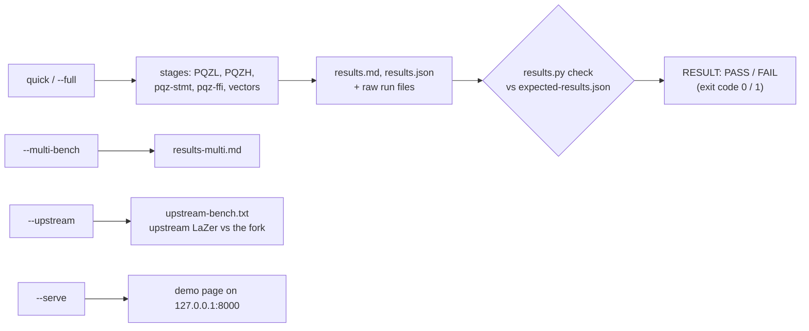

# pqz-core reproducibility package (PQZL and PQZH)

This package lets anyone rebuild both PQZ proof systems from source and re-run their measurements on their own
machine. One script, `reproduce.sh`, builds everything, runs the tests and benchmarks, and compares the results with
the frozen reference values in `expected-results.json`; it exits 0 only if every check passes. It is meant for
reviewers and auditors who want to confirm the numbers in the [pqz-core README](../README.md) (§5), and for the team
before a release. For the terms used here (relation, form, op, SV, `proofSystemId`) see the glossary in that README.

**Refreshed 2026-10-30 (fs3 Task 6) at the set `n2304-kmax4096`.** The package was made at the retired 2026-10-17 freeze
(`n2048-kmax1024`, PQZL v2 `0x2e07e6ed…`, PQZH v1 `0x0a47a768…`, `runs/freeze-2026-10-17/`; both ids are refused today, the
v2 transcript is the forgeable one fixed by the PQZL v3 Fiat–Shamir fix, decisions CTR-PQZ-09). `reproduce.sh` now exports
`PQZ_SET=n2304-kmax4096` (its KAT check reads that set's own `lazer-3330e48-kat.json`; `--upstream` compares the fork
and upstream LaZer at one set, `n2048-kmax1024`: both sides are built and KAT-checked there), and `expected-results.json` carries the figures of the Docker quick run
`runs/fs3-t6-docker-quick-fail-0448/` (`changes` entry "v3 transcript + D-2/D-3"): `relations.*.fnv` n = 1 / 2 / 3 from
that run, n = 5 / 10 from `c-fnv-n5.jsonl` / `c-fnv-n10.jsonl` there (C `pqz_bench`), the proof sizes, `pqzh` figures of
seeds 0 and 1 (seeds 2-4 need a `--full` refreeze), `ffi`, `txm` and `rust`. That run failed (106 ok, 137 FAIL) only
because its image still held the 2026-10-18 `expected-results.json` and the `n2048-kmax1024` KAT path; its C hashes for
n = 2 equal the per-set gate's (`../runs/gate/fin-fnv-c.txt`, all 14 relations), and the Rust core gives the same hashes
for n = 1 / 3 / 5 / 10 and the eight op 7 shapes. The `pqzh` hashes and sizes have no gate anchor of their own: they
rest on the reproduction in the PASS run and the in-run native = wasm32 check (`ffi.digest_lines`, which carry PQZH
proofs through pqz-ffi, do equal the gate's). The values were written by
`runs/fs3-t6-docker-quick-fail-0448/refreeze.py` from that run's committed files and the 2026-10-18 file
(`python3 -I refreeze.py <base>` gives the committed `expected-results.json`); `refreshed` / `refresh_runs` name them,
while `frozen` / `source_runs` stay the 2026-10-17 history. **Docker quick run on the refreshed file: PASS, 252 ok, 0 FAIL, 0 warn,
0 info** (`runs/fs3-t6-docker-quick/`, 2026-10-30, `--memory=4g`, 75 min; every hash, proof size and digest line equal
to the 04:48 run's).
`--full`, `--upstream` and `--multi-bench` were not rerun and their sample sizes and `n2048-kmax1024` parts are still
those of the 2026-10-17 freeze.

**The current checks are the per-set gates:** `PQZ_SET=<set> scripts/capped pqz-core/gate.sh [label]` (`../gate.sh`:
KAT, the fix checks, the PQZL differential, C = Rust = wasm32, the vectors, pqz-ffi, pqz-stmt / Ligero tests, the
PQZH cross-checks, fuzz and the Rust core, at each of the four sets; logs `../runs/gate/`). The sets and their numbers:
[`../params/sets/README.md`](../params/sets/README.md).

**What it covers** (scope: both systems, owner 2026-10-14, replacing "PQZL only" of 2026-10-13):

- **PQZL**, the LaZer fork in C: the six relations `R_REG`, `R_TX`, `R_BURN`, `R_DS`, `R_DR`, `R_TX0`; the generic
  verifier `pqz_verify` and the specialised verifier (SV) `pqz_verify_fast`; and the multi-recipient transfer
  (`R_TXM`, precompile op 7, P6-ANON). History: `../STATUS.md`.
- **PQZH**, Ligero in Rust (`../pqzh/ligero/`): all six forms including `R_TX0`, at the proven preset
  (`docs/research/pqzh-ligero.md` §12–§14), and `R_TXM`.
- the statement codec **`pqz-stmt`** (`../stmt/`) and **`pqz-ffi`** (`../ffi/`), the one precompile over both
  systems, with the test vectors.

**Nothing built is published**: no image, no wasm, no binaries. You build and run everything yourself, and the package
compares your results with `expected-results.json`.

## Status (2026-10-17): frozen, refreshed 2026-10-30

Today's values are the 2026-10-30 refresh at `n2304-kmax4096` (the paragraph at the top); this section records the freeze.

The reference values are frozen (the retired freeze above: history, not today's state). After gates A and B passed (`../gate.sh`, 2026-10-17), the freeze ran the package's
`--full` mode on the host toolchain under the machine lock (AMD Ryzen 5 7235HS, Ubuntu 24.04, clang 18.1.3,
rustc 1.97.1, node v26.8.1). From the repository root:

```sh
OUT=artifact/runs/freeze-2026-10-17 scripts/capped pqz-core/artifact/reproduce.sh --full   # OUT is relative to pqz-core/
```

- Result: **RESULT PASS, 233 ok, 0 FAIL** (`runs/freeze-2026-10-17/results.md`).
- `expected-results.json` was then built from that run by
  `results.py freeze "frozen 2026-10-17" artifact/runs/freeze-2026-10-17`. Every proof hash, size and digest line is
  equal to the provisional file it replaced; only the informational times changed. `results.py check` of the run
  against the frozen file: PASS.
- The frozen tables are in the [pqz-core README §5.0](../README.md#5-measurements-frozen-2026-10-17).

The earlier, provisional states of the package are kept under [History](#history-before-the-freeze).

## Modes

`reproduce.sh` has five modes. Run it from the repository root (`pqz-core/artifact/reproduce.sh <mode>`; the script
itself changes into `pqz-core/`).

| Mode | What it does | Checked against `expected-results.json` |
|---|---|---|
| quick (no argument) | every stage below with small sample sizes | yes |
| `--full` | the same stages with the sample sizes of the frozen runs, plus the x86-64-v3 differential and `tamper.py` | yes |
| `--multi-bench` | the measurement table of the multi-recipient transfer (`R_TXM`), including oversize shapes in benchmark builds; ~1 h, ~2 GB | its own checks (29 in the 2026-10-17 run) |
| `--upstream [N]` | builds upstream LaZer `3330e48` and compares it with the fork on the same relations, both at `n2048-kmax1024` ([below](#--upstream-upstream-lazer-and-avx-512)) | no (comparison only) |
| `--serve` | builds both wasm modules and serves a local browser demo (PQZL `R_TX`, PQZH any form) | no |



## What is reproduced

**PQZL** (C):

| Step | What it shows | quick | `--full` |
|---|---|---|---|
| build | `pqzl/build.sh all`, `native-x86v3`, wasm without SV (`SV=0`); the symbol scan rejects any libc / GMP / MPFR reference in the library objects | yes | yes |
| KAT | the arithmetic layer equals upstream LaZer `3330e48`, 19/19 cases (`pqzl/kat/lazer-3330e48.json`) | yes | yes |
| `pqzl/check_tbox_fixes.sh` | the three LaZer `tbox` fixes are in place: P6-SZ, P6-L2 (`proofSystemId` v2), and the verifier-only z21 norm check (P6-Z21). Each has a cheating-prover proof of concept and a control run | yes | yes |
| `pqzl/sv/check_sv_fixes.sh` | `pqz_verify_fast` follows both transcript fixes. With either fix reverted, the differential test must fail | yes | yes |
| differential test | `pqz_verify` against `pqz_verify_fast` on honest and mutated proofs, all six relations (3,484 cases, the sample of `pqzl/sv/rel3.sh`). `--full` also runs the x86-64-v3 build (1,350 cases) | portable | + x86-64-v3 |
| six relations, generic verifier | prove, verify, six tamper kinds; native `pqz_bench`, wasm32 under node | 3 proves, 3 verifies | 10 / 100 native, 5 / 30 wasm (= `research/pqzl-measure/relfix.sh`) |
| six relations, specialised verifier | p50 / p99 portable, x86-64-v3 + AES-NI, wasm32. With `PQZ_VERIFY=both`, every wasm verify runs both verifiers and they must agree | 50 verifies | 200 (= `pqzl/sv/rel3.sh`) |
| wasm prove memory | arena peak of one relation per process, prover build without SV | yes | yes |

**PQZH** (Ligero, Rust 1.97.1), at the proven preset (`Params::preset`, `--regime proven --r431 1`), all six forms
(`R_REG`, `R_TX`, `R_BURN`, `R_DS`, `R_DR`, `R_TX0`):

| Step | What it shows | quick | `--full` |
|---|---|---|---|
| `cargo test` (`pqzh/ligero`) | 13 unit + 17 integration tests: 6 × 960 mutated inputs rejected, every negative witness, cross-form, hedged proofs, the EVM fixtures | yes | yes |
| production build | `--no-default-features`: tests, examples / bins, `cargo clippy -- -D clippy::float_arithmetic` | yes | yes |
| C ↔ Rust cross-check | `../pqzh/xcheck/ligero.sh`: the statement and witness bytes of the Rust client equal `pqz_bench.c`'s (12 files); then `kat_stmt.py`: each statement parses under `pqz_kat.py` with PQZH's id only and is rebuilt byte for byte | yes | yes |
| `pqz-stmt` | `../stmt/xcheck.sh`: unit tests (release and debug), C and `pqz_kat.py` cross-check, wasm32 build | yes | yes |
| native bench | `ligero_bench`: proof bytes, `max_len_exact`, prove, prove heap peak, verify p50 / p99, 12 mutation kinds, FNV hash of the proofs of seeds 0..n-1 | 2 proofs, 20 verifies, 12 × 2 mutations | 5, 1,000, 12 × 80 (= `pqzh/ligero/runs/tx0.sh`) |
| wasm32 bench | `run_wasm.mjs` under node: the same, linear memory ≤ 256 MiB, FNV hash of seed 1 (must equal native) | 2 proofs, 20 verifies, 12 × 1 | 2, 1,000, 12 × 4 (the gate-B method) |

**pqz-ffi** (`../ffi/`, the one precompile over both systems; its PQZL backend is the default one, the Rust core
`pqzl`, CTR-PQZ-09). This is `ffi/run.sh` without `/usr/bin/time`:

- `cargo test --features prove,test-hooks`: the self-test hash, every decoder rejection, the PQZL differential test,
  node faults, the verify-only process, fill determinism, and the native digest lines;
- `cargo test --lib` without `prove`;
- the verify-only cdylib, no test hooks in it (`TEST_ARENA` / `TEST_FAIL_WORKER`), the C core's symbol scan
  (`../pqzl/check_symbols.sh`) when the build has the C core (`cargo tree -e features -i pqz-ffi` shows `pqzl-c`;
  the default build has none and says so), and the C smoke test against `pqz_ffi.h`;
- clippy `-D clippy::float_arithmetic`;
- the wasm32 builds and digest lines (they must equal native);
- `ffi_bench` (20 verifies in quick, 200 in `--full`).

**Vectors** (`smartcontracts/vectors/pqz/`, P6e Task 11; the generator is pqz-ffi's `pqz-vectors`). Like
`ffi/vectors/run.sh` in check mode: the package never rewrites the vectors.

- quick and `--full`: `pqz-vectors --check` (a second generation compared byte for byte; every honest proof and
  negative input through `pqz_precompile`, PQZL also through the generic verifier), `pqz_kat.py --check` (the
  independent Python checker) and the wasm32 replay (`ffi/vectors/replay_wasm.mjs`: every proof proved again in
  wasm32, byte-equal and valid);
- `--full` only: `tamper.py` (single-leaf edits; each must be caught).

**The multi-recipient transfer (`R_TXM`, op 7) in the default stages** (since P6-ANON S6). `results.py` replays every
built (id, M, auditorOn) of `proof_pqzl.json` / `proof_pqzh.json` (PQZL M = 1, 2, 4, 8; PQZH M = 1, 2, 4; with and
without the auditor; decoy and boundary cases):

- natively through `pqz_precompile` (`…01`, the `pqz-vectors --check` lines);
- in wasm32 (`ffi/vectors/replay_wasm.mjs`): proved again, byte-equal, PQZL M = 8 included (`pqz-ffi`'s Rust
  backend proves up to M = 8 in wasm32 since the Rust port's Task 12; on the C backend, opt-in, PQZL M = 8 is
  verify-only, because the C core proves only up to M = 4 in wasm32);
- the multi-recipient rows of `negative.json` (PQZL 177, PQZH 165) must give `…00` or a revert.

**Rust = C** (port plan Task 12; the Rust core `../pqzl/rust/`, the production PQZL core since 2026-10-19). `pqz-ffi`'s
default PQZL backend is the Rust core (feature `pqzl-rust`, CTR-PQZ-09), so the pqz-ffi and vectors stages above
already check it against the values the C core fixed: the self-test hash, the digest lines, `pqz-vectors --check`
(every vector file byte-equal) and the wasm32 replay. The stage adds only what they do not cover, without repeating
any of them (owner 2026-10-16). In quick and `--full`:

- the Rust prover's `proofs_fnv` equals the C core's frozen hashes: `bench 5 5 63` natively (the six relations,
  n = 5), `bench 2 2 16320` (the eight op 7 shapes, n = 2; `expected-results.json` `rust.txm_fnv`, from the C core's
  L3 run) and `wasm/run_wasm.mjs 3 1 63` in wasm32 (n = 3). Every bench must report `fails 0`;
- the keys KAT: `keys_kat 100` gives the C core's `pqz_keys_kat 100` lines (SHA-256 `rust.keys_kat`; the C-only
  `before_init_rejected` line left out), and `pqz_kat.py --c-keys` reports `ok`;
- `--full` only: the same benches with `PQZ_VERIFY=fast` (`verify_fast`).

The Rust rows of `results.md` come from these runs. They use other sample sizes than the C rows; the comparable
figures are run `d6`'s.

`--full` uses the sample sizes of the frozen runs, but not PQZL's ASan + UBSan build (`research/pqzl-measure/relfix.sh`
and `pqzl/sv/rel3.sh` keep that).

## Run in Docker

The build context is the repository root, narrowed by `Dockerfile.dockerignore` to about 12 MB:

- `pqz-core/`;
- `smartcontracts/vectors/pqz/` (the vectors and `pqz_kat.py`, read by the vector checks, the PQZH and `pqz-stmt`
  cross-checks, and pqz-ffi's `build.rs` for the self-test proofs);
- `smartcontracts/evm/test/vectors/pqzh-ligero/` (the Ligero crate's EVM fixture test).

Run from the repository root:

```sh
docker build -t pqz-core-artifact -f pqz-core/artifact/Dockerfile .   # needs network; cargo / cc capped at 2 jobs
mkdir -p pqz-out
docker run --rm --memory=4g --memory-swap=4g --network none -u "$(id -u):$(id -g)" -v "$PWD/pqz-out:/out" -e OUT=/out/quick pqz-core-artifact
docker run --rm --memory=4g --memory-swap=4g --network none -u "$(id -u):$(id -g)" -v "$PWD/pqz-out:/out" -e OUT=/out/full pqz-core-artifact --full
docker run --rm --memory=4g --memory-swap=4g -u "$(id -u):$(id -g)" -v "$PWD/pqz-out:/out" -e OUT=/out/upstream pqz-core-artifact --upstream
docker run --rm --memory=4g --memory-swap=4g --network none -u "$(id -u):$(id -g)" -v "$PWD/pqz-out:/out" -e OUT=/out/multi pqz-core-artifact --multi-bench   # multi-recipient table, ~1 h
docker run --rm --memory=4g --memory-swap=4g --init -p 127.0.0.1:8000:8000 pqz-core-artifact --serve # open http://127.0.0.1:8000/
docker image rm pqz-core-artifact                                     # when done
```

**The image is pinned:**

- `ubuntu:24.04` by digest; apt packages from the Ubuntu snapshot archive (`APT_SNAPSHOT`), with the measured
  toolchain pinned by version (clang / lld 18.1.3, gcc 13.3.0, cmake 3.28.3);
- node 26.8.1 by sha256;
- LaZer `3330e48` by commit (source only, for `--upstream`);
- `rustup-init` 1.29.1 by sha256 and Rust 1.97.1 (minimal profile + `wasm32-unknown-unknown` + clippy; rustup checks
  every component against the sha256 in the 1.97.1 channel manifest);
- the crates by their committed `Cargo.lock` (`cargo fetch --locked` into the image for `pqzh/ligero`,
  `pqzh/ligero/wasm`, `stmt`, `ffi`, `ffi/wasm`).

Only the image build needs network. The runs do not: every cargo call is `--locked --offline`, hence `--network none`
above. `--upstream` clones nothing either, since LaZer is in the image.

## Run on a local toolchain

You need:

- x86-64 Linux, clang 18, `wasm-ld-18` (lld 18), node, python3, binutils (`strings`);
- rustup with Rust 1.97.1 (`../pqzh/rust-toolchain.toml` and `../ffi/rust-toolchain.toml` select it), with
  `wasm32-unknown-unknown` and clippy installed;
- the crates in the cargo cache: run `cargo fetch --locked` once in each crate directory, because the runs are offline;
- about 2 GB of free memory (see "Hardware and time" below);
- for `--upstream` also gcc / g++, cmake, unzip, git, `libgmp-dev` and `libmpfr-dev`.

From the repository root:

```sh
pqz-core/artifact/reproduce.sh                 # quick
pqz-core/artifact/reproduce.sh --full
pqz-core/artifact/reproduce.sh --serve         # PORT=8000 BIND=127.0.0.1 by default
pqz-core/artifact/reproduce.sh --multi-bench   # the multi-recipient (R_TXM) measurement table (~1 h, ~2 GB)
LAZER_SRC=<LaZer clone> pqz-core/artifact/reproduce.sh --upstream [N]   # without LAZER_SRC it clones from GitHub
```

On a shared machine, put heavy runs under the repository's machine lock: `scripts/capped pqz-core/artifact/reproduce.sh …`.

Results go to `pqz-core/artifact/out/<mode>-<UTC stamp>/` (git-ignored), or to `$OUT`. A relative `$OUT` is relative
to `pqz-core/`.

## Reading the results

`results.md` and `results.json` contain three tables, and then every check against `expected-results.json`:

- **PQZL**, per relation: proof bytes, prove p50 native / wasm, generic verify p50, SV p50 / p99 portable /
  x86-64-v3 / wasm, and the wasm prove peak.
- **PQZH**, per form: proof bytes (max), `max_len_exact`, prove p50 native / wasm32, verify p50 / p99 native and
  wasm32, prove memory (native heap peak, wasm32 linear memory) and the number of verifies.
- **pqz-ffi**: the self-test hash and, per system and form, verify p50 / p99 through the C ABI.

`reproduce.sh` exits 0 only when no check fails (`RESULT: PASS`). Each check is one of three kinds.

**PQZL checks:**

- **exact:** `proofs_fnv` (an FNV-1a hash over the proofs of seeds 0..n-1, keyed by n). Native, x86-64-v3 and wasm
  must give the same hash, because the proofs are byte-identical across builds. The KAT must give 19/19. Both fix
  checks must print `ok`. The differential test must report 0 mismatches. Every bench must report `fails 0`.
- **within a tolerance** (stated in `expected-results.json`): largest proof size ±0.5 %, wasm prove arena peak ±1 %.
  Two ratios get ±50 % and only warn, because they depend on the machine: the SV speed-up (generic p50 / SV p50,
  native) and wasm / native prove.
- **informational:** all times. Expect them to differ on other CPUs. The reference numbers were measured on the
  machine named in `expected-results.json` (`machine`).

**PQZH and pqz-ffi checks:**

- **exact:**
  - the FNV-1a hash and the length of each PQZH proof, keyed by its seed (native seeds 0..n-1, wasm32 seed 1), and
    native = wasm32 for the same seed;
  - `max_len_exact` per form, and every proof ≤ `max_len_exact` (the verifier's bound);
  - wasm32 linear memory ≤ 256 MiB;
  - every bench `fails 0` (0 mutations accepted, 0 panics) with all six forms;
  - the text stages end with `rc=0` and show their markers (`kat_stmt: ok`, `xcheck: C 6 / 6 forms equal`,
    `0 verifier panics caught`, `c_abi: ok (0 failures)`, `symbols ok`, test hooks 0, `0 disagreements`);
  - the pqz-ffi self-test hash and digest lines equal the frozen ones, and the wasm32 digest lines equal native;
  - the vectors: `pqz-vectors --check: … ok` (no `DIFF` / `EXTRA`), `pqz_kat: ok`, every wasm32 replay row byte-equal
    and valid, `tamper: … caught: ok`.
- **within a tolerance:** wasm32 / native prove and verify (±50 %, warn only).
- **informational:** times and memory.

**Hardware and time.**

- The package targets x86-64. Without AVX2 + AES-NI the x86-64-v3 runs are skipped.
- Memory: up to about 2 GB (the header of `reproduce.sh`). The PQZL bench reserves a 768 MiB arena; pqz-ffi's wasm32
  digest run takes about 0.6 GB; with the multi-recipient transfer, pqz-ffi's prove tests take up to about 0.9 GB per
  test thread and `pqz-vectors --check` about 1 GB; `--multi-bench` with PQZL M = 16 about 1.6 GB. The documented
  `docker run --memory=4g` leaves headroom.
- Wall time on the reference machine (Ryzen 5 7235HS):
  - image build: a few minutes plus the apt snapshot download (which took 42 min while snapshot.ubuntu.com was
    failing);
  - quick: 27 min in the 2026-10-14 Docker run, before the multi-recipient transfer (PQZL 18, PQZH 4, pqz-ffi 4,
    vectors 2); 75 min in the 2026-10-30 Docker run at `n2304-kmax4096` with the Rust "Rust = C" stage
    (`runs/fs3-t6-docker-quick/`, on a loaded host; the 04:48 run took 54 min);
  - `--full`: 69 min in the freeze run (`runs/freeze-2026-10-17/log.txt`, 08:49:55 to 09:59:07): roughly
    `research/pqzl-measure/relfix.sh` plus `pqzl/sv/rel3.sh`, plus PQZH's 1,000-verify benches, pqz-ffi, the vectors
    and `tamper.py`;
  - `--multi-bench`: 44 min in Docker (2026-10-17);
  - `--upstream`: builds HEXL and LaZer twice, which takes several minutes.

## Measurements of the multi-recipient transfer (`R_TXM`, op 7)

From `--multi-bench` in Docker, 2026-10-17 (`--memory=4g`, 44 min): **PASS**, 29 checks (`runs/s6-docker-multi/`).
`results.py multi` writes these tables to `results-multi.md`. Machine: AMD Ryzen 5 7235HS (8 threads; flags aes vaes
avx2), in Docker: True. Times are informational. M is the number of legs (recipients, decoys included); "auditor"
says whether each leg also has an auditor copy. "built" = the shape is accepted on chain; oversize shapes exist only
in benchmark builds.

### PQZL (research/pqzl-measure/txm-bench.sh, the L3 method)

| M | auditor | built | proof bytes (max) | prove p50 native / wasm32 | generic verify p50 / p99 native | SV p99 portable / x86-64-v3 / wasm32 | wasm32 prove peak (no SV) |
|---|---|---|---|---|---|---|---|
| 1 | on | yes | 42,784 | 914 / 1,296 ms | 583 / 596 ms | 7.8 / 4.8 / 13.2 ms | 221.1 MiB |
| 1 Rust | on | yes | same proofs as C | 572 / 1,744 ms | 339 / 468 ms | 11.7 / – / 29.8 ms | 68.9 MiB |
| 2 | on | yes | 43,616 | 978 / 1,371 ms | 674 / 936 ms | 8.6 / 5.0 / 14.2 ms | 232.3 MiB |
| 2 Rust | on | yes | same proofs as C | 544 / 1,407 ms | 318 / 468 ms | 9.5 / – / 36.4 ms | 70.9 MiB |
| 4 | on | yes | 45,295 | 1,354 / 1,827 ms | 865 / 880 ms | 9.1 / 5.3 / 15.0 ms | 255.6 MiB |
| 4 Rust | on | yes | same proofs as C | 799 / 2,549 ms | 411 / 530 ms | 10.0 / – / 38.8 ms | 77.2 MiB |
| 8 | on | yes | 61,822 | 2,398 / 2,931 ms | 2,007 / 2,138 ms | 13.6 / 8.3 / 23.1 ms | 495.3 MiB |
| 8 Rust | on | yes | same proofs as C | 1,128 / 2,393 ms | 830 / 899 ms | 13.9 / – / 51.0 ms | 117.4 MiB |
| 16 | on | no (oversize, bench build only) | 92,367 | 7,466 / 8,336 ms | 6,230 / 6,425 ms | 21.9 / 12.6 / 35.7 ms | 1,199.1 MiB |
| 16 Rust | on | no (oversize, bench build only) | same proofs as C | not in run `d6` | – | – | – |
| 1 | off | yes | 42,442 | 784 / 1,112 ms | 542 / 550 ms | 7.9 / 4.7 / 12.9 ms | 216.7 MiB |
| 1 Rust | off | yes | same proofs as C | 449 / 1,237 ms | 243 / 289 ms | 8.7 / – / 34.3 ms | 68.4 MiB |
| 2 | off | yes | 42,936 | 1,003 / 1,650 ms | 591 / 597 ms | 8.4 / 4.8 / 13.2 ms | 223.4 MiB |
| 2 Rust | off | yes | same proofs as C | 639 / 2,171 ms | 287 / 316 ms | 8.9 / – / 34.8 ms | 69.1 MiB |
| 4 | off | yes | 43,956 | 1,110 / 2,605 ms | 691 / 720 ms | 8.7 / 4.9 / 13.8 ms | 237.2 MiB |
| 4 Rust | off | yes | same proofs as C | 711 / 4,032 ms | 322 / 406 ms | 9.1 / – / 38.0 ms | 73.9 MiB |
| 8 | off | yes | 59,048 | 1,776 / 2,370 ms | 1,444 / 1,546 ms | 12.9 / 7.2 / 21.9 ms | 447.0 MiB |
| 8 Rust | off | yes | same proofs as C | 911 / 2,827 ms | 604 / 746 ms | 12.9 / – / 50.1 ms | 105.9 MiB |
| 16 | off | no (oversize, bench build only) | 86,581 | 5,167 / 5,504 ms | 4,302 / 4,498 ms | 20.3 / 11.1 / 32.6 ms | 1,051.1 MiB |
| 16 Rust | off | no (oversize, bench build only) | same proofs as C | not in run `d6` | – | – | – |

"Rust" rows: the Rust core (`pqzl/rust/`), from run `d6` (2026-10-18, `pqzl/rust/d6.sh`, C and Rust in one session
outside Docker: native 10 proves / 100 verifies, wasm32 5 / 30, verify_fast 200 / 100; SV p99 = the larger of honest
and adversarial; `pqzl/rust/runs/d6/results-d6.md` has the same run's C rows). The C rows above are unchanged. The
M = 16 Rust rows need a `--multi-bench` run with its Rust step, which `results.py multi` turns into rows next to
PQZL's whenever the run directory has `rust-txm-*.jsonl`; none has run yet. The Rust wasm32 prove peak is the
module's linear memory after the proves, against the C arena peak; the Rust core has no x86-64-v3 build. The Rust
M = 8 wasm32 peak (117.4 MiB on, 105.9 MiB off) fits within the C M = 4 peak (255.6 MiB), so `pqz-ffi`'s Rust
backend proves M = 8 in wasm32 (Task 12:
[pqzl/rust/README.md](../pqzl/rust/README.md#the-wasm32-op-7-limit-owner-2026-10-18-if-it-is-enough-raise-it)).

### PQZH (Ligero, the proven preset; the H2 method of pqzh/ligero/runs/txm.sh)

| M | auditor | built | proof bytes (max) | max_len_exact | prove p50 native / wasm32 | verify p50 / p99 native | verify p50 / p99 wasm32 | prove memory native heap / wasm32 linear |
|---|---|---|---|---|---|---|---|---|
| 1 | on | yes | 233,102 | 235,470 | 631 / 1,340 ms | 9.60 / 9.86 ms | 17.04 / 18.54 ms | 43.2 / 46.3 MiB |
| 2 | on | yes | 232,526 | 235,470 | 635 / 1,346 ms | 9.83 / 10.12 ms | 17.46 / 19.01 ms | 43.2 / 46.9 MiB |
| 4 | on | yes | 233,604 | 236,196 | 626 / 1,297 ms | 10.64 / 10.90 ms | 18.64 / 20.36 ms | 43.6 / 47.8 MiB |
| 8 | on | no (oversize, bench build only) | 278,456 | 281,208 | 902 / 1,882 ms | 13.73 / 13.96 ms | 24.90 / 25.35 ms | 61.4 / 67.6 MiB |
| 16 | on | no (oversize, bench build only) | 369,420 | 372,684 | 1,394 / 2,943 ms | 19.99 / 20.19 ms | 37.58 / 38.03 ms | 96.6 / 104 MiB |
| 1 | off | yes | 232,440 | 234,744 | 618 / 1,272 ms | 9.30 / 9.83 ms | 16.32 / 17.67 ms | 42.9 / 47.8 MiB |
| 2 | off | yes | 232,590 | 235,470 | 627 / 1,305 ms | 9.63 / 10.05 ms | 17.02 / 18.65 ms | 43.2 / 48.4 MiB |
| 4 | off | yes | 232,654 | 235,470 | 652 / 1,281 ms | 9.96 / 10.72 ms | 17.45 / 18.60 ms | 43.2 / 48.8 MiB |
| 8 | off | no (oversize, bench build only) | 276,780 | 279,756 | 877 / 1,798 ms | 12.35 / 13.30 ms | 22.55 / 22.93 ms | 60.6 / 104 MiB |
| 16 | off | no (oversize, bench build only) | 366,078 | 369,054 | 1,361 / 2,884 ms | 17.39 / 18.61 ms | 33.00 / 33.78 ms | 94.9 / 105.8 MiB |

## `--upstream`: upstream LaZer and AVX-512

`--upstream` builds upstream LaZer `3330e48` from source in two variants: x86-64-v3 (AVX2) and x86-64-v4 with
AVX-512 IFMA / VBMI2. Each variant includes HEXL from LaZer's `third_party` zip, links the distribution's GMP /
MPFR, and uses the flags of `../research/upstream/static/build.sh`. Upstream and the fork are both built at the
parameter set `n2048-kmax1024` (`reproduce.sh` sets `PQZ_SET` to it in this mode only). Then it does three things:

1. It checks the upstream KAT dump against the golden `pqzl/kat/lazer-3330e48.json`.
2. It runs the `R_REG` / `R_TX` cross-check bench through `../research/upstream/shim`. This compares upstream and the
   fork on the same statements, parameters and seeds (`../research/upstream/README.md`).
3. It runs the fork's bench (`bench_fork`).

**Building without AVX-512.** Building needs only the compiler flags (`-march=x86-64-v4 -mavx512ifma
-mavx512vbmi2`), because gcc emits AVX-512 code on any host. HEXL's configure test normally compiles *and runs*
its AVX-512 probe, so here it is relaxed to "compiles".

**Running needs the CPU:** an AVX-512 IFMA CPU (Ice Lake / Sapphire Rapids, Zen 4 or later) or Intel SDE
(`sde64 -spr -- ...`). `reproduce.sh` runs the v4 binaries only when `/proc/cpuinfo` lists `avx512ifma`; otherwise it
prints that they were skipped and why. At run time, HEXL picks its kernels from CPUID
(`../research/upstream/static/cpuf`), so `HEXL_DISABLE_AVX512IFMA=1` gives an A/B comparison on the same binary.

The results of the 2026-10-14 Docker run are in the [pqz-core README §5.5](../README.md#55-comparisons) and under
History below.

## Licences

- pqz-core includes a modified LaZer subset: MIT, (c) IBM, `../pqzl/lazer/LICENSE`. Third-party notices are in
  `../NOTICE`.
- The pqz-core library links no GMP, MPFR or HEXL.
- `--upstream` builds upstream LaZer with HEXL (Apache-2.0) and links GMP / MPFR (LGPL-3.0+). It does this only
  inside the container, or on your machine, from source. The binaries stay in `pqzl/build/upstream/` (git-ignored).
  This package never ships them, and you should not distribute them: distributing a binary with GMP / MPFR linked in
  carries LGPL relinking duties.
- PQZH and pqz-ffi use the crates in their `Cargo.lock` (`sha3` and its RustCrypto dependencies, MIT / Apache-2.0),
  fetched from crates.io when you build the image.
- No built artifact of any kind is published with this package.

## Files

| File | Purpose |
|---|---|
| `Dockerfile`, `Dockerfile.dockerignore` | the pinned image (build context: the repository root, narrowed by the allowlist in `Dockerfile.dockerignore`) |
| `reproduce.sh` | every mode; works in Docker and on a local toolchain |
| `results.py` | `check`: the tables and the comparison; `freeze`: `expected-results.json` from a frozen run (both systems + pqz-ffi); `freeze-txm`: only the multi-recipient parts, from a quick / full run; `multi`: the multi-recipient table of a `--multi-bench` run; `d6`: the Rust-against-C table of a `pqzl/rust/d6.sh` run. Rust rows appear next to the C rows when the Rust run files exist |
| `check_rust_stage.py` | pins `results.py check`'s "Rust = C" checks: on scratch copies of a passing quick run (default `runs/fs3-t6-docker-quick`), a crashed, cut-short, missing or non-zero-rc Rust bench and a verify-only wasm32 row on the Rust backend each give FAIL; the untouched copy PASS (`runs/fs3-t6-docker-quick/check-rust-stage.txt`) |
| `expected-results.json` | the reference values: frozen 2026-10-17 from `runs/freeze-2026-10-17/`, refreshed 2026-10-30 from `runs/fs3-t6-docker-quick-fail-0448/` (reproduced by the PASS run `runs/fs3-t6-docker-quick/`) |
| `web/index.html` | the `--serve` page (loads the locally built `pqz.wasm` and `pqzh_ligero_wasm.wasm`) |
| `runs/` | logs of the package's own test runs (text only) |

## History (before the freeze)

These notes record how the package and its provisional reference values got to the freeze, newest first. They are
kept for the record; the current state is [Status](#status-2026-10-17-frozen-refreshed-2026-10-30) above. Branches named here are merged.
Run paths are given in the current pqz-core layout (the directories moved on 2026-10-15, branch `pqz-layout`).

<details>
<summary><b>2026-10-17, P6-ANON S6</b> (branch <code>p6-anon-s6b</code>, merged): the multi-recipient transfer in the package</summary>

Ported to the new pqz-core layout.

- **The multi-recipient transfer in the default stages:** see "What is reproduced" above.
- **`expected-results.json` regenerated once with the multi-recipient transfer** (`results.py freeze-txm s6-quick`;
  owner decision D21: one regeneration for it). Only `txm` and `ffi.digest_lines` changed (29 lines; the 17 earlier
  lines kept, in order). Docker quick on the new layout (`runs/s6-docker-quick/`): the run itself gave 177 ok and
  1 FAIL, the FAIL being the digest lines before the regeneration (`summary-run.txt`); the same output checked against
  the regenerated file: **PASS, 199 ok** (`summary-post-freeze-txm.txt`).
- **`--multi-bench`** (new mode): the multi-recipient measurement table. PQZL by
  `../research/pqzl-measure/txm-bench.sh` (the L3 method), PQZH by `ligero_bench` / `run_wasm.mjs` txm (the H2 method);
  oversize shapes (PQZL M = 16, PQZH M = 8, 16) in benchmark builds only; `results.py multi` writes
  `results-multi.md`. Docker run (2026-10-17, `--memory=4g`, 44 min): **PASS**, 29 checks (`runs/s6-docker-multi/`);
  the tables are [above](#measurements-of-the-multi-recipient-transfer-r_txm-op-7).
- At that point the freeze (`--full`, after gates A / B) was still to come, and `expected-results.json` stayed
  provisional until then. Both are now done (see Status).

</details>

<details>
<summary><b>2026-10-14/15, both systems</b> (branch <code>pqz-artifact2</code>, merged 2026-10-15): Docker quick PASS</summary>

**Done (source):** `Dockerfile` (build context = the repository root through the allowlist
`Dockerfile.dockerignore`; Rust 1.97.1 by `rustup-init` sha256, `cargo fetch --locked` into the image, apt retries,
`CARGO_BUILD_JOBS=2` / `RUST_TEST_THREADS=2`); `reproduce.sh` (PQZH, `pqz-stmt`, pqz-ffi and vector stages in quick
and `--full`; `--serve` builds both wasm modules); `results.py` (PQZH, pqz-ffi and vector checks, three tables;
`freeze` takes the Ligero and pqz-ffi run prefixes); `expected-results.json` (provisional, below); `web/index.html`
(PQZH prove / verify of any form next to PQZL `R_TX`); this README.

**Provisional expected results:** `results.py freeze` from `../research/pqzl-measure/runs/tx0c-*` +
`../pqzl/sv/runs/tx0c-*` (PQZL, unchanged: regenerated 2026-10-15 with `R_TX0`; the other five relations
byte-identical to the previous file), `../pqzh/ligero/runs/l15-tx0-proven` (PQZH, `d58e20a`, 1,000 verifies native
and wasm32) and `../ffi/runs/ffi1f2-*` (pqz-ffi): `runs/art2-provisional-freeze.md`.

**Docker tests (2026-10-14/15, AMD Ryzen 5 7235HS, no avx512ifma; logs in `runs/art2-*`):**

- Image: `runs/art2-docker-build-6.txt`, pinned snapshot `20261013T000000Z`. Its apt layer is the one built in
  `runs/art2-docker-build-4.txt`: 42 min, because snapshot.ubuntu.com kept answering 500 / 502 / 503; builds 1 and 2
  (`runs/art2-docker-build-{1,2}-failed-snapshot-502.txt`) failed on that before `Acquire::Retries` was added. Same
  pinned toolchain as before plus rustc / cargo 1.97.1; image 1.92 GB (was 1.08 GB; the Rust layer is 762 MB).
  Accepted (controller 2026-10-15): the image is built locally and never pushed. Build 3
  (`runs/art2-docker-build-3-probe-live-archive.txt`) was a probe only: the live archive with the same pinned
  versions (`runs/art2-live-archive-versions.txt`); not cited.
- Quick mode `runs/art2-docker-quick/` (`summary.txt`, `results.md`), `docker run --network none --memory=4g
  --memory-swap=4g -u`: **RESULT PASS, 148 ok / 0 FAIL / 0 warn**, 27 min.
  - PQZL as before: every `proofs_fnv`, KAT 19/19, both fix checks, differential 2,972 cases, 0 mismatches.
  - PQZH: 13 + 17 tests (6 × 960 mutations, 0 accepted / 0 panics), `--no-default-features` tests and the clippy
    float lint, xcheck 12 / 12 equal + `kat_stmt: ok`, `pqz-stmt` xcheck, every proof hash and length of seeds 0, 1
    native and seed 1 wasm32 equal to `l15-tx0`, native = wasm32, every `max_len_exact` equal, wasm32 ≤ 48.1 MiB.
  - pqz-ffi: self-test `ed910a2c…`, 443 rejection cases, differential 0 disagreements, symbols ok, C smoke test ok,
    17 digest lines native = wasm32 = `ffi1f2`.
  - Vectors: `pqz-vectors --check: 15 files, 11371429 B: ok`, `pqz_kat: ok`, wasm32 replay 34 / 34 byte-equal and
    valid.
- A false pass, found and fixed: a first quick run on the probe image
  (`runs/art2-docker-quick-1-probe-live-archive-failed-symbols-path/`) passed at the time, but `check_symbols.sh`
  (now `../pqzl/check_symbols.sh`) got a relative archive path, `llvm-nm` said "No such file", and the script still
  printed `symbols ok` (its `nm` errors were lost in a pipe). `reproduce.sh` now passes an absolute path, and
  `results.py` fails `ffi-native.txt` on "No such file" (re-checked: that run now FAILs).
- `--serve` (`runs/art2-docker-serve.txt`): `/` 200 `text/html` (the PQZL / PQZH page), `pqz.wasm` 200
  `application/wasm` (411,510 B) and `pqzh_ligero_wasm.wasm` 200 `application/wasm` (276,022 B), both with the wasm
  magic; `docker stop` 0.23 s with `--init`. The page's JavaScript was not exercised in a browser (only the HTTP side).
  Two earlier attempts (`runs/art2-docker-serve-{1,2}-*.txt`) curled before the server had bound (docker's port proxy
  resets the connection); `curl --retry-all-errors` fixed that.
- `docker image rm pqz-core-artifact` done; no image kept or pushed.

**Not tested then:** `--full` in Docker (as before, the freeze runs on the host toolchain), and `--upstream` after this
change (the Dockerfile kept every LaZer / GMP / HEXL pin; only `cmake --build -j2` changed).

**The to-do list for the freeze, as written then** (all three items are done):

1. One `--full` run on the host toolchain under the machine lock (both systems, pqz-ffi, the vectors including
   `tamper.py`), and the frozen numbers from it — *done 2026-10-17* (see Status). The procedure, from the repository
   root:

   ```sh
   OUT=artifact/runs/freeze-<date> scripts/capped pqz-core/artifact/reproduce.sh --full   # OUT is relative to pqz-core/
   cd pqz-core && python3 -I artifact/results.py freeze "frozen <date>" artifact/runs/freeze-<date> \
     > artifact/expected-results.json      # prints the three tables (Markdown) on stderr
   ```
2. Write the frozen tables and the reference machine into `../STATUS.md` and `../README.md`, and remove the
   provisional notes here — *done 2026-10-17* (`../README.md` §5.0, `../STATUS.md` "Gates A / B and the freeze").
3. PQZL `R_TX0` in the package's PQZL runs — *done 2026-10-15* (controller): `pqz_bench` / `run_wasm.mjs` mask 63,
   the `R_TX0` per-process run, `results.py` `RELS` with `R_TX0`, and the differential sample of `pqzl/sv/rel3.sh`
   (9 arguments, `n_tx0` = 12: 3,484 cases). The Docker quick run above predates it (five PQZL relations, 2,972
   differential cases: the 8-argument sample gave `R_TX0` the default 4); the host quick run below has it.

**Host quick run with `R_TX0` (2026-10-15)**, `runs/art2-host-quick/` (`summary.txt`), on the host toolchain under
`scripts/capped` (no Docker: P6f needed it): **RESULT PASS, 159 ok / 0 FAIL / 0 warn**, 30 min.

- PQZL, six relations: every `R_TX0` `proofs_fnv` equal to `tx0c` (n = 1, 2, 3; native, x86-64-v3, wasm, wasm `both`,
  wasm without SV); its largest proof 42,432 B (`tx0c` 42,441 B, 0.02 %); its wasm prove peak equal to the byte;
  differential 3,484 cases, 0 mismatches.
- PQZH, pqz-ffi and the vectors as in the Docker run.
- Same commit: `check_symbols.sh` fails on a missing file or an `nm` error (`../STATUS.md` Open 9, closed;
  `runs/art2-check-symbols.txt`: `pqzl/build.sh native` and `pqzl/test/check_symbols_neg.sh` ok;
  `../glic/runs/absence-2026-10-15.txt`: the three real-file scans and the G-LIC absence check pass).

</details>

<details>
<summary><b>2026-10-14, PQZL only</b> (before the scope change to both systems)</summary>

**Done (source, committed):** `Dockerfile`, `Dockerfile.dockerignore`, `reproduce.sh` (quick, `--full`, `--serve`,
`--upstream`), `results.py` (`check`, `freeze`), `web/index.html`, this README, `.gitignore` entry `artifact/out/`.

**Tested before the Docker runs:** `results.py freeze` on the v2 runs (`research/pqzl-measure/runs/v2full-*` +
`pqzl/sv/runs/v2-*`): 69 / 69 checks ok, and the table it prints matches the v2 numbers in `../STATUS.md`.
`sh -n reproduce.sh`.

**Docker tests (2026-10-14, AMD Ryzen 5 7235HS, no avx512ifma; logs and outputs in `runs/`):**

- Image build `runs/docker-build-2.txt`: ok, no Dockerfile change after the `ca-certificates` fix (first failure:
  `runs/docker-build-1-failed.txt`; `snapshot.ubuntu.com` is HTTPS only). The log shows the pinned versions installed:
  clang-18 / lld-18 1:18.1.3-1ubuntu1, gcc-13 / g++-13 13.3.0-6ubuntu2~24.04.1, cmake 3.28.3-1build7; node 26.8.1
  sha256 ok; LaZer `3330e48`. Image 1.08 GB. `runs/docker-build-3.txt` and `-4.txt` are the rebuilds after the shim
  and `reproduce.sh` changes below (only the `COPY` layer changed).
- Quick mode `runs/docker-quick/` (`summary.txt`): RESULT PASS, 66 ok / 0 FAIL against the provisional
  `expected-results.json`. Every `proofs_fnv` equal (5 relations × 7 run files: native, x86-64-v3, wasm, wasm `both`,
  wasm without SV); proof sizes and wasm prove peaks equal to the byte (only `R_REG` max 28,085 vs 28,108, within
  0.5 %); KAT 19/19, `check_tbox_fixes: ok`, `check_sv_fixes: ok`, differential 2,710 cases, 0 mismatches. About
  15 min.
- `--upstream --network none`, `runs/docker-upstream/` (image `runs/docker-build-4.txt`): ok, upstream and the fork on
  the same relation.
  - The upstream bench compiles the fork's own relation source (`../pqzl/src/pqz_rel.c`, not a copy), with the two
    upstream-API substitutions of the original cross-check (no bounded decoder, no coder `err` flag).
    `runs/docker-upstream/upstream-relation.txt` is the check: exactly those two lines differ, and `reproduce.sh`
    stops otherwise.
  - Both sides prove and verify the same statement and witness (`../research/upstream/shim/bench.c`). Proofs do not
    cross-verify, by design: the fork's tbox fixes P6-SZ / P6-L2 change the transcript (`proofSystemId` v2).
  - Upstream v3 and v4 (IFMA) build; KAT upstream v3 19/19; v4 is built only (no avx512ifma on this CPU, so the v4 KAT
    and bench are skipped, as designed).
  - Bench, N = 3 medians, fails 0 on both sides:

    | binary | `R_REG` prove | `R_REG` verify | `R_TX` prove | `R_TX` verify | `R_REG` / `R_TX` bytes |
    |---|---|---|---|---|---|
    | upstream `3330e48` x86-64-v3 | 548 ms | 513 ms | 6,581 ms | 6,403 ms | 28,106 / 42,756 |
    | fork (portable build) | 247 ms | 178 ms | 1,012 ms | 613 ms | 28,086 / 42,771 |

  - Relation differences `b2402b5` → then (`git diff b2402b5..HEAD -- pqzl/src/pqz_rel.c`;
    `pqzl/params/pqz_reg_params.h` and `pqz_tx_params.h` unchanged): the `R_TX` statement layout (640 B header; fee a
    be32 word at 256 that must be < 2^64, was a be8 after the body); `build_tx` / `tx_witness` became `build_debit` /
    `debit_witness` (shared with `R_BURN`; `LAY_TX` = the old slot bases, same rows, same selectors); relation keys
    built at first use; `A` global; `#ifdef` code not compiled here (l2dom proof of concept, SV, test hooks); the new
    relations. No `R_REG` / `R_TX` equation changed.
  - Earlier runs, kept: `runs/docker-upstream-1-failed/` (the shim bench built the `b2402b5` statement layout; fork
    `R_TX` prove rc 3) and `runs/docker-upstream-2-oldrel/` (after the layout fix in
    `../research/upstream/shim/bench.c` and `up_rel.c`, upstream still on the `b2402b5` relation copy: every median
    within 10 % of the table above, run-to-run noise at N = 3). `../research/upstream/shim/up_rel.c` stays the
    `b2402b5` copy for the older cross-check scripts.
- `--serve`, `runs/docker-serve-*.txt`: `/` 200 `text/html`, `pqz.wasm` 200 `Content-type: application/wasm`
  (405,882 B, wasm magic). No change needed: Python 3.12 maps `.wasm` itself. Without `--init`, `docker stop` ended it
  with 137 after the grace period (`http.server` as PID 1 ignores SIGTERM); the `--serve` command lines here and in the
  `Dockerfile` now use `docker run --init`, and `docker stop` takes 0.2 s (`runs/docker-serve-init.txt`).
- `docker image rm pqz-core-artifact` done; no image kept or pushed.

**Not tested then:** `--full` in Docker (controller decision 2026-10-14: no Docker `--full` run; the freeze stays on
the host toolchain), and every mode on the host toolchain.

**`expected-results.json` was provisional.** It was built from `research/pqzl-measure/runs/v2full-*` +
`pqzl/sv/runs/v2-*` (2026-10-13, before the z21 merge). z21 changed only the verifier, and the post-z21
`research/pqzl-measure/runs/final-*` gives the same `proofs_fnv`, as does the Docker quick run above. Its times were
pre-z21.

**Phase 1 runs on disk:** `research/pqzl-measure/runs/final-*` is a complete `research/pqzl-measure/relfix.sh` run
with the v2full sample sizes, post z21: rc 0, KAT 19/19, `check_tbox_fixes: ok`, `fails 0`, and `proofs_fnv` = v2 for
all five relations. `pqzl/sv/runs/final-*` was interrupted (see `final-rc.txt`); only its portable differential is
complete: 2,710 cases, 0 mismatches. Neither is the freeze.

**Freeze postponed (controller 2026-10-14).** A first `--full` run was stopped after the KAT, the fix checks and part
of the differential test (`runs/freeze-2026-10-14-interrupted-console.txt`), because P6e found that the PQZL
prover's masks were not hedged as CTR-PQZ-19 requires (P6e plan gap G2, Task 1). The fix changes every honest proof
(`proofs_fnv`), so the freeze had to wait until after P6e gate A (PQZL vectors and `proofSystemId` frozen), with a new
date in its paths.

**Provisional expected results after P6e Task 1** (2026-10-14, branch `p6e-a1`): regenerated with `results.py freeze`
from the hedged-prover runs `../research/pqzl-measure/runs/hedge2-*` and `../pqzl/sv/runs/hedge2-*` (69 / 69 checks
ok, `runs/hedge2-provisional-freeze.md`; the first hedge run without the inner witness tag,
`runs/hedge-provisional-freeze.md`, is superseded). New `proofs_fnv` for every relation and n; proof sizes within noise
(largest proof ±30 B); arena and wasm prove peaks identical. The Docker runs in `runs/docker-*` predate it (v2 hashes).

**Provisional expected results after P6e Task 2** (2026-10-14, branch `p6e-a2`), regenerated three times with
`results.py freeze` (69 / 69 checks ok each time):

1. From `../research/pqzl-measure/runs/tx0-*` / `../pqzl/sv/runs/tx0-*` (`runs/tx0-provisional-freeze.md`). Only
   `R_TX` changes: its bench statement now carries `auditorOn = 1` in the header word at 448 (P6e ruling R6: the
   83,072-byte form requires it; the word was filler before), so its proofs and every `R_TX` `proofs_fnv` change;
   `R_REG`, `R_BURN`, `R_DS`, `R_DR` are byte-identical to `hedge2`.
2. From `../research/pqzl-measure/runs/tx0b-*` / `../pqzl/sv/runs/tx0b-*` (`runs/tx0b-provisional-freeze.md`): the
   `R_TX` and `R_BURN` bench statements carry the canonical salt word (16 zero bytes ‖ salt), so their hashes change
   once more; `R_REG`, `R_DS`, `R_DR` unchanged.
3. From `../research/pqzl-measure/runs/tx0c-*` / `../pqzl/sv/runs/tx0c-*` (`runs/tx0c-provisional-freeze.md`): the
   D15 zero words in the bench headers (`R_TX` recipient, `R_BURN` toUA / auditorOn) change `R_TX` and `R_BURN` once
   more.

At that time the new relation `R_TX0` (transfer without the auditor) was not yet in the package's runs (`reproduce.sh`
passed the relation mask 31, and `results.py` skips relations it does not list); it was added on 2026-10-15 (see the
section above).

**The freeze planned then (never run; replaced by the freeze of 2026-10-17):**

```sh
OUT=pqz-core/artifact/runs/freeze-2026-10-14 scripts/capped pqz-core/artifact/reproduce.sh --full
cd pqz-core && python3 -I artifact/results.py freeze "frozen 2026-10-14 (post z21)" artifact/runs/freeze-2026-10-14 \
  > artifact/expected-results.json      # prints the frozen table (Markdown) on stderr
```

The plan was then to write the frozen table and the reference machine into `../STATUS.md` and the five-relation table
of `../README.md`, to compare it with `research/pqzl-measure/runs/final-*` (a direct relfix run), and to remove the
provisional notes.

</details>
