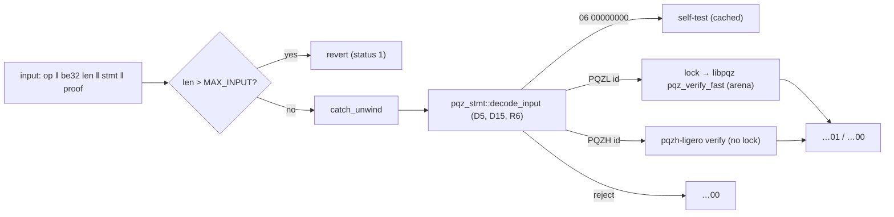

# pqz-ffi

The one boundary in front of both PQZ verifiers (P6e plan Task 7, decisions D10 / R5; [pq-zero-knowledge.md](../../docs/contracts/pq-zero-knowledge.md)
§9.1, CTR-PQZ-10): the precompile decoder, dispatch on `proofSystemId`, the C ABI for the node (P6f), the Rust API, and
a `prove` feature for clients (P6h). Rust 1.97.1, safe code apart from the calls into the C core. The input, output,
decoder rules and both proof formats are specified byte by byte in
[pq-zero-knowledge.md §8.1 "Serialization v1"](../../docs/contracts/pq-zero-knowledge.md#serialization).



## API

| Entry | What |
|---|---|
| `pqz_precompile(input, len, out, out_len) -> int` (`pqz_ffi.h`) | C ABI for P/Invoke. Status 0 = `out[0..32]` holds `…01` / `…00` / the self-test hash; 1 = revert (input over `MAX_INPUT` = 393,216 B); 2 = bad arguments (nothing written); 3 = a panic in the decode / verify logic was caught (input-caused, the same on every node: `out` = `…00`, log it); 4 = node fault (below: no result, `out` untouched). Thread-safe; natively it never unwinds or aborts (wasm32 is `panic = abort`, client side only; a native build with `panic = abort` is a compile error) |
| `precompile(&[u8]) -> Result<[u8; 32], Error>` | the same in Rust: `Error::Revert`, `Error::NodeFault`; a caught input-caused panic gives `…00` |
| `decode(&[u8])` | `pqz_stmt::decode_input` (the crate re-exports `pqz_stmt` as `stmt`) |
| `verify_input(&[u8]) -> Result<bool, NodeFault>` | decode + the id's verifier (op 1..5, 7) |
| `pqzl::verify_fast` / `pqzl::verify_generic` / `pqzh::verify` | the verifiers on decoded parts; the generic PQZL verifier is the differential reference, never on the precompile path (R5) |
| `selftest::selftest()`, `selftest::report()` | `OP_SELFTEST` (D13), below |
| feature `prove`: `prove(op, stmt, wit, rnd32)` | PQZL (`pqz_prove`) or PQZH (Ligero) by the statement's id; deterministic, hedged (CTR-PQZ-19) |
| `pqzl::keygen`, `pqzl::enc`, `pqzl::dec`, `pqzl::keypair_from_secret` | §4.2 from seeds (`pqz_keys.c`); in every build (the self-test uses them), not on the verify path |
| feature `prove`: `fixture::{wit_key, wit_debit, wit_ds, cases, digest_lines}` | the prover-API witness layouts (R3) and one honest instance of every form from seeds (tests, bench, wasm32 run, the Task 11 generator) |
| feature `prove`: `fixture::{wit_multi, multi_case, multi_cases, recipients_hash}`, `pqzl::{enc_group_seed, enc_multi}`, `memo::{seal, open}` | multi-recipient transfer (`R_TXM`) (P6-ANON S3): the per-group Enc (D13: group seeds, legs then `pk_f` then the auditor copies), the `R_TXM` witness layout, `recipientsHash`, the §5.4 sender memo; one honest case per built `(M, auditorOn)` of each id |

**Lock and arenas (STATUS.md Open 6, Open 2).** Every libpqz call runs under one process-wide `Mutex` (the core keeps
its arena, base mark, sticky error and SV tables in globals); PQZH needs none. The core lives on one arena allocated
once: `ARENA_SMALL` (verify-only, 512 MiB since the multi-recipient transfer, owner 2026-10-16: 2.00 × the measured adversarial peak 268 MB
of the specialised verifier over all six forms and every multi-recipient shape with their keys and tables kept, plus the
self-test; run `s3a`) for the precompile path; the first prove or generic verify moves it once to `ARENA_BIG` (1 GiB
native; the all-loaded prove peak is 854 MB, `R_TXM8_0`). wasm32 has one 512 MiB arena for both and `prove` refuses
PQZL multi-recipient transfers above M = 4 there (`ProveError::Statement(Reject::Legs)`); M = 8 is for native clients. A poisoned lock is recovered and the core
re-initialised. The arena's pages are reserved, not touched, until the core uses them.

**Faults (controller 2026-10-14).** Input-caused: a panic in the decode / verify logic (any node hits it on the
same input) ⇒ `…00`, status 3. Node-local, not a property of the input ⇒ `NodeFault`, status 4, no result: the arena
reservation or `pqz_init` fails, the worker cannot be created or a job on it panicked, the core runs out of arena
(`pqz_err == PQZ_ERR_ARENA` after a call; the core is then dropped and re-initialised at the next call), the
self-test's computation fails (its inputs are fixed), a panic outside the classified region. The host (P6f) aborts
block processing on status 4 and never records the input as invalid. Ligero catches its own verifier panics and
returns false (input-caused, `…00`, counted in `pqzh_ligero::ligero::VERIFY_PANICS`). A failed Rust heap allocation
aborts the process (Rust's allocator; the arenas are reserved fallibly). Test hooks (feature `test-hooks`, never in a
production build: `pqzl::TEST_ARENA_BYTES`, `TEST_FAIL_WORKER`, `TEST_ARENA_FILL`, `reinit`, `arena_bytes`) inject
both kinds (`tests/fault.rs`, its own process).

**Integration.** The C ABI needs no lock and at most 1 MiB of the caller's stack. A wasm32 wallet that embeds the
`prove` feature must link with an 8 MiB stack (`-zstack-size=8388608`, as `wasm/.cargo/config.toml`): wasm32 has no
worker thread, the core runs on the module's stack.

**Self-test (D13).** `keccak256(kat_digest ‖ u8(pqzl_valid) ‖ u8(pqzl_invalid) ‖ u8(pqzh_valid) ‖ u8(pqzh_invalid))`
with `kat_digest = keccak256(A digest ‖ keccak256(pk) ‖ keccak256(u ‖ v) ‖ M ‖ keccak256(fft) ‖ u8(fft_ok))`: A read
from the core column by column (equal to `pqz_kat.py`'s A digest `f176b313…`), KeyGen(`0x51…`), Enc / Dec of 123,456,
one forward / inverse Ligero FFT over 1,634 points; the four results are the precompile path on one compiled-in
`R_REG` proof per id (the REGISTER rows of `smartcontracts/vectors/pqz/proof_{pqzl,pqzh}.json`, read by `build.rs`:
plan D9, no copy; proved with `rnd32 = 0x53…`; statement `opTag ‖ id ‖ keccak256("SCAAS-PQZ-SELFTEST-V1") ‖ pk`) and
the same proof under the statement with the last message byte flipped. Computed once per process. After a prover
change: regenerate the vectors (`vectors/run.sh <label> write`), which rebuilds the crate; `selftest_vectors` checks a
fresh prove equals the compiled-in proofs.

**Vectors (P6e Task 11).** `src/bin/pqz-vectors.rs` (feature `prove`) writes `smartcontracts/vectors/pqz/` (D9, R4):
every value from this crate (`pqzl` keygen / enc / dec / `encrypt`, `prove`), every expected output from
`pqz_precompile` and `selftest::selftest()`; `--check` regenerates and compares byte for byte. `vectors/run.sh` runs it
with `pqz_kat.py --check`, `vectors/tamper.py` and the wasm32 replay `vectors/replay_wasm.mjs` (through `wasm/`).

**C core build.** `build.rs` compiles `../src/{pqz_lazer,pqz_ntt,pqz_arena,pqz_rel,pqz_keys,pqz_sv}.c` with
`pqzl/build.sh`'s flags (clang, `-std=gnu11 -O2 -fno-builtin -fno-math-errno -ffp-contract=off -DPQZ_SV`, native
`-fstack-protector-strong`, no `-march`), assembles `lazer.h` as `pqzl/build.sh` does, and runs `../pqzl/check_symbols.sh` on the
archive (the build fails on `malloc`, stdio, libm, GMP, MPFR). wasm32: freestanding, `csrc/wasm_ti3.c` adds the
branch-free 128-bit helpers of `pqz_wasm_rt.c` (the prover shifts by secret amounts; they override
`compiler_builtins`' weak ones), Rust provides `mem*`.

## Run

```sh
scripts/capped pqz-core/ffi/run.sh <label>      # everything below, outputs in runs/<label>-*
cargo test --release --offline --features prove,test-hooks -- --nocapture
cargo run --release --offline --features prove,test-hooks --example ffi_bench 200       # JSON lines: verify p50 / p99
(cd wasm && cargo build --release --offline --target wasm32-unknown-unknown)
node wasm/run_wasm.mjs wasm/target/wasm32-unknown-unknown/release/pqz_ffi_wasm.wasm 3   # = the native digest lines
```

Tests (`tests/ffi.rs`): honest round trip of every form of both ids (PQZL 8 forms = six relations + REFRESH +
AUDITOR; PQZH the same 8) and of every built multi-recipient shape (PQZL M ∈ {1, 2, 4, 8}, PQZH {1, 2, 4}, auditor on / off);
`multi_limits_and_memo` (worst-case multi-recipient inputs vs `MAX_INPUT`, the PQZH (4, on) boundary, oversize M refused, the memo); every decoder rejection (each D15 / R6 rule with its `Reject`, op /
opTag / id confusion, lengths ± 1, `MAX_PROOF + 1`, truncated / extended / bit-flipped proofs, the other system's
id, framing, `MAX_INPUT + 1` = revert); the PQZL differential test (SV vs generic through the FFI on honest and
mutated proofs); the C ABI's arguments; the self-test
(A digest = `pqz_kat.py`); the compiled-in self-test proofs equal a fresh prove; the precompile path on a 1 MiB
caller stack; `pqz_ffi.h`'s constants; node faults (`tests/fault.rs`: an 18 MiB fixed arena and a failing worker give status 4 with `out` untouched; at the same fixed size a fresh core verifies `R_REG` after the fault; everything verifies again afterwards); the digest lines (native half of the wasm32 byte-equality check).
`tests/verify_only.rs`, the production configuration (a fresh process that never proves, on the 512 MiB arena; the
inputs come from a child process): the whole corpus (every rejection, framing, the honest inputs, the self-test, the
10,240-input abort-freedom generator: random / random-proof / edited inputs) through the C ABI, the generator again
from 8 threads and on a 1 MiB caller stack, 5,000 repeated mixed calls: identical results, no status 3 or 4, only the
unedited honest inputs valid, `arena_used()` constant after every call and `arena_peak()` constant; and arenas filled
with 0x00 / 0xA5 / 0x5A before `pqz_init` (child processes) give identical digest lines and corpus results.

## PQZH adapter

Everything that names the Ligero API is `src/pqzh.rs` (`PARAMS = Params::proven()`, `verify`, `prove`, `fft_kat`).
Since `p6e-b3` (merged, run `ffi1e`) Ligero decodes through `pqz-stmt` and has all six relations, so PQZH covers every
form; its proof bytes for the self-test vector were unchanged by the switch (`selftest_vectors`).

Results: [STATUS.md](../STATUS.md) §"`pqz-ffi`", runs in `runs/`.
