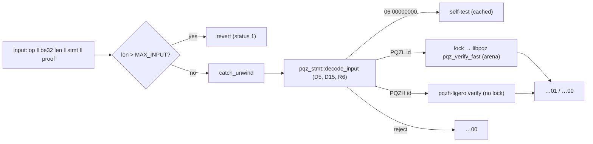

# pqz-ffi

The one boundary in front of both PQZ verifiers (P6e plan Task 7, decisions D10 / R5; [pq-zether.md](../../docs/contracts/pq-zether.md)
§9.1, CTR-PQZ-10): the precompile decoder, dispatch on `proofSystemId`, the C ABI for the node (P6f), the Rust API, and
a `prove` feature for clients (P6h). Rust 1.97.1, safe code apart from the calls into the C core.



## API

| Entry | What |
|---|---|
| `pqz_precompile(input, len, out, out_len) -> int` (`pqz_ffi.h`) | C ABI for P/Invoke. Status 0 = `out[0..32]` holds `…01` / `…00` / the self-test hash; 1 = revert (input over `MAX_INPUT` = 393,216 B); 2 = bad arguments (nothing written); 3 = a panic was caught (`out` = `…00`, log it). Thread-safe, never unwinds or aborts |
| `precompile(&[u8]) -> Result<[u8; 32], Revert>` | the same in Rust (a caught panic gives `…00`) |
| `decode(&[u8])` | `pqz_stmt::decode_input` (the crate re-exports `pqz_stmt` as `stmt`) |
| `verify_input(&[u8]) -> bool` | decode + the id's verifier (op 1..5) |
| `pqzl::verify_fast` / `pqzl::verify_generic` / `pqzh::verify` | the verifiers on decoded parts; the generic PQZL verifier is the differential reference, never on the precompile path (R5) |
| `selftest::selftest()`, `selftest::report()` | `OP_SELFTEST` (D13), below |
| feature `prove`: `prove(op, stmt, wit, rnd32)` | PQZL (`pqz_prove`) or PQZH (Ligero) by the statement's id; deterministic, hedged (CTR-PQZ-19) |
| `pqzl::keygen`, `pqzl::enc`, `pqzl::dec`, `pqzl::keypair_from_secret` | §4.2 from seeds (`pqz_keys.c`); in every build (the self-test uses them), not on the verify path |
| feature `prove`: `fixture::{wit_key, wit_debit, wit_ds, cases, digest_lines}` | the prover-API witness layouts (R3) and one honest instance of every form from seeds (tests, bench, wasm32 run, the Task 11 generator) |

**Lock and arenas (STATUS.md Open 6, Open 2).** Every libpqz call runs under one process-wide `Mutex` (the core keeps
its arena, base mark, sticky error and SV tables in globals); PQZH needs none. The core lives on one arena allocated
once: `ARENA_SMALL` (verify-only: 1.5 × the measured peak of the specialised verifier over all six forms with every
form's keys and tables kept, plus the self-test) for the precompile path; the first prove or generic verify moves it
once to `ARENA_BIG` (448 MiB; `R_TX` prove alone peaks at 304 MB). A poisoned lock is recovered and the core
re-initialised. The arena's pages are reserved, not touched, until the core uses them.

**Self-test (D13).** `keccak256(kat_digest ‖ u8(pqzl_valid) ‖ u8(pqzl_invalid) ‖ u8(pqzh_valid) ‖ u8(pqzh_invalid))`
with `kat_digest = keccak256(A digest ‖ keccak256(pk) ‖ keccak256(u ‖ v) ‖ M ‖ keccak256(fft) ‖ u8(fft_ok))`: A read
from the core column by column (equal to `pqz_kat.py`'s A digest `f176b313…`), KeyGen(`0x51…`), Enc / Dec of 123,456,
one forward / inverse Ligero FFT over 1,634 points; the four results are the precompile path on one compiled-in
`R_REG` proof per id (`selftest/{pqzl,pqzh}_reg.hex`, proved with `rnd32 = 0x53…`; statement `opTag ‖ id ‖
keccak256("SCAAS-PQZ-SELFTEST-V1") ‖ pk`) and the same proof under the statement with the last message byte flipped.
Computed once per process. Regenerate the proofs after a prover change: `PQZ_FFI_WRITE_SELFTEST=1 cargo test --release
--offline --features prove selftest_vectors` (under `scripts/capped`), then rebuild.

**C core build.** `build.rs` compiles `../src/{pqz_lazer,pqz_ntt,pqz_arena,pqz_rel,pqz_keys,pqz_sv}.c` with
`build.sh`'s flags (clang, `-std=gnu11 -O2 -fno-builtin -fno-math-errno -ffp-contract=off -DPQZ_SV`, native
`-fstack-protector-strong`, no `-march`), assembles `lazer.h` as `build.sh` does, and runs `../check_symbols.sh` on the
archive (the build fails on `malloc`, stdio, libm, GMP, MPFR). wasm32: freestanding, `csrc/wasm_ti3.c` adds the
branch-free 128-bit helpers of `pqz_wasm_rt.c` (the prover shifts by secret amounts; they override
`compiler_builtins`' weak ones), Rust provides `mem*`.

## Run

```sh
scripts/capped pqz-core/ffi/run.sh <label>      # everything below, outputs in runs/<label>-*
cargo test --release --offline --features prove -- --nocapture
cargo run --release --offline --features prove --example ffi_bench 200       # JSON lines: verify p50 / p99
(cd wasm && cargo build --release --offline --target wasm32-unknown-unknown)
node wasm/run_wasm.mjs wasm/target/wasm32-unknown-unknown/release/pqz_ffi_wasm.wasm 3   # = the native digest lines
```

Tests (`tests/ffi.rs`): honest round trip of every form of both ids (PQZL 8 forms = six relations + REFRESH +
AUDITOR; PQZH 7, `R_TX0` pending in Ligero); every decoder rejection (each D15 / R6 rule with its `Reject`, op /
opTag / id confusion, lengths ± 1, `MAX_PROOF + 1`, truncated / extended / bit-flipped proofs, the other system's
id, framing, `MAX_INPUT + 1` = revert); the PQZL differential test (SV vs generic through the FFI on honest and
mutated proofs); abort-freedom (10,240 random / random-proof / edited inputs through the C ABI, serial and from 8
threads: identical results, status 3 never, only unedited honest inputs valid); the C ABI's arguments; the self-test
(A digest = `pqz_kat.py`); the compiled-in self-test proofs equal a fresh prove; the precompile path on a 1 MiB
caller stack; `pqz_ffi.h`'s constants; the digest lines (native half of the wasm32 byte-equality check).

## PQZH: the switch after `p6e-b3`

Everything that names the Ligero API is `src/pqzh.rs` (`PARAMS`, `verify`, `prove`, `fft_kat`). When Ligero moves onto
`pqz-stmt` (Task 6) and gains `R_TX0` (Task 8): adjust those calls if their signatures change, drop the `Transfer0`
skip in `tests/ffi.rs` (`honest`, `pqzh_tx0_pending`) and the PQZH count (7 → 8) there and in `digest_lines`
(15 → 16), and regenerate `selftest/pqzh_reg.hex` if the proof format changed.

Results: [STATUS.md](../STATUS.md) §"`pqz-ffi`", runs in `runs/`.
