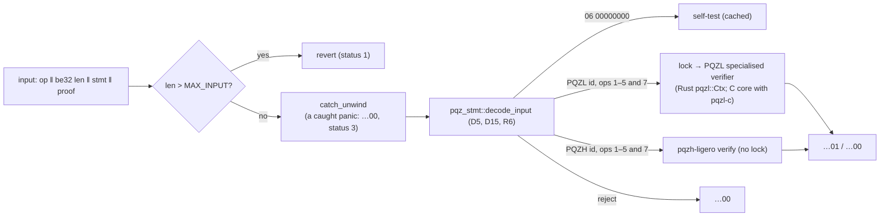

# pqz-ffi

`pqz-ffi` is the library a blockchain node loads to verify PQZ proofs: it is the `PQZ` precompile. It is the one
entry point in front of both proof systems: it decodes the input with [`pqz-stmt`](../stmt/README.md), reads the
statement's `proofSystemId` and sends the proof to the PQZL or the PQZH verifier. The node calls it through one C
function; Rust code and wallets can use its Rust API, and the feature `prove` adds key generation, encryption and
proving for clients. For the terms used here (op, form, `proofSystemId`, SV) see the glossary in the
[pqz-core README](../README.md); for how the precompile sits on chain 7622 see its
[§3](../README.md#3-two-proof-systems-one-precompile).

- **Plan and specification:** P6e plan Task 7, decisions D10 / R5; [pq-zero-knowledge.md](../../docs/contracts/pq-zero-knowledge.md)
  §9.1, CTR-PQZ-10. The node side is P6f, the client side (`prove`) P6h.
- **Byte layouts:** the input, the output, the decoder rules and both proof formats are specified byte by byte in
  [pq-zero-knowledge.md §8.1 "Serialization v1"](../../docs/contracts/pq-zero-knowledge.md#serialization).
- **Language:** Rust 1.97.1, safe code apart from the C ABI entry, the worker's job hand-off and (feature `pqzl-c`
  only) the calls into the PQZL C core.
- **PQZL backend (CTR-PQZ-09):** the Rust crate [`pqzl`](../pqzl/rust/README.md) by default (feature `pqzl-rust`,
  since 2026-10-18); the C core is opt-in (feature `pqzl-c`). Both give the same proofs and verdicts. See "PQZL
  backends" below.

How one call flows. Ops 1–5 and the multi-recipient transfer (`R_TXM`, op 7) verify a proof; op 6 is the self-test.
The status numbers are explained in the next section.



## Status codes

`pqz_precompile` returns a status and, for status 0, writes a 32-byte answer into `out`: `…01` (valid), `…00`
(invalid) or the self-test hash.

| Status | Meaning | `out` | What the node does |
|---|---|---|---|
| 0 | ok | `out[0..32]` holds `…01`, `…00` or the self-test hash | uses the answer |
| 1 | revert: the input is over `MAX_INPUT` = 393,216 B | zeroed | the call reverts |
| 2 | bad arguments (`input` NULL with `len` > 0, `out` NULL, or `out_len` < 32) | nothing written | — |
| 3 | a panic in the decode / verify logic was caught. It is caused by the input, so every node hits it on the same input | `…00` (invalid) | treats the input as invalid and logs it |
| 4 | node fault: a fault of this node, not of the input (see "Faults" below) | untouched, no result | stops block processing; never records the input as invalid |

The function is thread-safe. Natively it never unwinds or aborts. The wasm32 build is `panic = abort`, but it is for
clients only; a native build with `panic = abort` is a compile error.

## API

| Entry | What it does |
|---|---|
| `pqz_precompile(input, len, out, out_len) -> int` (`pqz_ffi.h`) | the C ABI the node calls (P/Invoke); status codes in the table above |
| `precompile(&[u8]) -> Result<[u8; 32], Error>` | the same in Rust: `Error::Revert`, `Error::NodeFault`; a caught input-caused panic gives `…00` |
| `decode(&[u8])` | `pqz_stmt::decode_input` (the crate re-exports `pqz_stmt` as `stmt`) |
| `verify_input(&[u8]) -> Result<bool, NodeFault>` | decode, then run the id's verifier (ops 1–5 and 7) |
| `pqzl::verify_fast` / `pqzl::verify_generic` / `pqzh::verify` | the verifiers, on already-decoded parts. The generic PQZL verifier is only the reference for the differential test; it is never on the precompile path (R5) |
| `selftest::selftest()`, `selftest::report()` | `OP_SELFTEST` (P6e D13); see "Self-test" below |
| feature `prove`: `prove(op, stmt, wit, rnd32)` | proves with PQZL (`pqz_prove` / `pqzl::Ctx::prove`) or PQZH (Ligero), chosen by the statement's id; deterministic and hedged (CTR-PQZ-19) |
| `pqzl::keygen`, `pqzl::enc`, `pqzl::dec`, `pqzl::keypair_from_secret` | key generation, encryption and decryption from seeds (spec §4.2, `pqz_keys.c` / `pqzl`'s `keys.rs`). In every build, because the self-test uses them; not on the verify path |
| features `pqzl-rust` + `pqzl-c` together: `pqzl::c::*` | the C core next to the Rust one (`pqzl::`), for differential tests and the fuzz mode `pqzl-diff` |
| feature `prove`: `fixture::{wit_key, wit_debit, wit_ds, cases, digest_lines}` | the witness layouts of the prover API (R3), and one honest instance of every form, built from seeds (for the tests, the bench, the wasm32 run and the vector generator of P6e Task 11) |
| feature `prove`: `fixture::{wit_multi, multi_case, multi_cases, recipients_hash}`, `pqzl::{enc_group_seed, enc_multi}`, `memo::{seal, open}` | the multi-recipient transfer (`R_TXM`, op 7; P6-ANON S3): encryption per group of legs (P6-ANON D13: group seeds; first the legs, then `pk_f`, then the auditor copies), the `R_TXM` witness layout, `recipientsHash`, the sender memo of spec §5.4; one honest case per built (M, auditorOn) of each id |

## Inside

**PQZL backends (CTR-PQZ-09, owner 2026-10-18).** `src/pqzl.rs` is one API over two byte-for-byte equal cores:

- **Rust, the default** (feature `pqzl-rust`, `src/pqzl/rust.rs`): the crate `pqzl` (`pqz-core/pqzl/rust`). No C is
  compiled: `cc` is an optional build-dependency, and `build.rs` compiles the C core only under `pqzl-c`
  (`run.sh` prints the dependency graph to show it).
- **C, opt-in** (feature `pqzl-c`, `src/pqzl/c.rs`): the C core, the reference. Select it alone with
  `--no-default-features --features pqzl-c` (or `PQZL=c` for `run.sh` and `vectors/run.sh`); `PQZL=rust` selects the
  Rust core alone explicitly.
- **Both** (`--features pqzl-c` on the default): `pqzl::` is the Rust core and `pqzl::c` the C core, in one binary
  (the fuzz mode `pqzl-diff`, `../fuzz/README.md`).

The node image (`../nethermind/Dockerfile`) builds this crate's default and copies `pqz-core/pqzl/rust` (its Docker
build is checked in the Rust port's Task 12). Chain 7622 runs the C-backed library built before the switch until the
live roll-out.

**Lock (STATUS.md Open 6).** Every PQZL call runs under one process-wide `Mutex`, on one worker thread with a 16 MiB
stack, with either backend; PQZH needs no lock. The Rust backend keeps one `pqzl::Ctx` for the process (A, each
relation's keys and the specialised verifier's tables, built at first use; about 41 KB inline, so boxed): one locked
`Ctx` rather than one per thread, because the node calls the precompile from several threads and a per-thread `Ctx`
would build and keep a full cache set per thread and make a verify's time depend on the thread it lands on. The C
core keeps its arena, base mark, sticky error and SV tables in global variables.

**Arenas (C backend only; STATUS.md Open 2).** The C core works in one fixed memory area (an *arena*), allocated
once:

- `ARENA_SMALL`, 512 MiB, verify only: the precompile path. Sized when the multi-recipient transfer was added (owner
  2026-10-16) at 2.00 × the measured adversarial peak of 268 MB: the specialised verifier over all six forms and every
  multi-recipient shape, with their keys and tables kept, plus the self-test (run `s3a`).
- `ARENA_BIG`, 1 GiB native: the first prove or generic verify moves the core to it, once. The peak with every
  relation loaded is 854 MB (`R_TXM8_0`, M = 8 without the auditor).
- wasm32 has one 512 MiB arena for both. There, `prove` refuses PQZL multi-recipient transfers above M = 4
  (`ProveError::Statement(Reject::Legs)`); M = 8 is for native clients. The Rust backend has no arena and proves
  M = 8 in wasm32 too (`WASM_PQZL_MAX_LEGS` = 8 there; its M = 8 prove peaks at 117.4 MiB of linear memory, run
  `d6`, Rust port Task 12, CTR-PQZ-09).

A poisoned lock is recovered and the core re-initialised (the Rust backend: a fresh `Ctx`). The arena's pages are
reserved, not touched, until the core uses them.

**Faults (controller 2026-10-14).** A failure is either caused by the input or local to the node:

- *Input-caused:* a panic in the decode / verify logic. Every node hits it on the same input, so the answer is `…00`
  with status 3. Ligero also catches its own verifier panics and returns false (input-caused, `…00`, counted in
  `pqzh_ligero::ligero::VERIFY_PANICS`). A panic inside the Rust PQZL core is caught on the worker, the `Ctx` is
  dropped and the panic resumes on the caller's thread: status 3, as any other.
- *Node-local* (not a property of the input): `NodeFault`, status 4, no result. This covers: the arena reservation or
  `pqz_init` fails; the worker thread cannot be created, or a job on it panicked; the core runs out of arena
  (`pqz_err == PQZ_ERR_ARENA` after a call; the core is then dropped and re-initialised at the next call); the
  self-test's computation fails (its inputs are fixed); a panic outside the classified region. The host (P6f) stops
  block processing on status 4 and never records the input as invalid.
- A failed Rust heap allocation outside the PQZL core aborts the process (Rust's allocator; the C arenas are
  reserved fallibly). Inside the Rust PQZL core, every buffer that scales with the input is reserved fallibly: a
  verifier that cannot allocate gives `Error::Memory` (`pqzl::Ctx::try_verify_fast` / `try_verify`), which is a node
  fault (status 4), as the C backend's arena exhaustion, never `…00`; `prove` returns code 2.
- The C backend's arena exhaustion is graceful (status 4) only in the specialised verifier's own allocations; an
  allocation inside LaZer (A, a relation's keys, the prover, the generic verifier) that does not fit stops the process
  with a trap, before anything is written (review round 2, Q-C; the arenas are sized from measurement with margin).

The test hooks (feature `test-hooks`, never in a production build: `pqzl::TEST_FAIL_WORKER` for both backends; the C
backend's `TEST_ARENA_BYTES`, `TEST_ARENA_FILL`, `reinit`, `arena_bytes`; the Rust backend's `TEST_PANIC`, `drop_ctx`)
inject the faults (`tests/fault.rs`, in its own process, with a denying allocator for the Rust backend).

**Integration.** The C ABI needs no lock from the caller and at most 1 MiB of the caller's stack. A wasm32 wallet that
embeds the `prove` feature must link with an 8 MiB stack (`-zstack-size=8388608`, as in `wasm/.cargo/config.toml`):
wasm32 has no worker thread, so the core runs on the module's own stack.

**Self-test (P6e D13).** Op 6 (`OP_SELFTEST`, input exactly `06 00000000`) returns

```text
keccak256(kat_digest ‖ u8(pqzl_valid) ‖ u8(pqzl_invalid) ‖ u8(pqzh_valid) ‖ u8(pqzh_invalid))
kat_digest = keccak256(A digest ‖ keccak256(pk) ‖ keccak256(u ‖ v) ‖ M ‖ keccak256(fft) ‖ u8(fft_ok))
```

- `kat_digest` covers: the matrix A read from the core column by column (equal to `pqz_kat.py`'s A digest
  `f176b313…`), KeyGen(`0x51…`), Enc / Dec of 123,456, and one forward / inverse Ligero FFT over 1,634 points.
- The four flags run the precompile path on one compiled-in `R_REG` proof per id, and on the same proof under the
  statement with the last message byte flipped. The proofs are the REGISTER rows of
  `smartcontracts/vectors/pqz/proof_{pqzl,pqzh}.json`, read by `build.rs` (plan D9: no copy), proved with
  `rnd32 = 0x53…`; the statement is `opTag ‖ id ‖ keccak256("SCAAS-PQZ-SELFTEST-V1") ‖ pk`.
- It is computed once per process. The same hash from either backend (`ed910a2c…`).
- After a prover change, regenerate the vectors (from the repository root:
  `scripts/capped pqz-core/ffi/vectors/run.sh <label> write`), which rebuilds the crate; the test `selftest_vectors`
  checks that a fresh prove equals the compiled-in proofs.

**Vectors (P6e Task 11).** `src/bin/pqz-vectors.rs` (feature `prove`) writes the test vectors in
`smartcontracts/vectors/pqz/` (D9, R4). Every value comes from this crate (`pqzl` keygen / enc / dec / `encrypt`,
`prove`), and every expected output from `pqz_precompile` and `selftest::selftest()`. `--check` regenerates them and
compares byte for byte. `vectors/run.sh` runs it together with `pqz_kat.py --check`, `vectors/tamper.py` and the
wasm32 replay `vectors/replay_wasm.mjs` (through `wasm/`).

**C core build (feature `pqzl-c`).** `build.rs` compiles
`../pqzl/src/{pqz_lazer,pqz_ntt,pqz_arena,pqz_rel,pqz_keys,pqz_sv}.c` with the flags of `pqzl/build.sh` (clang,
`-std=gnu11 -O2 -fno-builtin -fno-math-errno -ffp-contract=off -DPQZ_SV`, natively also `-fstack-protector-strong`,
no `-march`). It assembles `lazer.h` the way `pqzl/build.sh` does, and runs
`../pqzl/check_symbols.sh` on the archive: the build fails on `malloc`, stdio, libm, GMP or MPFR. For wasm32 the core
is freestanding: `csrc/wasm_ti3.c` adds the branch-free 128-bit helpers of `pqz_wasm_rt.c` (the prover shifts by
secret amounts; these override the weak ones of `compiler_builtins`), and Rust provides `mem*`.

## Run

The first command runs from the repository root; the others run from `pqz-core/ffi/`.

```sh
scripts/capped pqz-core/ffi/run.sh <label>      # everything below, outputs in pqz-core/ffi/runs/<label>-*
PQZL=c scripts/capped pqz-core/ffi/run.sh <label>   # the same on the C core alone (PQZL=rust: the Rust core alone)
cargo test --release --offline --features prove,test-hooks -- --nocapture
cargo run --release --offline --features prove,test-hooks --example ffi_bench 200       # JSON lines: verify p50 / p99
(cd wasm && cargo build --release --offline --target wasm32-unknown-unknown)
node wasm/run_wasm.mjs wasm/target/wasm32-unknown-unknown/release/pqz_ffi_wasm.wasm 3   # = the native digest lines
```

**What `tests/ffi.rs` covers:**

- an honest round trip of every form of both ids (PQZL 8 forms = the six relations + REFRESH + AUDITOR; PQZH the same
  8) and of every built multi-recipient shape (PQZL M ∈ {1, 2, 4, 8}, PQZH {1, 2, 4}, auditor on and off);
- `multi_limits_and_memo`: the worst-case multi-recipient inputs against `MAX_INPUT`, the PQZH (M = 4, auditor on)
  boundary, oversize M refused, and the memo;
- every decoder rejection: each D15 / R6 rule with its `Reject`; op / opTag / id confusion; lengths ± 1;
  `MAX_PROOF + 1`; truncated, extended and bit-flipped proofs; the other system's id; framing; `MAX_INPUT + 1` =
  revert;
- the PQZL differential test (SV against the generic verifier, through the FFI, on honest and mutated proofs);
- the C ABI's arguments; `pqz_ffi.h`'s constants;
- the self-test (A digest = `pqz_kat.py`'s), and that the compiled-in self-test proofs equal a fresh prove;
- the precompile path on a 1 MiB caller stack;
- node faults (`tests/fault.rs`): a failing worker (both backends) and an 18 MiB fixed arena (C backend) give status
  4 with `out` untouched; at the same fixed size a fresh C core verifies `R_REG` after the fault; Rust backend: a
  denied `Ctx` allocation and denied cache allocations (≥ 1 MiB, `Error::Memory`) give status 4, a panic in the core
  (hook `TEST_PANIC`) gives `…00` / status 3; everything verifies again afterwards;
- the digest lines (the native half of the native = wasm32 byte-equality check).

**What `tests/verify_only.rs` covers** — the production configuration: a fresh process that never proves (C backend:
on the 512 MiB arena), with its inputs made by a child process.

- The whole corpus through the C ABI: every rejection, framing, the honest inputs, the self-test, and the 10,240
  inputs of the abort-freedom generator (random, random-proof and edited inputs).
- The generator again from 8 threads and on a 1 MiB caller stack, then 5,000 repeated mixed calls.
- Expected: identical results, no status 3 or 4, only the unedited honest inputs valid; C backend: `arena_used()`
  constant after every call and `arena_peak()` constant; Rust backend: the process heap (a counting allocator in the
  test) within 4 KiB of its value before the 5,000 calls after every one of them, their peak at most the warm-up's.
- C backend: arenas filled with 0x00 / 0xA5 / 0x5A before `pqz_init` (in child processes) give identical digest lines
  and corpus results (the Rust core has no arena and no uninitialised memory).

## PQZH adapter

Everything that names the Ligero API is in `src/pqzh.rs` (`PARAMS = Params::proven()`, `verify`, `prove`, `fft_kat`).
Since `p6e-b3` (merged, run `ffi1e`), Ligero decodes through `pqz-stmt` and has all six relations, so PQZH covers
every form. The switch did not change its proof bytes for the self-test vector (`selftest_vectors`).

Results: [STATUS.md](../STATUS.md) §"`pqz-ffi`"; run logs in `runs/`.
