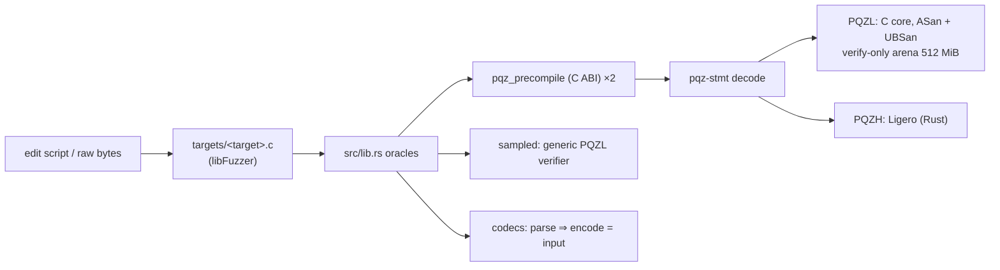

# pqz-core/fuzz

This directory fuzzes the PQZ precompile: it feeds [`pqz-ffi`](../ffi/README.md) millions of random and mutated
inputs and checks that it never crashes and never accepts an input it should reject (CTR-PQZ-10, "never crash, never
wrong-accept at the boundary"). The precompile runs in its production configuration, so the fuzzing covers the decoder
(`pqz-stmt`), the PQZL C core's specialised verifier and the PQZH Ligero verifier. The long campaigns run locally,
on the owner's machine; CI runs only a short smoke test (see "Run"). For the terms used here (op, form, SV,
`proofSystemId`) see the glossary in the [pqz-core README](../README.md).

- **Plan:** P6e plan Task 10, decision D12; the multi-recipient transfer (`R_TXM`, op 7) is covered since P6-ANON S5.
- **Words used here:** a *target* is one libFuzzer entry point; an *oracle* is the code that decides whether a result
  is wrong (`src/lib.rs`); an *edit script* is a short fuzzer input that describes edits to a known valid input; an
  *honest input* is a valid input with a valid proof from the frozen vectors.



## Targets

There are three targets. Each one has its own input format and extra checks, on top of the common checks in the next
section.

**`precompile`** — raw bytes straight into `pqz_precompile`.

- `targets/precompile.c` calls the C ABI itself.
- `-max_len=400000`, which is over `MAX_INPUT`, so the revert path is reached.
- Seeds: the vectors' honest and negative inputs (the multi-recipient ones included) and `06 00000000` (the
  self-test).
- Extra checks: none.

**`mutate`** — an edit script of at most 512 B, applied to one of the 44 honest inputs (PQZL and PQZH × 8 forms, the
fee-0 forms, every built multi-recipient (id, M, auditorOn), and `regress/valid/`).

- Byte 0 picks the honest input.
- Byte 1 picks the mode: edits anywhere, including the op and the length field / one decoded PQZL proof field changed
  and re-encoded by `pqz_test_mutate` (multi-recipient proofs too: relation code `PQZ_REL_TXM`), then edits /
  statement only / proof only.
- Then follow `[off lo, mid, hi, xor]` edits and an optional truncate or extend.
- Extra check: on every 256th mutated PQZL input that decodes, the PQZL specialised verifier (whose verdict is the
  precompile's) must agree with the generic verifier. The core is then put back on the verify-only arena.

**`codec`** — an edit script of at most 512 B, applied to an honest statement, precompile input, bundle, opening or
PQZL proof (multi-recipient statements, inputs and proofs included).

- `byte 0 % 5` picks the codec; `(byte 0 / 5) << 4 | byte 1 & 15` picks the honest input.
- Extra check (D15, canonical encoding): whatever a decoder accepts must re-encode to exactly the input:
  - `pqz_stmt::parse` ⇒ `encode`, with the form's op and length (multi-recipient: `multi_len(M, auditorOn)`);
  - `decode_input` ⇒ `input(op, stmt, proof)`, and it agrees with `parse`;
  - `parse_bundle` ⇒ `encode`; `parse_opening` ⇒ `opening`;
  - the PQZL proof decoder `pqz_decproof` ⇒ `encproof` gives the same bytes;
  - each decoder runs twice, with equal results.

## Common checks (every target, every input)

The common oracle is in `src/lib.rs`. A violation aborts, which libFuzzer reports as a crash.

- **No panic anywhere.** The panic hook aborts, so a panic that `pqz-ffi`'s `catch_unwind` (status 3) or Ligero's
  own catch would hide in production becomes a finding. Overflow checks and debug assertions are on in the fuzz build.
- **Status.** Never 3 (an input-caused panic) or 4 (a node fault: arena exhaustion, worker). Status 1 (revert) exactly
  for the inputs over `MAX_INPUT`.
- **Determinism.** Every precompile input runs twice and must give the same status and output.
- **Verdict.** `…01` exactly for the 44 unmodified honest inputs, the self-test hash (`ed910a2c…`) for `06 00000000`,
  and `…00` for everything else. A modified input that verifies is a wrong accept or a malleable encoding.
- **Arena bound.** The C core runs on the verify-only arena, as in a long-running node: `ARENA_SMALL` = 512 MiB since
  P6-ANON S3 (144 MiB in the P6e campaigns below). A warm-up pass first builds the keys and tables of every form and
  every multi-recipient shape. The arena's high-water mark must then stay ≤ `ARENA_SMALL` / 1.5, the margin the arena
  was sized with: 341 MiB = 357,913,940 B now, 96 MiB in the P6e campaigns. The run prints the maximum seen, because
  the peak depends on the input (`STATUS.md` Open 2).

## Inputs

`seeds.py` rebuilds the inputs from the frozen vectors (`smartcontracts/vectors/pqz/`, P6e D9, P6-ANON S4) at the start
of every run. It is light: it uses `pqz_kat.py`'s helpers, and the fuzz process never proves.

- **The 44 honest inputs** (`pqz-core/build/fuzz/honest.bin`):
  - P6e's 24: `proof_pqzl.json` and `proof_pqzh.json`, 8 forms each, and the 4 fee-0 forms of `fee0.json` under both
    ids;
  - 19 multi-recipient (`R_TXM`) rows: `proof_pqzl.json` 11 (M ∈ {1, 2, 4, 8} × auditor on / off, and 3 special
    cases), `proof_pqzh.json` 8 (M ∈ {1, 2, 4}); the statements come from `statement_transfer_multi.json`; oversize M
    is never built;
  - the files of `regress/valid/`.
- **The `precompile` seeds:** those inputs, plus `06 00000000` and the 731 rows of `negative.json` (342 of them
  multi-recipient).

`regress/valid/` holds valid inputs from outside the vectors, which the oracle must know as honest. Today it holds one
file, `crash-b9881dfc…`:

- what it is: the `DISCLOSE-RECEIVER` fixture input of the harness before the vectors existed (PQZL,
  `pqz_ffi::fixture`, `rnd32` = 0x33…);
- how it got here: it was the false finding of `smoke3-precompile`. The merge step wrote it into the fuzz directory
  (that step had no `-artifact_prefix`; it has one now), and it sat at the fuzz root from P6e Task 10 to P6-ANON S5;
- how it was identified: `runs/2026-10-16-s5-stray-crash.txt` (the generic verifier says valid; it was re-proved
  byte-equal).

## Build (D12)

`build.sh` uses stable Rust 1.97.1 and clang 18: no nightly, no cargo-fuzz.

- **Rust side.** The oracles (this crate, a `staticlib`), `pqz-ffi`, `pqz-stmt` and `pqzh-ligero` are instrumented by
  rustc's sanitizer-coverage pass on stable flags (`-C passes=sancov-module` with `-sanitizer-coverage-level=4`,
  inline 8-bit counters, PC table, trace-compares). `--target` keeps these flags off the build scripts.
  `panic = "unwind"` stays (pqz-ffi refuses `panic = "abort"` natively); the panic hook turns every panic into an
  abort.
- **C core.** `pqz-ffi`'s `build.rs` compiles it with its feature `fuzz`: ASan + UBSan (`-fno-sanitize-recover=all`,
  without the upstream nits of `STATUS.md` Open 4, as in `pqzl/sv/fuzz.sh`), `-fsanitize=fuzzer-no-link`, and
  `PQZ_TEST_HOOKS` (for `pqz_test_mutate`). Only in this build the symbol scan is skipped, because the sanitizer
  runtime is outside the library.
- **Link.** `targets/<target>.c` and the staticlib are linked by `clang-18 -fsanitize=fuzzer,address,undefined`.

This is the arena build, not `PQZ_DEBUG_MALLOC`. ASan sees the arena as one block, so it does not catch overflows
inside it here; the arena bound is measured instead. The ASan runs on the malloc path are `research/opt/asan.sh` and
`pqzl/sv/fuzz.sh`.

## Run

From the repository root:

```sh
scripts/capped pqz-core/fuzz/build.sh
scripts/capped pqz-core/fuzz/run.sh <precompile|mutate|codec> <seconds> [label]   # log: pqz-core/fuzz/runs/<label>-<target>.txt
```

What `run.sh` does:

1. **Corpus.** It fuzzes on a work corpus (`pqz-core/build/fuzz/work/<target>/`, kept between runs) plus the
   committed `corpus/<target>/`, the regression inputs `regress/<target>/` and the run-time seeds. When the honest
   inputs change, the work corpus is dropped: it would hold valid proofs the oracle does not know.
2. **Limits.** `-rss_limit_mb=3072 -malloc_limit_mb=1536` (since P6-ANON S5). The differential's generic verifier
   reserves `ARENA_BIG` (1 GiB since S3) in one malloc, which the old `-malloc_limit_mb=1024` reported as an
   out-of-memory error. `scripts/capped` caps the job at 4 GB.
3. **Merge.** It merges the work corpus into a minimal covering set and commits its inputs of ≤ 512 B to
   `corpus/<target>/`. That is all of `mutate` and `codec`; the large `precompile` inputs stay in the work corpus and
   are rebuilt from the honest inputs.
4. **Crashes.** A crash input lands in `pqz-core/build/fuzz/crash-<target>-*`. It moves to `regress/<target>/`
   together with its fix.

Run one campaign at a time (`scripts/capped` is a machine-wide lock). "Continuous" means the owner reruns the three
targets one after the other, for example nightly (owner step 2 of the plan).

**Smoke runs.** Two places run all three targets for 60 s each:

- `pqz-core/gate.sh` (the gate A / B checklist), which afterwards restores the committed corpora, because a smoke run
  is too short to replace the corpora of the 2-hour campaigns;
- the CI job `pqz` in `.github/workflows/ci.yml` (added with `gate.sh`, P6e Task 10), on the committed corpora
  (`fuzz/run.sh "$t" 60 ci`). Until then the decision was local runs only (controller 2026-10-14).

## Results

**No finding in any campaign so far**: no crash, sanitizer report, panic, status 3 or 4, nondeterminism, wrong
verdict, differential disagreement or non-canonical encoding. All runs are [measured] on this machine, one process per
target under `scripts/capped`, with ASan + UBSan; logs in `runs/`.

| Run | Target | Time | Execs (exec/s) | Coverage (edges / features) at end | Other |
|---|---|---|---|---|---|
| `2026-10-14-precompile` | precompile (seeds: the fixture's 16 honest inputs, before the vectors) | 60 min | 1,464,429 (406) | 2,122 / 4,133, 349 inputs (32 MB) | 564 valid = unmodified honest |
| `2026-10-15-precompile` | precompile (seeds: vectors, 414) | 45 min | 1,043,633 (386) | 2,124 / 4,219, 346 inputs (31 MB) | 307,654 decoded, 434 valid = unmodified honest |
| `2026-10-15-mutate` | mutate | 45 min | 86,923 (32) | 3,314 / 6,877, 532 inputs | 69,718 decoded; 197 SV = generic differentials |
| `2026-10-15-codec` | codec | 45 min | 367,237 (135) | 856 / 1,553, 277 inputs | 120,328 accepted and round-tripped, 56,597 of them PQZL proofs (`decproof` ⇒ `encproof` = input) |
| `2026-10-16-s5-precompile` | precompile with the multi-recipient transfer (seeds: 776, 342 multi-recipient; 44 honest, 19 multi-recipient) | 120 min | 3,012,684 (418) | 2,269 / 4,697, 401 inputs (43 MB) | 879,386 decoded, 205,263 of them multi-recipient; 3,461 valid = unmodified honest |
| `2026-10-16-s5-mutate` | mutate with the multi-recipient transfer | 120 min | 192,360 (26) | 3,513 / 8,241, 600 inputs | 149,586 decoded, 42,191 multi-recipient; 473 SV = generic differentials, 108 of them multi-recipient |
| `2026-10-16-s5-codec` | codec with the multi-recipient transfer | 120 min | 1,103,090 (153) | 917 / 1,729, 294 inputs | 382,784 decoded, 130,232 multi-recipient; 137,333 PQZL proofs re-encoded byte-equal |

**P6-ANON S5 (the multi-recipient transfer, 2 h per target, 2026-10-16/17).** No finding.

- Arena high-water mark: **268,240,256 B (255.81 MiB)** in every S5 run. This is the warm-up peak of the honest
  inputs; the bound is 341 MiB (`ARENA_SMALL` 512 MiB since S3).
- Peak RSS 901 / 1,055 / 679 MB (precompile / mutate / codec).
- Slowest `mutate` unit: 15 s, caused by the differential's generic re-initialisation (`-timeout=120`). The
  `crash-mutate-slow-unit-*` files libFuzzer writes for it are not findings.
- Committed corpora after the merge step: `precompile` 12 inputs (424 B), `mutate` 421 inputs (6,740 B), `codec` 246
  inputs (1,727 B).
- `2026-10-16-s5-precompile-interrupted`: a machine reboot stopped the first precompile campaign after ≈ 42 min
  (867,956 execs, no finding, merge step not reached); the campaign was re-run in full.

**Gate A / B smoke runs (2026-10-17).** `pqz-core/gate.sh 2026-10-17` ran the three targets for 60 s each
(`runs/gate-2026-10-17-{precompile,mutate,codec}.txt`): no finding, arena peak 268,240,256 B, as in S5.

**P6e campaigns** (before the multi-recipient transfer).

- Arena: the verify-only arena's high-water mark over every run is **95,169,680 B (90.76 MiB)**, the adversarial peak
  that `pqz-ffi`'s `tests/verify_only.rs` measured (the honest inputs alone: 94,615,600 B). Bound 96 MiB,
  `ARENA_SMALL` 144 MiB (1.59 ×).
- Committed corpora after the merge step: `precompile` 9 inputs (42 B; the large ones are rebuilt), `mutate` 392
  inputs (5,578 B), `codec` 231 inputs (2,259 B).
- Other logs:
  - `smoke*`: short runs while the harness was being built;
  - `2026-10-15-precompile-stale-seed` and the false finding of `smoke3-precompile`: a seed proved by the harness's
    earlier fixture, a valid proof the oracle did not know; `seeds.py` and `run.sh` now drop stale seeds and work
    corpora;
  - `2026-10-15-precompile-interrupted`: the process was killed together with the session after ≈ 248k execs, no
    finding.
