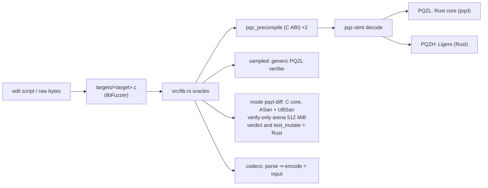

# pqz-core/fuzz

This directory fuzzes the PQZ precompile: it feeds [`pqz-ffi`](../ffi/README.md) millions of random and mutated
inputs and checks that it never crashes and never accepts an input it should reject (CTR-PQZ-10, "never crash, never
wrong-accept at the boundary"). The precompile runs in its production configuration, so the fuzzing covers the decoder
(`pqz-stmt`), the PQZL core's specialised verifier (the Rust crate `pqzl`, `pqz-ffi`'s default backend since
2026-10-18, CTR-PQZ-09; the C core until then) and the PQZH Ligero verifier. The mode `pqzl-diff` links both PQZL cores
and compares them on every input (see "Mode `pqzl-diff`"). The long campaigns run locally,
on the owner's machine; CI runs only a short smoke test (see "Run"). For the terms used here (op, form, SV,
`proofSystemId`) see the glossary in the [pqz-core README](../README.md).

- **Plan:** P6e plan Task 10, decision D12; the multi-recipient transfer (`R_TXM`, op 7) is covered since P6-ANON S5;
  the Rust core and the mode `pqzl-diff` since the PQZL Rust port, Task 11.
- **Words used here:** a *target* is one libFuzzer entry point; an *oracle* is the code that decides whether a result
  is wrong (`src/lib.rs`); an *edit script* is a short fuzzer input that describes edits to a known valid input; an
  *honest input* is a valid input with a valid proof from the set's vectors.



## Targets

There are three targets. Each one has its own input format and extra checks, on top of the common checks in the next
section.

**`precompile`** — raw bytes straight into `pqz_precompile`.

- `targets/precompile.c` calls the C ABI itself.
- `-max_len` = the set's `MAX_INPUT` + 4,096 (set.json `max_input` 524,288 at every set since the R0 review fix, so
  528,384; 397,312 at `n2048-kmax1024` before), so the revert path is reached and no honest seed is truncated.
- Seeds: the vectors' honest and negative inputs (the multi-recipient ones included) and `06 00000000` (the
  self-test).
- Extra checks: none.

**`mutate`** — an edit script of at most 512 B, applied to one of the set's honest inputs (PQZL and PQZH × 8 forms, the
fee-0 forms, every built multi-recipient (id, M, auditorOn), the op 7 disclosures, and at `n2048-kmax1024`
`regress/valid/`; see "Inputs").

- Byte 0 picks the honest input.
- Byte 1 picks the mode: edits anywhere, including the op and the length field / one decoded PQZL proof field changed
  and re-encoded by `pqz_test_mutate` (the backend's: `pqzl::test_mutate` of the Rust core; multi-recipient proofs
  too: relation code `PQZ_REL_TXM`), then edits / statement only / proof only.
- Then follow `[off lo, mid, hi, xor]` edits and an optional truncate or extend.
- Extra check: on every 256th mutated PQZL input that decodes, the PQZL specialised verifier (whose verdict is the
  precompile's) must agree with the generic verifier (both the Rust core's).

**`codec`** — an edit script of at most 512 B, applied to an honest statement, precompile input, bundle, opening or
PQZL proof (multi-recipient statements, inputs and proofs included).

- `byte 0 % 5` picks the codec; `(byte 0 / 5) << 4 | byte 1 & 15` picks the honest input.
- Extra check (D15, canonical encoding): whatever a decoder accepts must re-encode to exactly the input:
  - `pqz_stmt::parse` ⇒ `encode`, with the form's op and length (multi-recipient: `multi_len(M, auditorOn)`);
  - `decode_input` ⇒ `input(op, stmt, proof)`, and it agrees with `parse`;
  - `parse_bundle` ⇒ `encode`; `parse_opening` ⇒ `opening`;
  - the PQZL proof decoder `pqz_decproof` ⇒ `encproof` gives the same bytes;
  - each decoder runs twice, with equal results.

## Common checks (every target, every input)

The common oracle is in `src/lib.rs`. A violation aborts, which libFuzzer reports as a crash.

- **No panic anywhere.** The panic hook aborts, so a panic that `pqz-ffi`'s `catch_unwind` (status 3) or Ligero's
  own catch would hide in production becomes a finding. Overflow checks and debug assertions are on in the fuzz build.
- **Status.** Never 3 (an input-caused panic) or 4 (a node fault: worker, C arena exhaustion). Status 1 (revert)
  exactly for the inputs over `MAX_INPUT`.
- **Determinism.** Every precompile input runs twice and must give the same status and output.
- **Verdict.** `…01` exactly for the unmodified honest inputs, the set's self-test hash for `06 00000000` (e.g.
  `d6c01fbc…` at `n2304-kmax4096`; every set: `../ffi/README.md`, "Self-test"), and `…00` for everything else. A modified input that verifies is a wrong accept or a malleable encoding.
- **Arena bound (mode `pqzl-diff`; the Rust core has no arena).** The C core runs on the verify-only arena, as in a
  long-running node: `ARENA_SMALL` = 512 MiB since P6-ANON S3 (144 MiB in the P6e campaigns below). A warm-up pass
  first builds the keys and tables of every form and every multi-recipient shape. The arena's high-water mark must
  then stay ≤ `ARENA_SMALL` / 1.5, the margin the arena was sized with: 341 MiB = 357,913,940 B now, 96 MiB in the
  P6e campaigns. The run prints the maximum seen, because the peak depends on the input (`STATUS.md` Open 2).

## Mode `pqzl-diff`

`PQZ_FUZZ_MODE=pqzl-diff` for `build.sh` and `run.sh` (binaries `pqz-core/build/fuzz/<target>-pqzl-diff`, cargo
feature `pqzl-diff` of this crate = `pqz-ffi`'s `pqzl-c` next to `pqzl-rust`): both PQZL cores in one binary. The
precompile runs on the Rust core (production); the C core (`pqz_ffi::pqzl::c`, ASan + UBSan) is the oracle:

- every input that decodes as PQZL: the C core's specialised verdict = the precompile's;
- every `pqz_test_mutate` (mutate mode 1, codec 4): the C core's bytes (or "does not decode") = the Rust core's;
- the warm-up: every honest PQZL input valid in the C core too; the C arena bound as in "Common checks".

Its log lines: `pqz-fuzz init … mode pqzl-diff …` and the summary's `PQZL verdicts C = Rust`,
`pqz_test_mutate C = Rust`.

## Inputs

`seeds.py` rebuilds the inputs from the set's vectors (`smartcontracts/vectors/pqz/` for `n2048-kmax1024`,
`smartcontracts/vectors/pqz/<set>/` for the others; P6e D9, P6-ANON S4; `PQZ_SET`, default `n2304-kmax4096`) at the
start of every run. It is light: it uses `pqz_kat.py`'s helpers, and the fuzz process never proves.

- **The honest inputs** (`pqz-core/build/fuzz/honest.bin`; per set 52 / 51 / 51 / 27 at `n2048-kmax1024` /
  `n2304-kmax4096` / `n2560-kmax16384` / `n2816-kmax65536`, the gates' `pqz-fuzz init` lines in
  `pqz-core/runs/gate/<set>-fuzz.txt`):
  - P6e's 24: `proof_pqzl.json` and `proof_pqzh.json`, 8 forms each, and the 4 fee-0 forms of `fee0.json` under both
    ids (at `n2816-kmax65536`, which has no PQZH, only the PQZL rows, here and below);
  - 19 multi-recipient (`R_TXM`) rows: `proof_pqzl.json` 11 (M ∈ {1, 2, 4, 8} × auditor on / off, and 3 special
    cases), `proof_pqzh.json` 8 (M ∈ {1, 2, 4}); the statements come from `statement_transfer_multi.json`; oversize M
    is never built;
  - the op 7 disclosures of both ids (R0 review fix: `statement_transfer_multi.json` `disclosures`);
  - at `n2048-kmax1024` only, the files of `regress/valid/`.
- **The `precompile` seeds:** those inputs, plus `06 00000000` and every row of the set's `negative.json`.

`regress/valid/` holds valid inputs from outside the vectors, which the oracle must know as honest. Today it holds one
file, `fixture-disclose-receiver-rnd33`:

- what it is: the `DISCLOSE-RECEIVER` fixture input of the harness before the vectors existed (PQZL,
  `pqz_ffi::fixture`, `rnd32` = 0x33…);
- how it got here: it was the false finding of `smoke3-precompile` (then `crash-b9881dfc…`). The merge step wrote it
  into the fuzz directory (that step had no `-artifact_prefix`; it has one now), and it sat at the fuzz root from P6e
  Task 10 to P6-ANON S5;
- how it was identified: `runs/2026-10-16-s5-stray-crash.txt` (the generic verifier says valid; it was re-proved
  byte-equal);
- PQZL v3 (lazer#28 fix, 2026-10-19): `crash-b9881dfc…` carried the retired v2 id, so it was re-proved under v3 with the
  same statement (id word aside) and `rnd32`, and renamed: `runs/2026-10-19-fs5-regress-valid.txt`. Re-proved rather
  than deleted, so the honest set stayed at 44 then and the committed `mutate` / `codec` edit scripts keep their meaning.
- B-1 / A-2 (5h Task 8a, 2026-10-21): re-proved again under the new transcript, same statement and `rnd32`
  (`runs/2026-10-21-t8a-regress-valid.txt`).
- The set's own ids (5h Task 8d part 1, 2026-10-23): the statement's id word set to `n2048-kmax1024`'s PQZL id
  (`…/mlwe-d64k32-q42l4/v4`; the v3 id is retired) and re-proved with the same `rnd32`
  (`runs/2026-10-23-t8d1-regress-valid.txt`). It is an input of that set only (`seeds.py` adds it there).
- R0 review fix (2026-10-25): re-proved under that set's `…/v5` id, as `fixture::cases`' DISCLOSE-RECEIVER at the new
  keys (KeyGen V2 changed them, review R2-C3) with the same `rnd32` (`runs/2026-10-25-r01a-regress-valid.txt`).

## Build (D12)

`build.sh` uses stable Rust 1.97.1 and clang 18: no nightly, no cargo-fuzz.

- **Rust side.** The oracles (this crate, a `staticlib`), `pqz-ffi`, `pqz-stmt`, `pqzl` and `pqzh-ligero` are
  instrumented by rustc's sanitizer-coverage pass on stable flags (`-C passes=sancov-module` with
  `-sanitizer-coverage-level=4`, inline 8-bit counters, PC table, trace-compares). `--target` keeps these flags off the build scripts.
  `panic = "unwind"` stays (pqz-ffi refuses `panic = "abort"` natively); the panic hook turns every panic into an
  abort.
- **C core (mode `pqzl-diff` only).** `pqz-ffi`'s `build.rs` compiles it with its features `pqzl-c` and `fuzz`:
  ASan + UBSan (`-fno-sanitize-recover=all`, without the upstream nits of `STATUS.md` Open 4, as in `pqzl/sv/fuzz.sh`), `-fsanitize=fuzzer-no-link`, and
  `PQZ_TEST_HOOKS` (for `pqz_test_mutate`). Only in this build the symbol scan is skipped, because the sanitizer
  runtime is outside the library.
- **Link.** `targets/<target>.c` and the staticlib are linked by `clang-18 -fsanitize=fuzzer,address,undefined`.

This is the arena build, not `PQZ_DEBUG_MALLOC`. ASan sees the arena as one block, so it does not catch overflows
inside it here; the arena bound is measured instead. The ASan runs on the malloc path are `research/opt/asan.sh` and
`pqzl/sv/fuzz.sh`.

## Run

From the repository root:

```sh
scripts/capped pqz-core/fuzz/build.sh
scripts/capped pqz-core/fuzz/run.sh <precompile|mutate|codec> <seconds> [label]   # log: pqz-core/fuzz/runs/<label>-<target>.txt
PQZ_SET=n2048-kmax1024 scripts/capped pqz-core/fuzz/build.sh                    # another set (default n2304-kmax4096;
PQZ_SET=n2048-kmax1024 scripts/capped pqz-core/fuzz/run.sh mutate 7200 <label>   #  the same PQZ_SET for both)
```

What `run.sh` does:

1. **Corpus.** It fuzzes on a work corpus (`pqz-core/build/fuzz/work/<target>/`, kept between runs) plus the
   committed `corpus/<target>/`, the regression inputs `regress/<target>/` and the run-time seeds. When the honest
   inputs change, the work corpus is dropped: it would hold valid proofs the oracle does not know.
2. **Limits.** `-rss_limit_mb=3072 -malloc_limit_mb=1536` (since P6-ANON S5, when the differential's generic verifier
   ran on the C core and reserved `ARENA_BIG`, 1 GiB, in one malloc, which the old `-malloc_limit_mb=1024` reported
   as an out-of-memory error). `scripts/capped` caps the job at 4 GB.
3. **Merge.** It merges the work corpus into a minimal covering set and commits its inputs of ≤ 512 B to
   `corpus/<target>/`. That is all of `mutate` and `codec`; the large `precompile` inputs stay in the work corpus and
   are rebuilt from the honest inputs.
4. **Crashes.** A crash input lands in `pqz-core/build/fuzz/crash-<target>-*`. It moves to `regress/<target>/`
   together with its fix.

Run one campaign at a time (`scripts/capped` is a machine-wide lock). "Continuous" means the owner reruns the three
targets one after the other, for example nightly (owner step 2 of the plan).

**Smoke runs.** Two places run all three targets for 60 s each:

- `pqz-core/gate.sh` (the gate A / B checklist, per set): its smoke run merges into `pqz-core/build/fuzz-<set>/corpus/`
  and only reads the committed corpora, because a smoke run is too short to replace the corpora of the 2-hour
  campaigns;
- the CI job `pqz` in `.github/workflows/ci.yml` (added with `gate.sh`, P6e Task 10), on the committed corpora
  (`fuzz/run.sh "$t" 60 ci`). Until then the decision was local runs only (controller 2026-10-14).

## Results

**No finding in any campaign so far**: no crash, sanitizer report, panic, status 3 or 4, nondeterminism, wrong
verdict, differential disagreement or non-canonical encoding. All runs are [measured] on this machine, one process per
target under `scripts/capped`, with ASan + UBSan; logs in `runs/`.

| Run | Target | Time | Execs (exec/s) | Coverage (edges / features) at end | Other |
|---|---|---|---|---|---|
| `2026-10-14-precompile` | precompile (seeds: the fixture's 16 honest inputs, before the vectors) | 60 min | 1,464,429 (406) | 2,122 / 4,133, 349 inputs (32 MB) | 564 valid = unmodified honest |
| `2026-10-15-precompile` | precompile (seeds: vectors, 414) | 45 min | 1,043,633 (386) | 2,124 / 4,219, 346 inputs (31 MB) | 307,654 decoded, 434 valid = unmodified honest |
| `2026-10-15-mutate` | mutate | 45 min | 86,923 (32) | 3,314 / 6,877, 532 inputs | 69,718 decoded; 197 SV = generic differentials |
| `2026-10-15-codec` | codec | 45 min | 367,237 (135) | 856 / 1,553, 277 inputs | 120,328 accepted and round-tripped, 56,597 of them PQZL proofs (`decproof` ⇒ `encproof` = input) |
| `2026-10-16-s5-precompile` | precompile with the multi-recipient transfer (seeds: 776, 342 multi-recipient; 44 honest, 19 multi-recipient) | 120 min | 3,012,684 (418) | 2,269 / 4,697, 401 inputs (43 MB) | 879,386 decoded, 205,263 of them multi-recipient; 3,461 valid = unmodified honest |
| `2026-10-16-s5-mutate` | mutate with the multi-recipient transfer | 120 min | 192,360 (26) | 3,513 / 8,241, 600 inputs | 149,586 decoded, 42,191 multi-recipient; 473 SV = generic differentials, 108 of them multi-recipient |
| `2026-10-16-s5-codec` | codec with the multi-recipient transfer | 120 min | 1,103,090 (153) | 917 / 1,729, 294 inputs | 382,784 decoded, 130,232 multi-recipient; 137,333 PQZL proofs re-encoded byte-equal |
| `rust1-pqzl-diff-precompile` | precompile, mode `pqzl-diff` (Rust core = C core) | 120 min | 1,252,401 (173) | 3,315 / 6,861, 571 inputs (58 MB) | peak RSS 978 MB |
| `rust1-pqzl-diff-mutate` | mutate, mode `pqzl-diff` | 120 min | 134,348 (18) | 4,341 / 9,269, 566 inputs | peak RSS 1,148 MB |
| `rust1-pqzl-diff-codec` | codec, mode `pqzl-diff` | 120 min | 517,545 (71) | 1,142 / 2,165, 304 inputs | peak RSS 890 MB |
| `fs7-precompile` | precompile, mode `pqzl-diff`, PQZL v3 | 120 min | 766,921 (106) | 3,259 / 6,694, 554 inputs (59 MB) | peak RSS 915 MB |
| `fs7-mutate` | mutate, mode `pqzl-diff`, PQZL v3 | 120 min | 86,955 (12) | 4,320 / 9,122, 570 inputs | peak RSS 1,056 MB |
| `fs7-codec` | codec, mode `pqzl-diff`, PQZL v3 | 120 min | 287,503 (39) | 1,152 / 2,194, 323 inputs | peak RSS 811 MB |

**PQZL Rust port Task 11 (`rust1-pqzl-diff-*`, 2026-10-18) and PQZL v3 (`fs7-*`, 2026-10-19, plan `pqzl-fs3` Task 7,
the three targets at once, so exec/s is not comparable).** Mode `pqzl-diff`, 2 h per target, no finding (every
`[fuzz rc=0]`, `[merge rc=0]`); 44 honest inputs (the parameters that are now `n2048-kmax1024`); C arena high-water
mark 268,240,256 B (`rust1`) and 268,297,200 B (`fs7`), bound 341 MiB. No 2-hour campaign has run since the parameter
sets and the R0 review fix; the gates run the 60 s smoke runs per set (`pqz-core/runs/gate/<set>-fuzz.txt`).

**P6-ANON S5 (the multi-recipient transfer, 2 h per target, 2026-10-16/17).** No finding.

- Arena high-water mark: **268,240,256 B (255.81 MiB)** in every S5 run. This is the warm-up peak of the honest
  inputs; the bound is 341 MiB (`ARENA_SMALL` 512 MiB since S3).
- Peak RSS 901 / 1,055 / 679 MB (precompile / mutate / codec).
- Slowest `mutate` unit: 15 s, caused by the differential's generic re-initialisation (`-timeout=120`). The
  `crash-mutate-slow-unit-*` files libFuzzer writes for it are not findings.
- Committed corpora after the merge step: `precompile` 12 inputs (424 B), `mutate` 421 inputs (6,740 B), `codec` 246
  inputs (1,727 B).
- `2026-10-16-s5-precompile-interrupted`: a machine reboot stopped the first precompile campaign after ≈ 42 min
  (867,956 execs, no finding, merge step not reached); the campaign was re-run in full.

**Gate A / B smoke runs (2026-10-17).** `pqz-core/gate.sh 2026-10-17` ran the three targets for 60 s each
(`runs/gate-2026-10-17-{precompile,mutate,codec}.txt`): no finding, arena peak 268,240,256 B, as in S5.

**P6e campaigns** (before the multi-recipient transfer).

- Arena: the verify-only arena's high-water mark over every run is **95,169,680 B (90.76 MiB)**, the adversarial peak
  that `pqz-ffi`'s `tests/verify_only.rs` measured (the honest inputs alone: 94,615,600 B). Bound 96 MiB,
  `ARENA_SMALL` 144 MiB (1.59 ×).
- Committed corpora after the merge step: `precompile` 9 inputs (42 B; the large ones are rebuilt), `mutate` 392
  inputs (5,578 B), `codec` 231 inputs (2,259 B).
- Other logs:
  - `smoke*`: short runs while the harness was being built;
  - `2026-10-15-precompile-stale-seed` and the false finding of `smoke3-precompile`: a seed proved by the harness's
    earlier fixture, a valid proof the oracle did not know; `seeds.py` and `run.sh` now drop stale seeds and work
    corpora;
  - `2026-10-15-precompile-interrupted`: the process was killed together with the session after ≈ 248k execs, no
    finding.
