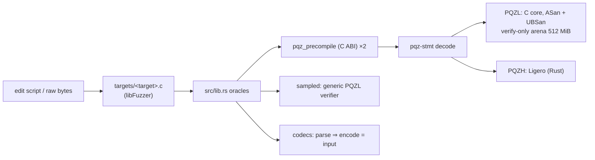

# pqz-core/fuzz

Continuous fuzzing of the PQZ precompile (P6e plan Task 10, decision D12; CTR-PQZ-10 "never crash, never wrong-accept
at the boundary"; op 7 `R_TXM` since P6-ANON S5). Three libFuzzer targets drive `pqz-ffi` — the decoder (`pqz-stmt`), the PQZL C core's specialised
verifier and the PQZH Ligero verifier — in the precompile's production configuration. Local runs only: no CI job
(controller 2026-10-14; the plan's CI `pqz` job is not built).



## Targets

| Target | Input | Checks (besides the common ones below) |
|---|---|---|
| `precompile` | raw bytes into `pqz_precompile` (`targets/precompile.c` calls the C ABI itself), `-max_len=400000` (over `MAX_INPUT`, so the revert path is reached); seeds: the vectors' honest and negative inputs (op 7's included) and `06 00000000` | — |
| `mutate` | edit script ≤ 512 B over one of the 44 honest inputs (PQZL and PQZH × 8 forms, the fee-0 forms, every built op 7 `(id, M, auditorOn)`, `regress/valid/`): byte 0 the input, byte 1 the mode (edits anywhere incl. op and length field / one decoded PQZL proof field changed and re-encoded by `pqz_test_mutate` (op 7 too: relation code `PQZ_REL_TXM`), then edits / statement only / proof only), then `[off lo, mid, hi, xor]` edits and an optional truncate / extend | the PQZL specialised verifier (the precompile's verdict) = the generic verifier on every 256th mutated PQZL input that decodes (then the core is put back on the verify-only arena) |
| `codec` | edit script ≤ 512 B over an honest statement / precompile input / bundle / opening / PQZL proof (any honest input: byte 0 % 5 the codec, `(byte 0 / 5) << 4 \| byte 1 & 15` the input; op 7 statements, inputs and proofs included) | D15: accepted ⇒ re-encoding equals the input — `pqz_stmt::parse` ⇒ `encode`, the form's op and length (op 7: `multi_len(M, auditorOn)`); `decode_input` ⇒ `input(op, stmt, proof)` and `parse` agree; `parse_bundle` ⇒ `encode`; `parse_opening` ⇒ `opening`; the PQZL proof decoder `pqz_decproof` ⇒ `encproof` gives the same bytes; each decoder twice, equal results |

Common oracle (every target, every input; `src/lib.rs`), a violation aborts (libFuzzer crash):

- **No panic anywhere**: the panic hook aborts, so the panics `pqz-ffi`'s `catch_unwind` (status 3) and Ligero's own
  catch would hide are findings; overflow checks and debug assertions are on in the fuzz build.
- **Status**: never 3 (input-caused panic) or 4 (node fault: arena exhaustion, worker); 1 (revert) exactly for inputs
  over `MAX_INPUT`.
- **Determinism**: every precompile input runs twice, same status and output.
- **Verdict**: `…01` exactly for the 44 unmodified honest inputs, the self-test hash (`ed910a2c…`) for `06 00000000`,
  `…00` for everything else: a modified input that verifies is a wrong accept or a malleable encoding.
- **Arena bound**: the C core runs on the verify-only arena (`ARENA_SMALL` = 512 MiB since P6-ANON S3; 144 MiB for
  the P6e campaigns below) with every form's and every op 7 shape's keys and tables built by a warm-up pass, as in a
  long-running node; its high-water mark must stay ≤ `ARENA_SMALL` / 1.5 (341 MiB = 357,913,940 B now, 96 MiB in the
  P6e campaigns, the margin the arena was sized with; the maximum seen is printed, see `STATUS.md` Open 2: the peak is
  input-dependent).

Inputs come from the frozen vectors (`smartcontracts/vectors/pqz/`, P6e D9, P6-ANON S4), rebuilt by `seeds.py` (light,
through `pqz_kat.py`'s helpers) at the start of every run: the 44 honest inputs (`pqz-core/build/fuzz/honest.bin`) —
P6e's 24 (`proof_pqzl.json` and `proof_pqzh.json`, 8 forms each, and the 4 fee-0 forms of `fee0.json` under both
ids), the 19 op 7 `R_TXM` rows (`proof_pqzl.json` 11: M ∈ {1, 2, 4, 8} × auditor on / off and 3 special cases;
`proof_pqzh.json` 8: M ∈ {1, 2, 4}; statements from `statement_transfer_multi.json`; oversize M is never built) and
the files of `regress/valid/` — and as `precompile` seeds those plus `06 00000000` and the 731 rows of
`negative.json` (342 of them op 7). The fuzz process never proves.

`regress/valid/` holds valid inputs from outside the vectors, which the oracle must know as honest:
`crash-b9881dfc…` is the pre-vector harness's own `DISCLOSE-RECEIVER` fixture input (PQZL, `pqz_ffi::fixture`,
`rnd32` = 0x33…), the false finding of `smoke3-precompile` that the merge step wrote into this directory (it had no
`-artifact_prefix`, now it has) and that sat at the fuzz root from P6e Task 10 to P6-ANON S5 (identified in
`runs/2026-10-16-s5-stray-crash.txt`: generic verifier valid, re-proved byte-equal).

## Build (D12)

`build.sh` — stable Rust 1.97.1 and clang 18, no nightly, no cargo-fuzz:

- the oracles (this crate, a `staticlib`), `pqz-ffi`, `pqz-stmt` and `pqzh-ligero` are instrumented by rustc's
  sanitizer-coverage pass on stable flags (`-C passes=sancov-module` with `-sanitizer-coverage-level=4`, inline 8-bit
  counters, PC table, trace-compares); `--target` keeps the flags off build scripts; `panic = "unwind"` stays (pqz-ffi
  refuses `panic = "abort"` natively) and the panic hook turns every panic into an abort;
- the C core is compiled by `pqz-ffi`'s `build.rs` with its feature `fuzz`: ASan + UBSan (`-fno-sanitize-recover=all`,
  without the upstream nits of `STATUS.md` Open 4, as `sv/fuzz.sh`), `-fsanitize=fuzzer-no-link`, and `PQZ_TEST_HOOKS`
  (`pqz_test_mutate`); the symbol scan is skipped in that build only (the sanitizer runtime is outside the library);
- `targets/<target>.c` + the staticlib are linked by `clang-18 -fsanitize=fuzzer,address,undefined`.

The arena build (not `PQZ_DEBUG_MALLOC`): ASan sees the arena as one block, so overflows inside it are not caught
here (the malloc-path ASan runs are `opt/asan.sh`, `sv/fuzz.sh`); the arena bound is measured instead.

## Run

```sh
scripts/capped pqz-core/fuzz/build.sh
scripts/capped pqz-core/fuzz/run.sh <precompile|mutate|codec> <seconds> [label]   # log: runs/<label>-<target>.txt
```

`run.sh` fuzzes on a work corpus (`pqz-core/build/fuzz/work/<target>/`, kept between runs) plus the committed
`corpus/<target>/`, the regression inputs `regress/<target>/` and the run-time seeds (the work corpus is dropped when
the honest inputs change: it would hold valid proofs the oracle does not know), with `-rss_limit_mb=3072 -malloc_limit_mb=1536`
(since P6-ANON S5; the differential's generic verifier reserves `ARENA_BIG`, 1 GiB since S3, one malloc that the old
`-malloc_limit_mb=1024` reports as an OOM; `scripts/capped` caps at 4 GB), then merges the work corpus into a minimal covering set and commits its inputs of
≤ 512 B to `corpus/<target>/` (all of `mutate` and `codec`; the large `precompile` inputs stay in the work corpus and
are rebuilt from the honest inputs). A crash input lands in `pqz-core/build/fuzz/crash-<target>-*`; it goes to
`regress/<target>/` with its fix. One campaign at a time (the machine-wide lock of `scripts/capped`).

Continuous = the owner reruns the three targets, e.g. nightly, one after the other (owner step 2 of the plan).

## Results

First campaigns [measured] (this machine, one process per target under `scripts/capped`, ASan + UBSan; logs in
`runs/`): **no finding** — no crash, sanitizer report, panic, status 3 / 4, nondeterminism, wrong verdict,
differential disagreement or non-canonical encoding.

| Run | Target | Time | Execs (exec/s) | Coverage (edges / features) at end | Other |
|---|---|---|---|---|---|
| `2026-10-14-precompile` | precompile (seeds: the fixture's 16 honest inputs, before the vectors) | 60 min | 1,464,429 (406) | 2,122 / 4,133, 349 inputs (32 MB) | 564 valid = unmodified honest |
| `2026-10-15-precompile` | precompile (seeds: vectors, 414) | 45 min | 1,043,633 (386) | 2,124 / 4,219, 346 inputs (31 MB) | 307,654 decoded, 434 valid = unmodified honest |
| `2026-10-15-mutate` | mutate | 45 min | 86,923 (32) | 3,314 / 6,877, 532 inputs | 69,718 decoded; 197 SV = generic differentials |
| `2026-10-15-codec` | codec | 45 min | 367,237 (135) | 856 / 1,553, 277 inputs | 120,328 accepted and round-tripped, 56,597 of them PQZL proofs (`decproof` ⇒ `encproof` = input) |

**Arena:** the verify-only arena's high-water mark over every run is **95,169,680 B (90.76 MiB)**, the adversarial
peak `pqz-ffi`'s `tests/verify_only.rs` measured (the honest inputs alone: 94,615,600 B); bound 96 MiB, `ARENA_SMALL`
144 MiB (1.59 ×).

Committed corpora after the merge step: `precompile` 9 inputs (42 B; the large ones are rebuilt), `mutate` 392
inputs (5,578 B), `codec` 231 inputs (2,259 B). Other logs: `smoke*` (short runs while building the harness),
`2026-10-15-precompile-stale-seed` and the false finding of `smoke3-precompile` (a seed proved by the harness's
earlier fixture: a valid proof the oracle did not know; `seeds.py` and `run.sh` now drop stale seeds and work
corpora), `2026-10-15-precompile-interrupted` (the process was killed with the session after ≈ 248k execs, no
finding).
