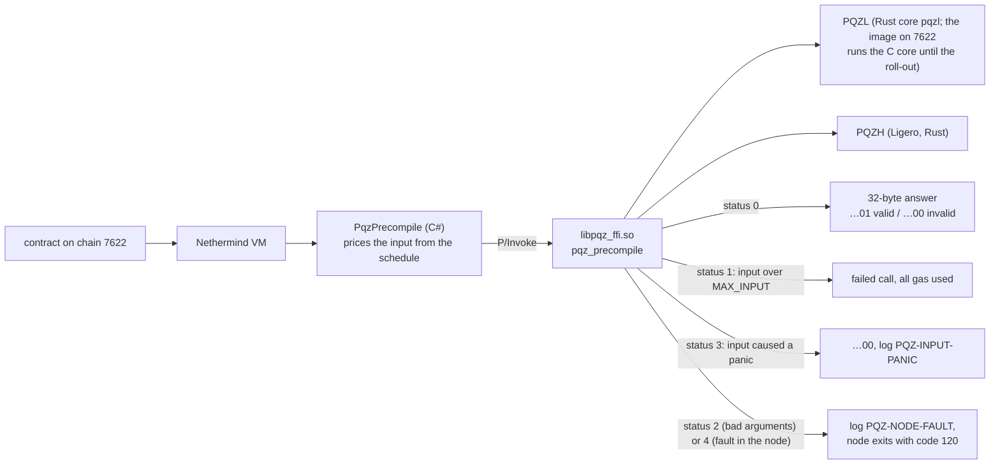
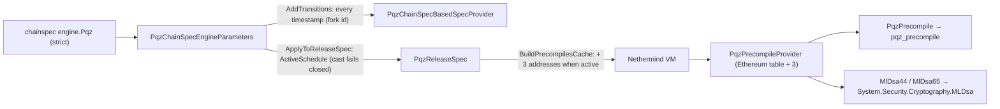

# `Nethermind.Pqz` — the PQZ and ML-DSA precompiles for chain 7622 (P6f)

This folder holds the code that lets a blockchain node check PQZ proofs. It is a **plugin** for the Nethermind 1.39.0
Ethereum client (no change to Nethermind itself) that adds three **precompiles**: built-in contracts at fixed
addresses that run native code instead of EVM bytecode. One of them, `PQZ`, hands each proof to the PQZ library
`libpqz_ffi.so`; the other two check ML-DSA signatures. It runs today on chain 7622 (the SCaaS testnet). What PQZ is and
how the library works: the parent [pqz-core README](../README.md), §3
["Two proof systems, one precompile"](../README.md#3-two-proof-systems-one-precompile).

- **Image:** the plugin ships in the local Docker image `scaas/nethermind-pqz:1.39.0-pqz2` (built locally, never
  pushed). The image was `pqz1` until 2026-10-17, when `pqz2` added the multi-recipient transfer (P6-ANON S8). Today
  the library inside the image is built from the C PQZL core.
- **Plan:** [P6f](../../docs/superpowers/plans/2026-10-14-p6f-precompiles.md). **Spec:**
  [pq-zero-knowledge.md](../../docs/contracts/pq-zero-knowledge.md) CTR-PQZ-10 / CTR-PQZ-11, §9.1–§9.3, §10.
- **Operating the chain** (roll-out, rollback, health checks): [chain/RUNBOOK.md](chain/RUNBOOK.md).

**Words used here**

| Term | Meaning |
|---|---|
| chainspec | the chain's JSON configuration (`genesis.json` on the chain host); the plugin reads its `engine.Pqz` section |
| `engine.Pqz` | the chainspec section that turns the precompiles on; the plugin is enabled only when it is present |
| schedule | one entry of `engine.Pqz.schedules`: a start timestamp plus the gas prices that apply from then on |
| row | one gas price in a schedule, for one `(op, proofSystemId, statement length)`; rows for the multi-recipient transfer also carry `(M, auditorOn)` |
| miss | an input that matches no row: it pays the smallest row and gets `…00` (invalid) without calling the library |
| multi-recipient transfer | `R_TXM`, op 7: one proof for a transfer to M recipients ([parent README](../README.md)) |
| P/Invoke | the .NET way of calling a C function in a shared library; here `pqz_precompile` in `libpqz_ffi.so` |
| copy | a throwaway replica of chain 7622 used to rehearse every step before it runs on the real chain |

## The three precompiles

The addresses are the 32-bit form (spec 2026-10-20 §12 item 9, plan 5h Task 8d part 1); chain 7622's live image `pqz2`
still serves P6f D3's `0x5caa500000000000000000000000000000000f01` / `…0012` / `…0013` until the next roll-out.
`PQZ`'s input limit (`PqzNative.MaxInput`, an input above it is a failed call) is the loaded library's
`pqz_max_input()`, the `MAX_INPUT` of the parameter set it was built for (524,288 B at the default `n2304-kmax4096`;
was the literal 393,216 of `n2048-kmax1024`).

| Address | Name | What it checks | Gas |
|---|---|---|---|
| `0x000000000000000000000000000000005caa0f01` | `PQZ` | a proof of either proof system (PQZL or PQZH), through `pqz-ffi`'s C function `pqz_precompile` (P/Invoke into `libpqz_ffi.so`) | the active schedule's row `(op, id, stmtLen)` — the multi-recipient transfer (op 7) also `(M, auditorOn)` from header words 320 / 448 — + 3·⌈len/32⌉; a miss = the smallest row (and `…00`, no FFI call); op 6 = `selftestGas` |
| `0x000000000000000000000000000000005caa0012` | `MLDSA44` | an ML-DSA-44 signature; EIP-8355 input layout `pk ‖ sig ‖ msg`, empty context; .NET 10 `MLDsa` (OpenSSL 3.5 of the base image); never reverts: a short input or a `CryptographicException` from .NET is `…00` (review W-R) | `mldsa44Gas` (≥ 6,500; calibrated 49,000) + 6·⌈max(0, L − 3,732)/32⌉ |
| `0x000000000000000000000000000000005caa0013` | `MLDSA65` | the same for ML-DSA-65 | `mldsa65Gas` (≥ 9,000; calibrated 68,000) + 6·⌈max(0, L − 5,261)/32⌉ |

How to read the gas column: `id` is the statement's `proofSystemId`, `stmtLen` its length in bytes and `len` the
length of the whole input, so `PQZ` adds 3 gas per 32-byte input word to the row price. For ML-DSA, `L` is the input
length; 3,732 (ML-DSA-44) and 5,261 (ML-DSA-65) are the public key plus the signature, so the extra charge is 6 gas per
32-byte word of message. The calibrated values are in the results table below.

### How a call reaches the library

A contract calls the `PQZ` address; the plugin prices the input, passes it to `libpqz_ffi.so` and turns the library's
status code into the call's result.



A node fault never becomes a verdict: the node stops before it seals the block, and a restart re-processes that block
(see the health checks in the [runbook](chain/RUNBOOK.md)).

### How the plugin turns on

The plugin reads `engine.Pqz` from the chainspec. Each schedule's timestamp becomes a fork transition, and from that
timestamp on the three addresses are added to the node's precompile table. A release that Nethermind builds for a
block-number transition (for example `maxCodeSizeTransition`) carries the schedule in force at the genesis timestamp,
and from the first timestamp transition on Nethermind looks releases up by timestamp alone, so a block-number
transition never drops the precompiles (review W-D, 2026-10-19: refuted, the test
`A_block_number_transition_keeps_the_schedule` is the proof). At start-up the plugin checks that its registrations
took effect, that .NET supports ML-DSA, that the library's SHA-256 equals the reviewed value compiled into the plugin
(`SelfTest.ExpectedLibrarySha256`, review W-G) and that the library's self-test (op 6) returns the expected hash; it
then logs `PQZ-START` (library SHA-256, self-test, schedules, addresses). Any failure logs `PQZ-REFUSE` and the node
exits with code 120 instead of running without the precompiles.



## Layout

The labels in brackets (R1, D1–D6, Task 1–6) point to the decisions and tasks of the
[P6f plan](../../docs/superpowers/plans/2026-10-14-p6f-precompiles.md).

| Path | What |
|---|---|
| `ref.sh` | extracts `/nethermind` of the pinned base image into `ref/` (git-ignored); every project compiles against it (R1) |
| `Nethermind.Pqz/` | the plugin: `PqzPlugin` (enabled only when `engine.Pqz` is present; start-up checks R3, log tag `PQZ-START`), `PqzChainSpecEngineParameters` (D2), `PqzReleaseSpec`, `PqzChainSpecBasedSpecProvider`, `PqzPrecompileProvider` (D1), `PqzPrecompile` + `Native` (D4, D6), `MlDsaPrecompile` (D5), `SelfTest`, `Addresses` (D3) |
| `Nethermind.Pqz.Test/` | NUnit tests: spec / chainspec (Task 1), every PQZ vector through the C# class and the status-4 child process (Task 2), ML-DSA (Task 3) |
| `Harness/` | the harness that stresses the P/Invoke boundary (Task 4) and the child process used for the fault test |
| `fault-hooks/` | test-only shared library: `pqz-ffi` with `test-hooks` + `pqz_test_fail_worker` (never in the image) |
| `fresh-proofs/` | N fresh honest proofs per form (used for calibration only) |
| `Calibrate/` | the gas calibration (Task 6), run inside the image's `calib` target |
| `corpus.py` | builds the flat input corpus from the parameter set's vectors (`PQZ_SET`, default `n2304-kmax4096` = `pqz-ffi`'s default build: `smartcontracts/vectors/pqz/n2304-kmax4096/`) into `bin/corpus.jsonl` for every consumer |
| `Dockerfile`, `Dockerfile.dockerignore`, `build-image.sh`, `NOTICE-pqz.txt` | the image (Task 5) |
| `chain/` | the copy and the live runbook: `copy.sh`, `docker-compose.copy.yml`, `config.{signer,follower}.json`, `nginx-rpc.conf`, `patch-chainspec.py`, `probe.sh`, `e2e.py`, `watch.sh`, `engine-pqz.json` |
| `runs/` | every run's output (text) |

## Build and test

Run every command from the repository root. Heavy jobs go through `scripts/capped`, the repository's machine lock
(two jobs at a time). After a `dotnet` job, `dotnet build-server shutdown` releases the compiler server that would
otherwise keep holding the lock.

```sh
# 1. Extract the pinned Nethermind reference and build the input corpus
scripts/capped sh -c 'pqz-core/nethermind/ref.sh && python3 -I pqz-core/nethermind/corpus.py pqz-core/nethermind/bin/corpus.jsonl'
# 2. Build the pqz-ffi shared library the tests load (default features: the set n2304-kmax4096, the corpus' set)
scripts/capped sh -c 'cd pqz-core/ffi && cargo build --release --offline'                     # cdylib for the tests
# 3. Build the test-only fault-hook library
scripts/capped sh -c 'cd pqz-core/nethermind/fault-hooks && cargo build --release --offline && mkdir -p ../bin/test-hooks && cp target/release/libpqz_ffi_fault_hooks.so ../bin/test-hooks/libpqz_ffi.so'
# 4. Run the NUnit tests
scripts/capped sh -c 'cd pqz-core/nethermind && dotnet test Nethermind.Pqz.Test -c Release -m:2'; dotnet build-server shutdown
# 5. Run the P/Invoke harness for 60 minutes on the host ...
scripts/capped sh -c 'cd pqz-core/nethermind && dotnet Harness/bin/Release/net10.0/Harness.dll run ../ffi/target/release bin/corpus.jsonl ../.. --minutes 60'
#    ... or the same inside the base image's .NET runtime
scripts/capped pqz-core/nethermind/harness.sh 60 1h                                         # the same, in the base image's runtime
# 6. Build the image (with CALIB=1 also the calib target)
CALIB=1 scripts/capped pqz-core/nethermind/build-image.sh pqz1                               # runs/<date>-image-pqz1.txt (+ calib target)
# 7. Calibrate the gas prices, once, on the chain host
scripts/capped pqz-core/nethermind/calibrate.sh pqz1                                       # ONE run: runs/<date>-calib.txt, chain/engine-pqz.json
```

**The reviewed library (review W-G, 2026-10-19).** `build-image.sh` reads `ExpectedLibrarySha256` from
`Nethermind.Pqz/SelfTest.cs`, builds `libpqz_ffi.so` (the `ffi-export` target) and stops with `FAIL the built library is
not the reviewed one` unless the two hashes are equal; the Dockerfile checks the library in the image against the same
value and the plugin refuses to start with any other library. A change to the library is therefore: build, review the
new hash (the failure line prints it), set it in `SelfTest.cs`, commit, build again (the `ffi` stage comes from the
cache). The value today is the library of `pqz3`; plan Task 13 sets the one of `pqz4`. `clang` in the Dockerfile is
pinned to exact Debian 12 package versions.

The commands show the first image label, `pqz1`. The current image was built with the label `pqz2`
(`runs/2026-10-17-image-pqz2.txt`). The multi-recipient calibration was `calibrate.sh pqz2 --ops 7`: it writes only
the op 7 rows (`runs/2026-10-17-calib-ops7*`) and leaves `chain/engine-pqz.json` unchanged, because those rows join
the live rows in a second schedule.

## Runbook

[chain/RUNBOOK.md](chain/RUNBOOK.md) has every step, in order, for:

- **the copy** (Tasks 7–8): the rehearsal on a replica of chain 7622. Executed; the gate passed on 2026-10-16, with
  the checklist in `runs/2026-10-15-rehearsal.txt`;
- **the live roll-out on chain 7622** (Task 10): back up, then reset the chain with `engine.Pqz` active from block 0
  (owner decision 2026-10-15). Executed on 2026-10-16, log `runs/2026-10-16-live.txt`;
- **adding the multi-recipient transfer (op 7)** to the running chain with a second schedule. Executed on 2026-10-17,
  log `runs/2026-10-17-s8-live.txt`.

## Results (2026-10-15 to 2026-10-17)

| Task | Result | Log |
|---|---|---|
| 1–3 tests | 36 / 36 in the pinned SDK image | `runs/2026-10-15-test.txt` |
| 4 harness | 1 h clean: 6,955,371 inputs, 8 threads + GC pressure, status 3 = 0, `…01` = honest inputs | `runs/2026-10-15-harness-1h.txt` |
| 5 image | `pqz1` = `sha256:c53359a69bfa…`, library `12495e8b…7d87`, no hooks / GMP / MPFR / HEXL, never pushed | `runs/2026-10-15-image-pqz1.txt` |
| 6 calibration | `t_ecMul` 17 µs; rows 2.567–5.409 M gas; `selftestGas` 2,567,000; ML-DSA 49,000 / 68,000 | `runs/2026-10-15-calib.txt` |
| 7 copy | the stock image ignores `engine.Pqz`; path A before / after T, probe 111, e2e 53; path B probe 112, e2e 53 | `runs/2026-10-1[56]-copy-*.txt` |
| 8 rehearsal | burst 429s, 80 M ramp + full block (79.24 M gas), kill drill, rollback | `runs/2026-10-15-rehearsal.txt` |
| 10 live roll-out | chain 7622 backed up and reset with `engine.Pqz` from block 0 (image `pqz1`); genesis hash unchanged; probe and e2e passed | `runs/2026-10-16-live.txt` |
| S8 multi-recipient transfer (op 7, P6-ANON) | plugin rows per `(id, M, auditorOn)` (plan D19), 41 / 41 tests; harness 60 min CLEAN (4,577,772 inputs); image `pqz2` (library `4fc1a6a2…`); multi-recipient calibration 14 rows 3,625,000–6,177,000 gas; copy path A (pqz1 → pqz2, data kept) before / after T, e2e 86 ok; **live on 7622** 2026-10-17: second schedule at T = 1792205116, probe 389 ok before and after T, e2e 76 ok | `runs/2026-10-17-*` |

In this table, "path A" and "path B" are the two ways to switch the precompiles on (a future timestamp, or from
genesis; see the [runbook](chain/RUNBOOK.md)); "probe" and "e2e" count the checks that passed in `chain/probe.sh` (read-only
calls: chain id, genesis hash, self-test, every test vector and its gas) and `e2e.py e2e` (real transactions).
