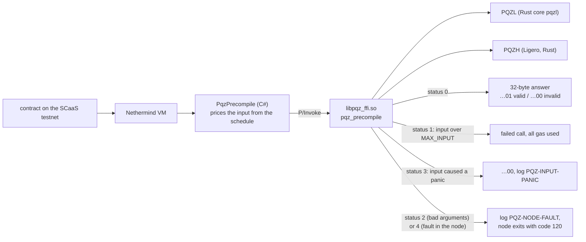
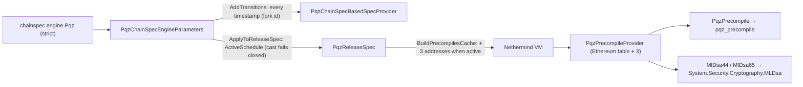

# `Nethermind.Pqz` — the PQZ and ML-DSA precompiles for the SCaaS testnet (P6f)

This folder holds the code that lets a blockchain node check PQZ proofs. It is a **plugin** for the Nethermind 2.2.0
Ethereum client (no change to Nethermind itself) that adds three **precompiles**: built-in contracts at fixed
addresses that run native code instead of EVM bytecode. One of them, `PQZ`, hands each proof to the PQZ library
`libpqz_ffi.so`; the other two check ML-DSA signatures. It runs today on the SCaaS testnet (chain id 7622), which runs
Amsterdam (Glamsterdam) since its reset on 2026-10-21. The SCaaS testnet is a test chain whose data may be reset; the
code is unaudited. What PQZ is and how the library works: the parent [pqz-core README](../README.md), §3
["Two proof systems, one precompile"](../README.md#3-two-proof-systems-one-precompile).

- **Image:** the plugin ships in the local Docker image `scaas/nethermind-pqz:2.2.0-pqz5` (built locally, never
  pushed; live on the SCaaS testnet since 2026-10-26): Nethermind 2.2.0 + the reviewed library `dd0e7668…e5601` (set
  `n2304-kmax4096`, the proofSystemIds of the R0 review fix part b, PQZL v5 `0xef1ffbcb…` / PQZH v3 `0x046859a8…`,
  `pqz_max_input()` 524,288; built from `349b96b8`), with provisional `engine.Pqz` rows
  (`chain/engine-pqz-provisional-n2304.json`) until the calibration of plan 5h Task 9. History: `1.39.0-pqz1` (2026-10-16), `1.39.0-pqz2` (2026-10-17, the
  multi-recipient transfer, P6-ANON S8; C PQZL core), `1.39.0-pqz3` (2026-10-19, never ran on the testnet),
  `2.2.0-pqz3` (2026-10-21; library `16dd99ce…` from `1adbd563`), `2.2.0-pqz4` (2026-10-25; library `0894d191…` from
  `54c7c88e`, the plan 5h Task 8d ids PQZL v4 / PQZH v2), `2.2.0-pqz5` (2026-10-26). The `2.2.0-pqz5` image carries
  pqz4's `scaas.pqz.selftest` label `23d7a1db…` (a Dockerfile literal then; the plugin's own start-up check uses the
  right hash `d6c01fbc…`); since plan 5h Task 8d part 2b `build-image.sh` passes the set's `SelfTest.ExpectedHash`
  as the label and checks it after the build (no image built with it yet).
- **Nethermind 2.2.0 (2026-10-21):** the first release with Glamsterdam on Hoodi; 64 KiB contracts (EIP-7954) and
  200 M-gas blocks. What the port changed and what Amsterdam's gas rules mean for our pins (`ROLL_MAX`, op 7 M = 8,
  the precompile gas): [§ Nethermind 2.2.0 and Amsterdam](#nethermind-220-and-amsterdam-2026-10-21) and
  [`runs/2026-10-21-glamsterdam-gas-impact.md`](runs/2026-10-21-glamsterdam-gas-impact.md).
- **Plan:** [P6f](../../docs/superpowers/plans/2026-10-14-p6f-precompiles.md). **Spec:**
  [pq-zero-knowledge.md](../../docs/contracts/pq-zero-knowledge.md) CTR-PQZ-10 / CTR-PQZ-11, §9.1–§9.3, §10.
- **Operating the chain** (roll-out, rollback, health checks): [chain/RUNBOOK.md](chain/RUNBOOK.md).

**Words used here**

| Term | Meaning |
|---|---|
| chainspec | the chain's JSON configuration (`genesis.json` on the chain host); the plugin reads its `engine.Pqz` section |
| `engine.Pqz` | the chainspec section that turns the precompiles on; the plugin is enabled only when it is present |
| schedule | one entry of `engine.Pqz.schedules`: a start timestamp plus the gas prices that apply from then on |
| row | one gas price in a schedule, for one `(op, proofSystemId, statement length)`; rows for the multi-recipient transfer also carry `(M, auditorOn)` |
| miss | an input that matches no row: it pays the smallest row and gets `…00` (invalid) without calling the library |
| multi-recipient transfer | `R_TXM`, op 7: one proof for a transfer to M recipients ([parent README](../README.md)) |
| P/Invoke | the .NET way of calling a C function in a shared library; here `pqz_precompile` in `libpqz_ffi.so` |
| copy | a throwaway replica of the SCaaS testnet used to rehearse every step before it runs on the real chain |

## The three precompiles

The addresses are the 32-bit form (spec 2026-10-20 §12 item 9, plan 5h Task 8d part 1); live on the SCaaS testnet since image
`2.2.0-pqz4` (2026-10-25); the earlier images served P6f D3's `0x5caa500000000000000000000000000000000f01` / `…0012` / `…0013`.
`PQZ`'s input limit (`PqzNative.MaxInput`, an input above it is a failed call) is the loaded library's
`pqz_max_input()`, the `MAX_INPUT` of the parameter set it was built for (524,288 B at the default `n2304-kmax4096`;
was the literal 393,216 of `n2048-kmax1024`).

| Address | Name | What it checks | Gas |
|---|---|---|---|
| `0x000000000000000000000000000000005caa0f01` | `PQZ` | a proof of either proof system (PQZL or PQZH), through `pqz-ffi`'s C function `pqz_precompile` (P/Invoke into `libpqz_ffi.so`) | the active schedule's row `(op, id, stmtLen)` — the multi-recipient transfer (op 7) also `(M, auditorOn)` from header words 320 / 448 — + 3·⌈len/32⌉; a miss = the smallest row (and `…00`, no FFI call); op 6 = `selftestGas` |
| `0x000000000000000000000000000000005caa0012` | `MLDSA44` | an ML-DSA-44 signature; EIP-8355 input layout `pk ‖ sig ‖ msg`, empty context; .NET 10 `MLDsa` (OpenSSL 3.5 of the base image); never reverts: a short input or a `CryptographicException` from .NET is `…00` (review W-R) | `mldsa44Gas` (≥ 6,500; calibrated 49,000) + 6·⌈max(0, L − 3,732)/32⌉ |
| `0x000000000000000000000000000000005caa0013` | `MLDSA65` | the same for ML-DSA-65 | `mldsa65Gas` (≥ 9,000; calibrated 68,000) + 6·⌈max(0, L − 5,261)/32⌉ |

How to read the gas column: `id` is the statement's `proofSystemId`, `stmtLen` its length in bytes and `len` the
length of the whole input, so `PQZ` adds 3 gas per 32-byte input word to the row price. For ML-DSA, `L` is the input
length; 3,732 (ML-DSA-44) and 5,261 (ML-DSA-65) are the public key plus the signature, so the extra charge is 6 gas per
32-byte word of message. The calibrated values are in the results table below.

### How a call reaches the library

A contract calls the `PQZ` address; the plugin prices the input, passes it to `libpqz_ffi.so` and turns the library's
status code into the call's result.



A node fault never becomes a verdict: the node stops before it seals the block, and a restart re-processes that block
(see the health checks in the [runbook](chain/RUNBOOK.md)).

### How the plugin turns on

The plugin reads `engine.Pqz` from the chainspec. Each schedule's timestamp becomes a fork transition, and from that
timestamp on the three addresses are added to the node's precompile table. A release that Nethermind builds for a
block-number transition (for example `maxCodeSizeTransition`) carries the schedule in force at the genesis timestamp,
and from the first timestamp transition on Nethermind looks releases up by timestamp alone, so a block-number
transition never drops the precompiles (review W-D, 2026-10-19: refuted, the test
`A_block_number_transition_keeps_the_schedule` is the proof). At start-up the plugin checks that its registrations
took effect, that .NET supports ML-DSA and gives the compiled-in known answers (`MlDsaKat`: 8 cases per level through
the precompile path, the verdicts' SHA-256 against a constant; review R4-C4), that the library's SHA-256 equals the
reviewed value of its set compiled into the plugin (`SelfTest.ExpectedLibrarySha256`, review W-G; one per set since the
R0 review fix part b), that the library's self-test (op 6) returns the expected hash and that the schedule in force at
the next block (block-tree head timestamp + 1, the genesis on an empty database) and every later one carry only the
set's proofSystemIds (`PqzSetIds`, generated by `gen_set.py`; review R4-C3, owner 2026-10-26: so after an id switch at
T a new-library node starts once its head reaches T − 1 — in practice after T, see §9.1 — and a fresh node needs a
data copy past T,
`pq-zero-knowledge.md` §9.1); it then logs
`PQZ-START` (library SHA-256, self-test, `max_input`, the OpenSSL version, the ML-DSA KAT hash, the set, addresses,
schedules; since plan 5h Task 8d part 2b, not yet in the live `2.2.0-pqz5` image, also the head the id check read:
`id_check_head=<timestamp> (block <n>)`, or `(genesis, empty database)`, `runs/2026-10-26-t8d2b-startup-n2304-kmax4096.txt`;
with a non-zero genesis timestamp 16 both paths log `id_check_head=16`, `runs/2026-10-26-t8d2b-fix-startup-ts16-n2304-kmax4096.txt`.
The runs show the field on an empty database and on one whose head is block 0 only: a head past genesis needs produced
blocks, which these throwaway runs do not have; that branch is covered by the `IdCheckHead` unit test). Any failure logs `PQZ-REFUSE` and the node
exits with code 120 instead of running without the precompiles. On Nethermind 2.x these checks are the init step
`PqzStartupCheck` (after `InitializeBlockTree`, before `LoadGenesisBlock`): 2.x no longer calls a plugin's `Init`.



## Layout

The labels in brackets (R1, D1–D6, Task 1–6) point to the decisions and tasks of the
[P6f plan](../../docs/superpowers/plans/2026-10-14-p6f-precompiles.md).

| Path | What |
|---|---|
| `ref.sh` | extracts `/nethermind` of the pinned base image into `ref/` (git-ignored); every project compiles against it (R1) |
| `Nethermind.Pqz/` | the plugin: `PqzPlugin` (enabled only when `engine.Pqz` is present) and its init step `PqzStartupCheck` (start-up checks R3, log tag `PQZ-START`), `PqzChainSpecEngineParameters` (D2), `PqzReleaseSpec`, `PqzChainSpecBasedSpecProvider`, `PqzPrecompileProvider` (D1), `PqzPrecompile` + `Native` (D4, D6), `MlDsaPrecompile` (D5), `MlDsaKat` (R4-C4), `SelfTest` (per-set hashes), `PqzSetIds` (generated by `gen_set.py`, R4-C3), `Addresses` (D3) |
| `Nethermind.Pqz.Test/` | NUnit tests: spec / chainspec (Task 1), every PQZ vector through the C# class and the child processes for status 4 (node fault, Task 2) and status 3 (input panic, review R4-C6), ML-DSA (Task 3) |
| `Harness/` | the harness that stresses the P/Invoke boundary (Task 4) and the child processes of the fault and panic tests |
| `fault-hooks/` | test-only shared library: `pqz-ffi` with `test-hooks` + `pqz_test_fail_worker` and `pqz_test_panic` (never in the image) |
| `fresh-proofs/` | N fresh honest proofs per form (used for calibration only) |
| `Calibrate/` | the gas calibration (Task 6), run inside the image's `calib` target |
| `corpus.py` | builds the flat input corpus from the parameter set's vectors (`PQZ_SET`, default `n2304-kmax4096` = `pqz-ffi`'s default build: `smartcontracts/vectors/pqz/n2304-kmax4096/`) into `bin/corpus.jsonl` for every consumer (`e2e.py`, `probe.sh`, `provisional-rows.py`, the C# tests, the harness, the calibration). `bin/` is git-ignored, so the file is generated: **regenerate it after every parameter-set or library change** (`PQZ_SET=n2304-kmax4096 python3 -I pqz-core/nethermind/corpus.py pqz-core/nethermind/bin/corpus.jsonl` from the repo root; `n2304-kmax4096` today: 877 inputs, 51 valid = 43 honest + 8 fee0, self-test `d6c01fbc…`, PQZL `ef1ffbcb…`, PQZH `046859a8…`). A stale corpus carries retired proof-system ids and the old self-test hash: `e2e.py probe` / `burst` then fail against the live node (regenerated 2026-10-31; the 2026-10-15 file of 414 rows is kept as `bin/corpus.jsonl.bak-20261015` in the main checkout) |
| `Directory.Build.props`, `run-tests.sh`, `harness.sh`, `calibrate.sh` | the `PqzSet` MSBuild property (default `n2304-kmax4096`), the test, harness and calibration runs |
| `Dockerfile`, `Dockerfile.dockerignore`, `build-image.sh`, `NOTICE-pqz.txt` | the image (Task 5) |
| `chain/` | the copy and the live runbook: `copy.sh`, `docker-compose.copy.yml`, `config.{signer,follower}.json`, `nginx-rpc.conf`, `patch-chainspec.py`, `add-schedule.py`, `probe.sh`, `e2e.py`, `eth.py`, `watch.sh`; `engine-pqz-provisional-<n>.json` (provisional rows per set, made by `provisional-rows.py`) and `engine-pqz.json` (the retired calibration of 2026-10-15 / 17, PQZL v3 / PQZH v1 ids, refused at start-up by today's plugin) |
| `runs/` | every run's output (text) |

## Build and test

Run every command from the repository root. Heavy jobs go through `scripts/capped`, the repository's machine lock
(two jobs at a time). After a `dotnet` job, `dotnet build-server shutdown` releases the compiler server that would
otherwise keep holding the lock.

```sh
# 1. Extract the pinned Nethermind reference and build the input corpus
scripts/capped sh -c 'pqz-core/nethermind/ref.sh && python3 -I pqz-core/nethermind/corpus.py pqz-core/nethermind/bin/corpus.jsonl'
# 2. Build the pqz-ffi shared library the tests load (default features: the set n2304-kmax4096, the corpus' set)
scripts/capped sh -c 'cd pqz-core/ffi && cargo build --release --offline'                     # cdylib for the tests
# 3. Build the test-only fault-hook library
scripts/capped sh -c 'cd pqz-core/nethermind/fault-hooks && cargo build --release --offline && mkdir -p ../bin/test-hooks && cp target/release/libpqz_ffi_fault_hooks.so ../bin/test-hooks/libpqz_ffi.so'
# 4. Run the NUnit tests
scripts/capped sh -c 'cd pqz-core/nethermind && dotnet test Nethermind.Pqz.Test -c Release -m:2'; dotnet build-server shutdown
# 5. Run the P/Invoke harness for 60 minutes on the host ...
scripts/capped sh -c 'cd pqz-core/nethermind && dotnet Harness/bin/Release/net10.0/Harness.dll run ../ffi/target/release bin/corpus.jsonl ../.. --minutes 60'
#    ... or the same inside the base image's .NET runtime
scripts/capped pqz-core/nethermind/harness.sh 60 1h                                         # the same, in the base image's runtime
# 6. Build the image (with CALIB=1 also the calib target)
CALIB=1 scripts/capped pqz-core/nethermind/build-image.sh pqz1                               # runs/<date>-image-pqz1.txt (+ calib target)
#    ... the image live on the SCaaS testnet since 2026-10-26: the reviewed library from its own commit, the plugin from the work tree
FFI_REV=349b96b8 scripts/capped pqz-core/nethermind/build-image.sh pqz5   # 2.2.0-pqz5 (runs/2026-10-26-image-pqz5.txt)
# 7. Calibrate the gas prices, once, on the chain host (last run 2026-10-15 / 17 at the retired ids; plan 5h Task 9 next)
scripts/capped pqz-core/nethermind/calibrate.sh pqz1                                       # ONE run: runs/<date>-calib.txt, chain/engine-pqz.json
```

**Another parameter set (plan 5h Task 8d part 1b).** The plugin is built for the set of the library it loads: the
MSBuild property `PqzSet` (`Directory.Build.props`, default `n2304-kmax4096`) selects `SelfTest.ExpectedHash` (the
set's `selftest.json` hash) and an unknown set does not compile. The tests of another set, e.g. `n2816-kmax65536`
(PQZL only): build its library (`cd pqz-core/ffi && CARGO_TARGET_DIR=target/neth-<set> cargo build --release --offline
--no-default-features --features pqzl-rust,set-<set>`), its fault-hook library (`cd fault-hooks && cargo build --release
--offline --no-default-features --features pqz-ffi/set-<set>`, copied to a directory of its own as `libpqz_ffi.so`) and
its corpus (`PQZ_SET=<set> corpus.py bin/corpus-<set>.jsonl`), then `PQZ_SET=<set> PQZ_FFI_DIR=<abs dir> PQZ_CORPUS=<abs
file> PQZ_HOOKS_DIR=<abs dir> scripts/capped pqz-core/nethermind/run-tests.sh` (log `runs/<date>-test-<set>.txt`; the
script passes `-p:PqzSet=$PQZ_SET`). `SelfTest.ExpectedLibrarySha256` holds each set's reviewed library (the
Dockerfile's `ffi` stage with `--build-arg PQZ_SET=<set>`, logs `runs/2026-10-26-r01b-ffi-<set>.txt`; R0 review fix part
b), and `PQZ_SET=<set> build-image.sh <label>` builds that set's library, plugin and image (the `calib` target and
`fresh-proofs`, which iterates both ids, stay the default set's). Provisional testnet rows per set:
`chain/engine-pqz-provisional-<n>.json` (`n2048` / `n2304` / `n2560` / `n2816`, the R0 fix ids; the SCaaS testnet's live
`2.2.0-pqz5` runs `engine-pqz-provisional-n2304.json` since 2026-10-26).

**The reviewed library (review W-G, 2026-10-19).** `build-image.sh` reads `ExpectedLibrarySha256` from
`Nethermind.Pqz/SelfTest.cs`, builds `libpqz_ffi.so` (the `ffi-export` target) and stops with `FAIL the built library is
not the reviewed one` unless the two hashes are equal; the Dockerfile checks the library in the image against the same
value and the plugin refuses to start with any other library. A change to the library is therefore: build, review the
new hash (the failure line prints it), set it in `SelfTest.cs`, commit, build again (the `ffi` stage comes from the
cache). Since the R0 review fix part b `SelfTest.cs` holds one reviewed hash per set; at `n2304-kmax4096` it is
`dd0e7668…e5601`, the library of `2.2.0-pqz5`. `clang` in the Dockerfile is pinned to exact Debian 12 package versions.

The commands show the first image label, `pqz1`; the live image is `pqz5` (above). History: the multi-recipient
calibration of 2026-10-17 was `calibrate.sh pqz2 --ops 7`: it writes only the op 7 rows
(`runs/2026-10-17-calib-ops7*`) and leaves `chain/engine-pqz.json` unchanged, because those rows join the live rows in
a second schedule.

**`FFI_REV` (2026-10-21; `2.2.0-pqz5` was built the same way, `FFI_REV=349b96b8`).** On main the library sources moved on after the reviewed build (pqzl-fs3 Task 5: the PQZL
`proofSystemId` v3 and regenerated vectors; A-3 secret wiping), so a build from the work tree gives `ee2f7096…`, not
the reviewed `16dd99ce…`, and `build-image.sh` stops (`runs/2026-10-21-image-pqz3-failed-main-ffi.txt`). With
`FFI_REV=<commit>` the script extracts that commit's tree (`git archive` into `bin/ffi-src`) and passes it as the
Dockerfile's `ffisrc` build context, so the library is built (reproducibly, the same sha256) from the reviewed commit
while the plugin comes from the work tree. A library change is still the review step above; `FFI_REV` does not replace
it. The probe and e2e of such an image use that commit's vectors: `python3 -I bin/ffi-src/pqz-core/nethermind/corpus.py
bin/corpus-ffi-<rev>.jsonl` and `e2e.py … --corpus bin/corpus-ffi-<rev>.jsonl`.

## Nethermind 2.2.0 and Amsterdam (2026-10-21)

**Port** (commits on branch `nethermind-2.2`): base `nethermind/nethermind:2.2.0@sha256:5cc0061e…`, SDK
`10.0.402-resolute@sha256:6924c5c6…` (2.2.0's build SDK; its runtime is .NET 10.0.13 with OpenSSL 3.5.5, as the base
image). Changes Nethermind 2.x forced:

| Nethermind 2.x | Plugin change |
|---|---|
| `IPrecompile.BaseGasCost` / `DataGasCost` and the spec provider's block numbers are `ulong` (2.0.0: numeric API types) | gas returns `ulong`; no schedule ⇒ `ulong.MaxValue` (out of gas, as before) |
| `ReleaseSpec` indexes precompiles by number and throws for an address with a non-zero byte above its low 32 bits ("a precompile number must fit 32 bits") | `PqzReleaseSpec` re-implements `IReleaseSpec.Precompiles` / `IsPrecompile` over its own set; every caller in Nethermind goes through the interface, and the code-info repositories fall back to the provider's dictionary for a number they cannot index. Test `IsPrecompile_finds_the_three_from_T` |
| The plugin `Init` hook is gone (init steps, #12326): `Init` still compiled and was never called | `PqzStartupCheck` step; test `Startup_checks_are_a_step_before_genesis` (the first `2.2.0-pqz3` build ran a few minutes without `PQZ-START` before this was found, see the run log) |
| `IJsonSerializer.Deserialize<T>` returns `T?` | `!` in the harness, calibration and tests |

Tests 46 / 46 in the pinned SDK image (`runs/2026-10-21-test.txt`). Not re-run for this port: the 60-minute P/Invoke
harness (the boundary and the library are unchanged) and the calibration (owner's go).

**Amsterdam on the SCaaS testnet.** Reset on 2026-10-21 (owner: reset directly, no backup), `eip<N>TransitionTimestamp`
= 1 for EIP-2780, 7708, 7778, 7928, 7954, 7976, 7981, 8024, 8037, 8038, 8246 — Amsterdam from block 1, the genesis
block (and hash `0x24e43dcb…c464`) unchanged. Not enabled: EIP-7843 (SLOTNUM needs a consensus layer's slot number;
the Clique producer sets none and 2.2.0 rejects such a header) and EIP-8282 (builder requests: CL predeploys). Code
size 64 KiB native (EIP-7954; `maxCodeSize` 0x10000 stays for the genesis release). `Blocks.TargetBlockGasLimit`
80 M → 200 M: a 64 KiB deploy is ≈ 100 M of EIP-8037 state gas and needs a block larger than its `tx.gas`.
History (2026-10-21): `engine.Pqz` kept the two schedules the testnet ran before (PQZL rows with the v2 id
`0x2e07e6ed…`, which the reviewed `pqz3` library verifies; copy in `runs/2026-10-21-testnet-engine-pqz.json`). **The v2
id is the forgeable one**: the PQZL v2 transcript lets a proof be forged (fixed by v3 / `0x8079d65b…`, pqzl-fs3 Task
5), so a PQZL proof accepted by the testnet then proved nothing — a test chain only (owner ruling, review
nethermind-2.2 M5). The `2.2.0-pqz4` reset (2026-10-25) replaced those rows with the plan 5h Task 8d ids, the
`2.2.0-pqz5` reset (2026-10-26) with PQZL v5 / PQZH v3 ([RUNBOOK](chain/RUNBOOK.md)). Procedure:
[chain/RUNBOOK.md](chain/RUNBOOK.md#nethermind-220-and-amsterdam-on-the-scaas-testnet-executed-2026-10-21); log
`runs/2026-10-21-testnet-2.2.0.txt`.

**Gas-rule headline** ([full report](runs/2026-10-21-glamsterdam-gas-impact.md)): (1) the EIP-7976 calldata floor (64
gas per byte) must stay under 2^24 (EIP-8037), so **no transaction carries more than ≈ 261,909 calldata bytes**:
every PQZH TRANSFER / BURN / REFRESH / op 7 input and PQZL op 7 M = 8 with the auditor are now refused when the precompile
input is the transaction's calldata (measured, probe / e2e of 2026-10-21), and the op 7 M = 8 input of `n2560-kmax16384` at its plan 5h
Task 7 sizes (309,591 B) can never be calldata; (2) EIP-8038's 10,000-gas storage write puts that set's `ROLL_MAX` =
192 rollover at ≈ 16.6–18.0 M, so `ROLL_MAX` under 0.75 · 2^24 becomes ≈ 80–96 [estimate; measured since plan 5h Task
8d part 2b: 96 / 80 / 64 / 32 at `n2048-kmax1024` / `n2304-kmax4096` / `n2560-kmax16384` / `n2816-kmax65536`, the
sets' `set.toml` `roll_max`, on both relay paths]; (3) the precompile prices are unchanged (every probed row = formula); (4) every SSTORE2
op blob becomes ≈ 26–32 M of state gas. Through the token the precompile input is built in memory, so only the call's
calldata counts: the measured gas per relation and set is in
[`../params/sets/README.md`](../params/sets/README.md#one-transactions-gas-per-relation-measured-plan-5h-task-8d-part-2b).

**Prepared for the next reset (2026-10-22, branch `amsterdam-node`; the review nethermind-2.2 minors that need no new
library).** (a) `chain/patch-chainspec.py --testnet-reset` sets the genesis `gasLimit` to 200,000,000 (`0xbebc200`,
= `TargetBlockGasLimit`: no 2.5 h ramp) and replaces an existing `engine.Pqz` (reset only); the genesis hash changes
with it. Checked on a throwaway chain (`runs/2026-10-22-genesis-200m-throwaway.txt`): block 0 `gasLimit` 200 M, a
65,536 B contract deployed in block 9 (100,504,388 gas), 65,537 B refused, a 22.0 M-gas transaction (200 new slots,
regular < 2^24) included, probe all checks passed; the live genesis through the same reset gives the hash
`0xa17faef4…2ac2`. **The SCaaS testnet was reset with it on 2026-10-22** (script
`runs/2026-10-22-testnet-reset-200m.sh`, log `runs/2026-10-22-testnet-200m.txt`): genesis `0xa17faef4…2ac2` as predicted,
block 1 `0xca1fbc04…f012`, image `sha256:b3f6c855…`, `gasLimit` 200 M from block 0, probe / e2e / `codesize` all
checks passed ([RUNBOOK](chain/RUNBOOK.md#genesis-gaslimit-200-m-on-the-scaas-testnet-executed-2026-10-22)). (b) `e2e.py probe`
has an `eth_estimateGas` row (a direct call to `PQZ` estimates the precompile row: 3,394,851 vs exact 3,366,962,
+0.8 %, on the throwaway chain), closing the review's open point on Facade / JsonRpc. (c) Fail-closed drill (M1) on a
throwaway container: a library with one appended byte gives `PQZ-REFUSE … != the reviewed 16dd99ce…` and exit 120
3.5 s after start, RPC never answered; the untampered control starts (`runs/2026-10-22-fail-closed-drill.txt`).
(d) M4 (no `.dockerignore` for the default build) does not hold: BuildKit reads `Dockerfile.dockerignore` (an
allowlist) for `-f Dockerfile`; the default build sends 16 MB (`runs/2026-10-22-default-context-check.txt`). (e)
`e2e.py burst` / `fill` pick the largest input under the calldata floor and size `tx.gas` by `intrinsic()` (M2; not
run: Task 13 drills). Not done (owner's go): the 200 M block load rehearsal (M3), timing / gas calibration.

## Runbook

[chain/RUNBOOK.md](chain/RUNBOOK.md) has every step, in order, for:

- **the copy** (Tasks 7–8): the rehearsal on a replica of the SCaaS testnet. Executed; the gate passed on 2026-10-16, with
  the checklist in `runs/2026-10-15-rehearsal.txt`;
- **the live roll-out on the SCaaS testnet** (Task 10): back up, then reset the chain with `engine.Pqz` active from block 0
  (owner decision 2026-10-15). Executed on 2026-10-16, log `runs/2026-10-16-live.txt`;
- **adding the multi-recipient transfer (op 7)** to the running chain with a second schedule. Executed on 2026-10-17,
  log `runs/2026-10-17-s8-live.txt`.
- **Genesis gasLimit 200 M**: the SCaaS testnet reset again with a 200 M genesis block, everything else unchanged.
  Executed on 2026-10-22, log `runs/2026-10-22-testnet-200m.txt`.
- **Nethermind 2.2.0 + Amsterdam**: the SCaaS testnet reset onto `2.2.0-pqz3` with Amsterdam from block 1. Executed on
  2026-10-21, log `runs/2026-10-21-testnet-2.2.0.txt`.
- **Image `2.2.0-pqz4`**: reset (path B, no backup) onto the plan 5h Task 8d part 1 library at `n2304-kmax4096` with
  provisional rows. Executed on 2026-10-25, log `runs/2026-10-25-pqz4-live.txt`.
- **Image `2.2.0-pqz5`**: reset (path B, no backup) onto the R0 review fix part b library (PQZL v5 / PQZH v3) with
  provisional rows. Executed on 2026-10-26, log `runs/2026-10-26-pqz5-live.txt`.

## Results (2026-10-15 to 2026-10-26)

| Task | Result | Log |
|---|---|---|
| 1–3 tests | 36 / 36 in the pinned SDK image | `runs/2026-10-15-test.txt` |
| 4 harness | 1 h clean: 6,955,371 inputs, 8 threads + GC pressure, status 3 = 0, `…01` = honest inputs | `runs/2026-10-15-harness-1h.txt` |
| 5 image | `pqz1` = `sha256:c53359a69bfa…`, library `12495e8b…7d87`, no hooks / GMP / MPFR / HEXL, never pushed | `runs/2026-10-15-image-pqz1.txt` |
| 6 calibration | `t_ecMul` 17 µs; rows 2.567–5.409 M gas; `selftestGas` 2,567,000; ML-DSA 49,000 / 68,000 | `runs/2026-10-15-calib.txt` |
| 7 copy | the stock image ignores `engine.Pqz`; path A before / after T, probe 111, e2e 53; path B probe 112, e2e 53 | `runs/2026-10-1[56]-copy-*.txt` |
| 8 rehearsal | burst 429s, 80 M ramp + full block (79.24 M gas), kill drill, rollback | `runs/2026-10-15-rehearsal.txt` |
| 10 live roll-out | the SCaaS testnet backed up and reset with `engine.Pqz` from block 0 (image `pqz1`); genesis hash unchanged; probe and e2e passed | `runs/2026-10-16-live.txt` |
| S8 multi-recipient transfer (op 7, P6-ANON) | plugin rows per `(id, M, auditorOn)` (plan D19), 41 / 41 tests; harness 60 min CLEAN (4,577,772 inputs); image `pqz2` (library `4fc1a6a2…`); multi-recipient calibration 14 rows 3,625,000–6,177,000 gas; copy path A (pqz1 → pqz2, data kept) before / after T, e2e 86 ok; **live on the SCaaS testnet** 2026-10-17: second schedule at T = 1792205116, probe 389 ok before and after T, e2e 76 ok | `runs/2026-10-17-*` |
| Nethermind 2.2.0 + Amsterdam | port tests 46 / 46; image `2.2.0-pqz3` (library `16dd99ce…` from `1adbd563`); **SCaaS testnet reset** 2026-10-21 with Amsterdam from block 1: `PQZ-START`, genesis hash unchanged, probe all checks passed (input refusals over the floor included), e2e 76 ok, one ordinary transfer; the 64 KiB deploy check waited for the gas-limit ramp and passed after the 200 M genesis reset of 2026-10-22 (RUNBOOK) | `runs/2026-10-21-*` |
| Image `2.2.0-pqz4` (plan 5h Task 8d part 1) | image `sha256:55037b0b…`, library `0894d191…`, set `n2304-kmax4096`, 26 provisional rows; SCaaS testnet reset on path B 2026-10-25; probe 398 ok / 0 FAIL | `runs/2026-10-25-*` |
| Image `2.2.0-pqz5` (R0 review fix part b) | tests 49 / 49 at `n2304-kmax4096` and `n2816-kmax65536`; image `sha256:4d906b55…`, library `dd0e7668…`, PQZL v5 / PQZH v3; SCaaS testnet reset on path B 2026-10-26: `PQZ-START`, genesis hash `0xa17faef4…2ac2` unchanged, probe 420 ok / 0 FAIL, e2e 84 ok / 0 FAIL | `runs/2026-10-26-r01b-*`, `runs/2026-10-26-*pqz5*` |
| plan 5h Task 8d part 2b (not in an image yet) | tests 51 / 51 at `n2304-kmax4096` and `n2816-kmax65536` (the input-panic child process and `IdCheckHead` added); start-up runs with the `id_check_head` field on an empty and on an initialised database (head block 0; with genesis timestamp 0 and 16; no head past genesis); `docker build --check` of the Dockerfile: no warnings | `runs/2026-10-26-t8d2b-*` |

In this table, "path A" and "path B" are the two ways to switch the precompiles on (a future timestamp, or from
genesis; see the [runbook](chain/RUNBOOK.md)); "probe" and "e2e" count the checks that passed in `chain/probe.sh` (read-only
calls: chain id, genesis hash, self-test, every test vector and its gas) and `e2e.py e2e` (real transactions).
