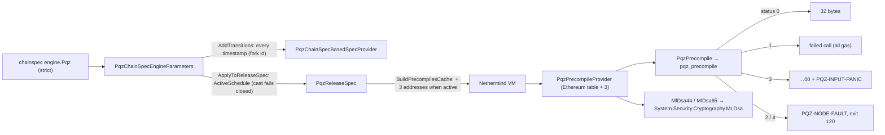

# `Nethermind.Pqz` — the PQZ and ML-DSA precompiles for chain 7622 (P6f)

A Nethermind 1.39.0 **plugin** (no Nethermind patch) that adds three precompiles, built into the local image
`scaas/nethermind-pqz:1.39.0-pqz1` (never pushed). Plan: [P6f](../../docs/superpowers/plans/2026-10-14-p6f-precompiles.md);
spec: [pq-zether.md](../../docs/contracts/pq-zether.md) CTR-PQZ-10 / CTR-PQZ-11, §9.1–§9.3, §10.

| Address | Name | What | Gas |
|---|---|---|---|
| `0x5caa500000000000000000000000000000000f01` | `PQZ` | both proof systems (PQZL, PQZH) through `pqz-ffi`'s C ABI `pqz_precompile` (P/Invoke into `libpqz_ffi.so`) | the active schedule's row `(op, id, stmtLen)` + 3·⌈len/32⌉; a miss = the smallest row (and `…00`, no FFI call); op 6 = `selftestGas` |
| `0x5caa500000000000000000000000000000000012` | `MLDSA44` | EIP-8355 layout `pk ‖ sig ‖ msg`, empty context, .NET 10 `MLDsa` (OpenSSL 3.5 of the base image) | `mldsa44Gas` (≥ 6,500; calibrated 49,000) + 6·⌈max(0, L − 3,732)/32⌉ |
| `0x5caa500000000000000000000000000000000013` | `MLDSA65` | the same, ML-DSA-65 | `mldsa65Gas` (≥ 9,000; calibrated 68,000) + 6·⌈max(0, L − 5,261)/32⌉ |



## Layout

| Path | What |
|---|---|
| `ref.sh` | extracts `/nethermind` of the pinned base image into `ref/` (git-ignored); every project compiles against it (R1) |
| `Nethermind.Pqz/` | the plugin: `PqzPlugin` (enabled iff `engine.Pqz`; start-up checks R3, `PQZ-START`), `PqzChainSpecEngineParameters` (D2), `PqzReleaseSpec`, `PqzChainSpecBasedSpecProvider`, `PqzPrecompileProvider` (D1), `PqzPrecompile` + `Native` (D4, D6), `MlDsaPrecompile` (D5), `SelfTest`, `Addresses` (D3) |
| `Nethermind.Pqz.Test/` | NUnit: spec / chainspec (Task 1), every PQZ vector through the C# class and the status-4 child process (Task 2), ML-DSA (Task 3) |
| `Harness/` | the P/Invoke boundary harness (Task 4) and the fault child |
| `fault-hooks/` | test-only cdylib: `pqz-ffi` with `test-hooks` + `pqz_test_fail_worker` (never in the image) |
| `fresh-proofs/` | N fresh honest proofs per form (calibration only) |
| `Calibrate/` | the gas calibration (Task 6), run inside the image's `calib` target |
| `corpus.py` | the flat input corpus from `smartcontracts/vectors/pqz` (`bin/corpus.jsonl`) for every consumer |
| `Dockerfile`, `Dockerfile.dockerignore`, `build-image.sh`, `NOTICE-pqz.txt` | the image (Task 5) |
| `chain/` | the copy and the live runbook: `copy.sh`, `docker-compose.copy.yml`, `config.{signer,follower}.json`, `nginx-rpc.conf`, `patch-chainspec.py`, `probe.sh`, `e2e.py`, `watch.sh`, `engine-pqz.json` |
| `runs/` | every run's output (text) |

## Build and test

```sh
scripts/capped sh -c 'pqz-core/nethermind/ref.sh && python3 -I pqz-core/nethermind/corpus.py pqz-core/nethermind/bin/corpus.jsonl'
scripts/capped sh -c 'cd pqz-core/ffi && cargo build --release --offline'                     # cdylib for the tests
scripts/capped sh -c 'cd pqz-core/nethermind/fault-hooks && cargo build --release --offline && mkdir -p ../bin/test-hooks && cp target/release/libpqz_ffi_fault_hooks.so ../bin/test-hooks/libpqz_ffi.so'
scripts/capped sh -c 'cd pqz-core/nethermind && dotnet test Nethermind.Pqz.Test -c Release -m:2'; dotnet build-server shutdown
scripts/capped sh -c 'cd pqz-core/nethermind && dotnet Harness/bin/Release/net10.0/Harness.dll run ../ffi/target/release bin/corpus.jsonl ../.. --minutes 60'
scripts/capped pqz-core/nethermind/harness.sh 60 1h                                         # the same, in the base image's runtime
CALIB=1 scripts/capped pqz-core/nethermind/build-image.sh pqz1                               # runs/<date>-image-pqz1.txt (+ calib target)
scripts/capped pqz-core/nethermind/calibrate.sh pqz1                                       # ONE run: runs/<date>-calib.txt, chain/engine-pqz.json
```

## Runbook

See [chain/RUNBOOK.md](chain/RUNBOOK.md): the copy (Tasks 7–8, executed; gate passed 2026-10-16, checklist in
`runs/2026-10-15-rehearsal.txt`) and the live roll-out on chain 7622 (Task 10: back up, then reset with `engine.Pqz`
from block 0, owner 2026-10-15).

## Results (2026-10-15 / 16)

| Task | Result | Log |
|---|---|---|
| 1–3 tests | 36 / 36 in the pinned SDK image | `runs/2026-10-15-test.txt` |
| 4 harness | 1 h clean: 6,955,371 inputs, 8 threads + GC pressure, status 3 = 0, `…01` = honest inputs | `runs/2026-10-15-harness-1h.txt` |
| 5 image | `pqz1` = `sha256:c53359a69bfa…`, library `12495e8b…7d87`, no hooks / GMP / MPFR / HEXL, never pushed | `runs/2026-10-15-image-pqz1.txt` |
| 6 calibration | `t_ecMul` 17 µs; rows 2.567–5.409 M gas; `selftestGas` 2,567,000; ML-DSA 49,000 / 68,000 | `runs/2026-10-15-calib.txt` |
| 7 copy | stock image ignores `engine.Pqz`; path A before / after T, probe 111, e2e 53; path B probe 112, e2e 53 | `runs/2026-10-1[56]-copy-*.txt` |
| 8 rehearsal | burst 429s, 80 M ramp + full block (79.24 M gas), kill drill, rollback | `runs/2026-10-15-rehearsal.txt` |
