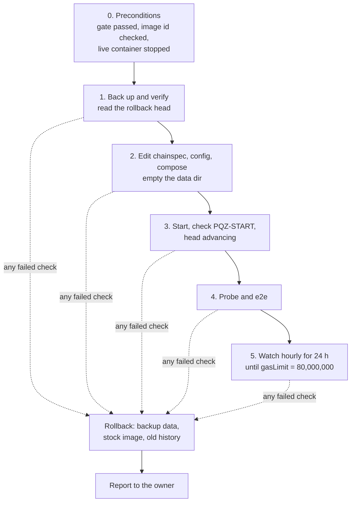

# P6f runbook — the copy (executed) and the live roll-out on the SCaaS testnet (Task 10)

This runbook is the step-by-step procedure for switching on the PQZ and ML-DSA precompiles
([../README.md](../README.md)) on a running chain, and for undoing it. It is for whoever operates the chain host: the
owner, or the controller session the owner has allowed to back up, reset and deploy the SCaaS testnet (owner decision
2026-10-15). Every step was first rehearsed on a throwaway **copy** of the SCaaS testnet, then run on the real chain.

**Status (all executed):**

| Procedure | Date | Log |
|---|---|---|
| [The copy](#the-copy-tasks-78) — rehearsal of both activation paths (Tasks 7–8); gate passed | 2026-10-15 / 16 | `../runs/*-copy-*.txt`, `../runs/2026-10-15-rehearsal.txt` |
| [Live roll-out on the SCaaS testnet](#live-roll-out-on-the-scaas-testnet-task-10-executed-2026-10-16) — back up, reset with the precompiles from block 0 (Task 10, image `pqz1`) | 2026-10-16 | `../runs/2026-10-16-live.txt` |
| [The multi-recipient transfer (op 7)](#the-multi-recipient-transfer-op-7-on-the-scaas-testnet-executed-2026-10-17) — a second schedule on the running chain (image `pqz2`) | 2026-10-17 | `../runs/2026-10-17-s8-live*.txt` |
| [Nethermind 2.2.0 and Amsterdam](#nethermind-220-and-amsterdam-on-the-scaas-testnet-executed-2026-10-21) — reset onto image `2.2.0-pqz3`, Amsterdam from block 1 | 2026-10-21 | `../runs/2026-10-21-testnet-2.2.0.txt` |
| [Genesis gasLimit 200 M](#genesis-gaslimit-200-m-on-the-scaas-testnet-executed-2026-10-22) — the same chain reset with a 200 M genesis block | 2026-10-22 | `../runs/2026-10-22-testnet-200m.txt` |
| [Image 2.2.0-pqz4: per-set ids, 32-bit addresses](#image-220-pqz4-on-the-scaas-testnet-executed-2026-10-25) — reset (path B, no backup) onto the plan 5h Task 8d part 1 library (`n2304-kmax4096`) with provisional rows | 2026-10-25 | `../runs/2026-10-25-pqz4-live.txt` |
| [Image 2.2.0-pqz5: the R0 review fix part b ids](#image-220-pqz5-on-the-scaas-testnet-executed-2026-10-26) — reset (path B, no backup) onto the part b library (`n2304-kmax4096`, PQZL v5 / PQZH v3) with provisional rows | 2026-10-26 | `../runs/2026-10-26-pqz5-live.txt` |

The commands below are the ones that were executed. Steps marked *live only* ran on the SCaaS testnet itself; everything else
ran on the copy. Plan: [P6f](../../../docs/superpowers/plans/2026-10-14-p6f-precompiles.md) Tasks 7, 8, 10; spec:
[pq-zero-knowledge.md §10](../../../docs/contracts/pq-zero-knowledge.md#chain-integration). Logs of the executed runs:
[`../runs/`](../runs/).

**Scripts at `349b96b8` (R0 review fix part b) and later target image `2.2.0-pqz5`, live on the SCaaS testnet since
2026-10-26** (the part b ids PQZL v5 / PQZH v3; the scripts of `pqz-8d1`, plan 5h Task 8d part 1, targeted `2.2.0-pqz4`
with PQZL v4 / PQZH v2): `e2e.py`, `patch-chainspec.py` and the plugin use the 32-bit addresses
`0x000000000000000000000000000000005caa0f01` / `…5caa0012` / `…5caa0013`, and `e2e.py` / `corpus.py` take the self-test
hash, `MAX_INPUT` and the vectors of `PQZ_SET` (default `n2304-kmax4096`, the library's set). For an older image
(`2.2.0-pqz3` and before: P6f D3's `0x5caa50…0f01` / `…0012` / `…0013`, the `n2048-kmax1024` library, the old-id rows)
run the scripts of that image's commit.

**Chain roles** (owner 2026-10-15): **the SCaaS testnet (chain id 7622) is the test chain**, and its data may be reset. **22776 is the future
mainnet** (owner only; not built). Chain 22776 gets the precompiles only after the production gates — the external
audit and the G-LIC written licence clearance ([pq-zero-knowledge.md CTR-PQZ-01](../../../docs/contracts/pq-zero-knowledge.md),
the licence inventory) — with `engine.Pqz` in its genesis from block 0 and the same addresses.

**Words used here**

| Term | Meaning |
|---|---|
| chain host | the machine that runs the SCaaS testnet: live directory `/home/dockers/mba-chain-nethermind`, container `mba_chain_node_nethermind`, RPC `http://127.0.0.1:8545` |
| copy | a replica of the SCaaS testnet with a throwaway signer key, run from `scratchpad/p6f-copy` (containers `pqzcopy-*`) |
| chainspec | the chain's JSON configuration (`genesis.json`); the precompiles are switched on by its `engine.Pqz` section |
| schedule, T | one entry of `engine.Pqz.schedules`: gas prices that apply from its timestamp T on |
| stock image | the unmodified Nethermind image (`nethermind/nethermind:1.39.0` in the copy and the roll-out of 2026-10-16); it ignores `engine.Pqz` |
| probe | `probe.sh` / `e2e.py probe`: read-only calls that check chain id, genesis hash, self-test, every test vector and its gas |
| e2e | `e2e.py e2e`: real transactions that call the precompiles through a test contract |
| rollback head | the last block of the old chain, read from the backup in step 1; after a rollback the head must equal it |

## Two activation paths (both tested on the copy)

| Path | When | chainspec | Data |
|---|---|---|---|
| **A. Transition timestamp** (an upgrade of a running chain) | 22776 later, any chain upgrade, a re-price or a new op such as the multi-recipient transfer (`R_TXM`, op 7), added as a second schedule | `engine.Pqz.schedules[0].timestamp` = T in the future; history before T is unchanged; a proofSystemId change at T: a node with the new library starts only once its head has reached T − 1, a node with the old library is refused at any restart once the schedule is in the chainspec, a fresh node needs a data copy past T; with a block period the last block before T usually lies below T − 1, so the swap comes after T and the old-library nodes (old chainspec) seal the first blocks at or after T under the old ids — send no PQZ call between T and the swap (`pq-zero-knowledge.md` §9.1) | kept |
| **B. From genesis** (a new chain, the SCaaS testnet reset, owner 2026-10-15) | Task 10 on the SCaaS testnet (used on 2026-10-16) | `engine.Pqz` with the first timestamp = the genesis timestamp (0 on 7622): active in every block | fresh (the old data dir is backed up, not used) |

The plugin refuses a first timestamp *before* genesis; a timestamp equal to genesis is path B.
`patch-chainspec.py` is stricter (review CHAIN-02): without `--testnet-reset` the first timestamp must lie at least
5 minutes in the future, as in `add-schedule.py`; with it, the timestamp must equal the genesis timestamp.

## The copy (Tasks 7–8)

**What it is.** The copy is a **replica** of the SCaaS testnet: the live chainspec's parameters, engine and genesis header
(`../Nethermind.Pqz.Test/chainspecs/genesis-7622.json`) with a throwaway signer key in `extraData`. The stock image
first produces some history on it. The live directory is never read beyond read-only `cat` / `ls` /
`docker image inspect`, and no live data or key material is copied. As a result the copy's genesis hash is its own,
not the SCaaS testnet's (`0x24e43dcb…c464` then, `0xa17faef4…2ac2` since the 200 M genesis reset of 2026-10-22); on the
live chain, step 2 of the probe checks the live hash.

**Changes the copy needed** (found in runs `2026-10-1[56]-copy-*.txt`):

- the history chainspec `genesis.stock.json` adds `eip4895TransitionTimestamp` 0 and `maximumExtraDataSize` `0xffff`
  (with the SCaaS testnet's parameters as they are, no follower can sync);
- path B starts from the faithful replica `genesis.faithful.json` with `--testnet-reset`, exactly as Task 10 does;
- both node configs set `Network.FilterPeersByRecentIp` false (otherwise a restarted follower was refused for minutes);
- `copy.sh up` starts the signer first.

**Commands.** Run from the repository root on the dev host. The comments say what each group demonstrates. The image
tags are those of the 2026-10-15 / 16 run (the stock `nethermind/nethermind:1.39.0`, `scaas/nethermind-pqz:1.39.0-pqz1`;
`E` was `engine-pqz.json` then). `copy.sh up` takes any image, so a rehearsal today passes the current image and the
set's engine file (`E` below); the copy has not been re-run since 2026-10-17.

```sh
C=pqz-core/nethermind/chain
E=pqz-core/nethermind/chain/engine-pqz-provisional-n2304.json  # the set's engine file (engine-pqz-provisional-<n>.json per set, R0 review fix part b;
                                                        # engine-pqz.json = the retired v3 / PQZH v1 calibration, refused at start-up), timestamp patched below
$C/copy.sh init                                         # key, password, genesis.stock.json, configs (scratchpad/p6f-copy)
$C/copy.sh up nethermind/nethermind:1.39.0 genesis.stock.json      # history with the stock image
python3 -I $C/e2e.py head
$C/copy.sh down && $C/copy.sh backup pre                # the rollback point (data dirs, chainspecs, configs)
# G2 demonstration: the stock image with engine.Pqz ignores it
$C/copy.sh patch $E $(( $(date +%s) + 360 ))
$C/copy.sh up nethermind/nethermind:1.39.0 genesis.pqz.json   # after T:
python3 -I $C/e2e.py stock --engine $C/../../../scratchpad/p6f-copy/genesis.pqz.json  # the probe FAILS (recorded)
$C/copy.sh down && $C/copy.sh restore pre
# Path A: step 1 (image, future T), before-T probe, step 2 after T, e2e
$C/copy.sh patch $E $(( $(date +%s) + 600 ))
$C/copy.sh up scaas/nethermind-pqz:1.39.0-pqz1 genesis.pqz.json
docker logs pqzcopy-signer 2>&1 | grep PQZ-START
BEFORE=1 $C/probe.sh $E
$C/probe.sh $E                                           # after T
python3 -I $C/e2e.py e2e --engine $E --key <throwaway key>
# Path B: a fresh chain with engine.Pqz from block 0
$C/copy.sh down && $C/copy.sh backup pathA && $C/copy.sh wipe
$C/copy.sh genesis0 $E && $C/copy.sh up scaas/nethermind-pqz:1.39.0-pqz1 genesis.pqz0.json
$C/probe.sh $E && python3 -I $C/e2e.py e2e --engine $E --key <throwaway key>
```

**Task 8, the rehearsal (the gate before the live chain):**

1. Burst: `e2e.py burst` (step 5 of spec §10).
2. The 80 M ramp: `watch.sh` until `gasLimit` = 80,000,000, then `e2e.py fill`.
3. The kill drill: `docker kill -s KILL pqzcopy-signer` during `e2e.py fill`, restart; the block hashes must agree.
4. The rollback rehearsal: `copy.sh down`, `copy.sh restore pre`, the stock image; the head must equal the recorded head.

Results: `../runs/*-copy-*.txt`, `../runs/*-rehearsal.txt`.

## Live roll-out on the SCaaS testnet (Task 10, executed 2026-10-16)

*Live only.* **Executed on 2026-10-16** with image `pqz1`; log `../runs/2026-10-16-live.txt`. It ran `pqz2` from
2026-10-17 ([op 7 section](#the-multi-recipient-transfer-op-7-on-the-scaas-testnet-executed-2026-10-17)); the image
today is in the status table above.

**The decision** (owner 2026-10-15, TODO.md, explicit): once the copy gate (Tasks 7–9) passes, back up the current
SCaaS testnet data, then **reset** the SCaaS testnet with a fresh genesis carrying the precompiles from block 0 (path B). Keep chain id
7622, the gas limit 16,777,216, the ports and the signer.

**Why the genesis hash does not change.** The genesis **block** stays byte-identical, so the genesis hash stays
`0x24e43dcbfc9624b23bf89409acd104d6e5671e2c41d8c192373d65519321c464` (it is pinned in tests, vectors and
`chain-uids.json`). `engine.Pqz` and the three `--testnet-reset` params (`eip4895TransitionTimestamp` 1,
`maximumExtraDataSize` `0xffff`, `maxCodeSizeTransition` 0 — rehearsed as path B on the copy) are not part of the
genesis header. The old history is discarded; it stays in the backup.

**Rules.** Write every command and its output into `pqz-core/nethermind/runs/<date>-live.txt`. If any step fails, run
the [rollback](#rollback), then report. Do not improvise.



### Step 0: preconditions

Who: the operator, on the chain host. All must hold before step 1:

1. The gate passed: `../runs/*-rehearsal.txt`.
2. The image is the one the gate used: `docker image inspect scaas/nethermind-pqz:1.39.0-pqz1 --format '{{.Id}}'`
   prints the same id.
3. The live container is stopped: `docker inspect -f '{{.State.Status}}' mba_chain_node_nethermind` prints `exited`.
   If not, stop it with `docker compose stop -t 120 blockchain-node` (in `/home/dockers/mba-chain-nethermind`).
4. The probe and e2e inputs exist in the repository (the 2026-10-16 run had to rerun its probe because they were
   missing): the forge artifact `smartcontracts/evm/out/PqzPrecompileProbe.sol/PqzPrecompileProbe.json` (build it in
   `smartcontracts/evm` with `forge build test/p6f/PqzPrecompileProbe.sol`) and `pqz-core/nethermind/bin/corpus.jsonl`
   (step 1 of [Build and test](../README.md#build-and-test)).

### Steps 1–5

Run in one shell on the chain host. First set the variables; replace `<repo>` with the path of the repository
checkout. From `cd $L` on, the working directory is the live directory, so `genesis.json`, `config.json` and
`docker-compose.yml` are the live files.

```sh
L=/home/dockers/mba-chain-nethermind
C=<repo>/pqz-core/nethermind/chain
E=$C/engine-pqz.json
TS=$(date +%Y%m%d-%H%M%S)
B=/home/dockers/mba-chain-nethermind-backups/pqz-$TS          # dated, outside the repo and outside $L
A="docker run --rm --memory 512m -v $L:/l -v $(dirname $B):/b alpine:3"
cd $L
```

**Step 1 — back up, verify the backup, and read the rollback head.** The backup holds the chainspec, config, compose
file, password, keystore (the keys) and the data dir. Keep it until the owner deletes it.

```sh
# 1. Backup: chainspec, config, compose, password, keystore (keys), data dir; kept until the owner deletes it
mkdir -p $B && cp -p genesis.json config.json docker-compose.yml password.txt $B/
$A sh -c "cp -a /l/keystore /l/data/nethermind_data /b/pqz-$TS/"
#    readable and identical: sha256 manifests of every file, live vs backup (paths relative), then sizes
$A sh -c "cd /l/data/nethermind_data && find . -type f | sort | xargs sha256sum" > $B.live-data.sha256
$A sh -c "cd /b/pqz-$TS/nethermind_data && find . -type f | sort | xargs sha256sum" > $B.backup-data.sha256
cmp $B.live-data.sha256 $B.backup-data.sha256 && echo "data backup identical: $(wc -l < $B.live-data.sha256) files"
(cd $B && sha256sum genesis.json config.json docker-compose.yml password.txt) ; diff <(cd $L && sha256sum genesis.json config.json docker-compose.yml password.txt) <(cd $B && sha256sum genesis.json config.json docker-compose.yml password.txt)
$A du -s /l/data/nethermind_data /b/pqz-$TS/nethermind_data /b/pqz-$TS/keystore
#    the rollback head, read from a scratch copy of the BACKUP by the stock image (no mining, no keys, no peers):
#    also proves the backup opens
S=<repo>/scratchpad/p6f-livecheck && mkdir -p $S
docker run --rm --memory 512m -v $(dirname $B):/b -v $S:/s alpine:3 cp -a /b/pqz-$TS/nethermind_data /s/data
python3 -I - $L/config.json $S/config.json <<'PY2'
import json, sys
c = json.load(open(sys.argv[1])); c["Init"]["IsMining"] = False; c["Mining"] = {"Enabled": False}; c.pop("KeyStore")
c["JsonRpc"].pop("AdditionalRpcUrls", None); c["Network"] = {"MaxActivePeers": 0}
json.dump(c, open(sys.argv[2], "w"), indent=2)
PY2
docker run -d --name p6f-livecheck --memory 2g -p 127.0.0.1:18547:8545 -v $S/data:/nethermind/nethermind_datadir \
  -v $B/genesis.json:/nethermind/genesis.json:ro -v $S/config.json:/nethermind/config.json:ro \
  nethermind/nethermind:1.39.0 --config /nethermind/config.json --datadir /nethermind/nethermind_datadir
# (after ~30 s) the head of the old history = the rollback head; genesis hash = 0x24e43dcb…c464
python3 -I $C/e2e.py head --rpc http://127.0.0.1:18547
docker rm -f p6f-livecheck && docker run --rm -v $S:/s alpine:3 rm -rf /s/data
```

Success: `data backup identical: <n> files` is printed; the `diff` of the four config files prints nothing; the live
and backup sizes from `du` match closely; `e2e.py head` prints the old head and the genesis hash `0x24e43dcb…c464`.
Write that head (number and hash) into the log: it is the **rollback head**.

**Step 2 — edit the chainspec, config and compose file, then empty the data dir.** This is the first step that changes
the live chain. On 2026-10-16 the owner approved that the controller runs it in its own session (the first attempt was
blocked by the permission system; the live files were checked unchanged by sha256 before the retry).

```sh
# 2. Edits (diff of each against its backup into the log)
python3 -I $C/patch-chainspec.py $B/genesis.json $E 0 $L/genesis.json --testnet-reset
python3 -I - config.json <<'PY2'
import json, sys
c = json.load(open(sys.argv[1]))
c.setdefault("TxPool", {})["MaxTxSize"] = 1048576
c.setdefault("Blocks", {})["TargetBlockGasLimit"] = 80000000
json.dump(c, open(sys.argv[1], "w"), indent=2)
PY2
sed -i 's#image: nethermind/nethermind:1.39.0#image: scaas/nethermind-pqz:1.39.0-pqz1\n    mem_limit: 4g#' docker-compose.yml
diff $B/genesis.json genesis.json; diff $B/config.json config.json; diff $B/docker-compose.yml docker-compose.yml
$A sh -c 'rm -rf /l/data/nethermind_data && mkdir /l/data/nethermind_data'     # fresh chain; the old data is in $B
```

Success: the three diffs show only the intended changes — `genesis.json` gains `engine.Pqz` and the three
`--testnet-reset` params; `config.json` gains `TxPool.MaxTxSize` and `Blocks.TargetBlockGasLimit`;
`docker-compose.yml` switches the image to `scaas/nethermind-pqz:1.39.0-pqz1` and adds `mem_limit: 4g`.

**Step 3 — start the node and check its health.**

```sh
# 3. Start and health
docker compose up -d blockchain-node
docker logs mba_chain_node_nethermind 2>&1 | grep -E '^PQZ-START|PQZ-REFUSE'   # sha256 = image label, selftest, schedule ts 0x0, addresses
$C/watch.sh mba_chain_node_nethermind http://127.0.0.1:8545 10m                 # head advancing every 5 s
python3 -I $C/e2e.py head --rpc http://127.0.0.1:8545
```

Success: one `PQZ-START` line whose library sha256 equals the image label, with the self-test hash, schedule timestamp
`0x0` and the three addresses; no `PQZ-REFUSE`; the head advances every 5 s.

**Step 4 — probes and e2e.** With path B the precompiles are active at once. The genesis hash must still be
`0x24e43dcb…c464`.

```sh
# 4. Probes and e2e (path B: at once). Genesis hash unchanged: 0x24e43dcb…c464
$C/probe.sh $E http://127.0.0.1:8545 0x24e43dcbfc9624b23bf89409acd104d6e5671e2c41d8c192373d65519321c464
python3 -I $C/e2e.py e2e --engine $E --rpc http://127.0.0.1:8545 --key <a test key funded in genesis> --no-ua
```

Success: `probe: all checks passed` and `e2e: all checks passed`, both with exit code 0. The 2026-10-16 run used the
test key `0x…04` (address `0x1efF47bc…A718`, funded in genesis); the test key `0x…05` is not funded and is refused
by the pool.

**Step 5 — watch.**

```sh
# 5. Watch: hourly for 24 h (cron line or manual), until gasLimit = 80,000,000
$C/watch.sh mba_chain_node_nethermind http://127.0.0.1:8545 1h
```

Success: hourly for 24 h no fault tags and the head advancing, and `gasLimit` reaches 80,000,000.

### Rollback

When: any failed check in steps 1–5. Same shell and variables as above, on the chain host. It returns to the backup
and the stock image, with the old history.

```sh
# Rollback (on any failed check): back to the backup and the stock image, the old history
docker compose down
cp -p $B/genesis.json $B/config.json $B/docker-compose.yml $L/
$A sh -c "rm -rf /l/data/nethermind_data && cp -a /b/pqz-$TS/nethermind_data /l/data/nethermind_data"
docker compose up -d blockchain-node      # head hash = the rollback head of step 1
```

Success: the head hash equals the rollback head written down in step 1. Then report to the owner.

### Health checks after any restart

- `PQZ-START` is present in the log, and there is no `PQZ-REFUSE` or `PQZ-NODE-FAULT`.
- The head advances every 5 s.
- `eth_chainId` = `0x1dc6`.
- `OP_SELFTEST` (op 6) = `d6c01fbc…6f68d` (image `2.2.0-pqz5`, set `n2304-kmax4096`; `23d7a1db…c97c0` on `2.2.0-pqz4`, `ed910a2c…d205` before).

A node fault (plan D4) stops the node with exit code 120 and the tag `PQZ-NODE-FAULT` in its log. The block in
progress is never sealed; a restart (`docker compose up -d blockchain-node`) re-processes it. The node has no restart
policy: choosing one is the owner's decision (owner step 3 of the P6f plan), so after a fault someone must restart it
by hand.

**No public RPC on the signer (review W-H, 2026-10-19; a rule, not a code change).** The exit path above runs in
whatever thread calls the precompile, `eth_call`, `eth_estimateGas` and tracing included, and the PQZL verifier's
process-wide lock is shared by RPC calls and block import. A node that serves RPC to anyone can therefore be stopped
(a node fault inside an `eth_call`) or slowed (calls queueing on the lock) by its callers. So the signer's JSON-RPC
must be reachable from the chain host only; public RPC goes to a follower behind the rate-limited proxy
(`config.follower.json`, `nginx-rpc.conf`; the copy publishes it on `127.0.0.1:18545`), whose exit stops only that
follower. **On the SCaaS testnet** the live `docker-compose.yml` (read 2026-10-19) publishes `8545:8545` and `8546:8546` on every
host interface; **accepted for the testnet (owner 2026-10-19)**: no firewall or binding change. The rule above binds
mainnet 22776. A start-up refusal
`PQZ-REFUSE … sha256 … != the reviewed …` means the image's `libpqz_ffi.so` is not the reviewed build (review W-G):
use an image built by `build-image.sh` from the reviewed commit.

### Owner steps outside this runbook

- The follower node and the rate-limited public RPC that the rule above asks for on mainnet 22776 (not needed on the
  SCaaS testnet, owner 2026-10-19). The copy's `docker-compose.copy.yml`, `config.follower.json` and `nginx-rpc.conf`
  are the rehearsed configs.
- A restart policy for the node (the live `docker-compose.yml` has none: after a host restart the node stays stopped
  until someone runs `docker compose up -d blockchain-node`).
- When to delete the backups left in the live directory: `genesis.json.bak-pre-200m-20261022`,
  `data/nethermind_data.pre-200m-20261022`, `genesis.json.bak-pqz4-20261026`, `docker-compose.yml.bak-pqz4-20261026`
  (listed 2026-10-26; the dated `pqz-<TS>` / `op7-<TS>` directories of `/home/dockers/mba-chain-nethermind-backups/`
  were empty then).

## The multi-recipient transfer (op 7) on the SCaaS testnet (executed 2026-10-17)

*Live only;* plan P6-ANON S8. This added the multi-recipient transfer (`R_TXM`, op 7) to the running chain.

**What changed.** The chain kept running and kept its data (path A). Three things were added:

- a second `engine.Pqz` schedule at a future timestamp T: the live rows unchanged, plus one row per built
  multi-recipient shape `(proofSystemId, M, auditorOn)` (plugin rows with `legs` / `auditorOn`, plan D19), taken from
  the multi-recipient calibration (`../runs/2026-10-17-calib-ops7*`);
- the image `scaas/nethermind-pqz:1.39.0-pqz2`, whose plugin reads the multi-recipient transfer's header words; it
  must run before T;
- nothing else: the chain data is kept.

**Rehearsed first** on a fresh copy (`../runs/2026-10-17-s8-copy-*`): pqz1 → pqz2 with the data kept; before T every
multi-recipient input was a miss; after T every built shape returned `…01`; e2e 86 ok. Live log:
`../runs/2026-10-17-s8-live*.txt` (probe 389 ok before and after T = 1792205116, e2e 76 ok).

**Who and where:** the operator, on the chain host, in one shell; replace `<repo>` with the path of the repository
checkout. First set the variables and stop the node (the first four lines of the block below). The numbered steps
match the comments in the block:

1. Back up exactly as in [Task 10 step 1](#steps-15): the chainspec, config, compose file, password, keystore and data,
   with the sha256 manifests compared. The backup lands in `$B` (`op7-$TS`), so in those commands write `op7-$TS`
   wherever they say `pqz-$TS`.
2. Add the second schedule (the script refuses a T less than 5 minutes ahead; since review W-F, 2026-10-19, it also
   refuses a calibration file with more than one schedule, one that lacks a row of the replaced ops the last schedule
   has, and a duplicate row), switch the image to `pqz2`, start the
   node, and copy the live `engine.Pqz` into `$C/engine-pqz.json` for the probes. Success: `PQZ-START` shows library
   `4fc1a6a2…`, self-test `ed910a2c…` and two schedules.
3. Before T: probe with schedule 0. Success: every multi-recipient input is a miss (smallest row, `…00`, no FFI call).
4. After T: probe and e2e. Success: every built shape returns `…01` at its row, every negative returns `…00`, and the
   e2e transactions with the test key `0x…04` pass.

```sh
L=/home/dockers/mba-chain-nethermind; C=<repo>/pqz-core/nethermind/chain
TS=$(date +%Y%m%d-%H%M%S); B=/home/dockers/mba-chain-nethermind-backups/op7-$TS
A="docker run --rm --memory 512m -v $L:/l -v $(dirname $B):/b alpine:3"
cd $L && docker compose stop -t 120 blockchain-node
# 1. backup as in Task 10 step 1 (chainspec, config, compose, password, keystore, data; sha256 manifests compared)
# 2. the second schedule (refuses a T less than 5 minutes ahead) and the image
T=$(( $(date +%s) + 900 ))
python3 -I $C/add-schedule.py $B/genesis.json <repo>/pqz-core/nethermind/runs/2026-10-17-calib-ops7-engine-pqz.json $T $L/genesis.json
sed -i 's#scaas/nethermind-pqz:1.39.0-pqz1#scaas/nethermind-pqz:1.39.0-pqz2#' docker-compose.yml
docker compose up -d blockchain-node      # PQZ-START: library 4fc1a6a2…, self-test ed910a2c…, two schedules
python3 -I -c "import json; json.dump(json.load(open('$L/genesis.json'))['engine']['Pqz'], open('$C/engine-pqz.json', 'w'), indent=2)"
# 3. before T: every multi-recipient inputs a miss (smallest row, …00, no FFI call)
python3 -I $C/e2e.py probe --engine $C/engine-pqz.json --schedule 0 --rpc http://127.0.0.1:8545 --genesis-hash 0x24e43dcb…c464
# 4. after T: every built shape …01 at its row, negatives …00; transactions with the test key 0x…04
python3 -I $C/e2e.py probe --engine $C/engine-pqz.json --rpc http://127.0.0.1:8545 --genesis-hash 0x24e43dcb…c464
python3 -I $C/e2e.py e2e --engine $C/engine-pqz.json --rpc http://127.0.0.1:8545 --key <test key 0x…04> --no-ua
# Rollback before T: stop, restore genesis.json + docker-compose.yml from $B (pqz1, one schedule), start; the data
# needs no restore (no block used the second schedule). After T: Task 10's rollback with $B's data.
```

**Rollback:**

- **Before T:** stop the node, restore `genesis.json` and `docker-compose.yml` from `$B` (image `pqz1`, one schedule),
  start it again. The data needs no restore, because no block has used the second schedule yet.
- **After T:** run [Task 10's rollback](#rollback) with `$B`'s data, again writing `op7-$TS` where it says `pqz-$TS`.
  This returns the chain to its state at the op 7 backup.

## Nethermind 2.2.0 and Amsterdam on the SCaaS testnet (executed 2026-10-21)

*Live only.* The owner's instruction (2026-10-21): reset the SCaaS testnet directly with the new image and Amsterdam
active, **no backup**. Nothing was deleted: the 1.39.0 data dir was renamed to
`data/nethermind_data.pre-2.2.0-20261021`, and the three edited files got `*.bak-1.39.0-20261021` copies (the live
directory's convention); deleting them is the controller's call.

**Why a reset and not a fork at a future timestamp.** The owner allowed and then asked for a reset; it also gives a
fresh flat-DB (2.x default for a new node) instead of a 1.39.0 patricia DB carried forward. An in-place fork would
work the same way with `eip<N>TransitionTimestamp` = T > now (Clique forks by timestamp like any chain).

**What changed** (script `../runs/2026-10-21-testnet-reset-2.2.0.sh`, steps `reset` and `check`):

- `genesis.json`: `eip<N>TransitionTimestamp` = 1 for EIP-2780, 7708, 7778, 7928, 7954, 7976, 7981, 8024, 8037, 8038,
  8246. Timestamp 1, not 0: the genesis (timestamp 0) stays a pre-Amsterdam block, so its header and hash
  `0x24e43dcb…c464` do not change (the same trick as `eip4895TransitionTimestamp` 1). Left out: EIP-7843 (SLOTNUM; the
  Clique producer sets no slot number and 2.2.0's header validator rejects the block) and EIP-8282 (builder requests,
  CL predeploys). `engine.Pqz` unchanged (two schedules, PQZL v2 rows). The file was rewritten by `json.dump` with
  indent 2, so its diff is mostly whitespace.
- `config.json`: `Blocks.TargetBlockGasLimit` 80,000,000 → 200,000,000 (a 64 KiB deploy needs ≈ 100 M of state gas
  and a block bigger than its `tx.gas`; the limit ramps by 1/1024 per block, ≈ 2.5 h from 16.8 M to 100 M); `Init.IsMining`
  removed (2.2.0: "Invalid configuration settings"; `Mining.Enabled` is the key).
- `docker-compose.yml`: image `scaas/nethermind-pqz:2.2.0-pqz3`.

**Checks** (all in the log): `PQZ-START` with library `16dd99ce…`, self-test `ed910a2c…`, both schedules; blocks every
5 s with a `blockAccessListHash` in the header; `eth_chainId` 0x1dc6; genesis hash unchanged; `e2e.py probe` all
checks passed with the reviewed library's corpus (`--corpus bin/corpus-ffi-1adbd563.jsonl`), every input whose
calldata floor exceeds 2^24 refused by `eth_call`; `e2e.py e2e` all checks passed (76), the same inputs refused by the
pool; one ordinary value transfer (21,000 gas = 12,000 + 3,000 + 6,000, with its EIP-7708 log). **Not run in this
reset** (it passed after the [200 M genesis reset](#genesis-gaslimit-200-m-on-the-scaas-testnet-executed-2026-10-22)):
`e2e.py codesize` (65,536 B of code must deploy, 65,537 B fail). It needs a block gas limit above its `tx.gas` of
110 M, and after the reset the limit ramps from the genesis `gasLimit` 0x1000000 (16,777,216) toward
`TargetBlockGasLimit` 200 M by only 1/1024 per block: ≈ 1,780 blocks (≈ 2.5 h) to 110 M, ≈ 2,540 blocks (≈ 3.5 h) to
200 M (block 856 was at 38.7 M). Re-run once `gasLimit` > 111 M (the command waits by itself):
`python3 -I pqz-core/nethermind/chain/e2e.py codesize --rpc http://127.0.0.1:8545 --key <test key 0x…04>`.

**After any reset** the same ramp applies: until the limit has climbed, a transaction whose `tx.gas` exceeds the
current block gas limit is not included (EIP-8037 reserves `tx.gas` in the state dimension), so large deploys wait.
Changing the genesis `gasLimit` would change the genesis hash.

**Rollback** to 1.39.0 (not needed, and no longer possible: neither the `*.bak-1.39.0-20261021` files nor
`data/nethermind_data.pre-2.2.0-20261021` are in the live directory on 2026-10-26): stop the node, put the three
`*.bak-1.39.0-20261021` files back, swap the data dirs back (`data/nethermind_data.pre-2.2.0-20261021` →
`data/nethermind_data`), start. The 1.39.0 head is the one in that data dir.

**Amsterdam rules the operator must know** ([gas impact](../runs/2026-10-21-glamsterdam-gas-impact.md)): `tx.gas` may
exceed 2^24 (up to 2^32 − 1) but execution gas may not; the calldata floor is 64 gas per byte and must stay ≤ 2^24, so
a transaction carries at most ≈ 261,909 calldata bytes; a transaction's `tx.gas` must fit the block gas limit (EIP-8037
reserves it in the state dimension); new storage slots cost 97,920 state gas and code 1,530 per byte.


## Genesis gasLimit 200 M on the SCaaS testnet (executed 2026-10-22)

*Live only.* Owner 2026-10-22: reset the SCaaS testnet now so blocks are 200 M from block 0 ("Reset ngay để có 200 M
sớm, không cần chạy tải"); no load rehearsal, no burst / fill drill, no calibration. Everything else stays as on
2026-10-21: image `scaas/nethermind-pqz:2.2.0-pqz3`, the same `engine.Pqz` (two schedules, PQZL v2 rows) and params
(Amsterdam from timestamp 1), `config.json` (`TargetBlockGasLimit` already 200 M), compose, ports and keys. No chain-data
backup (owner 2026-10-21); the data dir is renamed, `genesis.json` gets a `.bak-pre-200m-20261022` copy.

**Status: executed 2026-10-22** by the controller (log `../runs/2026-10-22-testnet-200m.txt`, script
`../runs/2026-10-22-testnet-reset-200m.sh`, rehearsed first on throwaway chains, `../runs/2026-10-22-genesis-200m-throwaway.txt`).
Image `scaas/nethermind-pqz:2.2.0-pqz3` = `sha256:b3f6c855b2d2adbcf1fa6f6453e931cd54b79467e7e5f023e8642aae43a93b14`;
`PQZ-START` with library `16dd99ce…`; genesis `0xa17faef497fa29ec90603969dad0176ea18fd1cc2eaf0f9f4fa2dacc9c952ac2` (as
predicted), block 1 `0xca1fbc04d57f83aa20993bb097be1f5801b1fff4d1505a00926dce4e9024f012`, `gasLimit` 200,000,000 from
block 0; probe all checks passed (with the `eth_estimateGas` row: 3,394,851 vs exact 3,366,962); e2e `--no-ua` all checks
passed; `codesize`: 65,536 B deployed at once in block 46 (100,504,388 gas), 65,537 B refused. The e2e part of the log
holds two interleaved check runs started at the same time with the same key: one hit a nonce clash ("replacement
transaction underpriced"), the other passed fully — an operator slip, not a chain fault. Redeployed by the checks: the
probe contract of `e2e.py e2e` and the two `codesize` contracts; nothing else (the PQZ / UA stack is redeployed with
plan fs3 Task 13). Afterwards `smartcontracts/evm/chain-uids.json` `private7622`, `scaas-node/node.example.toml` and
`docs/networks/evm.md` carry the new genesis hash (commit `00d791b0`). A gas-less `eth_call` of a call with total gas
> 2^24 and regular < 2^24 succeeds on the reset chain (`../runs/2026-10-22-testnet-gasless-call.txt`).

```sh
sh pqz-core/nethermind/runs/2026-10-22-testnet-reset-200m.sh reset   # stop, .bak, patch-chainspec --testnet-reset, rename data, start
sh pqz-core/nethermind/runs/2026-10-22-testnet-reset-200m.sh check   # head, block 0 / 1, probe (+ eth_estimateGas row), e2e --no-ua, codesize
```

`reset` refuses to go on unless the semantic diff of `genesis.json` is exactly `genesis.gasLimit` `0x1000000` →
`0xbebc200`. Success: `PQZ-START` (library `16dd99ce…`), block 0 hash `0xa17faef497fa29ec90603969dad0176ea18fd1cc2eaf0f9f4fa2dacc9c952ac2`
(predicted by the throwaway run with the live genesis) and `gasLimit` 200,000,000 from block 0, probe and e2e all checks
passed, `codesize` deploys 65,536 B at once (no ramp). After it: record block 1's hash and the image id in this section
and in `../README.md`; the genesis hash is the new `chainUid` of chain 7622 (`smartcontracts/evm/chain-uids.json`
`private7622`, the chain profile's `genesis_hash`, every contract that pins `chainUid`); everything deployed on the old
chain is gone and is redeployed by its own scripts (`smartcontracts/evm/script/pqz/e2e.py` for the PQZ stack). The test
vectors that use `0x24e43dcb…c464` as a fixed `chainUid` keep it (a test constant, not the live chain's).

**Rollback:** stop the node, put `genesis.json.bak-pre-200m-20261022` back, swap the data dirs back
(`data/nethermind_data.pre-200m-20261022` → `data/nethermind_data`), start.

## Image 2.2.0-pqz4 on the SCaaS testnet (executed 2026-10-25)

*Live only.* Owner 2026-10-24: "run it on the SCaaS testnet yourself" (the controller deploys plan 5h Task 8d part 1 to
the testnet itself, instead of a copy-chain probe) and "no backup of chain 7622 needed". Log
`../runs/2026-10-25-pqz4-live.txt`; branch `pqz-16k` at `35b59a62` (8d part 1 merged with main's Nethermind 2.2 work).

1. Image: `scripts/capped pqz-core/nethermind/build-image.sh pqz4` twice — pass 1 stops at the reviewed-library check
   and prints the new library's hash; review (exports `pqz_max_input` / `pqz_precompile` only, no test hooks, no GMP /
   MPFR / HEXL, `pqz_max_input()` = 524,288), set `SelfTest.ExpectedLibrarySha256` = `0894d191…64772`, commit; pass 2
   builds `scaas/nethermind-pqz:2.2.0-pqz4` (`sha256:55037b0b…faca6`), `build-image: ok`.
2. Rows: `provisional-rows.py ../bin/corpus.jsonl engine-pqz.json engine-pqz-provisional-n2304.json` — 26 rows for the
   new ids (the live row of the same op / proof system / legs / auditor flag × 1.3; `selftestGas` 3,337,000; ML-DSA
   unchanged). **Provisional, testnet only**: plan 5h Task 9 calibrates the real prices.
3. Chainspec: `patch-chainspec.py genesis.json engine-pqz-provisional-n2304.json 0x0 genesis.new.json --testnet-reset`
   — engine.Pqz replaced, params and genesis header unchanged, so the genesis hash stays `0xa17faef4…2ac2`.
4. Node (stopped since 2026-10-22): install `genesis.json`, compose image `2.2.0-pqz3` → `2.2.0-pqz4`, empty
   `data/nethermind_data` (no backup), `docker compose up -d blockchain-node`.
5. Health: `PQZ-START sha256=0894d191… selftest=23d7a1db…c97c0 max_input=524288 addresses=PQZ:0x…5caa0f01,
   MLDSA44:0x…5caa0012,MLDSA65:0x…5caa0013`, 26 rows; blocks sealed from block 1.
6. Probe: `PQZ_SET=n2304-kmax4096 e2e.py probe --engine chain/engine-pqz-provisional-n2304.json --rpc
   http://127.0.0.1:8545 --genesis-hash 0xa17faef4…2ac2` — **398 ok, 0 FAIL** (chain id, genesis hash, `OP_SELFTEST`,
   every `n2304-kmax4096` PQZL / PQZH vector 1 / 0 with the formula gas, the retired ids refused, misses, ML-DSA-44 /
   -65 at the 32-bit addresses).

Not done here: contracts (plan 5h Task 8d part 2 — the testnet has no PQZ contracts until their redeploy, fs3 Task
13), the calibration (Task 9).

## Image 2.2.0-pqz5 on the SCaaS testnet (executed 2026-10-26)

*Live only.* Owner 2026-10-26: "làm roll-out testnet đi" (roll the R0 review fix part b out to the testnet); no backup
of chain 7622's data (owner 2026-10-24). Logs `../runs/2026-10-26-image-pqz5.txt`, `../runs/2026-10-26-pqz5-live.txt`;
branch `pqz-16k` at `349b96b8` (part b merged).

1. Image: `CAPPED_SLOTS=4 CAPPED_MEM=3G FFI_REV=349b96b8 scripts/capped pqz-core/nethermind/build-image.sh pqz5` —
   library `dd0e7668…e5601` = `SelfTest.ExpectedLibrarySha256` of `n2304-kmax4096` (one pass, no new hash to review),
   corpus 877 inputs, `scaas/nethermind-pqz:2.2.0-pqz5` = `sha256:4d906b55…bd9334`, `build-image: ok`. Start-up check
   (throwaway container, fresh volume, the new genesis): `PQZ-START sha256=dd0e7668… selftest=d6c01fbc…6f68d
   set=n2304-kmax4096`, genesis `0xa17faef4…2ac2`.
2. Chainspec: `patch-chainspec.py genesis.json engine-pqz-provisional-n2304.json 0x0 <out> --testnet-reset` — only the
   rows' ids change (`0xe4bc6d17…` / `0x15d16d77…` → PQZH v3 `0x046859a8…` / PQZL v5 `0xef1ffbcb…`), params and genesis
   header unchanged, so the genesis hash stays `0xa17faef4…2ac2`. Provisional prices (× 1.3) until plan 5h Task 9.
3. Node (stopped since the host shutdown of 2026-10-25): `.bak-pqz4-20261026` copies of `genesis.json` and
   `docker-compose.yml`, install `genesis.json`, compose image `2.2.0-pqz4` → `2.2.0-pqz5`, the pqz4 chain data deleted,
   `docker compose up -d blockchain-node`.
4. Health: `PQZ-START sha256=dd0e7668… selftest=d6c01fbc…6f68d max_input=524288 … set=n2304-kmax4096`, 26 rows; block 1
   `0x39febd49…753b08`; blocks every 5 s; no `PQZ-REFUSE` / `PQZ-NODE-FAULT`.
5. Probe: `PQZ_SET=n2304-kmax4096 e2e.py probe --engine chain/engine-pqz-provisional-n2304.json --rpc
   http://127.0.0.1:8545 --genesis-hash 0xa17faef4…2ac2` — **420 ok, 0 FAIL**. e2e: `e2e.py e2e … --key 0x…04 --no-ua`
   — **84 ok, 0 FAIL** (probe contract `0x060cc260…4ce6`, block 37; `check()` transactions in blocks 39–50).

Rollback: stop, put the two `.bak-pqz4-20261026` files back, empty `data/nethermind_data`, start (a fresh pqz4 chain;
the old pqz4 data is gone). Not done here: contracts (fs3 Task 13), the calibration (Task 9).
