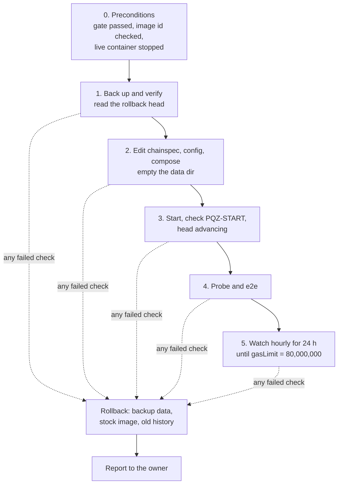

# P6f runbook — the copy (executed) and the live roll-out on the SCaaS testnet (Task 10)

This runbook is the step-by-step procedure for switching on the PQZ and ML-DSA precompiles
([../README.md](../README.md)) on a running chain, and for undoing it. It is for whoever operates the chain host: the
owner, or the controller session the owner has allowed to back up, reset and deploy the SCaaS testnet (owner decision
2026-10-15). Every step was first rehearsed on a throwaway **copy** of the SCaaS testnet, then run on the real chain.

**Status (all executed):**

| Procedure | Date | Log |
|---|---|---|
| [The copy](#the-copy-tasks-78) — rehearsal of both activation paths (Tasks 7–8); gate passed | 2026-10-15 / 16 | `../runs/*-copy-*.txt`, `../runs/2026-10-15-rehearsal.txt` |
| [Live roll-out on the SCaaS testnet](#live-roll-out-on-the-scaas-testnet-task-10-executed-2026-10-16) — back up, reset with the precompiles from block 0 (Task 10, image `pqz1`) | 2026-10-16 | `../runs/2026-10-16-live.txt` |
| [The multi-recipient transfer (op 7)](#the-multi-recipient-transfer-op-7-on-the-scaas-testnet-executed-2026-10-17) — a second schedule on the running chain (image `pqz2`) | 2026-10-17 | `../runs/2026-10-17-s8-live*.txt` |
| [Nethermind 2.2.0 and Amsterdam](#nethermind-220-and-amsterdam-on-the-scaas-testnet-executed-2026-10-21) — reset onto image `2.2.0-pqz3`, Amsterdam from block 1 | 2026-10-21 | `../runs/2026-10-21-testnet-2.2.0.txt` |
| [Genesis gasLimit 200 M](#genesis-gaslimit-200-m-on-the-scaas-testnet-executed-2026-10-22) — the same chain reset with a 200 M genesis block | 2026-10-22 | `../runs/2026-10-22-testnet-200m.txt` |
| [Image 2.2.0-pqz4: per-set ids, 32-bit addresses](#image-220-pqz4-on-the-scaas-testnet-executed-2026-10-25) — reset (path B, no backup) onto the plan 5h Task 8d part 1 library (`n2304-kmax4096`) with provisional rows | 2026-10-25 | `../runs/2026-10-25-pqz4-live.txt` |
| [Image 2.2.0-pqz5: the R0 review fix part b ids](#image-220-pqz5-on-the-scaas-testnet-executed-2026-10-26) — reset (path B, no backup) onto the part b library (`n2304-kmax4096`, PQZL v5 / PQZH v3) with provisional rows | 2026-10-26 | `../runs/2026-10-26-pqz5-live.txt` |
| [Node split: sealer + rpc](#node-split-sealer--rpc-owner-2026-10-31) — the single node split into a key-holding `sealer` (no port, internal network) and a key-less archive `rpc` (public RPC, sentry for external nodes); Blockscout on `rpc` | 2026-10-31 | `../runs/2026-10-31-pqz6-live.txt` § S |

The commands below are the ones that were executed. Steps marked *live only* ran on the SCaaS testnet itself; everything else
ran on the copy. Plan: [P6f](../../../docs/superpowers/plans/2026-10-14-p6f-precompiles.md) Tasks 7, 8, 10; spec:
[pq-zero-knowledge.md §10](../../../docs/contracts/pq-zero-knowledge.md#chain-integration). Logs of the executed runs:
[`../runs/`](../runs/).

**Scripts at `349b96b8` (R0 review fix part b) and later target image `2.2.0-pqz5`, live on the SCaaS testnet since
2026-10-26** (the part b ids PQZL v5 / PQZH v3; the scripts of `pqz-8d1`, plan 5h Task 8d part 1, targeted `2.2.0-pqz4`
with PQZL v4 / PQZH v2): `e2e.py`, `patch-chainspec.py` and the plugin use the 32-bit addresses
`0x000000000000000000000000000000005caa0f01` / `…5caa0012` / `…5caa0013`, and `e2e.py` / `corpus.py` take the self-test
hash, `MAX_INPUT` and the vectors of `PQZ_SET` (default `n2304-kmax4096`, the library's set). For an older image
(`2.2.0-pqz3` and before: P6f D3's `0x5caa50…0f01` / `…0012` / `…0013`, the `n2048-kmax1024` library, the old-id rows)
run the scripts of that image's commit.

**Chain roles** (owner 2026-10-15): **the SCaaS testnet (chain id 7622) is the test chain**, and its data may be reset. **22776 is the future
mainnet** (owner only; not built). Chain 22776 gets the precompiles only after the production gates — the external
audit and the G-LIC written licence clearance ([pq-zero-knowledge.md CTR-PQZ-01](../../../docs/contracts/pq-zero-knowledge.md),
the licence inventory) — with `engine.Pqz` in its genesis from block 0 and the same addresses.

**Words used here**

| Term | Meaning |
|---|---|
| chain host | the machine that runs the SCaaS testnet: live directory `/home/dockers/mba-chain-nethermind`, container `mba_chain_node_nethermind` (service `blockchain-node`) until 2026-10-31, then `mba_chain_sealer` + `mba_chain_rpc` (services `sealer`, `rpc`; [node split](#node-split-sealer--rpc-owner-2026-10-31)), RPC `http://127.0.0.1:8545`; the procedures below ran on the single node and keep its names |
| copy | a replica of the SCaaS testnet with a throwaway signer key, run from `scratchpad/p6f-copy` (containers `pqzcopy-*`) |
| chainspec | the chain's JSON configuration (`genesis.json`); the precompiles are switched on by its `engine.Pqz` section |
| schedule, T | one entry of `engine.Pqz.schedules`: gas prices that apply from its timestamp T on |
| stock image | the unmodified Nethermind image (`nethermind/nethermind:1.39.0` in the copy and the roll-out of 2026-10-16); it ignores `engine.Pqz` |
| probe | `probe.sh` / `e2e.py probe`: read-only calls that check chain id, genesis hash, self-test, every test vector and its gas |
| e2e | `e2e.py e2e`: real transactions that call the precompiles through a test contract |
| rollback head | the last block of the old chain, read from the backup in step 1; after a rollback the head must equal it |

## Two activation paths (both tested on the copy)

| Path | When | chainspec | Data |
|---|---|---|---|
| **A. Transition timestamp** (an upgrade of a running chain) | 22776 later, any chain upgrade, a re-price or a new op such as the multi-recipient transfer (`R_TXM`, op 7), added as a second schedule | `engine.Pqz.schedules[0].timestamp` = T in the future; history before T is unchanged; a proofSystemId change at T: a node with the new library starts only once its head has reached T − 1, a node with the old library is refused at any restart once the schedule is in the chainspec, a fresh node needs a data copy past T; with a block period the last block before T usually lies below T − 1, so the swap comes after T and the old-library nodes (old chainspec) seal the first blocks at or after T under the old ids — send no PQZ call between T and the swap (`pq-zero-knowledge.md` §9.1) | kept |
| **B. From genesis** (a new chain, the SCaaS testnet reset, owner 2026-10-15) | Task 10 on the SCaaS testnet (used on 2026-10-16) | `engine.Pqz` with the first timestamp = the genesis timestamp (0 on 7622): active in every block | fresh (the old data dir is backed up, not used) |

The plugin refuses a first timestamp *before* genesis; a timestamp equal to genesis is path B.
`patch-chainspec.py` is stricter (review CHAIN-02): without `--testnet-reset` the first timestamp must lie at least
5 minutes in the future, as in `add-schedule.py`; with it, the timestamp must equal the genesis timestamp.

## The copy (Tasks 7–8)

**What it is.** The copy is a **replica** of the SCaaS testnet: the live chainspec's parameters, engine and genesis header
(`../Nethermind.Pqz.Test/chainspecs/genesis-7622.json`) with a throwaway signer key in `extraData`. The stock image
first produces some history on it. The live directory is never read beyond read-only `cat` / `ls` /
`docker image inspect`, and no live data or key material is copied. As a result the copy's genesis hash is its own,
not the SCaaS testnet's (`0x24e43dcb…c464` then, `0xa17faef4…2ac2` since the 200 M genesis reset of 2026-10-22,
`0xf1f491abec46eb7c1784b7fc75a0174171b41831530e510c46b7178c02d63164` since the `2.2.0-pqz6` reset of 2026-10-31); on the
live chain, step 2 of the probe checks the live hash.

**Changes the copy needed** (found in runs `2026-10-1[56]-copy-*.txt`):

- the history chainspec `genesis.stock.json` adds `eip4895TransitionTimestamp` 0 and `maximumExtraDataSize` `0xffff`
  (with the SCaaS testnet's parameters as they are, no follower can sync);
- path B starts from the faithful replica `genesis.faithful.json` with `--testnet-reset`, exactly as Task 10 does;
- both node configs set `Network.FilterPeersByRecentIp` false (otherwise a restarted follower was refused for minutes);
- `copy.sh up` starts the signer first.

**Commands.** Run from the repository root on the dev host. The comments say what each group demonstrates. The image
tags are those of the 2026-10-15 / 16 run (the stock `nethermind/nethermind:1.39.0`, `scaas/nethermind-pqz:1.39.0-pqz1`;
`E` was `engine-pqz.json` then). `copy.sh up` takes any image, so a rehearsal today passes the current image and the
set's engine file (`E` below); the copy has not been re-run since 2026-10-17.

```sh
C=pqz-core/nethermind/chain
E=pqz-core/nethermind/chain/engine-pqz-provisional-n2304.json  # the set's engine file (engine-pqz-provisional-<n>.json per set, R0 review fix part b;
                                                        # engine-pqz.json = the retired v3 / PQZH v1 calibration, refused at start-up), timestamp patched below
$C/copy.sh init                                         # key, password, genesis.stock.json, configs (scratchpad/p6f-copy)
$C/copy.sh up nethermind/nethermind:1.39.0 genesis.stock.json      # history with the stock image
python3 -I $C/e2e.py head
$C/copy.sh down && $C/copy.sh backup pre                # the rollback point (data dirs, chainspecs, configs)
# G2 demonstration: the stock image with engine.Pqz ignores it
$C/copy.sh patch $E $(( $(date +%s) + 360 ))
$C/copy.sh up nethermind/nethermind:1.39.0 genesis.pqz.json   # after T:
python3 -I $C/e2e.py stock --engine $C/../../../scratchpad/p6f-copy/genesis.pqz.json  # the probe FAILS (recorded)
$C/copy.sh down && $C/copy.sh restore pre
# Path A: step 1 (image, future T), before-T probe, step 2 after T, e2e
$C/copy.sh patch $E $(( $(date +%s) + 600 ))
$C/copy.sh up scaas/nethermind-pqz:1.39.0-pqz1 genesis.pqz.json
docker logs pqzcopy-signer 2>&1 | grep PQZ-START
BEFORE=1 $C/probe.sh $E
$C/probe.sh $E                                           # after T
python3 -I $C/e2e.py e2e --engine $E --key <throwaway key>
# Path B: a fresh chain with engine.Pqz from block 0
$C/copy.sh down && $C/copy.sh backup pathA && $C/copy.sh wipe
$C/copy.sh genesis0 $E && $C/copy.sh up scaas/nethermind-pqz:1.39.0-pqz1 genesis.pqz0.json
$C/probe.sh $E && python3 -I $C/e2e.py e2e --engine $E --key <throwaway key>
```

**Task 8, the rehearsal (the gate before the live chain):**

1. Burst: `e2e.py burst` (step 5 of spec §10).
2. The 80 M ramp: `watch.sh` until `gasLimit` = 80,000,000, then `e2e.py fill`.
3. The kill drill: `docker kill -s KILL pqzcopy-signer` during `e2e.py fill`, restart; the block hashes must agree.
4. The rollback rehearsal: `copy.sh down`, `copy.sh restore pre`, the stock image; the head must equal the recorded head.

Results: `../runs/*-copy-*.txt`, `../runs/*-rehearsal.txt`.

## Live roll-out on the SCaaS testnet (Task 10, executed 2026-10-16)

*Live only.* **Executed on 2026-10-16** with image `pqz1`; log `../runs/2026-10-16-live.txt`. It ran `pqz2` from
2026-10-17 ([op 7 section](#the-multi-recipient-transfer-op-7-on-the-scaas-testnet-executed-2026-10-17)); the image
today is in the status table above.

**The decision** (owner 2026-10-15, TODO.md, explicit): once the copy gate (Tasks 7–9) passes, back up the current
SCaaS testnet data, then **reset** the SCaaS testnet with a fresh genesis carrying the precompiles from block 0 (path B). Keep chain id
7622, the gas limit 16,777,216, the ports and the signer.

**Why the genesis hash does not change.** The genesis **block** stays byte-identical, so the genesis hash stays
`0x24e43dcbfc9624b23bf89409acd104d6e5671e2c41d8c192373d65519321c464` (it is pinned in tests, vectors and
`chain-uids.json`). `engine.Pqz` and the three `--testnet-reset` params (`eip4895TransitionTimestamp` 1,
`maximumExtraDataSize` `0xffff`, `maxCodeSizeTransition` 0 — rehearsed as path B on the copy) are not part of the
genesis header. The old history is discarded; it stays in the backup.

**Rules.** Write every command and its output into `pqz-core/nethermind/runs/<date>-live.txt`. If any step fails, run
the [rollback](#rollback), then report. Do not improvise.



### Step 0: preconditions

Who: the operator, on the chain host. All must hold before step 1:

1. The gate passed: `../runs/*-rehearsal.txt`.
2. The image is the one the gate used: `docker image inspect scaas/nethermind-pqz:1.39.0-pqz1 --format '{{.Id}}'`
   prints the same id.
3. The live container is stopped: `docker inspect -f '{{.State.Status}}' mba_chain_node_nethermind` prints `exited`.
   If not, stop it with `docker compose stop -t 120 blockchain-node` (in `/home/dockers/mba-chain-nethermind`).
4. The probe and e2e inputs exist in the repository (the 2026-10-16 run had to rerun its probe because they were
   missing): the forge artifact `smartcontracts/evm/out/PqzPrecompileProbe.sol/PqzPrecompileProbe.json` (build it in
   `smartcontracts/evm` with `forge build test/p6f/PqzPrecompileProbe.sol`) and `pqz-core/nethermind/bin/corpus.jsonl`
   (step 1 of [Build and test](../README.md#build-and-test)).

### Steps 1–5

Run in one shell on the chain host. First set the variables; replace `<repo>` with the path of the repository
checkout. From `cd $L` on, the working directory is the live directory, so `genesis.json`, `config.json` and
`docker-compose.yml` are the live files.

```sh
L=/home/dockers/mba-chain-nethermind
C=<repo>/pqz-core/nethermind/chain
E=$C/engine-pqz.json
TS=$(date +%Y%m%d-%H%M%S)
B=/home/dockers/mba-chain-nethermind-backups/pqz-$TS          # dated, outside the repo and outside $L
A="docker run --rm --memory 512m -v $L:/l -v $(dirname $B):/b alpine:3"
cd $L
```

**Step 1 — back up, verify the backup, and read the rollback head.** The backup holds the chainspec, config, compose
file, password, keystore (the keys) and the data dir. Keep it until the owner deletes it.

```sh
# 1. Backup: chainspec, config, compose, password, keystore (keys), data dir; kept until the owner deletes it
mkdir -p $B && cp -p genesis.json config.json docker-compose.yml password.txt $B/
$A sh -c "cp -a /l/keystore /l/data/nethermind_data /b/pqz-$TS/"
#    readable and identical: sha256 manifests of every file, live vs backup (paths relative), then sizes
$A sh -c "cd /l/data/nethermind_data && find . -type f | sort | xargs sha256sum" > $B.live-data.sha256
$A sh -c "cd /b/pqz-$TS/nethermind_data && find . -type f | sort | xargs sha256sum" > $B.backup-data.sha256
cmp $B.live-data.sha256 $B.backup-data.sha256 && echo "data backup identical: $(wc -l < $B.live-data.sha256) files"
(cd $B && sha256sum genesis.json config.json docker-compose.yml password.txt) ; diff <(cd $L && sha256sum genesis.json config.json docker-compose.yml password.txt) <(cd $B && sha256sum genesis.json config.json docker-compose.yml password.txt)
$A du -s /l/data/nethermind_data /b/pqz-$TS/nethermind_data /b/pqz-$TS/keystore
#    the rollback head, read from a scratch copy of the BACKUP by the stock image (no mining, no keys, no peers):
#    also proves the backup opens
S=<repo>/scratchpad/p6f-livecheck && mkdir -p $S
docker run --rm --memory 512m -v $(dirname $B):/b -v $S:/s alpine:3 cp -a /b/pqz-$TS/nethermind_data /s/data
python3 -I - $L/config.json $S/config.json <<'PY2'
import json, sys
c = json.load(open(sys.argv[1])); c["Init"]["IsMining"] = False; c["Mining"] = {"Enabled": False}; c.pop("KeyStore")
c["JsonRpc"].pop("AdditionalRpcUrls", None); c["Network"] = {"MaxActivePeers": 0}
json.dump(c, open(sys.argv[2], "w"), indent=2)
PY2
docker run -d --name p6f-livecheck --memory 2g -p 127.0.0.1:18547:8545 -v $S/data:/nethermind/nethermind_datadir \
  -v $B/genesis.json:/nethermind/genesis.json:ro -v $S/config.json:/nethermind/config.json:ro \
  nethermind/nethermind:1.39.0 --config /nethermind/config.json --datadir /nethermind/nethermind_datadir
# (after ~30 s) the head of the old history = the rollback head; genesis hash = 0x24e43dcb…c464
python3 -I $C/e2e.py head --rpc http://127.0.0.1:18547
docker rm -f p6f-livecheck && docker run --rm -v $S:/s alpine:3 rm -rf /s/data
```

Success: `data backup identical: <n> files` is printed; the `diff` of the four config files prints nothing; the live
and backup sizes from `du` match closely; `e2e.py head` prints the old head and the genesis hash `0x24e43dcb…c464`.
Write that head (number and hash) into the log: it is the **rollback head**.

**Step 2 — edit the chainspec, config and compose file, then empty the data dir.** This is the first step that changes
the live chain. On 2026-10-16 the owner approved that the controller runs it in its own session (the first attempt was
blocked by the permission system; the live files were checked unchanged by sha256 before the retry).

```sh
# 2. Edits (diff of each against its backup into the log)
python3 -I $C/patch-chainspec.py $B/genesis.json $E 0 $L/genesis.json --testnet-reset
python3 -I - config.json <<'PY2'
import json, sys
c = json.load(open(sys.argv[1]))
c.setdefault("TxPool", {})["MaxTxSize"] = 1048576
c.setdefault("Blocks", {})["TargetBlockGasLimit"] = 80000000
json.dump(c, open(sys.argv[1], "w"), indent=2)
PY2
sed -i 's#image: nethermind/nethermind:1.39.0#image: scaas/nethermind-pqz:1.39.0-pqz1\n    mem_limit: 4g#' docker-compose.yml
diff $B/genesis.json genesis.json; diff $B/config.json config.json; diff $B/docker-compose.yml docker-compose.yml
$A sh -c 'rm -rf /l/data/nethermind_data && mkdir /l/data/nethermind_data'     # fresh chain; the old data is in $B
```

Success: the three diffs show only the intended changes — `genesis.json` gains `engine.Pqz` and the three
`--testnet-reset` params; `config.json` gains `TxPool.MaxTxSize` and `Blocks.TargetBlockGasLimit`;
`docker-compose.yml` switches the image to `scaas/nethermind-pqz:1.39.0-pqz1` and adds `mem_limit: 4g`.

**Step 3 — start the node and check its health.**

```sh
# 3. Start and health
docker compose up -d blockchain-node
docker logs mba_chain_node_nethermind 2>&1 | grep -E '^PQZ-START|PQZ-REFUSE'   # sha256 = image label, selftest, schedule ts 0x0, addresses
$C/watch.sh mba_chain_node_nethermind http://127.0.0.1:8545 10m                 # head advancing every 5 s
python3 -I $C/e2e.py head --rpc http://127.0.0.1:8545
```

Success: one `PQZ-START` line whose library sha256 equals the image label, with the self-test hash, schedule timestamp
`0x0` and the three addresses; no `PQZ-REFUSE`; the head advances every 5 s.

**Step 4 — probes and e2e.** With path B the precompiles are active at once. The genesis hash must still be
`0x24e43dcb…c464`.

```sh
# 4. Probes and e2e (path B: at once). Genesis hash unchanged: 0x24e43dcb…c464
$C/probe.sh $E http://127.0.0.1:8545 0x24e43dcbfc9624b23bf89409acd104d6e5671e2c41d8c192373d65519321c464
python3 -I $C/e2e.py e2e --engine $E --rpc http://127.0.0.1:8545 --key <a test key funded in genesis> --no-ua
```

Success: `probe: all checks passed` and `e2e: all checks passed`, both with exit code 0. The 2026-10-16 run used the
test key `0x…04` (address `0x1efF47bc…A718`, funded in genesis); the test key `0x…05` is not funded and is refused
by the pool.

**Step 5 — watch.**

```sh
# 5. Watch: hourly for 24 h (cron line or manual), until gasLimit = 80,000,000
$C/watch.sh mba_chain_node_nethermind http://127.0.0.1:8545 1h
```

Success: hourly for 24 h no fault tags and the head advancing, and `gasLimit` reaches 80,000,000.

### Rollback

When: any failed check in steps 1–5. Same shell and variables as above, on the chain host. It returns to the backup
and the stock image, with the old history.

```sh
# Rollback (on any failed check): back to the backup and the stock image, the old history
docker compose down
cp -p $B/genesis.json $B/config.json $B/docker-compose.yml $L/
$A sh -c "rm -rf /l/data/nethermind_data && cp -a /b/pqz-$TS/nethermind_data /l/data/nethermind_data"
docker compose up -d blockchain-node      # head hash = the rollback head of step 1
```

Success: the head hash equals the rollback head written down in step 1. Then report to the owner.

### Health checks after any restart

- `PQZ-START` is present in the log, and there is no `PQZ-REFUSE` or `PQZ-NODE-FAULT`.
- The head advances every 5 s.
- `eth_chainId` = `0x1dc6`.
- `OP_SELFTEST` (op 6) = `d6c01fbc…6f68d` (images `2.2.0-pqz5` / `2.2.0-pqz6`, set `n2304-kmax4096`; `23d7a1db…c97c0` on `2.2.0-pqz4`, `ed910a2c…d205` before).

A node fault (plan D4) stops the node with exit code 120 and the tag `PQZ-NODE-FAULT` in its log. The block in
progress is never sealed; a restart (`docker compose up -d blockchain-node`) re-processes it. The node has no restart
policy: choosing one is the owner's decision (owner step 3 of the P6f plan), so after a fault someone must restart it
by hand.

**No public RPC on the signer (review W-H, 2026-10-19; a rule, not a code change).** The exit path above runs in
whatever thread calls the precompile, `eth_call`, `eth_estimateGas` and tracing included, and the PQZL verifier's
process-wide lock is shared by RPC calls and block import. A node that serves RPC to anyone can therefore be stopped
(a node fault inside an `eth_call`) or slowed (calls queueing on the lock) by its callers. So the signer's JSON-RPC
must be reachable from the chain host only; public RPC goes to a follower behind the rate-limited proxy
(`config.follower.json`, `nginx-rpc.conf`; the copy publishes it on `127.0.0.1:18545`), whose exit stops only that
follower. **On the SCaaS testnet** the live `docker-compose.yml` (read 2026-10-19) publishes `8545:8545` and `8546:8546` on every
host interface; **accepted for the testnet (owner 2026-10-19)**: no firewall or binding change. The rule above binds
mainnet 22776. Since the node split (2026-10-31) 7622 follows it too: the sealer serves no RPC beyond its container
loopback, and the public endpoints are on `rpc`. A start-up refusal
`PQZ-REFUSE … sha256 … != the reviewed …` means the image's `libpqz_ffi.so` is not the reviewed build (review W-G):
use an image built by `build-image.sh` from the reviewed commit.

### Owner steps outside this runbook

- The follower node and the rate-limited public RPC that the rule above asks for on mainnet 22776 (not needed on the
  SCaaS testnet, owner 2026-10-19). The copy's `docker-compose.copy.yml`, `config.follower.json` and `nginx-rpc.conf`
  are the rehearsed configs.
- A restart policy for the node (the live `docker-compose.yml` has none: after a host restart the node stays stopped
  until someone runs `docker compose up -d blockchain-node`).
- When to delete the backups left in the live directory: `genesis.json.bak-pre-200m-20261022`,
  `data/nethermind_data.pre-200m-20261022`, `genesis.json.bak-pqz4-20261026`, `docker-compose.yml.bak-pqz4-20261026`
  (listed 2026-10-26; the dated `pqz-<TS>` / `op7-<TS>` directories of `/home/dockers/mba-chain-nethermind-backups/`
  were empty then).

## The multi-recipient transfer (op 7) on the SCaaS testnet (executed 2026-10-17)

*Live only;* plan P6-ANON S8. This added the multi-recipient transfer (`R_TXM`, op 7) to the running chain.

**What changed.** The chain kept running and kept its data (path A). Three things were added:

- a second `engine.Pqz` schedule at a future timestamp T: the live rows unchanged, plus one row per built
  multi-recipient shape `(proofSystemId, M, auditorOn)` (plugin rows with `legs` / `auditorOn`, plan D19), taken from
  the multi-recipient calibration (`../runs/2026-10-17-calib-ops7*`);
- the image `scaas/nethermind-pqz:1.39.0-pqz2`, whose plugin reads the multi-recipient transfer's header words; it
  must run before T;
- nothing else: the chain data is kept.

**Rehearsed first** on a fresh copy (`../runs/2026-10-17-s8-copy-*`): pqz1 → pqz2 with the data kept; before T every
multi-recipient input was a miss; after T every built shape returned `…01`; e2e 86 ok. Live log:
`../runs/2026-10-17-s8-live*.txt` (probe 389 ok before and after T = 1792205116, e2e 76 ok).

**Who and where:** the operator, on the chain host, in one shell; replace `<repo>` with the path of the repository
checkout. First set the variables and stop the node (the first four lines of the block below). The numbered steps
match the comments in the block:

1. Back up exactly as in [Task 10 step 1](#steps-15): the chainspec, config, compose file, password, keystore and data,
   with the sha256 manifests compared. The backup lands in `$B` (`op7-$TS`), so in those commands write `op7-$TS`
   wherever they say `pqz-$TS`.
2. Add the second schedule (the script refuses a T less than 5 minutes ahead; since review W-F, 2026-10-19, it also
   refuses a calibration file with more than one schedule, one that lacks a row of the replaced ops the last schedule
   has, and a duplicate row), switch the image to `pqz2`, start the
   node, and copy the live `engine.Pqz` into `$C/engine-pqz.json` for the probes. Success: `PQZ-START` shows library
   `4fc1a6a2…`, self-test `ed910a2c…` and two schedules.
3. Before T: probe with schedule 0. Success: every multi-recipient input is a miss (smallest row, `…00`, no FFI call).
4. After T: probe and e2e. Success: every built shape returns `…01` at its row, every negative returns `…00`, and the
   e2e transactions with the test key `0x…04` pass.

```sh
L=/home/dockers/mba-chain-nethermind; C=<repo>/pqz-core/nethermind/chain
TS=$(date +%Y%m%d-%H%M%S); B=/home/dockers/mba-chain-nethermind-backups/op7-$TS
A="docker run --rm --memory 512m -v $L:/l -v $(dirname $B):/b alpine:3"
cd $L && docker compose stop -t 120 blockchain-node
# 1. backup as in Task 10 step 1 (chainspec, config, compose, password, keystore, data; sha256 manifests compared)
# 2. the second schedule (refuses a T less than 5 minutes ahead) and the image
T=$(( $(date +%s) + 900 ))
python3 -I $C/add-schedule.py $B/genesis.json <repo>/pqz-core/nethermind/runs/2026-10-17-calib-ops7-engine-pqz.json $T $L/genesis.json
sed -i 's#scaas/nethermind-pqz:1.39.0-pqz1#scaas/nethermind-pqz:1.39.0-pqz2#' docker-compose.yml
docker compose up -d blockchain-node      # PQZ-START: library 4fc1a6a2…, self-test ed910a2c…, two schedules
python3 -I -c "import json; json.dump(json.load(open('$L/genesis.json'))['engine']['Pqz'], open('$C/engine-pqz.json', 'w'), indent=2)"
# 3. before T: every multi-recipient inputs a miss (smallest row, …00, no FFI call)
python3 -I $C/e2e.py probe --engine $C/engine-pqz.json --schedule 0 --rpc http://127.0.0.1:8545 --genesis-hash 0x24e43dcb…c464
# 4. after T: every built shape …01 at its row, negatives …00; transactions with the test key 0x…04
python3 -I $C/e2e.py probe --engine $C/engine-pqz.json --rpc http://127.0.0.1:8545 --genesis-hash 0x24e43dcb…c464
python3 -I $C/e2e.py e2e --engine $C/engine-pqz.json --rpc http://127.0.0.1:8545 --key <test key 0x…04> --no-ua
# Rollback before T: stop, restore genesis.json + docker-compose.yml from $B (pqz1, one schedule), start; the data
# needs no restore (no block used the second schedule). After T: Task 10's rollback with $B's data.
```

**Rollback:**

- **Before T:** stop the node, restore `genesis.json` and `docker-compose.yml` from `$B` (image `pqz1`, one schedule),
  start it again. The data needs no restore, because no block has used the second schedule yet.
- **After T:** run [Task 10's rollback](#rollback) with `$B`'s data, again writing `op7-$TS` where it says `pqz-$TS`.
  This returns the chain to its state at the op 7 backup.

## Nethermind 2.2.0 and Amsterdam on the SCaaS testnet (executed 2026-10-21)

*Live only.* The owner's instruction (2026-10-21): reset the SCaaS testnet directly with the new image and Amsterdam
active, **no backup**. Nothing was deleted: the 1.39.0 data dir was renamed to
`data/nethermind_data.pre-2.2.0-20261021`, and the three edited files got `*.bak-1.39.0-20261021` copies (the live
directory's convention); deleting them is the controller's call.

**Why a reset and not a fork at a future timestamp.** The owner allowed and then asked for a reset; it also gives a
fresh flat-DB (2.x default for a new node) instead of a 1.39.0 patricia DB carried forward. An in-place fork would
work the same way with `eip<N>TransitionTimestamp` = T > now (Clique forks by timestamp like any chain).

**What changed** (script `../runs/2026-10-21-testnet-reset-2.2.0.sh`, steps `reset` and `check`):

- `genesis.json`: `eip<N>TransitionTimestamp` = 1 for EIP-2780, 7708, 7778, 7928, 7954, 7976, 7981, 8024, 8037, 8038,
  8246. Timestamp 1, not 0: the genesis (timestamp 0) stays a pre-Amsterdam block, so its header and hash
  `0x24e43dcb…c464` do not change (the same trick as `eip4895TransitionTimestamp` 1). Left out: EIP-7843 (SLOTNUM; the
  Clique producer sets no slot number and 2.2.0's header validator rejects the block) and EIP-8282 (builder requests,
  CL predeploys). `engine.Pqz` unchanged (two schedules, PQZL v2 rows). The file was rewritten by `json.dump` with
  indent 2, so its diff is mostly whitespace.
- `config.json`: `Blocks.TargetBlockGasLimit` 80,000,000 → 200,000,000 (a 64 KiB deploy needs ≈ 100 M of state gas
  and a block bigger than its `tx.gas`; the limit ramps by 1/1024 per block, ≈ 2.5 h from 16.8 M to 100 M); `Init.IsMining`
  removed (2.2.0: "Invalid configuration settings"; `Mining.Enabled` is the key).
- `docker-compose.yml`: image `scaas/nethermind-pqz:2.2.0-pqz3`.

**Checks** (all in the log): `PQZ-START` with library `16dd99ce…`, self-test `ed910a2c…`, both schedules; blocks every
5 s with a `blockAccessListHash` in the header; `eth_chainId` 0x1dc6; genesis hash unchanged; `e2e.py probe` all
checks passed with the reviewed library's corpus (`--corpus bin/corpus-ffi-1adbd563.jsonl`), every input whose
calldata floor exceeds 2^24 refused by `eth_call`; `e2e.py e2e` all checks passed (76), the same inputs refused by the
pool; one ordinary value transfer (21,000 gas = 12,000 + 3,000 + 6,000, with its EIP-7708 log). **Not run in this
reset** (it passed after the [200 M genesis reset](#genesis-gaslimit-200-m-on-the-scaas-testnet-executed-2026-10-22)):
`e2e.py codesize` (65,536 B of code must deploy, 65,537 B fail). It needs a block gas limit above its `tx.gas` of
110 M, and after the reset the limit ramps from the genesis `gasLimit` 0x1000000 (16,777,216) toward
`TargetBlockGasLimit` 200 M by only 1/1024 per block: ≈ 1,780 blocks (≈ 2.5 h) to 110 M, ≈ 2,540 blocks (≈ 3.5 h) to
200 M (block 856 was at 38.7 M). Re-run once `gasLimit` > 111 M (the command waits by itself):
`python3 -I pqz-core/nethermind/chain/e2e.py codesize --rpc http://127.0.0.1:8545 --key <test key 0x…04>`.

**After any reset** the same ramp applies: until the limit has climbed, a transaction whose `tx.gas` exceeds the
current block gas limit is not included (EIP-8037 reserves `tx.gas` in the state dimension), so large deploys wait.
Changing the genesis `gasLimit` would change the genesis hash.

**Rollback** to 1.39.0 (not needed, and no longer possible: neither the `*.bak-1.39.0-20261021` files nor
`data/nethermind_data.pre-2.2.0-20261021` are in the live directory on 2026-10-26): stop the node, put the three
`*.bak-1.39.0-20261021` files back, swap the data dirs back (`data/nethermind_data.pre-2.2.0-20261021` →
`data/nethermind_data`), start. The 1.39.0 head is the one in that data dir.

**Amsterdam rules the operator must know** ([gas impact](../runs/2026-10-21-glamsterdam-gas-impact.md)): `tx.gas` may
exceed 2^24 (up to 2^32 − 1) but execution gas may not; the calldata floor is 64 gas per byte and must stay ≤ 2^24, so
a transaction carries at most ≈ 261,909 calldata bytes; a transaction's `tx.gas` must fit the block gas limit (EIP-8037
reserves it in the state dimension); new storage slots cost 97,920 state gas and code 1,530 per byte.


## Genesis gasLimit 200 M on the SCaaS testnet (executed 2026-10-22)

*Live only.* Owner 2026-10-22: reset the SCaaS testnet now so blocks are 200 M from block 0 ("Reset ngay để có 200 M
sớm, không cần chạy tải"); no load rehearsal, no burst / fill drill, no calibration. Everything else stays as on
2026-10-21: image `scaas/nethermind-pqz:2.2.0-pqz3`, the same `engine.Pqz` (two schedules, PQZL v2 rows) and params
(Amsterdam from timestamp 1), `config.json` (`TargetBlockGasLimit` already 200 M), compose, ports and keys. No chain-data
backup (owner 2026-10-21); the data dir is renamed, `genesis.json` gets a `.bak-pre-200m-20261022` copy.

**Status: executed 2026-10-22** by the controller (log `../runs/2026-10-22-testnet-200m.txt`, script
`../runs/2026-10-22-testnet-reset-200m.sh`, rehearsed first on throwaway chains, `../runs/2026-10-22-genesis-200m-throwaway.txt`).
Image `scaas/nethermind-pqz:2.2.0-pqz3` = `sha256:b3f6c855b2d2adbcf1fa6f6453e931cd54b79467e7e5f023e8642aae43a93b14`;
`PQZ-START` with library `16dd99ce…`; genesis `0xa17faef497fa29ec90603969dad0176ea18fd1cc2eaf0f9f4fa2dacc9c952ac2` (as
predicted), block 1 `0xca1fbc04d57f83aa20993bb097be1f5801b1fff4d1505a00926dce4e9024f012`, `gasLimit` 200,000,000 from
block 0; probe all checks passed (with the `eth_estimateGas` row: 3,394,851 vs exact 3,366,962); e2e `--no-ua` all checks
passed; `codesize`: 65,536 B deployed at once in block 46 (100,504,388 gas), 65,537 B refused. The e2e part of the log
holds two interleaved check runs started at the same time with the same key: one hit a nonce clash ("replacement
transaction underpriced"), the other passed fully — an operator slip, not a chain fault. Redeployed by the checks: the
probe contract of `e2e.py e2e` and the two `codesize` contracts; nothing else (the PQZ / UA stack is redeployed with
plan fs3 Task 13). Afterwards `smartcontracts/evm/chain-uids.json` `private7622`, `scaas-node/node.example.toml` and
`docs/networks/evm.md` carry the new genesis hash (commit `00d791b0`). A gas-less `eth_call` of a call with total gas
> 2^24 and regular < 2^24 succeeds on the reset chain (`../runs/2026-10-22-testnet-gasless-call.txt`).

```sh
sh pqz-core/nethermind/runs/2026-10-22-testnet-reset-200m.sh reset   # stop, .bak, patch-chainspec --testnet-reset, rename data, start
sh pqz-core/nethermind/runs/2026-10-22-testnet-reset-200m.sh check   # head, block 0 / 1, probe (+ eth_estimateGas row), e2e --no-ua, codesize
```

`reset` refuses to go on unless the semantic diff of `genesis.json` is exactly `genesis.gasLimit` `0x1000000` →
`0xbebc200`. Success: `PQZ-START` (library `16dd99ce…`), block 0 hash `0xa17faef497fa29ec90603969dad0176ea18fd1cc2eaf0f9f4fa2dacc9c952ac2`
(predicted by the throwaway run with the live genesis) and `gasLimit` 200,000,000 from block 0, probe and e2e all checks
passed, `codesize` deploys 65,536 B at once (no ramp). After it: record block 1's hash and the image id in this section
and in `../README.md`; the genesis hash is the new `chainUid` of chain 7622 (`smartcontracts/evm/chain-uids.json`
`private7622`, the chain profile's `genesis_hash`, every contract that pins `chainUid`); everything deployed on the old
chain is gone and is redeployed by its own scripts (`smartcontracts/evm/script/pqz/e2e.py` for the PQZ stack). The test
vectors that use `0x24e43dcb…c464` as a fixed `chainUid` keep it (a test constant, not the live chain's).

**Rollback:** stop the node, put `genesis.json.bak-pre-200m-20261022` back, swap the data dirs back
(`data/nethermind_data.pre-200m-20261022` → `data/nethermind_data`), start.

## Image 2.2.0-pqz4 on the SCaaS testnet (executed 2026-10-25)

*Live only.* Owner 2026-10-24: "run it on the SCaaS testnet yourself" (the controller deploys plan 5h Task 8d part 1 to
the testnet itself, instead of a copy-chain probe) and "no backup of chain 7622 needed". Log
`../runs/2026-10-25-pqz4-live.txt`; branch `pqz-16k` at `35b59a62` (8d part 1 merged with main's Nethermind 2.2 work).

1. Image: `scripts/capped pqz-core/nethermind/build-image.sh pqz4` twice — pass 1 stops at the reviewed-library check
   and prints the new library's hash; review (exports `pqz_max_input` / `pqz_precompile` only, no test hooks, no GMP /
   MPFR / HEXL, `pqz_max_input()` = 524,288), set `SelfTest.ExpectedLibrarySha256` = `0894d191…64772`, commit; pass 2
   builds `scaas/nethermind-pqz:2.2.0-pqz4` (`sha256:55037b0b…faca6`), `build-image: ok`.
2. Rows: `provisional-rows.py ../bin/corpus.jsonl engine-pqz.json engine-pqz-provisional-n2304.json` — 26 rows for the
   new ids (the live row of the same op / proof system / legs / auditor flag × 1.3; `selftestGas` 3,337,000; ML-DSA
   unchanged). **Provisional, testnet only**: plan 5h Task 9 calibrates the real prices.
3. Chainspec: `patch-chainspec.py genesis.json engine-pqz-provisional-n2304.json 0x0 genesis.new.json --testnet-reset`
   — engine.Pqz replaced, params and genesis header unchanged, so the genesis hash stays `0xa17faef4…2ac2`.
4. Node (stopped since 2026-10-22): install `genesis.json`, compose image `2.2.0-pqz3` → `2.2.0-pqz4`, empty
   `data/nethermind_data` (no backup), `docker compose up -d blockchain-node`.
5. Health: `PQZ-START sha256=0894d191… selftest=23d7a1db…c97c0 max_input=524288 addresses=PQZ:0x…5caa0f01,
   MLDSA44:0x…5caa0012,MLDSA65:0x…5caa0013`, 26 rows; blocks sealed from block 1.
6. Probe: `PQZ_SET=n2304-kmax4096 e2e.py probe --engine chain/engine-pqz-provisional-n2304.json --rpc
   http://127.0.0.1:8545 --genesis-hash 0xa17faef4…2ac2` — **398 ok, 0 FAIL** (chain id, genesis hash, `OP_SELFTEST`,
   every `n2304-kmax4096` PQZL / PQZH vector 1 / 0 with the formula gas, the retired ids refused, misses, ML-DSA-44 /
   -65 at the 32-bit addresses).

Not done here: contracts (plan 5h Task 8d part 2 — the testnet has no PQZ contracts until their redeploy, fs3 Task
13), the calibration (Task 9).

## Image 2.2.0-pqz5 on the SCaaS testnet (executed 2026-10-26)

*Live only.* Owner 2026-10-26: "làm roll-out testnet đi" (roll the R0 review fix part b out to the testnet); no backup
of chain 7622's data (owner 2026-10-24). Logs `../runs/2026-10-26-image-pqz5.txt`, `../runs/2026-10-26-pqz5-live.txt`;
branch `pqz-16k` at `349b96b8` (part b merged).

1. Image: `CAPPED_SLOTS=4 CAPPED_MEM=3G FFI_REV=349b96b8 scripts/capped pqz-core/nethermind/build-image.sh pqz5` —
   library `dd0e7668…e5601` = `SelfTest.ExpectedLibrarySha256` of `n2304-kmax4096` (one pass, no new hash to review),
   corpus 877 inputs, `scaas/nethermind-pqz:2.2.0-pqz5` = `sha256:4d906b55…bd9334`, `build-image: ok`. Start-up check
   (throwaway container, fresh volume, the new genesis): `PQZ-START sha256=dd0e7668… selftest=d6c01fbc…6f68d
   set=n2304-kmax4096`, genesis `0xa17faef4…2ac2`.
2. Chainspec: `patch-chainspec.py genesis.json engine-pqz-provisional-n2304.json 0x0 <out> --testnet-reset` — only the
   rows' ids change (`0xe4bc6d17…` / `0x15d16d77…` → PQZH v3 `0x046859a8…` / PQZL v5 `0xef1ffbcb…`), params and genesis
   header unchanged, so the genesis hash stays `0xa17faef4…2ac2`. Provisional prices (× 1.3) until plan 5h Task 9.
3. Node (stopped since the host shutdown of 2026-10-25): `.bak-pqz4-20261026` copies of `genesis.json` and
   `docker-compose.yml`, install `genesis.json`, compose image `2.2.0-pqz4` → `2.2.0-pqz5`, the pqz4 chain data deleted,
   `docker compose up -d blockchain-node`.
4. Health: `PQZ-START sha256=dd0e7668… selftest=d6c01fbc…6f68d max_input=524288 … set=n2304-kmax4096`, 26 rows; block 1
   `0x39febd49…753b08`; blocks every 5 s; no `PQZ-REFUSE` / `PQZ-NODE-FAULT`.
5. Probe: `PQZ_SET=n2304-kmax4096 e2e.py probe --engine chain/engine-pqz-provisional-n2304.json --rpc
   http://127.0.0.1:8545 --genesis-hash 0xa17faef4…2ac2` — **420 ok, 0 FAIL**. e2e: `e2e.py e2e … --key 0x…04 --no-ua`
   — **84 ok, 0 FAIL** (probe contract `0x060cc260…4ce6`, block 37; `check()` transactions in blocks 39–50).

Rollback: stop, put the two `.bak-pqz4-20261026` files back, empty `data/nethermind_data`, start (a fresh pqz4 chain;
the old pqz4 data is gone). Not done here: contracts (fs3 Task 13), the calibration (Task 9).

## Image 2.2.0-pqz6 on the SCaaS testnet (executed 2026-10-31)

*Live only;* fs3 Task 13 + plan 5h Task 9. Owner 2026-10-30: timing and the 7622 reset approved; owner 2026-10-31: rows
option (b), the CREATE2 deployer in the genesis alloc, Blockscout on with caps, the node hardened. Log
`../runs/2026-10-31-pqz6-live.txt`; the phase A / B / C commands in `../runs/2026-10-30-fs3-t13-plan.txt`.

1. Image `scaas/nethermind-pqz:2.2.0-pqz6` = `sha256:656d91d6…3e83` (`CALIB=1 build-image.sh pqz6`, 2026-10-30): library
   `dd0e7668…e5601` (byte-identical to pqz5's), plugin of plan 5h Task 8d part 2b, label `scaas.pqz.selftest` `d6c01fbc…`.
2. Rows: `chain/engine-pqz.json` = `runs/2026-10-31-fs3-t13-rows-one-baseline-engine-pqz.json` (README § Prices).
3. Backups (stack directory `L=/home/dockers/mba-chain-nethermind`): `genesis.json.bak-pre-pqz6-20261031`,
   `docker-compose.yml.bak-pre-pqz6-20261031`, and `backup-pqz5-20261031-0621/` (genesis, config, compose, password,
   keystore and the pqz5 chain data through `alpine:3 cp -a`; sha256 manifests of the 150 data files identical).
4. Genesis alloc: `0x4e59b44847b379578588920cA78FbF26c0B4956C` = `{"balance": "0", "nonce": "1", "code":
   "0x7fff…ffe03601600081602082378035828234f58015156039578182fd5b8082525050506014600cf3"}`, the runtime code of the
   deterministic deployment proxy (github.com/Arachnid/deterministic-deployment-proxy, the code anvil also puts there;
   `keccak256` = `0x2fa86add…4989`), added to `$L/genesis.json` before the patch. Then
   `patch-chainspec.py $L/genesis.json chain/engine-pqz.json 0x0 <out> --testnet-reset` (engine.Pqz replaced, params and
   header unchanged, `grep -c 7702` = 0 before and after), installed; compose image pqz5 → pqz6; data dir emptied.
5. `docker compose up -d blockchain-node` by hand (restart policy `no`). `PQZ-START sha256=dd0e7668… selftest=d6c01fbc…
   id_check_head=0 (genesis, empty database) set=n2304-kmax4096`, 26 rows at the new prices; **genesis hash
   `0xf1f491abec46eb7c1784b7fc75a0174171b41831530e510c46b7178c02d63164`** (the alloc changes the state root; new
   `chainUid`, `smartcontracts/evm/chain-uids.json`); `cast code 0x4e59…956C` = the proxy code.
6. Probe 420 ok / 0 FAIL; node e2e (`--key 0x…04 --no-ua`) 84 ok / 0 FAIL.
7. EIP-7702 off: `cast send --auth … --gas-limit 200000` → `-32000 InvalidTxType: Transaction type in Custom is not
   supported`; a distinct raw type-4 transaction (`0x04f8…`) through `cast publish` → the same; an EIP-1559 transfer
   mined (block 67).
8. Contracts: `smartcontracts/evm/script/pqz/e2e.py` full (254 ok, 2 FAIL: the per-kind list checks expected the lists
   without dave, who joins 0x0131 at his ML-DSA-65 `register` and 0x0142 when `storePqzPop` proves his key
   (UARegistry `_pqzProof`; `setPqzKey` alone lists nothing) — a script expectation, fixed in `e2e.py`), `--split` (265 ok,
   0 FAIL), and after the hardening the full run again through the public RPC (256 ok, 0 FAIL);
   `PRIVATE_KEY=0x…04 FOUNDRY_PROFILE=private7622 CHAIN_UID=0xf1f491ab…3164 scripts/capped smartcontracts/scripts/deploy.sh
   evm http://127.0.0.1:8545`: 31 transactions, all status 1, through the genesis CREATE2 deployer (UA registry with 21
   kinds, OpenFactory, MtxRelayFee + executor, the NormalToken and SCaaSDex releases); `deployments/7622.json`
   (git-ignored; copy in `smartcontracts/evm/runs/2026-10-31-fs3-t13-deploy-7622.txt`). UniswapExecutor: no deploy
   script (plan decision PD7).

Rollback (to pqz5, the old chain): stop the stack, put `backup-pqz5-20261031-0621/{genesis.json,config.json,
docker-compose.yml}` back, replace `data/nethermind_data` with the backup's copy (alpine `cp -a`), start the node.

## 7622 node layout and access (owner 2026-10-31)

Two nodes since the node split (owner 2026-10-31, [NET-EVM-10](../../../docs/networks/evm.md#NET-EVM-10)): `sealer`
(the Clique signer, container `mba_chain_sealer`) and `rpc` (the public node, container `mba_chain_rpc`), both in the
stack's one `docker-compose.yml`, both image `scaas/nethermind-pqz:2.2.0-pqz6`. Host = `192.168.1.72` (the chain host's
LAN address; `DinhHa`). The single node before the split (container `mba_chain_node_nethermind`, service
`blockchain-node`, one key-holding node serving every endpoint) is described in the bullets marked *single node* below.

| Endpoint | Node | Bound | Modules | For |
|---|---|---|---|---|
| `http://<host>:8545`, `ws://<host>:8546` | `rpc` | LAN (compose `8545:8545`, `8546:8546`) | Eth, Net, Web3, Subscribe | wallets, `scaas-node`, the e2e scripts, deploys (`eth_sendRawTransaction`) |
| `http://rpc:8547` (http + ws) | `rpc` | the `mba-net` Docker network and the host's bridge address (`<rpc mba-net IP>:8547`); not published, not on the LAN | Eth, Net, Web3, TxPool | Blockscout (blocks, receipts, archive balances and code, `txpool_content` for pending transactions) |
| `http://127.0.0.1:8550` (http + ws) | `rpc` | its container's own loopback (`AdditionalRpcUrls`); not published | admin set | the operator through a sidecar in `mba_chain_rpc`'s network namespace |
| `http://127.0.0.1:8550` (http + ws) | `sealer` | its container's own loopback (`JsonRpc.Host` `127.0.0.1`, `Port` / `WebSocketsPort` 8550, the only endpoint); not published | admin set (Eth, Net, Web3, TxPool, Debug, Trace, Parity, Clique, Admin) | the operator through a sidecar in `mba_chain_sealer`'s network namespace (`clique_*` votes) |
| P2P `30303` tcp + udp | `rpc` | LAN (compose `30303:30303/tcp`, `/udp`) | — | external nodes (they peer with `rpc` only) |
| P2P `30303` | `sealer` | the internal network `chain-p2p` only (`10.76.24.10`) | — | `rpc` (`10.76.24.11`) only |

Port 8547 here is `rpc`'s Docker-only Blockscout endpoint, not the `scaas-node` gateway default `127.0.0.1:8547`
(likewise 8550 here is a node container's admin endpoint, not the `scaas-node` mesh bus default `0.0.0.0:8550`).

### Node split: sealer + rpc (owner 2026-10-31)

| | `sealer` | `rpc` |
|---|---|---|
| Container / service | `mba_chain_sealer` / `sealer` | `mba_chain_rpc` / `rpc` |
| Config | `$L/config.json` | `$L/config.rpc.json` |
| Data | `$L/data/nethermind_data` (the single node's chain data, kept; flat state, pruned) | `$L/data/nethermind_rpc_data` (full sync from `sealer`; patricia state, archive: `Pruning.Mode` `None`, `FlatDb.Enabled` false) |
| Key | `keystore/` + `PasswordFiles` + `UnlockAccounts` + `EnodeAccount` = the sealer `0xdE36…46BB`; `Mining.Enabled` true | no keystore, no unlocked account (`eth_accounts` = `[]`), `Mining.Enabled` false; P2P key `KeyStore.EnodeKeyFile` = `$L/rpc-node.key` (32 random bytes, mounted read-only) |
| Enode | `enode://a4f1adb3…e442@10.76.24.10:30303` (from the sealer key: Nethermind 2.2.0 signs Clique blocks with the node key, so the sealer's enode key is the signer key) | `enode://daa72efa…5737@192.168.1.72:30303` (`Network.ExternalIp` = the LAN address) |
| P2P | discovery off; `Network.StaticPeers` = `rpc`; `OnlyStaticPeers` true; `MaxActivePeers` 4; `ExternalIp` `10.76.24.10` | discovery off; `StaticPeers` = `sealer`; `MaxActivePeers` 25; accepts inbound peers |
| Networks | `chain-p2p` only | `chain-p2p` + `mba-net` |
| TxPool | `MaxTxSize` 2 MiB; **`AcceptTxWhenNotSynced` true** (below) | `MaxTxSize` 2 MiB |
| Memory | `mem_limit` 1g (768m at the split was too tight: 694 MiB total / 611 MiB anon under the PQZ e2e 5 min after a restart; raised 2026-10-31); `Init.MemoryHint` 512 MB, `Pruning.CacheMb` 128, `DirtyCacheMb` 64, `FlatDb.BlockCacheSizeBudget` / `TrieCacheMemoryBudget` 128 MiB | `mem_limit` 1536m; `Init.MemoryHint` 1 GB |

**The sealer accepts gossiped transactions although "not synced" (`TxPool.AcceptTxWhenNotSynced` true, found
2026-10-31).** A sole signer never sees a peer ahead of it: `rpc` only ever has the sealer's own blocks, so in the
sealer's sync peer pool `rpc` is "Sleeping", and about 10–12 minutes after each session starts the sealer's sync mode
turns `Disconnected` (log "Waiting for peers… Ns", `debug_getSyncStage` → `Disconnected`). Nethermind 2.2.0's
`SyncedTxGossipPolicy` then stops listening to gossiped transactions unless the mode includes `WaitingForBlock` or
`AcceptTxWhenNotSynced` is true, and `Eth62ProtocolHandler` drops them ("TransactionsMessage ignored, syncing", trace
level only). Blocks keep flowing (sealer → `rpc`), so nothing looks wrong, but every transaction sent to the public RPC
stays in `rpc`'s pool: the first PQZ e2e after the split stopped at a `mtxRollOver` with no receipt (log
`smartcontracts/evm/runs/2026-10-31-fs3-t13-pqz-7622-node-split-1fail-sealer-not-synced.txt`), and a transfer sent 12 min
after a fresh session did not mine; a sealer-side reconnect (`admin_removePeer` / `admin_addPeer`) brought the mode back
to `WaitingForBlock` and the stuck transfer mined at once. With the flag the sealer takes them in every mode (the
sealer is the chain tip; "not synced" never applies to it). Keep it on any sole-signer sealer behind a sentry.
**`TxPool.MaxTxSize` 2 MiB = 2,097,152 on both nodes (owner ruling 2026-10-31; the default is 131,072 B, the split
started with the old 1 MiB).** Reason: it matches `MaxRequestBodySize` 4 MiB, since `eth_sendRawTransaction` carries the
transaction as hex (twice its size), so about 2 MiB is the largest raw transaction the RPC can take at all. It is
headroom, not a calldata enabler: the calldata floor (below) already refuses anything above about 262 KB at pool
admission, so 2 MiB is harmless. The largest PQZ e2e transaction is 107,268 B of calldata (op 7 with M = 8, which even
the default would accept); the 544 KB PQZH M = 16 auditor-on proof is a bench shape only (no gas row, the Rust core
refuses the shape), not a transaction anyone sends. Checked 2026-10-31 after recreating sealer then rpc: a raw
transaction of 2,097,263 B (request body 4,194,6xx B) → HTTP 413 `-32005 Request body too large. The max request body
size is 4194304 bytes.`, so the body limit refuses it before the pool sees it. **The size limit is not what bounds a
transaction on the SCaaS testnet: the regular-gas cap is** ([CTR-PQZ-06](../../../docs/contracts/pq-zero-knowledge.md#CTR-PQZ-06),
[CTR-PQZ-11](../../../docs/contracts/pq-zero-knowledge.md#CTR-PQZ-11)). On Amsterdam (EIP-8037 on from timestamp 1)
Nethermind 2.2.0 caps a transaction's **regular gas** (intrinsic, the EIP-7976 calldata floor 15,000 + 64 per byte,
execution) at 2^24 = 16,777,216; the **gasLimit** may go up to 2^32 − 1, and gas above 2^24 can pay only state gas
(that is why `mtxPrepareAcc` with gasUsed 23.15 M and the 96.5 M release deploy mine). Hence at most
(16,777,216 − 15,000) / 64 = 261,909 B of calldata per transaction: a 1.5 MiB calldata transaction is refused whatever
its gas limit, `-32000 intrinsic gas too low: Intrinsic gas (execution 25180824, floor 100678296) exceeded cap of
16777216`; 240,000 B of calldata mined (block 2585); 250,000 B with a 16,000,000 gas limit was refused because its
floor (16,015,000) exceeds that gas limit, not the cap (the probe already records M = 8 inputs above 2^24 as refused).

Both: `Network.FilterPeersByRecentIp` false (with the default a node drops a restarted peer's reconnects from the same
IP for minutes, seen on the copy), the calls filter `jsonrpc.filter`, the same chainspec. The full enodes are in the two
config files; `admin_nodeInfo` on either sidecar prints them.

- **The sealer is reachable from `rpc` only.** `chain-p2p` is `internal: true` (no gateway) with
  `com.docker.network.bridge.inhibit_ipv4` (the host bridge gets no address on `10.76.24.0/24`, so the host has no route
  to it either; without that option the host reached `10.76.24.10:30303`); only `sealer` and `rpc` join it; the sealer
  publishes no port and its JSON-RPC binds its own loopback. So the LAN, the host and every `mba-net` container
  (Blockscout) cannot reach it; the operator reaches its admin endpoint through the sidecar only. Transactions reach it
  over P2P from `rpc`'s pool; blocks go back the same way.
- **External nodes connect to `rpc`, never to the sealer.** `rpc` is the sentry: an external follower (or a future second
  signer's node) sets `rpc`'s enode as its static peer, `enode://daa72efa1376e41b62e43c22991b185a80e0731048b60a9ac7ea26a4f14c15ac4e9084f9df1eed3063aaecb967de472a440090745e2384dbf93f597a8d385737@192.168.1.72:30303`
  (stable: fixed key file), with the 7622 chainspec (`$L/genesis.json`; a follower needs its
  `eip4895TransitionTimestamp` and `maximumExtraDataSize`, which the live chainspec has, [NET-EVM-02 traps](../../../docs/networks/evm.md#private-chain)),
  or the operator adds it from `rpc`'s side with `admin_addPeer` through the `rpc` sidecar. Why: the sealer then has
  one peer it knows, no inbound connection from anyone else and no public RPC, so a peer or a caller that misbehaves
  (P2P flood, an `eth_call` that trips the PQZ node-fault exit, calls queueing on the PQZL lock) hits `rpc`, not block
  production; and the key lives only in the process that seals.
- **Admin via a sidecar on each node** (image pinned, no other way in):
  ```sh
  docker run --rm --memory 64m --network container:mba_chain_sealer curlimages/curl:8.21.0 -s \
    -H 'content-type: application/json' \
    -d '{"jsonrpc":"2.0","id":1,"method":"clique_getSigners","params":[]}' http://127.0.0.1:8550
  # the same with --network container:mba_chain_rpc for the public node (admin_peers, admin_addPeer, txpool_*, trace_*)
  ```
- **Start / stop order.** Start: `docker compose up -d sealer`, then `docker compose up -d rpc`, then Blockscout
  (`docker compose up -d explorer-db explorer-backend explorer-frontend`). Stop in reverse:
  `docker compose stop explorer-frontend explorer-backend explorer-db rpc sealer`. No restart policy on any of them
  (owner step). `rpc` may restart on its own at any time (public RPC down meanwhile, blocks keep coming); a `sealer`
  restart pauses blocks for about 10 s (measured 9–12 s).
- **Health:** `eth_blockNumber` equal on both sidecars and on `http://192.168.1.72:8545`, advancing every 5 s;
  `admin_peers` on each shows the other; `PQZ-START` in both logs (`docker logs mba_chain_sealer`, `mba_chain_rpc`); a transfer through 8545 mines within two
  blocks. The sealer's `debug_getSyncStage` reads `Disconnected` (log "Waiting for peers…") from about 10 minutes after
  each session start: expected, harmless with `AcceptTxWhenNotSynced` (checked 15 min after a restart: transfers mined).
- **Recovery.** `rpc` lost or corrupt: stop it, move `data/nethermind_rpc_data` aside (alpine `mv`, never delete without
  the owner), start it: it re-syncs from the sealer (1,670 blocks in about 15 s on 2026-10-31). Sealer down: the chain
  stops until it is back (one signer); restart it, check `Sealed block` in its log. Rollback to the single node:
  `cp config.json.bak-pre-split-20261031-0844 config.json; cp docker-compose.yml.bak-pre-split-20261031-0844
  docker-compose.yml`, `docker compose stop rpc sealer`, `docker rm mba_chain_rpc mba_chain_sealer`,
  `docker compose up -d blockchain-node`, then `docker compose up -d --no-deps explorer-backend`; the sealer's data dir is
  the single node's (copy before the split: `data/nethermind_data.pre-split-20261031`).
- **Split executed 2026-10-31 (fs3 Task 13 follow-up):** log `../runs/2026-10-31-pqz6-live.txt` § S (node split).

- **Wallet methods refused everywhere.** `KeyStore.UnlockAccounts` must stay: Nethermind 2.2.0 reads the sealer key's
  password through it (without it start-up fails in `NodeKeyManager.LoadKeyForAccount`: "Cannot read keys when …
  console input has been redirected"), and the node's other key file (`keystore/node.key.plain1`) is not the sealer
  (it started with node address `0xea3205e8…` and sealed nothing). So `JsonRpc.CallsFilterFilePath` =
  `/nethermind/jsonrpc.filter` (compose mounts `$L/jsonrpc.filter`, a copy is `chain/jsonrpc.filter`) holds one regex,
  `^(?!eth_(sendtransaction|sign|signtransaction|signtypeddata.*)$).*$`: Nethermind matches every call's method name,
  lower-cased, against it, on every endpoint and transport, batches included; the four wallet methods get `-32601 the
  method … does not exist/is not available`. `personal` is enabled nowhere. Since the split the key is only in the
  sealer, whose one endpoint is its container loopback (filter on there too); `rpc` has no account (`eth_accounts` =
  `[]` on 8545, 8546, 8547, 8550). *Single node:* `eth_accounts` listed the sealer address (read-only).
- **Limits on all endpoints (both nodes):** `MaxBatchSize` 100, `MaxRequestBodySize` 4,194,304 (largest e2e request: about 140 KB of
  hex; `TxPool.MaxTxSize` 2 MiB = 4 MiB of hex, the body limit), `GasCap` 200,000,000 (= the block gas limit; the largest e2e
  estimate is the `WrappedPqzToken` release, 96.5 M gas used, just under the default cap of 100 M), `Timeout` 20,000 ms,
  `RequestQueueLimit` 500.
- **Admin endpoint: container loopback + sidecar (owner 2026-10-31; *single node* below, per node since the split, above).** The admin URL binds `127.0.0.1:8550` inside the node
  container and is not published. A `0.0.0.0` bind with a `127.0.0.1:8550:8550` publish limited only the host port:
  every container on `mba-net` (the three Blockscout services, two of them reachable from the LAN) answered `admin_*` /
  `clique_*` / `debug_*` on `<node mba-net IP>:8550` (review I1). Admin calls run on the host from a throwaway sidecar
  that shares the node's network namespace (image pinned):
  ```sh
  docker run --rm --memory 64m --network container:mba_chain_node_nethermind curlimages/curl:8.21.0 -s \
    -H 'content-type: application/json' \
    -d '{"jsonrpc":"2.0","id":1,"method":"clique_getSigners","params":[]}' http://127.0.0.1:8550
  ```
  From another machine: `ssh <user>@192.168.1.72` and run the sidecar there.
- **Checks, *single node* (2026-10-31, log above):** from the LAN address and from the host, `eth_sendTransaction`, `eth_sign`,
  `eth_signTransaction`, `eth_signTypedData(_v4)`, upper-case variants and the same inside a batch → `-32601`;
  `personal_*`, `admin_*`, `debug_*`, `trace_*`, `clique_*`, `txpool_*`, `parity_*` on 8545 / 8546 → `-32600 … namespace
  … is disabled`; `192.168.1.72:8550`, `192.168.1.72:8547`, `127.0.0.1:8547` and a container on the default bridge →
  connection refused; on 8550 `admin_nodeInfo`, `clique_getSigners`, `trace_block`, `txpool_status` answer; an EIP-1559
  transfer through `eth_sendRawTransaction` on 8545 mined; blocks every 5 s; probe 420 / 0 and the PQZ e2e 256 / 0 through
  `http://192.168.1.72:8545`.
- **Checks after the loopback bind, *single node* (2026-10-31 08:07 +07, node container recreated only, one 8 s block gap):** the
  head advances; `clique_getSigners` on 8550 → connection refused from a container on `mba-net` (by IP `192.168.0.2` and
  by name `blockchain-node`), from inside `mba_explorer_backend`, from the host (`127.0.0.1`, the bridge address) and from
  the LAN address (before the change the `mba-net` container got the signer list); through the sidecar
  `clique_getSigners`, `admin_nodeInfo` and `txpool_status` answer; 8545 / 8546 and 8547 (from `mba-net`) answer as
  before, 8547 refused on the LAN address; the wallet methods (incl. upper case and a batch) → `-32601` on 8545, 8546
  (WebSocket), 8547 and 8550; Blockscout indexes new blocks and showed a tip-0 transaction as `pending` before its
  replacement mined. Backups `config.json.bak-pre-i1-20261031-0806`, `docker-compose.yml.bak-pre-i1-20261031-0806`;
  rollback: copy both back and `docker compose up -d --no-deps blockchain-node explorer-frontend`.
- **Rollback, *single node*, to before the hardening:** `cp config.json.bak-pre-hardening-20261031 config.json; cp docker-compose.yml.bak-pre-hardening-20261031
  docker-compose.yml; docker compose up -d blockchain-node` (the single-endpoint layout; Blockscout services are then
  commented out again).
- **TODO for mainnet 22776 (not built):** a reverse proxy with TLS and rate limits in front of 8545 / 8546; the same
  sealer + rpc split proposed (owner decides at launch); an external signer for the sealer still to check (Nethermind
  2.2.0 has `Mining.Signer`, "the URL of an external signer like Clef", and ships `Nethermind.ExternalSigner.Plugin`; not
  tried).

### Blockscout (owner 2026-10-31: on, lean, with caps)

Services `explorer-db` (postgres:18, `mem_limit` 1g, `cpus` 1.0), `explorer-backend` (`ghcr.io/blockscout/blockscout:9.0.2`,
2g, 1.5), `explorer-frontend` (`ghcr.io/blockscout/frontend@sha256:4b69f44148414b55c6b8550bc3270c63c9f99e923d54ef0b307e762af6bac90a`,
v2.3.5, 512m, 0.5); no restart policy; UI `http://192.168.1.72:8558` (owner 2026-10-31: not 3000; compose `8558:3000`,
`NEXT_PUBLIC_APP_PORT` 8558, the container listens on `PORT` 3000), API and WebSocket `http://192.168.1.72:4000` (the
browser calls it directly; CORS `*`, `CHECK_ORIGIN` off). Host ports published by Blockscout: 8558 and 4000. The
backend reads `rpc` over `http://rpc:8547` (before the split: the single node, `http://blockchain-node:8547`).

```sh
cd /home/dockers/mba-chain-nethermind
docker compose up -d explorer-db explorer-backend explorer-frontend      # start (after the node)
docker compose stop explorer-frontend explorer-backend explorer-db       # stop (the index stays in data/explorer_*)
```

- **Lean env** (names checked against 9.0.2's `runtime.exs` / `prod.exs` / `apps/indexer/config/prod/nethermind.exs`):
  off — internal transactions, block rewards, token instances (realtime, retry, sanitize, refetch, ERC-721 /
  1155 sanitize), cataloged token updater, beacon blobs, market / exchange rates; on — blocks, receipts, logs, token
  transfers, token balances, address coin balances, pending transactions (`ETHEREUM_JSONRPC_PENDING_TRANSACTIONS_TYPE=geth`: `txpool_content`);
  `POOL_SIZE` 10, `POOL_SIZE_API` 5, catch-up concurrency 2, receipts 2 × 50, token concurrency 2; `FIRST_BLOCK` 1.
- **Coin balance fetcher on (owner 2026-10-31).** With `INDEXER_DISABLE_ADDRESS_COIN_BALANCE_FETCHER=true`, 9.0.2 does
  not start `CoinBalance.Realtime` but its realtime block fetcher still calls it: every realtime import crashed after the
  insert (`GenServer.call(Indexer.Fetcher.CoinBalance.Realtime …) no process`, 511 times in 3 h) and the home-page block
  list (`/api/v2/main-page/blocks`) stopped updating while the DB kept indexing. Since the env line was removed (backup
  `docker-compose.yml.bak-pre-coinbal-20261031-0818`, backend recreated): 0 crashes, the home list follows the DB tip
  (≤ 1 block behind over 5 min), address pages show balances. **Measured cost, then closed by a cleanup:** before, backend 1.7 % median
  (max 3.4) / 306 MiB, db 1.0 % (max 8.7) / 118 MiB; after, backend 149 % median (peak 155 %, its 1.5-CPU cap) /
  347–362 MiB, db 1.0 % (peak 13.4) / 119–123 MiB, node about 60 % (was 1.5–3 %). Cause: the coin-balance catch-up
  fetcher retries forever the 1,734 balances recorded at old blocks (block 1 … tip − 64) that the pruned node cannot
  serve (`-32002 No state available`, about 10,900 failed lookups per 2 min, 1,349 distinct address@block). A cap
  (`INDEXER_COIN_BALANCES_CONCURRENCY` / `INDEXER_COIN_BALANCES_BATCH_SIZE`) would only slow the loop. **Cleanup (owner
  2026-10-31):** `blockscout-code-backfill.py --prune-coin-balances http://127.0.0.1:8545 <backup.csv>` backs up, then
  deletes in one transaction (rolled back unless the count equals the backup), the unfetched rows (`value_fetched_at`
  NULL) more than 64 blocks behind the node's tip; then `docker compose restart explorer-backend` (the fetcher keeps its
  queue in memory). Run it after a Blockscout outage longer than the pruning window (about 64 blocks, 5 min), or when
  the backend log shows `coin_balance_catchup … No state available`. First run 2026-10-31 01:31Z: 1,734 rows deleted
  (backup `$L/address_coin_balances-unfetched-bak-20261031-0831.csv`); after it, 0 `No state` errors in 5 min, backend
  2.0 % median (peak 6.4) / 301 MiB, db 1.2 % / 118 MiB, node 1.9 % / 478 MiB, home list on the tip, balances right.
  Root fix: archive mode at the sealer / RPC node split. **Since the split (2026-10-31) not needed:** the 1,734 deleted
  rows were put back from the backup CSV (`\copy` into a temp table, `insert … on conflict do nothing`) and the backend
  restarted; the catch-up fetched all 1,734 from the archive `rpc` within about 25 s with 0 `No state` errors (values
  equal to `eth_getBalance` at those blocks). Keep the mode only for a Blockscout pointed at a pruned node.
- **Pruned node (*single node*, before the split; `rpc` is archive since 2026-10-31, so neither cleanup is needed:
  `eth_getBalance` / `eth_getCode` at block 0 and 1 answer, the DB has 0 created contracts without code).** The node keeps no old state (`Pruning.Mode` Hybrid: `eth_getBalance` / `eth_getCode` at an old block →
  `-32002 No state available`). Blockscout's ContractCode fetcher asks the code at the creation block, so for a
  contract created more than about 64 blocks before Blockscout sees it, it retries forever (one core; 7.0.2 also loops on
  block 0). After a Blockscout outage that spans contract deploys, run
  `python3 -I pqz-core/nethermind/chain/blockscout-code-backfill.py http://127.0.0.1:8545` (code at latest, only the
  transactions it selected marked done, empty code left NULL, RPC code checked to be hex; `--self-test` checks the SQL
  builder), then `docker compose restart explorer-backend`. At the next reset consider `Pruning.Mode` `None` (archive).
- **Measured (2026-10-31, `docker stats`):** catch-up of 740 blocks (before the backfill): backend 115–150 % CPU (the
  ContractCode loop), db ≤ 37.6 % / ≤ 216 MiB (log B2), frontend ≤ 51 % at start; steady state after the backfill, pending fetcher on:
  backend 1–5 % / 300 MiB, db 0.5–10 % / 103–109 MiB, frontend 0 % / 165 MiB.

### Contract verification: sc-verifier (owner 2026-10-31)

Service `sc-verifier` (container `mba_sc_verifier`, image `scaas/sc-verifier:v1.11.1-amsterdam1`: a locally patched
build of upstream v1.11.1, see below; upstream was
`ghcr.io/blockscout/smart-contract-verifier:v1.11.1@sha256:a7580f42b55c0aafad43a2acd979b60adddc1e9985a8cf01857179962f0fe063`;
512m, 1 CPU): HTTP 8050 on `mba-net` only (no published port, gRPC off), Solidity only (Vyper, Sourcify, zkSync off),
solc from `binaries.soliditylang.org` (the only outbound traffic; Blockscout's hosted eth-bytecode-db is not used),
compilers run natively in the container (`SMART_CONTRACT_VERIFIER__COMPILERS__EXECUTION__TYPE=native`: the docker
executor would need the host Docker socket inside it), at most 2 compiler threads. The backend uses it through
`MICROSERVICE_SC_VERIFIER_ENABLED=true`, `MICROSERVICE_SC_VERIFIER_TYPE=sc_verifier`,
`MICROSERVICE_SC_VERIFIER_URL=http://sc-verifier:8050/` (names from 9.0.2's `runtime.exs`; without the URL 9.0.2 is
enabled by default and points at `https://eth-bytecode-db.services.blockscout.com/`). Start / stop with Blockscout:

```sh
docker compose up -d sc-verifier            # before explorer-backend
docker compose stop sc-verifier
```

**After every 7622 reset or deploy run, and after each PQZ e2e run** `smartcontracts/evm/script/verify-blockscout.sh`
(`[broadcast [e2e-run-log …]]`, default `broadcast/Deploy.s.sol/7622/run-latest.json` and every `runs/*.txt` whose
`# P6g e2e on chain 7622` header names the current genesis hash; `BLOCKSCOUT_API`, `RPC` default
`http://192.168.1.72:8545`, `FOUNDRY_PROFILE` default `private7622`): one `forge verify-contract … --verifier blockscout`
per CREATE / CREATE2 row and per factory child of the broadcast (MtxRelayExecutor, the SmartKeyAccount implementation,
the NormalToken / SCaaSDex implementations), constructor arguments from the init code; for the PQZ e2e
(`script/pqz/e2e.py`, no broadcast file; `deployments/7622-pqz.json` holds only its last run) every
`<Name> at 0x…` line of its run logs (constructor arguments from the creation transaction) and every
`<Name> release at 0x…` (an OpenFactory release: arguments `abi.encode(envVersion, env, implArgs)` rebuilt from the
factory's `releaseOf` / `envOf`); its tokens (pqUSD, pqW) are EIP-1167 clones of those releases (`Clones` in
`OpenFactory.createToken`), not verified themselves: the row checks Blockscout's `proxy_type` `eip1167` and its
implementation link. No `--libraries` (the deployed metadata has none; the verifier matches the unlinked
placeholders, a full match), forge under `scripts/capped`; skips verified addresses, prints ok / fail per contract,
exit 1 on any fail. It looks each address up first: Blockscout learns the code of a CREATE2 or factory child only on
demand (internal transactions are off). API rate limit: the backend runs with `API_RATE_LIMIT_DISABLED: "true"`
(2026-10-31: Blockscout's default per-IP limit, 500 `/api/v2` calls per 15 min, answered 429 to every caller, the UI
included, during a verify run); the script stays gentle anyway (one address call per check, curl retries a 429 with a
back-off, a pause between contracts, forge status polls every 10 s).

- **Patched verifier (owner ruling 2026-10-31 option (a)), temporary until upstream supports Amsterdam.** Every
  contract here is compiled with `evmVersion` `amsterdam` + `experimental` (NET-EVM-06; solc 0.8.37). Upstream v1.11.1
  (the newest tag, also `latest` and `main`) parses the standard JSON into `foundry-compilers-artifacts` 0.19, whose
  `EvmVersion` stops at `osaka` and whose settings drop `experimental` (which solc needs for amsterdam and writes into
  the CBOR metadata): 0 of 31 verified (`Unknown evm version: amsterdam`). The live stack uses a locally patched
  verifier image (built outside the repo, `/home/dockers/mba-chain-nethermind/sc-verifier/`: patch, `build.sh`, README;
  blockscout-rs `9457af29` + the two foundry-compilers 0.19.10 crates with `amsterdam` and `experimental` passed
  through, no verifier code change). Result (Deploy.s.sol only): 31 ok, 0 fail, every contract a full match (evm amsterdam, experimental
  true); with the PQZ e2e logs (five runs on this genesis) 136 ok, 0 fail: 126 contracts all full matches, 10 token
  clones `eip1167` with their implementation. Calls that keep a raw selector in the transaction list: the CREATE2
  deployer `0x4e59b448…956C` (raw bytecode, its calldata is salt + init code, not an ABI call), and contracts outside
  the broadcast and the e2e logs (the node's `PqzPrecompileProbe` from the pqz6 live run was verified once by hand). To return to upstream: `sc-verifier/check-image.sh <image>` must print `SUCCESS OK FULL`, then swap the image
  back (steps in that README).
- **Measured (2026-10-31, `docker stats`, cgroup):** idle 0.02–0.03 % / 4.5 MiB. Patched image, the 31-contract run
  (about 3 min): up to 100.6 % (its 1-CPU cap) and 402 MiB; cgroup `memory.peak` reached the 512 MiB cap with page
  cache reclaimed (`memory.events` max 3, oom_kill 0); 351 MiB held afterwards. Upstream image before (all refused at
  parse): ≤ 0.4 % / 6.8 MiB; one NormalToken compile peaked at 364 MiB. Run the script sequentially (as it does)
  under the 512m cap.
