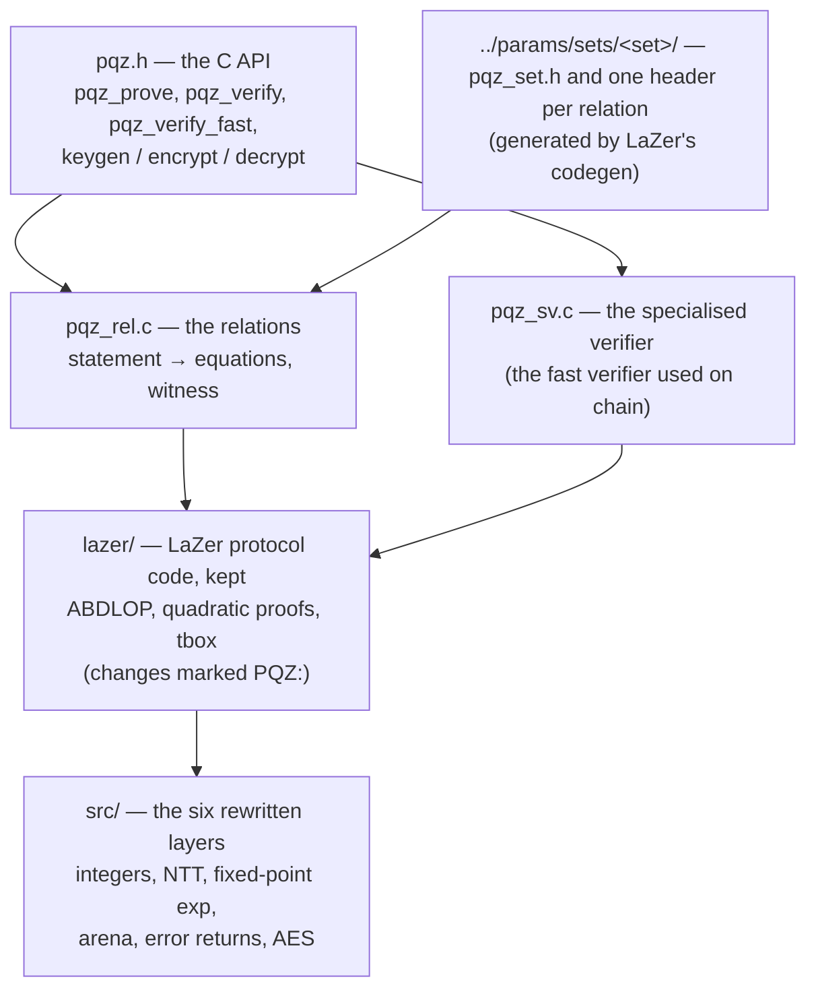

# PQZL — the lattice proof system

PQZL is one of PQZ's two proof systems (the other is [PQZH](../pqzh/README.md)). It proves each PQZ statement with a
lattice proof (LNP22: ABDLOP commitments plus LaZer's "tbox" proof), and its security rests on the lattice problems
MSIS and MLWE. Proofs are small: an `R_TX` transfer proof is 46,670 B at the default parameter set `n2304-kmax4096`
(42,783 B at `n2048-kmax1024`; every set and relation: [params/sets/README.md](../params/sets/README.md), from the
gate's `runs/gate/<set>-fnv-c.jsonl`). Verify and prove times are not final: they wait on the calibration of plan 5h
Task 9. Unaudited.

This directory holds the C core: a fork of IBM's [LaZer](https://github.com/lazer-crypto/lazer) (commit `3330e48`,
MIT) with six layers rewritten so that it runs without GMP, MPFR, HEXL, floating point, `malloc`, `abort` or stdio —
natively, in the node, and as freestanding wasm32 in a browser wallet. For the big picture (what PQZ proves, both
systems, the precompile, the measurements) read the parent [pqz-core/README.md](../README.md) first.

> **The production core is the Rust crate** `pqzl` in `rust/` (owner 2026-10-18, decisions CTR-PQZ-09; branch
> `pqzl-rust` merged into `main` 2026-10-19, `5952951a`): a byte-for-byte port of this C core. `pqz-ffi` builds it by
> default, and the SCaaS testnet's node image (`2.2.0-pqz5`, `../nethermind/README.md`) loads that library. This C core
> stays as the reference the Rust crate is checked against and as `pqz-ffi`'s opt-in backend (feature `pqzl-c`).
>
> **Parameter sets** (owner 2026-10-21): one set per build, chosen with `PQZ_SET=<set>` (default `n2304-kmax4096`);
> `set.sh` copies that set's `pqz_set.h` and relation headers from
> [`../params/sets/<set>/`](../params/sets/README.md) into `build/include`.

## How it is put together



- **The C API** (`src/pqz.h`): `pqz_init` gives the library one memory area (the arena) to work in; `pqz_prove`,
  `pqz_verify` (the generic reference verifier) and `pqz_verify_fast` (the specialised verifier, SV) take
  `op ‖ statement ‖ proof`; `pqz_keygen`, `pqz_enc_seed`, `pqz_dec` and their raw forms handle keys and ciphertexts,
  all deterministic from seeds.
- **The relations** (`src/pqz_rel.c`): `R_REG`, `R_TX`, `R_TX0`, `R_BURN`, `R_DS`, `R_DR` and the multi-recipient
  transfer `R_TXM` (op 7). Each turns a statement into the equations LaZer proves. The prover mixes the secret
  witness into its random masks ("hedged"), so a weak random number generator cannot leak keys.
- **The specialised verifier** (`src/pqz_sv.c`): checks the same proofs as `pqz_verify`, but with precomputed tables
  per relation, much faster (history, run `d6`, 2026-10-18, PQZL v2 at the `n2048-kmax1024` parameters: `R_TX`
  8.5 ms against 674.4 ms natively, `rust/README.md`). A differential test keeps the two in agreement (`sv/`).
- **The six rewritten layers** (`src/`): `pqz_mpn.h` (integers without GMP), `pqz_ntt.c` (NTT mod q),
  `pqz_fixexp.h` (fixed-point exp for the sampler and rejection), `pqz_arena.c` (the arena instead of `malloc`),
  `pqz_rt.h` (sticky error returns instead of `abort`), `pqz_aes_gen.h` (bitsliced AES-256-CTR, generated by
  `gen_aes.py`). `pqz_lazer.c` compiles the kept LaZer files over them in one unit.
- **Four soundness fixes to upstream LaZer** live here and were reported upstream:
  [lazer#24](https://github.com/lazer-crypto/lazer/issues/24) and [#25](https://github.com/lazer-crypto/lazer/issues/25)
  (the Schwartz–Zippel checks, the reason for `proofSystemId` v2), [#26](https://github.com/lazer-crypto/lazer/issues/26)
  (the z21 norm check, verifier only) and [#28](https://github.com/lazer-crypto/lazer/issues/28) (the Fiat–Shamir
  transcript, PQZL v3: v2 was forgeable and is retired, 2026-10-19). Later transcript fixes of our own reviews (B-1 /
  A-2, plan 5h Task 8a; the R0 review fix 2026-10-25) bumped the id again; today each parameter set has its own PQZL id
  `…/v5` (`../params/sets/README.md`, "proofSystemIds per set"; v2, v3 and v4 retired). `check_tbox_fixes.sh` fails if
  #24, #25, #26, #28 or A-2 is gone ([sz/README.md](sz/README.md)).

## What is in each folder

| Path | What it holds |
|---|---|
| `src/` | the C API `pqz.h`, the relations, keys (`pqz_keys.c`), the specialised verifier, the rewritten layers, the wasm runtime (`pqz_wasm_rt.c`) and `freestanding/` headers for wasm32 |
| `lazer/` | the subset of LaZer `3330e48` that PQZL uses; changes made in place and marked `PQZ:`; licence `lazer/LICENSE` |
| `params/` | the record of the first relation specs (`*_params.sage`, the shapes before the parameter sets), LaZer's codegen, `to_rust.py`, the security sizing and the parameter studies ([params/README.md](params/README.md)); the headers the cores build with are per set in `../params/sets/<set>/` |
| `kat/` | known-answer test of the arithmetic layers against upstream LaZer: `lazer_dump.c`, `check.py` (must print 19/19; the golden files per set: `../params/sets/<set>/lazer-3330e48-kat.json`) |
| `test/` | `pqz_bench.c` (prove, verify, tamper checks, timings, a hash of the proofs), `run_wasm.mjs` (the same under node), `pqz_keys_kat.c` (keys KAT), `pqz_sv_diff.c` and `pqz_sv_fuzz.c` (SV differential test and fuzz target), `ct.sh` + `pqz_ct.c` (constant-time check of the prover under valgrind memcheck, C and Rust; review fix E), `ub_test.sh` + `pqz_ub_test.c` (ASan + UBSan tests of the hardening and of review round 2: parts a–f on the libc heap, g (arena wiped after secret calls) and h (an undersized arena traps) on the arena), `check_symbols_neg.sh` (the scan's failure paths) |
| `sv/` | checks of the specialised verifier: `diff.sh`, `bench.sh`, `fuzz.sh`, `rel3.sh` (all of them in one job), `txm-l2.sh` (the `R_TXM` shapes), `check_sv_fixes.sh`; `review/` holds the reproducers of its independent review |
| `sz/`, `l2dom/` | reproducers of the two LaZer tbox findings (lazer#24, #25) ([sz/README.md](sz/README.md)) |
| `build.sh`, `set.sh`, `check_symbols.sh` | the builds (native, x86-64-v3, wasm32; `PQZ_SET` picks the set, `set.sh` copies its headers) and the scan that fails a build whose library references anything beyond `memcpy`, `memset`, `__stack_chk_fail` (and wasm32's `__stack_pointer`), or defines a test hook (`pqz_test_*`, `pqz_sv_test_*`, `pqz_sz_trace*`, `pqz_l2dom_poc`, upstream's `lnp_quad_eval_*`) |
| `check_tbox_fixes.sh` | fails if one of the LaZer fixes (#24, #25, #26, #28) or A-2 is gone |
| `legacy/` | `lnp-quad-eval.c`, upstream's quad_eval prover / verifier without the #28 fix: no caller, not built since the R0 review fix (R1-C7), kept as the record |
| `runs/` | run logs of this directory, e.g. the C wasm32 arena peaks of plan 5h Task 8d part 2b (`2026-10-26-t8d2b-cwasm-m2-<set>.jsonl`) |
| `rust/` | crate `pqzl`, the Rust port and the production core ([rust/README.md](rust/README.md)) |

## Build and test

Run from `pqz-core/`; heavy steps under `scripts/capped` from the repository root (see the parent README §6).

```sh
pqzl/build.sh native        # pqzl/build/native: libpqz.a, libpqz.so, pqz_bench, kat_dump, tests
pqzl/build.sh wasm          # pqzl/build/wasm/pqz.wasm (clang 18, wasm-ld-18, freestanding)
pqzl/build.sh all           # both
PQZ_SET=n2560-kmax16384 PQZ_BUILD_TAG=n2560-kmax16384 pqzl/build.sh native   # another set, in pqzl/build/<tag>/
pqzl/build/native/kat_dump > pqzl/build/native/kat-pqz.json
python3 -I pqzl/kat/check.py params/sets/<set>/lazer-3330e48-kat.json pqzl/build/native/kat-pqz.json   # must print 19/19
pqzl/check_tbox_fixes.sh                       # the LaZer fixes and A-2 are in place
pqzl/build/native/pqz_bench 7 7                # 7 proves and 7 + 7 verifies per relation (JSON lines)
pqzl/build/native/pqz_sv_diff 10 5 2 1 10      # SV and generic verifier agree on honest and mutated proofs
```

More commands (x86-64-v3 build, measurement rounds, parameter regeneration): parent README §6, "PQZL core (C)" and
"Regenerate".

## Further reading

- Spec: [pq-zero-knowledge.md, "Proof engine"](../../docs/contracts/pq-zero-knowledge.md#proof-engine).
- Research notes in `docs/research/`: `pqz-core-e-s1.md` (the first spike), `pqz-specialised-verifier.md`,
  `pqz-tbox-soundness.md`, `pqz-l2-domain.md`, `pqz-z21-norm.md`, `pqz-parameters-e-s0.md`.
- The parameter sets: [params/sets/README.md](../params/sets/README.md) and each set's `SET.md`.
- The dated log of every change and run: [STATUS.md](../STATUS.md).
