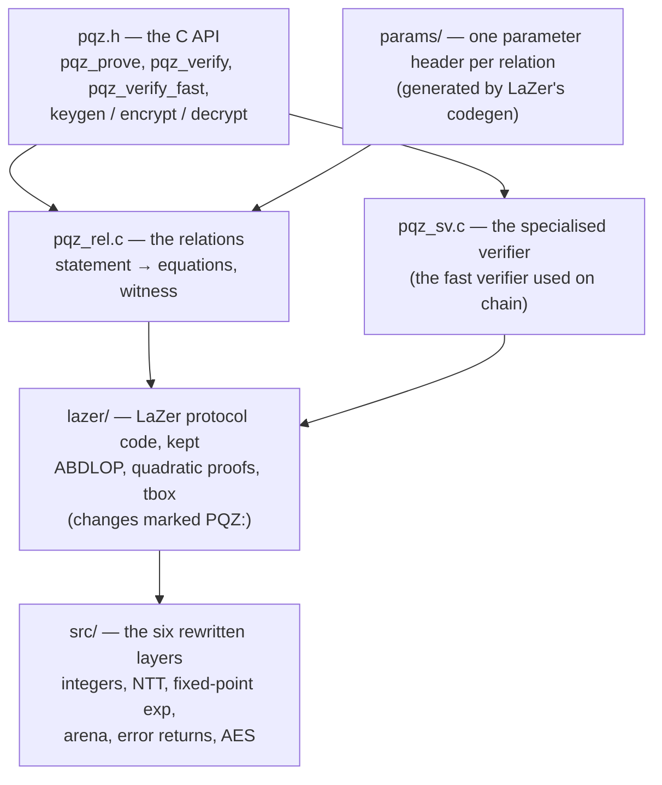

# PQZL — the lattice proof system

PQZL is one of PQZ's two proof systems (the other is [PQZH](../pqzh/README.md)). It proves each PQZ statement with a
lattice proof (LNP22: ABDLOP commitments plus LaZer's "tbox" proof), and its security rests on the lattice problems
MSIS and MLWE. Proofs are small (about 43 KB for a transfer) and verify in about 8 ms on chain.

This directory holds the C core: a fork of IBM's [LaZer](https://github.com/lazer-crypto/lazer) (commit `3330e48`,
MIT) with six layers rewritten so that it runs without GMP, MPFR, HEXL, floating point, `malloc`, `abort` or stdio —
natively, in the node, and as freestanding wasm32 in a browser wallet. For the big picture (what PQZ proves, both
systems, the precompile, the measurements) read the parent [pqz-core/README.md](../README.md) first.

> **The production core is moving to Rust** (owner 2026-10-18): the crate `pqzl` in `rust/` is a byte-for-byte port
> of this C core and becomes the core of the `PQZ` precompile once the port is verified. The C core then stays as the
> reference the Rust crate is checked against. Until then, the precompile on chain 7622 runs this C core. The port is
> on branch `pqzl-rust` ([plan](../../docs/superpowers/plans/2026-10-17-pqzl-rust-port.md)).

## How it is put together



- **The C API** (`src/pqz.h`): `pqz_init` gives the library one memory area (the arena) to work in; `pqz_prove`,
  `pqz_verify` (the generic reference verifier) and `pqz_verify_fast` (the specialised verifier, SV) take
  `op ‖ statement ‖ proof`; `pqz_keygen`, `pqz_enc_seed`, `pqz_dec` and their raw forms handle keys and ciphertexts,
  all deterministic from seeds.
- **The relations** (`src/pqz_rel.c`): `R_REG`, `R_TX`, `R_TX0`, `R_BURN`, `R_DS`, `R_DR` and the multi-recipient
  transfer `R_TXM` (op 7). Each turns a statement into the equations LaZer proves. The prover mixes the secret
  witness into its random masks ("hedged"), so a weak random number generator cannot leak keys.
- **The specialised verifier** (`src/pqz_sv.c`): checks the same proofs as `pqz_verify`, but with precomputed tables
  per relation, about 80× faster. A differential test keeps the two in agreement (`sv/`).
- **The six rewritten layers** (`src/`): `pqz_mpn.h` (integers without GMP), `pqz_ntt.c` (NTT mod q),
  `pqz_fixexp.h` (fixed-point exp for the sampler and rejection), `pqz_arena.c` (the arena instead of `malloc`),
  `pqz_rt.h` (sticky error returns instead of `abort`), `pqz_aes_gen.h` (bitsliced AES-256-CTR, generated by
  `gen_aes.py`). `pqz_lazer.c` compiles the kept LaZer files over them in one unit.
- **Three soundness fixes to upstream LaZer** live here and were reported upstream:
  [lazer#24](https://github.com/lazer-crypto/lazer/issues/24), [#25](https://github.com/lazer-crypto/lazer/issues/25)
  (the reason the `proofSystemId` is v2) and [#26](https://github.com/lazer-crypto/lazer/issues/26) (the z21 norm
  check, verifier only). `check_tbox_fixes.sh` fails if any of the three is gone.

## What is in each folder

| Path | What it holds |
|---|---|
| `src/` | the C API `pqz.h`, the relations, keys (`pqz_keys.c`), the specialised verifier, the rewritten layers, the wasm runtime (`pqz_wasm_rt.c`) and `freestanding/` headers for wasm32 |
| `lazer/` | the subset of LaZer `3330e48` that PQZL uses; changes made in place and marked `PQZ:`; licence `lazer/LICENSE` |
| `params/` | one LaZer spec per relation (`*_params.sage`), the generated headers `pqz_*_params.h`, the codegen and the security sizing ([params/README.md](params/README.md)) |
| `kat/` | known-answer test of the arithmetic layers against upstream LaZer: `lazer_dump.c`, the golden `lazer-3330e48.json`, `check.py` (must print 19/19) |
| `test/` | `pqz_bench.c` (prove, verify, tamper checks, timings, a hash of the proofs), `run_wasm.mjs` (the same under node), `pqz_keys_kat.c` (keys KAT), `pqz_sv_diff.c` and `pqz_sv_fuzz.c` (SV differential test and fuzz target), `ct.sh` + `pqz_ct.c` (constant-time check of the prover under valgrind memcheck, C and Rust; review fix E), `ub_test.sh` + `pqz_ub_test.c` (ASan + UBSan tests of the hardening and of review round 2: parts a–f on the libc heap, g (arena wiped after secret calls) and h (an undersized arena traps) on the arena), `check_symbols_neg.sh` (the scan's failure paths) |
| `sv/` | checks of the specialised verifier: `diff.sh`, `bench.sh`, `fuzz.sh`, `rel3.sh` (all of them in one job), `check_sv_fixes.sh`; `review/` holds the reproducers of its independent review |
| `sz/`, `l2dom/` | reproducers of the two LaZer tbox findings (lazer#24, #25) ([sz/README.md](sz/README.md)) |
| `build.sh`, `check_symbols.sh` | the builds (native, x86-64-v3, wasm32) and the scan that fails a build whose library references anything beyond `memcpy`, `memset` and `__stack_chk_fail`, or defines a test hook (`pqz_test_*`, `pqz_sv_test_*`, `pqz_sz_trace*`, `pqz_l2dom_poc`) |
| `check_tbox_fixes.sh` | fails if one of the three LaZer fixes is gone |
| `rust/` (branch `pqzl-rust`) | crate `pqzl`, the Rust port |

## Build and test

Run from `pqz-core/`; heavy steps under `scripts/capped` from the repository root (see the parent README §6).

```sh
pqzl/build.sh native        # pqzl/build/native: libpqz.a, libpqz.so, pqz_bench, kat_dump, tests
pqzl/build.sh wasm          # pqzl/build/wasm/pqz.wasm (clang 18, wasm-ld-18, freestanding)
pqzl/build.sh all           # both
pqzl/build/native/kat_dump > pqzl/build/native/kat-pqz.json
python3 -I pqzl/kat/check.py pqzl/kat/lazer-3330e48.json pqzl/build/native/kat-pqz.json   # must print 19/19
pqzl/check_tbox_fixes.sh                       # the three LaZer fixes are in place
pqzl/build/native/pqz_bench 7 7                # 7 proves and 7 + 7 verifies per relation (JSON lines)
pqzl/build/native/pqz_sv_diff 10 5 2 1 10      # SV and generic verifier agree on honest and mutated proofs
```

More commands (x86-64-v3 build, measurement rounds, parameter regeneration): parent README §6, "PQZL core (C)" and
"Regenerate".

## Further reading

- Spec: [pq-zero-knowledge.md, "Proof engine"](../../docs/contracts/pq-zero-knowledge.md#proof-engine).
- Research notes in `docs/research/`: `pqz-core-e-s1.md` (the first spike), `pqz-specialised-verifier.md`,
  `pqz-tbox-soundness.md`, `pqz-l2-domain.md`, `pqz-z21-norm.md`, `pqz-parameters-e-s0.md`.
- The dated log of every change and run: [STATUS.md](../STATUS.md).
