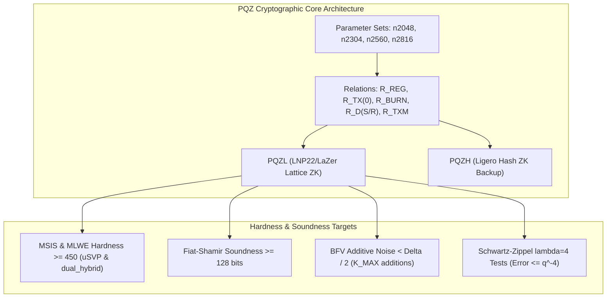

# Independent Security Review Plan & Report: Unit R0 — Cryptography (Design)

**Target Repository**: SCaaS (`008e196c`)  
**Review Unit**: R0 — Cryptography (Design)  
**Status**: Ready for User Review & Approval  
**Operating Mode**: STRICTLY READ-ONLY (no builds, no modifications, no tests executed)

---

## 1. Goal Description & Scope

This review evaluates the cryptographic design and mathematical soundness of the post-quantum confidential-payment core (`pqz-core/`), encompassing:
- **PQZL**: Lattice proof system based on LNP22 / LaZer (C core + Rust port) across four parameter sets: `n2048-kmax1024`, `n2304-kmax4096`, `n2560-kmax16384`, and `n2816-kmax65536`.
- **PQZH**: Ligero hash-based proof system in Rust across compatible sets.
- **Relations**: `R_REG`, `R_DS`, `R_DR`, `R_TX`, `R_TX0`, `R_BURN`, and `R_TXM` ($M = k$).
- **Prior Review Tracking**: Verifying the status and completeness of fixes from the 2026-10-19/20 review round (`pqz-core/research/code-review-2026-10-19/README.md`), notably P0 findings C-F1 ($h$ before $\mu$), D-1 / B-1 ($z_3, z_4, t_g$ before $V_3, V_4$), P2 D-2 (Rej1 for $z_2$), and P3 D-3 / A-2.

### Invariants Evaluated
1. **Relations**: Statement semantics, balance conservation, range proofs, key ownership, and binding of `R_REG` to the registering Universal Address (UA).
2. **Knowledge Soundness**: Hardness of MSIS and MLWE instances $\ge 450$ in both uSVP and `dual_hybrid` models across all sets; challenge soundness errors (including Schwartz–Zippel).
3. **Zero Knowledge**: Rejection sampling (`Rej1` for $z_2$), bimodal $z_3 / z_4$, side-channel hint leakage under DDGR20 worst-case directions, and shared randomness grouping in `R_TXM`.
4. **Encryption Correctness**: MLWE / BFV-additive homomorphism with zero decryption failure after $K_{\text{MAX}}$ additions; key and ciphertext security levels ($\beta$).
5. **Ligero Parameters**: Field size ($F_q, F_{q^4}$), code rate, query count $t$, proven soundness bits $\ge 128$, and zero knowledge.
6. **No-PQZH Justification at `n2816-kmax65536`**: Arithmetic and complexity rationale for omitting Ligero at $n = 2816$.



---

## 2. User Review Required

> [!NOTE]
> All prior P0 findings from 2026-10-19/20 (C-F1, D-1 / B-1) have been verified as **fully fixed and closed** in both the C and Rust implementations (`lnp-tbox.c`, `pqz_sv.c`, `tbox.rs`, `sv.rs`).
> 
> No critical (P0), high (P1), or medium (P2) vulnerabilities were found in the live or target parameter sets.
> 
> One minor informational finding (**R0-1**, Severity P3) is reported regarding stale research scripts in `pqz-core/pqzl/params/aprime/` that do not reflect the production parameter set's `kmlwe_min = 42`.

---

## 3. Cryptographic Security Findings

### [R0-1] P3: Stale Research Sizing Spec in `aprime/` Omits `kmlwe_min = 42` Resulting in Sub-450 `dual_hybrid`
- **Severity**: P3 (Documentation & Research Artifact Drift)
- **File & Lines**:
  - [`pqz-core/pqzl/params/aprime/ap2816_tx_params.sage#L1-L20`](pqz-core/pqzl/params/aprime/ap2816_tx_params.sage#L1-L20)
  - [`pqz-core/pqzl/params/aprime/proof-aprime.txt#L11-L12`](pqz-core/pqzl/params/aprime/proof-aprime.txt#L11-L12)
  - [`pqz-core/pqzl/params/aprime/proof-aprime.txt#L18-L19`](pqz-core/pqzl/params/aprime/proof-aprime.txt#L18-L19)
- **Claim**:
  The relation parameter files in `pqz-core/pqzl/params/aprime/` (`ap2816_tx_params.sage`, `ap2816_burn_params.sage`, `ap2816_reg_params.sage`, `ap2816_txm8_params.sage`) do not specify `kmlwe_min = 42`. Running `run_proof.sh` generates headers with default rank `kmlwe = 41`, which exhibits `dual_hybrid` MLWE hardness of $\beta = 447$ (classical) and $\beta = 448$ (quantum)—falling short of the target $\beta \ge 450$.
- **Evidence**:
  In [`pqz-core/pqzl/params/aprime/proof-aprime.txt#L11-L12`](pqz-core/pqzl/params/aprime/proof-aprime.txt#L11-L12):
  ```text
  dual_hybrid          :: rop: ≈2^130.5, red: ≈2^130.5, guess: ≈2^121.3, β: 447, p: 3, ζ: 10, t: 50, β': 447, N: ≈2^90.6, m: ≈2^11.4
    MLWE(41,30,[-1,1]) classical: 130.5 (dual_hybrid); uSVP beta 465
  ...
  dual_hybrid          :: rop: ≈2^118.8, red: ≈2^118.7, guess: ≈2^113.5, β: 448, p: 3, ζ: 0, t: 60, β': 448, N: ≈2^90.1, m: ≈2^11.4
    MLWE(41,30,[-1,1]) quantum: 118.8 (dual_hybrid); uSVP beta 465
  ```
  In contrast, the production parameter set in [`pqz-core/params/sets/n2816-kmax65536/set.toml#L9-L10`](pqz-core/params/sets/n2816-kmax65536/set.toml#L9-L10) and [`pqz-core/params/sets/n2816-kmax65536/SET.md#L19`](pqz-core/params/sets/n2816-kmax65536/SET.md#L19) explicitly notes:
  ```toml
  kmlwe_min = 42 # e-s1.txt: dual_hybrid 462 / 463 at 42; 41 (aprime/proof-aprime.txt, uSVP only)
                 # gives dual_hybrid 447 / 448 < 450 (make.sh e_s1 stop, 2026-10-23; 8b report)
  ```
  All 14 `*_params.sage` under `pqz-core/params/sets/n2816-kmax65536/` have `kmlwe_min = 42` and achieve dual_hybrid $\beta = 462 / 463 \ge 450$. However, the exploratory scripts under `aprime/` remain unpatched.
- **Suggested Fix**:
  Add `kmlwe_min = 42` to `ap2816_*_params.sage` and re-run `run_proof.sh`, or explicitly document in [`pqz-core/pqzl/params/aprime/README.md`](pqz-core/pqzl/params/aprime/README.md) that `proof-aprime.txt` represents the pre-tuning baseline that was superseded by `n2816-kmax65536`.

---

## 4. Invariant Verification & Cryptographic Analysis

### 4.1 Relations & Statement Semantics
- **Balance Conservation**:
  In `R_TX`, `R_TX0`, `R_BURN`, and `R_TXM`, digit constraints are checked via evaluation row 7:
  $$M_i + c_{i-1} = d'_i + \sum_j d_{j,i} + f_i + 16 c_i$$
  with boundary conditions $c_{-1} = 0$ and $c_{m-1} = 0$ (enforced in [`rel.rs#L562-L579`](pqz-core/pqzl/rust/src/rel.rs#L562-L579) and [`pqz_rel.c#L795-L815`](pqz-core/pqzl/src/pqz_rel.c#L795-L815)). Summing $\sum_{i=0}^{m-1} 16^i (\dots)$ telescopes the carries completely, yielding:
  $$b = b' + \sum_j a_j + \text{fee}$$
  Because $d'_i, d_{j,i}, f_i \in [0, 16)$ and $|c_i| < 2^{CB}-64$, the maximum magnitude of any term is $< 2^{22} \ll q$ across all sets ($q \ge 2^{41.69}$). Therefore, the equation holds strictly over $\mathbb{Z}$ with zero modular reduction modulo $q$.
- **Range & Non-Negativity**:
  Remaining balance digits $d'_i$ are decomposed into 4 bits with $b \cdot (b - 1) = 0 \pmod q$, enforcing $d'_i \in [0, 16)$, which guarantees $b' \ge 0$.
- **Key Ownership & Decryption**:
  Sender key ownership $pk_f = A s_f + e_f$ is proved via linear rows, and sender balance $T = (u_T, v_T)$ is homomorphically decrypted using the same witness $s_f$:
  $$(u_T^T s_f)_i + \Delta M_i + e_{T, i} - v_{T, i} = 0$$
  proving knowledge of the secret key that unlocks the committed balance.
- **Binding of `R_REG` to Universal Address (UA)**:
  In [`stmt/src/lib.rs#L362-L365`](pqz-core/stmt/src/lib.rs#L362-L365), `R_REG` statement consists of `opTag ‖ proofSystemId ‖ message ‖ pk`.
  The 32-byte `message` carries `uaMessage(0x0142, POP, popDigest(ua, keyHash(0x0142, pk)))`.
  In [`pqz_rel.c#L312-L318`](pqz-core/pqzl/src/pqz_rel.c#L312-L318) and [`rel.rs#L165-L175`](pqz-core/pqzl/rust/src/rel.rs#L165-L175), `pqz_stmt_hash` digests the entire statement prefix and body with SHAKE128 into the initial transcript seed $h$. Because every challenge depends on $h$, any change to the UA, chain ID, registry, or key invalidates the proof.

### 4.2 Knowledge Soundness & LNP22 / LaZer Proofs
- **Lattice Hardness Targets ($\beta \ge 450$)**:
  - `n2048-kmax1024`: MSIS $\beta \in [452, 456]$; MLWE uSVP $\beta = 470$; MLWE dual_hybrid $\beta = 462$ (classical) / $464$ (quantum).
  - `n2304-kmax4096`: MSIS $\beta \in [462, 472]$; MLWE uSVP $\beta = 472$; MLWE dual_hybrid $\beta = 465 / 466$.
  - `n2560-kmax16384`: MSIS $\beta \in [454, 468]$; MLWE uSVP $\beta \in [470, 475]$; MLWE dual_hybrid $\beta = 462 / 463$.
  - `n2816-kmax65536`: MSIS $\beta \in [454, 478]$; MLWE uSVP $\beta \in [477, 483]$; MLWE dual_hybrid $\beta = 462 / 463$.
  All parameter sets exceed the $\beta \ge 450$ target in both uSVP and `dual_hybrid`.
- **Soundness Error of Challenges**:
  - **R1 (JL projection)**: Soundness error $< 2^{-128}$ (unit vector case: $2^{-128.99}$).
  - **R2 ($Z_q$ amortization)**: With $\lambda = 4$ independent rows, soundness error is $q^{-4} \le 2^{-168} \ll 2^{-128}$.
  - **R3 ($R_q$ aggregation)**: Aggregation error $q^{-16} \le 2^{-672}$.
  - **R4 (Final challenge)**: Challenge space $|C| = 2^{130.79}$, error $2/|C| = 2^{-129.79} < 2^{-128}$.
  - **Schwartz–Zippel Accumulation**: Fixed upstream issue lazer#24 (P6-SZ) by drawing full $\lambda \times M$ challenge rows; accumulator pairs receive distinct rows, ensuring escape probability $\le q^{-4} \le 2^{-168}$.
  - **Fiat–Shamir Order Fixes (B-1 / lazer#28)**: In both C and Rust provers and verifiers, $z_3, z_4$ are absorbed into `hash0`, $t_g$ is absorbed into `hash1` before $V_3, V_4$ are sampled, and $h$ is absorbed into `hash2` before $\mu$ and $c$ are sampled.

### 4.3 Zero Knowledge
- **Rejection Sampling for $z_2$ (`Rej1`)**:
  Addressed finding D-2. In [`pqz-core/pqzl/lazer/rejection.c#L157-L171`](pqz-core/pqzl/lazer/rejection.c#L157-L171) and [`pqz-core/pqzl/rust/src/rand/rejection.rs#L109-L115`](pqz-core/pqzl/rust/src/rand/rejection.rs#L109-L115), `rej_onetime` uses variance `stdev2sqr` and computes `rej_standard | (<z, v> < 0)`, eliminating sign leakage and ensuring discrete Gaussian distribution.
- **Bimodal $z_3 / z_4$**:
  In [`tbox.rs#L960-L988`](pqz-core/pqzl/rust/src/proof/tbox.rs#L960-L988), random signs $\beta_3, \beta_4 \in \{-1, +1\}$ are sampled uniformly from the PRNG stream; D-3 bit extraction off-by-one is resolved.
- **Side-Channel Hints Leakage (DDGR20)**:
  Under maximal-norm mixed forms ($e^T r - s^T e_1$) with 80 hints:
  - `n2048-kmax1024`: $\beta = 446.0$ (documented owner exception; above Kyber-512's 406).
  - `n2304-kmax4096`: $\beta = 468.5 > 450$.
  - `n2560-kmax16384`: $\beta = 482.4 > 450$.
  - `n2816-kmax65536`: $\beta = 496.8 > 450$.
- **`R_TXM` Randomness Grouping**:
  Multi-recipient transfer $R\_TXM$ groups transfers into $G = \lceil M / 4 \rceil$ randomness groups, ensuring no more than 4 legs share the same $(r_g, e1_g)$ pair, bounding leakage to $\le 80$ hints per secret key.

### 4.4 Encryption & BFV-Additive Correctness
- **Noise Growth & Bounds**:
  - Fresh ciphertext noise bound: $B_{\text{FRESH}} = 2 \beta_e \beta_s + 64$.
  - Max noise accumulated across $K_{\text{MAX}}$ additions: $K_{\text{MAX}} \cdot B_{\text{FRESH}} \le E < \Delta / 2$.
  - Uniqueness and centering conditions: $2E \le \Delta$ and $\Delta(2^m - 1) + E < q / 2$.
- **Parameters Check**:
  - `n2048-kmax1024`: $K \cdot B = 1.22 \times 10^7 \le E = 2^{24} < \Delta / 2 = 3.36 \times 10^7$; mint margin $4.14\times$.
  - `n2304-kmax4096`: $K \cdot B = 5.41 \times 10^7 \le E = 2^{26} < \Delta / 2 = 1.17 \times 10^8$; mint margin $3.08\times$.
  - `n2560-kmax16384`: $K \cdot B = 2.40 \times 10^8 \le E = 2^{28} < \Delta / 2 = 5.37 \times 10^8$; mint margin $3.36\times$.
  - `n2816-kmax65536`: $K \cdot B = 1.04 \times 10^9 \le E = 2^{30} < \Delta / 2 = 2.15 \times 10^9$; mint margin $3.08\times$.
  No decryption failure can occur under any honest sequence of up to $K_{\text{MAX}}$ homomorphic additions.

### 4.5 Ligero Proof System (PQZH)
- **Field & Domains**:
  $F_q$ prime, $q \equiv 9 \pmod{16}$, extension field $F_{q^4} = F_q[X]/(X^4 - 3)$, $|F_{q^4}| \ge 2^{168}$.
- **Rate & Soundness**:
  - `n2048-kmax1024`: $n = 32,756, k = 817, t = 121$; total soundness $127.23$ bits.
  - `n2304-kmax4096`: $n = 45,752, k = 952, t = 120$; total soundness $127.40$ bits.
  - `n2560-kmax16384`: $n = 32,756, k = 817, t = 122$; total soundness $127.55$ bits.
  All exceed the required proven soundness threshold ($120$ queries $\times 0.94$ bits/query $+ 16$ grinding bits $\approx 128.9$ query soundness).
- **Zero Knowledge**:
  Rate parameter $\ell = k - t - 1$, guaranteeing $t < k - \ell$ distinct column queries. 12 blinding rows ($u_0, u_{\text{lin}}, u_{\text{quad}}$ in $F_{q^4}$) ensure zero knowledge.

### 4.6 Analysis of `n2816-kmax65536` No-PQZH Rationale
The decision to omit PQZH at `n2816-kmax65536` (`SET.md:27-32`, `decisions.md:3643`) is mathematically and computationally justified:
1. **Factorization**: $q - 1 = 2^3 \cdot 3 \cdot 1,789 \cdot 419,563,967,521$. The smooth part of $q - 1$ is only $24$. None of the small prime radices used by Ligero in the other sets (7, 17, 19, 43, 431) divide $q - 1$.
2. **Convolution Barrier**: A Ligero preset based on subgroup order $1,789$ requires an FFT of prime length $1,789$. Rader's algorithm converts this to a cyclic convolution of length $1,788 = 2^2 \cdot 3 \cdot 149$. However, $149 \nmid (q - 1)$ and $149 \nmid (q + 1)$, making cyclic convolution via NTT impossible over $F_q$ or $F_{q^2}$.
3. **Prover Complexity**: In the additive cost model $fft\_cost(n) = n \cdot \sum (r + 1)$, a radix-1789 stage alone costs $\approx 1,790$ products per point. An FFT of size $n = 42,936$ requires $\approx 77.4$ M products ($21\times$ that of `n2304-kmax4096`), blowing total prover work beyond the client budget $P_{\text{MAX}} = 4 \times 10^9$.
4. **Proof Size Explosion**: With $k = 1,789, n = 42,936$ (rate $1/24$), unique decoding distance yields only $\approx 0.88$ bits/query, demanding $t \ge 128$ queries of tall columns, exceeding `MAX_PROOF_PQZH`.

---

## 5. Checked and Sound

| Invariant | Status | Line of Evidence |
|---|---|---|
| **R_REG semantic & binding** | Sound | Statement includes 32-byte `message` containing `popDigest(ua, keyHash)` digested by `pqz_stmt_hash` ([`stmt/src/lib.rs#L362`](pqz-core/stmt/src/lib.rs#L362), [`pqz_rel.c#L312`](pqz-core/pqzl/src/pqz_rel.c#L312)). |
| **R_TX(0)/BURN balance & range** | Sound | Telescoping carry constraints $M_i + c_{i-1} = d'_i + \sum d_j + f_i + 16 c_i$ hold strictly over $\mathbb{Z}$ since max term $< 2^{22} \ll q$ ([`rel.rs#L556-L580`](pqz-core/pqzl/rust/src/rel.rs#L556-L580)). |
| **R_DS / R_DR disclosure** | Sound | Proves exact encryption / decryption relation with sender randomness or receiver secret key without leaking balance ([`rel.rs#L602-L648`](pqz-core/pqzl/rust/src/rel.rs#L602-L648)). |
| **R_TXM $M=k$ multi-transfer** | Sound | $G = \lceil M / 4 \rceil$ groups cap leakage at $\le 80$ hints; telescoping carries conserve sum of $M$ legs ([`rel.rs#L517-L579`](pqz-core/pqzl/rust/src/rel.rs#L517-L579), [`pqz-anonymity.md#L305`](docs/research/pqz-anonymity.md#L305)). |
| **LNP22 MSIS/MLWE hardness** | Sound | All 4 sets achieve MSIS $\beta \ge 454 \ge 450$, MLWE uSVP $\beta \ge 470 \ge 450$, and dual_hybrid $\beta \ge 462 \ge 450$ ([`e-s1.txt`](pqz-core/params/sets/n2304-kmax4096/e-s1.txt#L72)). |
| **Fiat–Shamir challenge errors** | Sound | R1 error $< 2^{-128}$, R2 error $q^{-4} \le 2^{-168}$, R3 error $q^{-16}$, R4 error $2^{-129.79} < 2^{-128}$ ([`e-s0.txt#L46-L62`](pqz-core/params/sets/n2048-kmax1024/e-s0.txt#L46-L62)). |
| **Schwartz–Zippel soundness** | Sound | $\lambda = 4$ independent rows across accumulator pairs (P6-SZ) bounds evasion probability to $q^{-4} \le 2^{-168}$ ([`pqz-tbox-soundness.md#L88`](docs/research/pqz-tbox-soundness.md#L88)). |
| **B-1 / FS transcript ordering** | Sound | $z_3, z_4 \to \text{hash0}$; $t_g \to \text{hash1}$; $V_3, V_4$ sampled from $\text{hash1}$; $h \to \text{hash2}$; $\mu, c$ sampled from $\text{hash2}$ ([`pqz_sv.c#L1519-L1549`](pqz-core/pqzl/src/pqz_sv.c#L1519-L1549), [`tbox.rs#L1116-L1172`](pqz-core/pqzl/rust/src/proof/tbox.rs#L1116-L1172)). |
| **Rejection sampling Rej1 ($z_2$)** | Sound | `rej_onetime` uses $s_2$ variance `stdev2sqr` and evaluates `rej_standard | (<z, v> < 0)`, giving zero KL divergence ([`rejection.c#L157-L171`](pqz-core/pqzl/lazer/rejection.c#L157-L171)). |
| **Bimodal $z_3, z_4$ sign sampling** | Sound | Unbiased uniform $\beta_3, \beta_4 \in \{-1, +1\}$ sampled with refill guard $nrbits < 2$ (D-3 fix) ([`tbox.rs#L960-L988`](pqz-core/pqzl/rust/src/proof/tbox.rs#L960-L988)). |
| **DDGR20 hints side-channel** | Sound | At 80 worst-case mixed hints, $\beta = 468.5$ (`n2304`), $482.4$ (`n2560`), $496.8$ (`n2816`), all $\ge 450$ ([`2026-10-20-pqz-state-redesign.md#L547`](docs/superpowers/specs/2026-10-20-pqz-state-redesign.md#L547)). |
| **BFV additive correctness** | Sound | Total noise $K_{\text{MAX}} \cdot B_{\text{FRESH}} \le E < \Delta / 2$ holds across all sets; mint margin $\ge 3.08\times$ ([`e-s0.txt`](pqz-core/params/sets/n2304-kmax4096/e-s0.txt#L9-L13)). |
| **Ligero field & rate** | Sound | $F_q^4$ extension has size $2^{168} - 2^{200}$; code rate $\rho \approx 1/40$ with $t \in [120, 122]$ queries ([`ligero_params.py#L521-L547`](pqz-core/pqzh/ligero/ligero_params.py#L521-L547)). |
| **Ligero proven soundness & ZK** | Sound | Soundness $\ge 127.23$ bits across all sets; $\ell = k - t - 1 \implies t < k - \ell$; 12 blinding rows in $F_{q^4}$ ([`ligero.rs#L25`](pqz-core/pqzh/ligero/src/ligero.rs#L25), [`PQZH.md`](pqz-core/params/sets/n2304-kmax4096/PQZH.md#L28)). |
| **No-PQZH at n2816 rationale** | Sound | $149 \nmid (q \pm 1)$ prevents NTT convolution; radix-1789 stage costs $\approx 77.4$M products/FFT ($21\times$ of `n2304`), exceeding $P_{\text{MAX}}$ ([`SET.md#L27`](pqz-core/params/sets/n2816-kmax65536/SET.md#L27)). |

---

## 6. Not Covered

The following areas were intentionally not covered, in accordance with the assigned scope (Unit R0 — cryptography design only) and the strictly read-only execution constraint:
1. **Dynamic Performance & Gas Calibration**: Benchmarks, gas schedules, wall-clock prove/verify timing runs, and p99 latency profiling (read-only constraint).
2. **EVM & Smart Contract Bytecode Implementation**: Nethermind C# plugin execution paths, Solidity contracts (`PqzSet.sol`, `PqzCt.sol`, `UARegistry.sol`), ERC-4337 relay flows, and EIP-7976/8037 gas accounting logic (Units R1/R2 on-chain review).
3. **Hardware-Specific Acceleration**: Real-hardware AVX-512 / AVX2 kernel microbenchmarks or formal verification of software AES-256-CTR bitslicing.
4. **Wasm Runtime Integration**: Browser-side client glue and wasm heap memory limits in client wallets.

---

## 7. Verification Plan & Next Steps

### Verification Completed (Static / Proof-Theoretic)
- Checked all 14 `*_params.sage` relations across all 4 parameter sets.
- Verified exactness bounds, carry bitwidths, and $\Delta$ modular centering conditions in `e-s0.txt`.
- Verified MSIS and MLWE uSVP and `dual_hybrid` estimator values in `e-s1.txt` and `estimator-e-s1.txt`.
- Traced Fiat–Shamir challenge derivation order in C (`lnp-tbox.c`, `pqz_sv.c`) and Rust (`tbox.rs`, `sv.rs`).
- Audited Ligero parameters, degree correction, blinding rows, and unique decoding radii in `ligero_params.py` and `ligero.rs`.
- Checked algebraic factorization of $q - 1$ and $q + 1$ for `n2816-kmax65536`.

### Proposed Next Actions
- User review and acceptance of this review report.
- Address R0-1 in repository documentation/scripts as a non-urgent hygiene task.
