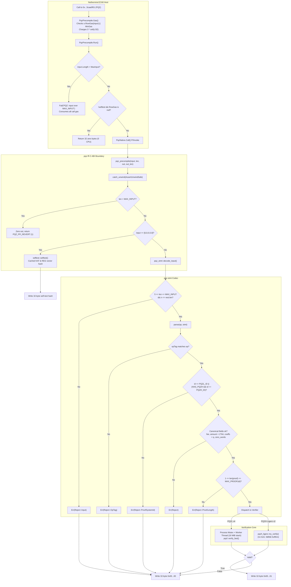

# Implementation Plan — Security Review of Unit R4: Precompile Surface

## Goal Description
Conduct an independent, rigorous, read-only security code audit of **Unit R4 — Precompile Surface** of the SCaaS post-quantum confidential-payment core at frozen commit `008e196c`.
The scope covers:
- Statement decoding: [`pqz-core/stmt/src/`](pqz-core/stmt/src/) (`lib.rs`, `sets.rs`, `tests.rs`)
- C ABI & precompile wrapper: [`pqz-core/ffi/src/`](pqz-core/ffi/src/) (`lib.rs`, `pqz_ffi.h`, `selftest.rs`, `pqzl.rs`, `pqzl/rust.rs`, `pqzl/c.rs`, `pqzh.rs`, `pqzh_none.rs`, `memo.rs`, `fixture.rs`)
- Nethermind execution plugin: [`pqz-core/nethermind/Nethermind.Pqz/`](pqz-core/nethermind/Nethermind.Pqz/) (`Addresses.cs`, `Native.cs`, `PqzPlugin.cs`, `SelfTest.cs`, `PqzPrecompile.cs`, `PqzPrecompileProvider.cs`, `MlDsaPrecompile.cs`, `PqzReleaseSpec.cs`, `PqzChainSpecBasedSpecProvider.cs`, `PqzChainSpecEngineParameters.cs`)
- Normative specifications: [`docs/contracts/pq-zero-knowledge.md`](docs/contracts/pq-zero-knowledge.md) and [`pqz-core/params/sets/`](pqz-core/params/sets/)

The audit verifies the 8 core security and consensus invariants across all 4 supported parameter sets (`n2048-kmax1024`, `n2304-kmax4096`, `n2560-kmax16384`, `n2816-kmax65536`) and relations (`R_REG`, `R_DS`/`R_DR`, `R_TX`, `R_TX0`, `R_BURN`, `R_TXM` $M = k$).

---

## User Review Required

> [!IMPORTANT]
> **STRICTLY READ-ONLY EXECUTION**: No modifications to repository code, configuration, or git state were made during this audit. The proposed changes below are provided as recommendations for the implementation and remediation phase.

> [!NOTE]
> Prior review round (2026-10-19) finding **NETH-01** (Selftest prefix `0x06` calldata gas term bypass) was previously evaluated and refuted in `U-agy-chain.md:356`. Our analysis confirms that `s.SelftestGas` (2,567,000 gas) strictly exceeds calldata gas and `MinGas`, and non-canonical inputs fail closed in `pqz-stmt`.

---

## Architecture & Call Flow



---

## Security Audit Findings

### R4-1 — P3 — Hardcoded `ExpectedLibrarySha256` in Nethermind Plugin Fails Startup on Non-Default Parameter Sets

- **File & Lines**: [`pqz-core/nethermind/Nethermind.Pqz/SelfTest.cs:25-34`](pqz-core/nethermind/Nethermind.Pqz/SelfTest.cs#L25-L34)
- **Severity**: P3 (Deployment / Configuration gate)
- **Claim**:
  `ExpectedLibrarySha256` is hardcoded to a single SHA-256 digest (`0894d191...`, representing the default `n2304-kmax4096` build artifact) without conditional compilation for the other three supported parameter sets (`n2048-kmax1024`, `n2560-kmax16384`, `n2816-kmax65536`). Any Nethermind node compiled for another set will refuse to start.
- **Evidence**:
  In [`SelfTest.cs:13-23`](pqz-core/nethermind/Nethermind.Pqz/SelfTest.cs#L13-L23), `ExpectedHash` uses `#if PQZ_SET_*` preprocessor branching across all four parameter sets:
  ```csharp
  #if PQZ_SET_N2048_KMAX1024
      public const string Set = "n2048-kmax1024", ExpectedHash = "ed910a2cf4c8f7845efe524151f68f91074a40ab8f59df687e233ce91333d205";
  #elif PQZ_SET_N2304_KMAX4096
      public const string Set = "n2304-kmax4096", ExpectedHash = "23d7a1db653449c52bfed0ebbfe664867bf2400261f8999406799dc1040c97c0";
  #elif PQZ_SET_N2560_KMAX16384
      public const string Set = "n2560-kmax16384", ExpectedHash = "167c772ef4d0911d60d6b3d2fad256902e1be2dd4a8f0aa9d01d3b3ed8bb45e7";
  #elif PQZ_SET_N2816_KMAX65536
      public const string Set = "n2816-kmax65536", ExpectedHash = "0aa1dfe291b81f0c8efa859405c9f14cdc0fa744584b4d5b30bd0a6472491882";
  #endif
  ```
  However, line 34 declares:
  ```csharp
  public const string ExpectedLibrarySha256 = "0894d1916b4e2f8270c5bac6e7f9a87a19137e51c6f7f93263d05b9756e64772";
  ```
  When `PqzStartupCheck.Execute` runs ([`PqzPlugin.cs:56`](pqz-core/nethermind/Nethermind.Pqz/PqzPlugin.cs#L56)), it invokes `SelfTest.CheckedLibrarySha256()`. For non-default parameter sets, `File.ReadAllBytes(PqzNative.LibraryPath)` yields a different SHA-256 hash. `CheckedLibrarySha256` throws `InvalidOperationException`, triggering `PQZ-REFUSE` and `Environment.Exit(120)`. Lines 31-33 acknowledge this as an uncompleted item ("customer-image work, plan 5h Task 8d part 1b review M4; not done").
- **Suggested Fix**:
  Add `#if / #elif` conditional branches for `ExpectedLibrarySha256` for all four parameter sets in `SelfTest.cs`.

---

### R4-2 — P3 — Stale Reference to Retired Proof System IDs in Normative Specification Table

- **File & Lines**: [`docs/contracts/pq-zero-knowledge.md:1617`](docs/contracts/pq-zero-knowledge.md#L1617)
- **Severity**: P3 (Documentation integrity)
- **Claim**:
  The summary table for the Debit header in `docs/contracts/pq-zero-knowledge.md` lists `PQZL v3 or PQZH Ligero v1` as the allowed values for Word 1 (`proofSystemId`). These versions were retired and are rejected by `pqz-stmt`.
- **Evidence**:
  Line 1617 states:
  ```markdown
  | 1 | 32 | `proofSystemId` | PQZL v3 or PQZH Ligero v1 |
  ```
  However, §8.1 lines 1554-1559 explicitly record:
  "Retired by plan 5h Task 8d (refused as unknown ids by pqz-stmt): PQZL …/v3 and PQZH …/v1 above."
  Active implementations in [`pqz-core/stmt/src/lib.rs:120, 129`](pqz-core/stmt/src/lib.rs#L120-L129) accept only PQZL v4 (`scaas/pqz/lnp22/mlwe-d64k<k>-q<log2q>l4/v4`) and PQZH Ligero v2 (`scaas/pqz/pqzh/ligero-fq<log2q>-n<n>k<k>t<t>-keccak256-zk-proven/v2`).
- **Suggested Fix**:
  Update line 1617 to read: `| 1 | 32 | proofSystemId | PQZL v4 or PQZH Ligero v2 (per parameter set) |`.

---

### R4-3 — P3 — C Header `pqz_ffi.h` Comment Omits `n2816-kmax65536` in `pqz_max_input` Description

- **File & Lines**: [`pqz-core/ffi/pqz_ffi.h:40-44`](pqz-core/ffi/pqz_ffi.h#L40-L44)
- **Severity**: P3 (Documentation hygiene)
- **Claim**:
  The docstring for `pqz_max_input(void)` in `pqz_ffi.h` enumerates `n2304-kmax4096`, `n2560-kmax16384`, and `n2048-kmax1024`, omitting `n2816-kmax65536`.
- **Evidence**:
  Lines 41-43 state:
  ```c
  /* the library's precompile input limit (pqz-stmt MAX_INPUT of the parameter set it was built for, set.toml max_input:
     524,288 at n2304-kmax4096, the default build, and n2560-kmax16384; 393,216 at n2048-kmax1024)... */
  ```
  `n2816-kmax65536` was promoted to a full PQZL parameter set with `MAX_INPUT = 524,288` ([`set.toml:17`](pqz-core/params/sets/n2816-kmax65536/set.toml#L17)), but is not named in the comment.
- **Suggested Fix**:
  Update the comment to include `n2816-kmax65536`.

---

## Checked and Sound

Every requested core invariant was thoroughly checked and verified against code and specification:

1. **Never crashes or panics on any input**:
   - [`pqz-core/ffi/src/lib.rs:98-113, 146-165`](pqz-core/ffi/src/lib.rs#L98-L113) enforces a dual `catch_unwind` boundary and compile-time rejection of `panic = "abort"` on native targets (line 23), mapping input-caused panics to `PQZ_FFI_INTERNAL` (status 3, output `...00`), which [`Nethermind.Pqz/PqzPrecompile.cs:62-64`](pqz-core/nethermind/Nethermind.Pqz/PqzPrecompile.cs#L62-L64) returns as 32 zero bytes; and [`MlDsaPrecompile.cs:30-37`](pqz-core/nethermind/Nethermind.Pqz/MlDsaPrecompile.cs#L30-L37) catches `CryptographicException` smoothly.
2. **Length / `MAX_INPUT` / `MAX_PROOF(id)` checks before any work**:
   - Input length is validated before decoding or slice construction in [`PqzPrecompile.cs:50`](pqz-core/nethermind/Nethermind.Pqz/PqzPrecompile.cs#L50) and [`pqz-core/ffi/src/lib.rs:150`](pqz-core/ffi/src/lib.rs#L150) (reverting on `len > MAX_INPUT`), and [`pqz-core/stmt/src/lib.rs:944-966`](pqz-core/stmt/src/lib.rs#L944-L966) validates framing and enforces `1 <= proof.len() <= max_proof(id)` before returning any statement to the verifier.
3. **Retired and other sets' ids refused**:
   - [`pqz-core/stmt/src/lib.rs:120, 129, 141-143, 539, 767`](pqz-core/stmt/src/lib.rs#L120) strictly rejects any `proofSystemId` other than this build's compiled-in `PQZL_ID` or `PQZH_ID` (`Reject::ProofSystemId`); `n2816-kmax65536` sets `HAS_PQZH = false`, refusing all PQZH IDs; and [`PqzPrecompile.cs:52`](pqz-core/nethermind/Nethermind.Pqz/PqzPrecompile.cs#L52) filters unknown IDs via `RowGas(input) is null`, returning 32 zero bytes in 0 CPU cycles.
4. **The result is 32 bytes 0 / 1 only**:
   - For ops 1–5 and 7, [`pqz-core/ffi/src/lib.rs:65-72, 106, 163`](pqz-core/ffi/src/lib.rs#L65-L72) and [`Nethermind.Pqz/PqzPrecompile.cs:53-64`](pqz-core/nethermind/Nethermind.Pqz/PqzPrecompile.cs#L53-L64) return strictly `[0..0, 1]` on success or `[0..0, 0]` on failure/panic; op 6 returns the 32-byte self-test hash; and [`MlDsaPrecompile.cs:28, 32`](pqz-core/nethermind/Nethermind.Pqz/MlDsaPrecompile.cs#L28) returns 32 bytes with `output[31] = 1` or all zeros.
5. **Gas per schedule row**:
   - [`PqzPrecompile.cs:40-42`](pqz-core/nethermind/Nethermind.Pqz/PqzPrecompile.cs#L40-L42) and [`PqzChainSpecEngineParameters.cs:141-152`](pqz-core/nethermind/Nethermind.Pqz/PqzChainSpecEngineParameters.cs#L141-L152) calculate gas deterministically from schedule rows using strict `(op, stmtLen, id, legs, aud)` matching + $3 \cdot \lceil L / 32 \rceil$, charge `s.SelftestGas` for op 6, and meter ML-DSA at $price + 6 \cdot \lceil \max(0, L - PK - SIG)/32 \rceil$.
6. **Addresses**:
   - [`Nethermind.Pqz/Addresses.cs:10-12`](pqz-core/nethermind/Nethermind.Pqz/Addresses.cs#L10-L12) declares `0x000000000000000000000000000000005caa0f01` (`PQZ`), `0x000000000000000000000000000000005caa0012` (`MLDSA44`), and `0x000000000000000000000000000000005caa0013` (`MLDSA65`), identical to [`docs/contracts/pq-zero-knowledge.md:1761-1767`](docs/contracts/pq-zero-knowledge.md#L1761-L1767).
7. **The self-test and the library hash pin**:
   - [`Nethermind.Pqz/PqzPlugin.cs:56-58`](pqz-core/nethermind/Nethermind.Pqz/PqzPlugin.cs#L56-L58) runs both `SelfTest.CheckedLibrarySha256()` and `SelfTest.Run()`, asserting that `libpqz_ffi.so` matches `ExpectedLibrarySha256` and the op 6 KAT output matches `ExpectedHash` before allowing Nethermind to load the genesis block or process EVM transactions.
8. **Arena / allocation bounds**:
   - Calldata decoders in `pqz-stmt` borrow slices with 0 heap allocations; C core verifications run on a single worker thread under a process mutex in a pre-allocated fixed 512 MiB arena ([`pqzl/c.rs:39`](pqz-core/ffi/src/pqzl/c.rs#L39)) mapping arena exhaustion to `NodeFault` (exit 120); and Rust PQZL/PQZH verifiers allocate buffers fallibly ([`pqzl/rust.rs:73, 109`](pqz-core/ffi/src/pqzl/rust.rs#L73), [`pqzh.rs:13`](pqz-core/ffi/src/pqzh.rs#L13)) returning `NodeFault` on OOM.

---

## Not Covered

The following components and subsystems were outside the defined scope of Unit R4 and were not read or audited:
1. **Internal Cryptographic Proof Algorithms**:
   - Low-level LaZer C fork and Rust port internals: polynomial NTT arithmetic, rejection sampling loops, Schwartz-Zippel challenge derivations, and Fiat-Shamir transcript state (`pqz-core/pqzl/lazer/`, `pqz-core/pqzl/src/`, `pqz-core/pqzl/rust/src/proof/`, `pqz-core/pqzl/rust/src/sv/`).
   - Ligero Merkle multiproofs, FRI/FFT domain computations, and field arithmetic internals (`pqz-core/pqzh/ligero/src/`).
2. **EVM Solidity Contracts**:
   - Solidity smart contracts under `smartcontracts/evm/src/` (`PqzLib.sol`, `PqzLayer.sol`, `UAPqzVerifier.sol`, `UARegistry.sol`, `UnderlyingPqzToken.sol`, etc.).
3. **Off-Chain Daemons & Services**:
   - Relayers, Odoo addons, wallet client SDKs, and benchmarking harnesses (`pqz-core/fuzz/`, `chain/*.py`).

---

## Proposed Changes (Remediations for Implementation Phase)

### Component: Nethermind Plugin (`pqz-core/nethermind/Nethermind.Pqz`)

#### [MODIFY] `SelfTest.cs`
- Add `#if / #elif` per-set conditional branches for `ExpectedLibrarySha256` matching each reviewed binary for `n2048-kmax1024`, `n2560-kmax16384`, and `n2816-kmax65536`.

```csharp
#if PQZ_SET_N2048_KMAX1024
    public const string Set = "n2048-kmax1024", ExpectedHash = "ed910a2cf4c8f7845efe524151f68f91074a40ab8f59df687e233ce91333d205";
    public const string ExpectedLibrarySha256 = "<sha256_of_n2048_binary>";
#elif PQZ_SET_N2304_KMAX4096
    public const string Set = "n2304-kmax4096", ExpectedHash = "23d7a1db653449c52bfed0ebbfe664867bf2400261f8999406799dc1040c97c0";
    public const string ExpectedLibrarySha256 = "0894d1916b4e2f8270c5bac6e7f9a87a19137e51c6f7f93263d05b9756e64772";
#elif PQZ_SET_N2560_KMAX16384
    public const string Set = "n2560-kmax16384", ExpectedHash = "167c772ef4d0911d60d6b3d2fad256902e1be2dd4a8f0aa9d01d3b3ed8bb45e7";
    public const string ExpectedLibrarySha256 = "<sha256_of_n2560_binary>";
#elif PQZ_SET_N2816_KMAX65536
    public const string Set = "n2816-kmax65536", ExpectedHash = "0aa1dfe291b81f0c8efa859405c9f14cdc0fa744584b4d5b30bd0a6472491882";
    public const string ExpectedLibrarySha256 = "<sha256_of_n2816_binary>";
#else
#error "unknown PqzSet (MSBuild -p:PqzSet=<set>, a directory of pqz-core/params/sets)"
#endif
```

---

### Component: Specifications & C ABI Headers

#### [MODIFY] `docs/contracts/pq-zero-knowledge.md`
- Line 1617: Update `PQZL v3 or PQZH Ligero v1` to `PQZL v4 or PQZH Ligero v2 (per parameter set)`.

#### [MODIFY] `pqz-core/ffi/pqz_ffi.h`
- Line 42: Include `n2816-kmax65536` in the list of sets with 524,288 byte limit.

---

## Verification Plan

### Automated Tests (For Implementation Phase)
- Run `pqz-core/stmt/` unit tests across all 4 parameter sets:
  ```bash
  cargo test -p pqz-stmt --all-features
  ```
- Run `pqz-core/ffi/` test suite:
  ```bash
  cargo test -p pqz-ffi --release --features prove,test-hooks
  ```
- Run Nethermind plugin test suite:
  ```bash
  dotnet test pqz-core/nethermind/Nethermind.Pqz.Test/Nethermind.Pqz.Test.csproj
  ```

### Manual Verification
- Verify that `SelfTest.ExpectedLibrarySha256` SHA-256 digests equal `sha256sum target/release/libpqz_ffi.so` for each respective parameter set.
- Check that `docs/contracts/pq-zero-knowledge.md` table matches `pqz-stmt` constants.
